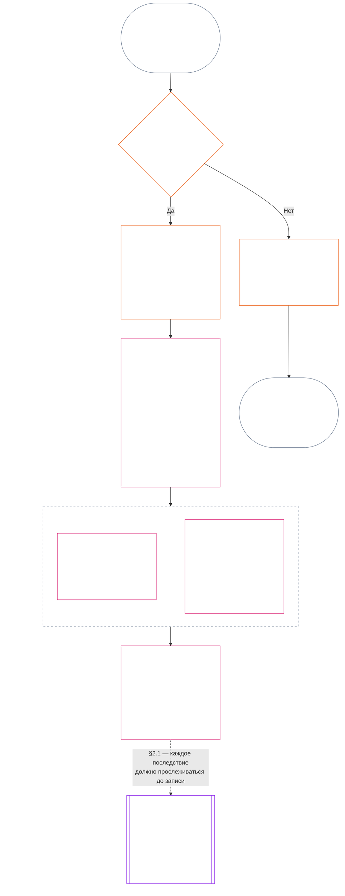

> Черновой перевод с помощью ИИ — язык: русский; источник: commit 9c2c8c10c871d91157bcd27b9f56ad6a1cec90d3; статус: не проверен; частичный охват: Глава одиннадцатая, только §§1–3. Это не полный перевод главы.

### 1. Три вопроса

*Простыми словами: траектория определяется ответами на три вопроса по порядку. Не выводите факты из желаемой оценки и не выбирайте оценку, чтобы оправдать желаемое последствие.*

| Вопрос | Что спрашивает этот вопрос | Где дан ответ |
| --- | --- | --- |
| **1. Что произошло?** | Какие факты проверены, о ком или о чём они, за какой период, и каковы состояние записи траектории и статус оспаривания? | [Раздел 2](#2-question-1--what-happened) и [Раздел 3](#3-question-1-event-type-guide--what-kind-of-help-or-harm-occurred) |
| **2. Насколько это было хорошо или плохо?** | Какой вид и масштаб вклада или нарушения устанавливают эти факты? | [Глава двенадцатая, Раздел 1](core_12.000_standing_measurement.md#1-question-2--how-good-or-bad-was-it) |
| **3. Что из этого следует?** | Какое признание, готовность, средство защиты, гарантия, ограничение или иное последствие вытекает из этого? | [Глава тринадцатая](core_13.000_standing_integration.md#chapter-thirteen-standing-effects-and-integration) |

Каждый вопрос зависит от ответа на предыдущий:

- Вопрос 1 предоставляет проверенные факты для Вопроса 2.
- Вопрос 2 измеряет эти факты для Вопроса 3.
- Вопрос 3 не должен переписывать факты или оценку ради предпочтительного результата.

Ответы на все три вопроса вместе образуют полную оценку траектории для одного ограниченного события или одного определённого паттерна. У субъекта может быть несколько таких оценок с течением времени, и ни одна не является чистым баллом или общей оценкой субъекта. Записи траектории вклада и нарушения сохраняют ответы на Вопросы 1 и 2; решение по Вопросу 3 указывает, что из них следует.

#### 1.1 Цель и охват

Эта глава задаёт конституционную рамку записей, а [Глава двенадцатая](core_12.000_standing_measurement.md#chapter-twelve-standing-measurement--question-2-how-good-or-bad-was-it) — рамку измерения для **систем**, **сентентов** и **институций**, включая каждую систему, классифицированную согласно [**CS-9.305**](corpus_systems/cs_09.305_system_classification_machinery.md#cs-9305-part-a-system-classification-machinery) (*механизм классификации системы*). Эти рамки не измеряют сплетни, популярность, расплывчатую репутацию, присущее достоинство или общую ценность; ничто из этого не является допустимым предметом оценки траектории.

Цепочка траектории должна оставаться действенной, когда:

- ранее проверенные вклады устаревают настолько, что больше не подтверждают текущую компетентность или надёжность;
- нарушения остаются неразрешёнными;
- исправление требует больших затрат;
- ответственность пересекает границы; или
- субъект использует организационную многоуровневость или переименование, чтобы препятствовать подотчётности.

К принятому тексту по реализации относятся:

- повседневные процедуры;
- этапы эскалации;
- операции по возмещению и исправлению;
- меры восстановительной подотчётности; и
- разработка стимулов.

Измерение в Главе двенадцатой само по себе **не** разрешает применение силы, задержание или иное ограничение свободы. Любое такое последствие должно независимо соответствовать требованиям Главы шестой, **Статьи XX** (*Правосудие после проверенного нарушения*), включая требования пропорциональности, наименее ограничительного средства, ограничения по времени, возмещения и восстановительной подотчётности.

<strong>Отслеживание · Определения · Оценка · Соблюдение</strong>

- Предшествующие положения: [Глава первая §16 — Ответственное управление в глубине](core_01.010_stewardship_capacity_principles.md#16-stewardship-in-depth); [Главы со второй по четвёртую](core_02.000_definition_structure.md); [Глава пятая](core_05.000_definitions_home.md#chapter-five-foundational-definitions).
- Последующие положения: [§2](#2-question-1--what-happened) (*Вопрос 1*); [§4](#4-standing-record-operational-requirements) (*требования к проверке и записям*); [§5](#5-record-custody-and-opening-authority) (*хранение записи и полномочия на её открытие*); [§6](#6-handling-a-standing-record) (*обращение с записью траектории*); [Глава двенадцатая §1](core_12.000_standing_measurement.md#1-question-2--how-good-or-bad-was-it) (*измерение по Вопросу 2*); [Глава двенадцатая §2](core_12.000_standing_measurement.md#2-magnitude-and-severity-input-dimensions) (*измерения входных данных для оценки*); [Глава двенадцатая §3](core_12.000_standing_measurement.md#3-route-descriptor-catalogs-and-measurement-roles) (*каталоги дескрипторов маршрутов*); [Глава двенадцатая §4](core_12.000_standing_measurement.md#4-slot-grammar-and-shared-scaling) (*грамматика слотов и общая шкала*); [Глава двенадцатая §5](core_12.000_standing_measurement.md#5-constitutional-inputs-to-axis-assignment) (*конституционные источники для назначения осей*); [Глава двенадцатая §6](core_12.000_standing_measurement.md#6-unified-proportional-lequ-scale--contribution-and-violation-axes) (*единая пропорциональная шкала LEQU для обеих осей*); [Глава тринадцатая](core_13.000_standing_integration.md#chapter-thirteen-standing-effects-and-integration) (*Вопрос 3*).
- [Материальность](core_05.050_band_oversight.md#materiality) · [O](core_05.050_band_oversight.md#materiality) · [M](core_05.050_band_oversight.md#materiality-determination-a) · [A](core_05.050_band_oversight.md#materiality-determination-a) · [C](core_05.050_band_oversight.md#materiality-determination-c)
- [Вред](core_05.035_band_accountability.md#harm) · [O](core_05.035_band_accountability.md#harm) · [M](core_05.035_band_accountability.md#harm-a) · [A](core_05.035_band_accountability.md#harm-a) · [C](core_05.035_band_accountability.md#harm-c)
- [Пропорциональность](core_05.035_band_accountability.md#proportionality) · [O](core_05.035_band_accountability.md#proportionality) · [M](core_05.035_band_accountability.md#proportionality-a) · [A](core_05.035_band_accountability.md#proportionality-a) · [C](core_05.035_band_accountability.md#proportionality-c)

### 2. Вопрос 1 — что произошло?

<strong>Отслеживание</strong>

- Предшествующие положения: [§1](#1-the-three-questions) (*рамка трёх вопросов*); [Главы со второй по четвёртую](core_02.000_definition_structure.md) (*записи, проверка и отслеживаемость определений до результатов*).
- Опоры тетрады: **участие**; **надзор** (оспоримость и пути оспаривания). Главные цели: **Расцвет** и **Преемственность** (отслеживаемые записи, которые сохраняют отдельные выводы о вкладе и нарушении для последующего измерения).
- Последующие положения:
  - [§2.2](#22-silence-is-the-default) (*молчание — значение по умолчанию*);
  - [§2.3](#23-protected-dissent-is-not-a-trigger) (*защищённое несогласие не является триггером*);
  - [§2.4](#24-linked-standing-records-and-no-offset-bridge) (*связанные записи траектории и запрет на взаимозачёт*);
  - [§2.5](#25-verified-input-gate) (*шлюз проверенных входных данных*);
  - [§2.6](#26-stage-boundary) (*граница этапов*);
  - [§2.7](#27-forum-boundary) (*граница форума*);
  - [§3](#3-question-1-event-type-guide--what-kind-of-help-or-harm-occurred) (*справочник типов событий*);
  - [§4](#4-standing-record-operational-requirements) (*требования к записям*);
  - [§5](#5-record-custody-and-opening-authority) (*хранение записи и полномочия на её открытие*);
  - [§6](#6-handling-a-standing-record) (*обращение с записью траектории*);
  - [Глава двенадцатая §1](core_12.000_standing_measurement.md#1-question-2--how-good-or-bad-was-it) (*измерение по Вопросу 2*);
  - [Глава двенадцатая §2](core_12.000_standing_measurement.md#2-magnitude-and-severity-input-dimensions) (*измерения входных данных для оценки*);
  - [Глава двенадцатая §3](core_12.000_standing_measurement.md#3-route-descriptor-catalogs-and-measurement-roles) (*каталоги дескрипторов маршрутов*);
  - [Глава двенадцатая §4](core_12.000_standing_measurement.md#4-slot-grammar-and-shared-scaling) (*грамматика слотов и общая шкала*);
  - [Глава двенадцатая §5](core_12.000_standing_measurement.md#5-constitutional-inputs-to-axis-assignment) (*конституционные источники для назначения осей*);
  - [Глава двенадцатая §6](core_12.000_standing_measurement.md#6-unified-proportional-lequ-scale--contribution-and-violation-axes) (*единая пропорциональная шкала LEQU для обеих осей*);
  - [Глава тринадцатая](core_13.000_standing_integration.md#chapter-thirteen-standing-effects-and-integration) (13.000) (*Вопрос 3*).

 

*Простыми словами: Вопрос 1 устанавливает ограниченное и оспоримое описание того, что произошло. До рассмотрения любой оценки или последствия он определяет субъекта, событие или паттерн, период времени, проверенные факты и статус записи. Подтверждённая помощь и подтверждённые нарушения учитываются в отдельных записях траектории, чтобы одно не стирало другое. Эти записи не являются рейтингами популярности или расплывчатыми ярлыками.*

**Запись траектории** — это ограниченная запись, которую эта глава использует для конкретного субъекта, функционального охвата, периода записи, статуса проверки и контекста принятия решения. До начала измерения она должна устанавливать:

- кого или что касается запись траектории;
- относится ли она к ограниченному событию или определённому паттерну;
- когда и где происходили соответствующее поведение и его последствия;
- какие факты проверены, а какие остаются спорными;
- какие доказательства, атрибуция и путь оспаривания поддерживают выводы; и
- текущий статус проверки, исправления и замещения записи траектории.

На схеме событие прослеживается, чтобы определить, запускает ли оно запись траектории и что эта запись далее содержит; в последующих подразделах изложено каждое правило. Ветка «нет» уходит вправо от основного пути.

#### 2.1 Записи траектории: виды и субъекты

Для подтверждённой помощи Вопрос 1 использует **запись траектории вклада**, а для подтверждённого вреда, включая сбои подотчётности, — **запись траектории нарушения**. Одна запись траектории не объединяет оба вида выводов.

- Запись траектории может касаться сентента, институции, системы, оценки, ограниченного события, роли, коллектива, записи в отношении конкретного субъекта или иной единицы, значимой для Конституции.
  - Она не должна сводить различные субъекты, роли, системы, сообщества, периоды записей, статусы проверки или контексты решений к одному недифференцированному ярлыку траектории.
- Запись траектории может охватывать **ограниченное событие** — один эпизод с ясным началом и концом — или **паттерн** повторяющегося поведения.
  - Для паттерна нужны определённые субъект, охват и период проверки.
- У одного субъекта со временем может быть несколько записей траектории, в том числе связанные записи траектории вклада и нарушения.
  - Если у них общий субъект, перекрывающийся период записи, ограниченное событие, паттерн или контекст решения, связанные записи траектории должны **перекрёстно ссылаться** друг на друга согласно **разделу 4.2**.
- Запись траектории не является самостоятельной оценкой репутации, рангом достоинства, постоянным статусом, ярлыком общей ценности или объединённой таблицей баллов.
  - Операционные требования приведены в **разделе 4**.

Любой последующий эффект траектории относится к Главе тринадцатой и должен прослеживаться до соответствующей записи или записей траектории, не становясь частью самой записи.

#### 2.2 Молчание — значение по умолчанию

Отсутствие записи траектории является обычным состоянием сентента, институции или системы; в таком состоянии останется большинство сентентов.

- Запись траектории открывается только при подтверждении триггера согласно **разделу 4**. Назначенное лицо с полномочием открыть запись должно утвердить внесение, а отдельный хранитель записи должен её внести (**раздел 5**). Запись траектории никогда не открывается:
  - для установления исходного уровня;
  - для заполнения списка; или
  - потому что этого предпочитает назначенный привратник конкретного пути.
- Отсутствие записи траектории ничего не говорит. «Без оценки», «не проверено» и «в деле записи нет» — не доказательства риска, низкого вклада или чего-либо ещё. Никто не вправе использовать отсутствие записи как основание для усиленного контроля, более низкого исходного значения или условного доступа к назначенному пути.
- Ни одна институция или система не вправе требовать запись траектории, подтверждение «записи нет» или согласие на её открытие в качестве условия для:
  - необходимого в соответствии со **Статьёй III** (*Выживание и необходимый доступ*);
  - гарантий **Статьи III-C** (*Труд и экономический минимум*);
  - обычной торговли; или
  - участия в качестве затронутой стороны.
  Исключение составляют опубликованные пороговые требования компетентности для конкретных назначенных путей, чувствительных к доверию, согласно [Главе тринадцатой §6.2 Пороговые требования и допуски](core_13.000_standing_integration.md#62-competency-bars-and-clearances). В них следует указывать, почему данный назначенный путь чувствителен к доверию.
- При открытии записи траектории о субъекте его необходимо уведомить, как требует **раздел 4**. Уведомление допускается отложить только в том случае, если документированная необходимость в [сохранении доказательств](core_05.050_band_oversight.md#evidence-preservation) или безопасности это оправдывает, и только на ограниченный установленный срок. Уведомление делает запись траектории оспоримой: субъект, не знающий о её существовании, не может оспорить или исправить её.

#### 2.3 Защищённое несогласие не является триггером

Несогласие или мирный протест — включая [защищённое ненасильственное гражданское неповиновение](core_06.005_rights_part_b.md#xi-d-nonviolent-civil-disobedience) — согласно **Статье XI-D** (*Собрания, несогласие и мирный протест*) ([*минимальная гарантия для несогласия и мирного протеста*](core_06.005_rights_part_b.md#xi-d-dissent-and-peaceful-protest) не является подтверждённым триггером.

- Оно не открывает, не продлевает и не усугубляет запись траектории нарушения; не является входным параметром тяжести согласно **разделу 8.2**; а его повторение не превращает его в паттерн.
- Отделимое поведение, самостоятельно нарушающее конституционную гарантию, регистрируется на собственных условиях, без усугубления из-за точки зрения, причины или цели протеста.

#### 2.4 Связанные записи траектории и запрет на взаимозачёт

<strong>Отслеживание</strong>

- Предшествующее положение: [§2.1](#21-standing-records-kinds-and-subjects) (*отдельные записи вклада и нарушения*).
- Последующие положения:
  - [§2.5](#25-verified-input-gate) (*шлюз проверенных входных данных*);
  - [§2.7](#27-forum-boundary) (*граница форума*);
  - [§4.2](#42-related-standing-record-cross-references) (*перекрёстные ссылки*);
  - [Глава двенадцатая §1](core_12.000_standing_measurement.md#1-question-2--how-good-or-bad-was-it) (*измерение по Вопросу 2*);
  - [Глава двенадцатая §2](core_12.000_standing_measurement.md#2-magnitude-and-severity-input-dimensions) (*измерения входных данных для оценки*);
  - [Глава двенадцатая §3](core_12.000_standing_measurement.md#3-route-descriptor-catalogs-and-measurement-roles) (*каталоги дескрипторов маршрутов*);
  - [Глава двенадцатая §4](core_12.000_standing_measurement.md#4-slot-grammar-and-shared-scaling) (*грамматика слотов и общая шкала*);
  - [Глава двенадцатая §5](core_12.000_standing_measurement.md#5-constitutional-inputs-to-axis-assignment) (*конституционные источники для назначения осей*);
  - [Глава двенадцатая §6](core_12.000_standing_measurement.md#6-unified-proportional-lequ-scale--contribution-and-violation-axes) (*единая пропорциональная шкала LEQU для обеих осей*);
  - [Глава тринадцатая](core_13.000_standing_integration.md#chapter-thirteen-standing-effects-and-integration) (13.000) (*Вопрос 3*).
- Читать вместе с: [Глава тринадцатая — интеграция траектории](core_13.000_standing_integration.md#2-automatic-integration-review-and-continuity) (13.000) (*неотказ от требований и интеграция связанных записей*); [Глава тринадцатая §6.2 — пороговые требования и допуски](core_13.000_standing_integration.md#62-competency-bars-and-clearances) (13.000 §6.2); [Глава тринадцатая §4.2 — блокировки траектории](core_13.000_standing_integration.md#42-prevention--general-standing-locks) (13.000 §4.2).

 

**Основное правило:** подтверждённые **записи траектории вклада** и подтверждённые **записи траектории нарушения** хранятся отдельно согласно **разделу 2.1**. Каждый вывод о вкладе или нарушении должен основываться на собственных подтверждённых фактах в собственной записи траектории. Анализ и подтверждающие материалы должны сохранять отдельную отслеживаемость двух путей записей. Ни одна отдельная запись или связанный набор не является чистым баллом, смешанным баллом или обменом.

- **Записи траектории нарушения и блокировки траектории:**
  - Согласно Главе тринадцатой применимые **блокировки траектории**, выведенные из записей траектории нарушения, могут ограничивать траекторию, ограничивать пригодность к ролям или влиять на доступ к средствам защиты, пока подтверждённое нарушение остаётся неразрешённым.
  - Блокировки траектории не должны стирать подтверждённый положительный вклад, записанный в записях траектории вклада.
  - Неурегулированные подтверждённые нарушения не обесцениваются только из-за течения времени.
  - Подтверждённые нарушения не должны превращать не связанные с ними записи траектории вклада в ложное негативное досье репутации.
- **Записи траектории вклада и допуски компетентности:**
  - Подтверждённый вклад может поддерживать применимые **допуски компетентности** относительно опубликованных **пороговых требований компетентности** и поддерживать право на допуск, связанное с доверием, ролью или признанием, если он актуален и относится к роли.
  - Подтверждённый вклад не должен взаимозачитывать, снижать усреднением, оправдывать или переименовывать вывод о подтверждённом нарушении.
  - Выполнение условий шлюза не отменяет применимую блокировку траектории.

**Единственное исключение:** если вывод о нарушении сам опровергает заявленный вклад — например, доказательства показывают, что вы не сделали то, что указано в записи о вашем вкладе, — связанную запись траектории вклада можно исправить или удалить посредством надлежащего процесса работы с доказательствами и проверки, с обязательной перекрёстной ссылкой согласно **разделу 4.2**. Но нарушение не стирает автоматически не связанную с ним помощь, записанную в отдельных записях траектории вклада.

#### 2.5 Шлюз проверенных входных данных

Шлюз действует следующим образом:

- Любое решение, затрагивающее траекторию, доверие, роль, признание или право на признание, может использовать только проверенные входные данные из соответствующих **записей траектории вклада** или **записей траектории нарушения**.
- Обвинения, нерассмотренные утверждения, предварительные маршрутизирующие теги, рассказы только на этапе приёма и другие материалы стадии спора сами по себе не устанавливают для траектории характер вклада или нарушения.
- Проверенный входной элемент — это **вывод о траектории**: подтверждённый вывод о вкладе (Ось I) или подтверждённый вывод о нарушении (Ось II).
- Выводы о вкладе и нарушении остаются в отдельных записях траектории (см. **раздел 2.1**).

#### 2.6 Граница этапов

Этапы записи траектории остаются раздельными:

- Вопрос 1 фиксирует проверенные факты; Вопрос 2 измеряет их.
- Запись траектории может быть открыта после завершения проверенной фактической основы, даже если измерение по Вопросу 2 ещё ожидается.
- До проведения измерения в полях Вопроса 2 следует указать, что оно ожидается, а не подразумевать слот или категорию.
- Запись траектории не должна указывать или применять **эффект траектории** Вопроса 3.

#### 2.7 Граница форума

*Простыми словами: форумы — это места, где споры контролируются, оспариваются и преобразуются в проверенные результаты, — но подача дела или победа в споре о нарративе не обновляет траекторию. Шлюз проверенных входных данных из **раздела 2.5** продолжает действовать. Когда форум проверяет факты согласно Главам со второй по четвёртую, он может **открыть, обновить или исправить** запись траектории — или **отменить ошибочную запись после оспаривания**. Форумы не объединяют хорошее и плохое в один балл и не изобретают категорию траектории самостоятельно.*

Этот раздел отвечает на один вопрос: как работа форума влияет на запись траектории. Остальные этапы цепочки принадлежат указанным здесь ответственным сторонам, а сама цепочка проходит в таком порядке:

1. Подаётся спор, и форум ведёт **запись дела форума**, которая не является записью траектории. Ответственный: [Глава пятнадцатая §2.3 Записи дел форума, записи траектории и оспаривания](core_15.000_forum.md#23-forum-case-records-standing-records-and-contests); см. также [§2.7.1 Запись дела форума](#271-forum-case-record).
2. Форум проверяет факты согласно [Главам со второй по четвёртую](core_02.000_definition_structure.md).
3. Проверенные выводы проходят шлюз проверенных входных данных. Ответственный: [§2.5 Шлюз проверенных входных данных](#25-verified-input-gate).
4. Назначенный орган с полномочием открыть запись, которым может быть форум, открывает, обновляет или исправляет запись траектории либо отменяет ошибочную запись после оспаривания. За содержание записи отвечает [§4.1 Минимальное содержание записи](#41-minimum-record-contents), а за лиц, уполномоченных действовать, — [§5 Хранение записи и полномочия на её открытие](#5-record-custody-and-opening-authority).
5. Запись траектории содержит только проверенные факты, которые затем измеряются по Вопросу 2. Ответственные: [§2.6 Граница этапов](#26-stage-boundary) и [Глава двенадцатая §1 Вопрос 2 — насколько это было хорошо или плохо?](core_12.000_standing_measurement.md#1-question-2--how-good-or-bad-was-it).
6. Если возникает эффект траектории, он следует согласно [Главе тринадцатой](core_13.000_standing_integration.md#chapter-thirteen-standing-effects-and-integration), которая отвечает за эффекты траектории.

Семейства форумов в соответствии с [Главой пятнадцатой](core_15.000_forum.md#chapter-fifteen-forums-and-jurisdiction) **надзирают** за тем, как конкретные споры проходят цепочку траектории. Согласно [Главе пятнадцатой §6 Своевременное разрешение, уровни материальности и дисциплина против задержек](core_15.000_forum.md#6-timely-resolution-materiality-tiers-and-anti-delay-discipline) и [Статье XXVI-C](core_06.020_rights_part_e.md#article-xxvi-c-timely-resolution-and-anti-delay-floor) (*Своевременное разрешение и гарантия против задержек*), форумы обеспечивают:

- доступную возможность оспаривания;
- независимую проверку;
- судебно-техническую поддержку;
- последовательность устранения последствий; и
- сроки по уровням.

Если выводы форума удовлетворяют шлюзу проверенных входных данных согласно Главам со второй по четвёртую, они могут:

- **открыть, обновить или исправить** записи траектории согласно **разделу 4.1**; или
- **отменить ошибочную запись после оспаривания**.

##### 2.7.1 Запись дела форума

Собственное дело форума об открытом споре — это [**запись дела форума**](core_05.035_band_accountability.md#forum-case-record), определённая в [Главе пятнадцатой §2.3 Записи дел форума, записи траектории и оспаривания](core_15.000_forum.md#23-forum-case-records-standing-records-and-contests). Это **не** запись траектории.

##### 2.7.2 Выводы форума и измерение по Вопросу 2

Проверенные фактические выводы форума могут предоставить фактическую основу для записи траектории по Вопросу 1. Они **не** определяют измерение по Вопросу 2 — насколько хорошим или плохим был подтверждённый вклад или нарушение ([§2.6 Граница этапов](#26-stage-boundary)). Соответственно:

- В разбирательствах форума нельзя **объединять** материалы о вкладе и нарушении в один чистый балл, смешанный ответ по существу или недифференцированный ярлык траектории; связанные записи траектории остаются раздельными согласно [§2.1 Записи траектории: виды и субъекты](#21-standing-records-kinds-and-subjects) и [§2.4 Связанные записи траектории и запрет на взаимозачёт](#24-linked-standing-records-and-no-offset-bridge).
- Результаты форума не должны заменять доказуемые проверенные входные данные ([§2.5 Шлюз проверенных входных данных](#25-verified-input-gate)), отдельное измерение ([Глава двенадцатая §1 Вопрос 2 — насколько это было хорошо или плохо?](core_12.000_standing_measurement.md#1-question-2--how-good-or-bad-was-it)) или механизмы эффектов траектории, за которые отвечает [Глава тринадцатая](core_13.000_standing_integration.md#chapter-thirteen-standing-effects-and-integration), рассказами о споре, удобством маршрутизации или предпочтением коллегии.

##### 2.7.3 Что граница форума не уменьшает

Эта граница **не** уменьшает возможности оспаривания, средства защиты, временные меры или процессуальные гарантии, предусмотренные:

- [Статьёй XIII-A](core_06.010_rights_part_c.md#article-xiii-a-reliability-and-trustworthiness-baseline) (*базовый уровень надёжности и добросовестности*);
- [Статьёй XIII-B](core_06.010_rights_part_c.md#article-xiii-b-right-to-redress-and-remedy) (*право на возмещение и средство защиты*);
- [Главой пятнадцатой §6 Своевременное разрешение, уровни материальности и дисциплина против задержек](core_15.000_forum.md#6-timely-resolution-materiality-tiers-and-anti-delay-discipline);
- [Статьёй XXVI-C](core_06.020_rights_part_e.md#article-xxvi-c-timely-resolution-and-anti-delay-floor) (*Своевременное разрешение и гарантия против задержек*); или
- связанными статьями о правосудии.

Она требует, чтобы проверенные выводы форума входили в траекторию через те же ворота, что и другие проверенные входные данные, — а не в обход них.

### 3. Справочник типов событий Вопроса 1 — какая помощь или вред имели место?

*Простыми словами: используйте эти таблицы, чтобы описать, что произошло после проверки фактов. Они помогают определить вид соответствующего вклада или нарушения. Они не определяют, насколько это было хорошо или плохо, не назначают слот и не устанавливают последующие последствия.*

#### 3.1 Типы событий вклада

**Правило квалификации:** заявленный вклад учитывается только тогда, когда его можно отследить, он не переносит вред на других и в целом согласуется с действующей Конституцией.

- Перенесённый на других вред, принудительная зависимость, сужение Пола прав или скрытое бремя могут лишить заявленный вклад оснований или ограничить его.
- Заявленный вклад не взаимозачитывает отдельный вывод о нарушении.

Каждая строка таблицы ниже называет распространённый путь подтверждённой помощи и его конституционную значимость. К одной записи траектории может относиться более одной строки.

| Тип подтверждённого вклада | Что произошло | Опора или опоры тетрады | Главная цель или цели |
| --- | --- | --- | --- |
| Выживание и поддержание тела | Кто-то получил пищу, жильё, медицинскую помощь или безопасность | **Участие**, **Надзор** | **Расцвет** |
| Уход и обучение | Воспитывали детей, заботились о пожилых или обучали других | **Участие**, **Надзор** | **Расцвет**, **Преемственность** |
| Устранение травмы | Кто-то получил помощь в восстановлении после психологического вреда, мешавшего благополучию | **Участие**, **Подотчётность** | **Расцвет** |
| Устранение тяжёлого бремени | Были устранены сокрушительный долг, эксплуатационные условия труда или системные барьеры | **Участие**, **Надзор** | **Расцвет** |
| Восстановление самостоятельности | Кто-то получил значимые возможности выбора в собственной жизни | **Участие** | **Расцвет** |
| Расширение производительных возможностей | Инструменты, инфраструктура или возможности позволили другим процветать самостоятельно | **Участие**, **Надзор** | **Расцвет**, **Преемственность** |
| Повышение эффективности времени | Сократились предотвратимое ожидание, административные трения или накладные расходы на координацию, вернув полезное время для ухода, отдыха, самостоятельности, обучения или работы, соответствующей правам | **Участие**, **Надзор** | **Расцвет** |
| Снижение экологического или инфраструктурного риска | Предотвращены экологический коллапс или отказ критически важной системы | **Надзор**, **Подотчётность** | **Преемственность**, **Расцвет** |
| Сокращение экологического следа | Использование ресурсов, выбросы или потребность в земле и воде проверяемым образом сократились без переноса бремени на других или экосистемы | **Надзор**, **Подотчётность** | **Преемственность**, **Расцвет** |
| Восстановление экосистем | Деградировавшие земли, воды или места обитания восстановлены до функционального, самоподдерживающегося состояния | **Надзор**, **Подотчётность** | **Преемственность**, **Расцвет** |
| Защита исчезающих видов | Виды, которым грозит вымирание, или места их обитания защищены от утраты | **Надзор**, **Подотчётность** | **Преемственность**, **Расцвет** |
| Сокращение загрязнения и отходов | Загрязнение, вредные выбросы или отходы были предотвращены, удалены или безопасно обработаны | **Надзор**, **Подотчётность** | **Расцвет**, **Преемственность** |
| Укрепление безопасности, истины, аудируемости или способности оспаривать | Институции или практики созданы либо восстановлены для защиты прав и привлечения власти к ответственности | **Участие**, **Надзор**, **Подотчётность** | **Расцвет**, **Преемственность** |

#### 3.2 Типы событий нарушения

**Правило квалификации:** тип события нарушения требует подтверждённого вывода о нарушении, который остаётся отслеживаемым, ограниченным, проверяемым и оспоримым согласно **Главам со второй по четвёртую**.

- Обвинения, предварительные теги, рассказы форума и входные метки могут помогать маршрутизации или первичной сортировке, но они не завершают Вопрос 1.
- Положительный вклад не взаимозачитывает, не оправдывает, не отменяет и не переименовывает подтверждённое нарушение.

Каждая строка таблицы ниже называет распространённый путь подтверждённой утраты, опасности или неисполнения обязанности и его конституционную значимость. К одной записи траектории может относиться более одной строки.

| Тип подтверждённой утраты или опасности | Что произошло | Опора или опоры тетрады | Главная цель или цели |
| --- | --- | --- | --- |
| Лишение необходимого для выживания или поддержания тела | Произошла предотвратимая смерть, отказ в помощи, небезопасные условия или материальное лишение необходимого для выживания | **Подотчётность**, **Участие** | **Расцвет** |
| Тяжёлое предотвратимое бремя | Сокрушительное, навязанное или систематически переложенное бремя существенно ухудшило благополучие или самостоятельность | **Подотчётность**, **Участие** | **Расцвет** |
| Принудительная утрата самостоятельности | Произошли принуждение, манипуляция, заслуживающая доверия угроза, заключение или угроза свободе | **Подотчётность**, **Участие** | **Расцвет** |
| Лишение Пола прав | Были существенно нарушены не подлежащие обсуждению конституционные гарантии, верховенство Конституции или доступ к оспариванию и средствам защиты | **Подотчётность**, **Надзор** | **Расцвет**, **Преемственность** |
| Экологический ущерб или повреждение инфраструктуры | Были повреждены условия, необходимые для конституционного благополучия | **Подотчётность**, **Надзор** | **Преемственность**, **Расцвет** |
| Вред от загрязнения или отходов | Загрязнение, вредные выбросы или отходы причинили вред воздуху, воде, почве или здоровью | **Подотчётность**, **Надзор** | **Расцвет**, **Преемственность** |
| Уничтожение видов или мест обитания | Виды под угрозой вымирания или места их обитания были уничтожены, фрагментированы либо доведены до утраты; включая утрату, которую считали подлежащей взаимозачёту | **Подотчётность**, **Надзор** | **Преемственность**, **Расцвет** |
| Утрата способности экосистемы к восстановлению | Способность экосистемы возрождаться после вреда была исключена либо её обращение вспять было сделано неоправданно трудным или невозможным | **Подотчётность**, **Надзор** | **Преемственность**, **Расцвет** |
| Перенесённый на других экологический вред или истощение | Экологические издержки переложены на других или экосистемы, ресурсы истощены сверх способности к восстановлению либо утверждение об экологическом следе или устойчивости скрыло продолжающееся ухудшение | **Подотчётность**, **Надзор** | **Преемственность**, **Расцвет** |
| Уничтожение производительных возможностей | Были исключены необходимые для независимого процветания инструменты, способности, отношения или ресурсы | **Подотчётность** | **Расцвет** |
| Ухудшение безопасности, истины или аудируемости | Произошли сокрытие, дезинформация, порча записей, недоступные пути оспаривания или агрегирование, не поддающееся проверке | **Надзор**, **Подотчётность** | **Расцвет**, **Преемственность** |
| Препятствование подотчётности | Произошло подтверждённое вмешательство в механизмы ответа за действия — целостность доказательств, проверку, процесс форума, записи траектории, сроки средств защиты или пути оспаривания и возмещения; если препятствие является метаатакой на отдельный базовый вред, откройте отдельную связанную запись траектории нарушения | **Подотчётность**, **Надзор**, **Своевременность** | **Расцвет**, **Преемственность** |
| Захват системы или злоупотребление зависимостью | Произошло структурное обеспечение, злоупотребление асимметрией зависимости, проектирование против уклонения или захват путей подотчётности | **Подотчётность**, **Участие** | **Преемственность**, **Расцвет** |
