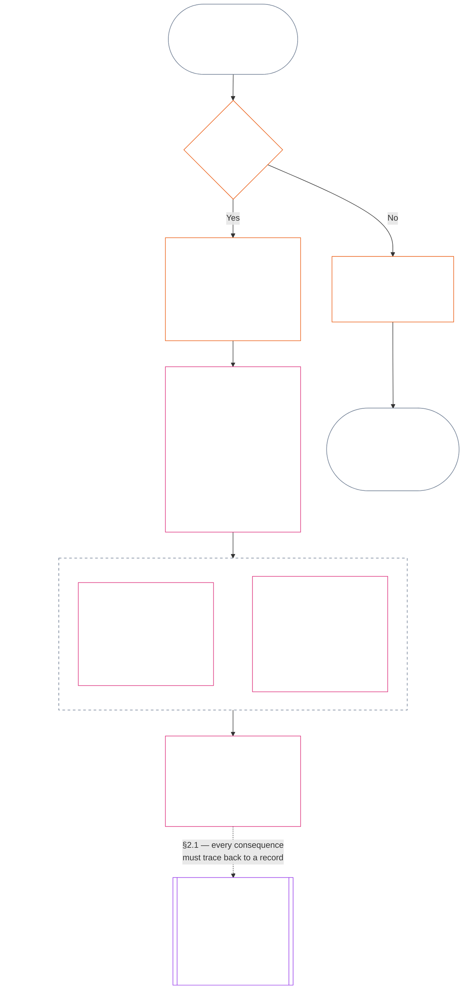
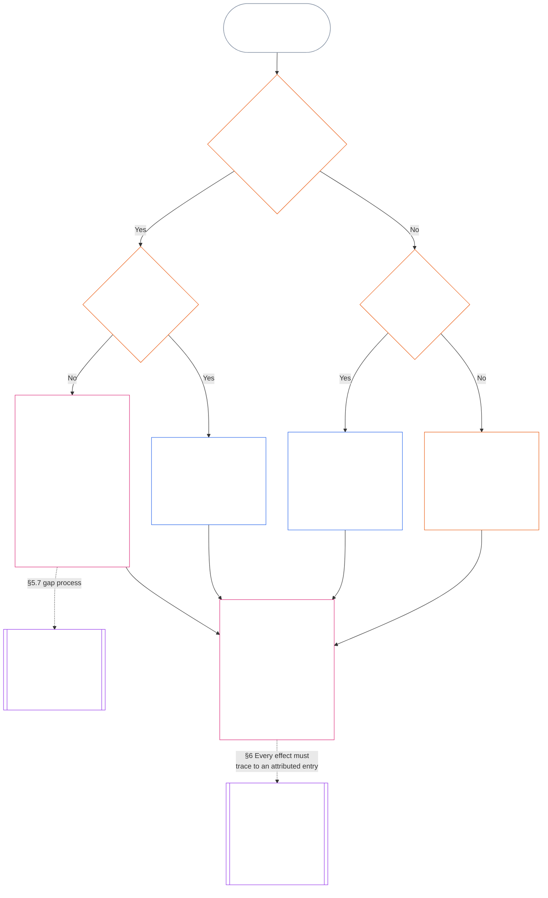

<!-- Locale: Russian (ru) | Full Chapter Eleven draft | Source commit: 9c2c8c10c871d91157bcd27b9f56ad6a1cec90d3 | AI-drafted, unreviewed, non-binding draft -->

# ГЛАВА ОДИННАДЦАТАЯ: ЗАПИСИ О СТАТУСЕ — ВОПРОС 1: ЧТО ПРОИЗОШЛО

<strong>Место в корпусе (неоперативное): структура файла и правила чтения</strong>

> Этот файл — **часть Конституции сентентов** и **обязателен только вместе** с другими пронумерованными файлами `core_*`, читаемыми как единый текст. В нём изложена **Глава одиннадцатая**: три вопроса цепочки установления статуса и **Вопрос 1** (*что произошло?*) в **§§1–6**. На **Вопрос 2** (*насколько это было хорошо или плохо?*) отвечает [Глава двенадцатая](core_12.000_standing_measurement.md#chapter-twelve-standing-measurement--question-2-how-good-or-bad-was-it). Вопрос 3 (*что происходит вследствие этого?*) продолжается в [Главе тринадцатой](core_13.000_standing_integration.md#chapter-thirteen-standing-effects-and-integration); рассмотрение ограничено обозначением антиконституционного проступка в [Главе четырнадцатой](core_14.000_misconduct_designation.md#chapter-fourteen-anti-constitutional-misconduct) для отвечающих критериям выводов по Violation Axis `s` = 7–9. Порядок чтения, разделение обязательного и вспомогательного материала и метаданные издания корпуса указаны в [README.md](README.md).

<strong>Руководство читателю (неоперативное): место Главы одиннадцатой и что остаётся здесь</strong>

> | Вопрос | Владелец и роль |
> | --- | --- |
> | **1. Что произошло?** | Глава одиннадцатая (этот файл): установить проверенные факты в ограниченной и оспоримой записи о статусе. |
> | **2. Насколько это было хорошо или плохо?** | [Глава двенадцатая](core_12.000_standing_measurement.md#chapter-twelve-standing-measurement--question-2-how-good-or-bad-was-it): измерить проверенные факты, не объединяя помощь и вред. |
> | **3. Что происходит вследствие этого?** | Перейти к [Главе тринадцатой](core_13.000_standing_integration.md#chapter-thirteen-standing-effects-and-integration). |
>
> Обвинения, популярность и версии спора не отвечают на Вопрос 1. Желаемый рейтинг не может предоставить факты для Вопроса 1, а желаемое последствие — рейтинг для Вопроса 2.

<strong>Прослеживаемость</strong>

- Предшествующие источники:
  - [Конституционная тетрада](core_00.000_preamble.md#constitutional-tetrad);
  - [Две конституционные цели](core_00.000_preamble.md#two-constitutional-aims);
  - [материальная ставка](core_00.000_preamble.md#material-stake);
  - [Преамбула §6 Ключевые практические цепочки процессов](core_00.000_preamble.md#6-key-practical-process-pipelines) (*цепочка Глав с девятой по пятнадцатую*).
- Предшествующие источники:
  - [Глава первая](core_01.010_stewardship_capacity_principles.md#chapter-01-principles-and-constraints) (1.010) (*ответственное управление доступностью простого языка отражено в пояснениях к отдельным разделам*);
  - [Глава первая §16 — Ответственное управление в глубину](core_01.010_stewardship_capacity_principles.md#16-stewardship-in-depth) (1.010 §16) (*основание на уровне принципов для компетентности и прослеживаемого статуса — доверие, роли и признание*);
  - [Главы вторая — четвёртая](core_02.000_definition_structure.md) (*целостность, записи и проверка*);
  - [Глава пятая](core_05.000_definitions_home.md#chapter-five-foundational-definitions) (5.000) (*определения и верховенство, читаемые вместе с Главами второй — четвёртой*).
- Предшествующий источник: [Глава девятая](core_09.000_system_alignment_certification_evaluation.md#chapter-nine-system-alignment-certification) (9.000) (*сертификация согласованности системы*); [Глава девятая, часть C §11](core_09.010_system_alignment_certification_record_recertification.md#11-relationship-to-standing) (9.010 §11) (*связь со статусом — только потенциальные проверенные входные данные*).
- Цепочка установления статуса:
  - [Преамбула §6.2 Как работает вся цепочка](core_00.000_preamble.md#62-how-the-full-chain-fits-together);
  - [Глава одиннадцатая — Записи о статусе](core_11.000_standing_assessment.md#chapter-eleven-standing-records--question-1-what-happened) (11.000) (*рамка трёх вопросов и записи Вопроса 1*);
  - [Глава двенадцатая — Измерение статуса](core_12.000_standing_measurement.md#chapter-twelve-standing-measurement--question-2-how-good-or-bad-was-it) (12.000) (*измерение Вопроса 2*);
  - [Глава тринадцатая — Последствия статуса и интеграция](core_13.000_standing_integration.md#chapter-thirteen-standing-effects-and-integration) (13.000) (*последствия Вопроса 3 и интеграция*);
  - [Глава четырнадцатая](core_14.000_misconduct_designation.md#chapter-fourteen-anti-constitutional-misconduct) (14.000) (*обозначение только для отвечающих критериям выводов Violation Axis `s` = 7–9*).
- Подразделы этого файла:
  - [§1](#1-the-three-questions) (*рамка трёх вопросов и область охвата*);
  - [§2](#2-question-1--what-happened) (*Вопрос 1 — проверенные факты и записи*);
  - [§3](#3-question-1-event-type-guide--what-kind-of-help-or-harm-occurred) (*справочник типов событий Вопроса 1 — виды помощи и вреда*);
  - [§4](#4-standing-record-operational-requirements) (*проверка и требования к записи*);
  - [§5](#5-record-custody-and-opening-authority) (*хранение записи и полномочие на её открытие*);
  - [§6](#6-handling-a-standing-record) (*обращение с записью о статусе*);
- Последующие источники:
  - [Глава двенадцатая](core_12.000_standing_measurement.md#chapter-twelve-standing-measurement--question-2-how-good-or-bad-was-it) (12.000) (*Вопрос 2 — базовый уровень LEQU, измерительные параметры, каталоги дескрипторов маршрутов, грамматика слотов, конституционные источники, шкала LEQU, стандартные меры вклада, примеры и переход к Вопросу 3*);
  - [Глава четырнадцатая](core_14.000_misconduct_designation.md#chapter-fourteen-part-a-anti-constitutional-misconduct-designation) (14.000) (*только обозначение — измерение Вопроса 2 не пересматривается*);
  - [Глава пятнадцатая](core_15.000_forum.md#chapter-fifteen-forums-and-jurisdiction) (15.000) (*надзор форумов и маршрутизация*);
  - [Статья XXVI-C](core_06.020_rights_part_e.md#article-xxvi-c-timely-resolution-and-anti-delay-floor) (*своевременное разрешение*);
  - [Статья XX](core_06.015_rights_part_d.md#article-xx-a-justice-objective-and-scope) (*ограничения правосудия*).
- Читать вместе с: [Глава пятая *Состояние статуса, вклад и нарушение*](core_05.035_band_accountability.md#defa3-standing-state-contribution-and-violation) (5.035) (*маршрутизация к каноническим определениям*).
- Читать вместе с: [README.md](README.md) (*порядок чтения*); [doc_architecture.md](doc_architecture.md) (*необязательные редакционные карты, если они не приняты*).

 

Глава одиннадцатая — конституционный источник **проверенной фактической записи (Вопрос 1)**. Она охватывает [§1 Три вопроса](#1-the-three-questions) — [§6 Обращение с записью о статусе](#6-handling-a-standing-record). [Глава двенадцатая](core_12.000_standing_measurement.md#chapter-twelve-standing-measurement--question-2-how-good-or-bad-was-it) регулирует Вопрос 2: от [Главы двенадцатой §1 Вопрос 2 — насколько это было хорошо или плохо?](core_12.000_standing_measurement.md#1-question-2--how-good-or-bad-was-it) до [Главы двенадцатой §9 Переход к Вопросу 3 — связи между вопросами при измерении](core_12.000_standing_measurement.md#9-hand-off-to-question-3--cross-question-measurement-hooks). Вопрос 3 продолжается в Главе тринадцатой.

*Простыми словами: эта глава фиксирует, что произошло, и хранит запись о статусе. Насколько это было хорошо или вредно, измеряется в Главе двенадцатой по двум отдельным направлениям, которые никогда не сводятся к единому чистому баллу. Само по себе возбуждение дела не создаёт статус.*

### 1. Три вопроса

*Простыми словами: траектория определяется ответами на три вопроса по порядку. Не выводите факты из желаемой оценки и не выбирайте оценку, чтобы оправдать желаемое последствие.*

| Вопрос | Что спрашивает этот вопрос | Где дан ответ |
| --- | --- | --- |
| **1. Что произошло?** | Какие факты проверены, о ком или о чём они, за какой период, и каковы состояние записи траектории и статус оспаривания? | [Раздел 2](#2-question-1--what-happened) и [Раздел 3](#3-question-1-event-type-guide--what-kind-of-help-or-harm-occurred) |
| **2. Насколько это было хорошо или плохо?** | Какой вид и масштаб вклада или нарушения устанавливают эти факты? | [Глава двенадцатая, Раздел 1](core_12.000_standing_measurement.md#1-question-2--how-good-or-bad-was-it) |
| **3. Что из этого следует?** | Какое признание, готовность, средство защиты, гарантия, ограничение или иное последствие вытекает из этого? | [Глава тринадцатая](core_13.000_standing_integration.md#chapter-thirteen-standing-effects-and-integration) |

Каждый вопрос зависит от ответа на предыдущий:

- Вопрос 1 предоставляет проверенные факты для Вопроса 2.
- Вопрос 2 измеряет эти факты для Вопроса 3.
- Вопрос 3 не должен переписывать факты или оценку ради предпочтительного результата.

Ответы на все три вопроса вместе образуют полную оценку траектории для одного ограниченного события или одного определённого паттерна. У субъекта может быть несколько таких оценок с течением времени, и ни одна не является чистым баллом или общей оценкой субъекта. Записи траектории вклада и нарушения сохраняют ответы на Вопросы 1 и 2; решение по Вопросу 3 указывает, что из них следует.

#### 1.1 Цель и охват

Эта глава задаёт конституционную рамку записей, а [Глава двенадцатая](core_12.000_standing_measurement.md#chapter-twelve-standing-measurement--question-2-how-good-or-bad-was-it) — рамку измерения для **систем**, **сентентов** и **институций**, включая каждую систему, классифицированную согласно [**CS-9.305**](corpus_systems/cs_09.305_system_classification_machinery.md#cs-9305-part-a-system-classification-machinery) (*механизм классификации системы*). Эти рамки не измеряют сплетни, популярность, расплывчатую репутацию, присущее достоинство или общую ценность; ничто из этого не является допустимым предметом оценки траектории.

Цепочка траектории должна оставаться действенной, когда:

- ранее проверенные вклады устаревают настолько, что больше не подтверждают текущую компетентность или надёжность;
- нарушения остаются неразрешёнными;
- исправление требует больших затрат;
- ответственность пересекает границы; или
- субъект использует организационную многоуровневость или переименование, чтобы препятствовать подотчётности.

К принятому тексту по реализации относятся:

- повседневные процедуры;
- этапы эскалации;
- операции по возмещению и исправлению;
- меры восстановительной подотчётности; и
- разработка стимулов.

Измерение в Главе двенадцатой само по себе **не** разрешает применение силы, задержание или иное ограничение свободы. Любое такое последствие должно независимо соответствовать требованиям Главы шестой, **Статьи XX** (*Правосудие после проверенного нарушения*), включая требования пропорциональности, наименее ограничительного средства, ограничения по времени, возмещения и восстановительной подотчётности.

<strong>Отслеживание · Определения · Оценка · Соблюдение</strong>

- Предшествующие положения: [Глава первая §16 — Ответственное управление в глубине](core_01.010_stewardship_capacity_principles.md#16-stewardship-in-depth); [Главы со второй по четвёртую](core_02.000_definition_structure.md); [Глава пятая](core_05.000_definitions_home.md#chapter-five-foundational-definitions).
- Последующие положения: [§2](#2-question-1--what-happened) (*Вопрос 1*); [§4](#4-standing-record-operational-requirements) (*требования к проверке и записям*); [§5](#5-record-custody-and-opening-authority) (*хранение записи и полномочия на её открытие*); [§6](#6-handling-a-standing-record) (*обращение с записью траектории*); [Глава двенадцатая §1](core_12.000_standing_measurement.md#1-question-2--how-good-or-bad-was-it) (*измерение по Вопросу 2*); [Глава двенадцатая §2](core_12.000_standing_measurement.md#2-magnitude-and-severity-input-dimensions) (*измерения входных данных для оценки*); [Глава двенадцатая §3](core_12.000_standing_measurement.md#3-route-descriptor-catalogs-and-measurement-roles) (*каталоги дескрипторов маршрутов*); [Глава двенадцатая §4](core_12.000_standing_measurement.md#4-slot-grammar-and-shared-scaling) (*грамматика слотов и общая шкала*); [Глава двенадцатая §5](core_12.000_standing_measurement.md#5-constitutional-inputs-to-axis-assignment) (*конституционные источники для назначения осей*); [Глава двенадцатая §6](core_12.000_standing_measurement.md#6-unified-proportional-lequ-scale--contribution-and-violation-axes) (*единая пропорциональная шкала LEQU для обеих осей*); [Глава тринадцатая](core_13.000_standing_integration.md#chapter-thirteen-standing-effects-and-integration) (*Вопрос 3*).
- [Материальность](core_05.050_band_oversight.md#materiality) · [O](core_05.050_band_oversight.md#materiality) · [M](core_05.050_band_oversight.md#materiality-determination-a) · [A](core_05.050_band_oversight.md#materiality-determination-a) · [C](core_05.050_band_oversight.md#materiality-determination-c)
- [Вред](core_05.035_band_accountability.md#harm) · [O](core_05.035_band_accountability.md#harm) · [M](core_05.035_band_accountability.md#harm-a) · [A](core_05.035_band_accountability.md#harm-a) · [C](core_05.035_band_accountability.md#harm-c)
- [Пропорциональность](core_05.035_band_accountability.md#proportionality) · [O](core_05.035_band_accountability.md#proportionality) · [M](core_05.035_band_accountability.md#proportionality-a) · [A](core_05.035_band_accountability.md#proportionality-a) · [C](core_05.035_band_accountability.md#proportionality-c)

### 2. Вопрос 1 — что произошло?

<strong>Отслеживание</strong>

- Предшествующие положения: [§1](#1-the-three-questions) (*рамка трёх вопросов*); [Главы со второй по четвёртую](core_02.000_definition_structure.md) (*записи, проверка и отслеживаемость определений до результатов*).
- Опоры тетрады: **участие**; **надзор** (оспоримость и пути оспаривания). Главные цели: **Расцвет** и **Преемственность** (отслеживаемые записи, которые сохраняют отдельные выводы о вкладе и нарушении для последующего измерения).
- Последующие положения:
  - [§2.2](#22-silence-is-the-default) (*молчание — значение по умолчанию*);
  - [§2.3](#23-protected-dissent-is-not-a-trigger) (*защищённое несогласие не является триггером*);
  - [§2.4](#24-linked-standing-records-and-no-offset-bridge) (*связанные записи траектории и запрет на взаимозачёт*);
  - [§2.5](#25-verified-input-gate) (*шлюз проверенных входных данных*);
  - [§2.6](#26-stage-boundary) (*граница этапов*);
  - [§2.7](#27-forum-boundary) (*граница форума*);
  - [§3](#3-question-1-event-type-guide--what-kind-of-help-or-harm-occurred) (*справочник типов событий*);
  - [§4](#4-standing-record-operational-requirements) (*требования к записям*);
  - [§5](#5-record-custody-and-opening-authority) (*хранение записи и полномочия на её открытие*);
  - [§6](#6-handling-a-standing-record) (*обращение с записью траектории*);
  - [Глава двенадцатая §1](core_12.000_standing_measurement.md#1-question-2--how-good-or-bad-was-it) (*измерение по Вопросу 2*);
  - [Глава двенадцатая §2](core_12.000_standing_measurement.md#2-magnitude-and-severity-input-dimensions) (*измерения входных данных для оценки*);
  - [Глава двенадцатая §3](core_12.000_standing_measurement.md#3-route-descriptor-catalogs-and-measurement-roles) (*каталоги дескрипторов маршрутов*);
  - [Глава двенадцатая §4](core_12.000_standing_measurement.md#4-slot-grammar-and-shared-scaling) (*грамматика слотов и общая шкала*);
  - [Глава двенадцатая §5](core_12.000_standing_measurement.md#5-constitutional-inputs-to-axis-assignment) (*конституционные источники для назначения осей*);
  - [Глава двенадцатая §6](core_12.000_standing_measurement.md#6-unified-proportional-lequ-scale--contribution-and-violation-axes) (*единая пропорциональная шкала LEQU для обеих осей*);
  - [Глава тринадцатая](core_13.000_standing_integration.md#chapter-thirteen-standing-effects-and-integration) (13.000) (*Вопрос 3*).

 

*Простыми словами: Вопрос 1 устанавливает ограниченное и оспоримое описание того, что произошло. До рассмотрения любой оценки или последствия он определяет субъекта, событие или паттерн, период времени, проверенные факты и статус записи. Подтверждённая помощь и подтверждённые нарушения учитываются в отдельных записях траектории, чтобы одно не стирало другое. Эти записи не являются рейтингами популярности или расплывчатыми ярлыками.*

**Запись траектории** — это ограниченная запись, которую эта глава использует для конкретного субъекта, функционального охвата, периода записи, статуса проверки и контекста принятия решения. До начала измерения она должна устанавливать:

- кого или что касается запись траектории;
- относится ли она к ограниченному событию или определённому паттерну;
- когда и где происходили соответствующее поведение и его последствия;
- какие факты проверены, а какие остаются спорными;
- какие доказательства, атрибуция и путь оспаривания поддерживают выводы; и
- текущий статус проверки, исправления и замещения записи траектории.

На схеме событие прослеживается, чтобы определить, запускает ли оно запись траектории и что эта запись далее содержит; в последующих подразделах изложено каждое правило. Ветка «нет» уходит вправо от основного пути.

#### 2.1 Записи траектории: виды и субъекты

Для подтверждённой помощи Вопрос 1 использует **запись траектории вклада**, а для подтверждённого вреда, включая сбои подотчётности, — **запись траектории нарушения**. Одна запись траектории не объединяет оба вида выводов.

- Запись траектории может касаться сентента, институции, системы, оценки, ограниченного события, роли, коллектива, записи в отношении конкретного субъекта или иной единицы, значимой для Конституции.
  - Она не должна сводить различные субъекты, роли, системы, сообщества, периоды записей, статусы проверки или контексты решений к одному недифференцированному ярлыку траектории.
- Запись траектории может охватывать **ограниченное событие** — один эпизод с ясным началом и концом — или **паттерн** повторяющегося поведения.
  - Для паттерна нужны определённые субъект, охват и период проверки.
- У одного субъекта со временем может быть несколько записей траектории, в том числе связанные записи траектории вклада и нарушения.
  - Если у них общий субъект, перекрывающийся период записи, ограниченное событие, паттерн или контекст решения, связанные записи траектории должны **перекрёстно ссылаться** друг на друга согласно **разделу 4.2**.
- Запись траектории не является самостоятельной оценкой репутации, рангом достоинства, постоянным статусом, ярлыком общей ценности или объединённой таблицей баллов.
  - Операционные требования приведены в **разделе 4**.

Любой последующий эффект траектории относится к Главе тринадцатой и должен прослеживаться до соответствующей записи или записей траектории, не становясь частью самой записи.

#### 2.2 Молчание — значение по умолчанию

Отсутствие записи траектории является обычным состоянием сентента, институции или системы; в таком состоянии останется большинство сентентов.

- Запись траектории открывается только при подтверждении триггера согласно **разделу 4**. Назначенное лицо с полномочием открыть запись должно утвердить внесение, а отдельный хранитель записи должен её внести (**раздел 5**). Запись траектории никогда не открывается:
  - для установления исходного уровня;
  - для заполнения списка; или
  - потому что этого предпочитает назначенный привратник конкретного пути.
- Отсутствие записи траектории ничего не говорит. «Без оценки», «не проверено» и «в деле записи нет» — не доказательства риска, низкого вклада или чего-либо ещё. Никто не вправе использовать отсутствие записи как основание для усиленного контроля, более низкого исходного значения или условного доступа к назначенному пути.
- Ни одна институция или система не вправе требовать запись траектории, подтверждение «записи нет» или согласие на её открытие в качестве условия для:
  - необходимого в соответствии со **Статьёй III** (*Выживание и необходимый доступ*);
  - гарантий **Статьи III-C** (*Труд и экономический минимум*);
  - обычной торговли; или
  - участия в качестве затронутой стороны.
  Исключение составляют опубликованные пороговые требования компетентности для конкретных назначенных путей, чувствительных к доверию, согласно [Главе тринадцатой §6.2 Пороговые требования и допуски](core_13.000_standing_integration.md#62-competency-bars-and-clearances). В них следует указывать, почему данный назначенный путь чувствителен к доверию.
- При открытии записи траектории о субъекте его необходимо уведомить, как требует **раздел 4**. Уведомление допускается отложить только в том случае, если документированная необходимость в [сохранении доказательств](core_05.050_band_oversight.md#evidence-preservation) или безопасности это оправдывает, и только на ограниченный установленный срок. Уведомление делает запись траектории оспоримой: субъект, не знающий о её существовании, не может оспорить или исправить её.

#### 2.3 Защищённое несогласие не является триггером

Несогласие или мирный протест — включая [защищённое ненасильственное гражданское неповиновение](core_06.005_rights_part_b.md#xi-d-nonviolent-civil-disobedience) — согласно **Статье XI-D** (*Собрания, несогласие и мирный протест*) ([*минимальная гарантия для несогласия и мирного протеста*](core_06.005_rights_part_b.md#xi-d-dissent-and-peaceful-protest) не является подтверждённым триггером.

- Оно не открывает, не продлевает и не усугубляет запись траектории нарушения; не является входным параметром тяжести согласно **разделу 8.2**; а его повторение не превращает его в паттерн.
- Отделимое поведение, самостоятельно нарушающее конституционную гарантию, регистрируется на собственных условиях, без усугубления из-за точки зрения, причины или цели протеста.

#### 2.4 Связанные записи траектории и запрет на взаимозачёт

<strong>Отслеживание</strong>

- Предшествующее положение: [§2.1](#21-standing-records-kinds-and-subjects) (*отдельные записи вклада и нарушения*).
- Последующие положения:
  - [§2.5](#25-verified-input-gate) (*шлюз проверенных входных данных*);
  - [§2.7](#27-forum-boundary) (*граница форума*);
  - [§4.2](#42-related-standing-record-cross-references) (*перекрёстные ссылки*);
  - [Глава двенадцатая §1](core_12.000_standing_measurement.md#1-question-2--how-good-or-bad-was-it) (*измерение по Вопросу 2*);
  - [Глава двенадцатая §2](core_12.000_standing_measurement.md#2-magnitude-and-severity-input-dimensions) (*измерения входных данных для оценки*);
  - [Глава двенадцатая §3](core_12.000_standing_measurement.md#3-route-descriptor-catalogs-and-measurement-roles) (*каталоги дескрипторов маршрутов*);
  - [Глава двенадцатая §4](core_12.000_standing_measurement.md#4-slot-grammar-and-shared-scaling) (*грамматика слотов и общая шкала*);
  - [Глава двенадцатая §5](core_12.000_standing_measurement.md#5-constitutional-inputs-to-axis-assignment) (*конституционные источники для назначения осей*);
  - [Глава двенадцатая §6](core_12.000_standing_measurement.md#6-unified-proportional-lequ-scale--contribution-and-violation-axes) (*единая пропорциональная шкала LEQU для обеих осей*);
  - [Глава тринадцатая](core_13.000_standing_integration.md#chapter-thirteen-standing-effects-and-integration) (13.000) (*Вопрос 3*).
- Читать вместе с: [Глава тринадцатая — интеграция траектории](core_13.000_standing_integration.md#2-automatic-integration-review-and-continuity) (13.000) (*неотказ от требований и интеграция связанных записей*); [Глава тринадцатая §6.2 — пороговые требования и допуски](core_13.000_standing_integration.md#62-competency-bars-and-clearances) (13.000 §6.2); [Глава тринадцатая §4.2 — блокировки траектории](core_13.000_standing_integration.md#42-prevention--general-standing-locks) (13.000 §4.2).

 

**Основное правило:** подтверждённые **записи траектории вклада** и подтверждённые **записи траектории нарушения** хранятся отдельно согласно **разделу 2.1**. Каждый вывод о вкладе или нарушении должен основываться на собственных подтверждённых фактах в собственной записи траектории. Анализ и подтверждающие материалы должны сохранять отдельную отслеживаемость двух путей записей. Ни одна отдельная запись или связанный набор не является чистым баллом, смешанным баллом или обменом.

- **Записи траектории нарушения и блокировки траектории:**
  - Согласно Главе тринадцатой применимые **блокировки траектории**, выведенные из записей траектории нарушения, могут ограничивать траекторию, ограничивать пригодность к ролям или влиять на доступ к средствам защиты, пока подтверждённое нарушение остаётся неразрешённым.
  - Блокировки траектории не должны стирать подтверждённый положительный вклад, записанный в записях траектории вклада.
  - Неурегулированные подтверждённые нарушения не обесцениваются только из-за течения времени.
  - Подтверждённые нарушения не должны превращать не связанные с ними записи траектории вклада в ложное негативное досье репутации.
- **Записи траектории вклада и допуски компетентности:**
  - Подтверждённый вклад может поддерживать применимые **допуски компетентности** относительно опубликованных **пороговых требований компетентности** и поддерживать право на допуск, связанное с доверием, ролью или признанием, если он актуален и относится к роли.
  - Подтверждённый вклад не должен взаимозачитывать, снижать усреднением, оправдывать или переименовывать вывод о подтверждённом нарушении.
  - Выполнение условий шлюза не отменяет применимую блокировку траектории.

**Единственное исключение:** если вывод о нарушении сам опровергает заявленный вклад — например, доказательства показывают, что вы не сделали то, что указано в записи о вашем вкладе, — связанную запись траектории вклада можно исправить или удалить посредством надлежащего процесса работы с доказательствами и проверки, с обязательной перекрёстной ссылкой согласно **разделу 4.2**. Но нарушение не стирает автоматически не связанную с ним помощь, записанную в отдельных записях траектории вклада.

#### 2.5 Шлюз проверенных входных данных

Шлюз действует следующим образом:

- Любое решение, затрагивающее траекторию, доверие, роль, признание или право на признание, может использовать только проверенные входные данные из соответствующих **записей траектории вклада** или **записей траектории нарушения**.
- Обвинения, нерассмотренные утверждения, предварительные маршрутизирующие теги, рассказы только на этапе приёма и другие материалы стадии спора сами по себе не устанавливают для траектории характер вклада или нарушения.
- Проверенный входной элемент — это **вывод о траектории**: подтверждённый вывод о вкладе (Ось I) или подтверждённый вывод о нарушении (Ось II).
- Выводы о вкладе и нарушении остаются в отдельных записях траектории (см. **раздел 2.1**).

#### 2.6 Граница этапов

Этапы записи траектории остаются раздельными:

- Вопрос 1 фиксирует проверенные факты; Вопрос 2 измеряет их.
- Запись траектории может быть открыта после завершения проверенной фактической основы, даже если измерение по Вопросу 2 ещё ожидается.
- До проведения измерения в полях Вопроса 2 следует указать, что оно ожидается, а не подразумевать слот или категорию.
- Запись траектории не должна указывать или применять **эффект траектории** Вопроса 3.

#### 2.7 Граница форума

*Простыми словами: форумы — это места, где споры контролируются, оспариваются и преобразуются в проверенные результаты, — но подача дела или победа в споре о нарративе не обновляет траекторию. Шлюз проверенных входных данных из **раздела 2.5** продолжает действовать. Когда форум проверяет факты согласно Главам со второй по четвёртую, он может **открыть, обновить или исправить** запись траектории — или **отменить ошибочную запись после оспаривания**. Форумы не объединяют хорошее и плохое в один балл и не изобретают категорию траектории самостоятельно.*

Этот раздел отвечает на один вопрос: как работа форума влияет на запись траектории. Остальные этапы цепочки принадлежат указанным здесь ответственным сторонам, а сама цепочка проходит в таком порядке:

1. Подаётся спор, и форум ведёт **запись дела форума**, которая не является записью траектории. Ответственный: [Глава пятнадцатая §2.3 Записи дел форума, записи траектории и оспаривания](core_15.000_forum.md#23-forum-case-records-standing-records-and-contests); см. также [§2.7.1 Запись дела форума](#271-forum-case-record).
2. Форум проверяет факты согласно [Главам со второй по четвёртую](core_02.000_definition_structure.md).
3. Проверенные выводы проходят шлюз проверенных входных данных. Ответственный: [§2.5 Шлюз проверенных входных данных](#25-verified-input-gate).
4. Назначенный орган с полномочием открыть запись, которым может быть форум, открывает, обновляет или исправляет запись траектории либо отменяет ошибочную запись после оспаривания. За содержание записи отвечает [§4.1 Минимальное содержание записи](#41-minimum-record-contents), а за лиц, уполномоченных действовать, — [§5 Хранение записи и полномочия на её открытие](#5-record-custody-and-opening-authority).
5. Запись траектории содержит только проверенные факты, которые затем измеряются по Вопросу 2. Ответственные: [§2.6 Граница этапов](#26-stage-boundary) и [Глава двенадцатая §1 Вопрос 2 — насколько это было хорошо или плохо?](core_12.000_standing_measurement.md#1-question-2--how-good-or-bad-was-it).
6. Если возникает эффект траектории, он следует согласно [Главе тринадцатой](core_13.000_standing_integration.md#chapter-thirteen-standing-effects-and-integration), которая отвечает за эффекты траектории.

Семейства форумов в соответствии с [Главой пятнадцатой](core_15.000_forum.md#chapter-fifteen-forums-and-jurisdiction) **надзирают** за тем, как конкретные споры проходят цепочку траектории. Согласно [Главе пятнадцатой §6 Своевременное разрешение, уровни материальности и дисциплина против задержек](core_15.000_forum.md#6-timely-resolution-materiality-tiers-and-anti-delay-discipline) и [Статье XXVI-C](core_06.020_rights_part_e.md#article-xxvi-c-timely-resolution-and-anti-delay-floor) (*Своевременное разрешение и гарантия против задержек*), форумы обеспечивают:

- доступную возможность оспаривания;
- независимую проверку;
- судебно-техническую поддержку;
- последовательность устранения последствий; и
- сроки по уровням.

Если выводы форума удовлетворяют шлюзу проверенных входных данных согласно Главам со второй по четвёртую, они могут:

- **открыть, обновить или исправить** записи траектории согласно **разделу 4.1**; или
- **отменить ошибочную запись после оспаривания**.

##### 2.7.1 Запись дела форума

Собственное дело форума об открытом споре — это [**запись дела форума**](core_05.035_band_accountability.md#forum-case-record), определённая в [Главе пятнадцатой §2.3 Записи дел форума, записи траектории и оспаривания](core_15.000_forum.md#23-forum-case-records-standing-records-and-contests). Это **не** запись траектории.

##### 2.7.2 Выводы форума и измерение по Вопросу 2

Проверенные фактические выводы форума могут предоставить фактическую основу для записи траектории по Вопросу 1. Они **не** определяют измерение по Вопросу 2 — насколько хорошим или плохим был подтверждённый вклад или нарушение ([§2.6 Граница этапов](#26-stage-boundary)). Соответственно:

- В разбирательствах форума нельзя **объединять** материалы о вкладе и нарушении в один чистый балл, смешанный ответ по существу или недифференцированный ярлык траектории; связанные записи траектории остаются раздельными согласно [§2.1 Записи траектории: виды и субъекты](#21-standing-records-kinds-and-subjects) и [§2.4 Связанные записи траектории и запрет на взаимозачёт](#24-linked-standing-records-and-no-offset-bridge).
- Результаты форума не должны заменять доказуемые проверенные входные данные ([§2.5 Шлюз проверенных входных данных](#25-verified-input-gate)), отдельное измерение ([Глава двенадцатая §1 Вопрос 2 — насколько это было хорошо или плохо?](core_12.000_standing_measurement.md#1-question-2--how-good-or-bad-was-it)) или механизмы эффектов траектории, за которые отвечает [Глава тринадцатая](core_13.000_standing_integration.md#chapter-thirteen-standing-effects-and-integration), рассказами о споре, удобством маршрутизации или предпочтением коллегии.

##### 2.7.3 Что граница форума не уменьшает

Эта граница **не** уменьшает возможности оспаривания, средства защиты, временные меры или процессуальные гарантии, предусмотренные:

- [Статьёй XIII-A](core_06.010_rights_part_c.md#article-xiii-a-reliability-and-trustworthiness-baseline) (*базовый уровень надёжности и добросовестности*);
- [Статьёй XIII-B](core_06.010_rights_part_c.md#article-xiii-b-right-to-redress-and-remedy) (*право на возмещение и средство защиты*);
- [Главой пятнадцатой §6 Своевременное разрешение, уровни материальности и дисциплина против задержек](core_15.000_forum.md#6-timely-resolution-materiality-tiers-and-anti-delay-discipline);
- [Статьёй XXVI-C](core_06.020_rights_part_e.md#article-xxvi-c-timely-resolution-and-anti-delay-floor) (*Своевременное разрешение и гарантия против задержек*); или
- связанными статьями о правосудии.

Она требует, чтобы проверенные выводы форума входили в траекторию через те же ворота, что и другие проверенные входные данные, — а не в обход них.

### 3. Справочник типов событий Вопроса 1 — какая помощь или вред имели место?

*Простыми словами: используйте эти таблицы, чтобы описать, что произошло после проверки фактов. Они помогают определить вид соответствующего вклада или нарушения. Они не определяют, насколько это было хорошо или плохо, не назначают слот и не устанавливают последующие последствия.*

#### 3.1 Типы событий вклада

**Правило квалификации:** заявленный вклад учитывается только тогда, когда его можно отследить, он не переносит вред на других и в целом согласуется с действующей Конституцией.

- Перенесённый на других вред, принудительная зависимость, сужение Пола прав или скрытое бремя могут лишить заявленный вклад оснований или ограничить его.
- Заявленный вклад не взаимозачитывает отдельный вывод о нарушении.

Каждая строка таблицы ниже называет распространённый путь подтверждённой помощи и его конституционную значимость. К одной записи траектории может относиться более одной строки.

| Тип подтверждённого вклада | Что произошло | Опора или опоры тетрады | Главная цель или цели |
| --- | --- | --- | --- |
| Выживание и поддержание тела | Кто-то получил пищу, жильё, медицинскую помощь или безопасность | **Участие**, **Надзор** | **Расцвет** |
| Уход и обучение | Воспитывали детей, заботились о пожилых или обучали других | **Участие**, **Надзор** | **Расцвет**, **Преемственность** |
| Устранение травмы | Кто-то получил помощь в восстановлении после психологического вреда, мешавшего благополучию | **Участие**, **Подотчётность** | **Расцвет** |
| Устранение тяжёлого бремени | Были устранены сокрушительный долг, эксплуатационные условия труда или системные барьеры | **Участие**, **Надзор** | **Расцвет** |
| Восстановление самостоятельности | Кто-то получил значимые возможности выбора в собственной жизни | **Участие** | **Расцвет** |
| Расширение производительных возможностей | Инструменты, инфраструктура или возможности позволили другим процветать самостоятельно | **Участие**, **Надзор** | **Расцвет**, **Преемственность** |
| Повышение эффективности времени | Сократились предотвратимое ожидание, административные трения или накладные расходы на координацию, вернув полезное время для ухода, отдыха, самостоятельности, обучения или работы, соответствующей правам | **Участие**, **Надзор** | **Расцвет** |
| Снижение экологического или инфраструктурного риска | Предотвращены экологический коллапс или отказ критически важной системы | **Надзор**, **Подотчётность** | **Преемственность**, **Расцвет** |
| Сокращение экологического следа | Использование ресурсов, выбросы или потребность в земле и воде проверяемым образом сократились без переноса бремени на других или экосистемы | **Надзор**, **Подотчётность** | **Преемственность**, **Расцвет** |
| Восстановление экосистем | Деградировавшие земли, воды или места обитания восстановлены до функционального, самоподдерживающегося состояния | **Надзор**, **Подотчётность** | **Преемственность**, **Расцвет** |
| Защита исчезающих видов | Виды, которым грозит вымирание, или места их обитания защищены от утраты | **Надзор**, **Подотчётность** | **Преемственность**, **Расцвет** |
| Сокращение загрязнения и отходов | Загрязнение, вредные выбросы или отходы были предотвращены, удалены или безопасно обработаны | **Надзор**, **Подотчётность** | **Расцвет**, **Преемственность** |
| Укрепление безопасности, истины, аудируемости или способности оспаривать | Институции или практики созданы либо восстановлены для защиты прав и привлечения власти к ответственности | **Участие**, **Надзор**, **Подотчётность** | **Расцвет**, **Преемственность** |

#### 3.2 Типы событий нарушения

**Правило квалификации:** тип события нарушения требует подтверждённого вывода о нарушении, который остаётся отслеживаемым, ограниченным, проверяемым и оспоримым согласно **Главам со второй по четвёртую**.

- Обвинения, предварительные теги, рассказы форума и входные метки могут помогать маршрутизации или первичной сортировке, но они не завершают Вопрос 1.
- Положительный вклад не взаимозачитывает, не оправдывает, не отменяет и не переименовывает подтверждённое нарушение.

Каждая строка таблицы ниже называет распространённый путь подтверждённой утраты, опасности или неисполнения обязанности и его конституционную значимость. К одной записи траектории может относиться более одной строки.

| Тип подтверждённой утраты или опасности | Что произошло | Опора или опоры тетрады | Главная цель или цели |
| --- | --- | --- | --- |
| Лишение необходимого для выживания или поддержания тела | Произошла предотвратимая смерть, отказ в помощи, небезопасные условия или материальное лишение необходимого для выживания | **Подотчётность**, **Участие** | **Расцвет** |
| Тяжёлое предотвратимое бремя | Сокрушительное, навязанное или систематически переложенное бремя существенно ухудшило благополучие или самостоятельность | **Подотчётность**, **Участие** | **Расцвет** |
| Принудительная утрата самостоятельности | Произошли принуждение, манипуляция, заслуживающая доверия угроза, заключение или угроза свободе | **Подотчётность**, **Участие** | **Расцвет** |
| Лишение Пола прав | Были существенно нарушены не подлежащие обсуждению конституционные гарантии, верховенство Конституции или доступ к оспариванию и средствам защиты | **Подотчётность**, **Надзор** | **Расцвет**, **Преемственность** |
| Экологический ущерб или повреждение инфраструктуры | Были повреждены условия, необходимые для конституционного благополучия | **Подотчётность**, **Надзор** | **Преемственность**, **Расцвет** |
| Вред от загрязнения или отходов | Загрязнение, вредные выбросы или отходы причинили вред воздуху, воде, почве или здоровью | **Подотчётность**, **Надзор** | **Расцвет**, **Преемственность** |
| Уничтожение видов или мест обитания | Виды под угрозой вымирания или места их обитания были уничтожены, фрагментированы либо доведены до утраты; включая утрату, которую считали подлежащей взаимозачёту | **Подотчётность**, **Надзор** | **Преемственность**, **Расцвет** |
| Утрата способности экосистемы к восстановлению | Способность экосистемы возрождаться после вреда была исключена либо её обращение вспять было сделано неоправданно трудным или невозможным | **Подотчётность**, **Надзор** | **Преемственность**, **Расцвет** |
| Перенесённый на других экологический вред или истощение | Экологические издержки переложены на других или экосистемы, ресурсы истощены сверх способности к восстановлению либо утверждение об экологическом следе или устойчивости скрыло продолжающееся ухудшение | **Подотчётность**, **Надзор** | **Преемственность**, **Расцвет** |
| Уничтожение производительных возможностей | Были исключены необходимые для независимого процветания инструменты, способности, отношения или ресурсы | **Подотчётность** | **Расцвет** |
| Ухудшение безопасности, истины или аудируемости | Произошли сокрытие, дезинформация, порча записей, недоступные пути оспаривания или агрегирование, не поддающееся проверке | **Надзор**, **Подотчётность** | **Расцвет**, **Преемственность** |
| Препятствование подотчётности | Произошло подтверждённое вмешательство в механизмы ответа за действия — целостность доказательств, проверку, процесс форума, записи траектории, сроки средств защиты или пути оспаривания и возмещения; если препятствие является метаатакой на отдельный базовый вред, откройте отдельную связанную запись траектории нарушения | **Подотчётность**, **Надзор**, **Своевременность** | **Расцвет**, **Преемственность** |
| Захват системы или злоупотребление зависимостью | Произошло структурное обеспечение, злоупотребление асимметрией зависимости, проектирование против уклонения или захват путей подотчётности | **Подотчётность**, **Участие** | **Преемственность**, **Расцвет** |

### 4. Требования к проверке и записи

<strong>Прослеживание</strong>

- Входящие ссылки: [§2](#2-question-1--what-happened) (*записи по Вопросу 1 и руководство по типам событий*); [Главы вторая — четвёртая](core_02.000_definition_structure.md) (*запись, проверка и прослеживаемость от определений к результатам*).
- Исходящие ссылки:
  - [§4.1](#41-minimum-record-contents) (*минимальное содержание*);
  - [§4.2](#42-related-standing-record-cross-references) (*перекрёстные ссылки*);
  - [§5](#5-record-custody-and-opening-authority) (*хранение записи и полномочие на её открытие*);
  - [§6](#6-handling-a-standing-record) (*ведение записи статуса*);
  - [Глава двенадцатая §1](core_12.000_standing_measurement.md#1-question-2--how-good-or-bad-was-it) (*Вопрос 2*).
- Читать вместе с: [CF-15.415 §8 Полномочия в отношении ограниченной информации](corpus_forum/cf_15.415_routing_operations_transfer_certification_representative_treatment.md#cf-15415-8-restricted-information-authority) (*первое место обращения при споре об ограничении раскрытия, указанном в [§4.1](#41-minimum-record-contents)*).

 

*Простыми словами: в этом разделе указано, что должна содержать каждая запись статуса, как связанные записи статуса ссылаются друг на друга и как ведётся версионирование записей. Кто может открывать и хранить запись статуса и как её можно оспорить или исправить, указано в [§5 Хранение записи и полномочие на её открытие](#5-record-custody-and-opening-authority). Измерения по Вопросу 2 можно добавлять лишь после внесения проверенной фактической основы.*

Требуемая подробность доказательств и записей может увеличиваться вместе с материальной ставкой и классом системы. Такая градация не исключает ни одного подпадающего под действие правила сентента, учреждения или системы из процесса статуса.

#### 4.1 Минимальное содержание записи

Запись статуса содержит поля ниже; два последних подраздела добавляют поля для каждой оси. Ворота проверенных входных данных, определяющие, что может быть включено в запись статуса, описаны в [§2.5 Ворота проверенных входных данных](#25-verified-input-gate). Правило, отделяющее факты Вопроса 1 от измерения Вопроса 2, описано в [§2.6 Граница этапов](#26-stage-boundary).

##### 4.1.1 Поля, обязательные для каждой записи статуса

Каждая запись статуса должна содержать как минимум:

- тип записи статуса — **запись статуса вклада** или **запись статуса нарушения**;
- кого или что оценивают и каков объём оценки, включая соответствующие границы системы и роли, затронутые сообщества и отношения зависимости;
- какое поведение или вывод оценивают, включая действия, бездействие, обязанности, последствия, ограниченное событие, относящийся к делу шаблон, запись вклада или вывод о нарушении, на которые опирается запись статуса;
- период записи и текущий статус рассмотрения — например, предварительная, окончательная для указанной цели, оспариваемая, заменённая или подлежащая плановой переоценке;
- связанные записи статуса, перекрёстные ссылки на которые требуются по **§4.2**;
- официальные записи, свидетельства, измерения, аудиты, решения форума или другие материалы проверки, благодаря которым запись статуса можно подтвердить, рассмотреть и оспорить согласно Главам второй — четвёртой;
- **полномочие на открытие записи**, которое проверило фактическую основу и разрешило внесение, и отдельный **хранитель записи**, который внёс запись статуса и хранит её; каждый указывается по имени согласно **§5**;
- порядок оспаривания записи статуса, в том числе:
  - какой форум или орган её рассматривает;
  - любые ограничения на раскрытие; и
  - условия для:
    - исправления;
    - восстановления;
    - истечения срока; или
    - планового рассмотрения;
- необходимые ниже поля измерения по Вопросу 2 для каждой оси после проведения измерения.

##### 4.1.2 Проверяемые атрибутируемые действия

Доказательства атрибутируемых действий связаны с записью статуса следующим образом:

- Для персонала/агентов, осуществляющих управление критической системой или существенные операционные полномочия, реконструируемые доказательства атрибутируемых действий определены в **[CS-16.305 §10 Проверяемые атрибутируемые действия](corpus_systems/cs_16.305_critical_system_stewardship.md#cs-16305-103-inspectable-attributable-action)** как стандартный договор о ведении журналов для смешанных команд.
- Эти доказательства могут использоваться в данной записи статуса.
- Они не заменяют эту запись статуса.
- Запись статуса не содержит весов модели ИИ (чисел внутри модели) или её закрытых рассуждений. Единственное исключение — когда больше ничего не осталось, чтобы показать, кто или что несёт ответственность.
- Дело не исключается из измерения статуса лишь потому, что в нём затрагивается чья-то частная жизнь или защищённое внутреннее состояние системы. Если оно имеет отношение к вопросу статуса, оно всё равно измеряется.

##### 4.1.3 Нет исключения по причине частной жизни или непрозрачности

Частная жизнь, конфиденциальность или непрозрачность внутренних частей системы не освобождают вопрос от измерения статуса. Если они вступают в противоречие с требованием проверенной записи, это противоречие разрешается согласно [Главе первой §13.1 Основные принципы компромисса](core_01.005_interaction_interpretation.md#131-core-tradeoff-principles) и правилам ведения записи решения при сохранении доступа независимого рецензента.

##### 4.1.4 Дополнительные поля для записей статуса вклада

**Записи статуса вклада** также должны указывать:

- измерение вклада по Вопросу 2, включая:
  - основную полосу;
  - слот `s`, если он назначен (см. [Главу двенадцатую §4 Грамматика слотов и общее масштабирование](core_12.000_standing_measurement.md#4-slot-grammar-and-shared-scaling));
  - доказательную основу;
  - обоснование существенности; и
  - принятую калибровку LEQU или сопоставимую калибровку для прозрачного обоснования;
- если вклад общий, как распределён зачёт, с учётом:
  - времени;
  - усилий;
  - координации;
  - обслуживания;
  - причинного вклада; и
  - менее заметной вспомогательной работы;
- измерение вклада, зафиксированное здесь, на котором должны основываться любые последующие эффекты статуса по Главе тринадцатой.

##### 4.1.5 Дополнительные поля для записей статуса нарушения

**Записи статуса нарушения** также должны указывать:

- измерение нарушения по Вопросу 2, включая:
  - орган, вынесший вывод, или основание записи;
  - воздействие LEQU;
  - слот `s`, если он назначен (см. [Главу двенадцатую §4 Грамматика слотов и общее масштабирование](core_12.000_standing_measurement.md#4-slot-grammar-and-shared-scaling));
  - характер процесса/реагирования, если применимо; и
  - статус любого обозначения по Главе четырнадцатой;
- если несколько действующих лиц разделяют или распределяют ответственность за нарушение, проверенные основания для неблагоприятного статуса, внесённого в отношении конкретного действующего лица, включая:
  - причинную роль;
  - обязанность;
  - полномочия;
  - контроль;
  - предсказуемость;
  - выгоду;
  - сокрытие; или
  - реальную возможность предотвратить нарушение;
- если вывод о нарушении связан с пропуском раскрытия форумом или намеренным срывом процесса самоотвода (о правилах измерения см. **§8.2.2** (*Как фиксируется способ причинения вреда*)):
  - проверенное основание пропуска или сбоя;
  - неисполненная обязанность раскрытия или самоотвода;
  - осведомлённость, безрассудство или намерение действующего лица, если они установлены; и
  - оказало ли поведение существенное влияние на:
    - законность коллегии;
    - независимость;
    - оспаривание самоотвода;
    - целостность доказательств;
    - сроки средства правовой защиты;
    - резервную маршрутизацию; или
    - практическую оспоримость;
- измерение нарушения, зафиксированное здесь, на котором должны основываться любые последующие эффекты статуса по Главе тринадцатой.

#### 4.2 Перекрёстные ссылки на связанные записи статуса

Если запись статуса вклада и запись статуса нарушения касаются одного и того же субъекта, совпадают по времени либо относятся к одному и тому же событию, шаблону или решению, каждая должна указывать на другую.

Каждая перекрёстная ссылка должна как минимум определять:

- связанную запись статуса и то, является ли она записью вклада или нарушения;
- почему две записи статуса связаны, включая случаи, когда вывод о нарушении опровергает, исправляет или ограничивает заявленный вклад согласно **§2.4**;
- что общего у двух записей статуса: субъект, событие, шаблон или решение; и
- как перекрываются их периоды времени или охватываемые ими вопросы.

Перекрёстные ссылки:

- должны оставаться доступными для аудита и оспаривания;
- не должны заменять раздельное измерение;
- не должны создавать объединённый балл; и
- не должны создавать впечатление, что две записи статуса охватывают одни и те же вопросы или периоды, если это не так.

#### 4.3 Коллективные записи и записи по отдельным действующим лицам

Если несколько сентентов или организаций разделяют одну и ту же выгоду или одно и то же нарушение, система может хранить как коллективную запись статуса, так и отдельные записи по действующим лицам. Применяются следующие правила:

- Выводы о вкладе и нарушении должны оставаться в отдельных записях статуса согласно **§2.1**.
- При общем зачёте признание должно соответствовать фактическому вкладу каждого сентента:
  - роль;
  - время;
  - усилия;
  - риск;
  - навык;
  - координация;
  - обслуживание; и
  - причинное воздействие.
- Если помогали многие сентенты и их индивидуальные доли нельзя чётко разделить, предпочтительно широкое распределение.
- При общих нарушениях нельзя возлагать вину лишь на основании членства в группе.
- Неблагоприятный статус отдельного действующего лица требует проверенной связи с:
  - причинной ролью;
  - обязанностью;
  - полномочиями;
  - контролем;
  - предсказуемостью;
  - выгодой;
  - сокрытием; или
  - реальной возможностью предотвращения.

#### 4.4 Версионирование

Для записей статуса должны создаваться новые версии при изменении любого из следующих элементов:

- существенные факты;
- выводы;
- результаты рассмотрения;
- статус устранения последствий;
- доказательства вклада;
- калибровка реализации; или
- конституционные правила.

Последующая версия может:

- обновить запись статуса на будущее;
- исправить её задним числом, если она была неверной;
- прекратить её действие для завершённого контекста принятия решения; или
- заменить её для нового контекста принятия решения.

Последующая версия должна сохранять прежнюю аудиторскую цепочку и объяснять, что изменилось, кто внёс изменение, на основании каких полномочий по открытию записи или хранению согласно **§5**, с использованием каких материалов проверки и по чьему запросу.

#### 4.5 Инструменты реализации

Команды могут создавать практические инструменты для записей статуса, включая:

- поля данных;
- теги;
- пороговые значения;
- формы;
- панели мониторинга;
- этапы рассмотрения; и
- публикуемые **стандартные измерения вклада** для повторяющихся задач согласно **§13**.

Эти инструменты должны оставлять поля, предусмотренные **§4.1**, раздельно видимыми и доступными для оспаривания. Они не должны скрывать эти поля в одном непрозрачном балле или скрытой метке.

### 5. Хранение записи и полномочие на открытие

<strong>Прослеживаемость</strong>

- Предшествующие источники:
  - [Глава восьмая §2 *Конституционное требование четырёх мест*](core_08.000_functional_independence_separation_of_duties.md#2-four-seat-constitutional-requirement) (8.000 §2) (*требование уровня принципов, применяемое здесь к записям о статусе; его нельзя сужать в этом разделе*);
  - [Глава первая §19.3 *Множественное выявление и рассмотрение*](core_01.010_stewardship_capacity_principles.md#193-misalignment-detection) (1.010 §19.3);
  - [§2.2](#22-silence-is-the-default) (*проверенный триггер; уведомление субъекта*);
  - [§4.1](#41-minimum-record-contents) (*минимальное содержание*);
  - [§4.4](#44-versioning) (*версионирование*);
  - [§2.7](#27-forum-boundary) (*форумы могут открывать, обновлять, исправлять или отменять запись*);
  - [Главы вторая — четвёртая](core_02.000_definition_structure.md) (*запись, проверка и прослеживаемость*);
  - [Сохранение доказательств](core_05.050_band_oversight.md#evidence-preservation) (*цепочка хранения доказательств*).
- Элемент(ы) Тетрады: **подотчётность** (названный участник отвечает за каждую запись); **надзор** (ни одна сторона не проверяет собственное утверждение). Основные цели: **Расцвет** и **Преемственность**.
- Читать вместе с:
  - [Глава пятая *Хартия системы*](core_05.040_band_continuity.md#system-charter) (5.040) и
  - [*Институциональная хартия*](core_05.040_band_continuity.md#institutional-charter) (*опубликованные документы о сфере действия; их карта ролей хартии называет полномочие открытия записи и хранителя для охваченной хартией сферы*);
  - [Глава седьмая §4 *Карта ролей хартии и хранение записей о статусе*](core_07.000_charters.md#4-the-charter-role-map-and-standing-record-custody) (7.000 §4);
  - **CI-8.205 §6** (*Содержание, рассмотрение и шаблон формирования Хартии системы и Институциональной хартии*) — поле хранения записи о статусе;
  - [**CJS-5.125 §11** *Конституционный контур и функциональное разделение*](corpus_joint_structure/cjs_05.125_accountability_operations.md#constitutional-lane-and-functional-separation) (*пять контуров, в которые помещены обязанности по записи; разделение обязанностей*);
  - **CI-8.205 §2** (*Контуры функционального разделения — опубликованная карта контуров, резервный вариант при молчании Хартии системы или Институциональной хартии*);
  - **CI-8.205 §3** (*цепочка полномочий и контроль делегирования*);
  - **CI-16.205 §6** (*Каталог мест — архетипы процессуальных ролей и операционные границы*) — четыре места записи как типы мест 1–4 с правилом неверного места;
  - **CF-15.435 §6** (*запрет расследовать себя*) и
  - **CF-15.435 §8** (*Записи, направления и резервные маршруты*) для передачи проверенного вывода;
  - [Глава пятнадцатая §2.1](core_15.000_forum.md#21-lead-default-limits) (15.000 §2.1) (*резервный путь против самооценки*);
  - [CS-16.305 §10 проверяемое действие с указанием ответственного](corpus_systems/cs_16.305_critical_system_stewardship.md#cs-16305-103-inspectable-attributable-action) (*кто санкционировал; журнал не является записью о статусе*);
  - [Глава первая §17.5](core_01.010_stewardship_capacity_principles.md#175-duty-to-resist) (1.010 §17.5) (*остановить, отказаться, задокументировать, передать выше*).
- Последующие источники: [§6](#6-handling-a-standing-record) (*что делают держатели после определения хранения*); [Глава двенадцатая §1](core_12.000_standing_measurement.md#1-question-2--how-good-or-bad-was-it) (*Вопрос 2 измеряет только записи, внесённые по этому разделу и §6*); [Глава тринадцатая](core_13.000_standing_integration.md#chapter-thirteen-standing-effects-and-integration) (13.000) (*последствия Вопроса 3 прослеживаются до записи с указанной ответственностью*).

 

*Простыми словами: этот раздел применяет правило четырёх мест из [Главы восьмой §2 Конституционное требование четырёх мест](core_08.000_functional_independence_separation_of_duties.md#2-four-seat-constitutional-requirement) к записям о статусе. Запросить изменение, проверить факты, внести и хранить запись и рассмотреть оспаривание — разные обязанности; подразделение, проверяющее запись о статусе, никогда не вносит её и не рассматривает её оспаривание ([§5.1 Разделение обязанностей](#51-separation-of-duties)). Хартия системы или Институциональная хартия через Карту ролей хартии называет исполнителя каждого места ([Глава седьмая §4 Карта ролей хартии и хранение записей о статусе](core_07.000_charters.md#4-the-charter-role-map-and-standing-record-custody)). Этот раздел добавляет правила, специфичные для записей о статусе: кто отстраняется от записи ([§5.4 Нет хранения собственной записи](#54-no-self-custody)); чем это отстранение различается для записей оператора и затрагиваемой стороны ([§5.5 Два вида записей по субъекту](#55-two-kinds-of-standing-record-by-subject)) и для одного хранителя с конфликтом интересов ([§5.6 Хранитель с конфликтом интересов в одной записи](#56-conflicted-custodian-on-a-single-standing-record)); куда направляется запись, если место не названо ([§5.7 Если Хартия системы или Институциональная хартия не называет место](#57-when-a-system-charter-or-institutional-charter-leaves-a-seat-unnamed)) или ни одна из них не охватывает запись ([§5.8 Резервный порядок, если Хартия системы или Институциональная хартия не охватывает запись](#58-fallback-when-no-system-charter-or-institutional-charter-reaches-the-standing-record)); и как правила применяются в меньшем масштабе к неформальной работе ([§5.9 Неформальные записи и записи малого масштаба](#59-informal-and-small-scope-records)). [§6 Обращение с записью о статусе](#6-handling-a-standing-record) устанавливает, что делают держатели после определения хранения.*

#### 5.1 Разделение обязанностей

Этот раздел применяет к записям о статусе [Главу восьмую §2 *Конституционное требование четырёх мест*](core_08.000_functional_independence_separation_of_duties.md#2-four-seat-constitutional-requirement). Каждая запись о статусе затрагивает четыре обязанности; каждая занимает отдельное место в одной и той же записи:

| Обязанность | Содержание | Контур по [CJS-5.125 §11 *Конституционный контур и функциональное разделение*](corpus_joint_structure/cjs_05.125_accountability_operations.md#constitutional-lane-and-functional-separation) |
| --- | --- | --- |
| **Запрос** | просьба открыть, исправить, прекратить или заменить запись о статусе, включая собственную просьбу субъекта или заявителя | исполнение либо запрашивающая сторона; она занимает инициирующее место в собственном запросе и не нуждается для этого в учреждении |
| **Проверка** | установление фактической основы по Главам второй — четвёртой для шлюза **§2.5** — действие полномочия открытия записи | обеспечение и аудит |
| **Внесение и хранение** | внесение версии по **§4.4**, хранение записи и публикация пути оспаривания — действие хранителя записи | публикация и доказательства |
| **Оспаривание** | рассмотрение оспаривания записи, её отмена, исправление или подтверждение по **§2.7** | оспаривание и рассмотрение |

Совмещение мест ограничено следующим образом (см. [Главу восьмую §6 Пропорциональное масштабирование и совмещённое размещение](core_08.000_functional_independence_separation_of_duties.md#6-proportional-scaling-and-merged-hosting)):

- **Совместное занятие места:** подразделение не занимает два таких места в одной записи, если учреждение не опубликовало поддающуюся аудиту и оспариванию гарантию совмещённого размещения для этой пары по **CJS-5.125 §11** (*Подотчётность: распределённые и пропорциональные условия полномочий*) и **CI-8.205 §2** (*Контуры функционального разделения*).
- **Никогда не совмещаются:** одно подразделение никогда одновременно не проверяет и не вносит одну запись и никогда одновременно не проверяет её и не рассматривает её оспаривание.
- **Оператор не проверяет:** подразделение, управляющее системой, к которой относится запись, занимает исполнительный контур этой системы и поэтому никогда не проверяет относящиеся к ней записи.
- **Совмещение — исключение:** совмещённое размещение по опубликованной гарантии — исключение, масштабируемое по классу для небольших принимающих субъектов, а не правило.
- **Высокая ставка:** при высокой материальной ставке или классе системы места занимают разные подразделения.

#### 5.2 Названное полномочие на открытие записи

Каждое открытие, исправление, прекращение или замена записи о статусе санкционируется [**полномочием на открытие записи**](core_05.035_band_accountability.md#record-opening-authority): ролью, подразделением, форумом или органом, чьё полномочие проверить фактическую основу по Главам второй — четвёртой и санкционировать изменение опубликовано до его действия.

- **Назначено Хартией системы или Институциональной хартией:** если запись относится к системе, учреждению или предприятию, у которого есть [Хартия системы](core_05.040_band_continuity.md#system-charter) или [Институциональная хартия](core_05.040_band_continuity.md#institutional-charter), соответствующая хартия называет полномочие на открытие записи и хранителя для записей в охваченной ею сфере либо указывает опубликованный документ с этими именами ([Глава седьмая §4.6 Хранение записей о статусе](core_07.000_charters.md#46-standing-record-custody); **CI-8.205 §6** (*Содержание, рассмотрение и шаблон формирования Хартии системы и Институциональной хартии*)).
- **Форумы:** форумы действуют как полномочия на открытие записи по условиям **§2.7**; форум, проверивший запись, не рассматривает её оспаривание. Оно направляется на вторичное рассмотрение по [Главе пятнадцатой](core_15.000_forum.md#chapter-fifteen-forums-and-jurisdiction) и **CF-15.420** (*Апелляция, вторичное рассмотрение и маршруты исчерпания средств защиты*).
- **Полномочие не названо:** если Хартия системы или Институциональная хартия охватывает запись, но не называет обязательное место, применяется [§5.7 Если Хартия системы или Институциональная хартия не называет место](#57-when-a-system-charter-or-institutional-charter-leaves-a-seat-unnamed). Если запись не охвачена ни одной такой хартией или назначением форума, применяется [§5.8 Резервный порядок, если Хартия системы или Институциональная хартия не охватывает запись](#58-fallback-when-no-system-charter-or-institutional-charter-reaches-the-standing-record); тогда одно из утверждающих документов по [Главе девятнадцатой](core_19.000_amendment_ratification.md) или опубликованных правил органа, управляющего цепочкой статуса, должно назвать полномочие.
- **Предварительные записи:** запись без названного полномочия помечается **предварительной**: она сохраняет доказательства и уведомление по **§2.2**, но не является проверенным входным материалом по **§4.1** и не влечёт последствий Главы тринадцатой, пока названное полномочие не подтвердит её, не исправит или не отменит.

#### 5.3 Хранитель записи

У каждой записи есть названный [**хранитель записи**](core_05.035_band_accountability.md#record-custodian), который хранит её, управляет версиями по **§4.4**, публикует путь оспаривания по **§4.1** и отвечает за непрерывность записи. Это отдельное место от полномочия на открытие записи ([§5.1 Разделение обязанностей](#51-separation-of-duties)).

- **Хранение не должно прерываться:** если хранитель ликвидирован, находится в конфликте интересов или заменён, хранение вместе с полной историей аудита передаётся преемнику, названному Хартией системы, Институциональной хартией или резервным назначением, либо, если такой преемник не назван, Резервному хранителю записей (**CF-15.415 §9** (*Резервный хранитель записей*)), согласно [Сохранению доказательств](core_05.050_band_oversight.md#evidence-preservation).
- **Если Резервный хранитель записей не может действовать:** надзирающий форум по **§2.7** хранит запись или назначает держателя, отвечающего критериям поля 10 **CI-8.205 §6** (*Содержание, рассмотрение и шаблон формирования Хартии системы и Институциональной хартии*). Субъект, заявитель или оспаривающая сторона вправе немедленно передать запись форуму; форум, хранящий запись или назначающий её держателя, не рассматривает её оспаривание.
- **Одна запись или весь архив:** если конфликт касается одной записи, перемещается только она (см. ниже *Хранитель с конфликтом интересов в одной записи*); если хранитель прекращает существование или не может продолжать, перемещаются все хранившиеся у него записи вместе с их историей.

#### 5.4 Запрет на хранение собственной записи

Следующие лица и подразделения не могут быть полномочием на открытие или хранителем записи о статусе:

- субъект записи;
- сторона, заявляющая вклад или вменяющая нарушение, к которому относится запись; и
- любое подразделение в [Линии материального контроля](core_05.035_band_accountability.md#material-control-line), которое существенно контролирует эти стороны или само существенно контролируется ими.

Помимо такого исключения:

- **Стюарды внутри субъекта:** стюард, входящий в субъект записи (то есть работающий в стороне, охваченной хартией сфере или системе, о которой запись), и осуществляющий критически важное управление системой либо обладающий существенными операционными полномочиями сохраняет все обязанности по [Главе первой §17.5 Обязанность сопротивляться](core_01.010_stewardship_capacity_principles.md#175-duty-to-resist) и [CS-16.305 §10 проверяемое действие с указанием ответственного](corpus_systems/cs_16.305_critical_system_stewardship.md#cs-16305-103-inspectable-attributable-action): остановить подконтрольное, внести в журнал восстанавливаемый набор сведений, сохранить имеющиеся доказательства, уведомить и передать вопрос выше. Ни одно из этих действий не является проверкой фактов или внесением записи о статусе.
  - **Независимая проверка:** если обычное полномочие открытия само является субъектом или находится в этой линии, запись направляется на независимую проверку: форуму по **§2.7**, независимой следственной службе по **CF-15.435 §6** (*Запрет на саморасследование*) либо заранее назначенному резервному органу с опубликованными полномочиями — в том порядке, в каком их впервые называет Хартия системы, Институциональная хартия или резервное назначение.
- **Резервные назначения:** если никто не назван, полномочием по умолчанию на открытие является Резервное полномочие по записям (**CF-15.415 §7** (*Backup Record Authority*)), а хранителем по умолчанию — Резервный хранитель записей (**CF-15.415 §9** (*Backup Record Custodian*)).
- **Названного маршрута нет:** отсутствие такого маршрута — пробел, который стюард обязан указать в журнале, а не основание самому вносить запись.
- **Оба правила применяются вместе:** это правило исключает стороны из-за их интереса к записи; [§5.1 Разделение обязанностей](#51-separation-of-duties) распределяет места по функции. Применяются оба правила; действует более узкое ограничение.

#### 5.5 Два вида записей в зависимости от субъекта

Конфликты интересов различаются в зависимости от субъекта, поэтому различаются и правила хранения. Запись, субъектом которой является Сторона хартии, её охваченная хартией сфера или система под её ответственным управлением, — это **запись оператора о статусе**. Запись, субъектом которой является сентент или учреждение, использующее эти системы, полагающееся на них или затронутое ими, — это **запись затрагиваемой стороны о статусе**. Запись с иным субъектом подчиняется приведённым выше правилам *Разделение обязанностей* и *Запрет на хранение собственной записи* без дополнительных правил. Оба вида подчиняются этим двум правилам; действует более узкое ограничение. Если субъект записи включает и сторону Стороны хартии, и затрагиваемую сторону, применяются правила для записи оператора.

- **Запись оператора о статусе:** конфликт постоянный, поскольку Сторона хартии судила бы сама себя. Поэтому каждое подразделение в её [Линии материального контроля](core_05.035_band_accountability.md#material-control-line) исключается из каждой такой записи по правилу для всей охваченной хартией сферы, а не отдельно для каждой записи.
  - Карта ролей хартии называет полномочие открытия, хранителя, место оспаривания и независимый маршрут; все они находятся вне этой линии ([Глава седьмая §4 Карта ролей хартии и хранение записей о статусе](core_07.000_charters.md#4-the-charter-role-map-and-standing-record-custody)).
  - Сторона хартии не может выбирать, назначать, финансировать через подконтрольный канал или отстранять их, а также самостоятельно менять эти записи.
  - Ни одно подразделение внутри линии не может занимать ни одно из этих мест — единолично или в рамках гарантии совмещённого размещения.
- **Запись затрагиваемой стороны о статусе:** конфликт связан с интересом Стороны хартии к записи и определяется отдельно для каждой записи. Сторона хартии часто выступает заявителем, обвиняющей стороной или стороной, затронутой предметом записи; она также влияет на субъекта через услуги, доступ или оплату. Поэтому исключение определяется по каждой записи.
  - Подразделение Стороны хартии или её линии может занимать место, только если ни Сторона хартии, ни подразделение её линии не являются заявителем, обвиняющей стороной или стороной, чей интерес разрешается записью. Иначе запись направляется подразделениям карты контуров вне этой линии или на независимую проверку согласно правилу *Запрет на хранение собственной записи*.
  - Собственные журналы, жалобы и отчёты Стороны хартии о субъекте являются входными данными согласно *Заявления прежнего регистратора — входные данные*, но не проверкой.
  - Сторона хартии не должна ставить услуги или доступ субъекта в зависимость от его сотрудничества с ведением записи. Субъекту сохраняются уведомление по **§2.2** и опубликованный путь оспаривания.

#### 5.6 Хранитель с конфликтом интересов в одной записи

Иногда названный хранитель исключён по правилу *Запрет на хранение собственной записи* из одной записи, но продолжает хранить другие записи той же охваченной хартией сферы. Обычно это происходит, когда заявитель, субъект или оспаривающая сторона подчиняется хранителю. Исключение относится только к этой записи и действует лишь пока сохраняется конфликт. Для неё назначается заместитель хранителя. Хранитель не может просто отойти в сторону и оставить запись ждать; остальные его записи не перемещаются.

- **Исключённый хранитель:** он:
  - **Вносит в журнал:** запрос и конфликт в запись по правилу *Атрибутированная запись* ниже.
  - **Сохраняет:** запись и доказательства без изменений согласно [Сохранению доказательств](core_05.050_band_oversight.md#evidence-preservation).
  - **Поддерживает открытым:** опубликованный путь оспаривания.
  - **Не вносит:** новые версии записи, пока действует конфликт.
- **Куда передаётся хранение:** эта запись вместе с полной историей аудита передаётся:
  - **Названному заместителю:** держателю, названному Хартией системы, Институциональной хартией или картой контуров для соответствующей системы (**CI-8.205 §6** (*Содержание, рассмотрение и шаблон формирования Хартии системы и Институциональной хартии*), поле 10; контур публикации и доказательств вне линии контроля по **CI-8.205 §2** (*Контуры функционального разделения*)).
  - **Если заместитель не назван:** Резервному хранителю записей (**CF-15.415 §9** (*Backup Record Custodian*)).
  - **Если Резервный хранитель не может действовать:** надзирающему форуму по **§2.7**. Форум сам хранит запись либо назначает держателя, отвечающего критериям поля 10 **CI-8.205 §6** (*Содержание, рассмотрение и шаблон формирования Хартии системы и Институциональной хартии*).
- **Назначение:** тот, кто принимает хранение — названный заместитель, Резервный хранитель записей или форум — указывается в записи как заместитель хранителя.
- **Когда конфликт заканчивается:** заинтересованная сторона выходит из линии контроля либо запись закрывается в контексте принятия решения. После этого хранение может быть возвращено посредством зарегистрированной передачи по правилу *Хранитель записи* выше.
- **Продолжение внесения записей:** хранитель, который продолжает вносить версии, считая конфликт лишь формальностью, нарушает правило *Запрет на хранение собственной записи*. Решать, слишком ли мал конфликт для учёта, не вправе сам хранитель.
- **Дефект карты контуров:** если карта контуров учреждения помещает всех хранителей системы в линию подчинения подразделению, управляющему системой, в ней есть дефект по **CI-8.205 §2** (*Контуры функционального разделения*), который учреждение обязано исправить. До исправления записи этого учреждения по системе направляются форуму.

#### 5.7 Если Хартия системы или Институциональная хартия не называет место

Куда направляется запись, когда обычный названный маршрут недоступен, зависит от трёх вопросов, приведённых ниже на схеме по порядку. Этот раздел касается Хартии системы или Институциональной хартии, не назвавшей место; [§5.8 Резервный порядок, если Хартия системы или Институциональная хартия не охватывает запись](#58-fallback-when-no-system-charter-or-institutional-charter-reaches-the-standing-record) касается случая, когда ни одна из них запись не охватывает.

<strong>Руководство читателю (неоперативное): как читать схему</strong>

> Простыми словами: записью занимаются подразделения, названные Хартией системы или Институциональной хартией. Если хартия не называет место, она недействительна до устранения пробела, а запись направляется Резервному полномочию по записям и Резервному хранителю записей либо форуму, но не карте контуров. Если ни одна хартия не охватывает запись, действует опубликованная карта контуров учреждения; при её отсутствии запись передаётся на независимую проверку или, для неформальной работы и работы малого масштаба, органу, который на неё полагается.
>
> Все маршруты заканчиваются в одном блоке: одно подразделение проверяет факты, другое вносит и хранит запись, после чего [§6 Обращение с записью о статусе](#6-handling-a-standing-record) определяет действия держателей. Сплошные стрелки обозначают основной путь. Пунктирные стрелки — передачи с указанием применимого раздела. Блоки с двойными боковыми линиями принадлежат другой главе; последний показывает, откуда выводятся последствия для статуса, без переписывания записи. Схема не добавляет обязанностей, мест или полей.

 

Хартия системы или Институциональная хартия, не называющая обязательное место записи либо независимый маршрут:

- **Последствие:** Хартия системы или Институциональная хартия недействительна; изменение, которое привело бы к этому, не допускается ([Глава седьмая §4.7.1 Когда существует пробел и как он регистрируется](core_07.000_charters.md#471-when-a-gap-exists-and-how-it-is-logged)).
- **Глава седьмая определяет порядок устранения пробела:** [Глава седьмая §4.7 Пробелы в карте записей оператора о статусе](core_07.000_charters.md#47-gaps-in-the-map-for-operator-standing-records) также определяет:
  - как регистрируется пробел;
  - сроки ответа и разрешения (включая экстренную замену); и
  - когда хранение возвращается названным держателям.

Для записей о статусе этот раздел добавляет:

- **Кто не может действовать:** пока обязательное место вакантно и хартия не называет действительную замену, никто не выполняет функцию этого места, кроме маршрута в следующем пункте.
- **Куда направляется запись:** по правилу [§5.4 Запрет на хранение собственной записи](#54-no-self-custody) запись направляется Резервному полномочию по записям и Резервному хранителю записей либо форуму по **§2.7**; карта контуров не заменяет их. Каждая запись остаётся целостной и у одного хранителя.
- **Уже хранящиеся записи:**
  - В день, когда форум, регистратор или Резервное полномочие по записям получает уведомление о пробеле, любая запись оператора о статусе, хранящаяся подразделением внутри Линии материального контроля Стороны хартии, вместе с полной историей передаётся Резервному хранителю записей.
  - До этого подразделение хранит её только для чтения, не вносит версии и немедленно передаёт Резервному хранителю полную копию с историей.
  - Хранитель вне линии продолжает хранение и во время пробела вносит версии, разрешённые Резервным полномочием или форумом. Если форум установит, что хранитель находится внутри линии, запись с полной историей передаётся Резервному хранителю, как и в случае подразделения внутри линии.
- **Стюарды:** стюард, которого просят занять место, не предоставленное ему Хартией системы или Институциональной хартией:
  - **Отказывается от места:** доступ или техническая возможность внести запись не дают полномочия на её внесение.
  - **Указывает запрос и пробел:** оба указываются в журнале.
  - **Передаёт запись дальше:** по маршруту из пункта *Куда направляется запись* выше.
  - **Продолжает выполнять другие обязанности:** сохраняются его обязанности по [§5.4 Запрет на хранение собственной записи](#54-no-self-custody) (*Стюарды внутри субъекта*): остановить подконтрольное, зарегистрировать восстанавливаемый набор сведений, сохранить имеющиеся доказательства, уведомить и передать выше. Ничто из этого не проверяет факты и не вносит запись. Журнал и сохранённые доказательства передаются вместе с записью как входные данные проверяющему органу; они не являются записью и не разрешают факты.

#### 5.8 Резервный порядок, если Хартия системы или Институциональная хартия не охватывает запись

Если ни одна хартия не охватывает систему, учреждение или предприятие, к которому относится запись (например, субъект ниже порога класса L, не опубликовавший такую хартию), действует опубликованная карта контуров учреждения по **CI-8.205 §2** (*Контуры функционального разделения*):

- **Полномочие на открытие записи:** подразделение в контуре обеспечения и аудита, указанное картой для соответствующей системы, учреждения или предприятия. Оно проверяет фактическую основу и санкционирует внесение ([§5.2 Названное полномочие на открытие записи](#52-named-record-opening-authority)), но не вносит и не хранит запись.
- **Хранитель:** подразделение, занимающее контур публикации и доказательств.
- **Исполнительный контур исключён:** ни одно из них не может быть подразделением исполнительного контура соответствующей системы.
- **Нет и карты контуров:** запись направляется на независимую проверку по правилу *Запрет на хранение собственной записи* либо, для неформальных записей и записей малого масштаба, органу, полагающемуся на запись, по следующему правилу *Неформальные записи и записи малого масштаба*.
- **Стюарды:** стюард, которого просят занять место, не предоставленное картой контуров, действует по правилу *Стюарды* из [§5.7 Если Хартия системы или Институциональная хартия не называет место](#57-when-a-system-charter-or-institutional-charter-leaves-a-seat-unnamed): отказывается, указывает запрос и пробел в журнале и продолжает выполнять остальные обязанности. Запись передаётся подразделению, названному картой, либо, если оно не названо, по маршруту *Нет и карты контуров* выше.

#### 5.9 Неформальные записи и записи малого масштаба

Разделение обязанностей масштабируется по материальной ставке, а не по формальности ([Глава восьмая §2 Конституционное требование четырёх мест](core_08.000_functional_independence_separation_of_duties.md#2-four-seat-constitutional-requirement)).

- **Какая работа охвачена:** местные сообщества основаны на многих видах вклада, значительная часть которого не оплачивается и носит неформальный характер. Правило охватывает безвозмездную, организованную равными, взаимопомощь, уход, обслуживание, ремонт, обучение и ответственное управление сообществом; [Глава тринадцатая §6 Последствия вклада — второе](core_13.000_standing_integration.md#6-contribution-consequences-second) требует признавать такую работу по равным стандартам.
  - **Местные примеры:** соседи делятся едой и инструментами (взаимопомощь); заботятся о больном или пожилом соседе (уход); поддерживают общий сад или ручей (обслуживание и управление сообществом); чинят соседу трубы (ремонт); помогают с учёбой или обучают навыку (обучение). Каждый вид — отдельная форма вклада.
- **Кто занимает место проверки:** для такой работы его занимает **любой независимый орган с опубликованным полномочием полагаться на запись о статусе**; он и становится проверяющим органом.
  - **Кто это обычно:** часто орган, который будет полагаться на запись: местная группа вроде совета водосборного бассейна, организация, финансирующая или поддерживающая работу, орган признания записей **CI-6.255** (*Общие ресурсы, кооперативы, взаимопомощь и нерыночное управление сообществом*) либо форум по **§2.7**.
- **Что не учитывается:** место проверки не считается занятым лишь из-за формальности проверяющего органа.

Для такой записи:

- сентент, действующий самостоятельно, может просить запись о собственном вкладе без группы, учреждения, [Хартии системы](core_05.040_band_continuity.md#system-charter) или [Институциональной хартии](core_05.040_band_continuity.md#institutional-charter). В таком случае:
  - **Кто просит:** он занимает инициирующее место в собственном запросе как субъект и заявитель.
  - **Его материалы:** собственное изложение, журналы и фотографии являются входными данными, но не проверкой.
  - **Место проверки:** любой независимый орган с опубликованным полномочием полагаться на запись (проверяющий орган).
  - **Внесение и хранение:** отдельный хранитель вносит и хранит запись.
  - **Если её оспаривают:** оспаривание направляется в контур оспаривания или форум по **§2.7**.
  - **Органа, полагающегося на запись, нет:** запись направляется форуму по **§2.7**.
  - **Пример — сантехник на пенсии:** сантехник, который годами бесплатно чинил соседские трубы без поддержки группы, может попросить орган признания записей **CI-6.255** (*Общие ресурсы, кооперативы, взаимопомощь и нерыночное управление сообществом*) открыть запись:
    - **Просит и заявляет:** сантехник.
    - **Проверяет:** орган на основании журналов работ и подтверждений соседей.
    - **Вносит и хранит:** отдельный хранитель записи.
    - **При оспаривании:** дело направляется форуму, а не обратно проверявшему органу.
- участники являются субъектами и, если добиваются признания, заявителями. В коллективной записи по **§4.3**:
  - **Соучастники:** каждый является заявителем.
  - **Заявление участника о доле другого:** это входные данные, но не проверка.
- материалы в поддержку записи поступают из двух источников:
  - **Неучастники:** получатели пользы, соседи и другие неучастники предоставляют подтверждения как материалы проверки по **§4.1**.
  - **Журнал самой группы:** сентент, который его вёл, является регистратором и свидетелем согласно правилу *Заявления регистратора — входные данные* ниже.
- хранитель органа, полагающегося на запись, вносит и хранит то, что проверил отдельный проверяющий орган:
  - **Кому запрещено занимать любое из двух мест:** ни хранитель, ни проверяющий орган не могут быть заявителем или входить в [Линию материального контроля](core_05.035_band_accountability.md#material-control-line) заявителя.
  - **Один орган, два места:** один и тот же орган, полагающийся на запись, может занимать оба места по опубликованной карте контуров с гарантиями независимости, доступными для аудита и оспаривания.
  - **Никогда одно и то же лицо:** ни одно полномочие, хранитель или сентент не может выполнять обе обязанности в одной записи.
- собственный статус группы не определяет возможность участника заявить о вкладе:
  - **Неформальные группы:** группа без [Хартии системы](core_05.040_band_continuity.md#system-charter) или [Институциональной хартии](core_05.040_band_continuity.md#institutional-charter), а также группа, вообще не являющаяся Учреждением, не препятствует своим участникам.
  - **Каждый участник:** может просить признать его отдельным заявителем за работу в группе или вне её.
  - **Что охватывает запись:** вклад участника, а не статус группы.
  - **Пример — кружок лоскутного шитья:** если кружок передаёт одеяла недавно прибывшим беженцам, каждая участница может просить запись, проверенную независимым органом-получателем, например агентством, получающим одеяла; самому кружку не нужна Хартия системы или Институциональная хартия.
- в таких же неформальных условиях может возникнуть запись о нарушении; места и там остаются раздельными:
  - **Пример — происшествие в баре:** кто-то снимает на видео другого сентента, который напился, нарушает порядок и ведёт себя жестоко, хотя физически никто не пострадал.
    - **Травма не обязательна:** проверенная достоверная угроза насилия может обосновать запись о нарушении даже без пострадавшего (**§3.2**, утрата свободы действий из-за принуждения).
    - **Видео — входные данные:** снявший видео сентент — свидетель. Запись является входными данными, но сама по себе не проверкой; её наличие ничего не открывает (**§2.2**).
    - **Сентент на видео:** он является субъектом. Его уведомляют об открытии записи; занимать какое-либо место он не может ([§5.4 Запрет на хранение собственной записи](#54-no-self-custody)).
    - **Место проверки:** независимый орган с опубликованным полномочием полагаться на запись, например местный орган лицензирования или безопасности, либо форум по **§2.7**. Снявший видео сентент и владелец бара исключаются, если кто-либо из них является заявителем или входит в [Линию материального контроля](core_05.035_band_accountability.md#material-control-line) заявителя.
    - **Внесение, хранение и оспаривание:** отдельный хранитель вносит и хранит запись; оспаривание направляется в контур оспаривания или форум по **§2.7**, но не обратно проверявшему органу.
- правило или процесс, требующий проверки формальным учреждением, недоступным неформальной группе, при наличии независимого органа-получателя представляет собой произвольное создание барьеров по [Главе тринадцатой §6.2 Барьеры компетентности и допуски](core_13.000_standing_integration.md#62-competency-bars-and-clearances), а не разделение обязанностей.

Ничто из этого не требует обязательного наличия записи о статусе. Действует **§2.2** *Молчание — исходное состояние*: неформальную работу не записывают только потому, что это возможно; разделение обязанностей становится обязательным, лишь когда запрашивается запись о статусе.

### 6. Обращение с записью о статусе

<strong>Прослеживаемость</strong>

- Предшествующие источники:
  - [§5](#5-record-custody-and-opening-authority) (*кто занимает каждое место и кто исключён*);
  - [§2.2](#22-silence-is-the-default) (*проверенный триггер; уведомление субъекта*);
  - [§4.1](#41-minimum-record-contents) (*минимальное содержание; статус рассмотрения*);
  - [§4.4](#44-versioning) (*версионирование*);
  - [Сохранение доказательств](core_05.050_band_oversight.md#evidence-preservation) (*цепочка хранения доказательств*).
- Элемент(ы) Тетрады: **подотчётность** (названный участник отвечает за каждую запись); **надзор** (ни одна сторона не проверяет собственное утверждение). Основные цели: **Расцвет** и **Преемственность**.
- Читать вместе с:
  - [Глава четвёртая §5](core_04.000_burden_traceability_verification.md#5-compliance-evidence-standard) (4.000 §5) (*стандарт доказательств, применяемый местом проверки к заявлениям регистратора и сторон*);
  - [Добросовестность](core_05.035_band_accountability.md#good-faith) (*презумпция откровенности, но не точности*);
  - [Оспоримость](core_05.035_band_accountability.md#contestability) и
  - [Статья XIII-A](core_06.010_rights_part_c.md#article-xiii-a-reliability-and-trustworthiness-baseline) (*оспаривание, внесённое в запись о статусе, регистрируется и маршрутизируется до подачи любого документа*);
  - [Глава пятнадцатая §2.3](core_15.000_forum.md#23-forum-case-records-standing-records-and-contests) (15.000 §2.3) (*оспаривание записей, дошедших до форума*);
  - [Глава пятнадцатая §6](core_15.000_forum.md#6-timely-resolution-materiality-tiers-and-anti-delay-discipline) (15.000 §6) (*сроки по уровням, которые хранение не может продлить*) и
  - [Статья XXVI-C](core_06.020_rights_part_e.md#article-xxvi-c-timely-resolution-and-anti-delay-floor) (*Своевременное разрешение и предел против задержек*).
- Последующие источники: [Глава двенадцатая §1](core_12.000_standing_measurement.md#1-question-2--how-good-or-bad-was-it) (*Вопрос 2 измеряет только записи, внесённые по §5 и этому разделу*); [Глава тринадцатая](core_13.000_standing_integration.md#chapter-thirteen-standing-effects-and-integration) (13.000) (*последствия Вопроса 3 прослеживаются до записи с указанной ответственностью*).

 

*Простыми словами: когда хранение определено, действия сентентов и подразделений, у которых находится запись, регулируют четыре правила. Последующее заявление прежнего регистратора — доказательство для оценки, а не решение ([§6.1 Заявления регистратора — входные данные](#61-recorder-statements-are-inputs)). В каждом изменении указывается, кто его внёс, на каком основании и по чьей просьбе ([§6.2 Атрибутированная запись](#62-attributed-entry)). Оспаривание регистрируется и маршрутизируется в день получения ([§6.3 Оспаривание, полученное по записи о статусе](#63-challenge-received-on-the-standing-record)). Вопрос о хранении никогда не служит причиной ждать; хранить запись о статусе не значит владеть ею ([§6.4 Хранение — не задержка и не владение](#64-custody-is-not-delay-and-custody-is-not-ownership)).*

#### 6.1 Заявления регистратора — входные данные

Последующие заявления прежнего регистратора оцениваются по следующим правилам:

- **Прежний регистратор — свидетель:** последующее заявление сентента или подразделения, открывшего, проверившего или ранее хранившего запись, — в поддержку или опровержение заявленного вклада, предполагаемого пропуска либо оспаривания — вносится как материал проверки по **§4.1** и проходит тот же шлюз проверенных входных данных, что и любое другое. Прежний регистратор — свидетель по записи, а не её судья.
- **Поддержка, опровержение, согласие:** поддержка прежнего регистратора сама по себе не проверяет вклад; опровержение само по себе его не опровергает; согласие с субъектом или оспаривающей стороной само по себе ничего не разрешает.
- **Доступность:** наличие или отсутствие прежнего регистратора не замораживает и не завершает запись. Если с ним нельзя связаться, это указывается в записи, и работа продолжается по оставшимся проверенным материалам.
- **Кто определяет вес:** вес заявления регистратора — вопрос Глав второй — четвёртой для места проверки, а не вопрос хранения.
- **Добросовестность и точность:** если нет обратных указаний, проверяющий орган принимает заявление как добросовестное по [Добросовестности](core_05.035_band_accountability.md#good-faith), но добросовестность относится к откровенности, а не точности; точность устанавливается подтверждением по [Главе четвёртой §5 Стандарт доказательств соблюдения](core_04.000_burden_traceability_verification.md#5-compliance-evidence-standard).
- **Подтверждённые заявления:** заявление, совпадающее с текущими журналами, прежними версиями, аудитами или независимой проверкой, имеет вес этих материалов.
- **Заявления без подтверждения:** отдельное заявление является свидетельством и само по себе не несёт бремени доказывания. В этом отношении заявление заявителя, субъекта, оспаривающей стороны или подразделения в их линии контроля является самоудостоверением.
- **Заявления, объясняющие пропуск:** объяснение, *почему* запись оставили без изменений (например, прежний регистратор сообщает, что пункт не был проверен), доказывает состояние записи и то, что тогда оставалось непроверенным. Оно не решает, проверен ли пропущенный факт с тех пор; это место проверки устанавливает по текущим материалам.

#### 6.2 Атрибутированная запись

Каждое изменение записи оставляет след по следующим правилам:

- **Что указывается при каждом изменении:** каждое открытие, исправление, ретроактивное исправление, прекращение, замена или передача хранения указывает непосредственно в записи:
  - **Внесший:** кто сделал изменение;
  - **Источник полномочий:** на каком опубликованном основании;
  - **Доказательства:** на каких материалах проверки; и
  - **Запросивший:** по чьей просьбе.
- **Запросы заинтересованных сторон:** запрос субъекта, заявителя, оспаривающей стороны или подразделения в их линии контроля обрабатывается в два этапа:
  - **Регистрируется при получении:** запрос заносится в момент получения независимо от того, будут ли по нему действовать; и
  - **Исполняется только через проверку:** действие возможно лишь посредством самостоятельной проверки полномочием на открытие записи.
- **Нельзя отказываться от регистрации:** ни хранитель, ни полномочие не могут отказаться регистрировать запрос или отказ действовать по нему.

#### 6.3 Оспаривание, полученное по записи о статусе

С момента получения оспаривание обрабатывается так:

- **Статус, а не приостановление:** [*Оспаривается*](core_05.035_band_accountability.md#under-challenge) — статус, а не приостановление: запись остаётся доступной для осмотра, прежние версии сохраняются, а полагаться на оспариваемую версию для последствий по Главе тринадцатой перестают лишь по распоряжению места оспаривания или форума.
- **Регистрация, установка статуса, уведомление, маршрутизация:** [Оспоримость](core_05.035_band_accountability.md#contestability) начинается не при обращении в форум. Когда затрагиваемая сторона оспаривает запись, её версию или выведенное из неё последствие перед хранителем, полномочием на открытие или любым подразделением учреждения, хранитель при получении:
  - **Регистрирует:** оспаривание в самой записи по правилу *Атрибутированная запись* выше;
  - **Устанавливает статус:** по **§4.1** — *оспаривается*;
  - **Уведомляет:** субъекта и любого заявителя; и
  - **Маршрутизирует:** в место оспаривания, названное опубликованным путём записи:
    - **Контур оспаривания и рассмотрения:** подразделение, занимающее его по **CI-8.205 §2** (*Контуры функционального разделения*); либо
    - **Форум:** форум с юрисдикцией по **§2.7** и [Главе пятнадцатой §2.3 Записи дел форума, записи о статусе и оспаривания](core_15.000_forum.md#23-forum-case-records-standing-records-and-contests) (*Оспаривания записей о статусе*).
- **Сначала опубликованный путь:** обычный первый шаг по [Последовательности разрешения споров](core_15.000_forum.md#dispute-sequencing) — использовать опубликованный путь записи; форум с юрисдикцией остаётся доступным, если этот путь сам оспаривается, отсутствует, захвачен или не может предоставить необходимое средство защиты.
- **Кто решает:** хранитель и полномочие не решают оспаривание ни по опубликованному маршруту, ни в форуме. Его решает место оспаривания: подразделение контура оспаривания и рассмотрения либо форум, как указано выше.
- **Оспаривание — не запрос на исправление:** оно не является запросом на исправление и не замораживает исправление. Изложение оспаривающей стороны, как и заявителя, — входные данные проверки по правилу *Заявления регистратора — входные данные* и **§4.1**, а не сама проверка. Ни одна сторона не может ссылаться на незавершённое оспаривание, чтобы внести или не внести версию, уже проверенную полномочием на открытие.
- **Срок:** сроки по уровням из [Главы пятнадцатой §6 Своевременное разрешение, уровни материальности и дисциплина против задержек](core_15.000_forum.md#6-timely-resolution-materiality-tiers-and-anti-delay-discipline) (*своевременное разрешение, уровни материальности и дисциплина против задержек*) и [Статьи XXVI-C](core_06.020_rights_part_e.md#article-xxvi-c-timely-resolution-and-anti-delay-floor) (*Своевременное разрешение и предел против задержек*) отсчитываются с момента получения.
- **Место оспаривания не названо:** если место оспаривания (подразделение, слушающее оспаривания) не названо, оспаривание не прекращается. Это дефект Хартии системы или Институциональной хартии: поле 10 **CI-8.205 §6** (*Содержание, рассмотрение и шаблон формирования Хартии системы и Институциональной хартии*). Дефект заносится в запись, а оспаривание передаётся надзирающему форуму по **§2.7**. Прекращение оспаривания из-за отсутствия адресата является препятствованием по [Статье XIII-A](core_06.010_rights_part_c.md#article-xiii-a-reliability-and-trustworthiness-baseline) (*Базовый уровень надёжности и заслуживающей доверия работы*) и **§3.2** (*Препятствование подотчётности*).

#### 6.4 Хранение — не задержка и не владение

Кто хранит запись и любые споры о ней регулируются следующими правилами:

- **Передать дальше, не ждать:** если неясно, кто должен хранить запись или действовать по ней, передайте вопрос названному или независимому полномочию. Не ждите предварительного разрешения этого вопроса.
- **Запрет на затягивание:** никто не вправе использовать ни одно из трёх обстоятельств, чтобы держать запись открытой, закрытой или неисправленной сверх сроков (окон по уровням) из [Главы пятнадцатой §6 Своевременное разрешение, уровни материальности и дисциплина против задержек](core_15.000_forum.md#6-timely-resolution-materiality-tiers-and-anti-delay-discipline) и [Статьи XXVI-C](core_06.020_rights_part_e.md#article-xxvi-c-timely-resolution-and-anti-delay-floor) (*Своевременное разрешение и предел против задержек*):
  - **Спор о хранении:** спор о том, у кого находится запись;
  - **Регистратор недоступен:** с прежним регистратором нельзя связаться; или
  - **Место не названо:** не названо полномочие открытия, хранитель или место оспаривания — потому что хартия оставила место неназванным ([§5.7 Если Хартия системы или Институциональная хартия не называет место](#57-when-a-system-charter-or-institutional-charter-leaves-a-seat-unnamed)) либо ни одна из них не охватывает запись ([§5.8 Резервный порядок, если Хартия системы или Институциональная хартия не охватывает запись](#58-fallback-when-no-system-charter-or-institutional-charter-reaches-the-standing-record)).
- **Хранение не означает владение:** хранение записи не даёт полномочий в отношении:
  - калибровки измерения Вопроса 2;
  - последствий для статуса по Главе тринадцатой; или
  - субъекта записи.
- **Злоупотребление — отдельное нарушение:** если хранитель совершает любое из следующих действий, он становится субъектом отдельной записи о нарушении по **§3.2** (*Препятствование подотчётности*):
  - применяет последствие;
  - скрывает путь оспаривания; или
  - ставит внесение записи в зависимость от сотрудничества субъекта.

**Продолжение.** Измерение Вопроса 2 продолжается в [Главе двенадцатой](core_12.000_standing_measurement.md#chapter-twelve-standing-measurement--question-2-how-good-or-bad-was-it), начиная с [Главы двенадцатой, раздел 1 — Вопрос 2: насколько это было хорошо или плохо?](core_12.000_standing_measurement.md#1-question-2--how-good-or-bad-was-it).

---

**Предыдущий файл:** [core_10.000_institutional_alignment_certification.md](core_10.000_institutional_alignment_certification.md#chapter-ten-institutional-alignment-certification)

**Следующий файл:** [core_12.000_standing_measurement.md](core_12.000_standing_measurement.md)
