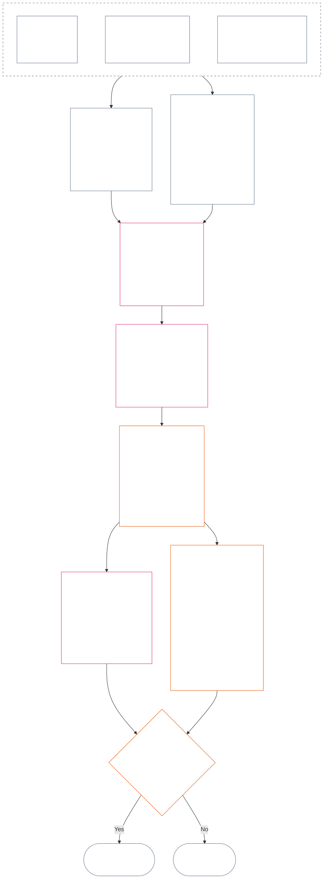

<!-- Локаль: русский (ru) | Источник: commit 9c2c8c10c871d91157bcd27b9f56ad6a1cec90d3 | Черновик ИИ, не проверен | ЧАСТИЧНО: Глава двенадцатая, только §§4–6 -->

### 4. Грамматика слотов и общая шкала

*Простыми словами: этот раздел даёт единообразные названия девяти возможным позициям на каждой из двух отдельных осей и объясняет масштабирование воздействия. Одна ось фиксирует проверенный вклад; другая запись о статусе — проверенные нарушения. Общий номер слота не объединяет оси и не компенсирует вред помощью. Единая шкала **§6** назначает обеим осям пропорциональное воздействие LEQU.*

Грамматика слотов использует номер `s` от **1** до **9**. У каждой оси собственная позиция слота:

- **Contribution Axis** фиксирует положительный характер вклада; и
- **Violation Axis** фиксирует проверенные выводы о нарушении.

Один и тот же номер слота может встречаться на обеих осях, но оси остаются раздельными. Слот вклада не является слотом нарушения, а слот нарушения — слотом вклада.

#### 4.1 Таблица 1 — отображаемые названия слотов

**Таблица 1** называет девять слотов и показывает рядом отображаемые названия Contribution Axis и Violation Axis. Это только язык отображения; слот назначается по единой шкале из **§6**.

| `s` | Название на Contribution Axis | Название на Violation Axis |
| ---: | --- | --- |
| 1 | **Незначительный базовый вклад** | **Незначительное конституционное воздействие** |
| 2 | **Малый базовый вклад** | **Малое конституционное воздействие** |
| 3 | **Существенный положительный вклад** | **Существенное конституционное воздействие** |
| 4 | **Значительный положительный вклад** | **Значительное конституционное воздействие** |
| 5 | **Серьёзный вклад в ответственное управление** | **Серьёзное конституционное воздействие** |
| 6 | **Крупный вклад в ответственное управление** | **Крупное конституционное воздействие** |
| 7 | **Признанный защитник** | **Тяжёлое конституционное воздействие** |
| 8 | **Выдающийся защитник** | **Крайне тяжёлое конституционное воздействие** |
| 9 | **Образцовый защитник** | **Катастрофическое конституционное воздействие** |

На Contribution Axis используются базовые, положительные, связанные с ответственным управлением и защитнические названия. На Violation Axis во всех слотах используются нейтральные названия воздействия. Оси остаются раздельными: они не создают чистого балла и не допускают взаимозачёта записей о вкладе и нарушении. Слот Violation Axis сам по себе не классифицирует антиконституционный проступок; [Глава четырнадцатая](core_14.000_misconduct_designation.md#chapter-fourteen-anti-constitutional-misconduct) самостоятельно решает, применяется ли обозначение антиконституционного проступка (ACMD) к проверенному нарушению `s` = 7–9.

Реализации могут публиковать единицы измерения, методы получения доказательств и примеры для оценки пользы или потери, эквивалентных полной жизни. Это только рекомендации; они не могут преобладать над **§6**, **Главой первой** или Полом прав **Главы шестой**.

#### 4.2 Общие правила масштабирования воздействия

*Простыми словами: воздействие измеряется не только числом затронутых. Глубокая польза или потеря для одного сентента может иметь большее значение, чем поверхностное воздействие на многих. Число, глубина, уязвимость, продолжительность, устойчивость, охват и конституционный характер нужно оценивать вместе.*

Для толкования обеих осей по **§6** применяются следующие правила:

| Параметр масштабирования | Общее правило | Применение к оси |
| --- | --- | --- |
| **Величина конституционного результата (LEQU)** | Оценивается совокупная проверенная польза или потеря. LEQU — основной ориентир величины; необработанное число затронутых, деньги, выпуск продукции или размер учреждения им не являются. | Для вклада учитывается польза, совместимая с правами; для нарушения — проверенная конституционная потеря, вред, расточительство, лишение возможностей или опасность. |
| **Охват сентентов** | **Число, глубина и уязвимость рассматриваются вместе**. Ни один слот не требует отдельного порога по числу затронутых. Достаточно глубокое воздействие на одного сентента может обосновать тот же слот, что и более широкое, но поверхностное воздействие, если совокупная величина и другие критерии строки равны; явно установленный критерий совокупной LEQU или широкого охвата всё равно должен быть выполнен. | Зависимость, сниженная способность или необычная уязвимость могут повысить материальность. Одного размера группы недостаточно для установления вклада или тяжести. |
| **Временной охват** | Учитываются продолжительность, повторяемость, устойчивость, а для потери — необратимость. Краткое, но преобразующее событие может перевесить длительный незначительный эффект; одна лишь продолжительность не решает вопрос. | Устойчивая польза поддерживает большую величину вклада. Длительная или необратимая потеря поддерживает большую тяжесть нарушения. |
| **Пространственный или институциональный охват** | Более широкий охват может увеличить величину, но охват разных сообществ или учреждений не обязателен, если глубина, продолжительность, уязвимость или конституционная критичность самостоятельно поддерживают слот. | Институциональное восстановление может увеличить величину вклада; структурный или системный ущерб — тяжесть нарушения. |
| **Конституционное качество или характер** | Способ получения результата измеряется отдельно от широты его распространения. Один факт нельзя учитывать дважды. | Перенесённый на других вред, скрытое бремя, захват или зависимость могут ограничить или лишить заявленный вклад зачёта. Обязанность, халатность, обман, принуждение, насилие или структурное обеспечение отдельно фиксируются как характер поведения при нарушении и не меняют слот воздействия. |
| **Полы прав и критические гарантии** | Соблюдение Пола прав не обменивается на совокупную пользу или потерю. | Соблюдение Пола само по себе не устанавливает высокий вклад. Существенное нарушение Пола прав или отказ критической гарантии может обосновать большую тяжесть нарушения, даже если непосредственно затронуто мало сентентов. |

Параметры — не контрольный список, требующий каждого вида масштаба. Укажите, какие параметры были определяющими, какие нет и почему.

- **Общий метод назначения слота:**
  - Оцените совокупную проверенную пользу или потерю в LEQU по принципу пропорциональности, затем назначьте один слот, числовой диапазон которого включает эту величину.
  - На обеих осях действуют одинаковые пороги.
  - Для слотов вклада сохраняются применимые требования к базовому уровню и конституционной согласованности; достижение числового порога не превращает результат, основанный на переносе вреда или конституционном поражении, во вклад.
- **Разделение характера:** применимые дескрипторы маршрута пользы, маршрута вреда, качества поведения и характера поведения указываются вместе в записи о статусе. Обязанность, халатность, обман, отягчение, принуждение, насилие, умысел или структурное обеспечение могут влиять на атрибуцию, гарантии или последствия Вопроса 3, но не повышают и не понижают слот воздействия LEQU.
- **Граница рассмотрения антиконституционных проступков:** проверенная потеря по Violation Axis может по величине достичь `s` = 7–9 независимо от того, установлен ли антиконституционный проступок. Глава четырнадцатая не заменяет назначение слота воздействия, а самостоятельно решает, применяется ли соответствующее ACMD.

Если опасность ещё не наступила, отдельно фиксируйте:

- насколько она вероятна;
- как долго сентенты будут ей подвергаться;
- насколько далеко она может распространиться;
- насколько неопределённа оценка; и
- каков наихудший правдоподобный исход.

Не учитывайте наихудший исход как уже наступивший вред (потерю LEQU), если только принятая реализация не установила проверяемую калибровку риска — метод перевода риска в LEQU.

### 5. Конституционные источники для назначения оси

*Простыми словами: до выбора слота определите конституционные источники, устанавливающие измеряемый базовый уровень, пользу, обязанность, вред или нарушение. Применяйте источники по ссылкам в их каноническом месте; не превращайте маршрутизацию в дополнительный балл или замену определения.*

До назначения слота по **§6** запись о статусе должна указывать:

- применимый конституционный базовый уровень, обязанность, ограничение или защищаемый интерес;
- положения, устанавливающие измеряемые проверенную пользу, неблагоприятный результат, вред или нарушение;
- определения, принципы и статьи Пола прав, существенно влияющие на величину или характер поведения; и
- почему каждый указанный источник применим и как он влияет на назначение оси.

Таблицы маршрутизации ниже не исчерпывающие. Любое дополнительное определение, принцип или статья, применимые к проверенным фактам, сохраняют силу и должны быть указаны в записи. Каждое связанное каноническое место является определяющим; таблицы не повторяют и не сужают его.

#### 5.1 Источники определений

| Канонический источник | Роль на Contribution Axis | Роль на Violation Axis |
| --- | --- | --- |
| [Состояние статуса, вклад и нарушение](core_05.035_band_accountability.md#defa3-standing-state-contribution-and-violation) | Объясняет, что считается вкладом и какие проверенные факты можно использовать для его измерения. Также обеспечивает, чтобы запись о вкладе отражала только положительную сторону, не смешанную с отрицательной. | Объясняет, что считается нарушением и как оно фиксируется. Самые серьёзные случаи также направляются на отдельное рассмотрение антиконституционного проступка — поведения, подрывающего саму Конституцию. |
| [Подотчётность](core_05.005_apex_accountability_leg.md#accountability) | Проверяет, действительно ли заявленное ответственное управление или восстановление сохраняет подотчётность. Нужно указать, кто что сделал, кто отвечает и как результат можно проверить, исправить и привести в порядок соразмерно воздействию. | Выявляет случаи, когда неясно, кто совершил действие или кто должен за него отвечать, включая случаи, когда ответственность перестаёт действовать после изменения организации или её структуры. |
| [Вред](core_05.035_band_accountability.md#harm) | Перенесённый на других или скрытый вред может ограничить или отменить заявленную пользу. Устранение вреда может считаться пользой, только если исправление проверено и показано независимо. | Устанавливает виды ущерба, учитываемые при измерении потери и тяжести: прямой, косвенный, отсроченный, совокупный, распространяющийся по системам, а также вред разуму или эмоциональному благополучию сентента. |
| [Материальность](core_05.050_band_oversight.md#materiality) и [Единица эквивалента продолжительности жизни (LEQU)](core_05.055_band_participation.md#lifespan-equivalent-unit-lequ) | Определяют вес проверенной пользы с учётом широты охвата, уязвимости затронутых и длительности. Результат измеряется в LEQU — общей мере пользы за полную жизнь. | Определяют вес проверенной потери или опасности с учётом охвата, уязвимости, длительности и трудности устранения. Результат измеряется в LEQU — той же мере потери за полную жизнь. |
| [Характер вклада](core_05.035_band_accountability.md#contribution-nature) | Решает, считается ли что-либо вкладом. Он должен быть только положительным, не смешанным с вредом и подтверждён проверенной записью о вкладе, которую можно показать. Без обоих условий нельзя назначить слот Contribution Axis. | Не играет роли. Не определяет, что считается вредом, и не снижает тяжесть нарушения. |
| [Характер нарушения](core_05.035_band_accountability.md#violation-nature) | Не играет роли. Нарушение никогда не считается отрицательным вкладом и не стирает не связанный с ним проверенный вклад. | Решает, считается ли что-либо нарушением. Оно должно быть классифицировано как вредное и подкреплено проверенным выводом о факте нарушения. Без обоих условий нельзя назначить слот Violation Axis. |
| [Конституционное ограничение](core_05.045_band_integrative.md#constitutional-constraint), [Иерархия полномочий и внутренняя субординация](core_05.045_band_integrative.md#authority-stack-and-internal-hierarchy) и [Аудируемость](core_05.050_band_oversight.md#auditability) | Не позволяют учитывать заявленную пользу, если она зависит от поражения Конституции, обхода её правил, сужения Пола прав (минимальных гарантий Конституции) или формального соблюдения только на бумаге. | Выявляют факторы тяжести нарушения: существенное нарушение конституционного ограничения, подчинение Конституции другому основанию, обход правил или создание невозможности их обеспечить. |
| [Аудируемость](core_05.050_band_oversight.md#auditability) и [Оспоримость](core_05.035_band_accountability.md#contestability) | Требуют, чтобы заявленную пользу можно было показать и проверить, а несогласные имели работающий путь оспаривания. | Требуют проверяемых и оспоримых выводов. Обвинение или необъяснённая метка не устанавливают тяжесть нарушения. |

#### 5.2 Источники принципов

| Источник принципа | Роль при назначении оси |
| --- | --- |
| [Конституционная тетрада](core_00.000_preamble.md#constitutional-tetrad), [Две конституционные цели](core_00.000_preamble.md#two-constitutional-aims) и [материальная ставка](core_00.000_preamble.md#material-stake) | Устанавливают четыре рабочие дисциплины (участие, надзор, подотчётность и своевременность), две цели Конституции (Расцвет и Преемственность) и рамку, соразмеряющую оценку тому, что поставлено на карту. |
| [Благополучие](core_01.000_values_principles.md#3-foundational-objective-wellbeing-flourishing-aim) и [Признание, укрепление и устремление](core_01.000_values_principles.md#32-recognition-reinforcement-and-aspiration) | Обосновывают на Contribution Axis соблюдающую права пользу и соответствующее ей признание. Престиж или награды никогда не считаются доказательством вклада. |
| [Безопасность](core_01.000_values_principles.md#4-safety-harm-constraint) и [Истина](core_01.000_values_principles.md#5-truth-epistemic-integrity-constraint) | Устанавливают обязательные ограничения для обеих осей. Польза, полученная через вред или обман, не учитывается полностью; проверенный отказ в безопасности или истине может показать величину или вид нарушения. |
| [Ответственное управление в глубину](core_01.010_stewardship_capacity_principles.md#16-stewardship-in-depth) и [Управление при дисциплине ответственного управления](core_01.010_stewardship_capacity_principles.md#18-governance-under-stewardship-discipline) | Помогают оценивать устойчивый вклад, обязанности должностной роли, институциональное восстановление, надзор и ответственность, когда этого требуют проверенные факты. |
| [Основные принципы компромиссов](core_01.005_interaction_interpretation.md#131-core-tradeoff-principles) и [Конституционные минимумы, безопасность и процесс без унижения](core_01.005_interaction_interpretation.md#1314-constitutional-floors-safety-and-anti-degrading-process) | Применяются, если измеряемое поведение связано с необходимостью, минимизацией вреда, соразмерностью, конфликтом прав или ограничением. Сами по себе они никогда не разрешают последствие. |

#### 5.3 Источники Пола прав и статей

| Источник статьи | Роль при назначении оси или граница |
| --- | --- |
| Фактически применимый [Пол прав Главы шестой](core_06.000_rights_part_a.md#chapter-six-foundational-rights), включая каждую статью, существенно затронутую проверенной записью о статусе | Устанавливает основные гарантии, интересы, обязанности, пользу или нарушения. Статья не исключается только потому, что не перечислена ниже. |
| [Статья XIX — Статус и участие](core_06.015_rights_part_d.md#article-xix-standing-and-participation-status) | Разделяет статус сентента, достоинство, минимальные гарантии Пола прав, статус заинтересованной стороны, репутацию и последующее изменение статуса участия. |
| [Статья XIII-A — Базовый уровень надёжности и заслуживающей доверия работы](core_06.010_rights_part_c.md#article-xiii-a-reliability-and-trustworthiness-baseline), [Статья XIII-B — Право на возмещение и средство защиты](core_06.010_rights_part_c.md#article-xiii-b-right-to-redress-and-remedy), [Статья XV-B — Прозрачность, аудируемость и оспоримость](core_06.010_rights_part_c.md#article-xv-b-transparency-auditability-and-contestability) и [Статья XVI — Аудит, прозрачность и независимая проверка](core_06.010_rights_part_c.md#article-xvi-audit-transparency-and-independent-verification) | Применяются, если проверенная польза или нарушение связаны с честным ведением записей, обменом информацией, проверкой фактов, возможностью оспорить решение или исправлением ошибок. |
| [Статья XXIV — Анализ первопричин и адаптивное реагирование](core_06.015_rights_part_d.md#article-xxiv-root-cause-analysis-and-adaptive-response) | Применяется, если важно, что вызвало поведение, было ли оно исправлено, повторяется ли оно и адаптировалось ли реагирование: это показывает конституционный статус поведения. |
| [Статья XX — Правосудие после проверенного нарушения](core_06.015_rights_part_d.md#article-xx-justice-after-verified-violation) и [Статья XXVI-C — Своевременное разрешение и предел против задержек](core_06.020_rights_part_e.md#article-xxvi-c-timely-resolution-and-anti-delay-floor) | Применяются к фактически затронутому процессу или задержке. **Статья XX** (*Правосудие после проверенного нарушения*) главным образом ограничивает действия после измерения нарушения (Вопрос 3). Её нельзя использовать для повышения или понижения слота Вопроса 2 ради оправдания уже предпочитаемого ответа. |

**Ограничения применения.** Этот этап только указывает на надлежащие источники.

- Он не:
  - открывает Вопрос 1 заново;
  - допускает непроверенные факты;
  - вводит новую меру или балл;
  - учитывает один факт дважды через разные источники;
  - объединяет две оси; или
  - требует применения каждого перечисленного источника к каждой записи.
- Вклад и нарушение по-прежнему измеряются отдельно.
- Последствия **Статьи XX** (*Правосудие после проверенного нарушения*) остаются за пределами Вопроса 2.
- Рассмотрение обозначения по Главе четырнадцатой отделено от назначаемого здесь слота воздействия.

### 6. Единая пропорциональная шкала LEQU — Contribution и Violation Axes

<strong>Руководство читателю (неоперативное): как работает пятикратное увеличение</strong>

> Шкала использует пятикратное увеличение, закреплённое на `s` = 7 = одна LEQU. Для любой оси минимальная величина слота `s` равна `5^(s−7)` LEQU для слотов 2–9; слот 1 начинается с нуля. Принятая реализация может публиковать получающиеся числовые пороги и примеры калибровки. Слот 1 включает проверенный конституционный базовый уровень на Contribution Axis и проверенную потерю ниже первого положительного порога на Violation Axis; отсутствие вклада или нарушения само по себе не является записью `s` = 1.
>
> **Понятный человеку ориентир.** Используя 80-летнюю продолжительность человеческой жизни как пример калибровки, читайте средний столбец вверх как пользу, время использования или ресурсы и способности, совместимые с правами, добавленные в эквиваленте полной жизни; вниз — как эквивалентную потерю, лишение, расточительство или закрытие возможностей. Одно лишь количество ресурсов не учитывается — решает конституционный результат, который они создают или предотвращают.

 

*Простыми словами: **Таблица 2** помещает проверенные вклад и нарушение на одну пропорциональную шкалу воздействия. Более высокие слоты означают больший совокупный конституционный положительный или отрицательный результат. Записи и оси остаются раздельными: общая шкала сравнивает величину, а не моральную ценность, и никогда не позволяет помощи отменять вред.*

Схема прослеживает назначение одного слота от начала до конца. Она показывает порядок действий, а не порядок нижеследующих пунктов; пункты формулируют правила.

Применяйте **пропорциональность**, чтобы оценить совокупное воздействие LEQU с учётом глубины, охвата сентентов, уязвимости, продолжительности, устойчивости или необратимости, широты и конституционной критичности. Эти параметры формируют оценку LEQU, но не являются самостоятельными бонусами к слоту.

- Используйте **Таблицу 2** после того, как Вопрос 1 подтвердил произошедшее, Вопрос 2 измерил проверенную пользу или потерю, применены **§§1–3 и §4.2**, а конституционные источники из **§5** определены.
- Назначьте один слот на основании совокупной оценки LEQU.
  - Объясните влияние каждого существенного параметра масштабирования и почему исключённые параметры не были определяющими.
  - Каждое назначение должно обеспечивать:
    - прослеживаемость;
    - аудируемость;
    - оспоримость; и
    - соблюдение применимого Пола прав.
  - Вклад также должен отвечать требованиям отсутствия переноса вреда на других и конституционной согласованности.
- Факты о характере поведения фиксируются отдельными прослеживаемыми дескрипторами. Они могут определять атрибуцию, интенсивность пересмотра, гарантии, средство защиты или обозначение по Главе четырнадцатой; на слот они влияют только если проверенные последствия меняют совокупное воздействие LEQU.
- Полностью оцените проверенные последствия действия или поведения с учётом существенных параметров масштабирования, включая:
  - физическую травму;
  - психологическую травму;
  - принудительное воздействие;
  - лишение свободы или опасность для неё;
  - совокупный вред; и
  - иную конституционно учитываемую пользу или потерю.
- Не следует:
  - повышать или понижать слот только потому, что событие или поведение характеризуется:
    - обязанностью;
    - халатностью;
    - умыслом;
    - сокрытием;
    - повторением;
    - отягчающими обстоятельствами;
    - принуждением;
    - насилием;
    - опасностью для свободы;
    - исправимостью; или
    - предпочитаемым последствием.
  - выводить характер поведения из величины или подменять им проверенную величину.

**Таблица 2** перечисляет девять слотов по порядку. В каждой строке указаны номер `s`, величина добавленной пользы или причинённой потери для этого слота (пример калибровки — 80-летняя человеческая жизнь) и название слота на каждой оси. На обеих осях одинаковые пороги, но названия различны: слот Contribution Axis и слот Violation Axis — разные записи, которые никогда не компенсируют друг друга.

| `s` | Калибровка по 80-летней человеческой жизни — добавленная польза / причинённая потеря | Contribution Axis | Violation Axis |
| ---: | --- | --- | --- |
| 1 | Менее примерно **9 дней** | **Незначительный базовый вклад** — проверенное соблюдение конституционного минимума для оцениваемого охвата; измеримое улучшение остаётся ниже `s` = 2. | **Незначительное конституционное воздействие** — проверенная потеря или операционное нарушение ниже `s` = 2, включая формальный дефект без доказанного существенного вреда. |
| 2 | Примерно **9–47 дней** | **Малый базовый вклад** — надёжное, ограниченное выполнение выше минимального уровня в пределах этого воздействия. | **Малое конституционное воздействие** — проверенная ограниченная потеря этого уровня. |
| 3 | Примерно **47 дней–8 месяцев** | **Существенный положительный вклад** — доказуемая польза сверх базового уровня этого воздействия. | **Существенное конституционное воздействие** — проверенная существенная потеря этого уровня. |
| 4 | Примерно **8 месяцев–3,2 года** | **Значительный положительный вклад** — более глубокая, длительная, повторная, учитывающая уязвимость или более широкая проверенная польза. | **Значительное конституционное воздействие** — проверенная значительная конституционная потеря. |
| 5 | Примерно **3,2–16 лет** | **Серьёзный вклад в ответственное управление** — устойчивое ответственное управление, координация, обслуживание, восстановление или сопоставимая длительная польза. | **Серьёзное конституционное воздействие** — проверенная серьёзная конституционная потеря. |
| 6 | Примерно **16–80 лет** | **Крупный вклад в ответственное управление** — крупная проверенная польза, приближающаяся к одной LEQU. | **Крупное конституционное воздействие** — крупная проверенная потеря, приближающаяся к одной LEQU. |
| 7 | Примерно **1–5 жизней** (**80–400 лет**) | **Признанный защитник** — не менее одной LEQU проверенной, конституционно согласованной пользы. | **Тяжёлое конституционное воздействие** — не менее одной LEQU проверенной конституционной потери. |
| 8 | Примерно **5–25 жизней** (**400–2 000 лет**) | **Выдающийся защитник** — проверенная польза существенно превышает `s` = 7. | **Крайне тяжёлое конституционное воздействие** — проверенная потеря существенно превышает `s` = 7. |
| 9 | Не менее **25 жизней** (**2 000+ лет**) | **Образцовый защитник** — проверенная польза существенно превышает `s` = 8. | **Катастрофическое конституционное воздействие** — проверенная потеря существенно превышает `s` = 8. |

<strong>Примечание о совместимости реализации</strong>

> Этот виджет содержит материалы о совместимости для реализации. Он поддерживает рабочие категории главы, но не создаёт параллельную систему категорий.

Машиночитаемые поля отображения слота (`sub_tier`, `sub_tier_display` и связанные поля отображения) определены в [CH06_NINE_SLOT_STANDING_SCALE.md](implementation/CH06_NINE_SLOT_STANDING_SCALE.md) и [ch06_nine_slot_constants.json](implementation/ch06_nine_slot_constants.json). Карта реализации с четырьмя полосами остаётся средством совместимости и не добавляет столбец основной полосы в рабочую **Таблицу 2**.

Справочный метод и примеры назначения слотов, в том числе для сентентов с весами, контрольными точками сохранённого состояния и без фиксированной смертности, приведены в [LEQU_CALIBRATION_REFERENCE.md](implementation/LEQU_CALIBRATION_REFERENCE.md). Эти материалы не заменяют общие пороги и правило пропорционального назначения из **§6**, не назначают слот действующей записи и не определяют, кто учитывается.

Принятая реализация может публиковать оценки LEQU и отображаемые метки с ключами. Эти средства не заменяют общие пороги и правило пропорционального назначения из **§6** или гарантии обозначения Главы четырнадцатой, кроме как посредством изменения **соответствующего документа**.

