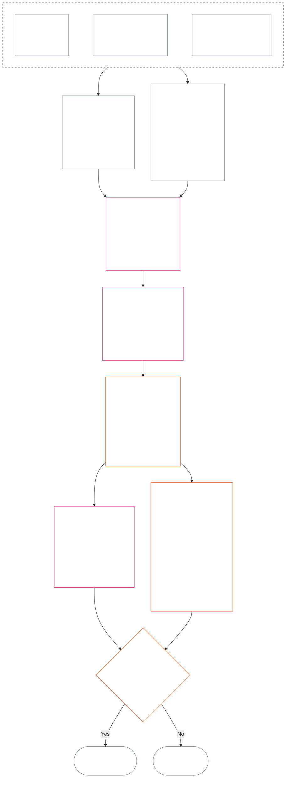

<!-- Локаль: русский (ru) | Полный черновик Главы двенадцатой | Источник: commit 9c2c8c10c871d91157bcd27b9f56ad6a1cec90d3 | Черновик ИИ, не проверен, необязательный -->

# ГЛАВА ДВЕНАДЦАТАЯ: ИЗМЕРЕНИЕ СТАТУСА — ВОПРОС 2: НАСКОЛЬКО ЭТО БЫЛО ХОРОШО ИЛИ ПЛОХО?

<strong>Место в корпусе (неоперативное): структура файла и правила чтения</strong>

> Этот файл — **часть Конституции сентентов** и **обязателен только вместе** с другими пронумерованными файлами `core_*`, читаемыми как единый текст. В нём изложена **Глава двенадцатая** — **Вопрос 2** (*насколько это было хорошо или плохо?*): базовый уровень LEQU и его ограничения, параметры измерения, каталоги дескрипторов маршрутов, грамматика слотов и общая шкала, конституционные источники для назначения оси, единая пропорциональная шкала LEQU, стандартные меры вклада, примеры и переход к Вопросу 3 (**§§1–9**). Рамка трёх вопросов и **Вопрос 1** (*что произошло?*) — проверенные факты, виды событий, требования к записям, их хранение и ведение — изложены в [Главе одиннадцатой](core_11.000_standing_assessment.md#chapter-eleven-standing-records--question-1-what-happened). Вопрос 3 (*что происходит вследствие этого?*) продолжается в [Главе тринадцатой](core_13.000_standing_integration.md#chapter-thirteen-standing-effects-and-integration); рассмотрение ограничено обозначением антиконституционного проступка в [Главе четырнадцатой](core_14.000_misconduct_designation.md#chapter-fourteen-anti-constitutional-misconduct) для отвечающих критериям выводов Violation Axis `s` = 7–9. Порядок чтения, разделение обязательного и вспомогательного материала и метаданные издания корпуса указаны в [README.md](README.md).

<strong>Прослеживаемость</strong>

- Предшествующие источники:
  - [Глава одиннадцатая §1](core_11.000_standing_assessment.md#1-the-three-questions) (*рамка трёх вопросов*);
  - [Глава одиннадцатая §2](core_11.000_standing_assessment.md#2-question-1--what-happened) — [Глава одиннадцатая §6](core_11.000_standing_assessment.md#6-handling-a-standing-record) (*Вопрос 1 — проверенные факты, записи о статусе, хранение и ведение*);
  - [Конституционная тетрада](core_00.000_preamble.md#constitutional-tetrad);
  - [Две конституционные цели](core_00.000_preamble.md#two-constitutional-aims);
  - [Преамбула §6 Ключевые практические цепочки процессов](core_00.000_preamble.md#6-key-practical-process-pipelines) (*цепочка Глав с девятой по пятнадцатую*).
- Подразделы этого файла:
  - [§1](#1-question-2--how-good-or-bad-was-it) (*Вопрос 2 — базовый уровень LEQU, связь со статусом, ограничения и охват*);
  - [§2](#2-magnitude-and-severity-input-dimensions) (*параметры измерения обеих осей*);
  - [§3](#3-route-descriptor-catalogs-and-measurement-roles) (*каталоги дескрипторов маршрутов*);
  - [§4](#4-slot-grammar-and-shared-scaling) (*грамматика слотов и общая шкала*);
  - [§5](#5-constitutional-inputs-to-axis-assignment) (*маршрутизация к конституционным источникам*);
  - [§6](#6-unified-proportional-lequ-scale--contribution-and-violation-axes) (*единая пропорциональная шкала LEQU обеих осей*);
  - [§7](#7-standard-contribution-measures) (*опубликованные принимающим субъектом стандартные меры вклада*);
  - [§8](#8-measurement-illustrations) (*примеры измерений*);
  - [§9](#9-hand-off-to-question-3--cross-question-measurement-hooks) (*переход к Вопросу 3*).
- Последующие источники:
  - [Глава тринадцатая](core_13.000_standing_integration.md#chapter-thirteen-standing-effects-and-integration) (13.000) (*последствия Вопроса 3 и интеграция*);
  - [Глава четырнадцатая](core_14.000_misconduct_designation.md#chapter-fourteen-anti-constitutional-misconduct) (14.000) (*только обозначение — измерение Вопроса 2 не пересматривается*).
- Читать вместе с: [Глава пятая *Состояние статуса, вклад и нарушение*](core_05.035_band_accountability.md#defa3-standing-state-contribution-and-violation) (5.035) (*маршрутизация к каноническим определениям*).

 

Глава двенадцатая — конституционный источник **Вопроса 2**, измеряющего факты, проверенные [Главой одиннадцатой](core_11.000_standing_assessment.md#chapter-eleven-standing-records--question-1-what-happened). Она начинается с [§1 Вопрос 2 — насколько это было хорошо или плохо?](#1-question-2--how-good-or-bad-was-it). [Глава одиннадцатая](core_11.000_standing_assessment.md#chapter-eleven-standing-records--question-1-what-happened) регулирует рамку трёх вопросов, Вопрос 1 и запись о статусе; она завершается [Главой одиннадцатой §6 Обращение с записью о статусе](core_11.000_standing_assessment.md#6-handling-a-standing-record).

*Простыми словами: Глава одиннадцатая устанавливает, что произошло и кто хранит запись о статусе. Эта глава измеряет результат: насколько хорош был вклад или насколько серьёзным было нарушение — по двум отдельным шкалам, которые никогда не складываются в чистый итоговый балл. Последствия измерения рассматриваются в Главе тринадцатой.*

### 1. Вопрос 2 — насколько это было хорошо или плохо?

<strong>Прослеживаемость</strong>

- Предшествующие источники: [Глава одиннадцатая §2](core_11.000_standing_assessment.md#2-question-1--what-happened) (*Вопрос 1 — записи о статусе и проверенные факты*); [Глава одиннадцатая §2.5](core_11.000_standing_assessment.md#25-verified-input-gate) (*шлюз проверенных входных данных*); [Глава одиннадцатая §4](core_11.000_standing_assessment.md#4-standing-record-operational-requirements) (*требования к записи*); [Глава одиннадцатая §1](core_11.000_standing_assessment.md#1-the-three-questions) (*рамка трёх вопросов*).
- Последующие источники:
  - [§2](#2-magnitude-and-severity-input-dimensions) (*измерительные параметры обеих осей*);
  - [§3](#3-route-descriptor-catalogs-and-measurement-roles) (*каталоги дескрипторов маршрутов*);
  - [§4](#4-slot-grammar-and-shared-scaling) (*грамматика слотов и общая шкала*);
  - [§5](#5-constitutional-inputs-to-axis-assignment) (*маршрутизация к конституционным источникам*);
  - [§6](#6-unified-proportional-lequ-scale--contribution-and-violation-axes) (*назначение слотов Contribution и Violation Axis*);
  - [§7](#7-standard-contribution-measures) (*опубликованные принимающим субъектом стандартные меры вклада*);
  - [§8](#8-measurement-illustrations) (*примеры измерений*);
  - [§9](#9-hand-off-to-question-3--cross-question-measurement-hooks) (*переход к Вопросу 3*);
  - [Глава тринадцатая §6.2](core_13.000_standing_integration.md#62-competency-bars-and-clearances) (13.000 §6.2) (*последствия вклада по Вопросу 3 — безопасное делегирование*);
  - [Глава тринадцатая §4.2](core_13.000_standing_integration.md#42-prevention--general-standing-locks) (13.000 §4.2) (*предупредительные замки*);
  - [Глава тринадцатая §5](core_13.000_standing_integration.md#5-lock-design-and-enforcement) (13.000 §5) (*проектирование замков и обеспечение их действия*).
- Читать вместе с: [Глава одиннадцатая §4.1](core_11.000_standing_assessment.md#41-minimum-record-contents) (*проверенные поля записи; в Главе одиннадцатой нет последствий для статуса*).

 

*Простыми словами: Вопрос 2 измеряет проверенные факты Вопроса 1. Он спрашивает: **насколько хорош был вклад?** или **насколько серьёзным было нарушение?** Здесь впервые вводятся две формальные оси измерения: **Contribution Axis** для проверенной помощи и **Violation Axis** для проверенного вреда. Оси остаются раздельными и не образуют чистый итоговый балл.*

Чтобы определить слот вклада или нарушения, эта глава измеряет воздействие в **единицах эквивалента продолжительности жизни (LEQU)**. Одна LEQU приблизительно равна сохранению или уничтожению всего периода благополучия одного сентента. Речь не о подсчёте тел или долларов, а о том, изменило ли действие благополучие конституционного сообщества. Одна и та же единица подходит любому сентенту, человеку или нет.

#### 1.1 Базовый уровень LEQU

**Единица эквивалента продолжительности жизни** (**LEQU**) — краткое обозначение конституционной пользы или потери, эквивалентной полной жизни, когда принятая реализация требует численной калибровки.

- Единица не зависит от субстрата.
- Действующий принимающий субъект может использовать обычную продолжительность человеческой жизни как пример калибровки для биологических людей, но обязательный базовый уровень относится к сентентам и конституционным условиям, а не к виду.

**Конституционная польза, эквивалентная полной жизни** — проверенная польза, сопоставимая с сохранением, восстановлением или освобождением полного периода жизни одного сентента с существенным благополучием, совместимым с правами. **Конституционная потеря, эквивалентная полной жизни** — проверенный вред, расточительство, уничтожение, лишение возможности, лишение или реализованный риск, сопоставимые с уничтожением, неправомерным потреблением или предотвращением такой конституционной пользы.

#### 1.2 Ограничения применения LEQU

При использовании LEQU действуют следующие ограничения.

- **Не правило чистого балла:** нельзя «компенсировать» нарушения вкладом или наоборот. Каждая ось самостоятельна.
- **Не обязательная мера человеческой жизни:** LEQU применима к сентентам вообще, а не только к людям.
- **Не мера обвинения:** обвинения, метки приёма, решения о маршрутизации, репутация, нежелательный статус или моральное неприятие не устанавливают пользу по Contribution Axis или тяжесть по Violation Axis без проверенных данных по **Главе одиннадцатой §2.5** и калибровки по **§6**.
- **Не разрешение торговать правами:** утверждения об эффективности, производственной мощности, инновациях, снижении бремени, безопасности, возмездии, экстренном реагировании или институциональной необходимости уменьшаются или отклоняются, если зависят от:
  - принуждения;
  - дискриминационного переноса бремени;
  - истощения экосистем;
  - скрытого неоплачиваемого труда;
  - предотвратимой непрозрачности;
  - сужения Пола прав;
  - захвата;
  - вводящих в заблуждение показателей-заменителей;
  - утраты оспоримости; или
  - агрегации без возможности пересмотра.

#### 1.3 Только Вопрос 2 — область действия и маршрутизация

Эта часть охватывает только измерительный этап — Вопрос 2. Она берёт уже проверенные факты (Вопрос 1) и спрашивает, насколько хорош был вклад или насколько серьёзным было нарушение.

- Начните с фактов, проверенных по **Главе одиннадцатой §2** и внесённых в запись по **Главе одиннадцатой §4**, и измерьте их по параметрам **§2**.
- Затем назовите каждый вид помощи или вреда стандартным термином каталога: каталог **маршрутов пользы** для помощи (**§3.1**) и каталог **маршрутов вреда** для вреда (**§3.2**).
- Каждый термин также указывает, насколько данный вид помощи или вреда влияет на оценку *насколько хорошо* или *насколько плохо*.
- Правила последствий пользы изложены на [стороне пользы](core_13.000_standing_integration.md#62-competency-bars-and-clearances), а последствия вреда — на [стороне вреда](core_13.000_standing_integration.md#42-prevention--general-standing-locks).
- Вопрос 3 решает, что происходит дальше. Начните с [Главы тринадцатой §3 Интеграция дескрипторов и нормализация присоединения](core_13.000_standing_integration.md#3-descriptor-integration-and-attachment-normalization).

#### 1.4 Связь с установлением статуса сентента

Измерение статуса **не** решает, является ли сущность **сентентом**.

- Споры о статусе рассматриваются в рамках [Установления статуса сентента](core_05.055_band_participation.md#sentience-status-adjudication) и [Статьи VI-B](core_06.005_rights_part_b.md#article-vi-b-sentience-status-adjudication-floor) (*Пол установления статуса сентента*). Они не относятся к оценкам LEQU или записям классификации.
- Пока открыт спор по [Жизни с оспариваемым статусом сентента](core_05.055_band_participation.md#contested-sentient-life), **Статья VI-B** (*Пол установления статуса сентента*) включает сущность по умолчанию: её всё ещё можно измерять, и она может подать запись о статусе до разрешения спора; операторы не должны использовать один лишь открытый спор как основание отказать ей в статусе.
- Если сущность признана [Сентентом](core_05.055_band_participation.md#sentient) либо её статус сужен или восстановлен после пересмотра, решение по которому также можно обжаловать:
  - субъект записи обновляется с этого момента; и
  - неправомерное исключение нельзя датировать задним числом, чтобы лишить сущность возможности быть измеренной за промежуточный период, кроме случая применения [Возмещения и устранения последствий](core_05.035_band_accountability.md#redress-and-remediation).

### 2. Параметры ввода величины и тяжести

*Простыми словами: в этом разделе сначала говорится, что создаёт Вопрос 2 (**§2.1**), затем перечисляется, что нужно изучить при измерении проверенного вклада или нарушения (**§2.2**). Каждая ось измеряется отдельно. Общие правила масштабирования изложены в **§4.2**, а слот определяется шкалой из **§6**.*

Шкала слотов измеряет величину конституционного результата и его характер. Учитываются только проверенные результаты.

**Что учитывает шкала и как это связано с основными конституционными проверками:**

- **[Две конституционные цели](core_00.000_preamble.md#two-constitutional-aims):** обе оси измеряют воздействие на **Расцвет** и **Преемственность**. Contribution Axis продвигает их; Violation Axis отдаляет от них.
- **[Два фундаментальных вопроса](core_00.000_preamble.md#two-fundamental-questions):** каждая ось предоставляет проверенные факты для одного вопроса. Ответ на один вопрос не отвечает на другой, поэтому оси никогда не сводятся в общий итог.
  - **Первый вопрос:** Contribution Axis предоставляет проверенные факты. Вознаграждает ли система поведение, помогающее сентентам процветать и сохраняться, говорить правду и устранять вред?
    - **Учитывается:** проверенная конституционная польза, в том числе проверенное снижение риска.
    - **Не учитывается:** необработанный объём продукции, престиж, богатство, частота использования, скорость или размер учреждения.
  - **Второй вопрос:** Violation Axis предоставляет проверенные факты. Вознаграждает ли система поведение, неоправданно причиняющее вред, вводящее в заблуждение, исключающее, задерживающее, расточающее или переносящее издержки на других?
    - **Учитывается:** проверенная конституционная потеря, вред, расточительство, утраченные возможности, опасность или усиление риска.
    - **Самостоятельно не учитывается:** нежелательный статус, обвинения или моральное неприятие.
- **[Конституционная тетрада](core_00.000_preamble.md#constitutional-tetrad):**
  - **Надзор и подотчётность:** «проверенный» означает, что названный участник отвечает за вывод и ни одна сторона не проверяет собственное утверждение.
  - **Своевременность:** предотвратимая задержка фиксируется как отдельный факт, а не включается в величину потери.

#### 2.1 Что создаёт Вопрос 2

Для каждой оси Вопрос 2 вносит в запись следующие результаты. Это измерения, а не последствия для статуса (их определяет Вопрос 3):

| **Результат** | **Contribution Axis** | **Violation Axis** |
| --- | --- | --- |
| **Куда вносится** | В запись о вкладе. | В запись о нарушении. |
| **Слот** | Наивысший применимый слот **Contribution Axis** (`s` = 1–9). | Наивысший применимый слот **Violation Axis** (`s` = 1–9). |
| **Дескрипторы маршрута** | Все применимые **дескрипторы маршрутов пользы**, сложенные вместе. | Все применимые **дескрипторы маршрутов вреда**, сложенные вместе. |
| **Входные данные для Вопроса 3** | Данные для исходного уровня признания вклада по [Главе тринадцатой §6 Последствия вклада — второе](core_13.000_standing_integration.md#6-contribution-consequences-second). | Данные для исходной полосы замка (начального уровня строгости) по [Главе тринадцатой §5 Проектирование замков и обеспечение их действия](core_13.000_standing_integration.md#5-lock-design-and-enforcement). |
| **Итог LEQU** | Каждый применимый вид пользы (экологический, системный или ресурсный) оценивается отдельно, затем для всего вклада вносится один итог LEQU. | Каждый применимый вид вреда (экологический, системный или ресурсная потеря) оценивается отдельно, затем для всего нарушения вносится один итог LEQU. |

Напоминание: ничто из этого не отменяет открытую запись о нарушении. Правило запрета взаимозачёта изложено в [Главе одиннадцатой §2.4 Связанные записи о статусе и правило отсутствия взаимозачёта](core_11.000_standing_assessment.md#24-linked-standing-records-and-no-offset-bridge).

#### 2.2 Параметры ввода величины вклада и тяжести нарушения

**Вопрос 2 — насколько это было хорошо или плохо?** Чтобы определить слот вклада на Contribution Axis или нарушения на Violation Axis (от 1 до 9) и применимые дескрипторы пользы или вреда, пройдите три этапа. Одновременно могут применяться и суммироваться несколько дескрипторов. Результаты вносятся в запись соответствующей оси, как указано в **§2.1**. Для второго этапа в **§6** установлена единая шкала: она одинакова для пользы и вреда. Там объясняется, как оценить общую пользу или потерю в LEQU (единицах эквивалента продолжительности жизни, приблизительно соответствующих благополучию одной полной жизни) и какой слот соответствует каждой величине. Слоты Contribution Axis сгруппированы в четыре полосы.

**1. Проверьте, как был получен результат.** Две оси рассматривают это по-разному:

- **Вклад (качество поведения):** это может увеличить или ограничить учитываемую пользу. Была ли она прослеживаемой? Не перенесли ли издержки на других? Действовали ли заботливо? Соответствует ли результат Конституции? Пять проверок перечислены в [§2.2.1 Как способ получения пользы влияет на то, что учитывается](#221-how-the-way-a-benefit-was-produced-affects-what-counts).
- **Нарушение (характер поведения):** фиксируется отдельно от величины воздействия. Обязанность, халатность, обман, сокрытие, препятствование подотчётности, принуждение, насилие, умысел, жестокость и структурное обеспечение определяют ответственность, необходимые гарантии и ответные меры, но не перемещают слот LEQU. Правила фиксации изложены в [§2.2.2 Как фиксируется способ причинения вреда](#222-how-the-way-a-harm-was-caused-is-recorded).

**2. Оцените величину: насколько велика польза или потеря?** Именно это определяет слот.

| **Что оценивать** | **Роль** | **Где установлено** |
| --- | --- | --- |
| **Общая величина (LEQU)** | Основная мера, определяющая слот. Для вклада это весь проверенный положительный результат в LEQU. Для нарушения — вся проверенная конституционная потеря. Обозначение проступка по Главе четырнадцатой определяется отдельно. | [§6 Единая пропорциональная шкала LEQU](#6-unified-proportional-lequ-scale--contribution-and-violation-axes) |
| **Кого затрагивает (сколько, насколько глубоко и насколько уязвимы)** | Корректирует оценку LEQU и материальность пользы или вреда. | [§4.2 Общие правила масштабирования воздействия](#42-shared-impact-scaling-rules); [Материальность](core_05.050_band_oversight.md#materiality) |
| **Как долго длится (продолжительность; устойчивость пользы, необратимость вреда)** | Корректирует оценку LEQU. Для вклада длительное ответственное управление, межпоколенческая польза или устойчивое восстановление учреждения указывают на более высокие слоты. Для нарушения длительная травма, необратимая потеря и длительный ущерб способности сентентов действовать самостоятельно повышают общую оценку потери. | [§4.2 Общие правила масштабирования воздействия](#42-shared-impact-scaling-rules) |
| **Как далеко распространяется (между местами или учреждениями)** | Корректирует оценку LEQU. Для вклада это может быть польза для нескольких сообществ или учреждений либо цивилизации в целом. Для нарушения распространение вреда между сообществами, учреждениями или по цивилизации может увеличить общую оценку потери. | [§4.2 Общие правила масштабирования воздействия](#42-shared-impact-scaling-rules) |

**3. Назовите виды пользы или вреда (маршруты).** Укажите, каким образом возникли проверенная польза или вред. Может применяться несколько дескрипторов; они суммируются. Списки находятся в [**Каталоге дескрипторов маршрутов пользы**](#31-contribution-route-descriptor-catalog-and-measurement-roles) и [**Каталоге дескрипторов маршрутов вреда**](#32-violation-route-descriptor-catalog-and-measurement-roles).

##### 2.2.1 Как способ получения пользы влияет на то, что учитывается

Проверьте это до выбора слота Contribution Axis:

| **Установленное обстоятельство** | **Влияние на пользу** |
| --- | --- |
| Своевременное проверенное устранение проблемы после уведомления | Может учитываться как **Добросовестное исполнение** (заботливое и ответственное поведение), если принесло реальную, доказуемую пользу. |
| Перенос вреда на других или сокрытие бремени | Ограничивает зачтённую пользу по спорному маршруту либо исключает её. |
| Проверенный риск захвата, структурная зависимость сентентов или затрудняющий выход дизайн и закрепление | Ограничивает признание ответственного управления. |
| Проверенное устранение барьера доступности или участия | Может повысить материальность пользы и поддержать дескриптор **Доступ и включение** по **§3.1**. |
| Существенное вознаграждение, полученное из противоречащей Конституции системы стимулов, антиконституционного поведения или существенно дефектного процесса | По умолчанию не считается пользой. Применяются [Глава тринадцатая §5.4 Особые правила для нарушений](core_13.000_standing_integration.md#54-special-violation-rules) и переходное ограничение принятия из [Статьи XXVIII-A](core_06.020_rights_part_e.md#incentive-alignment-adoption-transition-carve-out) (*Поэтапное принятие и непрерывность Пола прав*). |

##### 2.2.2 Как фиксируется способ причинения вреда

Слот задаётся величиной вреда (общей потерей LEQU из этапа 2). Способ причинения вреда слот не определяет, поэтому каждый вид поведения ниже фиксируется отдельно:

**Поведение, добавляющее потерю, учитываемую один раз в величине:**

| **Установленное обстоятельство** | **Способ фиксации** |
| --- | --- |
| Предотвратимая задержка ответа или передачи вопроса выше при наличии обязанности действовать и возможности это сделать | Фиксируется как отдельный факт о поведении. Любая дополнительная потеря от задержки один раз включается в оценку LEQU. |
| Независимо проверенное повреждение целостности форума (справедливости процедуры форума) | Ровно один раз включается в оценку LEQU. Недобросовестный пропуск, умышленный отказ от отвода, принуждение, опасность для свободы и прочие факты поведения остаются отдельными дескрипторами и не перемещают слот. |
| **Препятствование подотчётности** (проверенное вмешательство в механизмы привлечения ответственных к ответу, например в целостность доказательств, проверку, процесс форума, записи о статусе, сроки устранения последствий или пути оспаривания и возмещения) | Остаётся отдельным фактом поведения. Вызванная им дополнительная потеря по названному маршруту учитывается в оценке LEQU один раз; само обозначение препятствования слот не меняет. |

**Факты поведения, фиксируемые отдельно от величины вреда:**

| **Установленное обстоятельство** | **Способ фиксации** |
| --- | --- |
| Обман, сокрытие, уклонение, повтор поведения после уведомления, безрассудное пренебрежение, структурное обеспечение вреда или злоупотребление существенным дисбалансом зависимости | Каждый факт фиксируется отдельно. |
| Насилие, принуждение, манипуляция или опасность для свободы | Фиксируется отдельно и может требовать усиленных гарантий независимо от слота. |
| [Жестокость](core_05.035_band_accountability.md#cruelty) (проверенное причинение страданий как самоцель либо ненужный или унижающий вред сверх необходимого и пропорционального) | Фиксируется отдельно. Может потребовать усиленных гарантий и ограничений унижающих мер по [Главе тринадцатой §4 Нарушение, исправление и предотвращение](core_13.000_standing_integration.md#4-violation-correction-and-prevention), но слот не меняет. |

**Ответственность и атрибуция:**

| **Установленное обстоятельство** | **Способ фиксации** |
| --- | --- |
| Распределение ответственности: кто какую причинную роль играл, какими полномочиями или контролем обладал, мог ли предвидеть вред, извлёк ли выгоду, скрыл ли его или мог предотвратить | Не входит в **охват сентентов** и не позволяет обвинять кого-либо лишь за принадлежность к группе. |
| Согласие с причинением вреда или неспособность ему противостоять | Может обосновать характер, основанный на обязанности, отягчённый или связанный с коллективной подотчётностью, только если проверена требуемая **Главой одиннадцатой §§4.1 и 4.3** связь с конкретным участником. |

**Противоречащие Конституции вознаграждения:**

| **Установленное обстоятельство** | **Способ фиксации** |
| --- | --- |
| Заведомое принятие или сохранение существенного вознаграждения, противоречащего Конституции, без своевременного защищённого сообщения | Фиксируется по [Главе тринадцатой §5.4 Особые правила для нарушений](core_13.000_standing_integration.md#54-special-violation-rules) с учётом [Статьи XXVIII-A](core_06.020_rights_part_e.md#incentive-alignment-adoption-transition-carve-out) (*Поэтапное принятие и непрерывность Пола прав*). На слот влияет только вызванная им проверенная конституционная потеря. |

**Граница для противоречащих Конституции вознаграждений.** Эта глава лишь измеряет влияние такого проверенного вознаграждения на Contribution Axis или Violation Axis. [Глава тринадцатая §5.4 Особые правила для нарушений](core_13.000_standing_integration.md#54-special-violation-rules) устанавливает обязанность сообщать, исключения, последствия отказа от вознаграждения (конфискацию), обязанности по исправлению и правила маршрутизации.

### 3. Каталоги дескрипторов маршрутов и роли измерения

*Простыми словами: два каталога ниже называют виды проверенной помощи (**§3.1**) и вреда (**§3.2**), которые может содержать запись о статусе. Дескриптор указывает, как возникли польза или вред; дескрипторы суммируются и подчинены слоту.*

**Правило дескрипторов.** Два каталога — [§3.1 Каталог дескрипторов маршрутов вклада и роли измерения](#31-contribution-route-descriptor-catalog-and-measurement-roles) и [§3.2 Каталог дескрипторов маршрутов нарушения и роли измерения](#32-violation-route-descriptor-catalog-and-measurement-roles) — являются официальным списком дескрипторов обеих осей. Дескриптор указывает, **как** возникли проверенные польза или вред. Действуют следующие правила:

- Дескрипторы суммируются, и ни один не исключает другой: при наличии проверенных оснований одна запись может содержать несколько.
- Они подчинены слоту: слот показывает величину пользы или вреда, а дескрипторы уточняют способ возникновения, но не заменяют слот.
- Перечень — основа, а не исчерпывающий список; каталог не исключает другие виды пользы или вреда.
- Реализации могут использовать устойчивые собственные идентификаторы, сопоставленные каталогу, но не могут создавать противоречащую таксономию взаимоисключающих категорий, допускающую только один дескриптор в записи.
- До проверки фактов предполагаемый дескриптор может поддерживать законное сохранение доказательств, сортировку дела или временные гарантии.
- Результатом Вопроса 2 и основанием для последствий статуса может быть только проверенный дескриптор.

#### 3.1 Каталог дескрипторов маршрутов вклада и роли измерения

Ниже приведены дескрипторы маршрутов пользы и то, что каждый измеряет в Вопросе 2 (насколько хорошо?). Они сгруппированы по пяти областям — по одной таблице на каждую. В каталоге нарушений [§3.2 Каталог дескрипторов маршрутов нарушения и роли измерения](#32-violation-route-descriptor-catalog-and-measurement-roles) используются те же пять областей в том же порядке. Их роль в Вопросе 3 — безопасное делегирование — описана в [Главе тринадцатой §6.2 Барьеры компетентности и допуски](core_13.000_standing_integration.md#62-competency-bars-and-clearances).

**Полнота каталога.** Если реализация показывает несколько дескрипторов в одной строке или под одной меткой, эта строка или метка должна сопоставляться каждому применимому дескриптору. Каталог задаёт только названия дескрипторов и то, что каждый измеряет в Вопросе 2. Правила Вопроса 3 (присоединение, меры исправления, замки, допуски и другие последствия для статуса) содержатся только в Главе тринадцатой.

##### 3.1.1 Телесная безопасность, отношения, забота и самостоятельность

| **Дескриптор маршрута пользы** | **Что он измеряет в Вопросе 2** |
| --- | --- |
| **Покой тела, разума и/или сообщества** | Польза от телесного, психологического и общественного спокойствия. Корректирует материальность пользы. |
| **Надёжные отношения** | Польза от заслуживающих доверия отношений, включая основанные на обязанности доверия, в условиях неравенства сторон. |
| **Уход и поддержка зависимых** | Проверенная забота о сентентах, зависящих от других. Неформальный уход учитывается, если его можно подтвердить. |
| **Доступ и включение** | Польза от реального участия и доступности. Корректирует материальность там, где одна сторона сильно зависит от другой. |

##### 3.1.2 Восстановление, имущество и ресурсы

| **Дескриптор маршрута пользы** | **Что он измеряет в Вопросе 2** |
| --- | --- |
| **Восстановительная и компенсаторная польза** | Польза от исправления, компенсации и уменьшения вреда. |
| **Бережное управление ресурсами** | Заботливое обращение с материальными ресурсами и их надёжное распределение. |

##### 3.1.3 Знания, образование, записи и открытия

| **Дескриптор маршрута пользы** | **Что он измеряет в Вопросе 2** |
| --- | --- |
| **Целостность информационной сферы** | Укрепление записей, прозрачности и коммуникации. |
| **Образование и развитие способностей** | Польза от обучения, грамотности и роста способности сентентов действовать самостоятельно. Слот определяется общей пользой LEQU. |
| **Вклад в STEM и открытия** | Воспроизводимые другими открытия и исследования, повышающие безопасность. |

##### 3.1.4 Системы и конституционное функционирование

| **Дескриптор маршрута пользы** | **Что он измеряет в Вопросе 2** |
| --- | --- |
| **Оптимизация системы** | Исправление процессов между учреждениями и снижение риска. |
| **Конституционная согласованность** | Укрепление Пола прав и повышение возможности оспаривать решения. |

##### 3.1.5 Экология и добросовестное исполнение

| **Дескриптор маршрута пользы** | **Что он измеряет в Вопросе 2** |
| --- | --- |
| **Экологическое ответственное управление** | Польза для среды обитания и биоразнообразия, климатически ответственные действия. |
| **Добросовестное исполнение** | Предотвращение предвидимых рисков и компетентный надзор. |

#### 3.2 Каталог дескрипторов маршрутов нарушения и роли измерения

Ниже приведены дескрипторы маршрутов вреда и то, что каждый измеряет в Вопросе 2 (насколько плохо?). Они сгруппированы по пяти областям — по одной таблице на каждую, в том же порядке, что и [§3.1 Каталог дескрипторов маршрутов вклада и роли измерения](#31-contribution-route-descriptor-catalog-and-measurement-roles). Для Вопроса 3 правила интеграции и присоединения изложены в [Главе тринадцатой §3 Интеграция дескрипторов и нормализация присоединения](core_13.000_standing_integration.md#3-descriptor-integration-and-attachment-normalization); правила предотвращения и проектирования замков — в [Главе тринадцатой §4.2 Предотвращение — общие замки статуса](core_13.000_standing_integration.md#42-prevention--general-standing-locks) и [§5 Проектирование замков и обеспечение их действия](core_13.000_standing_integration.md#5-lock-design-and-enforcement).

**Полнота каталога.** Если реализация показывает несколько дескрипторов в одной строке или под одной меткой, эта строка или метка должна сопоставляться каждому применимому дескриптору. Каталог задаёт только названия дескрипторов и то, что каждый измеряет в Вопросе 2. Правила Вопроса 3 (присоединение, меры исправления, замки, допуски и другие последствия для статуса) содержатся только в Главе тринадцатой.

##### 3.2.1 Телесная безопасность, отношения, забота и самостоятельность

| **Дескриптор маршрута вреда** | **Что он измеряет в Вопросе 2** |
| --- | --- |
| **Насильственный проступок** | Насилие, принуждение или опасность для свободы фиксируются отдельно от слота воздействия LEQU. Могут потребоваться усиленные гарантии. |
| **Проступок в межличностных отношениях / обязанности заботы** | Материальность вреда выше, если одна сторона сильно зависит от другой. |
| **Проступок против доступности и барьеры участия** | Материальность выше при сильной зависимости одной стороны от другой; отягчающие признаки могут складываться. |
| **Проступок против приватности и самопринадлежности** | Отягчающие признаки применяются при проверенном сокрытии или эксплуатации и могут складываться. |
| **Проступок против самостоятельности и манипуляция** | Принуждение, манипуляция или опасность для свободы фиксируются отдельно от слота воздействия. |

##### 3.2.2 Восстановление, имущество и ресурсы

| **Дескриптор маршрута вреда** | **Что он измеряет в Вопросе 2** |
| --- | --- |
| **Проступок, подлежащий восстановлению** | Фиксирует характер исправимости (можно ли и как устранить вред). Слот определяется общей потерей LEQU. |
| **Проступок против имущества** | Маршрут имущественной потери. Слот определяется общей потерей LEQU. |

##### 3.2.3 Знания, образование, записи и открытия

| **Дескриптор маршрута вреда** | **Что он измеряет в Вопросе 2** |
| --- | --- |
| **Проступок против информационной сферы** | Ущерб безопасности или истине. Сокрытие и обман остаются отдельными фактами о способе причинения вреда. |
| **Проступок против образования** | Вред обучению или способности сентентов действовать самостоятельно. Слот определяется общей потерей LEQU. |
| **Проступок против исследований и открытий** | Вред исследованиям или открытиям. Слот определяется общей потерей LEQU. |

##### 3.2.4 Системы и конституционное функционирование

| **Дескриптор маршрута вреда** | **Что он измеряет в Вопросе 2** |
| --- | --- |
| **Системный проступок** | Распределение ответственности между участниками и структурное обеспечение фиксируются отдельно. Слот определяется общей потерей LEQU. |
| **Проступок — препятствование подотчётности** | Охватывает вмешательство в подотчётность — препятствование ответу за вред. Фиксируется как способ возникновения вреда. Способ препятствования (например, сокрытие или халатность) отмечается отдельно, а слот определяется общей потерей LEQU. При одном из высших слотов (см. [§4.1 Сводная таблица 1 — обозначения слотов](#41-table-1--slot-display-labels)) дело также может быть зарегистрировано как **антиконституционный проступок** и направлено на [рассмотрение антиконституционных проступков](core_05.035_band_accountability.md#anti-constitutional-misconduct-review) в Главе четырнадцатой. Направление на рассмотрение не равнозначно признанию проступка: решение отдельно принимает Глава четырнадцатая. |
| **Проступок — выход и закрепление** | Содержит признаки системного проступка, а также распределённую ответственность или захват, если они встроены в устройство системы. |
| **Проступок — жизненный цикл и необратимость** | Необратимость влияет на величину потери LEQU. Сокрытие или халатность фиксируются отдельно как характер поведения. |
| **Антиконституционный проступок** (дескриптор) | Направляет нарушение в высших слотах (см. [§4.1 Сводная таблица 1 — обозначения слотов](#41-table-1--slot-display-labels)) на рассмотрение обозначения по Главе четырнадцатой, не меняя слот воздействия. |

##### 3.2.5 Экология и добросовестное исполнение

| **Дескриптор маршрута вреда** | **Что он измеряет в Вопросе 2** |
| --- | --- |
| **Экологический проступок** | Потеря LEQU взвешивается с учётом утраты [способности экосистемы к восстановлению](core_05.040_band_continuity.md#ecological-recovery-capacity) (её способности восстановиться после вреда). Может суммироваться с насильственным маршрутом (**Насильственный проступок**). |
| **Халатный проступок** | Обязанность, предвидимость и предотвратимость фиксируются отдельно от слота воздействия. |

### 4. Грамматика слотов и общая шкала

*Простыми словами: этот раздел даёт единообразные названия девяти возможным позициям на каждой из двух отдельных осей и объясняет масштабирование воздействия. Одна ось фиксирует проверенный вклад; другая запись о статусе — проверенные нарушения. Общий номер слота не объединяет оси и не компенсирует вред помощью. Единая шкала **§6** назначает обеим осям пропорциональное воздействие LEQU.*

Грамматика слотов использует номер `s` от **1** до **9**. У каждой оси собственная позиция слота:

- **Contribution Axis** фиксирует положительный характер вклада; и
- **Violation Axis** фиксирует проверенные выводы о нарушении.

Один и тот же номер слота может встречаться на обеих осях, но оси остаются раздельными. Слот вклада не является слотом нарушения, а слот нарушения — слотом вклада.

#### 4.1 Таблица 1 — отображаемые названия слотов

**Таблица 1** называет девять слотов и показывает рядом отображаемые названия Contribution Axis и Violation Axis. Это только язык отображения; слот назначается по единой шкале из **§6**.

| `s` | Название на Contribution Axis | Название на Violation Axis |
| ---: | --- | --- |
| 1 | **Незначительный базовый вклад** | **Незначительное конституционное воздействие** |
| 2 | **Малый базовый вклад** | **Малое конституционное воздействие** |
| 3 | **Существенный положительный вклад** | **Существенное конституционное воздействие** |
| 4 | **Значительный положительный вклад** | **Значительное конституционное воздействие** |
| 5 | **Серьёзный вклад в ответственное управление** | **Серьёзное конституционное воздействие** |
| 6 | **Крупный вклад в ответственное управление** | **Крупное конституционное воздействие** |
| 7 | **Признанный защитник** | **Тяжёлое конституционное воздействие** |
| 8 | **Выдающийся защитник** | **Крайне тяжёлое конституционное воздействие** |
| 9 | **Образцовый защитник** | **Катастрофическое конституционное воздействие** |

На Contribution Axis используются базовые, положительные, связанные с ответственным управлением и защитнические названия. На Violation Axis во всех слотах используются нейтральные названия воздействия. Оси остаются раздельными: они не создают чистого балла и не допускают взаимозачёта записей о вкладе и нарушении. Слот Violation Axis сам по себе не классифицирует антиконституционный проступок; [Глава четырнадцатая](core_14.000_misconduct_designation.md#chapter-fourteen-anti-constitutional-misconduct) самостоятельно решает, применяется ли обозначение антиконституционного проступка (ACMD) к проверенному нарушению `s` = 7–9.

Реализации могут публиковать единицы измерения, методы получения доказательств и примеры для оценки пользы или потери, эквивалентных полной жизни. Это только рекомендации; они не могут преобладать над **§6**, **Главой первой** или Полом прав **Главы шестой**.

#### 4.2 Общие правила масштабирования воздействия

*Простыми словами: воздействие измеряется не только числом затронутых. Глубокая польза или потеря для одного сентента может иметь большее значение, чем поверхностное воздействие на многих. Число, глубина, уязвимость, продолжительность, устойчивость, охват и конституционный характер нужно оценивать вместе.*

Для толкования обеих осей по **§6** применяются следующие правила:

| Параметр масштабирования | Общее правило | Применение к оси |
| --- | --- | --- |
| **Величина конституционного результата (LEQU)** | Оценивается совокупная проверенная польза или потеря. LEQU — основной ориентир величины; необработанное число затронутых, деньги, выпуск продукции или размер учреждения им не являются. | Для вклада учитывается польза, совместимая с правами; для нарушения — проверенная конституционная потеря, вред, расточительство, лишение возможностей или опасность. |
| **Охват сентентов** | **Число, глубина и уязвимость рассматриваются вместе**. Ни один слот не требует отдельного порога по числу затронутых. Достаточно глубокое воздействие на одного сентента может обосновать тот же слот, что и более широкое, но поверхностное воздействие, если совокупная величина и другие критерии строки равны; явно установленный критерий совокупной LEQU или широкого охвата всё равно должен быть выполнен. | Зависимость, сниженная способность или необычная уязвимость могут повысить материальность. Одного размера группы недостаточно для установления вклада или тяжести. |
| **Временной охват** | Учитываются продолжительность, повторяемость, устойчивость, а для потери — необратимость. Краткое, но преобразующее событие может перевесить длительный незначительный эффект; одна лишь продолжительность не решает вопрос. | Устойчивая польза поддерживает большую величину вклада. Длительная или необратимая потеря поддерживает большую тяжесть нарушения. |
| **Пространственный или институциональный охват** | Более широкий охват может увеличить величину, но охват разных сообществ или учреждений не обязателен, если глубина, продолжительность, уязвимость или конституционная критичность самостоятельно поддерживают слот. | Институциональное восстановление может увеличить величину вклада; структурный или системный ущерб — тяжесть нарушения. |
| **Конституционное качество или характер** | Способ получения результата измеряется отдельно от широты его распространения. Один факт нельзя учитывать дважды. | Перенесённый на других вред, скрытое бремя, захват или зависимость могут ограничить или лишить заявленный вклад зачёта. Обязанность, халатность, обман, принуждение, насилие или структурное обеспечение отдельно фиксируются как характер поведения при нарушении и не меняют слот воздействия. |
| **Полы прав и критические гарантии** | Соблюдение Пола прав не обменивается на совокупную пользу или потерю. | Соблюдение Пола само по себе не устанавливает высокий вклад. Существенное нарушение Пола прав или отказ критической гарантии может обосновать большую тяжесть нарушения, даже если непосредственно затронуто мало сентентов. |

Параметры — не контрольный список, требующий каждого вида масштаба. Укажите, какие параметры были определяющими, какие нет и почему.

- **Общий метод назначения слота:**
  - Оцените совокупную проверенную пользу или потерю в LEQU по принципу пропорциональности, затем назначьте один слот, числовой диапазон которого включает эту величину.
  - На обеих осях действуют одинаковые пороги.
  - Для слотов вклада сохраняются применимые требования к базовому уровню и конституционной согласованности; достижение числового порога не превращает результат, основанный на переносе вреда или конституционном поражении, во вклад.
- **Разделение характера:** применимые дескрипторы маршрута пользы, маршрута вреда, качества поведения и характера поведения указываются вместе в записи о статусе. Обязанность, халатность, обман, отягчение, принуждение, насилие, умысел или структурное обеспечение могут влиять на атрибуцию, гарантии или последствия Вопроса 3, но не повышают и не понижают слот воздействия LEQU.
- **Граница рассмотрения антиконституционных проступков:** проверенная потеря по Violation Axis может по величине достичь `s` = 7–9 независимо от того, установлен ли антиконституционный проступок. Глава четырнадцатая не заменяет назначение слота воздействия, а самостоятельно решает, применяется ли соответствующее ACMD.

Если опасность ещё не наступила, отдельно фиксируйте:

- насколько она вероятна;
- как долго сентенты будут ей подвергаться;
- насколько далеко она может распространиться;
- насколько неопределённа оценка; и
- каков наихудший правдоподобный исход.

Не учитывайте наихудший исход как уже наступивший вред (потерю LEQU), если только принятая реализация не установила проверяемую калибровку риска — метод перевода риска в LEQU.

### 5. Конституционные источники для назначения оси

*Простыми словами: до выбора слота определите конституционные источники, устанавливающие измеряемый базовый уровень, пользу, обязанность, вред или нарушение. Применяйте источники по ссылкам в их каноническом месте; не превращайте маршрутизацию в дополнительный балл или замену определения.*

До назначения слота по **§6** запись о статусе должна указывать:

- применимый конституционный базовый уровень, обязанность, ограничение или защищаемый интерес;
- положения, устанавливающие измеряемые проверенную пользу, неблагоприятный результат, вред или нарушение;
- определения, принципы и статьи Пола прав, существенно влияющие на величину или характер поведения; и
- почему каждый указанный источник применим и как он влияет на назначение оси.

Таблицы маршрутизации ниже не исчерпывающие. Любое дополнительное определение, принцип или статья, применимые к проверенным фактам, сохраняют силу и должны быть указаны в записи. Каждое связанное каноническое место является определяющим; таблицы не повторяют и не сужают его.

#### 5.1 Источники определений

| Канонический источник | Роль на Contribution Axis | Роль на Violation Axis |
| --- | --- | --- |
| [Состояние статуса, вклад и нарушение](core_05.035_band_accountability.md#defa3-standing-state-contribution-and-violation) | Объясняет, что считается вкладом и какие проверенные факты можно использовать для его измерения. Также обеспечивает, чтобы запись о вкладе отражала только положительную сторону, не смешанную с отрицательной. | Объясняет, что считается нарушением и как оно фиксируется. Самые серьёзные случаи также направляются на отдельное рассмотрение антиконституционного проступка — поведения, подрывающего саму Конституцию. |
| [Подотчётность](core_05.005_apex_accountability_leg.md#accountability) | Проверяет, действительно ли заявленное ответственное управление или восстановление сохраняет подотчётность. Нужно указать, кто что сделал, кто отвечает и как результат можно проверить, исправить и привести в порядок соразмерно воздействию. | Выявляет случаи, когда неясно, кто совершил действие или кто должен за него отвечать, включая случаи, когда ответственность перестаёт действовать после изменения организации или её структуры. |
| [Вред](core_05.035_band_accountability.md#harm) | Перенесённый на других или скрытый вред может ограничить или отменить заявленную пользу. Устранение вреда может считаться пользой, только если исправление проверено и показано независимо. | Устанавливает виды ущерба, учитываемые при измерении потери и тяжести: прямой, косвенный, отсроченный, совокупный, распространяющийся по системам, а также вред разуму или эмоциональному благополучию сентента. |
| [Материальность](core_05.050_band_oversight.md#materiality) и [Единица эквивалента продолжительности жизни (LEQU)](core_05.055_band_participation.md#lifespan-equivalent-unit-lequ) | Определяют вес проверенной пользы с учётом широты охвата, уязвимости затронутых и длительности. Результат измеряется в LEQU — общей мере пользы за полную жизнь. | Определяют вес проверенной потери или опасности с учётом охвата, уязвимости, длительности и трудности устранения. Результат измеряется в LEQU — той же мере потери за полную жизнь. |
| [Характер вклада](core_05.035_band_accountability.md#contribution-nature) | Решает, считается ли что-либо вкладом. Он должен быть только положительным, не смешанным с вредом и подтверждён проверенной записью о вкладе, которую можно показать. Без обоих условий нельзя назначить слот Contribution Axis. | Не играет роли. Не определяет, что считается вредом, и не снижает тяжесть нарушения. |
| [Характер нарушения](core_05.035_band_accountability.md#violation-nature) | Не играет роли. Нарушение никогда не считается отрицательным вкладом и не стирает не связанный с ним проверенный вклад. | Решает, считается ли что-либо нарушением. Оно должно быть классифицировано как вредное и подкреплено проверенным выводом о факте нарушения. Без обоих условий нельзя назначить слот Violation Axis. |
| [Конституционное ограничение](core_05.045_band_integrative.md#constitutional-constraint), [Иерархия полномочий и внутренняя субординация](core_05.045_band_integrative.md#authority-stack-and-internal-hierarchy) и [Аудируемость](core_05.050_band_oversight.md#auditability) | Не позволяют учитывать заявленную пользу, если она зависит от поражения Конституции, обхода её правил, сужения Пола прав (минимальных гарантий Конституции) или формального соблюдения только на бумаге. | Выявляют факторы тяжести нарушения: существенное нарушение конституционного ограничения, подчинение Конституции другому основанию, обход правил или создание невозможности их обеспечить. |
| [Аудируемость](core_05.050_band_oversight.md#auditability) и [Оспоримость](core_05.035_band_accountability.md#contestability) | Требуют, чтобы заявленную пользу можно было показать и проверить, а несогласные имели работающий путь оспаривания. | Требуют проверяемых и оспоримых выводов. Обвинение или необъяснённая метка не устанавливают тяжесть нарушения. |

#### 5.2 Источники принципов

| Источник принципа | Роль при назначении оси |
| --- | --- |
| [Конституционная тетрада](core_00.000_preamble.md#constitutional-tetrad), [Две конституционные цели](core_00.000_preamble.md#two-constitutional-aims) и [материальная ставка](core_00.000_preamble.md#material-stake) | Устанавливают четыре рабочие дисциплины (участие, надзор, подотчётность и своевременность), две цели Конституции (Расцвет и Преемственность) и рамку, соразмеряющую оценку тому, что поставлено на карту. |
| [Благополучие](core_01.000_values_principles.md#3-foundational-objective-wellbeing-flourishing-aim) и [Признание, укрепление и устремление](core_01.000_values_principles.md#32-recognition-reinforcement-and-aspiration) | Обосновывают на Contribution Axis соблюдающую права пользу и соответствующее ей признание. Престиж или награды никогда не считаются доказательством вклада. |
| [Безопасность](core_01.000_values_principles.md#4-safety-harm-constraint) и [Истина](core_01.000_values_principles.md#5-truth-epistemic-integrity-constraint) | Устанавливают обязательные ограничения для обеих осей. Польза, полученная через вред или обман, не учитывается полностью; проверенный отказ в безопасности или истине может показать величину или вид нарушения. |
| [Ответственное управление в глубину](core_01.010_stewardship_capacity_principles.md#16-stewardship-in-depth) и [Управление при дисциплине ответственного управления](core_01.010_stewardship_capacity_principles.md#18-governance-under-stewardship-discipline) | Помогают оценивать устойчивый вклад, обязанности должностной роли, институциональное восстановление, надзор и ответственность, когда этого требуют проверенные факты. |
| [Основные принципы компромиссов](core_01.005_interaction_interpretation.md#131-core-tradeoff-principles) и [Конституционные минимумы, безопасность и процесс без унижения](core_01.005_interaction_interpretation.md#1314-constitutional-floors-safety-and-anti-degrading-process) | Применяются, если измеряемое поведение связано с необходимостью, минимизацией вреда, соразмерностью, конфликтом прав или ограничением. Сами по себе они никогда не разрешают последствие. |

#### 5.3 Источники Пола прав и статей

| Источник статьи | Роль при назначении оси или граница |
| --- | --- |
| Фактически применимый [Пол прав Главы шестой](core_06.000_rights_part_a.md#chapter-six-foundational-rights), включая каждую статью, существенно затронутую проверенной записью о статусе | Устанавливает основные гарантии, интересы, обязанности, пользу или нарушения. Статья не исключается только потому, что не перечислена ниже. |
| [Статья XIX — Статус и участие](core_06.015_rights_part_d.md#article-xix-standing-and-participation-status) | Разделяет статус сентента, достоинство, минимальные гарантии Пола прав, статус заинтересованной стороны, репутацию и последующее изменение статуса участия. |
| [Статья XIII-A — Базовый уровень надёжности и заслуживающей доверия работы](core_06.010_rights_part_c.md#article-xiii-a-reliability-and-trustworthiness-baseline), [Статья XIII-B — Право на возмещение и средство защиты](core_06.010_rights_part_c.md#article-xiii-b-right-to-redress-and-remedy), [Статья XV-B — Прозрачность, аудируемость и оспоримость](core_06.010_rights_part_c.md#article-xv-b-transparency-auditability-and-contestability) и [Статья XVI — Аудит, прозрачность и независимая проверка](core_06.010_rights_part_c.md#article-xvi-audit-transparency-and-independent-verification) | Применяются, если проверенная польза или нарушение связаны с честным ведением записей, обменом информацией, проверкой фактов, возможностью оспорить решение или исправлением ошибок. |
| [Статья XXIV — Анализ первопричин и адаптивное реагирование](core_06.015_rights_part_d.md#article-xxiv-root-cause-analysis-and-adaptive-response) | Применяется, если важно, что вызвало поведение, было ли оно исправлено, повторяется ли оно и адаптировалось ли реагирование: это показывает конституционный статус поведения. |
| [Статья XX — Правосудие после проверенного нарушения](core_06.015_rights_part_d.md#article-xx-justice-after-verified-violation) и [Статья XXVI-C — Своевременное разрешение и предел против задержек](core_06.020_rights_part_e.md#article-xxvi-c-timely-resolution-and-anti-delay-floor) | Применяются к фактически затронутому процессу или задержке. **Статья XX** (*Правосудие после проверенного нарушения*) главным образом ограничивает действия после измерения нарушения (Вопрос 3). Её нельзя использовать для повышения или понижения слота Вопроса 2 ради оправдания уже предпочитаемого ответа. |

**Ограничения применения.** Этот этап только указывает на надлежащие источники.

- Он не:
  - открывает Вопрос 1 заново;
  - допускает непроверенные факты;
  - вводит новую меру или балл;
  - учитывает один факт дважды через разные источники;
  - объединяет две оси; или
  - требует применения каждого перечисленного источника к каждой записи.
- Вклад и нарушение по-прежнему измеряются отдельно.
- Последствия **Статьи XX** (*Правосудие после проверенного нарушения*) остаются за пределами Вопроса 2.
- Рассмотрение обозначения по Главе четырнадцатой отделено от назначаемого здесь слота воздействия.

### 6. Единая пропорциональная шкала LEQU — Contribution и Violation Axes

<strong>Руководство читателю (неоперативное): как работает пятикратное увеличение</strong>

> Шкала использует пятикратное увеличение, закреплённое на `s` = 7 = одна LEQU. Для любой оси минимальная величина слота `s` равна `5^(s−7)` LEQU для слотов 2–9; слот 1 начинается с нуля. Принятая реализация может публиковать получающиеся числовые пороги и примеры калибровки. Слот 1 включает проверенный конституционный базовый уровень на Contribution Axis и проверенную потерю ниже первого положительного порога на Violation Axis; отсутствие вклада или нарушения само по себе не является записью `s` = 1.
>
> **Понятный человеку ориентир.** Используя 80-летнюю продолжительность человеческой жизни как пример калибровки, читайте средний столбец вверх как пользу, время использования или ресурсы и способности, совместимые с правами, добавленные в эквиваленте полной жизни; вниз — как эквивалентную потерю, лишение, расточительство или закрытие возможностей. Одно лишь количество ресурсов не учитывается — решает конституционный результат, который они создают или предотвращают.

 

*Простыми словами: **Таблица 2** помещает проверенные вклад и нарушение на одну пропорциональную шкалу воздействия. Более высокие слоты означают больший совокупный конституционный положительный или отрицательный результат. Записи и оси остаются раздельными: общая шкала сравнивает величину, а не моральную ценность, и никогда не позволяет помощи отменять вред.*

Схема прослеживает назначение одного слота от начала до конца. Она показывает порядок действий, а не порядок нижеследующих пунктов; пункты формулируют правила.

Применяйте **пропорциональность**, чтобы оценить совокупное воздействие LEQU с учётом глубины, охвата сентентов, уязвимости, продолжительности, устойчивости или необратимости, широты и конституционной критичности. Эти параметры формируют оценку LEQU, но не являются самостоятельными бонусами к слоту.

- Используйте **Таблицу 2** после того, как Вопрос 1 подтвердил произошедшее, Вопрос 2 измерил проверенную пользу или потерю, применены **§§1–3 и §4.2**, а конституционные источники из **§5** определены.
- Назначьте один слот на основании совокупной оценки LEQU.
  - Объясните влияние каждого существенного параметра масштабирования и почему исключённые параметры не были определяющими.
  - Каждое назначение должно обеспечивать:
    - прослеживаемость;
    - аудируемость;
    - оспоримость; и
    - соблюдение применимого Пола прав.
  - Вклад также должен отвечать требованиям отсутствия переноса вреда на других и конституционной согласованности.
- Факты о характере поведения фиксируются отдельными прослеживаемыми дескрипторами. Они могут определять атрибуцию, интенсивность пересмотра, гарантии, средство защиты или обозначение по Главе четырнадцатой; на слот они влияют только если проверенные последствия меняют совокупное воздействие LEQU.
- Полностью оцените проверенные последствия действия или поведения с учётом существенных параметров масштабирования, включая:
  - физическую травму;
  - психологическую травму;
  - принудительное воздействие;
  - лишение свободы или опасность для неё;
  - совокупный вред; и
  - иную конституционно учитываемую пользу или потерю.
- Не следует:
  - повышать или понижать слот только потому, что событие или поведение характеризуется:
    - обязанностью;
    - халатностью;
    - умыслом;
    - сокрытием;
    - повторением;
    - отягчающими обстоятельствами;
    - принуждением;
    - насилием;
    - опасностью для свободы;
    - исправимостью; или
    - предпочитаемым последствием.
  - выводить характер поведения из величины или подменять им проверенную величину.

**Таблица 2** перечисляет девять слотов по порядку. В каждой строке указаны номер `s`, величина добавленной пользы или причинённой потери для этого слота (пример калибровки — 80-летняя человеческая жизнь) и название слота на каждой оси. На обеих осях одинаковые пороги, но названия различны: слот Contribution Axis и слот Violation Axis — разные записи, которые никогда не компенсируют друг друга.

| `s` | Калибровка по 80-летней человеческой жизни — добавленная польза / причинённая потеря | Contribution Axis | Violation Axis |
| ---: | --- | --- | --- |
| 1 | Менее примерно **9 дней** | **Незначительный базовый вклад** — проверенное соблюдение конституционного минимума для оцениваемого охвата; измеримое улучшение остаётся ниже `s` = 2. | **Незначительное конституционное воздействие** — проверенная потеря или операционное нарушение ниже `s` = 2, включая формальный дефект без доказанного существенного вреда. |
| 2 | Примерно **9–47 дней** | **Малый базовый вклад** — надёжное, ограниченное выполнение выше минимального уровня в пределах этого воздействия. | **Малое конституционное воздействие** — проверенная ограниченная потеря этого уровня. |
| 3 | Примерно **47 дней–8 месяцев** | **Существенный положительный вклад** — доказуемая польза сверх базового уровня этого воздействия. | **Существенное конституционное воздействие** — проверенная существенная потеря этого уровня. |
| 4 | Примерно **8 месяцев–3,2 года** | **Значительный положительный вклад** — более глубокая, длительная, повторная, учитывающая уязвимость или более широкая проверенная польза. | **Значительное конституционное воздействие** — проверенная значительная конституционная потеря. |
| 5 | Примерно **3,2–16 лет** | **Серьёзный вклад в ответственное управление** — устойчивое ответственное управление, координация, обслуживание, восстановление или сопоставимая длительная польза. | **Серьёзное конституционное воздействие** — проверенная серьёзная конституционная потеря. |
| 6 | Примерно **16–80 лет** | **Крупный вклад в ответственное управление** — крупная проверенная польза, приближающаяся к одной LEQU. | **Крупное конституционное воздействие** — крупная проверенная потеря, приближающаяся к одной LEQU. |
| 7 | Примерно **1–5 жизней** (**80–400 лет**) | **Признанный защитник** — не менее одной LEQU проверенной, конституционно согласованной пользы. | **Тяжёлое конституционное воздействие** — не менее одной LEQU проверенной конституционной потери. |
| 8 | Примерно **5–25 жизней** (**400–2 000 лет**) | **Выдающийся защитник** — проверенная польза существенно превышает `s` = 7. | **Крайне тяжёлое конституционное воздействие** — проверенная потеря существенно превышает `s` = 7. |
| 9 | Не менее **25 жизней** (**2 000+ лет**) | **Образцовый защитник** — проверенная польза существенно превышает `s` = 8. | **Катастрофическое конституционное воздействие** — проверенная потеря существенно превышает `s` = 8. |

<strong>Примечание о совместимости реализации</strong>

> Этот виджет содержит материалы о совместимости для реализации. Он поддерживает рабочие категории главы, но не создаёт параллельную систему категорий.

Машиночитаемые поля отображения слота (`sub_tier`, `sub_tier_display` и связанные поля отображения) определены в [CH06_NINE_SLOT_STANDING_SCALE.md](implementation/CH06_NINE_SLOT_STANDING_SCALE.md) и [ch06_nine_slot_constants.json](implementation/ch06_nine_slot_constants.json). Карта реализации с четырьмя полосами остаётся средством совместимости и не добавляет столбец основной полосы в рабочую **Таблицу 2**.

Справочный метод и примеры назначения слотов, в том числе для сентентов с весами, контрольными точками сохранённого состояния и без фиксированной смертности, приведены в [LEQU_CALIBRATION_REFERENCE.md](implementation/LEQU_CALIBRATION_REFERENCE.md). Эти материалы не заменяют общие пороги и правило пропорционального назначения из **§6**, не назначают слот действующей записи и не определяют, кто учитывается.

Принятая реализация может публиковать оценки LEQU и отображаемые метки с ключами. Эти средства не заменяют общие пороги и правило пропорционального назначения из **§6** или гарантии обозначения Главы четырнадцатой, кроме как посредством изменения **соответствующего документа**.

### 7. Стандартные меры вклада

*Простыми словами: для регулярно повторяемых сентентами задач, например уборки мусора или единицы работ по восстановлению ручья, принимающий субъект может опубликовать стандартное измерение Вопроса 2, чтобы не оценивать каждый проверенный случай отдельно. Стандарт задаёт минимум, а не предел: работу с результатом выше стандарта измеряют по факту, а работу ниже — по проверенному результату. Стандарты обновляются по опубликованному графику, могут оспариваться и не создают обязанности выполнять задачу.*

Принятая реализация может публиковать **стандартные меры вклада**: типовую оценку Вопроса 2 — LEQU, охват и дескрипторы маршрутов пользы — для проверенного выполнения определённой повторяемой задачи в установленном масштабе, например уборки мусора на указанном участке, единицы работ по восстановлению водотока, участка восстановления земли или цикла обслуживания. Стандарты делают обычное ответственное управление понятным и достойным повторения согласно [Главе первой §3.2](core_01.000_values_principles.md#32-recognition-reinforcement-and-aspiration) (*Признание, укрепление и устремление*), без отдельной оценки каждого случая. Стандарт — средство измерения по **Главе одиннадцатой §4.5**, и:

- **Применение стандарта**
  - Он применяется только к работе, проверенной по Вопросу 1 согласно **Главе одиннадцатой §5**; стандарт не заменяет проверку того, что названный субъект выполнил задачу в установленном масштабе.
  - Это **минимум для стандартного исполнения, а не предел**:
    - Если проверенное воздействие превышает заложенное в стандарте — благодаря лучшему способу, более устойчивому результату, меньшему переносу бремени на других, более широкому или глубокому эффекту, — фактическое воздействие измеряется по **§4.2**, сохраняя стимул превзойти стандарт.
    - Если проверенная работа не достигает заложенных в стандарт охвата или устойчивости, измеряется проверенный результат, а не метка.
- **Пересмотр стандарта**
  - Стандарт **пересматривается по опубликованному графику и пересчитывается по мере роста эффективности**, отражая нынешние затраты и результаты задачи, а не превращая вчерашние усилия в сегодняшнюю заслугу.
  - Изменение действует на будущее; уже открытые записи сохраняют основание измерения по **Главе одиннадцатой §4.4**, кроме случаев, когда оно было ошибочным уже при внесении.
  - Изменение должно основываться на доказательствах, публиковаться и быть оспоримым.
  - Нельзя использовать изменение, чтобы подавлять признание вида работы, сообщества или группы либо снижать стандарт быстрее, чем подтверждённый прирост эффективности, на котором оно основано ([Глава первая §19 Согласование стимулов и захват системы](core_01.010_stewardship_capacity_principles.md#19-incentive-alignment-and-system-capture)).
- **Защита от злоупотребления и чрезмерного охвата**
  - Стандарт не создаёт квоты, обязанности выполнять работу или порога компетентности по [Главе тринадцатой §6.2 Барьеры компетентности и допуски](core_13.000_standing_integration.md#62-competency-bars-and-clearances); действует **Глава одиннадцатая §2.2** *Молчание — исходное состояние*, и сентент, никогда не выполнявший стандартную задачу, не получает запись лишь по этой причине.
  - Подразделение, устанавливающее или пересматривающее стандарт, занимает место направления и политики по **Главе одиннадцатой §5.1** *Разделение обязанностей*; оно не проверяет исполнение стандарта, и ни одно из этих подразделений не должно быть стороной, чьё признание измеряет стандарт.

Стандарты не могут преобладать над **§6**, **Главой первой** или Полом прав **Главы шестой**. Справочный метод и пример графика приведены в [LEQU_CALIBRATION_REFERENCE.md](implementation/LEQU_CALIBRATION_REFERENCE.md) (*поддержка процесса; не назначает слот действующей записи*).

### 8. Примеры измерения

*Простыми словами: два разобранных примера — **виньетки 8 и 9** — измеряют проверенные вклад и нарушение. Они приведены вместе с другими примерами и не добавляют правил.*

Разобранные примеры находятся в [прикладных виньетках Глав одиннадцатой — пятнадцатой](corpus_joint_structure/cjs_11.105_application_vignettes.md#cjs-11105-application-vignettes), иллюстрирующих эту главу, но не устанавливающих правил:

- [Виньетка 8: Совместное восстановление прибрежной зоны (измерение вклада)](corpus_joint_structure/cjs_11.105_application_vignettes.md#cjs-11105-8-riparian-cooperative-restoration-contribution-measurement): проверенный вклад измеряется от фактов Вопроса 1 до результатов Вопроса 2.
- [Виньетка 9: Халатность смотрителя водосборного бассейна со сокрытием результатов анализа (измерение нарушения)](corpus_joint_structure/cjs_11.105_application_vignettes.md#cjs-11105-9-watershed-steward-negligence-with-concealed-test-results-violation-measurement): проверенное нарушение измеряется тем же способом; связанный вклад его не компенсирует.

### 9. Передача к Вопросу 3 — связи между вопросами при измерении

**Межвопросное руководство.** Некоторые проверенные факты используются для двух разных вопросов.

- **Вопрос 2: насколько это было хорошо или плохо?** **Виньетки 8 и 9** ([§8 Примеры измерения](#8-measurement-illustrations)) показывают влияние каждого факта. Записи о вкладе и нарушении всегда измеряются отдельно, одна никогда не компенсирует другую ([Глава одиннадцатая §2.4 Связанные записи о статусе и правило отсутствия взаимозачёта](core_11.000_standing_assessment.md#24-linked-standing-records-and-no-offset-bridge)).
- **Вопрос 3: что происходит вследствие этого?** Таблица ниже показывает, какие из тех же фактов могут иметь значение и для него.
- Факт может относиться к обоим вопросам, а также к одной оси (вклада или нарушения), но не к другой.
- Отдельно фиксируйте применение факта к Вопросу 2 и к Вопросу 3.
  - Не складывайте их.
  - Не учитывайте один факт дважды.

Проверенные признаки сгруппированы по тому, как их рассматривает Вопрос 2:

**Факты, относящиеся также к вкладу:**

| **Проверенный признак** | **Источник Вопроса 2 в этой главе** | **Источник интеграции Вопроса 3** |
| --- | --- | --- |
| **Перенесённый на других вред / скрытое бремя** | [§2.2.1 Как способ получения пользы влияет на то, что учитывается](#221-how-the-way-a-benefit-was-produced-affects-what-counts) | [Глава тринадцатая §6.2 Барьеры компетентности и допуски](core_13.000_standing_integration.md#62-competency-bars-and-clearances) — может блокировать или ограничивать допуск до устранения проблемы |
| **Системное / структурное обеспечение** | [§2.2.1 Как способ получения пользы влияет на то, что учитывается](#221-how-the-way-a-benefit-was-produced-affects-what-counts); [§2.2.2 Как фиксируется способ причинения вреда](#222-how-the-way-a-harm-was-caused-is-recorded) и **Системный проступок** в [§3.2 Каталог дескрипторов маршрутов нарушения и роли измерения](#32-violation-route-descriptor-catalog-and-measurement-roles) | [Глава тринадцатая §6.2 Барьеры компетентности и допуски](core_13.000_standing_integration.md#62-competency-bars-and-clearances) и [Глава тринадцатая §4.2 Предотвращение — общие замки статуса](core_13.000_standing_integration.md#42-prevention--general-standing-locks) — гарантии делегирования или замки институционального механизма |
| **Риск выхода / закрепления или закрытие возможностей** | [§2.2.1 Как способ получения пользы влияет на то, что учитывается](#221-how-the-way-a-benefit-was-produced-affects-what-counts); **Проступок — выход и закрепление** в [§3.2 Каталог дескрипторов маршрутов нарушения и роли измерения](#32-violation-route-descriptor-catalog-and-measurement-roles) | [Глава тринадцатая §6.2 Барьеры компетентности и допуски](core_13.000_standing_integration.md#62-competency-bars-and-clearances) и [Глава тринадцатая §4.2 Предотвращение — общие замки статуса](core_13.000_standing_integration.md#42-prevention--general-standing-locks) — гарантии делегирования или блокировки пути выхода |
| **Доступность / устранение барьеров участия** | **Доступ и включение** в [§3.1 Каталог дескрипторов маршрутов вклада и роли измерения](#31-contribution-route-descriptor-catalog-and-measurement-roles) | [Глава тринадцатая §6.2 Барьеры компетентности и допуски](core_13.000_standing_integration.md#62-competency-bars-and-clearances) — барьер для включающего опыта или ограниченного именованного пути |

**Как причинён вред:**

| **Проверенный признак** | **Источник Вопроса 2 в этой главе** | **Источник интеграции Вопроса 3** |
| --- | --- | --- |
| **Препятствование подотчётности** | [§2.2.2 Как фиксируется способ причинения вреда](#222-how-the-way-a-harm-was-caused-is-recorded) и **Проступок — препятствование подотчётности** в [§3.2 Каталог дескрипторов маршрутов нарушения и роли измерения](#32-violation-route-descriptor-catalog-and-measurement-roles) | [Глава тринадцатая §4.2 Предотвращение — общие замки статуса](core_13.000_standing_integration.md#42-prevention--general-standing-locks) и [§5.4 Особые правила для нарушений](core_13.000_standing_integration.md#54-special-violation-rules) — замки для именованных путей; [Глава тринадцатая §10.13 Препятствование подотчётности](core_13.000_standing_integration.md#1013-obstruction-of-accountability) (*тип по Вопросу 3*); обозначение по Главе четырнадцатой только через шлюз рассмотрения антиконституционных проступков в [Главе тринадцатой §10.8 Обвинение в антиконституционном проступке](core_13.000_standing_integration.md#108-anti-constitutional-misconduct-allegation) |
| **Нарушение целостности форума** | [§2.2.2 Как фиксируется способ причинения вреда](#222-how-the-way-a-harm-was-caused-is-recorded) | [Глава тринадцатая §5.5 Особые замки](core_13.000_standing_integration.md#55-special-locks) — последствия для замка статуса из-за ущерба целостности форума |
| **Обман / сокрытие / уклонение** | [§2.2.2 Как фиксируется способ причинения вреда](#222-how-the-way-a-harm-was-caused-is-recorded) | [Глава тринадцатая §4.2 Предотвращение — общие замки статуса](core_13.000_standing_integration.md#42-prevention--general-standing-locks) — усиленный замок при сокрытии или уклонении |
| **Продолжение / модель / повтор после уведомления** | [§2.2.2 Как фиксируется способ причинения вреда](#222-how-the-way-a-harm-was-caused-is-recorded) | [Глава тринадцатая §4.2 Предотвращение — общие замки статуса](core_13.000_standing_integration.md#42-prevention--general-standing-locks) — замок повторяемости и устойчивости |
| **Насилие / принуждение / опасность для свободы** | [§2.2.2 Как фиксируется способ причинения вреда](#222-how-the-way-a-harm-was-caused-is-recorded) и **Насильственный проступок** в [§3.2 Каталог дескрипторов маршрутов нарушения и роли измерения](#32-violation-route-descriptor-catalog-and-measurement-roles) | [Глава тринадцатая §4.2 Предотвращение — общие замки статуса](core_13.000_standing_integration.md#42-prevention--general-standing-locks) — защитные гарантии и замки |
| **Жестокость** | [§2.2.2 Как фиксируется способ причинения вреда](#222-how-the-way-a-harm-was-caused-is-recorded); [Жестокость](core_05.035_band_accountability.md#cruelty) | [Глава тринадцатая §4.2 Предотвращение — общие замки статуса](core_13.000_standing_integration.md#42-prevention--general-standing-locks) — защитные гарантии и замки; [Глава тринадцатая §4.3 Добровольное публичное выражение подотчётности](core_13.000_standing_integration.md#43-voluntary-public-accountability-expression) — применяемое восстановительное выражение без унижения |
| **Распределение ответственности или контроля** | [§2.2.2 Как фиксируется способ причинения вреда](#222-how-the-way-a-harm-was-caused-is-recorded); связь с конкретным участником по [Главе одиннадцатой §4.1 Минимальное содержание записи](core_11.000_standing_assessment.md#41-minimum-record-contents) и [Главе одиннадцатой §4.3 Коллективные и индивидуальные записи](core_11.000_standing_assessment.md#43-collective-and-actor-specific-records) | [Глава тринадцатая §4.2 Предотвращение — общие замки статуса](core_13.000_standing_integration.md#42-prevention--general-standing-locks) — более широкий охват именованного пути или рассмотрение институционального механизма |
| **Попустительское участие / неспособность сопротивляться** | [§2.2.2 Как фиксируется способ причинения вреда](#222-how-the-way-a-harm-was-caused-is-recorded) | [Глава тринадцатая §4.2 Предотвращение — общие замки статуса](core_13.000_standing_integration.md#42-prevention--general-standing-locks) — охват именованного пути и последствия повторяемости |

**Виды вреда с отдельными дескрипторами нарушения:**

| **Проверенный признак** | **Источник Вопроса 2 в этой главе** | **Источник интеграции Вопроса 3** |
| --- | --- | --- |
| **Лишение доступности / вред от барьера участия** | **Проступок против доступности и барьеры участия** в [§3.2 Каталог дескрипторов маршрутов нарушения и роли измерения](#32-violation-route-descriptor-catalog-and-measurement-roles) | [Глава тринадцатая §4.2 Предотвращение — общие замки статуса](core_13.000_standing_integration.md#42-prevention--general-standing-locks) — блокировка именованных путей участия и доступности |
| **Вред приватности / самопринадлежности** | **Проступок против приватности и самопринадлежности** в [§3.2 Каталог дескрипторов маршрутов нарушения и роли измерения](#32-violation-route-descriptor-catalog-and-measurement-roles) | [Глава тринадцатая §4.2 Предотвращение — общие замки статуса](core_13.000_standing_integration.md#42-prevention--general-standing-locks) — блокировка именованных путей данных, образа, публикации или внутреннего состояния |
| **Сокрытие жизненного цикла / необратимости** | **Проступок — жизненный цикл и необратимость** в [§3.2 Каталог дескрипторов маршрутов нарушения и роли измерения](#32-violation-route-descriptor-catalog-and-measurement-roles) | [Глава тринадцатая §4.2 Предотвращение — общие замки статуса](core_13.000_standing_integration.md#42-prevention--general-standing-locks) — блокировки развёртывания и полномочий жизненного цикла |

#### 9.1 Похожие факты, которые необходимо различать

Некоторые связанные факты отвечают на разные вопросы. Фиксируйте их раздельно:

| **Первый факт** | **Другой факт** | **Почему их нужно различать** |
| --- | --- | --- |
| **Задержка ответа на первоначальную проблему или её передачи выше** | **Задержка начала или выполнения средства защиты** | Первый помогает измерить Вопрос 2 по [§2.2 Параметры ввода величины вклада и тяжести нарушения](#22-contribution-magnitude-input-and-violation-severity-input-dimensions). Второй — более поздний факт Вопроса 3 по [Главе тринадцатой §9.5 Своевременное исполнение](core_13.000_standing_integration.md#95-timely-implementation). |
| **Количество затронутых сентентов** | **Распределение ответственности или контроля между участниками и системами** | Первый помогает измерить величину пользы или вреда по [§2.2 Параметры ввода величины вклада и тяжести нарушения](#22-contribution-magnitude-input-and-violation-severity-input-dimensions). Второй относится к ответственности конкретных участников, её распределению и возможному охвату именованного пути Вопроса 3. |

---

**Продолжение.** Последствия статуса и интеграция продолжаются в [Главе тринадцатой](core_13.000_standing_integration.md#chapter-thirteen-standing-effects-and-integration), начиная с **§1 — Последствия статуса**.

---

**Предыдущий файл:** [core_11.000_standing_assessment.md](core_11.000_standing_assessment.md)

**Следующий файл:** [core_13.000_standing_integration.md](core_13.000_standing_integration.md)
