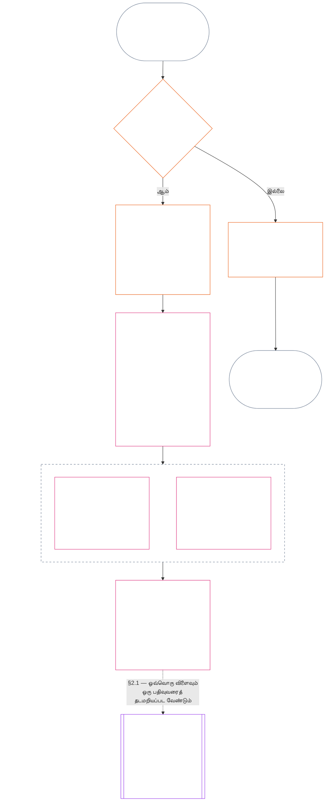

<!-- Locale: Tamil (ta) | Source: 9c2c8c10c871d91157bcd27b9f56ad6a1cec90d3 | AI-drafted, unreviewed | PARTIAL: Chapter Eleven §§1–3 only -->

### 1. மூன்று கேள்விகள்

*எளிய சொற்களில்: நிலைத்தட மதிப்பீடு, வரிசையாக மூன்று கேள்விகளுக்குப் பதிலளிப்பதன் மூலம் செய்யப்படுகிறது. விரும்பிய மதிப்பீட்டிலிருந்து உண்மைகளை ஊகிக்காதீர்கள்; விரும்பிய விளைவை நியாயப்படுத்த மதிப்பீட்டைத் தேர்ந்தெடுக்காதீர்கள்.*

| கேள்வி | கேள்வி கேட்பது என்ன | பதில் எங்கே அளிக்கப்படுகிறது |
| --- | --- | --- |
| **1. என்ன நடந்தது?** | எந்த உண்மைகள் சரிபார்க்கப்பட்டன; யாரைப் பற்றியோ எதைப் பற்றியோ, எந்தக் காலத்தில், எந்த நிலைத்தடப் பதிவு மற்றும் சவால் நிலைமையுடன்? | [பிரிவு 2](#2-question-1--what-happened) மற்றும் [பிரிவு 3](#3-question-1-event-type-guide--what-kind-of-help-or-harm-occurred) |
| **2. அது எவ்வளவு நல்லது அல்லது கெட்டது?** | அந்த உண்மைகள் எந்த வகையான, எந்த அளவிலான பங்களிப்பு அல்லது மீறலை நிறுவுகின்றன? | [அத்தியாயம் பன்னிரண்டு பிரிவு 1](core_12.000_standing_measurement.md#1-question-2--how-good-or-bad-was-it) |
| **3. அதன் விளைவாக என்ன நடக்கும்?** | என்ன அங்கீகாரம், தயார்நிலை, தீர்வு, பாதுகாப்பு, கட்டுப்பாடு அல்லது வேறு விளைவு தொடர்கிறது? | [அத்தியாயம் பதின்மூன்று](core_13.000_standing_integration.md#chapter-thirteen-standing-effects-and-integration) |

ஒவ்வொரு கேள்வியும் அதற்கு முந்தைய பதிலைச் சார்ந்துள்ளது:

- கேள்வி 1, கேள்வி 2-க்கு சரிபார்க்கப்பட்ட உண்மைகளை வழங்குகிறது.
- கேள்வி 2, கேள்வி 3-க்காக அந்த உண்மைகளை அளவிடுகிறது.
- விரும்பிய முடிவுக்குப் பொருந்துமாறு கேள்வி 3 உண்மைகளையோ மதிப்பீட்டையோ மீண்டும் எழுதக்கூடாது.

மூன்று கேள்விகளுக்கான பதில்கள் ஒன்றாக, வரையறுக்கப்பட்ட ஒரு நிகழ்வு அல்லது வரையறுக்கப்பட்ட ஒரு வடிவத்திற்கான முழுமையான நிலைத்தட மதிப்பீட்டை உருவாக்குகின்றன. ஒரு பொருளுக்கு காலப்போக்கில் இத்தகைய பல மதிப்பீடுகள் இருக்கலாம்; அவற்றில் எதுவும் அந்தப் பொருளின் நிகர மதிப்பெண்ணோ ஒட்டுமொத்த மதிப்பீடோ அல்ல. பங்களிப்பு மற்றும் மீறல் நிலைத்தடப் பதிவுகள் கேள்விகள் 1 மற்றும் 2-க்கான பதில்களைப் பாதுகாக்கின்றன; அவற்றின் அடிப்படையில் அடுத்து என்ன நிகழும் என்பதை கேள்வி 3 முடிவு கூறுகிறது.

#### 1.1 நோக்கமும் வரம்பும்

இந்த அத்தியாயம் **அமைப்புகள்**, **உணர்வுள்ளோர்**, **நிறுவனங்கள்** ஆகியவற்றுக்கான அரசியலமைப்பு பதிவுக் கட்டமைப்பைச் சொல்கிறது; [அத்தியாயம் பன்னிரண்டு](core_12.000_standing_measurement.md#chapter-twelve-standing-measurement--question-2-how-good-or-bad-was-it) அளவீட்டுக் கட்டமைப்பைச் சொல்கிறது. [**CS-9.305**](corpus_systems/cs_09.305_system_classification_machinery.md#cs-9305-part-a-system-classification-machinery) (*அமைப்பு வகைப்பாட்டு இயந்திரம்*) கீழ் வகைப்படுத்தப்பட்ட ஒவ்வொரு அமைப்பும் இதில் அடங்கும். இந்தக் கட்டமைப்புகள் வதந்தி, பிரபலத்தன்மை, தெளிவற்ற நற்பெயர், உள்ளார்ந்த கண்ணியம் அல்லது பொதுவான மதிப்பு ஆகியவற்றை அளவிடுவதில்லை; இவற்றில் எதுவும் நிலைத்தட மதிப்பீட்டின் அனுமதிக்கப்பட்ட பொருள் அல்ல.

பின்வரும் சூழல்களிலும் நிலைத்தடச் செயல்முறை செயல்திறனுடன் இருக்க வேண்டும்:

- முன்பு சரிபார்க்கப்பட்ட பங்களிப்புகள் தற்போதைய திறன் அல்லது நம்பகத்தன்மையைக் காட்ட முடியாத அளவு பழையதாகிவிட்டால்;
- மீறல்கள் தீர்க்கப்படாமல் இருந்தால்;
- சீரமைப்பு செலவு மிக்கதாக இருந்தால்;
- பொறுப்பு எல்லைகளைக் கடந்தால்; அல்லது
- பொறுப்புக்கூறலைத் தடுக்க ஒரு செயற்பாட்டாளர் அமைப்பின் அடுக்குகளையோ மறுபெயரிடலையோ பயன்படுத்தினால்.

இவை ஏற்றுக்கொள்ளப்பட்ட செயலாக்க உரையில் இடம்பெற வேண்டியவை:

- அன்றாட நடைமுறைகள்;
- மேல்நிலைக்கு எடுத்துச் செல்லும் படிகள்;
- திருப்பிச் செலுத்தல் மற்றும் சீரமைப்புச் செயல்கள்;
- மீட்டெடுக்கும் பொறுப்புக்கூறல் நடவடிக்கைகள்; மற்றும்
- ஊக்க வடிவமைப்பு.

அத்தியாயம் பன்னிரண்டின் அளவீடு மட்டும் வலுக்கட்டாயம், காவலில் வைத்தல் அல்லது வேறு சுதந்திரக் கட்டுப்பாட்டைத் தானாகவே அனுமதிப்பதில்லை. அத்தகைய விளைவு, அத்தியாயம் ஆறு **கட்டுரை XX** (*சரிபார்க்கப்பட்ட மீறலுக்குப் பிந்தைய நீதி*)யின் விகிதாசாரம், குறைந்தபட்சக் கட்டுப்பாடு, காலவரம்பு, திருப்பிச் செலுத்தல் மற்றும் மீட்டெடுக்கும் பொறுப்புக்கூறல் தேவைகள் உட்பட, தனியாகப் பூர்த்தி செய்ய வேண்டும்.

<strong>தடமறிதல் · வரையறைகள் · மதிப்பீடு · இணக்கம்</strong>

- மேல்நிலை: [அத்தியாயம் ஒன்று §16 — பொறுப்பான நிர்வாகம் விரிவாக](core_01.010_stewardship_capacity_principles.md#16-stewardship-in-depth); [அத்தியாயங்கள் இரண்டு முதல் நான்கு](core_02.000_definition_structure.md); [அத்தியாயம் ஐந்து](core_05.000_definitions_home.md#chapter-five-foundational-definitions).
- அடுத்த நிலை: [§2](#2-question-1--what-happened) (*கேள்வி 1*); [§4](#4-standing-record-operational-requirements) (*சரிபார்ப்பு மற்றும் பதிவு தேவைகள்*); [§5](#5-record-custody-and-opening-authority) (*பதிவுக் காப்பும் திறக்கும் அதிகாரமும்*); [§6](#6-handling-a-standing-record) (*நிலைத்தடப் பதிவைக் கையாளுதல்*); [அத்தியாயம் பன்னிரண்டு §1](core_12.000_standing_measurement.md#1-question-2--how-good-or-bad-was-it) (*கேள்வி 2 அளவீடு*); [அத்தியாயம் பன்னிரண்டு §2](core_12.000_standing_measurement.md#2-magnitude-and-severity-input-dimensions) (*அளவீட்டு உள்ளீட்டுப் பரிமாணங்கள்*); [அத்தியாயம் பன்னிரண்டு §3](core_12.000_standing_measurement.md#3-route-descriptor-catalogs-and-measurement-roles) (*பாதை விவரிப்பான் பட்டியல்கள்*); [அத்தியாயம் பன்னிரண்டு §4](core_12.000_standing_measurement.md#4-slot-grammar-and-shared-scaling) (*இடத்துண்டு இலக்கணமும் பகிரப்பட்ட அளவிடலும்*); [அத்தியாயம் பன்னிரண்டு §5](core_12.000_standing_measurement.md#5-constitutional-inputs-to-axis-assignment) (*அரசியலமைப்பு மூலங்களின் அடிப்படையில் அச்சு ஒதுக்கீடு*); [அத்தியாயம் பன்னிரண்டு §6](core_12.000_standing_measurement.md#6-unified-proportional-lequ-scale--contribution-and-violation-axes) (*இரு அச்சுகளுக்குமான ஒருங்கிணைந்த விகிதாசார LEQU அளவுகோல்*); [அத்தியாயம் பதின்மூன்று](core_13.000_standing_integration.md#chapter-thirteen-standing-effects-and-integration) (*கேள்வி 3*).
- [முக்கியத்துவம்](core_05.050_band_oversight.md#materiality) · [O](core_05.050_band_oversight.md#materiality) · [M](core_05.050_band_oversight.md#materiality-determination-a) · [A](core_05.050_band_oversight.md#materiality-determination-a) · [C](core_05.050_band_oversight.md#materiality-determination-c)
- [தீங்கு](core_05.035_band_accountability.md#harm) · [O](core_05.035_band_accountability.md#harm) · [M](core_05.035_band_accountability.md#harm-a) · [A](core_05.035_band_accountability.md#harm-a) · [C](core_05.035_band_accountability.md#harm-c)
- [விகிதாசாரம்](core_05.035_band_accountability.md#proportionality) · [O](core_05.035_band_accountability.md#proportionality) · [M](core_05.035_band_accountability.md#proportionality-a) · [A](core_05.035_band_accountability.md#proportionality-a) · [C](core_05.035_band_accountability.md#proportionality-c)

### 2. கேள்வி 1 — என்ன நடந்தது?

<strong>தடமறிதல்</strong>

- மேல்நிலை: [§1](#1-the-three-questions) (*மூன்று கேள்விக் கட்டமைப்பு*); [அத்தியாயங்கள் இரண்டு முதல் நான்கு](core_02.000_definition_structure.md) (*பதிவு, சரிபார்ப்பு, வரையறைகளிலிருந்து முடிவுகளுக்கான தடமறிதல்*).
- அரசியலமைப்பு நான்மத்தின் உறுப்புகள்: **பங்கேற்பு**; **மேற்பார்வை** (சவால் செய்யக்கூடிய தன்மை மற்றும் சவால் வழிகள்). முதன்மை நோக்கங்கள்: **செழிப்பு** மற்றும் **தொடர்ச்சி** (பின்னர் அளவிடுவதற்காக பங்களிப்பு மற்றும் மீறல் கண்டறிதல்களைத் தனித்தனியாகப் பாதுகாக்கும் தடமறியக்கூடிய பதிவுகள்).
- அடுத்த நிலை:
  - [§2.2](#22-silence-is-the-default) (*மௌனம் இயல்புநிலை*);
  - [§2.3](#23-protected-dissent-is-not-a-trigger) (*பாதுகாக்கப்பட்ட கருத்து வேறுபாடு தூண்டுதல் அல்ல*);
  - [§2.4](#24-linked-standing-records-and-no-offset-bridge) (*இணைக்கப்பட்ட நிலைத்தடப் பதிவுகள் மற்றும் ஈடுசெய்யாமை இணைப்பு*);
  - [§2.5](#25-verified-input-gate) (*சரிபார்க்கப்பட்ட உள்ளீட்டு வாயில்*);
  - [§2.6](#26-stage-boundary) (*கட்ட எல்லை*);
  - [§2.7](#27-forum-boundary) (*மன்ற எல்லை*);
  - [§3](#3-question-1-event-type-guide--what-kind-of-help-or-harm-occurred) (*நிகழ்வு-வகை வழிகாட்டி*);
  - [§4](#4-standing-record-operational-requirements) (*பதிவுத் தேவைகள்*);
  - [§5](#5-record-custody-and-opening-authority) (*பதிவுக் காப்பும் திறக்கும் அதிகாரமும்*);
  - [§6](#6-handling-a-standing-record) (*நிலைத்தடப் பதிவைக் கையாளுதல்*);
  - [அத்தியாயம் பன்னிரண்டு §1](core_12.000_standing_measurement.md#1-question-2--how-good-or-bad-was-it) (*கேள்வி 2 அளவீடு*);
  - [அத்தியாயம் பன்னிரண்டு §2](core_12.000_standing_measurement.md#2-magnitude-and-severity-input-dimensions) (*அளவீட்டு உள்ளீட்டுப் பரிமாணங்கள்*);
  - [அத்தியாயம் பன்னிரண்டு §3](core_12.000_standing_measurement.md#3-route-descriptor-catalogs-and-measurement-roles) (*பாதை விவரிப்பான் பட்டியல்கள்*);
  - [அத்தியாயம் பன்னிரண்டு §4](core_12.000_standing_measurement.md#4-slot-grammar-and-shared-scaling) (*இடத்துண்டு இலக்கணமும் பகிரப்பட்ட அளவிடலும்*);
  - [அத்தியாயம் பன்னிரண்டு §5](core_12.000_standing_measurement.md#5-constitutional-inputs-to-axis-assignment) (*அரசியலமைப்பு மூலங்களின் அடிப்படையில் அச்சு ஒதுக்கீடு*);
  - [அத்தியாயம் பன்னிரண்டு §6](core_12.000_standing_measurement.md#6-unified-proportional-lequ-scale--contribution-and-violation-axes) (*இரு அச்சுகளுக்குமான ஒருங்கிணைந்த விகிதாசார LEQU அளவுகோல்*);
  - [அத்தியாயம் பதின்மூன்று](core_13.000_standing_integration.md#chapter-thirteen-standing-effects-and-integration) (13.000) (*கேள்வி 3*).

 

*எளிய சொற்களில்: கேள்வி 1, என்ன நடந்தது என்பதற்கான வரையறுக்கப்பட்ட, சவால் செய்யக்கூடிய விவரத்தை நிறுவுகிறது. எந்த மதிப்பீடு அல்லது விளைவையும் பரிசீலிப்பதற்கு முன் பொருள், நிகழ்வு அல்லது வடிவம், காலப்பகுதி, சரிபார்க்கப்பட்ட உண்மைகள் மற்றும் பதிவு நிலை ஆகியவற்றைக் கண்டறிகிறது. சரிபார்க்கப்பட்ட உதவியும் சரிபார்க்கப்பட்ட மீறலும் தனித்த நிலைத்தடப் பதிவுகளில் வைக்கப்படுகின்றன; ஒன்றால் மற்றொன்று அழிக்கப்பட முடியாது. இவை பிரபல மதிப்பெண்களோ தெளிவற்ற குறிச்சொற்களோ அல்ல.*

**நிலைத்தடப் பதிவு** என்பது குறிப்பிட்ட பொருள், செயல்பாட்டுப் பரப்பு, பதிவுக் காலம், மறுஆய்வு நிலை மற்றும் முடிவுச் சூழலுக்காக இந்த அத்தியாயம் பயன்படுத்தும் வரையறுக்கப்பட்ட பதிவாகும். அளவீடு தொடங்குவதற்கு முன் அது பின்வருவனவற்றை நிறுவ வேண்டும்:

- நிலைத்தடப் பதிவு யாரைப் பற்றியது அல்லது எதைப் பற்றியது;
- அது வரையறுக்கப்பட்ட நிகழ்வைப் பற்றியதா அல்லது வரையறுக்கப்பட்ட வடிவத்தைப் பற்றியதா;
- தொடர்புடைய நடத்தை மற்றும் விளைவுகள் எப்போது, எங்கே நிகழ்ந்தன;
- எந்த உண்மைகள் சரிபார்க்கப்பட்டன, எவை இன்னும் சர்ச்சைக்குரியவை;
- அந்தக் கண்டறிதல்களை ஆதரிக்கும் சான்று, attribution மற்றும் சவால் வழி எவை; மற்றும்
- நிலைத்தடப் பதிவின் தற்போதைய மறுஆய்வு, திருத்தம் மற்றும் மாற்றீட்டு நிலை என்ன.

ஒரு நிகழ்வு நிலைத்தடப் பதிவைத் தூண்டுகிறதா, பதிவு பின்னர் எதைக் கொண்டிருக்கிறது என்பதை வரைபடம் தொடர்கிறது; அடுத்துள்ள துணைப்பிரிவுகள் ஒவ்வொரு விதியையும் குறிப்பிடுகின்றன. "இல்லை" என்ற கிளை முதன்மைப் பாதையிலிருந்து வலப்புறம் செல்கிறது.

#### 2.1 நிலைத்தடப் பதிவுகள்: வகைகளும் பொருள்களும்

கேள்வி 1 சரிபார்க்கப்பட்ட உதவிக்கு **பங்களிப்பு நிலைத்தடப் பதிவையும்**, பொறுப்புக்கூறல் தோல்விகள் உட்பட சரிபார்க்கப்பட்ட தீங்குக்கு **மீறல் நிலைத்தடப் பதிவையும்** பயன்படுத்துகிறது. ஒரு நிலைத்தடப் பதிவு இந்த இரு வகைக் கண்டறிதல்களையும் ஒன்றிணைக்காது.

- நிலைத்தடப் பதிவு ஓர் உணர்வுள்ளோர், நிறுவனம், அமைப்பு, மதிப்பீடு, வரையறுக்கப்பட்ட நிகழ்வு, பங்கு, கூட்டு அமைப்பு, செயற்பாட்டாளர்-குறிப்பிட்ட பதிவு அல்லது அரசியலமைப்புக்கு தொடர்புடைய வேறு அலகைப் பற்றியதாக இருக்கலாம்.
  - வேறுபட்ட பொருள்கள், பங்குகள், அமைப்புகள், சமூகங்கள், பதிவுக் காலங்கள், மறுஆய்வு நிலைகள் அல்லது முடிவுச் சூழல்களை வேறுபாடற்ற ஒரே நிலைத்தடக் குறிச்சொல்லில் சுருக்கக்கூடாது.
- நிலைத்தடப் பதிவு தெளிவான தொடக்கமும் முடிவும் உள்ள ஒரு நிகழ்வான **வரையறுக்கப்பட்ட நிகழ்வை**, அல்லது மீண்டும் நிகழும் நடத்தையின் **வடிவத்தை** உள்ளடக்கலாம்.
  - ஒரு வடிவத்துக்கு வரையறுக்கப்பட்ட பொருள், பரப்பு மற்றும் மறுஆய்வுக் காலம் தேவை.
- ஒரே பொருளுக்கு காலப்போக்கில் பல நிலைத்தடப் பதிவுகள் இருக்கலாம்; இணைக்கப்பட்ட பங்களிப்பு மற்றும் மீறல் பதிவுகளும் இதில் அடங்கும்.
  - தொடர்புடைய நிலைத்தடப் பதிவுகள் ஒரே பொருள், ஒன்றுடன் ஒன்று மேலிடும் பதிவுக் காலம், வரையறுக்கப்பட்ட நிகழ்வு, வடிவம் அல்லது முடிவுச் சூழலைப் பகிர்ந்தால் **பிரிவு 4.2**-இன் கீழ் ஒன்றையொன்று **குறுக்குக் குறிப்பிட** வேண்டும்.
- நிலைத்தடப் பதிவு என்பது தனிப்பட்ட நற்பெயர் மதிப்பெண், கண்ணியத் தரவரிசை, நிரந்தர நிலை, பொதுவான மதிப்புக் குறிச்சொல் அல்லது கலந்த மதிப்பெண் அட்டை அல்ல.
  - செயல்பாட்டு தேவைகள் **பிரிவு 4**-இல் உள்ளன.

பின்னர் ஏற்படும் நிலைத்தட விளைவு எதுவும் அத்தியாயம் பதின்மூன்றுக்குச் சொந்தமானது; அது தொடர்புடைய நிலைத்தடப் பதிவு அல்லது பதிவுகள்வரைத் தடமறியப்பட வேண்டும், ஆனால் பதிவின் ஒரு பகுதியாக இருக்கக்கூடாது.

#### 2.2 மௌனம் இயல்புநிலை

உணர்வுள்ளோர், நிறுவனம் அல்லது அமைப்புக்கு நிலைத்தடப் பதிவு இல்லாததே வழக்கமான நிலை; பெரும்பாலான உணர்வுள்ளோர் இந்த நிலையிலேயே இருப்பார்கள்.

- **பிரிவு 4**-இன் கீழ் தூண்டுதல் சரிபார்க்கப்பட்டால் மட்டுமே நிலைத்தடப் பதிவு திறக்கப்படும். பெயரிடப்பட்ட பதிவு-திறப்பு அதிகாரம் பதிவை ஒப்புதல் அளிக்க வேண்டும்; தனியான பதிவுக் காப்பாளர் அதைச் செய்ய வேண்டும் (**பிரிவு 5**). பின்வருவனவற்றுக்காக நிலைத்தடப் பதிவு ஒருபோதும் திறக்கப்படாது:
  - அடிப்படை நிலையை நிறுவ;
  - பட்டியலை நிறைவு செய்ய; அல்லது
  - பெயரிடப்பட்ட பாதைக் காவலர் விரும்புவதால்.
- நிலைத்தடப் பதிவு இல்லாதது எதையும் தெரிவிக்காது. "மதிப்பிடப்படவில்லை", "சரிபார்க்கப்படவில்லை", "கோப்பில் பதிவு இல்லை" என்பவை ஆபத்து, குறைந்த பங்களிப்பு அல்லது வேறு எதற்கும் சான்றல்ல. இல்லாத பதிவை அதிகக் கண்காணிப்பு, குறைந்த இயல்புநிலை அல்லது பெயரிடப்பட்ட பாதைக்கான நிபந்தனை அணுகல் ஆகியவற்றுக்கான காரணமாக யாரும் கருதக்கூடாது.
- பின்வருவனவற்றுக்கான நிபந்தனையாக எந்த நிறுவனமோ அமைப்போ நிலைத்தடப் பதிவு, "பதிவு இல்லை" என்ற உறுதிமொழி அல்லது ஒன்றைத் திறப்பதற்கான ஒப்புதல் ஆகியவற்றைக் கோரக்கூடாது:
  - **கட்டுரை III** (*உயிர்வாழ்தல் மற்றும் அத்தியாவசிய அணுகல்*) தேவைகள்;
  - **கட்டுரை III-C** (*உழைப்பு மற்றும் பொருளாதாரத் தளம்*) பாதுகாப்புகள்;
  - வழக்கமான வணிகம்; அல்லது
  - பாதிக்கப்பட்ட தரப்பாகப் பங்கேற்பது.
  [அத்தியாயம் பதின்மூன்று §6.2 திறன் வரம்புகளும் அனுமதிகளும்](core_13.000_standing_integration.md#62-competency-bars-and-clearances) கீழ் நம்பிக்கை-உணர்திறன் கொண்ட பெயரிடப்பட்ட பாதைகளுக்கான வெளியிடப்பட்ட திறன் வரம்புகள் விதிவிலக்கு; பெயரிடப்பட்ட பாதை ஏன் நம்பிக்கை-உணர்திறன் கொண்டது என்பதை அவை கூற வேண்டும்.
- ஒரு பொருளைப் பற்றிய நிலைத்தடப் பதிவு திறக்கப்பட்டால், **பிரிவு 4** கோருவது போல் அந்தப் பொருளுக்குத் தெரிவிக்க வேண்டும். ஆவணப்படுத்தப்பட்ட [சான்று பாதுகாப்பு](core_05.050_band_oversight.md#evidence-preservation) அல்லது பாதுகாப்புத் தேவை நியாயப்படுத்தினால் மட்டுமே அறிவிப்பைத் தாமதிக்கலாம்; அதுவும் வரையறுக்கப்பட்ட, நிர்ணயிக்கப்பட்ட காலத்திற்கே. அறிவிப்பே நிலைத்தடப் பதிவை சவால் செய்யக்கூடியதாக ஆக்குகிறது: பதிவு இருப்பது தெரியாத பொருள் அதைச் சவால் செய்யவோ திருத்தவோ முடியாது.

#### 2.3 பாதுகாக்கப்பட்ட கருத்து வேறுபாடு தூண்டுதல் அல்ல

**கட்டுரை XI-D** (*கூட்டம், கருத்து வேறுபாடு மற்றும் அமைதியான எதிர்ப்பு*) கீழ் கருத்து வேறுபாடு அல்லது அமைதியான எதிர்ப்பு — [பாதுகாக்கப்பட்ட வன்முறையற்ற குடிமைச் சட்டமறுப்பு](core_06.005_rights_part_b.md#xi-d-nonviolent-civil-disobedience) உட்பட — மற்றும் [*கருத்து வேறுபாடு மற்றும் அமைதியான எதிர்ப்பு உரிமைத் தளம்*](core_06.005_rights_part_b.md#xi-d-dissent-and-peaceful-protest), சரிபார்க்கப்பட்ட தூண்டுதல் அல்ல.

- அது மீறல் நிலைத்தடப் பதிவைத் திறக்கவோ நீட்டிக்கவோ தீவிரப்படுத்தவோாது; **பிரிவு 8.2**-இன் கீழ் தீவிரத்தன்மை உள்ளீடு அல்ல; அதை மீண்டும் செய்வதால் ஒரு வடிவமாகவும் மாறாது.
- அரசியலமைப்புத் தளத்தைத் தனித்துச் சென்று மீறும், பிரித்தறியக்கூடிய நடத்தை அதன் சொந்த அடிப்படையில் பதிவு செய்யப்படும்; எதிர்ப்பின் பார்வை, நோக்கம் அல்லது இலக்குக்காக தீவிரப்படுத்தப்படாது.

#### 2.4 இணைக்கப்பட்ட நிலைத்தடப் பதிவுகளும் ஈடுசெய்யாமை இணைப்பும்

<strong>தடமறிதல்</strong>

- மேல்நிலை: [§2.1](#21-standing-records-kinds-and-subjects) (*தனித்த பங்களிப்பு மற்றும் மீறல் பதிவுகள்*).
- அடுத்த நிலை:
  - [§2.5](#25-verified-input-gate) (*சரிபார்க்கப்பட்ட உள்ளீட்டு வாயில்*);
  - [§2.7](#27-forum-boundary) (*மன்ற எல்லை*);
  - [§4.2](#42-related-standing-record-cross-references) (*குறுக்குக் குறிப்புகள்*);
  - [அத்தியாயம் பன்னிரண்டு §1](core_12.000_standing_measurement.md#1-question-2--how-good-or-bad-was-it) (*கேள்வி 2 அளவீடு*);
  - [அத்தியாயம் பன்னிரண்டு §2](core_12.000_standing_measurement.md#2-magnitude-and-severity-input-dimensions) (*அளவீட்டு உள்ளீட்டுப் பரிமாணங்கள்*);
  - [அத்தியாயம் பன்னிரண்டு §3](core_12.000_standing_measurement.md#3-route-descriptor-catalogs-and-measurement-roles) (*பாதை விவரிப்பான் பட்டியல்கள்*);
  - [அத்தியாயம் பன்னிரண்டு §4](core_12.000_standing_measurement.md#4-slot-grammar-and-shared-scaling) (*இடத்துண்டு இலக்கணமும் பகிரப்பட்ட அளவிடலும்*);
  - [அத்தியாயம் பன்னிரண்டு §5](core_12.000_standing_measurement.md#5-constitutional-inputs-to-axis-assignment) (*அரசியலமைப்பு மூலங்களின் அடிப்படையில் அச்சு ஒதுக்கீடு*);
  - [அத்தியாயம் பன்னிரண்டு §6](core_12.000_standing_measurement.md#6-unified-proportional-lequ-scale--contribution-and-violation-axes) (*இரு அச்சுகளுக்குமான ஒருங்கிணைந்த விகிதாசார LEQU அளவுகோல்*);
  - [அத்தியாயம் பதின்மூன்று](core_13.000_standing_integration.md#chapter-thirteen-standing-effects-and-integration) (13.000) (*கேள்வி 3*).
- கூடவே படிக்க: [அத்தியாயம் பதின்மூன்று — நிலைத்தட ஒருங்கிணைப்பு](core_13.000_standing_integration.md#2-automatic-integration-review-and-continuity) (13.000) (*உரிமைத் துறப்பு இல்லாமையும் இணைக்கப்பட்ட பதிவுகளின் ஒருங்கிணைப்பும்*); [அத்தியாயம் பதின்மூன்று §6.2 — திறன் வரம்புகளும் அனுமதிகளும்](core_13.000_standing_integration.md#62-competency-bars-and-clearances) (13.000 §6.2); [அத்தியாயம் பதின்மூன்று §4.2 — நிலைத்தடப் பூட்டுகள்](core_13.000_standing_integration.md#42-prevention--general-standing-locks) (13.000 §4.2).

 

**முக்கிய விதி:** சரிபார்க்கப்பட்ட **பங்களிப்பு நிலைத்தடப் பதிவுகளும்**, சரிபார்க்கப்பட்ட **மீறல் நிலைத்தடப் பதிவுகளும்**, **பிரிவு 2.1** கீழ் தனித்தனியாக வைக்கப்படுகின்றன. ஒவ்வொரு பங்களிப்பு அல்லது மீறல் கண்டறிதலும் தன் நிலைத்தடப் பதிவிலுள்ள அதற்கான ஆதரவு உண்மைகளை அடிப்படையாகக் கொண்டிருக்க வேண்டும். பகுப்பாய்வும் ஆதரவு ஆவணங்களும் இரு பதிவு வழிகளையும் தனித்தனியாகத் தடமறியக்கூடியவையாக வைத்திருக்க வேண்டும். ஒரு பதிவு அல்லது இணைக்கப்பட்ட பதிவுகளின் தொகுப்பு எதுவும் நிகர மதிப்பெண், கலப்பு மதிப்பெண் அல்லது பரிமாற்றம் அல்ல.

- **மீறல் நிலைத்தடப் பதிவுகளும் நிலைத்தடப் பூட்டுகளும்:**
  - அத்தியாயம் பதின்மூன்றின் கீழ் மீறல் நிலைத்தடப் பதிவுகளிலிருந்து பெறப்படும் பொருந்தக்கூடிய **நிலைத்தடப் பூட்டுகள்**, சரிபார்க்கப்பட்ட மீறல் தீர்க்கப்படாமல் இருக்கும்போது நிலைத்தடத்தைக் கட்டுப்படுத்தலாம், பங்கு தகுதியைக் கட்டுப்படுத்தலாம் அல்லது தீர்வுக்கான அணுகலைப் பாதிக்கலாம்.
  - நிலைத்தடப் பூட்டுகள் பங்களிப்பு நிலைத்தடப் பதிவுகளில் பதிவான சரிபார்க்கப்பட்ட நேர்மறைப் பங்களிப்பை அழிக்கக்கூடாது.
  - தீர்க்கப்படாத சரிபார்க்கப்பட்ட மீறல்களின் எடை காலம் கடந்ததாலேயே குறைக்கப்படாது.
  - சரிபார்க்கப்பட்ட மீறல்கள் தொடர்பற்ற பங்களிப்பு நிலைத்தடப் பதிவுகளைத் தவறான எதிர்மறை நற்பெயர் கோப்பாக மாற்றி எழுதக்கூடாது.
- **பங்களிப்பு நிலைத்தடப் பதிவுகளும் திறன் அனுமதிகளும்:**
  - சரிபார்க்கப்பட்ட பங்களிப்பு வெளியிடப்பட்ட **திறன் வரம்புகளுக்கு** எதிரான பொருந்தக்கூடிய **திறன் அனுமதிகளை** ஆதரிக்கலாம்; தற்போதையதும் பங்கிற்குத் தொடர்புடையதுமானால் நம்பிக்கை, பங்கு அல்லது அங்கீகாரத்துடன் தொடர்புடைய தகுதியையும் ஆதரிக்கலாம்.
  - சரிபார்க்கப்பட்ட பங்களிப்பு, சரிபார்க்கப்பட்ட மீறல் கண்டறிதலை ஈடுசெய்யவோ சராசரியைக் குறைக்கவோ மன்னிக்கவோ மறுபெயரிடவோ கூடாது.
  - வாயில் நிபந்தனையைப் பூர்த்தி செய்வது பொருந்தக்கூடிய நிலைத்தடப் பூட்டைத் துறப்பதில்லை.

**ஒரே விதிவிலக்கு:** ஒரு மீறல் கண்டறிதலே கூறப்பட்ட பங்களிப்பு உண்மையல்ல என்பதை நிரூபித்தால் — எடுத்துக்காட்டாக, உங்கள் பங்களிப்பு பதிவு கூறும் செயலை நீங்கள் உண்மையில் செய்யவில்லை என்று சான்று காட்டினால் — சரியான சான்று மற்றும் மறுஆய்வு செயல்முறை வழியாக, **பிரிவு 4.2**-இன் தேவையான குறுக்குக் குறிப்புடன் இணைக்கப்பட்ட பங்களிப்பு நிலைத்தடப் பதிவைத் திருத்தவோ நீக்கவோ முடியும். ஆனால் தனித்த பங்களிப்பு நிலைத்தடப் பதிவுகளில் உள்ள தொடர்பற்ற உதவியை மீறல் தானாகவே அழிப்பதில்லை.

#### 2.5 சரிபார்க்கப்பட்ட உள்ளீட்டு வாயில்

இந்த வாயில் பின்வருமாறு செயல்படுகிறது:

- நிலைத்தடம், நம்பிக்கை, பங்கு, அங்கீகாரம் அல்லது அங்கீகாரத்திற்கான தகுதியைப் பாதிக்கும் எந்த முடிவும் தொடர்புடைய **பங்களிப்பு நிலைத்தடப் பதிவுகள்** அல்லது **மீறல் நிலைத்தடப் பதிவுகளிலிருந்து** சரிபார்க்கப்பட்ட உள்ளீடுகளை மட்டுமே பயன்படுத்தலாம்.
- குற்றச்சாட்டுகள், தீர்ப்பளிக்கப்படாத கோரிக்கைகள், தற்காலிக வழிமாற்றுக் குறிச்சொற்கள், வரவேற்பு-நிலை விவரிப்புகள் மற்றும் தகராறு-நிலை பிற பொருட்கள் தனியாக நிலைத்தடத்திற்கான பங்களிப்பு அல்லது மீறலின் தன்மையை வழங்குவதில்லை.
- சரிபார்க்கப்பட்ட உள்ளீடு என்பது **நிலைத்தடக் கண்டறிதல்**: சரிபார்க்கப்பட்ட பங்களிப்புக் கண்டறிதல் (அச்சு I) அல்லது சரிபார்க்கப்பட்ட மீறல் கண்டறிதல் (அச்சு II).
- பங்களிப்பு மற்றும் மீறல் கண்டறிதல்கள் தனித்த நிலைத்தடப் பதிவுகளில் இருக்கும் (பார்க்க **பிரிவு 2.1**).

#### 2.6 கட்ட எல்லை

நிலைத்தடப் பதிவின் கட்டங்கள் தனித்தனியாகவே இருக்கும்:

- கேள்வி 1 சரிபார்க்கப்பட்ட உண்மைகளைப் பதிவு செய்கிறது; கேள்வி 2 அவற்றை அளவிடுகிறது.
- கேள்வி 2 அளவீடு இன்னும் நிலுவையில் இருந்தாலும், சரிபார்க்கப்பட்ட உண்மை அடிப்படை முழுமையானதும் நிலைத்தடப் பதிவைத் திறக்கலாம்.
- அளவீடு நடைபெறும் வரை, கேள்வி 2 புலங்கள் இடத்துண்டு அல்லது வகையை உணர்த்துவதற்குப் பதிலாக நிலுவையில் இருப்பதைக் குறிப்பிட வேண்டும்.
- கேள்வி 3-இன் எந்த **நிலைத்தட விளைவையும்** நிலைத்தடப் பதிவு கூறவோ செயல்படுத்தவோ கூடாது.

#### 2.7 மன்ற எல்லை

*எளிய சொற்களில்: மன்றங்கள் தகராறுகளைக் கண்காணித்து, சவால் செய்ய அனுமதித்து, சரிபார்க்கப்பட்ட முடிவுகளாக மாற்றும் இடங்கள் — ஆனால் வழக்குத் தாக்கல் செய்வதோ ஒரு கதையாடல் மோதலில் வெல்வதோ நிலைத்தடத்தைப் புதுப்பிக்காது. **பிரிவு 2.5**-இன் சரிபார்க்கப்பட்ட உள்ளீட்டு வாயில் இன்னும் பொருந்தும். மன்றம் அத்தியாயங்கள் இரண்டு முதல் நான்கின் கீழ் உண்மைகளைச் சரிபார்த்தால், அது நிலைத்தடப் பதிவை **திறக்கலாம், புதுப்பிக்கலாம் அல்லது திருத்தலாம்** — அல்லது **சவாலின் பேரில் தவறான பதிவை ஒதுக்கலாம்**. மன்றங்கள் நல்லதையும் கெட்டதையும் ஒரு மதிப்பெண்ணாக இணைக்கவோ நிலைத்தட வகையைத் தாமாக உருவாக்கவோ செய்வதில்லை.*

இந்தப் பிரிவு ஒரே கேள்விக்குப் பொறுப்பாகும்: மன்றத்தின் பணி நிலைத்தடப் பதிவை எவ்வாறு அடைகிறது. தொடரின் மற்ற படிகள் இங்கு பெயரிடப்பட்ட பொறுப்பாளர்களுக்குரியவை; வரிசை பின்வருமாறு:

1. ஒரு தகராறு தாக்கல் செய்யப்படுகிறது; மன்றம் **மன்ற வழக்கு பதிவை** வைத்திருக்கிறது, அது நிலைத்தடப் பதிவு அல்ல. பொறுப்பாளர்: [அத்தியாயம் பதினைந்து §2.3 மன்ற வழக்கு பதிவுகள், நிலைத்தடப் பதிவுகள் மற்றும் சவால்கள்](core_15.000_forum.md#23-forum-case-records-standing-records-and-contests); [§2.7.1 மன்ற வழக்கு பதிவு](#271-forum-case-record)யையும் பார்க்கவும்.
2. மன்றம் [அத்தியாயங்கள் இரண்டு முதல் நான்கு](core_02.000_definition_structure.md) கீழ் உண்மைகளைச் சரிபார்க்கிறது.
3. சரிபார்க்கப்பட்ட கண்டறிதல்கள் சரிபார்க்கப்பட்ட உள்ளீட்டு வாயிலைக் கடக்கின்றன. பொறுப்பாளர்: [§2.5 சரிபார்க்கப்பட்ட உள்ளீட்டு வாயில்](#25-verified-input-gate).
4. மன்றமாகவும் இருக்கக்கூடிய பெயரிடப்பட்ட பதிவு-திறப்பு அதிகாரம், நிலைத்தடப் பதிவைத் திறக்கிறது, புதுப்பிக்கிறது அல்லது திருத்துகிறது; அல்லது சவாலின் பேரில் தவறான பதிவை ஒதுக்குகிறது. பதிவில் என்ன இருக்க வேண்டும் என்பதற்குப் பொறுப்பாளர் [§4.1 குறைந்தபட்சப் பதிவு உள்ளடக்கம்](#41-minimum-record-contents); யார் நடவடிக்கை எடுக்கலாம் என்பதற்குப் பொறுப்பாளர் [§5 பதிவுக் காப்பும் திறக்கும் அதிகாரமும்](#5-record-custody-and-opening-authority).
5. நிலைத்தடப் பதிவில் சரிபார்க்கப்பட்ட உண்மைகள் மட்டுமே இருக்கும்; கேள்வி 2 அவற்றை பின்னர் அளவிடும். பொறுப்பாளர்கள்: [§2.6 கட்ட எல்லை](#26-stage-boundary) மற்றும் [அத்தியாயம் பன்னிரண்டு §1 கேள்வி 2 — அது எவ்வளவு நல்லது அல்லது கெட்டது?](core_12.000_standing_measurement.md#1-question-2--how-good-or-bad-was-it).
6. நிலைத்தட விளைவு ஏதேனும் இருந்தால், நிலைத்தட விளைவுகளுக்குப் பொறுப்பான [அத்தியாயம் பதின்மூன்று](core_13.000_standing_integration.md#chapter-thirteen-standing-effects-and-integration) கீழ் அது தொடர்கிறது.

[அத்தியாயம் பதினைந்து](core_15.000_forum.md#chapter-fifteen-forums-and-jurisdiction) கீழுள்ள மன்றக் குடும்பங்கள், துல்லியமான தகராறுகள் நிலைத்தடச் செயல்முறையை எவ்வாறு கடக்கின்றன என்பதை **கண்காணிக்கின்றன**. [அத்தியாயம் பதினைந்து §6 காலந்தவறாத தீர்வு, முக்கியத்துவ நிலைகள் மற்றும் தாமத எதிர்ப்பு ஒழுங்கு](core_15.000_forum.md#6-timely-resolution-materiality-tiers-and-anti-delay-discipline) மற்றும் [கட்டுரை XXVI-C](core_06.020_rights_part_e.md#article-xxvi-c-timely-resolution-and-anti-delay-floor) (*காலந்தவறாத தீர்வு மற்றும் தாமத எதிர்ப்புத் தளம்*) கீழ் மன்றங்கள் பின்வருவனவற்றை வழங்குகின்றன:

- அணுகத்தக்க சவால்;
- சுயாதீன மறுஆய்வு;
- தடயவியல் ஆதரவு;
- தீர்வை வரிசைப்படுத்துதல்; மற்றும்
- நிலை சார்ந்த காலவரம்புகள்.

அத்தியாயங்கள் இரண்டு முதல் நான்கு கீழ் மன்றக் கண்டறிதல்கள் சரிபார்க்கப்பட்ட உள்ளீட்டு வாயிலைப் பூர்த்தி செய்தால், அவை:

- **பிரிவு 4.1** கீழ் நிலைத்தடப் பதிவுகளை **திறக்கலாம், புதுப்பிக்கலாம் அல்லது திருத்தலாம்**; அல்லது
- **சவாலின் பேரில் தவறான பதிவை ஒதுக்கலாம்**.

##### 2.7.1 மன்ற வழக்கு பதிவு

திறந்த தகராறு குறித்த மன்றத்தின் சொந்தக் கோப்பு [**மன்ற வழக்கு பதிவு**](core_05.035_band_accountability.md#forum-case-record) ஆகும்; இது [அத்தியாயம் பதினைந்து §2.3 மன்ற வழக்கு பதிவுகள், நிலைத்தடப் பதிவுகள் மற்றும் சவால்கள்](core_15.000_forum.md#23-forum-case-records-standing-records-and-contests) இல் வரையறுக்கப்பட்டுள்ளது. இது **நிலைத்தடப் பதிவு அல்ல**.

##### 2.7.2 மன்றக் கண்டறிதல்களும் கேள்வி 2 அளவீடும்

மன்றத்தின் சரிபார்க்கப்பட்ட உண்மைக் கண்டறிதல்கள் கேள்வி 1 நிலைத்தடப் பதிவுக்கான உண்மை அடிப்படையை வழங்கலாம். சரிபார்க்கப்பட்ட பங்களிப்பு அல்லது மீறல் எவ்வளவு நல்லது அல்லது கெட்டது என்பதற்கான கேள்வி 2 அளவீட்டை அவை **தீர்மானிப்பதில்லை** ([§2.6 கட்ட எல்லை](#26-stage-boundary)). ஆகவே:

- மன்ற நடவடிக்கைகள் பங்களிப்பு மற்றும் மீறல் பொருட்களை ஒரு நிகர மதிப்பெண், கலப்பு தகுதி-தீமைப் பதில் அல்லது வேறுபாடற்ற நிலைத்தடக் குறிச்சொல்லாக **இணைக்கக்கூடாது**; இணைக்கப்பட்ட நிலைத்தடப் பதிவுகள் [§2.1 நிலைத்தடப் பதிவுகள்: வகைகளும் பொருள்களும்](#21-standing-records-kinds-and-subjects) மற்றும் [§2.4 இணைக்கப்பட்ட நிலைத்தடப் பதிவுகளும் ஈடுசெய்யாமை இணைப்பும்](#24-linked-standing-records-and-no-offset-bridge) கீழ் தனித்தே இருக்கும்.
- மன்ற வெளியீடுகள் தகராறு விவரிப்புகள், வழிமாற்று வசதி அல்லது குழு விருப்பத்தை நிரூபிக்கக்கூடிய சரிபார்க்கப்பட்ட உள்ளீடுகளுக்கு ([§2.5 சரிபார்க்கப்பட்ட உள்ளீட்டு வாயில்](#25-verified-input-gate)), தனித்த அளவீட்டுக்கு ([அத்தியாயம் பன்னிரண்டு §1 கேள்வி 2 — அது எவ்வளவு நல்லது அல்லது கெட்டது?](core_12.000_standing_measurement.md#1-question-2--how-good-or-bad-was-it)), அல்லது [அத்தியாயம் பதின்மூன்று](core_13.000_standing_integration.md#chapter-thirteen-standing-effects-and-integration) பொறுப்பான நிலைத்தட விளைவு இயங்குமுறைகளுக்கு மாற்றாக **வைக்கக்கூடாது**.

##### 2.7.3 மன்ற எல்லை குறைக்காதவை

இந்த எல்லை பின்வருவனவற்றின் கீழ் தேவைப்படும் சவால், தீர்வு, இடைக்கால நிவாரணம் அல்லது நடைமுறைப் பாதுகாப்புகளைக் **குறைக்காது**:

- [கட்டுரை XIII-A](core_06.010_rights_part_c.md#article-xiii-a-reliability-and-trustworthiness-baseline) (*நம்பகத்தன்மை மற்றும் நம்பத்தகுந்த தன்மைக்கான அடிப்படை அளவு*);
- [கட்டுரை XIII-B](core_06.010_rights_part_c.md#article-xiii-b-right-to-redress-and-remedy) (*நிவாரணம் மற்றும் தீர்வுக்கான உரிமை*);
- [அத்தியாயம் பதினைந்து §6 காலந்தவறாத தீர்வு, முக்கியத்துவ நிலைகள் மற்றும் தாமத எதிர்ப்பு ஒழுங்கு](core_15.000_forum.md#6-timely-resolution-materiality-tiers-and-anti-delay-discipline);
- [கட்டுரை XXVI-C](core_06.020_rights_part_e.md#article-xxvi-c-timely-resolution-and-anti-delay-floor) (*காலந்தவறாத தீர்வு மற்றும் தாமத எதிர்ப்புத் தளம்*); அல்லது
- தொடர்புடைய நீதி கட்டுரைகள்.

சரிபார்க்கப்பட்ட மன்றக் கண்டறிதல்கள் மற்ற சரிபார்க்கப்பட்ட உள்ளீடுகளைப் போலவே அதே வாயில் வழியாக நிலைத்தடத்துக்குள் செல்ல வேண்டும் — அதைச் சுற்றி அல்ல.

### 3. கேள்வி 1 நிகழ்வு-வகை வழிகாட்டி — என்ன வகையான உதவி அல்லது தீங்கு நிகழ்ந்தது?

*எளிய சொற்களில்: உண்மைகள் சரிபார்க்கப்பட்ட பிறகு என்ன நடந்தது என்பதை விவரிக்க இந்த அட்டவணைகளைப் பயன்படுத்துங்கள். சம்பந்தப்பட்ட பங்களிப்பு அல்லது மீறலின் வகையை அடையாளம் காண அவை உதவுகின்றன. அது எவ்வளவு நல்லது அல்லது கெட்டது என்பதைத் தீர்மானிக்கவோ, இடத்துண்டு ஒதுக்கவோ, அதன் விளைவாக என்ன நடக்கும் என்பதை நிர்ணயிக்கவோ அவை செய்வதில்லை.*

#### 3.1 பங்களிப்பு நிகழ்வு வகைகள்

**தகுதி விதி:** கோரப்படும் பங்களிப்பு தடமறியக்கூடியதாகவும், பிறர்மீது செலவு சுமத்தப்படாததாகவும், நடைமுறையிலுள்ள அரசியலமைப்பு முழுவதுடனும் ஒத்துப்போவதாகவும் இருந்தால் மட்டுமே அது கணக்கில் கொள்ளப்படும்.

- பிறர்மீது சுமத்தப்பட்ட தீங்குகள், கட்டாய சார்புகள், உரிமைத் தளத்தைச் சுருக்குதல் அல்லது மறைக்கப்பட்ட சுமைகள் கோரப்படும் பங்களிப்பைத் தகுதியற்றதாக்கவோ வரையறுக்கவோலாம்.
- கோரப்படும் பங்களிப்பு தனியான மீறல் கண்டறிதலை ஈடுசெய்யாது.

கீழுள்ள அட்டவணையின் ஒவ்வொரு வரியும் சரிபார்க்கப்பட்ட உதவியின் பொதுவான பாதையையும் அதன் அரசியலமைப்புச் சார்பையும் பெயரிடுகிறது. ஒரே நிலைத்தடப் பதிவுக்கு ஒன்றுக்கு மேற்பட்ட வரிகள் பொருந்தலாம்.

| சரிபார்க்கப்பட்ட பங்களிப்பு வகை | என்ன நடந்தது | நான்மத்தின் உறுப்புகள் | முதன்மை நோக்கங்கள் |
| --- | --- | --- | --- |
| உயிர்வாழ்தலும் உடல் பராமரிப்பும் | ஒருவருக்கு உணவு, தங்குமிடம், மருத்துவப் பராமரிப்பு அல்லது பாதுகாப்பு கிடைத்தது | **பங்கேற்பு**, **மேற்பார்வை** | **செழிப்பு** |
| பராமரிப்பும் கற்பித்தலும் | குழந்தைகள் வளர்க்கப்பட்டனர், மூத்தோர் பராமரிக்கப்பட்டனர் அல்லது பிறருக்குக் கல்வி வழங்கப்பட்டது | **பங்கேற்பு**, **மேற்பார்வை** | **செழிப்பு**, **தொடர்ச்சி** |
| அதிர்ச்சியைத் தீர்த்தல் | நலத்தைத் தடுத்த உளவியல் தீங்கிலிருந்து மீள ஒருவருக்கு உதவி கிடைத்தது | **பங்கேற்பு**, **பொறுப்புக்கூறல்** | **செழிப்பு** |
| கடுமையான சுமைகளை அகற்றுதல் | நசுக்கும் கடன், சுரண்டலான வேலைநிலைகள் அல்லது அமைப்புமுறைத் தடைகள் அகற்றப்பட்டன | **பங்கேற்பு**, **மேற்பார்வை** | **செழிப்பு** |
| தன்னாட்சியை மீட்டல் | ஒருவர் தனது வாழ்க்கை குறித்து பொருளுள்ள தேர்வுகளைப் பெற்றார் | **பங்கேற்பு** | **செழிப்பு** |
| உற்பத்தித் திறனை விரிவாக்குதல் | கருவிகள், உள்கட்டமைப்பு அல்லது வாய்ப்புகள் பிறர் சுயமாக வளர வழிவகுத்தன | **பங்கேற்பு**, **மேற்பார்வை** | **செழிப்பு**, **தொடர்ச்சி** |
| நேரப் பயன்பாட்டுத் திறனை மேம்படுத்துதல் | தவிர்க்கக்கூடிய காத்திருப்பு, நிர்வாகத் தடைகள் அல்லது ஒருங்கிணைப்பு மேல்சுமை குறைந்து, பராமரிப்பு, ஓய்வு, தன்னாட்சி, கற்றல் அல்லது உரிமைகளுடன் ஒத்துப்போகும் பணிக்கான பயன்பாட்டு நேரம் மீண்டது | **பங்கேற்பு**, **மேற்பார்வை** | **செழிப்பு** |
| சூழலியல் அல்லது உள்கட்டமைப்பு இடரைக் குறைத்தல் | சுற்றுச்சூழல் சிதைவோ முக்கிய அமைப்புத் தோல்வியோ தடுக்கப்பட்டது | **மேற்பார்வை**, **பொறுப்புக்கூறல்** | **தொடர்ச்சி**, **செழிப்பு** |
| சூழலியல் தடத்தைக் குறைத்தல் | சுமையை பிறர்மீது அல்லது சூழலமைப்புகள்மீது தள்ளாமல் வளப் பயன்பாடு, உமிழ்வு அல்லது நிலம் மற்றும் நீர்த் தேவை சரிபார்க்கக்கூடிய வகையில் குறைக்கப்பட்டது | **மேற்பார்வை**, **பொறுப்புக்கூறல்** | **தொடர்ச்சி**, **செழிப்பு** |
| சூழலமைப்புகளை மீட்டமைத்தல் | சீரழிந்த நிலம், நீர் அல்லது வாழிடம் செயல்படும், தன்னைத்தானே நிலைநிறுத்தும் நிலைக்கு மீட்டமைக்கப்பட்டது | **மேற்பார்வை**, **பொறுப்புக்கூறல்** | **தொடர்ச்சி**, **செழிப்பு** |
| அருகிவரும் இனங்களைப் பாதுகாத்தல் | அழியும் இடர் உள்ள இனங்களோ அவை சார்ந்திருக்கும் வாழிடங்களோ இழப்பிலிருந்து காக்கப்பட்டன | **மேற்பார்வை**, **பொறுப்புக்கூறல்** | **தொடர்ச்சி**, **செழிப்பு** |
| மாசுபாட்டையும் கழிவையும் குறைத்தல் | மாசு, தீங்கு விளைவிக்கும் உமிழ்வு அல்லது கழிவு தடுக்கப்பட்டது, அகற்றப்பட்டது அல்லது பாதுகாப்பாக நிர்வகிக்கப்பட்டது | **மேற்பார்வை**, **பொறுப்புக்கூறல்** | **செழிப்பு**, **தொடர்ச்சி** |
| பாதுகாப்பு, உண்மை, தணிக்கைத் தகுதி அல்லது சவால் திறனை வலுப்படுத்துதல் | உரிமைகளைப் பாதுகாக்கவும் அதிகாரத்தைப் பொறுப்புக்கூறச் செய்யவும் நிறுவனங்களோ நடைமுறைகளோ உருவாக்கப்பட்டன அல்லது சீரமைக்கப்பட்டன | **பங்கேற்பு**, **மேற்பார்வை**, **பொறுப்புக்கூறல்** | **செழிப்பு**, **தொடர்ச்சி** |

#### 3.2 மீறல் நிகழ்வு வகைகள்

**தகுதி விதி:** மீறல் நிகழ்வு வகைக்கு **அத்தியாயங்கள் இரண்டு முதல் நான்கு** கீழ் சரிபார்க்கப்பட்ட மீறல் கண்டறிதல் தேவை; அது தடமறியக்கூடியதாகவும், வரையறுக்கப்பட்டதாகவும், தணிக்கை செய்யக்கூடியதாகவும், சவால் செய்யக்கூடியதாகவும் நீடிக்க வேண்டும்.

- குற்றச்சாட்டுகள், தற்காலிக குறிச்சொற்கள், மன்றக் கதையாடல்கள் மற்றும் வரவேற்பு லேபிள்கள் வழிமாற்று அல்லது தொடக்கத் தேர்வுக்கு உதவலாம்; ஆனால் அவை தனியாகக் கேள்வி 1-ஐ நிறைவு செய்யாது.
- நேர்மறைப் பங்களிப்பு சரிபார்க்கப்பட்ட மீறலை ஈடுசெய்யவோ மன்னிக்கவோ நீக்கவோ மறுபெயரிடவோாது.

கீழுள்ள அட்டவணையின் ஒவ்வொரு வரியும் சரிபார்க்கப்பட்ட இழப்பு, ஆபத்து அல்லது கடமைத் தோல்வியின் பொதுவான பாதையையும் அதன் அரசியலமைப்புச் சார்பையும் பெயரிடுகிறது. ஒரே நிலைத்தடப் பதிவுக்கு ஒன்றுக்கு மேற்பட்ட வரிகள் பொருந்தலாம்.

| சரிபார்க்கப்பட்ட இழப்பு அல்லது ஆபத்து வகை | என்ன நடந்தது | நான்மத்தின் உறுப்புகள் | முதன்மை நோக்கங்கள் |
| --- | --- | --- | --- |
| உயிர்வாழ்தல் அல்லது உடல் பராமரிப்பை மறுத்தல் | தவிர்க்கக்கூடிய மரணம், பராமரிப்பு மறுப்பு, பாதுகாப்பற்ற நிலைகள் அல்லது உயிர்வாழ்வுக்கான பொருள் சார்ந்த வறுமை ஏற்பட்டது | **பொறுப்புக்கூறல்**, **பங்கேற்பு** | **செழிப்பு** |
| கடுமையான தவிர்க்கக்கூடிய சுமை | நசுக்கும், திணிக்கப்பட்ட அல்லது அமைப்புமுறையில் பிறர்மீது தள்ளப்பட்ட சுமைகள் நலத்தையோ தன்னாட்சியையோ பொருள் சார்ந்து பாதித்தன | **பொறுப்புக்கூறல்**, **பங்கேற்பு** | **செழிப்பு** |
| கட்டாயத் தன்னாட்சி இழப்பு | கட்டாயப்படுத்தல், கையாளுதல், நம்பத்தகுந்த அச்சுறுத்தல், அடைப்பு அல்லது சுதந்திர இடர் ஏற்பட்டது | **பொறுப்புக்கூறல்**, **பங்கேற்பு** | **செழிப்பு** |
| உரிமைத் தளத்தைத் தோற்கடித்தல் | பேச்சுவார்த்தை செய்ய முடியாத அரசியலமைப்புத் தளங்கள், மேலாதிக்கம் அல்லது சவால் மற்றும் தீர்வுக்கான அணுகல் பொருள் சார்ந்து மீறப்பட்டது | **பொறுப்புக்கூறல்**, **மேற்பார்வை** | **செழிப்பு**, **தொடர்ச்சி** |
| சூழலியல் அல்லது உள்கட்டமைப்புச் சேதம் | அரசியலமைப்பு நலத்திற்குத் தேவையான நிலைகள் சேதப்படுத்தப்பட்டன | **பொறுப்புக்கூறல்**, **மேற்பார்வை** | **தொடர்ச்சி**, **செழிப்பு** |
| மாசு அல்லது கழிவுத் தீங்கு | மாசு, தீங்கு விளைவிக்கும் உமிழ்வு அல்லது கழிவு காற்று, நீர், மண் அல்லது ஆரோக்கியத்துக்குத் தீங்கு செய்தது | **பொறுப்புக்கூறல்**, **மேற்பார்வை** | **செழிப்பு**, **தொடர்ச்சி** |
| இன அல்லது வாழிட அழிவு | அழியும் இடர் உள்ள இனங்களோ அவை சார்ந்திருக்கும் வாழிடங்களோ அழிக்கப்பட்டன, துண்டிக்கப்பட்டன அல்லது இழப்பை நோக்கித் தள்ளப்பட்டன; ஈடு செய்யக்கூடியதாகக் கருதப்பட்ட இழப்பும் இதில் அடங்கும் | **பொறுப்புக்கூறல்**, **மேற்பார்வை** | **தொடர்ச்சி**, **செழிப்பு** |
| சூழலியல் மீட்புத் திறன் இழப்பு | தீங்குக்குப் பிறகு மீளுருவாக்கம் செய்யும் சூழலமைப்பின் திறன் முடக்கப்பட்டது அல்லது தவிர்க்கக்கூடிய வகையில் மாற்றுவது கடினமாகவோ இயலாததாகவோ செய்யப்பட்டது | **பொறுப்புக்கூறல்**, **மேற்பார்வை** | **தொடர்ச்சி**, **செழிப்பு** |
| வெளிப்புறமாக்கப்பட்ட சூழலியல் தீங்கு அல்லது வளச் சிதைவு | சூழலியல் செலவுகள் பிறர்மீது அல்லது சூழலமைப்புகள்மீது தள்ளப்பட்டன, வளங்கள் மீளுருவாக்கத்தை மீறி தீர்ந்தன, அல்லது தடம்/நிலைத்தன்மைக் கூற்று தொடர்ந்த சீரழிவை மறைத்தது | **பொறுப்புக்கூறல்**, **மேற்பார்வை** | **தொடர்ச்சி**, **செழிப்பு** |
| உற்பத்தித் திறனை அழித்தல் | சுயமாக வளரத் தேவையான கருவிகள், திறன்கள், உறவுகள் அல்லது வளங்கள் தடுக்கப்பட்டன | **பொறுப்புக்கூறல்** | **செழிப்பு** |
| பாதுகாப்பு, உண்மை அல்லது தணிக்கைத் தகுதியைச் சீரழித்தல் | மறைத்தல், தவறான தகவல், உடைந்த பதிவுகள், அணுக முடியாத சவால் வழிகள் அல்லது மறுஆய்வு செய்ய முடியாத தொகுத்தல் ஏற்பட்டது | **மேற்பார்வை**, **பொறுப்புக்கூறல்** | **செழிப்பு**, **தொடர்ச்சி** |
| பொறுப்புக்கூறலுக்குத் தடையிடுதல் | பதிலளிக்கும் பொறிமுறையில் — சான்றின் ஒருமைப்பாடு, சரிபார்ப்பு, மன்றச் செயல்முறை, நிலைத்தடப் பதிவுகள், தீர்வுக்கான காலங்கள் அல்லது சவால் மற்றும் நிவாரண வழிகள் — சரிபார்க்கப்பட்ட குறுக்கீடு ஏற்பட்டது; அந்தத் தடையீடு தனியான அடிப்படைத் தீங்கின் மீதான மெட்டா-தாக்குதலாக இருந்தால், இணைக்கப்பட்ட தனி மீறல் நிலைத்தடப் பதிவைத் திறக்கவும் | **பொறுப்புக்கூறல்**, **மேற்பார்வை**, **காலந்தவறாமை** | **செழிப்பு**, **தொடர்ச்சி** |
| அமைப்பைக் கைப்பற்றுதல் அல்லது சார்பைத் தவறாகப் பயன்படுத்துதல் | கட்டமைப்பு வழி உருவாக்கம், சார்பு-சமமின்மைத் தவறான பயன்பாடு, ஏய்ப்பெதிர் வடிவமைப்பு அல்லது பொறுப்புக்கூறல் வழிகளைக் கைப்பற்றுதல் ஏற்பட்டது | **பொறுப்புக்கூறல்**, **பங்கேற்பு** | **தொடர்ச்சி**, **செழிப்பு** |

---

*உள்ளடக்க வரம்பு: இந்தப் பகுதி வரைவு அத்தியாயம் பதினொன்று §§1–3-ஐ மட்டும் உள்ளடக்குகிறது. §§4–6 மற்றும் அத்தியாயம் பன்னிரண்டு இதில் இல்லை.*
