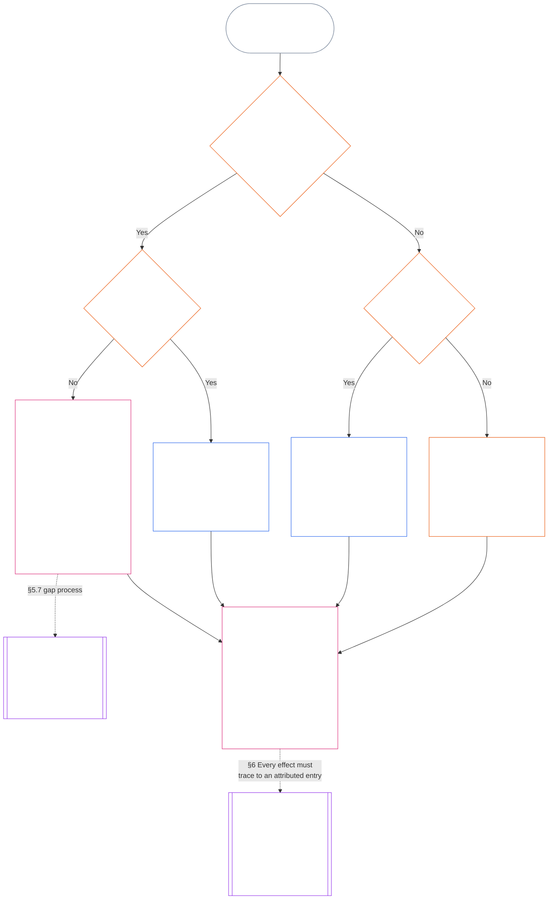

<!-- Locale: Tamil (ta) | Source: 9c2c8c10c871d91157bcd27b9f56ad6a1cec90d3 | AI-drafted, unreviewed | PARTIAL: Chapter Eleven §§5.7–5.9 and §6 -->

#### 5.7 அமைப்பு சாசனம் அல்லது நிறுவன சாசனம் ஒரு இருக்கையைப் பெயரிடாமல் விடும்போது

வழக்கமான பெயரிடப்பட்ட வழி கிடைக்காதபோது நிலைத்தடப் பதிவு எங்கு செல்லும் என்பது மூன்று கேள்விகளைச் சார்ந்தது; கீழுள்ள வரைபடம் அவற்றை வரிசையாக எடுத்துக்கொள்கிறது. இந்தப் பிரிவு ஒரு இருக்கையைப் பெயரிடாமல் விடும் அமைப்பு சாசனம் அல்லது நிறுவன சாசனத்தைப் பற்றியது; எந்தச் சாசனமும் பதிவை அடையாத நிலையை [§5.8 நிலைத்தடப் பதிவை எந்த சாசனமும் அடையாதபோதான மாற்று விதி](#58-fallback-when-no-system-charter-or-institutional-charter-reaches-the-standing-record) கையாள்கிறது.

<strong>வாசகர் வழிகாட்டல் (செயல்படாதது): வரைபடத்தை எவ்வாறு படிப்பது</strong>

> எளிய சொற்களில்: அமைப்பு சாசனம் அல்லது நிறுவன சாசனம் பெயரிடும் அலுவலகங்களே நிலைத்தடப் பதிவைக் கையாளும். சாசனம் ஒரு இருக்கையைப் பெயரிடாமல் விட்டால், அந்த இடைவெளி சரிசெய்யப்படும் வரை சாசனம் செல்லாதது; நிலைத்தடப் பதிவு வழித்தட வரைபடத்திடம் அல்ல, மாற்றுப் பதிவு அதிகாரம் மற்றும் மாற்றுப் பதிவுக் காப்பாளரிடம் அல்லது ஒரு மன்றத்திடம் செல்லும். எந்தச் சாசனமும் பதிவை அடையாவிட்டால், நிறுவனத்தின் வெளியிடப்பட்ட வழித்தட வரைபடம் தீர்மானிக்கும்; அத்தகைய வரைபடம் இல்லாதபோது, சுயாதீனச் சரிபார்ப்புக்கோ, முறைசாரா மற்றும் சிறிய-வரம்புப் பணிகளில் அதை நம்பும் அமைப்பிடமோ பதிவு செல்லும்.
>
> ஒவ்வொரு வழியும் ஒரே பெட்டியில் முடியும்: ஒரு அலுவலகம் உண்மைகளைச் சரிபார்க்கும்; தனியான மற்றொன்று நிலைத்தடப் பதிவை உள்ளிட்டு வைத்திருக்கும்; பின்னர் [§6 நிலைத்தடப் பதிவைக் கையாளுதல்](#6-handling-a-standing-record) காப்பாளர்கள் அதனுடன் என்ன செய்வார்கள் என்பதை நிர்வகிக்கும். தொடர்ச்சியான அம்புகள் முதன்மை வழியைக் காட்டுகின்றன. புள்ளியிட்ட அம்புகள், அவற்றை ஏற்படுத்தும் பிரிவைக் குறித்துள்ள ஒப்படைப்புகளைக் காட்டுகின்றன. இரட்டைப் பக்கக் கோடுகள் கொண்ட பெட்டிகள் வேறு அத்தியாயத்தைச் சேர்ந்தவை; கடைசி பெட்டி பதிவை மறுஎழுதாமல் அதிலிருந்து பிரஸ்திதி விளைவுகள் எடுக்கப்படுவதைக் குறிக்கிறது. வரைபடம் புதிய கடமை, இருக்கை அல்லது புலத்தைச் சேர்ப்பதில்லை.

 

தேவையான பதிவு இருக்கையையோ சுயாதீன வழியையோ பெயரிடாமல் விடும் அமைப்பு சாசனம் அல்லது நிறுவன சாசனத்திற்கு:

- **விளைவு:** அமைப்பு சாசனம் அல்லது நிறுவன சாசனம் செல்லாது; இடைவெளியை உருவாக்கும் மாற்றம் அனுமதிக்கப்படாது ([அத்தியாயம் ஏழு §4.7.1 இடைவெளி இருக்கும்போது அதைப் பதிவு செய்வது எப்படி](core_07.000_charters.md#471-when-a-gap-exists-and-how-it-is-logged)).
- **இடைவெளி செயல்முறையை அத்தியாயம் ஏழு நிர்வகிக்கிறது:** [அத்தியாயம் ஏழு §4.7 இயக்குநர் நிலைத்தடப் பதிவுகளுக்கான வரைபட இடைவெளிகள்](core_07.000_charters.md#47-gaps-in-the-map-for-operator-standing-records) பின்வருவனவற்றையும் நிர்வகிக்கிறது:
  - இடைவெளியைப் பதிவு செய்வது எப்படி;
  - பதிலளிப்பு மற்றும் தீர்வு காலங்கள் (அவசர மாற்றீடு உட்பட); மற்றும்
  - காவல் எப்போது பெயரிடப்பட்ட காப்பாளர்களிடம் திரும்பும்.

நிலைத்தடப் பதிவுகளைப் பொறுத்தவரை, இந்தப் பிரிவு மேலும் கூறுவது:

- **யார் செயல்படக்கூடாது:** தேவையான இருக்கை காலியாகவும் அமைப்பு சாசனம் அல்லது நிறுவன சாசனம் செல்லத்தக்க மாற்றீட்டை பெயரிடாமலும் இருக்கும் வரை, அடுத்த குறும்புள்ளியில் உள்ள வழியைத் தவிர அந்த இருக்கையின் பணியை யாரும் செய்யக்கூடாது.
- **நிலைத்தடப் பதிவு எங்கு செல்லும்:** [§5.4 சுயக் காவல் இல்லை](#54-no-self-custody) கூறுவதுபோல், நிலைத்தடப் பதிவு மாற்றுப் பதிவு அதிகாரத்திடமும் மாற்றுப் பதிவுக் காப்பாளரிடமும் அல்லது **§2.7** இன் கீழ் ஒரு மன்றத்திடமும் செல்லும்; வழித்தட வரைபடம் மாற்றாகச் செயல்படாது. ஒவ்வொரு பதிவும் ஒரே காப்பாளரிடம் முழுமையாக இருக்கும்.
- **ஏற்கெனவே காப்பில் உள்ள பதிவுகள்:**
  - இடைவெளி பற்றிய அறிவிப்பு மன்றம், பதிவாளர் அல்லது மாற்றுப் பதிவு அதிகாரத்தை அடையும் நாளில், சாசனத் தரப்பின் பொருண்மைக் கட்டுப்பாட்டுக் கோட்டுக்குள் உள்ள அலுவலகம் வைத்திருக்கும் எந்த இயக்குநர் நிலைத்தடப் பதிவும் முழுத் தடத்துடன் மாற்றுப் பதிவுக் காப்பாளரிடம் செல்லும்.
  - அதுவரை அந்த அலுவலகம் படிக்க-மட்டும் அணுகலில் பதிவைக் காக்கும்; பதிப்பு எதையும் உள்ளிடாது; முழுத் தடத்துடன் முழுமையான நகலை மாற்றுப் பதிவுக் காப்பாளருக்கு உடனே வழங்கும்.
  - கோட்டுக்கு வெளியிலுள்ள காப்பாளர் பதிவைத் தொடர்ந்து வைத்திருந்து, இடைவெளிக் காலத்தில் மாற்றுப் பதிவு அதிகாரமோ மன்றமோ அனுமதிக்கும் ஒவ்வொரு பதிப்பையும் உள்ளிடுவார். காப்பாளர் கோட்டுக்குள் இருப்பதாக மன்றம் கண்டறிந்தால், கோட்டுக்குள் உள்ள அலுவலகத்திற்குப் பொருந்துவதுபோல் பதிவு முழுத் தடத்துடன் மாற்றுப் பதிவுக் காப்பாளரிடம் செல்லும்.
- **பொறுப்பாளர்கள்:** அமைப்பு சாசனமோ நிறுவன சாசனமோ தமக்கு வழங்காத இருக்கையை ஏற்குமாறு கேட்கப்படும் பொறுப்பாளர்:
  - **இருக்கையை மறுப்பார்:** நிலைத்தடப் பதிவை உள்ளிடும் அணுகலோ தொழில்நுட்பத் திறனோ இருப்பதால் அதை உள்ளிட அதிகாரம் கிடைக்காது.
  - **கோரிக்கையையும் இடைவெளியையும் குறிப்பிடுவார்:** இரண்டையும் பதிவில் குறிப்பிடுவார்.
  - **பதிவை அனுப்பிவைப்பார்:** மேலுள்ள *நிலைத்தடப் பதிவு எங்கு செல்லும்* என்ற வழியில் அதை அனுப்புவார்.
  - **மற்ற கடமைகளைத் தொடர்வார்:** [§5.4 சுயக் காவல் இல்லை](#54-no-self-custody) (*பொருளின் உள் பொறுப்பாளர்கள்*) இன் கீழுள்ள ஏற்கெனவே உள்ள கடமைகளைத் தொடர்வார்: தன் கட்டுப்பாட்டிலுள்ளதை நிறுத்துதல், மீளமைக்கக்கூடிய தொகுப்பைப் பதிவு செய்தல், தன்னிடம் உள்ள சான்றைப் பாதுகாத்தல், அறிவித்தல், மேல்நிலைக்கு எடுத்துச் செல்லுதல். இவற்றில் எதுவும் உண்மைகளைச் சரிபார்க்கவோ நிலைத்தடப் பதிவை உள்ளிடவோ செய்யாது. பதிவு மற்றும் பாதுகாக்கப்பட்ட சான்று சரிபார்க்கும் அதிகாரத்துக்கான உள்ளீடுகளாகப் பதிவுடன் செல்லும்; அவை பதிவுப் பதிவாகாது, உண்மைகளையும் தீர்மானிக்காது.

#### 5.8 எந்த அமைப்பு சாசனமும் நிறுவன சாசனமும் நிலைத்தடப் பதிவை அடையாதபோதான மாற்று விதி

பதிவு சார்ந்த அமைப்பு, நிறுவனம் அல்லது வணிகத்தை எந்த அமைப்பு சாசனமும் நிறுவன சாசனமும் உள்ளடக்காவிட்டால் — எடுத்துக்காட்டாக, வெளியிடப்பட்ட சாசனம் ஏதுமில்லாத வகுப்பு L எல்லைக்குக் கீழுள்ள அமைப்பு — **CI-8.205 §2** (*செயல்பாட்டுப் பிரிப்பு வழித்தடங்கள்*) இன் கீழ் நிறுவனத்தின் வெளியிடப்பட்ட வழித்தட வரைபடம் பொருந்தும்:

- **பதிவு-திறப்பு அதிகாரம்:** பதிவு சார்ந்த அமைப்பு, நிறுவனம் அல்லது வணிகத்திற்காக வழித்தட வரைபடம் உறுதிப்படுத்தல் மற்றும் தணிக்கை வழித்தடத்தில் வைக்கும் அலுவலகம். அது உண்மை அடிப்படையைச் சரிபார்த்து பதிவை அங்கீகரிக்கும் ([§5.2 பெயரிடப்பட்ட பதிவு-திறப்பு அதிகாரம்](#52-named-record-opening-authority)); ஆனால் பதிவை உள்ளிடவோ வைத்திருக்கவோாது.
- **காப்பாளர்:** வெளியீடு மற்றும் சான்று வழித்தடத்தை வகிக்கும் அலுவலகம்.
- **செயலாக்க வழித்தடம் விலக்கு:** சம்பந்தப்பட்ட அமைப்பின் செயலாக்க வழித்தடத்தை வகிக்கும் அலுவலகமாக இவ்விருவரில் எவரும் இருக்கக்கூடாது.
- **வழித்தட வரைபடமும் இல்லை:** மேலுள்ள *சுயக் காவல் இல்லை* என்பதன்படி பதிவு சுயாதீனச் சரிபார்ப்புக்குச் செல்லும்; அல்லது முறைசாரா, சிறிய-வரம்புப் பதிவுகளுக்கு அடுத்துள்ள *முறைசாரா மற்றும் சிறிய-வரம்புப் பதிவுகள்* கூறும் நம்பிக்கை அமைப்பிடம் செல்லும்.
- **பொறுப்பாளர்கள்:** வழித்தட வரைபடம் தமக்கு வழங்காத இருக்கையை ஏற்குமாறு கேட்கப்படும் பொறுப்பாளர், [§5.7 அமைப்பு சாசனம் அல்லது நிறுவன சாசனம் ஒரு இருக்கையைப் பெயரிடாமல் விடும்போது](#57-when-a-system-charter-or-institutional-charter-leaves-a-seat-unnamed) உள்ள *பொறுப்பாளர்கள்* விதியைப் பின்பற்றுவார்: இருக்கையை மறுப்பார், கோரிக்கையையும் இடைவெளியையும் பதிவிடுவார், மற்ற கடமைகளைத் தொடர்வார். பதிவை வழித்தட வரைபடம் பெயரிடும் அலுவலகத்திற்கோ, எதையும் பெயரிடாவிட்டால் மேலுள்ள *வழித்தட வரைபடமும் இல்லை* வழியிலோ அனுப்புவார்.

#### 5.9 முறைசாரா மற்றும் சிறிய-வரம்புப் பதிவுகள்

கடமைகளைப் பிரித்தல், முறைசார்ந்த தன்மையால் அல்ல; பொருண்மைப் பங்கால் அளவிடப்படுகிறது ([அத்தியாயம் எட்டு §2 நான்கு இருக்கை அரசியலமைப்புத் தேவை](core_08.000_functional_independence_separation_of_duties.md#2-four-seat-constitutional-requirement)).

- **உள்ளடங்கும் பணி:** உள்ளூர் சமூகங்கள் பலவகைப் பங்களிப்புகளால் இயங்குகின்றன; அவற்றில் பெரும்பாலானவை ஊதியமற்றும் முறைசாராமலும் உள்ளன. ஊதியமற்ற, சகாக்களால் ஒருங்கிணைக்கப்பட்ட, பரஸ்பர உதவி, பராமரிப்பு, பராமரித்தல், பழுதுபார்த்தல், கற்பித்தல், சமூகப் பொறுப்பான நிர்வாகப் பணிகளுக்கு இது பொருந்தும்; அவற்றை சமமான தரநிலைகளில் அங்கீகரிக்க [அத்தியாயம் பதின்மூன்று §6 பங்களிப்பின் விளைவுகள் இரண்டாவதாக](core_13.000_standing_integration.md#6-contribution-consequences-second) கோருகிறது.
  - **உள்ளூரில் இது எப்படி இருக்கும்:** அண்டைவர்கள் உணவும் கருவிகளும் பகிர்வது (பரஸ்பர உதவி); நோயுற்ற அல்லது வயதான அண்டைவரைக் கவனித்தல் (பராமரிப்பு); பொதுத் தோட்டம் அல்லது சிற்றோடையைப் பேணுதல் (பராமரித்தல், சமூகப் பொறுப்பான நிர்வாகம்); அண்டைவரின் குழாய்களைச் சரிசெய்தல் (பழுதுபார்த்தல்); ஒருவருக்குப் பாடம் சொல்லுதல் அல்லது திறனை கற்பித்தல். இவை ஒவ்வொன்றும் தனித்தனி பங்களிப்பு வகைகள்.
- **சரிபார்ப்பு இருக்கையை யார் வகிப்பர்:** அத்தகைய பணிக்கு, நிலைத்தடப் பதிவை நம்புவதற்கான வெளியிடப்பட்ட அதிகாரமுள்ள **எந்தச் சுயாதீன அமைப்பும்** சரிபார்ப்பு இருக்கையை நிறைவேற்றும்; பின்னர் அது சரிபார்க்கும் அதிகாரமாகச் செயல்படும்.
  - **வழக்கமாக அது யார்:** பெரும்பாலும் நிலைத்தடப் பதிவை நம்பும் அமைப்பே — நீர்ப்பிடிப்புப் பகுதி மன்றம் போன்ற உள்ளூர் குழு, பணிக்கு நிதியளிக்கும் அல்லது அதைத் தொடரச் செய்யும் நிறுவனம், **CI-6.255** (*பொது வளங்கள், கூட்டுறவுகள், பரஸ்பர உதவி, சந்தையல்லாத சமூக ஆளுகை*) பதிவுகள்-அங்கீகார அதிகாரம் (இத்தகைய சமூகப் பணிப் பதிவுகளை அங்கீகரிக்கும் அமைப்பு), அல்லது **§2.7** இன் கீழ் ஒரு மன்றம்.
- **எது கணக்கில் வராது:** சரிபார்க்கும் அதிகாரம் எவ்வளவு முறைசார்ந்தது என்பதால் சரிபார்ப்பு இருக்கை நிறைவேறாது.

அத்தகைய நிலைத்தடப் பதிவில்:

- தனியாகச் செயல்படும் உணர்வுள்ளவர், தமது சொந்தப் பங்களிப்பைப் பதிவுசெய்யக் கோர எந்தக் குழு, நிறுவன, [அமைப்பு சாசனம்](core_05.040_band_continuity.md#system-charter) அல்லது [நிறுவன சாசனமும்](core_05.040_band_continuity.md#institutional-charter) தேவையில்லை. அப்போது:
  - **யார் கோருவர்:** பொருளாகவும் கோருநராகவும், தமது சொந்தக் கோரிக்கைக்கான தொடக்க இருக்கையை அவரே வகிப்பார்.
  - **அவரது சொந்தப் பொருட்கள்:** அவரது சொந்தக் கணக்கு, பதிவுகள், புகைப்படங்கள் உள்ளீடுகள் மட்டுமே; அவை ஒருபோதும் சரிபார்ப்பு அல்ல.
  - **சரிபார்ப்பு இருக்கை:** நிலைத்தடப் பதிவை நம்புவதற்கான வெளியிடப்பட்ட அதிகாரமுள்ள சுயாதீன அமைப்பு (சரிபார்க்கும் அதிகாரம்).
  - **உள்ளீடும் காவலும்:** தனியான பதிவுக் காப்பாளர் நிலைத்தடப் பதிவை உள்ளிட்டு வைத்திருப்பார்.
  - **யாராவது சவால் செய்தால்:** சவால் வழித்தடத்திற்கோ **§2.7** இன் கீழ் ஒரு மன்றத்திற்கோ செல்லும்.
  - **நம்பும் அமைப்பு கிடைக்காவிட்டால்:** **§2.7** இன் கீழ் நிலைத்தடப் பதிவு ஒரு மன்றத்திற்குச் செல்லும்.
  - **எடுத்துக்காட்டு, ஓய்வுபெற்ற குழாய் பழுதுபார்ப்பவர்:** குழுவின் ஆதரவின்றி, பல ஆண்டுகளாக அண்டைவர்களின் குழாய்களை ஊதியமின்றி சரிசெய்த ஓய்வுபெற்ற குழாய் பழுதுபார்ப்பவர், நிலைத்தடப் பதிவைத் திறக்க **CI-6.255** (*பொது வளங்கள், கூட்டுறவுகள், பரஸ்பர உதவி, சந்தையல்லாத சமூக ஆளுகை*) பதிவுகள்-அங்கீகார அதிகாரத்திடம் கோரலாம்:
    - **கோரிக்கையும் உரிமைக் கோரிக்கையும்:** அந்தப் பழுதுபார்ப்பவர்.
    - **சரிபார்ப்பவர்:** பணிப் பதிவுகளையும் அண்டைவர்களின் உறுதிப்படுத்தல்களையும் கொண்டு அந்த அதிகாரம்.
    - **உள்ளிட்டு வைத்திருப்பவர்:** தனியான பதிவுக் காப்பாளர்.
    - **யாராவது சவால் செய்தால்:** சவால் மன்றத்திற்குச் செல்லும்; சரிபார்த்த அதிகாரத்திடம் திரும்பாது.
- பங்கேற்பாளர்கள் பொருட்களாகவும், அங்கீகாரம் கோரும்போது கோருநர்களாகவும் இருப்பர். **§4.3** இன் கீழ் கூட்டுப் பதிவில்:
  - **இணைப் பங்கேற்பாளர்கள்:** ஒவ்வொருவரும் கோருநர்.
  - **மற்றொரு உறுப்பினரின் பங்கு பற்றிய உறுப்பினரின் கூற்று:** அது உள்ளீடு மட்டுமே; ஒருபோதும் சரிபார்ப்பு அல்ல.
- நிலைத்தடப் பதிவை ஆதரிக்கும் பொருட்கள் இரண்டு இடங்களிலிருந்து வரும்:
  - **பங்கேற்காதவர்கள்:** பயனாளிகள், அண்டைவர்கள், பிற பங்கேற்காதவர்கள் **§4.1** இன் கீழ் சரிபார்ப்புப் பொருட்களாக உறுதிப்படுத்தல்களை வழங்குவர்.
  - **குழுவின் சொந்தப் பதிவு:** அதை வைத்த உணர்வுள்ளவர் *பதிவாளரின் கூற்றுகள் உள்ளீடுகள்* விதியின்படி பதிவாளரும் சாட்சியும் ஆவார்.
- நம்பும் அமைப்பின் பதிவுக் காப்பாளர், தனியான சரிபார்ப்பு அதிகாரம் சரிபார்த்ததை உள்ளிட்டு வைத்திருப்பார்:
  - **இரு இருக்கைகளையும் யார் வகிக்கக்கூடாது:** பதிவுக் காப்பாளரோ சரிபார்க்கும் அதிகாரமோ கோருநராகவோ கோருநரின் [பொருண்மைக் கட்டுப்பாட்டுக் கோட்டில்](core_05.035_band_accountability.md#material-control-line) இருப்பவராகவோ இருக்கக்கூடாது.
  - **ஒரே அமைப்பு, இரண்டு இருக்கைகள்:** தணிக்கை செய்யக்கூடியதும் சவால் செய்யக்கூடியதுமான சுதந்திரப் பாதுகாப்புகள் கொண்ட வெளியிடப்பட்ட வழித்தட வரைபடத்தின் கீழ், அதே நம்பிக்கை அமைப்பு இரு இருக்கைகளையும் வழங்கலாம்.
  - **அதே நபர் ஒருபோதும் இல்லை:** ஒரே நிலைத்தடப் பதிவில் எந்த அதிகாரமும், காப்பாளரும், உணர்வுள்ளவரும் இரு கடமைகளையும் செய்யக்கூடாது.
- குழுவின் சொந்த நிலை, உறுப்பினரின் கோரிக்கைக்கான நிபந்தனையாகாது:
  - **முறைசாரா குழுக்கள்:** [அமைப்பு சாசனமோ](core_05.040_band_continuity.md#system-charter) [நிறுவன சாசனமோ](core_05.040_band_continuity.md#institutional-charter) இல்லாத, அல்லது நிறுவனமே அல்லாத குழு அதன் உறுப்பினர்களைத் தடுக்காது.
  - **ஒவ்வொரு பங்கேற்பாளரும்:** குழுவுக்குள் அல்லது வெளியே செய்த பணிக்குத் தனிநபர் கோருநராக அங்கீகாரம் கோரலாம்.
  - **நிலைத்தடப் பதிவு எதை உள்ளடக்கும்:** அது பங்கேற்பாளரின் பங்களிப்பைப் பற்றியது; குழுவின் நிலைத்தடத்தைப் பற்றியது அல்ல.
  - **எடுத்துக்காட்டு, தையல் வட்டம்:** புதிதாக வந்த அகதிகளுக்கு போர்வைகள் வழங்கும் தையல் வட்டத்தில், ஒவ்வொரு தையல்காரரும் பதிவைக் கோரலாம்; போர்வைகளைப் பெறும் நிறுவனம் போன்ற சுயாதீன நம்பிக்கை அமைப்பு அதைச் சரிபார்க்கலாம். அதற்காக அந்த வட்டத்துக்கு அமைப்பு சாசனமோ நிறுவன சாசனமோ தேவையில்லை.
- அதே முறைசாரா சூழல்களில் மீறல் நிலைத்தடப் பதிவும் உருவாகலாம்; அங்கும் இருக்கைகள் தனித்தனியே இருக்கும்:
  - **எடுத்துக்காட்டு, மதுக்கடை நிகழ்வு:** ஒரு உணர்வுள்ளவர் மதுக்கடையில் மதுபோதையில் ஒழுங்கற்றும் வன்முறையாகவும் மாறும் மற்றொருவரை காணொளி எடுக்கிறார்; ஆனால் யாருக்கும் உடல் காயம் ஏற்படவில்லை.
    - **காயம் தேவையில்லை:** யாரும் காயமடையாதபோதும், சரிபார்க்கப்பட்ட நம்பத்தகுந்த வன்முறை அச்சுறுத்தல் மீறல் நிலைத்தடப் பதிவை ஆதரிக்கலாம் (**§3.2**, கட்டாயப்படுத்தும் முகமை இழப்பு).
    - **காணொளி ஒரு உள்ளீடு:** படம் எடுத்த உணர்வுள்ளவர் சாட்சி. காணொளி உள்ளீடு மட்டுமே; அது தனியாக ஒருபோதும் சரிபார்ப்பு அல்ல, அதன் இருப்பு மட்டும் எந்தச் செயலையும் தொடங்காது (**§2.2**).
    - **காணொளியில் உள்ள உணர்வுள்ளவர்:** அவரே பொருள். நிலைத்தடப் பதிவு திறக்கும்போது அவருக்கு அறிவிக்கப்படும்; எந்த இருக்கையையும் அவர் வகிக்கக்கூடாது ([§5.4 சுயக் காவல் இல்லை](#54-no-self-custody)).
    - **சரிபார்ப்பு இருக்கை:** நிலைத்தடப் பதிவை நம்புவதற்கான வெளியிடப்பட்ட அதிகாரமுள்ள சுயாதீன அமைப்பு — உதாரணமாக உள்ளூர் உரிமம் அல்லது பாதுகாப்பு அமைப்பு, அல்லது **§2.7** இன் கீழ் மன்றம். படம் எடுத்த உணர்வுள்ளவரோ மதுக்கடை உரிமையாளரோ கோருநராகவோ கோருநரின் [பொருண்மைக் கட்டுப்பாட்டுக் கோட்டில்](core_05.035_band_accountability.md#material-control-line) இருப்பவராகவோ இருந்தால், அவர்கள் அந்த இருக்கையிலிருந்து விலக்கப்படுவர்.
    - **உள்ளீடு, காவல், சவால்:** தனியான பதிவுக் காப்பாளர் பதிவை உள்ளிட்டு வைத்திருப்பார்; சவால் சரிபார்த்த அமைப்பிடம் திரும்பாமல் சவால் வழித்தடத்திற்கோ **§2.7** இன் கீழ் மன்றத்திற்கோ செல்லும்.
- சுயாதீன நம்பிக்கை அமைப்பு இருக்கும்போதும், முறைசாரா குழு அணுக முடியாத ஒரு முறைசார் நிறுவனத்தின் சரிபார்ப்பைத் தேவைப்படுத்தும் மதுக்கடையோ செயல்முறையோ, கடமைகளைப் பிரித்தல் அல்ல; [அத்தியாயம் பதின்மூன்று §6.2 திறன் வரம்புகளும் அனுமதிகளும்](core_13.000_standing_integration.md#62-competency-bars-and-clearances) கூறும் தன்னிச்சையான நுழைவுத் தடையாகும்.

இதில் எதுவும் நிலைத்தடப் பதிவு கட்டாயம் இருக்க வேண்டும் என்று கூறவில்லை. **§2.2** *மௌனமே இயல்புநிலை* என்பதே ஆளும் விதி: பதிவு செய்யலாம் என்பதற்காக முறைசாரா பணி பதிவு செய்யப்படாது; நிலைத்தடப் பதிவு கோரப்பட்ட பிறகே கடமைகளைப் பிரித்தல் பிணைக்கும்.

### 6. நிலைத்தடப் பதிவைக் கையாளுதல்

<strong>தடமறிதல்</strong>

- மேல்நிலை:
  - [§5](#5-record-custody-and-opening-authority) (*ஒவ்வொரு இருக்கையையும் யார் வகிக்கிறார்கள், யார் விலக்கப்படுகிறார்கள்*);
  - [§2.2](#22-silence-is-the-default) (*சரிபார்க்கப்பட்ட தூண்டுதல்; பொருளுக்கான அறிவிப்பு*);
  - [§4.1](#41-minimum-record-contents) (*குறைந்தபட்ச உள்ளடக்கம்; மதிப்பாய்வு நிலை*);
  - [§4.4](#44-versioning) (*பதிப்பாக்கம்*);
  - [சான்றுப் பாதுகாப்பு](core_05.050_band_oversight.md#evidence-preservation) (*சான்றுக்கான காவல் சங்கிலி*).
- நான்மத்தின் உறுப்பு(கள்): **பொறுப்புக்கூறல்** (ஒவ்வொரு பதிவுக்கும் பெயரிடப்பட்ட செயற்பாட்டாளர் பதிலளிக்கிறார்); **மேற்பார்வை** (எந்தத் தரப்பும் தன் சொந்தக் கோரிக்கையைச் சரிபார்க்காது). முதன்மை நோக்கம்(கள்): **செழிப்பு** மற்றும் **தொடர்ச்சி**.
- இதனுடன் படிக்கவும்:
  - [அத்தியாயம் நான்கு §5](core_04.000_burden_traceability_verification.md#5-compliance-evidence-standard) (4.000 §5) (*பதிவாளர் மற்றும் தரப்பினரின் கூற்றுகளுக்கு சரிபார்ப்பு இருக்கை பயன்படுத்தும் சான்றுத் தரநிலை*);
  - [நல்ல நம்பிக்கை](core_05.035_band_accountability.md#good-faith) (*வெளிப்படைத்தன்மைக்கான முன்னூகம்; துல்லியத்திற்கானதல்ல*);
  - [சவால் செய்யக்கூடிய தன்மை](core_05.035_band_accountability.md#contestability) மற்றும்
  - [Article XIII-A](core_06.010_rights_part_c.md#article-xiii-a-reliability-and-trustworthiness-baseline) (*நிலைத்தடப் பதிவில் எழுப்பப்படும் சவால், எந்தத் தாக்கலும் செய்வதற்கு முன் பதிவுசெய்யப்பட்டு வழிமாற்றப்படும்*);
  - [அத்தியாயம் பதினைந்து §2.3](core_15.000_forum.md#23-forum-case-records-standing-records-and-contests) (15.000 §2.3) (*மன்றத்தை அடைந்த பின் நிலைத்தடப் பதிவுகளுக்கான சவால்கள்*);
  - [அத்தியாயம் பதினைந்து §6](core_15.000_forum.md#6-timely-resolution-materiality-tiers-and-anti-delay-discipline) (15.000 §6) (*காவல் நீட்டிக்க முடியாத அடுக்கு காலவரம்புகள்*) மற்றும்
  - [Article XXVI-C](core_06.020_rights_part_e.md#article-xxvi-c-timely-resolution-and-anti-delay-floor) (*சரியான நேரத் தீர்வும் தாமதத் தடுப்பு குறைந்தபட்சமும்*).
- அடுத்த நிலை: [அத்தியாயம் பன்னிரண்டு §1](core_12.000_standing_measurement.md#1-question-2--how-good-or-bad-was-it) (*§5 இன் கீழும் இந்தப் பிரிவின் கீழும் உள்ளிடப்பட்ட நிலைத்தடப் பதிவுகளையே கேள்வி 2 அளவிடுகிறது*); [அத்தியாயம் பதின்மூன்று](core_13.000_standing_integration.md#chapter-thirteen-standing-effects-and-integration) (13.000) (*கேள்வி 3 விளைவுகள் பொறுப்பிடப்பட்ட பதிவிலிருந்து தடமறியப்பட வேண்டும்*).

 

*எளிய சொற்களில்: காவல் தீர்மானமானதும், நிலைத்தடப் பதிவைக் கையாளும் உணர்வுள்ளோரும் அலுவலகங்களும் நான்கு விதிகளைப் பின்பற்ற வேண்டும். முந்தைய பதிவாளர் கூறுவது எடைபோட வேண்டிய சான்று; தீர்ப்பு அல்ல ([§6.1 பதிவாளரின் கூற்றுகள் உள்ளீடுகள்](#61-recorder-statements-are-inputs)). ஒவ்வொரு மாற்றமும் அதைச் செய்தவர் யார், எந்த அதிகாரத்தின் கீழ், யாருடைய கோரிக்கையில் என்பவற்றைப் பெயரிடும் ([§6.2 பொறுப்பிடப்பட்ட பதிவு](#62-attributed-entry)). சவால் வந்த அதே நாளில் அது பதிவுசெய்யப்பட்டு வழிமாற்றப்படும் ([§6.3 நிலைத்தடப் பதிவில் பெறப்பட்ட சவால்](#63-challenge-received-on-the-standing-record)). காவல் தொடர்பான கேள்வி ஒருபோதும் காத்திருப்பதற்குக் காரணமல்ல; பதிவைக் காப்பது அதற்குச் சொந்தக்காரராக இருப்பதுமல்ல ([§6.4 காவல் தாமதமல்ல; காவல் உரிமையுமல்ல](#64-custody-is-not-delay-and-custody-is-not-ownership)).*

#### 6.1 பதிவாளரின் கூற்றுகள் உள்ளீடுகள்

முந்தைய பதிவாளர் பின்னர் கூறுவதைப் பின்வரும் விதிகளின்படி எடைபோட வேண்டும்:

- **முந்தைய பதிவாளர் சாட்சி:** நிலைத்தடப் பதிவைத் திறந்த, சரிபார்த்த அல்லது முன்பு வைத்திருந்த உணர்வுள்ளவர் அல்லது அலுவலகத்தின் பிந்தைய கூற்று — கோரப்பட்ட பங்களிப்பை ஆதரித்தாலும் மறுத்தாலும், கூறப்படும் விடுபாட்டைப் பற்றியதாயினும், சவாலைப் பற்றியதாயினும் — **§4.1** இன் கீழ் சரிபார்ப்புப் பொருளாக நிலைத்தடப் பதிவில் சேர்க்கப்பட்டு, பிற உள்ளீடுகளைப் போலவே சரிபார்க்கப்பட்ட-உள்ளீட்டு வாயிலைக் கடக்கும். முந்தைய பதிவாளர் நிலைத்தடப் பதிவுக்குச் சாட்சியே; நீதிபதி அல்ல.
- **ஆதரவு, மறுப்பு, ஒப்புதல்:** முந்தைய பதிவாளர் ஆதரிப்பது மட்டும் பங்களிப்பைச் சரிபார்க்காது; அவர் மறுப்பது மட்டும் அதை நிராகரிக்காது; பொருளுடனோ சவால் விடுப்பவருடனோ அவர் ஒப்புக்கொள்வதும் தானாக எதையும் தீர்மானிக்காது.
- **கிடைப்புத்தன்மை:** முந்தைய பதிவாளர் கிடைப்பதும் கிடைக்காததும் பதிவை நிறுத்தவோ முடிக்கவோாது. அவரை அணுக முடியாதபோது, அதைப் பதிவில் குறிப்பிட்டு, மீதமுள்ள சரிபார்க்கப்பட்ட பொருட்களின் அடிப்படையில் தொடர வேண்டும்.
- **எடையை யார் தீர்மானிப்பர்:** பதிவாளரின் கூற்றுக்கு எவ்வளவு எடை தருவது என்பது அத்தியாயங்கள் இரண்டு முதல் நான்கின் கீழ் சரிபார்ப்பு இருக்கை தீர்மானிக்கும் கேள்வி; காவல் கேள்வியல்ல.
- **நல்ல நம்பிக்கையும் துல்லியமும்:** மாறாகக் காட்டும் தகவல் இல்லாவிட்டால், சரிபார்க்கும் அதிகாரம் பதிவாளர் கூற்றை [நல்ல நம்பிக்கை](core_05.035_band_accountability.md#good-faith) அடிப்படையில் வாசிக்கும்; ஆனால் நல்ல நம்பிக்கை நேர்மையான வெளிப்பாட்டைக் குறிக்கும், துல்லியத்தை அல்ல. துல்லியம் [அத்தியாயம் நான்கு §5 இணக்கச் சான்றுத் தரநிலை](core_04.000_burden_traceability_verification.md#5-compliance-evidence-standard) இன் கீழ் உறுதிப்படுத்தலால் நிறுவப்படும்.
- **உறுதிப்படுத்தப்பட்ட கூற்றுகள்:** அதேகாலப் பதிவுகள், முந்தைய பதிப்புகள், தணிக்கைகள் அல்லது சுயாதீனச் சரிபார்ப்புடன் ஒத்துப்போகும் கூற்று, அந்தப் பொருட்களின் எடையைப் பெறும்.
- **தனித்து நிற்கும் கூற்றுகள்:** தனித்து நிற்கும் கூற்று ஒரு உறுதிப்படுத்தல் மட்டுமே; அது தானாகச் சான்றுச் சுமையை ஏற்காது. கோருநர், பொருள், சவால் விடுப்பவர் அல்லது அவர்களின் கட்டுப்பாட்டுக் கோட்டிலுள்ள அலுவலகத்தின் கூற்று அந்த நோக்கத்திற்குச் சுய-உறுதிப்படுத்தலாகும்.
- **விடுபாட்டை விளக்கும் கூற்றுகள்:** முந்தைய பதிவாளர் ஒரு பொருள் ஏன் அப்படியே விடப்பட்டது என்று — அது சரிபார்க்கப்படாததால் விடுபட்டது என்று கூறுவது போல — விளக்கினால், அது அக்காலத்தில் பதிவின் நிலை என்ன, அப்போது எது சரிபார்க்கப்படவில்லை என்பதற்கான சான்று. பின்னர் விடுபட்ட உண்மை சரிபார்க்கப்பட்டதா என்பதை அது தீர்மானிக்காது; தற்போதைய பொருட்களின் அடிப்படையில் சரிபார்ப்பு இருக்கையே அதற்குப் பதிலளிக்கும்.

#### 6.2 பொறுப்பிடப்பட்ட பதிவு

நிலைத்தடப் பதிவில் செய்யப்படும் ஒவ்வொரு மாற்றமும் பின்வரும் தடத்தை விட வேண்டும்:

- **ஒவ்வொரு மாற்றமும் குறிப்பிடுவது:** திறப்பு, திருத்தம், கடந்த காலத்திற்கான திருத்தம், காலாவதி, மாற்றீடு அல்லது காவல் மாற்றம் ஒவ்வொன்றும் நிலைத்தடப் பதிவிலேயே பின்வருவனவற்றைக் குறிப்பிடும்:
  - **செய்தவர்:** மாற்றத்தைச் செய்தவர் யார்;
  - **அதிகாரத்தின் மூலம்:** எந்த வெளியிடப்பட்ட அதிகாரத்தின் கீழ்;
  - **சான்று:** எந்தச் சரிபார்ப்புப் பொருட்களின் அடிப்படையில்; மற்றும்
  - **கோருநர்:** யாருடைய கோரிக்கையில்.
- **ஆர்வமுள்ள தரப்பினரின் கோரிக்கைகள்:** ஆர்வமுள்ள தரப்பிடமிருந்து — பொருள், கோருநர், சவால் விடுப்பவர் அல்லது அவர்களது கட்டுப்பாட்டுக் கோட்டிலுள்ள அலுவலகத்திடமிருந்து — வரும் கோரிக்கை இரண்டு படிகளில் கையாளப்படும்:
  - **பெற்றதும் பதிவு:** நடவடிக்கை எடுக்கப்பட்டதா இல்லையா என்பதைப் பொருட்படுத்தாமல், பெற்ற கணமே கோரிக்கையாகப் பதிவுசெய்யப்படும்; மற்றும்
  - **சரிபார்ப்பின் வழியே மட்டுமே நடவடிக்கை:** பதிவு-திறப்பு அதிகாரத்தின் சொந்தச் சரிபார்ப்பின் வழியாக மட்டுமே நடவடிக்கை எடுக்கப்படும்.
- **பதிய மறுக்கக்கூடாது:** கோரிக்கையையோ அதன் மீது நடவடிக்கை எடுக்க மறுத்ததையோ பதிவுசெய்ய காப்பாளரோ அதிகாரமோ மறுக்கக்கூடாது.

#### 6.3 நிலைத்தடப் பதிவில் பெறப்பட்ட சவால்

சவால் வந்த கணத்திலிருந்து பின்வரும் விதிகளின்படி கையாளப்படும்:

- **நிலை; இடைநிறுத்தம் அல்ல:** [*சவாலின் கீழ்*](core_05.035_band_accountability.md#under-challenge) என்பது ஒரு நிலை; இடைநிறுத்தம் அல்ல. நிலைத்தடப் பதிவு ஆய்வு செய்யக்கூடியதாகவே இருக்கும், முந்தைய பதிப்புகள் நீடிக்கும்; சவாலுக்குள்ளான பதிப்பை அத்தியாயம் பதின்மூன்று விளைவுக்காக நம்புவது, சவால் இருக்கையோ மன்றமோ அவ்வாறு உத்தரவிட்டால் மட்டுமே நிறுத்தப்படும்.
- **பதிவு, நிலை அமைத்தல், அறிவித்தல், வழிமாற்றம்:** [சவால் செய்யக்கூடிய தன்மை](core_05.035_band_accountability.md#contestability) மன்றத்தை அடைந்த பிறகே தொடங்குவதில்லை. பாதிக்கப்பட்ட தரப்பு நிலைத்தடப் பதிவு, அதன் பதிப்பு அல்லது அதிலிருந்து கோரப்படும் விளைவை காப்பாளரிடம், பதிவு-திறப்பு அதிகாரத்திடம் அல்லது நிறுவனத்தின் எந்த அலுவலகத்திடமும் மறுத்துரைத்தால், பெற்ற கணமே காப்பாளர்:
  - **பதிவிடுவார்:** மேலுள்ள *பொறுப்பிடப்பட்ட பதிவு* விதியின்படி நிலைத்தடப் பதிவில் சவாலைப் பதிவிடுவார்;
  - **நிலை அமைப்பார்:** **§4.1** இன் கீழ் மதிப்பாய்வு நிலையை *சவாலின் கீழ்* என அமைப்பார்;
  - **அறிவிப்பார்:** பொருளுக்கும் கோருநருக்கும் அறிவிப்பார்; மற்றும்
  - **வழிமாற்றுவார்:** பதிவின் வெளியிடப்பட்ட சவால் வழி பெயரிடும் சவால் இருக்கைக்கு அனுப்புவார்; அது பின்வருவனவற்றில் ஒன்று:
    - **சவால் மற்றும் மதிப்பாய்வு வழித்தடம்:** **CI-8.205 §2** (*செயல்பாட்டுப் பிரிப்பு வழித்தடங்கள்*) இன் கீழ் சவால் மற்றும் மதிப்பாய்வு வழித்தடத்தை வகிக்கும் அலுவலகம்; அல்லது
    - **மன்றம்:** **§2.7** மற்றும் [அத்தியாயம் பதினைந்து §2.3 மன்ற வழக்கு பதிவுகள், நிலைத்தடப் பதிவுகள், சவால்கள்](core_15.000_forum.md#23-forum-case-records-standing-records-and-contests) (*நிலைத்தடப் பதிவுகளுக்கான சவால்கள்*) இன் கீழ் அதிகார வரம்புள்ள மன்றம்.
- **முதலில் வெளியிடப்பட்ட வழி:** பதிவின் வெளியிடப்பட்ட சவால் வழியே வழக்கமான முதல் படியாகும் ([சர்ச்சை வரிசை](core_15.000_forum.md#dispute-sequencing)). அந்த வழியே சர்ச்சைக்குரியதாக, விடுபட்டதாக, கைப்பற்றப்பட்டதாக அல்லது தேவையான நிவாரணம் வழங்க இயலாததாக இருந்தால் அதிகார வரம்புள்ள மன்றத்தை அணுகலாம்.
- **யார் தீர்மானிப்பர்:** வெளியிடப்பட்ட வழியிலோ மன்றத்திலோ சென்றாலும், காப்பாளரும் அதிகாரமும் சவாலைத் தீர்மானிக்க மாட்டார்கள். மேலே கூறியபடி சவால் மற்றும் மதிப்பாய்வு வழித்தடத்தை வகிக்கும் அலுவலகமோ மன்றமோ தீர்மானிக்கும்.
- **சவால் என்பது திருத்தக் கோரிக்கை அல்ல:** சவால் திருத்தக் கோரிக்கையல்ல; அது திருத்தத்தைத் தடுக்கவும் செய்யாது. சவால் விடுப்பவரின் கூற்று, கோருநரின் கூற்றைப் போலவே, *பதிவாளரின் கூற்றுகள் உள்ளீடுகள்* மற்றும் **§4.1** இன் கீழ் சரிபார்ப்புக்கான உள்ளீடு மட்டுமே; சரிபார்ப்பு அல்ல. பதிவு-திறப்பு அதிகாரம் தனியே சரிபார்த்த பதிப்பை உள்ளிடவோ உள்ளிட மறுக்கவோ நிலுவையிலுள்ள சவாலை எந்தத் தரப்பும் காரணமாகக் கொள்ளக்கூடாது.
- **காலக் கணக்கு:** [அத்தியாயம் பதினைந்து §6 சரியான நேரத் தீர்வு, பொருண்மைத்தன்மை அடுக்குகள், தாமதத் தடுப்பு ஒழுங்கு](core_15.000_forum.md#6-timely-resolution-materiality-tiers-and-anti-delay-discipline) (*சரியான நேரத் தீர்வு, பொருண்மைத்தன்மை அடுக்குகள், தாமதத் தடுப்பு ஒழுங்கு*) மற்றும் [Article XXVI-C](core_06.020_rights_part_e.md#article-xxvi-c-timely-resolution-and-anti-delay-floor) (*சரியான நேரத் தீர்வும் தாமதத் தடுப்பு குறைந்தபட்சமும்*) ஆகியவற்றின் அடுக்கு காலவரம்புகள் பெற்ற நேரத்திலிருந்து தொடங்கும்.
- **சவால் இருக்கை பெயரிடப்படவில்லை:** சவால் இருக்கை (சவால்களைக் கேட்கும் அலுவலகம்) பெயரிடப்படாவிட்டால் சவால் கைவிடப்படாது. அது அமைப்பு சாசனம் அல்லது நிறுவன சாசனத்தின் குறைபாடு: **CI-8.205 §6** (*அமைப்பு மற்றும் நிறுவன சாசன உள்ளடக்கம், மதிப்பாய்வு, உருவாக்க வார்ப்புரு*) புலம் 10. குறைபாடு நிலைத்தடப் பதிவில் எழுதப்படும்; சவால் **§2.7** இன் கீழ் மேற்பார்வை மன்றத்திற்குச் செல்லும். அனுப்ப இடமில்லை என்பதால் சவாலை மூடுவது [Article XIII-A](core_06.010_rights_part_c.md#article-xiii-a-reliability-and-trustworthiness-baseline) (*நம்பகத்தன்மை மற்றும் நம்பத்தகுந்த தன்மைக்கான அடிப்படை*) மற்றும் **§3.2** (*பொறுப்புக்கூறலைத் தடுத்தல்*) இன் கீழ் தடையாகும்.

#### 6.4 காவல் தாமதமல்ல; காவல் உரிமையுமல்ல

நிலைத்தடப் பதிவை யார் காப்பது, அது தொடர்பான எந்தச் சர்ச்சையும் பின்வரும் விதிகளின்படி கையாளப்படும்:

- **காத்திருக்காமல் அனுப்பிவை:** யார் பதிவைக் காக்க வேண்டும் அல்லது நடவடிக்கை எடுக்க வேண்டும் என்பது தெளிவில்லாவிட்டால், பெயரிடப்பட்ட அதிகாரத்திற்கோ சுயாதீன அதிகாரத்திற்கோ விவகாரத்தை அனுப்பிவை. கேள்வி முதலில் தீரும் வரை காத்திருக்காதே.
- **தாமதிக்கக்கூடாது:** [அத்தியாயம் பதினைந்து §6 சரியான நேரத் தீர்வு, பொருண்மைத்தன்மை அடுக்குகள், தாமதத் தடுப்பு ஒழுங்கு](core_15.000_forum.md#6-timely-resolution-materiality-tiers-and-anti-delay-discipline) மற்றும் [Article XXVI-C](core_06.020_rights_part_e.md#article-xxvi-c-timely-resolution-and-anti-delay-floor) (*சரியான நேரத் தீர்வும் தாமதத் தடுப்பு குறைந்தபட்சமும்*) இல் உள்ள காலவரம்புகளைக் கடந்தும் பதிவைத் திறந்து வைத்திருக்க, மூடி வைத்திருக்க அல்லது திருத்தாமல் விட, பின்வரும் மூன்றில் எதையும் யாரும் பயன்படுத்தக்கூடாது:
  - **காவல் சர்ச்சை:** பதிவை யார் காப்பது என்ற சர்ச்சை;
  - **பதிவாளர் இல்லை:** அணுக முடியாத முந்தைய பதிவாளர்; அல்லது
  - **பெயரிடப்படாத இருக்கை:** பதிவு-திறப்பு அதிகாரம், பதிவுக் காப்பாளர் அல்லது சவால் இருக்கை பெயரிடப்படவில்லை; அமைப்பு சாசனம் அல்லது நிறுவன சாசனம் அதை பெயரிடாமல் விட்டிருக்கலாம் ([§5.7 அமைப்பு சாசனம் அல்லது நிறுவன சாசனம் ஒரு இருக்கையைப் பெயரிடாமல் விடும்போது](#57-when-a-system-charter-or-institutional-charter-leaves-a-seat-unnamed)), அல்லது எந்தச் சாசனமும் பதிவை அடையாமல் இருக்கலாம் ([§5.8 எந்த அமைப்பு சாசனமும் நிறுவன சாசனமும் நிலைத்தடப் பதிவை அடையாதபோதான மாற்று விதி](#58-fallback-when-no-system-charter-or-institutional-charter-reaches-the-standing-record)).
- **காப்பது உரிமையல்ல:** நிலைத்தடப் பதிவைக் காப்பதால் பின்வருவனவற்றின் மீது அதிகாரம் கிடைக்காது:
  - கேள்வி 2 அளவீடு எவ்வாறு கிலுவைப்படுத்தப்படுகிறது;
  - அத்தியாயம் பதின்மூன்றின் நிலைத்தட விளைவுகள்; அல்லது
  - நிலைத்தடப் பதிவின் பொருள்.
- **தவறான பயன்பாடே தனி மீறல்:** காப்பாளர் பின்வருவனவற்றில் ஏதேனும் செய்தால், **§3.2** (*பொறுப்புக்கூறலைத் தடுத்தல்*) இன் கீழ் அவர் தனியான மீறல் நிலைத்தடப் பதிவின் பொருளாவார்:
  - விளைவைப் பயன்படுத்துதல்;
  - சவால் வழியை மறைத்தல்; அல்லது
  - பொருளின் ஒத்துழைப்பை உள்ளீட்டுக்கான நிபந்தனையாக்குதல்.

**தொடர்ச்சி.** கேள்வி 2 அளவீடு [அத்தியாயம் பன்னிரண்டில்](core_12.000_standing_measurement.md#chapter-twelve-standing-measurement--question-2-how-good-or-bad-was-it) தொடர்கிறது; அது [அத்தியாயம் பன்னிரண்டு §1 — கேள்வி 2: அது எவ்வளவு நல்லது அல்லது கெட்டது?](core_12.000_standing_measurement.md#1-question-2--how-good-or-bad-was-it) இல் தொடங்குகிறது.

---

**முந்தைய கோப்பு:** [core_10.000_institutional_alignment_certification.md](core_10.000_institutional_alignment_certification.md#chapter-ten-institutional-alignment-certification)

**அடுத்த கோப்பு:** [core_12.000_standing_measurement.md](core_12.000_standing_measurement.md)
