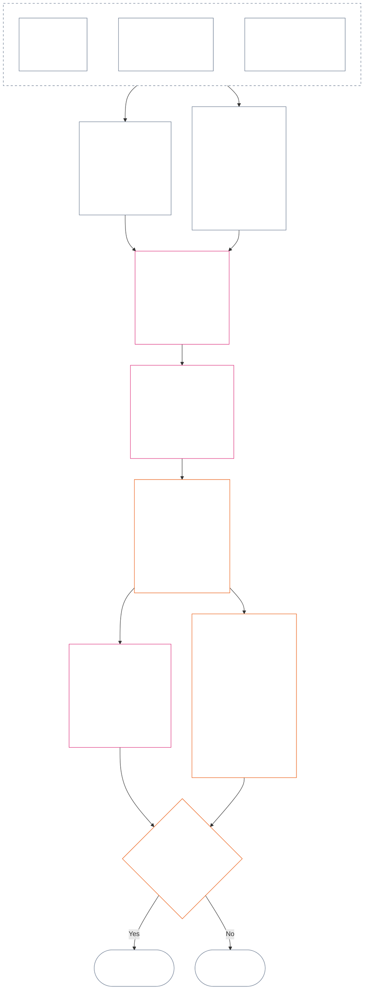

<!-- தமிழ் | பகுதி வரைவு: அத்தியாயம் பன்னிரண்டு §§4–6 | மூல commit: 9c2c8c10c871d91157bcd27b9f56ad6a1cec90d3 | AI-வரைவு, மதிப்பாய்வு செய்யப்படாதது -->

### 4. இடவெளி இலக்கணமும் பகிர்ந்த அளவாக்கமும்

*எளிய சொற்களில்: இரண்டு தனித்த அச்சுகளிலும் சாத்தியமான ஒன்பது நிலைகளுக்கு ஒரே சீரான பெயர்களை இந்தப் பிரிவு அளித்து, அவற்றிடையே தாக்கம் எவ்வாறு அளவாக்கப்படுகிறது என்பதை விளக்குகிறது. ஒரு அச்சு சரிபார்க்கப்பட்ட பங்களிப்பைப் பதிவு செய்கிறது; மற்ற நிலைத்தடப் பதிவுகள் சரிபார்க்கப்பட்ட மீறல்களைப் பதிவு செய்கின்றன. ஒரே இடவெளி எண் இருப்பதால் அச்சுகள் ஒன்றாவதில்லை; தீங்குடன் உதவியை நிகராக்கவும் முடியாது. **பிரிவு 6**-இன் ஒருங்கிணைந்த அளவுகோல் விகிதாசார LEQU தாக்கத்தின் அடிப்படையில் இரு அச்சுகளுக்கும் இடவெளி வழங்குகிறது.*

இடவெளி இலக்கணம் **1** முதல் **9** வரையிலான இடவெளி எண்ணான `s`-ஐப் பயன்படுத்துகிறது. ஒவ்வொரு அச்சுக்கும் தனி இடவெளி உண்டு:

- **Contribution Axis** நேர்மறைப் பங்களிப்பின் தன்மையைப் பதிவு செய்கிறது; மற்றும்
- **Violation Axis** சரிபார்க்கப்பட்ட மீறல் முடிவுகளைப் பதிவு செய்கிறது.

இரு அச்சுகளிலும் ஒரே இடவெளி எண் இருக்கலாம்; ஆனால் அச்சுகள் தனித்தே இருக்கும். பங்களிப்பு இடவெளி மீறல் இடவெளி அல்ல; மீறல் இடவெளியும் பங்களிப்பு இடவெளி அல்ல.

#### 4.1 அட்டவணை 1 — இடவெளிக் காட்சி குறிச்சொற்கள்

**அட்டவணை 1** ஒன்பது இடவெளிகளுக்குப் பெயரிட்டு, Contribution Axis மற்றும் Violation Axis காட்சி குறிச்சொற்களை அருகருகே காட்டுகிறது. இது காட்சி மொழியை மட்டுமே அளிக்கிறது; இடவெளி ஒதுக்கீடு **பிரிவு 6**-இன் ஒருங்கிணைந்த அளவுகோலின்படி நடக்கிறது.

| `s` | Contribution Axis காட்சி குறிச்சொல் | Violation Axis காட்சி குறிச்சொல் |
| ---: | --- | --- |
| 1 | **சிறிய அடிப்படைப் பங்களிப்பு** | **சிறிய அரசியலமைப்பு தாக்கம்** |
| 2 | **குறைந்த அடிப்படைப் பங்களிப்பு** | **குறைந்த அரசியலமைப்பு தாக்கம்** |
| 3 | **கணிசமான நேர்மறைப் பங்களிப்பு** | **கணிசமான அரசியலமைப்பு தாக்கம்** |
| 4 | **முக்கிய நேர்மறைப் பங்களிப்பு** | **முக்கிய அரசியலமைப்பு தாக்கம்** |
| 5 | **தீவிர பொறுப்பான-நிர்வாக நேர்மறைப் பங்களிப்பு** | **தீவிர அரசியலமைப்பு தாக்கம்** |
| 6 | **பெரிய பொறுப்பான-நிர்வாக நேர்மறைப் பங்களிப்பு** | **பெரிய அரசியலமைப்பு தாக்கம்** |
| 7 | **அங்கீகரிக்கப்பட்ட முன்னோடி** | **கடுமையான அரசியலமைப்பு தாக்கம்** |
| 8 | **சிறப்புமிக்க முன்னோடி** | **மிகக் கடுமையான அரசியலமைப்பு தாக்கம்** |
| 9 | **முன்மாதிரி முன்னோடி** | **பேரழிவான அரசியலமைப்பு தாக்கம்** |

Contribution Axis அடிப்படை, நேர்மறை, பொறுப்பான-நிர்வாக நேர்மறை மற்றும் முன்னோடி குறிச்சொற்களைப் பயன்படுத்துகிறது. Violation Axis ஒவ்வொரு இடவெளியிலும் நடுநிலைத் தாக்க குறிச்சொற்களைப் பயன்படுத்துகிறது. அச்சுகள் தனித்தனியாகவே இருக்கும்; அவை நிகர மதிப்பெண்ணையோ பங்களிப்பு மற்றும் மீறல் பதிவுகளுக்கிடையிலான நிகராக்கத்தையோ உருவாக்குவதில்லை. Violation Axis இடவெளி மட்டும் அரசியலமைப்பு-எதிர் தவறுசெயலை வகைப்படுத்தாது; சரிபார்க்கப்பட்ட `s` = 7–9 மீறலுக்கு அரசியலமைப்பு-எதிர் தவறுசெயல் குறியிடல் (ACMD) பொருந்துகிறதா என்பதை [அத்தியாயம் பதினான்கு](core_14.000_misconduct_designation.md#chapter-fourteen-anti-constitutional-misconduct) தனியாகத் தீர்மானிக்கிறது.

முழு வாழ்நாள்-சமமான நன்மை அல்லது இழப்பை மதிப்பிட நடைமுறைகள் அளவீட்டு அலகுகள், சான்று முறைகள், எடுத்துக்காட்டுகளை வெளியிடலாம். அவை வழிகாட்டல் மட்டுமே; **பிரிவு 6**, **அத்தியாயம் ஒன்று**, அல்லது **அத்தியாயம் ஆறு** உரிமைகள் தளத்தை மீற முடியாது.

#### 4.2 பகிர்ந்த தாக்க-அளவாக்க விதிகள்

*எளிய சொற்களில்: தாக்கத்தைப் பாதிக்கப்பட்டவர்களின் எண்ணிக்கை மட்டும் கொண்டு அளவிடுவதில்லை. ஒரு உணர்வுள்ள உயிரை ஆழமாகப் பாதிக்கும் நன்மை அல்லது இழப்பு, பலரை மேலோட்டமாகப் பாதிப்பதைவிட முக்கியமானதாக இருக்கலாம். எண்ணிக்கை, ஆழம், பாதிப்புக்குட்படும் தன்மை, காலம், நிலைத்தன்மை, பரவல் மற்றும் அரசியலமைப்புப் பண்பு ஆகியவற்றை ஒன்றாக மதிப்பிட வேண்டும்.*

**பிரிவு 6**-இல் இரு அச்சுகளையும் விளக்கப் பின்வரும் விதிகளைப் பயன்படுத்துங்கள்:

| அளவாக்கப் பரிமாணம் | பகிர்ந்த விதி | அச்சு சார்ந்த பயன்பாடு |
| --- | --- | --- |
| **அரசியலமைப்பு விளைவு அளவு (LEQU)** | ஒருங்கிணைந்த சரிபார்க்கப்பட்ட நன்மை அல்லது இழப்பை மதிப்பிடுங்கள். LEQU முதன்மை அளவு-அடிப்படை; மூல எண்ணிக்கை, பணம், உற்பத்தி அல்லது நிறுவன அளவு அல்ல. | பங்களிப்பு உரிமைகளுடன் ஒத்த நன்மையைக் கணக்கிடும்; மீறல் சரிபார்க்கப்பட்ட அரசியலமைப்பு இழப்பு, தீங்கு, வீணாக்கம், வாய்ப்பு முடக்கம் அல்லது ஆபத்தைக் கணக்கிடும். |
| **உணர்வுள்ள உயிர் வரம்பு** | **எண்ணிக்கை, ஆழம், பாதிப்புக்குட்படும் தன்மை ஆகியவற்றை ஒன்றாகக்** கருதுங்கள். எந்த இடவெளிக்கும் எண்ணிக்கை தனி நிபந்தனை அல்ல. மற்ற அளவுகோல்கள் சமமாக இருந்தால், ஒரு உயிர்மீது போதிய ஆழமான தாக்கம், அதிகமானோர்மீது மேலோட்டமான தாக்கம் உள்ள அதே இடவெளியை ஆதரிக்கலாம்; வெளிப்படையான மொத்த-LEQU அல்லது பரந்த-வரம்பு அளவுகோல் இருந்தால் அதுவும் நிறைவேற்றப்பட வேண்டும். | சார்பு, குறைந்த திறன் அல்லது வழக்கத்திற்கு மாறான பாதிப்புக்குட்படும் தன்மை பொருள்மையை உயர்த்தலாம். குழு அளவு மட்டும் பங்களிப்பையோ தீவிரத்தையோ நிரூபிக்காது. |
| **கால வரம்பு** | காலம், மீள்நிகழ்வு, நிலைத்தன்மை, இழப்புக்கான மீளமுடியாமை ஆகியவற்றைக் கருதுங்கள். குறுகிய ஆனால் மாற்றமளிக்கும் நிகழ்வு நீண்டகாலச் சிறிய தாக்கத்தைவிடப் பெரியதாக இருக்கலாம்; காலம் மட்டும் முடிவுசெய்யாது. | நீடித்த நன்மை உயர்ந்த பங்களிப்பு அளவை ஆதரிக்கிறது. நீடிக்கும் அல்லது மீளமுடியாத இழப்பு அதிக மீறல் தீவிரத்தை ஆதரிக்கிறது. |
| **இடவியல் அல்லது நிறுவன வரம்பு** | பரந்த பரவல் அளவை உயர்த்தலாம்; ஆனால் ஆழம், காலம், பாதிப்புக்குட்படும் தன்மை அல்லது அரசியலமைப்பு முக்கியத்துவம் தனியாகவே இடவெளியை ஆதரித்தால், சமூக/நிறுவன எல்லைகளைக் கடத்தல் கட்டாயமில்லை. | நிறுவனச் சீரமைப்பு பங்களிப்பு அளவை உயர்த்தலாம்; கட்டமைப்பு அல்லது அமைப்புசார் சேதம் மீறல் தீவிரத்தை உயர்த்தலாம். |
| **அரசியலமைப்பு தரம் அல்லது பண்பு** | விளைவு எவ்வாறு உருவானது என்பதை அது எவ்வளவு பரவியது என்பதிலிருந்து தனியாக அளவிடுங்கள். ஒரே உண்மையை இருமுறை கணக்கிடாதீர்கள். | பிறர்மீது தள்ளிய தீங்கு, மறைக்கப்பட்ட சுமை, கைப்பற்றல் அல்லது சார்பு ஆகியவை கோரப்பட்ட பங்களிப்பை வரையறுக்கவோ தகுதியிழக்கச் செய்யவோலாம். கடமை, அலட்சியம், ஏமாற்று, வற்புறுத்தல், வன்முறை அல்லது கட்டமைப்பு வசதி மீறல் நடத்தைப் பண்பாகத் தனியே பதிவாகும்; தாக்க இடவெளியை மாற்றாது. |
| **உரிமைத் தளங்களும் முக்கியப் பாதுகாப்புகளும்** | உரிமைத் தள இணக்கத்தை மொத்த நன்மை அல்லது இழப்புடன் பரிமாற முடியாது. | உரிமைத் தளத்தைப் பின்பற்றுவது மட்டும் உயர்ந்த பங்களிப்பை நிறுவாது. முக்கிய உரிமைத் தளத் தோல்வி அல்லது பாதுகாப்பு தோல்வி, நேரடியாகப் பாதிக்கப்பட்டோர் குறைவாக இருந்தாலும், உயர்ந்த மீறல் தீவிரத்தை ஆதரிக்கலாம். |

ஒவ்வொரு அளவின் எல்லா வடிவங்களும் இருக்க வேண்டும் எனக் கோரும் சரிபார்ப்புப் பட்டியல் இவை அல்ல. எந்தப் பரிமாணங்கள் முடிவை நிர்ணயித்தன, எவை செய்யவில்லை, ஏன் என்பதை விளக்குங்கள்.

- **பகிர்ந்த இடவெளி முறை:**
  - விகிதாசாரத்தின்படி ஒருங்கிணைந்த சரிபார்க்கப்பட்ட நன்மை அல்லது இழப்பை LEQU-வில் மதிப்பிட்டு, அந்த அளவு இடம்பெறும் ஒரே எண் பட்டை இடவெளியை ஒதுக்குங்கள்.
  - இரு அச்சுகளிலும் அதே வரம்புகள் பொருந்தும்.
  - பங்களிப்பு இடவெளிகளுக்கு பொருந்தும் அடிப்படை மற்றும் அரசியலமைப்பு-ஒத்திசைவு நிபந்தனைகள் தொடரும்; எண் வரம்பை அடைந்ததால் பிறர்மீது தள்ளிய அல்லது அரசியலமைப்பால் தோற்கடிக்கப்பட்ட உற்பத்தி பங்களிப்பாகாது.
- **பண்புகளைப் பிரித்தல்:** பொருந்தும் நன்மை-வழித்தட, தீங்கு-வழித்தட, நடத்தை-தர மற்றும் நடத்தை-பண்பு விவரிப்பான்களை நிலைத்தடப் பதிவில் அடுக்கியும் தனியே தடமறியக்கூடியதாகவும் வையுங்கள். கடமை, அலட்சியம், ஏமாற்று, தீவிரப்படுத்தல், வற்புறுத்தல், வன்முறை, நோக்கம் அல்லது கட்டமைப்பு வசதி காரண ஒதுக்கீடு, பாதுகாப்பு அல்லது கேள்வி 3 விளைவுகளைப் பாதிக்கலாம்; LEQU தாக்க இடவெளியை உயர்த்தவோ குறைக்கவோாது.
- **அரசியலமைப்பு-எதிர் தவறுசெயல் மறுபரிசீலனை வரம்பு:** சரிபார்க்கப்பட்ட Violation Axis இழப்பு தாக்கத்தின் அடிப்படையில் `s` = 7–9 அடையலாம்; அரசியலமைப்பு-எதிர் தவறுசெயல் நிறுவப்பட்டதா இல்லையா என்பது வேறு. அத்தியாயம் பதினான்கு தாக்க ஒதுக்கீட்டுக்குப் பதிலாக வராது; தொடர்புடைய ACMD பொருந்துகிறதா என்பதைத் தனியாக முடிவுசெய்கிறது.

ஆபத்து இன்னும் நிகழவில்லை என்றால் இவற்றை ஒவ்வொன்றாகத் தனியே பதிவு செய்யுங்கள்:

- அது நிகழும் சாத்தியம்;
- உணர்வுள்ள உயிர்கள் அதற்கு எவ்வளவு காலம் வெளிப்படுவர்;
- அது எவ்வளவு தூரம் பரவக்கூடும்;
- மதிப்பீடு எவ்வளவு நிச்சயமற்றது; மற்றும்
- நம்பத்தகுந்த மிக மோசமான விளைவு எது.

ஏற்றுக்கொள்ளப்பட்ட நடைமுறை ஆய்வு செய்யக்கூடிய இடர் அளவுத்திருத்தத்தை (இடரை LEQU-வாக மாற்றும் முறை) அமைக்காவிட்டால், அந்த மோசமான சாத்தியத்தை ஏற்கெனவே நிகழ்ந்த தீங்காக (LEQU இழப்பாக) கணக்கிடாதீர்கள்.

### 5. அச்சு ஒதுக்கீட்டுக்கான அரசியலமைப்பு உள்ளீடுகள்

*எளிய சொற்களில்: இடவெளியைத் தேர்வதற்கு முன், அளவிடப்படும் அடிப்படை, நன்மை, கடமை, தீங்கு அல்லது மீறலை நிர்ணயிக்கும் அரசியலமைப்பு மூலங்களை அடையாளம் காணுங்கள். கீழுள்ள இணைப்புகளைப் பயன்படுத்தி அவற்றின் அதிகாரப்பூர்வ இடத்தில் மூலங்களைப் பயன்படுத்துங்கள்; இந்த வழிப்படுத்தல் படியை இன்னொரு மதிப்பெண்ணாகவோ மாற்று வரையறையாகவோ மாற்றாதீர்கள்.*

**பிரிவு 6**-இன் கீழ் இடவெளி ஒதுக்குவதற்கு முன், நிலைத்தடப் பதிவு பின்வருவனவற்றை அடையாளம் காண வேண்டும்:

- பொருந்தும் அரசியலமைப்பு அடிப்படை, கடமை, கட்டுப்பாடு அல்லது பாதுகாக்கப்படும் நலன்;
- அளவிடப்படும் சரிபார்க்கப்பட்ட நன்மை, பாதக விளைவு, தீங்கு அல்லது மீறலை நிறுவும் விதிகள்;
- அளவு அல்லது நடத்தைப் பண்பை முக்கியமாகப் பாதிக்கும் வரையறைகள், கோட்பாடுகள் மற்றும் உரிமைத் தளக் கட்டுரைகள்; மற்றும்
- அடையாளம் காணப்பட்ட ஒவ்வொரு மூலம் ஏன் பொருந்துகிறது, அச்சு ஒதுக்கீட்டை எவ்வாறு பாதிக்கிறது.

கீழுள்ள வழிப்படுத்தல் அட்டவணைகள் முழுமையான பட்டியல் அல்ல. சரிபார்க்கப்பட்ட உண்மைகளால் தூண்டப்படும் கூடுதல் வரையறை, கோட்பாடு அல்லது கட்டுரை ஒவ்வொன்றும் பொருந்தும்; நிலைத்தடப் பதிவில் அடையாளம் காணப்பட வேண்டும். இணைக்கப்பட்ட ஒவ்வொரு அதிகாரப்பூர்வ இடமே கட்டுப்படுத்தும்; இவ்வட்டவணைகள் அதை மீளுரைக்கவோ சுருக்கவோ செய்யாது.

#### 5.1 வரையறை உள்ளீடுகள்

| அதிகாரப்பூர்வ மூலம் | Contribution Axis பங்கு | Violation Axis பங்கு |
| --- | --- | --- |
| [நிலைத்தட நிலை, பங்களிப்பு மற்றும் மீறல்](core_05.035_band_accountability.md#defa3-standing-state-contribution-and-violation) | பங்களிப்பாக எது கருதப்படும், அளவிட எந்தச் சரிபார்க்கப்பட்ட உண்மைகள் பயன்படுத்தப்படும் என்பதை விளக்குகிறது. பங்களிப்பு பதிவு நல்ல பக்கத்தை மட்டுமே கொண்டிருக்க வேண்டும்; தீயதுடன் கலக்கக்கூடாது என்பதையும் உறுதிசெய்கிறது. | மீறலாக எது கருதப்படும், எவ்வாறு பதிவு செய்யப்படும் என்பதை விளக்குகிறது. அரசியலமைப்பையே தளர்த்தும் நடத்தை குறித்த தனி மறுபரிசீலனைக்குக் கடுமையான வழக்குகளையும் அனுப்புகிறது. |
| [பொறுப்புக்கூறல்](core_05.005_apex_accountability_leg.md#accountability) | நல்ல பொறுப்பான நிர்வாகம் அல்லது சீரமைப்புக் கூற்று உண்மையில் ஒருவரைப் பதிலளிக்கச் செய்கிறதா என்பதைச் சரிபார்க்கிறது. யார் என்ன செய்தார், யார் பதிலளிக்க வேண்டும், தாக்கத்திற்கேற்ப மறுபரிசீலனை, திருத்தம், சீரமைப்பு எவ்வாறு சாத்தியம் என்பதைக் காட்ட வேண்டும். | யார் என்ன செய்தார் அல்லது யார் பதிலளிக்க வேண்டும் என்பது தெளிவில்லாத வழக்குகளை கண்டறிகிறது; அமைப்போ அதன் கட்டமைப்போ மாறியபின் பொறுப்புக்கூறல் செயலிழப்பதும் இதில் அடங்கும். |
| [தீங்கு](core_05.035_band_accountability.md#harm) | பிறர்மீது தள்ளிய அல்லது மறைத்த தீங்கு கோரப்பட்ட நன்மையை வரையறுக்கவோ ரத்துசெய்யவோலாம். தீங்கைச் சீரமைப்பது நன்மையாகக் கணக்காகலாம்; ஆனால் சரிபார்க்கப்பட்டு சுயாதீனமாகக் காட்டப்பட்டால்தான். | இழப்பு மற்றும் தீவிரத்தை அளவிடும் சேதங்களை விளக்குகிறது: நேரடி, மறைமுக, தாமதமான, குவிந்த, அமைப்புகள் முழுவதும் பரவும், உணர்வுள்ள உயிரின் மனம் அல்லது உணர்ச்சி நலனுக்கான சேதம். |
| [பொருள்மை](core_05.050_band_oversight.md#materiality) மற்றும் [வாழ்நாள்-சமமான அலகு (LEQU)](core_05.055_band_participation.md#lifespan-equivalent-unit-lequ) | பரவல், பாதிக்கப்பட்டோரின் பாதிப்புக்குட்படும் தன்மை, காலம் ஆகியவற்றின் அடிப்படையில் சரிபார்க்கப்பட்ட நன்மையின் அளவை அமைக்கின்றன. முழு வாழ்நாள் நன்மைக்கான பகிர்ந்த அளவுகோலான LEQU-வில் முடிவு அளவிடப்படும். | பரவல், பாதிப்புக்குட்படும் தன்மை, காலம், மீட்டெடுக்கும் கடினம் ஆகியவற்றால் சரிபார்க்கப்பட்ட இழப்பு அல்லது ஆபத்தின் அளவை அமைக்கின்றன. முழு வாழ்நாள் இழப்புக்கான அதே LEQU அளவுகோல் பயன்படுத்தப்படும். |
| [பங்களிப்பின் தன்மை](core_05.035_band_accountability.md#contribution-nature) | ஏதேனும் பங்களிப்பாகக் கணக்காகுமா என்பதைத் தீர்மானிக்கிறது. அது நன்மை மட்டுமே ஆக வேண்டும்; தீங்குடன் கலந்திருக்கக் கூடாது; காட்டக்கூடிய சரிபார்க்கப்பட்ட பங்களிப்பு பதிவு இருக்க வேண்டும். இரண்டும் இல்லாவிட்டால் Contribution Axis ஒதுக்கீடு கிடையாது. | இங்கு பங்கு இல்லை. எது தீங்காகும் என்பதைத் தீர்மானிக்காது; மீறலின் தீவிரத்தைக் குறைக்காது. |
| [மீறலின் தன்மை](core_05.035_band_accountability.md#violation-nature) | இங்கு பங்கு இல்லை. மீறல் எதிர்மறைப் பங்களிப்பாகக் கணக்கிடப்படாது; தொடர்பற்ற சரிபார்க்கப்பட்ட நன்மையையும் அழிக்காது. | ஏதேனும் மீறலாகக் கணக்காகுமா என்பதைத் தீர்மானிக்கிறது. அது தீங்கானதாக வகைப்படுத்தப்பட்டு, மீறல் நிகழ்ந்தது என்ற சரிபார்க்கப்பட்ட முடிவு இருக்க வேண்டும். இரண்டும் இல்லாவிட்டால் Violation Axis ஒதுக்கீடு கிடையாது. |
| [அரசியலமைப்புக் கட்டுப்பாடு](core_05.045_band_integrative.md#constitutional-constraint), [அதிகார அடுக்கு மற்றும் உள் படிநிலை](core_05.045_band_integrative.md#authority-stack-and-internal-hierarchy), [தணிக்கைத்திறன்](core_05.050_band_oversight.md#auditability) | அரசியலமைப்பைத் தோற்கடித்தல், விதிகளைத் தவிர்த்தல், Rights Floor-ஐ (அரசியலமைப்பு உறுதி செய்யும் குறைந்தபட்சப் பாதுகாப்பு) சுருக்குதல் அல்லது காகிதத்தில் மட்டும் இணங்குதல் ஆகியவற்றைச் சார்ந்த நன்மையைத் தடுக்கின்றன. | மீறல் தீவிரத்தைப் பாதிக்கும் அம்சங்களைக் காட்டுகின்றன: முக்கிய அரசியலமைப்புக் கட்டுப்பாட்டை மீறுதல், அரசியலமைப்புக்கு மேலே ஒன்றை வைப்பது, விதிகளைத் தவிர்ப்பது அல்லது அவற்றை அமலாக்க முடியாததாக்குவது. |
| [தணிக்கைத்திறன்](core_05.050_band_oversight.md#auditability), [சவால் செய்யக்கூடிய தன்மை](core_05.035_band_accountability.md#contestability) | நன்மைக் கூற்றை காட்டவும் சரிபார்க்கவும் முடியும்; மறுப்பவருக்கு அதைச் சவால் செய்யும் செயல்படும் வழி உள்ளது என்பதையும் உறுதிசெய்கின்றன. | முடிவுகளைச் சரிபார்க்கவும் சவால் செய்யவும் முடியும் எனக் கோருகின்றன. குற்றச்சாட்டோ விளக்கமற்ற குறிச்சொல்லோ மீறல் தீவிரத்தை நிர்ணயிக்காது. |

#### 5.2 கோட்பாட்டு உள்ளீடுகள்

| கோட்பாட்டு மூலம் | அச்சு ஒதுக்கீட்டுப் பங்கு |
| --- | --- |
| [அரசியலமைப்பு நான்மம்](core_00.000_preamble.md#constitutional-tetrad), [இரண்டு அரசியலமைப்பு நோக்கங்கள்](core_00.000_preamble.md#two-constitutional-aims), [பொருள் பங்கு](core_00.000_preamble.md#material-stake) | பங்கேற்பு, மேற்பார்வை, பொறுப்புக்கூறல், காலந்தவறாமை என்ற நான்கு செயல்முறை ஒழுங்குகள்; அரசியலமைப்பு நோக்கும் இரண்டு விளைவுகள் (செழிப்பு, தொடர்ச்சி); மற்றும் பங்கில் உள்ளதைப் பொருத்து ஒவ்வொரு ஒதுக்கீட்டின் அளவையும் நிர்ணயிக்கும் வடிவமைப்பு. |
| [நலவாழ்வு](core_01.000_values_principles.md#3-foundational-objective-wellbeing-flourishing-aim), [அங்கீகாரம், வலுப்படுத்தல் மற்றும் விழைவு](core_01.000_values_principles.md#32-recognition-reinforcement-and-aspiration) | உரிமைகளை மதிக்கும் நன்மையையும் அதற்கேற்ற அங்கீகாரத்தையும் Contribution Axis-இல் அடிப்படையாக்குகின்றன. புகழோ வெகுமதியோ பங்களிப்பின் சான்றாகாது. |
| [பாதுகாப்பு](core_01.000_values_principles.md#4-safety-harm-constraint), [உண்மை](core_01.000_values_principles.md#5-truth-epistemic-integrity-constraint) | இரு அச்சுகளுக்கும் கட்டுப்பாடுகளை அமைக்கின்றன. தீங்கு அல்லது ஏமாற்று வழி பெற்ற நன்மை முழுமையாகக் கணக்காகாது; பாதுகாப்பு அல்லது உண்மையின் சரிபார்க்கப்பட்ட தோல்வி மீறலின் அளவையோ வகையையோ காட்டலாம். |
| [பொறுப்பான நிர்வாகம் ஆழத்தில்](core_01.010_stewardship_capacity_principles.md#16-stewardship-in-depth), [பொறுப்பான நிர்வாக ஒழுக்கத்தின் கீழ் ஆட்சி](core_01.010_stewardship_capacity_principles.md#18-governance-under-stewardship-discipline) | சரிபார்க்கப்பட்ட உண்மைகள் தேவைப்படும்போது நீடித்த பங்களிப்பு, பணியுடன் வரும் கடமைகள், நிறுவனச் சீரமைப்பு, மேற்பார்வை மற்றும் பொறுப்பை எவ்வாறு எடைபோட வேண்டும் என வழிகாட்டுகின்றன. |
| [மையத் தியாகக் கோட்பாடுகள்](core_01.005_interaction_interpretation.md#131-core-tradeoff-principles), [அரசியலமைப்பு உரிமைத் தளங்கள், பாதுகாப்பு, இழிவுபடுத்தாத நடைமுறை](core_01.005_interaction_interpretation.md#1314-constitutional-floors-safety-and-anti-degrading-process) | அளவிடப்படும் நடத்தையில் அவசியம், தீங்கைக் குறைத்தல், விகிதாசாரம், உரிமை மோதல் அல்லது கட்டுப்பாடு இருந்தால் பொருந்தும். இவை தனியாக எந்த விளைவையும் அதிகாரப்படுத்துவதில்லை. |

#### 5.3 உரிமைத் தள மற்றும் கட்டுரை உள்ளீடுகள்

| கட்டுரை மூலம் | அச்சு ஒதுக்கீட்டுப் பங்கு அல்லது வரம்பு |
| --- | --- |
| உண்மைகளுக்குப் பொருந்தும் [அத்தியாயம் ஆறின் Rights Floor](core_06.000_rights_part_a.md#chapter-six-foundational-rights), சரிபார்க்கப்பட்ட நிலைத்தடப் பதிவு பொருளில் தொடர்புபடுத்தும் ஒவ்வொரு கட்டுரையையும் உள்ளடக்கியது | அடிப்படைப் பாதுகாப்புகள், நலன்கள், கடமைகள், நன்மைகள் அல்லது மீறல்களை அமைக்கிறது. கீழே பட்டியலிடப்படவில்லை என்பதற்காகக் கட்டுரை விலக்கப்படாது. |
| [கட்டுரை XIX — நிலைத்தடமும் பங்கேற்பு நிலையும்](core_06.015_rights_part_d.md#article-xix-standing-and-participation-status) | உணர்வுள்ள உயிரின் நிலைத்தடம், கண்ணியம், உரிமைத் தளத்தின் குறைந்தபட்சப் பாதுகாப்புகள், பங்குதாரர் நிலை, நற்பெயர் மற்றும் பங்கேற்பு நிலையின் பிற்கால மாற்றத்தைத் தனித்தனியாக வைக்கிறது. |
| [கட்டுரை XIII-A — நம்பகத்தன்மை அடிப்படை](core_06.010_rights_part_c.md#article-xiii-a-reliability-and-trustworthiness-baseline), [கட்டுரை XIII-B — நிவர்த்தி மற்றும் தீர்வுக்கான உரிமை](core_06.010_rights_part_c.md#article-xiii-b-right-to-redress-and-remedy), [கட்டுரை XV-B — வெளிப்படைத்தன்மை, தணிக்கைத்திறன், சவால் செய்யத்தன்மை](core_06.010_rights_part_c.md#article-xv-b-transparency-auditability-and-contestability), [கட்டுரை XVI — தணிக்கை, வெளிப்படைத்தன்மை, சுயாதீனச் சரிபார்ப்பு](core_06.010_rights_part_c.md#article-xvi-audit-transparency-and-independent-verification) | சரிபார்க்கப்பட்ட நன்மை அல்லது மீறல் நேர்மையான பதிவு, தகவல் பகிர்வு, உண்மைச் சோதனை, முடிவைச் சவால் செய்தல் அல்லது தவறைத் திருத்துதல் ஆகியவற்றை உள்ளடக்கும்போது பொருந்தும். |
| [கட்டுரை XXIV — மூலக் காரணப் பகுப்பாய்வும் தகவமைவு எதிர்வினையும்](core_06.015_rights_part_d.md#article-xxiv-root-cause-analysis-and-adaptive-response) | நடத்தை எதனால் ஏற்பட்டது, திருத்தப்பட்டதா, தொடர்கிறதா, பதில் மாறியதா என்பவை அதன் அரசியலமைப்புச் நிலையை வெளிப்படுத்தும்போது பொருந்தும். |
| [கட்டுரை XX — சரிபார்க்கப்பட்ட மீறலுக்குப் பிந்தைய நீதி](core_06.015_rights_part_d.md#article-xx-justice-after-verified-violation), [கட்டுரை XXVI-C — காலந்தவறாத தீர்வும் தாமத-எதிர்ப்பு உரிமைத் தளமும்](core_06.020_rights_part_e.md#article-xxvi-c-timely-resolution-and-anti-delay-floor) | உண்மைகள் சார்ந்துள்ள எந்த நடைமுறை அல்லது தாமதத்திற்கும் பொருந்தும். **கட்டுரை XX** (*சரிபார்க்கப்பட்ட மீறலுக்குப் பிந்தைய நீதி*) முதன்மையாக மீறல் அளவிடப்பட்ட பின் என்ன நடக்கிறது என்பதை (கேள்வி 3) கட்டுப்படுத்துகிறது. யாரோ ஏற்கெனவே விரும்பும் பதிலை நியாயப்படுத்த கேள்வி 2 இடவெளியை உயர்த்தவோ தாழ்த்தவோ பயன்படுத்தக் கூடாது. |

**பயன்பாட்டு வரம்புகள்.** இந்தப் படி சரியான மூலங்களுக்குச் சுட்டுகிறது மட்டுமே.

- இது பின்வருவனவற்றைச் செய்யாது:
  - கேள்வி 1-ஐ மீண்டும் திறத்தல்;
  - சரிபார்க்கப்படாத உண்மைகளை அனுமதித்தல்;
  - புதிய அளவீடு அல்லது மதிப்பெண்ணைச் சேர்த்தல்;
  - வெவ்வேறு மூலங்கள் வழியாக ஒரே உண்மையை இருமுறை கணக்கிடுதல்;
  - இரு அச்சுகளையும் ஒன்றாக்குதல்; அல்லது
  - பட்டியலிட்ட ஒவ்வொரு மூலமும் ஒவ்வொரு நிலைத்தடப் பதிவுக்கும் பொருந்தும் என்று கருதுதல்.
- பங்களிப்பும் மீறலும் தொடர்ந்து தனித்தனியாக அளவிடப்படும்.
- **கட்டுரை XX** (*சரிபார்க்கப்பட்ட மீறலுக்குப் பிந்தைய நீதி*) விளைவுகள் கேள்வி 2-க்கு வெளியே இருக்கும்.
- அத்தியாயம் பதினான்கின் குறியிடல் மறுபரிசீலனை இங்கு ஒதுக்கப்படும் தாக்க இடவெளியிலிருந்து தனித்தது.

### 6. ஒருங்கிணைந்த விகிதாசார LEQU அளவுகோல் — Contribution மற்றும் Violation Axes

<strong>வாசகர் வழிகாட்டல் (செயல்படாதது): ஐந்து மடங்கு வளர்ச்சி எவ்வாறு இயங்குகிறது</strong>

> `s` = 7 = ஒரு LEQU என அடிப்படையாக்கப்பட்ட ஐந்து மடங்கு வளர்ச்சியை அளவுகோல் பயன்படுத்துகிறது. இரு அச்சுகளிலும், 2 முதல் 9 வரையிலான இடவெளி `s`-க்கான குறைந்தபட்ச அளவு `5^(s−7)` LEQU; இடவெளி 1 பூஜ்ஜியத்திலிருந்து தொடங்குகிறது. ஏற்றுக்கொள்ளப்பட்ட நடைமுறை பெறப்படும் எண் வரம்புகளையும் அளவுத்திருத்த எடுத்துக்காட்டுகளையும் வெளியிடலாம். இடவெளி 1, Contribution Axis-இல் சரிபார்க்கப்பட்ட அரசியலமைப்பு அடிப்படையையும் Violation Axis-இல் முதல் நேர்மறை வரம்புக்குக் கீழுள்ள சரிபார்க்கப்பட்ட இழப்பையும் உள்ளடக்கும்; பங்களிப்பு இல்லாததோ மீறல் இல்லாததோ தானாகவே `s` = 1 பதிவாகாது.
>
> **மனிதர் புரியும் அடிப்படை.** 80 ஆண்டு மனித வாழ்நாளை அளவுத்திருத்த எடுத்துக்காட்டாகக் கொண்டு, நடு நெடுவரிசையை மேல்நோக்கி முழு வாழ்நாள்-சமமான நன்மை, பயன்படத்தக்க காலம், அல்லது உரிமைகளுடன் ஒத்த வளம்/திறன் சேர்க்கப்பட்டது என வாசிக்கவும்; கீழ்நோக்கி அதற்கு நிகரான இழப்பு, பறிப்பு, வீணாக்கம் அல்லது வாய்ப்பு முடக்கம் என வாசிக்கவும். வளத்தின் அளவு மட்டும் கணக்காகாது — அது உருவாக்கும் அல்லது தடுக்கும் அரசியலமைப்பு விளைவே கட்டுப்படுத்தும்.

 

*எளிய சொற்களில்: **அட்டவணை 2** சரிபார்க்கப்பட்ட பங்களிப்பையும் மீறலையும் ஒரே விகிதாசார தாக்க அளவுகோலில் வைக்கிறது. உயர்ந்த இடவெளி என்பது ஒருங்கிணைந்த அரசியலமைப்பு நன்மை அல்லது இழப்பு அதிகம் என்பதைக் குறிக்கும். நிலைத்தடப் பதிவுகளும் அச்சுகளும் தனித்தனியே உள்ளன: பொதுவான அளவுகோல் அளவை ஒப்பிடுகிறது, ஒழுக்க மதிப்பை அல்ல; உதவியால் தீங்கை ரத்து செய்ய ஒருபோதும் அனுமதிப்பதில்லை.*

கீழுள்ள விளக்கப்படம் ஓர் இடவெளி ஒதுக்கீட்டை தொடக்கம் முதல் முடிவு வரை காட்டுகிறது. கீழுள்ள புள்ளிகளின் வரிசையை அல்ல, படிகள் எவ்வாறு நடைபெறுகின்றன என்பதையே காட்டுகிறது; ஒவ்வொரு விதியையும் புள்ளிகள் சொல்கின்றன.

**விகிதாசாரத்தை** பயன்படுத்தி ஆழம், உணர்வுள்ள உயிர் வரம்பு, பாதிப்புக்குட்படும் தன்மை, காலம், நிலைத்தன்மை அல்லது மீளமுடியாமை, பரவல் மற்றும் அரசியலமைப்பு முக்கியத்துவம் ஆகியவற்றிலிருந்து ஒருங்கிணைந்த LEQU தாக்கத்தை மதிப்பிடுங்கள். இப்பரிமாணங்கள் LEQU மதிப்பீட்டை வடிவமைக்கின்றன; தனித்த இடவெளி போனஸ்கள் அல்ல.

- கேள்வி 1 என்ன நடந்தது என்பதை உறுதிசெய்து, கேள்வி 2 சரிபார்க்கப்பட்ட நன்மை அல்லது இழப்பை அளந்து, **பிரிவுகள் 1–3 மற்றும் 4.2** பயன்படுத்தப்பட்டு, **பிரிவு 5** வேண்டிய அரசியலமைப்பு மூலங்கள் அடையாளம் காணப்பட்ட பிறகே **அட்டவணை 2**-ஐப் பயன்படுத்துங்கள்.
- ஒருங்கிணைந்த LEQU மதிப்பீட்டிலிருந்து ஒரே இடவெளியை ஒதுக்குங்கள்.
  - ஒவ்வொரு பொருளுள்ள அளவாக்கப் பரிமாணமும் மதிப்பீட்டை எவ்வாறு பாதித்தது, விடுபட்டவை ஏன் முடிவுசெய்யவில்லை என்பதை விளக்குங்கள்.
  - ஒவ்வொரு ஒதுக்கீடும் பின்வருவனவற்றை நிறைவேற்ற வேண்டும்:
    - தடமறிதல்;
    - தணிக்கைத்திறன்;
    - சவால் செய்யக்கூடிய தன்மை; மற்றும்
    - பொருந்தும் Rights Floor.
  - பங்களிப்பு, பிறர்மீது சுமை மாற்றாமை மற்றும் அரசியலமைப்பு ஒத்திசைவு ஆகியவற்றையும் நிறைவேற்ற வேண்டும்.
- நடத்தைப் பண்பு உண்மைகளைத் தனியே தடமறியக்கூடிய விவரிப்பான்களாகப் பதிவு செய்யுங்கள். அவை காரண ஒதுக்கீடு, மறுபரிசீலனைத் தீவிரம், பாதுகாப்பு, நிவாரணம் அல்லது அத்தியாயம் பதினான்கு குறியிடலைக் கட்டுப்படுத்தலாம்; சரிபார்க்கப்பட்ட விளைவுகள் ஒருங்கிணைந்த LEQU தாக்கத்தை மாற்றினால் மட்டுமே இடவெளியைப் பாதிக்கும்.
- செயல் அல்லது நடத்தைத் தொடரின் சரிபார்க்கப்பட்ட விளைவுகளைப் பொருளுள்ள அளவாக்கப் பரிமாணங்கள் வழியே முழுமையாக மதிப்பிடுங்கள்; இதில்:
  - உடல் காயம்;
  - உளவியல் அதிர்ச்சி;
  - வற்புறுத்தல் விளைவுகள்;
  - சுதந்திரப் பறிப்பு அல்லது ஆபத்து;
  - குவிந்த தீங்கு; மற்றும்
  - அரசியலமைப்பால் ஏற்றுக்கொள்ளத்தக்க பிற நன்மை அல்லது இழப்பு.
- பின்வருவனவற்றைச் செய்யாதீர்கள்:
  - ஒரு நிகழ்வு அல்லது நடத்தைத் தொடர் பின்வருவதாக விவரிக்கப்படுகிறது என்பதற்காக மட்டும் இடவெளியை உயர்த்தவோ குறைக்கவோ வேண்டாம்:
    - கடமை;
    - அலட்சியம்;
    - நோக்கம்;
    - மறைத்தல்;
    - மீள்நிகழ்வு;
    - தீவிரப்படுத்தல்;
    - வற்புறுத்தல்;
    - வன்முறை;
    - சுதந்திர ஆபத்து;
    - சீர்செய்யத்தன்மை; அல்லது
    - விரும்பிய விளைவு.
  - அளவிலிருந்து நடத்தைப் பண்பை ஊகிக்கவோ, சரிபார்க்கப்பட்ட அளவுக்குப் பதிலாக நடத்தைப் பண்பைப் பயன்படுத்தவோ வேண்டாம்.

**அட்டவணை 2** ஒன்பது இடவெளிகளை வரிசையாகக் காட்டுகிறது. ஒவ்வொரு வரியும் `s` இடவெளி எண், அந்த இடவெளியை அடைய வேண்டிய நன்மை உயர்வு/இழப்பு (80 ஆண்டு மனித வாழ்நாள் அளவுத்திருத்த எடுத்துக்காட்டுடன்), இரு அச்சுகளுக்குமான இடவெளிப் பெயர் ஆகியவற்றைக் கொடுக்கிறது. இரு அச்சுகளிலும் அதே வரம்புகள் பொருந்தும்; ஆனால் பெயர்கள் தனித்தனியாக இருக்கும்: Contribution Axis இடவெளியும் Violation Axis இடவெளியும் வேறு பதிவுகள்; அவை ஒருபோதும் நிகராக்கப்படுவதில்லை.

| `s` | 80 ஆண்டு மனித அளவுத்திருத்தம் — சேர்க்கப்பட்ட நன்மை / ஏற்பட்ட இழப்பு | Contribution Axis | Violation Axis |
| ---: | --- | --- | --- |
| 1 | சுமார் **9 நாட்களுக்குக் குறைவு** | **சிறிய அடிப்படைப் பங்களிப்பு** — மதிப்பிடப்பட்ட வரம்புக்கான அரசியலமைப்பு அடித்தளத்தின் சரிபார்க்கப்பட்ட நிறைவேற்றம்; அளவிடக்கூடிய மேம்பாடு `s` = 2-க்குக் கீழே. | **சிறிய அரசியலமைப்பு தாக்கம்** — `s` = 2-க்குக் கீழான சரிபார்க்கப்பட்ட இழப்பு அல்லது செயல்பாட்டு பாதிப்பு; அடிப்படைத் தீங்கு நிரூபிக்காத முறையான குறையும் இதில் அடங்கும். |
| 2 | சுமார் **9–47 நாட்கள்** | **குறைந்த அடிப்படைப் பங்களிப்பு** — இந்தத் தாக்க மட்டத்தில் குறைந்தபட்சத்தைவிட மேலான நம்பகமான, வரையறுக்கப்பட்ட செயல்திறன். | **குறைந்த அரசியலமைப்பு தாக்கம்** — இந்தத் தாக்க மட்டத்திலான சரிபார்க்கப்பட்ட வரையறுக்கப்பட்ட இழப்பு. |
| 3 | சுமார் **47 நாட்கள்–8 மாதங்கள்** | **கணிசமான நேர்மறைப் பங்களிப்பு** — இந்த மட்டத்தில் அடிப்படைக்கு மேலான காட்டக்கூடிய நன்மை. | **கணிசமான அரசியலமைப்பு தாக்கம்** — இந்த மட்டத்தில் சரிபார்க்கப்பட்ட கணிசமான இழப்பு. |
| 4 | சுமார் **8 மாதங்கள்–3.2 ஆண்டுகள்** | **முக்கிய நேர்மறைப் பங்களிப்பு** — ஆழமான, நீடித்த, மீள்நிகழும், பாதிப்புக்குட்படும் தன்மைக்கு பதிலளிக்கும் அல்லது பரந்த சரிபார்க்கப்பட்ட நன்மை. | **முக்கிய அரசியலமைப்பு தாக்கம்** — சரிபார்க்கப்பட்ட முக்கிய அரசியலமைப்பு இழப்பு. |
| 5 | சுமார் **3.2–16 ஆண்டுகள்** | **தீவிர பொறுப்பான-நிர்வாக நேர்மறைப் பங்களிப்பு** — நீடித்த பொறுப்பான நிர்வாகம், ஒருங்கிணைப்பு, பராமரிப்பு, சீரமைப்பு அல்லது ஒப்பான தொடர்நன்மை. | **தீவிர அரசியலமைப்பு தாக்கம்** — சரிபார்க்கப்பட்ட தீவிர அரசியலமைப்பு இழப்பு. |
| 6 | சுமார் **16–80 ஆண்டுகள்** | **பெரிய பொறுப்பான-நிர்வாக நேர்மறைப் பங்களிப்பு** — ஒரு LEQU-ஐ அணுகும் பெரிய சரிபார்க்கப்பட்ட நன்மை. | **பெரிய அரசியலமைப்பு தாக்கம்** — ஒரு LEQU-ஐ அணுகும் பெரிய சரிபார்க்கப்பட்ட இழப்பு. |
| 7 | சுமார் **1–5 வாழ்நாள்கள்** (**80–400 ஆண்டுகள்**) | **அங்கீகரிக்கப்பட்ட முன்னோடி** — குறைந்தது ஒரு LEQU அளவிலான சரிபார்க்கப்பட்ட, அரசியலமைப்புடன் ஒத்த நன்மை. | **கடுமையான அரசியலமைப்பு தாக்கம்** — குறைந்தது ஒரு LEQU அளவிலான சரிபார்க்கப்பட்ட அரசியலமைப்பு இழப்பு. |
| 8 | சுமார் **5–25 வாழ்நாள்கள்** (**400–2,000 ஆண்டுகள்**) | **சிறப்புமிக்க முன்னோடி** — `s` = 7-ஐப் பொருளில் மீறும் சரிபார்க்கப்பட்ட நன்மை. | **மிகக் கடுமையான அரசியலமைப்பு தாக்கம்** — `s` = 7-ஐப் பொருளில் மீறும் சரிபார்க்கப்பட்ட இழப்பு. |
| 9 | குறைந்தது **25 வாழ்நாள்கள்** (**2,000+ ஆண்டுகள்**) | **முன்மாதிரி முன்னோடி** — `s` = 8-ஐப் பொருளில் மீறும் சரிபார்க்கப்பட்ட நன்மை. | **பேரழிவான அரசியலமைப்பு தாக்கம்** — `s` = 8-ஐப் பொருளில் மீறும் சரிபார்க்கப்பட்ட இழப்பு. |

<strong>செயலாக்க இடையிணக்கக் குறிப்பு</strong>

> இந்த விட்ஜெட்டில் நடைமுறை அமலாக்கத்துக்கான இடையிணக்கத் தகவல் உள்ளது. அத்தியாயத்தின் செயல்பாட்டு வகைகளை ஆதரிக்கிறது; இணையான வகைப்பாட்டு அமைப்பை உருவாக்குவதில்லை.

இடவெளிக் காட்சிக்கான இயந்திரம் வாசிக்கக்கூடிய புலங்கள் (`sub_tier`, `sub_tier_display`, தொடர்புடைய காட்சி புலங்கள்) [CH06_NINE_SLOT_STANDING_SCALE.md](implementation/CH06_NINE_SLOT_STANDING_SCALE.md), [ch06_nine_slot_constants.json](implementation/ch06_nine_slot_constants.json) இல் வரையறுக்கப்பட்டுள்ளன. நடைமுறை நான்கு-பட்டை வரைபடம் இடையிணக்க உதவியாகவே இருக்கும்; செயல்பாட்டு **அட்டவணை 2**-க்கு முதன்மைப் பட்டை நெடுவரிசையைச் சேர்ப்பதில்லை.

எடையுள்ள உயிர்கள், சேமிக்கப்பட்ட நிலைச் சோதனைப் புள்ளிகள், நிலையான இறப்பு இல்லாமை உள்ளிட்ட குறிப்பு முறை மற்றும் நடைமுறை இடவெளி ஒதுக்கீடுகள் [LEQU_CALIBRATION_REFERENCE.md](implementation/LEQU_CALIBRATION_REFERENCE.md) இல் உள்ளன. அவை **பிரிவு 6**-இன் பகிர்ந்த வரம்புகளையும் விகிதாசார ஒதுக்கீட்டு விதியையும் மாற்ற முடியாது; நடப்பு பதிவிற்கு இடவெளி ஒதுக்கவோ யார் கணக்கில் வருவர் எனத் தீர்மானிக்கவோ முடியாது.

ஏற்றுக்கொள்ளப்பட்ட நடைமுறை LEQU மதிப்பீடுகளையும் குறியீடு செய்யப்பட்ட காட்சி குறிச்சொற்களையும் வெளியிடலாம். **ஒத்திசைவான ஆவண** மாற்றம் மூலமே விதிவிலக்கு பெறலாம்; இல்லையெனில் அந்த உதவிகள் **பிரிவு 6**-இன் பகிர்ந்த வரம்புகள் மற்றும் விகிதாசார ஒதுக்கீட்டு விதியையோ அத்தியாயம் பதினான்கின் குறியிடல் பாதுகாப்புகளையோ மாற்றக் கூடாது.

