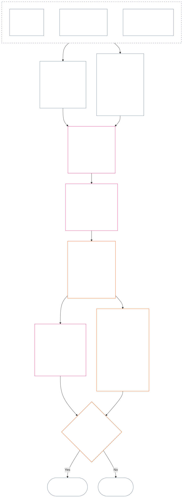

<!-- Locale: Tamil (ta) | Source: 9c2c8c10c871d91157bcd27b9f56ad6a1cec90d3 | AI-drafted, unreviewed | FULL Chapter Twelve draft; non-binding -->

# அத்தியாயம் பன்னிரண்டு: நிலைத்தட அளவீடு — கேள்வி 2, அது எவ்வளவு நல்லது அல்லது கெட்டது?

<strong>தொகுப்பில் இடம் (செயல்படாதது): கோப்பு அமைப்பும் வாசிப்பு விதிகளும்</strong>

> இந்தக் கோப்பு **உணர்வுள்ளோர் அரசியலமைப்பின்** ஒரு பகுதியாகும்; எண்ணிடப்பட்ட மற்ற `core_*` கோப்புகளுடன் ஒரே உரையாக வாசிக்கும்போது மட்டுமே **பிணைக்கும்**. இதில் **அத்தியாயம் பன்னிரண்டு** — **கேள்வி 2** (*அது எவ்வளவு நல்லது அல்லது கெட்டது?*) உள்ளது: LEQU அடிப்படையும் அதன் வரம்புகளும், அளவீட்டு உள்ளீட்டுப் பரிமாணங்களும், வழி விவரிப்பான் பட்டியல்களும், ச்லாட் இலக்கணமும் பகிர்ந்த அளவாக்கமும், அச்சு ஒதுக்கீட்டுக்கான அரசியலமைப்பு உள்ளீடுகளும், ஒருங்கிணைந்த விகிதாசார LEQU அளவுகோலும், நிலையான பங்களிப்பு அளவீடுகளும், விளக்கப்பட்ட எடுத்துக்காட்டுகளும், கேள்வி 3க்கான ஒப்படைப்பும் (**§1–§9**) உள்ளன. மூன்று-கேள்வி கட்டமைப்பும் **கேள்வி 1** (*என்ன நடந்தது?*) — சரிபார்க்கப்பட்ட உண்மைகள், நிகழ்வு வகைகள், பதிவு தேவைகள், பதிவுக் காவல், கையாளுதல் — ஆகியவை [அத்தியாயம் பதினொன்றில்](core_11.000_standing_assessment.md#chapter-eleven-standing-records--question-1-what-happened) உள்ளன. கேள்வி 3 (*இதனால் என்ன நிகழும்?*) [அத்தியாயம் பதின்மூன்றில்](core_13.000_standing_integration.md#chapter-thirteen-standing-effects-and-integration) தொடர்கிறது; தகுதியுள்ள Violation Axis `s` = 7–9 கண்டறிதல்களுக்கான அரசியலமைப்புக்கு-எதிரான தவறான நடத்தை வகைப்படுத்தல் மதிப்பாய்வுக்கு [அத்தியாயம் பதினான்கில்](core_14.000_misconduct_designation.md#chapter-fourteen-anti-constitutional-misconduct) மட்டுமே செல்லும். வாசிப்பு வரிசை, பிணைப்பு/ஆதரவு பிரிப்பு, தொகுப்பு பதிப்பு விவரங்கள் [README.md](README.md) இல் பராமரிக்கப்படுகின்றன.

<strong>தடமறிதல்</strong>

- மேல்நிலை:
  - [அத்தியாயம் பதினொன்று §1](core_11.000_standing_assessment.md#1-the-three-questions) (*மூன்று-கேள்வி கட்டமைப்பு*);
  - [அத்தியாயம் பதினொன்று §2](core_11.000_standing_assessment.md#2-question-1--what-happened) முதல் [அத்தியாயம் பதினொன்று §6](core_11.000_standing_assessment.md#6-handling-a-standing-record) வரை (*கேள்வி 1 — சரிபார்க்கப்பட்ட உண்மைகள், நிலைத்தடப் பதிவுகள், காவல், கையாளுதல்*);
  - [அரசியலமைப்பு நான்மம்](core_00.000_preamble.md#constitutional-tetrad);
  - [இரண்டு அரசியலமைப்பு நோக்கங்கள்](core_00.000_preamble.md#two-constitutional-aims);
  - [முகவுரை §6 முக்கிய நடைமுறைச் செயல்முறைத் தொடர்கள்](core_00.000_preamble.md#6-key-practical-process-pipelines) (*அத்தியாயங்கள் ஒன்பது முதல் பதினைந்து வரையிலான தொடர்*).
+- இந்தக் கோப்பின் துணைப்பிரிவுகள்:
+  - [§1](#1-question-2--how-good-or-bad-was-it) (*கேள்வி 2 — LEQU அடிப்படை, நிலை இணைப்பு, வரம்புகள், பரப்பு*);
+  - [§2](#2-magnitude-and-severity-input-dimensions) (*இரு அச்சுகளுக்குமான அளவீட்டு உள்ளீட்டுப் பரிமாணங்கள்*);
+  - [§3](#3-route-descriptor-catalogs-and-measurement-roles) (*வழி விவரிப்பான் பட்டியல்கள்*);
+  - [§4](#4-slot-grammar-and-shared-scaling) (*ச்லாட் இலக்கணமும் பகிர்ந்த அளவாக்கமும்*);
+  - [§5](#5-constitutional-inputs-to-axis-assignment) (*அரசியலமைப்பு மூல வழிமாற்றம்*);
+  - [§6](#6-unified-proportional-lequ-scale--contribution-and-violation-axes) (*இரு அச்சுகளுக்குமான ஒருங்கிணைந்த விகிதாசார LEQU அளவுகோல்*);
+  - [§7](#7-standard-contribution-measures) (*ஏற்றுக்கொண்டோர் வெளியிடும் நிலையான பங்களிப்பு அளவீடுகள்*);
+  - [§8](#8-measurement-illustrations) (*பணியுடன் விளக்கப்பட்ட அளவீட்டு எடுத்துக்காட்டுகள்*);
+  - [§9](#9-hand-off-to-question-3--cross-question-measurement-hooks) (*கேள்வி 3க்கு ஒப்படைப்பு*).
+- அடுத்த நிலை:
+  - [அத்தியாயம் பதின்மூன்று](core_13.000_standing_integration.md#chapter-thirteen-standing-effects-and-integration) (13.000) (*கேள்வி 3 விளைவுகளும் ஒருங்கிணைப்பும்*);
+  - [அத்தியாயம் பதினான்கு](core_14.000_misconduct_designation.md#chapter-fourteen-anti-constitutional-misconduct) (14.000) (*வகைப்படுத்தல் மட்டும் — கேள்வி 2 அளவீட்டை மீண்டும் திறக்காது*).
+- இதனுடன் படிக்கவும்: [அத்தியாயம் ஐந்து *நிலைத்தட நிலை, பங்களிப்பு, மீறல்*](core_05.035_band_accountability.md#defa3-standing-state-contribution-and-violation) (5.035) (*அதிகாரப்பூர்வ வரையறை வழிமாற்றம்*).
+
+

+
+ 
+
+அத்தியாயம் பன்னிரண்டு, [அத்தியாயம் பதினொன்று](core_11.000_standing_assessment.md#chapter-eleven-standing-records--question-1-what-happened) சரிபார்த்த உண்மைகளை அளவிடும் **கேள்வி 2**-க்கான அரசியலமைப்பு உரிமையாளராகும். இது [§1 கேள்வி 2 — அது எவ்வளவு நல்லது அல்லது கெட்டது?](#1-question-2--how-good-or-bad-was-it) இல் தொடங்குகிறது. [அத்தியாயம் பதினொன்று](core_11.000_standing_assessment.md#chapter-eleven-standing-records--question-1-what-happened) மூன்று-கேள்வி கட்டமைப்பு, கேள்வி 1, நிலைத்தடப் பதிவு ஆகியவற்றின் உரிமையாளராக இருந்து, [அத்தியாயம் பதினொன்று §6 நிலைத்தடப் பதிவைக் கையாளுதல்](core_11.000_standing_assessment.md#6-handling-a-standing-record) இல் முடிகிறது.
+
+*எளிய சொற்களில்: என்ன நடந்தது, யார் நிலைத்தடப் பதிவைக் காக்கிறார்கள் என்பதை அத்தியாயம் பதினொன்று தீர்மானிக்கிறது. இந்த அத்தியாயம் அதை அளவிடுகிறது: பங்களிப்பு எவ்வளவு நல்லது, அல்லது மீறல் எவ்வளவு தீங்கானது — ஒன்றாக நிகர மதிப்பெண் செய்யப்படாத இரண்டு தனி அளவுகோல்களில். அளவீட்டுக்குப் பின் என்ன நிகழும் என்பதை அத்தியாயம் பதின்மூன்று கூறுகிறது.*
+
### 1. கேள்வி 2 — அது எவ்வளவு நன்றாக அல்லது மோசமாக இருந்தது?

<strong>தடமறிதல்</strong>

- மேல்நிலை: [அத்தியாயம் பதினொன்று §2](core_11.000_standing_assessment.md#2-question-1--what-happened) (*கேள்வி 1 — நிலைத்தடப் பதிவுகளும் சரிபார்க்கப்பட்ட உண்மைகளும்*); [அத்தியாயம் பதினொன்று §2.5](core_11.000_standing_assessment.md#25-verified-input-gate) (*சரிபார்க்கப்பட்ட உள்ளீட்டு வாயில்*); [அத்தியாயம் பதினொன்று §4](core_11.000_standing_assessment.md#4-standing-record-operational-requirements) (*பதிவுத் தேவைகள்*); [அத்தியாயம் பதினொன்று §1](core_11.000_standing_assessment.md#1-the-three-questions) (*மூன்று-கேள்வி வடிவமைப்பு*).
- கீழ்நிலை:
  - [§2](#2-magnitude-and-severity-input-dimensions) (*இரு அச்சுகளுக்குமான அளவீட்டு உள்ளீட்டு பரிமாணங்கள்*);
  - [§3](#3-route-descriptor-catalogs-and-measurement-roles) (*வழித்தட விவரிப்பான் பட்டியல்கள்*);
  - [§4](#4-slot-grammar-and-shared-scaling) (*இடவெளி இலக்கணம் மற்றும் பகிர்ந்த அளவாக்கம்*);
  - [§5](#5-constitutional-inputs-to-axis-assignment) (*அரசியலமைப்பு மூலங்களை வழிப்படுத்தல்*);
  - [§6](#6-unified-proportional-lequ-scale--contribution-and-violation-axes) (*Contribution மற்றும் Violation Axis ஒதுக்கீடு*);
  - [§7](#7-standard-contribution-measures) (*ஏற்பாளரால் வெளியிடப்படும் நிலையான பங்களிப்பு அளவீடுகள்*);
  - [§8](#8-measurement-illustrations) (*அளவீட்டு எடுத்துக்காட்டுகள்*);
  - [§9](#9-hand-off-to-question-3--cross-question-measurement-hooks) (*கேள்வி 3-க்கு ஒப்படைப்பு*);
  - [அத்தியாயம் பதின்மூன்று §6.2](core_13.000_standing_integration.md#62-competency-bars-and-clearances) (13.000 §6.2) (*பங்களிப்புக்கான கேள்வி 3 — பாதுகாப்பான ஒப்படைப்பு*);
  - [அத்தியாயம் பதின்மூன்று §4.2](core_13.000_standing_integration.md#42-prevention--general-standing-locks) (13.000 §4.2) (*தடுப்பு பூட்டுகள்*);
  - [அத்தியாயம் பதின்மூன்று §5](core_13.000_standing_integration.md#5-lock-design-and-enforcement) (13.000 §5) (*பூட்டு வடிவமைப்பும் அமலாக்கமும்*).
- இதனுடன் வாசிக்க: [அத்தியாயம் பதினொன்று §4.1](core_11.000_standing_assessment.md#41-minimum-record-contents) (*சரிபார்க்கப்பட்ட நிலைத்தடப் பதிவின் புலங்கள்; அத்தியாயம் பதினொன்று நிலைத்தட விளைவுகளைத் தீர்மானிப்பதில்லை*).

 

*எளிய சொற்களில்: கேள்வி 2, கேள்வி 1-இல் சரிபார்க்கப்பட்ட உண்மைகளை அளவிடுகிறது. **பங்களிப்பு எவ்வளவு நன்றாக இருந்தது?** அல்லது **மீறல் எவ்வளவு மோசமாக இருந்தது?** என்று கேட்கிறது. சரிபார்க்கப்பட்ட உதவிக்கான **Contribution Axis** மற்றும் சரிபார்க்கப்பட்ட தீங்குக்கான **Violation Axis** என இரண்டு முறையான அளவீட்டு அச்சுகளை இந்த அத்தியாயம் முதலில் அறிமுகப்படுத்துகிறது. அச்சுகள் தனித்தனியாகவே இருக்கும்; அவை ஒரே நிகர மதிப்பெண்ணின் இரு பக்கங்கள் அல்ல.*

ஒருவரின் பங்களிப்பு அல்லது மீறல் எந்த இடவெளியில் சேரும் என்பதைத் தீர்மானிக்க, இந்த அத்தியாயம் **வாழ்நாள்-சமமான அலகு (Lifespan Equivalent Unit, LEQU)** மூலம் தாக்கத்தை அளவிடுகிறது. ஒரு LEQU என்பது ஒரு உணர்வுள்ள உயிரின் முழு வாழ்நாள் நலனைப் பாதுகாப்பதற்கோ அழிப்பதற்கோ ஏறத்தாழச் சமம். இது உடல்களின் எண்ணிக்கை அல்லது பணத்தின் கணக்கு அல்ல; ஒரு செயல் அரசியலமைப்புச் சமூகத்தின் நலனைப் பொருளுள்ள வகையில் மாற்றியதா என்பதே கேள்வி. மனிதராக இருந்தாலும் பிற உயிராக இருந்தாலும் இதே அலகு பொருந்தும்.

#### 1.1 LEQU அடிப்படை

**வாழ்நாள்-சமமான அலகு** (**LEQU**) என்பது ஏற்றுக்கொள்ளப்பட்ட நடைமுறைக்கு எண் அளவுத்திருத்தம் தேவைப்படும் போது, முழு வாழ்நாள்-சமமான அரசியலமைப்பு நன்மை அல்லது இழப்பைக் குறிக்கும் சுருக்க அலகாகும்.

- இந்த அலகு எந்தப் பொருள்-அடித்தளத்தையும் சார்ந்ததல்ல.
- உயிரியல் மனிதர் சூழலில் தற்போதைய ஏற்பாளர் சாதாரண மனித வாழ்நாளை அளவுத்திருத்த எடுத்துக்காட்டாகப் பயன்படுத்தலாம்; ஆனால் கட்டுப்படுத்தும் அடிப்படை உணர்வுள்ள உயிரையும் அரசியலமைப்பையும் சார்ந்தது, இனத்தை அல்ல.

**முழு வாழ்நாள்-சமமான அரசியலமைப்பு நன்மை** என்பது, பொருளுள்ள மற்றும் உரிமைகளுடன் ஒத்த நலனின் ஒரு முழு உணர்வுள்ள உயிர் வாழ்நாளைப் பாதுகாத்தல், மீட்டல் அல்லது விடுவித்தலுக்கு ஒப்பான சரிபார்க்கப்பட்ட நன்மை. **முழு வாழ்நாள்-சமமான அரசியலமைப்பு இழப்பு** என்பது அத்தகைய நன்மையை அழித்தல், தவறாகப் பயன்படுத்தல் அல்லது தடுத்தலுக்கு ஒப்பான சரிபார்க்கப்பட்ட தீங்கு, வீணாக்கம், அழிவு, வாய்ப்பை முடக்குதல், பறித்தல் அல்லது நிகழ்ந்த இடர்.

#### 1.2 LEQU பயன்படுத்துவதற்கான வரம்புகள்

LEQU பயன்படுத்தப்படும் எல்லா இடங்களிலும் பின்வரும் வரம்புகள் பொருந்தும்.

- **நிகர மதிப்பெண் விதி அல்ல:** பங்களிப்பால் மீறலையோ மீறலால் பங்களிப்பையோ “ரத்து” செய்ய முடியாது. ஒவ்வொரு அச்சும் தனித்தது.
- **கட்டாய மனித-வாழ்நாள் அளவுகோல் அல்ல:** LEQU எல்லா உணர்வுள்ள உயிர்களுக்கும் பொருந்தும்; மனிதருக்கு மட்டும் அல்ல.
- **குற்றச்சாட்டு அளவுகோல் அல்ல:** **அத்தியாயம் பதினொன்று பிரிவு 2.5**-இன் கீழ் சரிபார்க்கப்பட்ட உள்ளீடுகளும் **பிரிவு 6**-இன் கீழ் அளவுத்திருத்தமும் இல்லாமல், குற்றச்சாட்டுகள், தொடக்க-உள்வரவு குறிச்சொற்கள், வழிப்படுத்தல் முடிவுகள், நற்பெயர், விரும்பப்படாத நிலை அல்லது ஒழுக்க வெறுப்பு ஆகியவை Contribution Axis நன்மையையோ Violation Axis தீவிரத்தையோ வழங்காது.
- **உரிமைகளைப் பரிமாறும் உரிமம் அல்ல:** செயல்திறன், உற்பத்தித் திறன், புதுமை, சுமைக் குறைப்பு, பாதுகாப்பு, பழிவாங்கல், அவசரநிலைப் பதில் அல்லது நிறுவனத் தேவை என்ற பெயரிலான கூற்றுகள் பின்வருவனவற்றைச் சார்ந்தால் குறைக்கப்படவோ நிராகரிக்கப்படவோ வேண்டும்:
  - வற்புறுத்தல்;
  - பாகுபாடான சுமை மாற்றம்;
  - சூழலியல் வளச் சிதைவு;
  - மறைக்கப்பட்ட ஊதியமற்ற உழைப்பு;
  - தவிர்க்கக்கூடிய ஒளிவுமறைவு;
  - Rights Floor-ஐச் சுருக்குதல்;
  - கைப்பற்றல்;
  - தவறாக வழிநடத்தும் பதிலீட்டு அளவுகோல்கள்;
  - சவால் செய்யக்கூடிய தன்மையை இழத்தல்; அல்லது
  - மறுபரிசீலிக்க முடியாத ஒருங்கிணைப்பு.

#### 1.3 கேள்வி 2 மட்டும் — வரம்பும் வழிப்படுத்தலும்

இந்தப் பகுதி அளவீட்டுப் படியான கேள்வி 2-ஐ மட்டுமே உள்ளடக்குகிறது. ஏற்கெனவே சரிபார்க்கப்பட்ட உண்மைகளை (கேள்வி 1) எடுத்துக்கொண்டு, பங்களிப்பு எவ்வளவு நன்றாக இருந்தது அல்லது மீறல் எவ்வளவு மோசமாக இருந்தது என்று கேட்கிறது.

- **அத்தியாயம் பதினொன்று பிரிவு 2**-இன் கீழ் சரிபார்க்கப்பட்டு **அத்தியாயம் பதினொன்று பிரிவு 4**-இன் கீழ் நிலைத்தடப் பதிவில் எழுதப்பட்ட உண்மைகளிலிருந்து தொடங்கி, **பிரிவு 2**-இல் உள்ள பரிமாணங்களால் அவற்றை அளவிடுங்கள்.
- பிறகு ஒவ்வொரு வகை உதவிக்கும் அல்லது தீங்குக்கும் பட்டியலிலிருந்து நிலையான பெயரைக் கொடுங்கள்: உதவிக்கான **நன்மை-வழித்தடப் பட்டியல்** (**பிரிவு 3.1**), தீங்குக்கான **தீங்கு-வழித்தடப் பட்டியல்** (**பிரிவு 3.2**).
- ஒவ்வொரு பெயரும் அந்த வகை உதவி அல்லது தீங்கு *எவ்வளவு நன்று* அல்லது *எவ்வளவு தீயது* என்ற அளவீட்டில் எவ்வளவு பங்களிக்கிறது என்பதையும் கூறுகிறது.
- நன்மைக்குப் பிறகு என்ன நடக்கும் என்பதற்கான விதிகள் [நன்மைப் பக்கத்தில்](core_13.000_standing_integration.md#62-competency-bars-and-clearances) உள்ளன; தீங்குக்குப் பிறகு என்ன நடக்கும் என்பதற்கான விதிகள் [தீங்குப் பக்கத்தில்](core_13.000_standing_integration.md#42-prevention--general-standing-locks) உள்ளன.
- அடுத்து என்ன நடக்கும் என்பதை கேள்வி 3 தீர்மானிக்கிறது. [அத்தியாயம் பதின்மூன்று §3 விவரிப்பான் ஒருங்கிணைப்பும் இணைப்பு இயல்பாக்கமும்](core_13.000_standing_integration.md#3-descriptor-integration-and-attachment-normalization) இலிருந்து தொடங்குங்கள்.

#### 1.4 உணர்வுள்ள நிலை இணைப்பு

நிலைத்தடத்தை அளவிடுவது ஓர் அலகு **உணர்வுள்ள உயிரா** என்பதை **தீர்மானிப்பதில்லை**.

- நிலை தொடர்பான சர்ச்சைகள் [உணர்வுள்ள நிலைத் தீர்ப்பாய்வு](core_05.055_band_participation.md#sentience-status-adjudication) மற்றும் [கட்டுரை VI-B](core_06.005_rights_part_b.md#article-vi-b-sentience-status-adjudication-floor) (*உணர்வுள்ள நிலைத் தீர்ப்பாய்வு உரிமைத் தளம்*) ஆகியவற்றுக்குச் செல்லும். அவை LEQU மதிப்பெண்களுக்கோ வகைப்பாட்டுப் பதிவுகளுக்கோ செல்லாது.
- [சர்ச்சைக்குள்ளான உணர்வுள்ள உயிர்](core_05.055_band_participation.md#contested-sentient-life) கீழ் நிலைச் சர்ச்சை நிலுவையில் இருக்கும் போது **கட்டுரை VI-B** (*உணர்வுள்ள நிலைத் தீர்ப்பாய்வு உரிமைத் தளம்*) அந்த அலகை இயல்புநிலையாகச் சேர்க்கிறது: சர்ச்சை தீரும் வரை அதை அளவிடலாம், நிலைத்தடப் பதிவு தாக்கல் செய்யலாம்; சர்ச்சை திறந்திருப்பதை மட்டும் காரணமாகக் கொண்டு அதற்கு நிலைத்தடத்தை மறுக்கக் கூடாது.
- அந்த அலகு [உணர்வுள்ள உயிர்](core_05.055_band_participation.md#sentient) என்று தீர்மானிக்கப்பட்டாலோ, மறுபரிசீலனைக்குரிய தீர்ப்பாய்வுக்குப் பின் அதன் நிலை சுருக்கப்பட்டாலோ மீட்டெடுக்கப்பட்டாலோ:
  - அதன்பிறகு நிலைத்தடப் பதிவின் பொருள் புதுப்பிக்கப்படும்; மற்றும்
  - தவறான விலக்கலைப் பின்தேதியிட்டு, இடைக்கால அளவீட்டுத் தகுதியை அழிக்கக்கூடாது; விதிவிலக்கு [நிவர்த்தியும் சீரமைப்பும்](core_05.035_band_accountability.md#redress-and-remediation) வழியாக மட்டுமே.

### 2. அளவும் தீவிரமும்: உள்ளீட்டு பரிமாணங்கள்

*எளிய சொற்களில்: கேள்வி 2 எதை உருவாக்குகிறது (**பிரிவு 2.1**) என்பதை இந்தப் பிரிவு கூறி, சரிபார்க்கப்பட்ட பங்களிப்பையோ மீறலையோ அளவிடும்போது எதை ஆராய வேண்டும் (**பிரிவு 2.2**) என்று பட்டியலிடுகிறது. ஒவ்வொரு அச்சும் தனித்தனியாக அளவிடப்படுகிறது. பகிர்ந்த அளவாக்க விதிகள் **பிரிவு 4.2**-இல்; இடவெளி **பிரிவு 6**-இன் அளவுகோலிலிருந்து வருகிறது.*

இடவெளி அளவுகோல் அரசியலமைப்பு விளைவு எவ்வளவு பெரியது, அது எந்த வகையானது என்பதை அளவிடுகிறது. சரிபார்க்கப்பட்ட விளைவுகள் மட்டுமே கணக்கில் வரும்.

**அளவுகோல் கணக்கிடுவது; அரசியலமைப்பின் அடிப்படைச் சோதனைகளுடனான தொடர்பு:**

- [**இரண்டு அரசியலமைப்பு நோக்கங்கள்**](core_00.000_preamble.md#two-constitutional-aims): இரு அச்சுகளும் **செழிப்பு** மற்றும் **தொடர்ச்சி** மீதான விளைவைக் கணக்கிடுகின்றன. Contribution Axis அவற்றை முன்னேற்றும்; Violation Axis பின்னோக்கித் தள்ளும்.
- [**இரண்டு அடிப்படைக் கேள்விகள்**](core_00.000_preamble.md#two-fundamental-questions): ஒவ்வொரு அச்சும் ஒரு கேள்விக்கான சரிபார்க்கப்பட்ட உண்மைகளை வழங்குகிறது. ஒன்றுக்கான பதில் மற்றொன்றுக்குப் பதிலல்ல; ஆகவே இரு அச்சுகளும் ஒருபோதும் நிகராக்கப்படுவதில்லை.
  - **முதல் கேள்வி:** Contribution Axis சரிபார்க்கப்பட்ட உண்மைகளை வழங்குகிறது. உணர்வுள்ள உயிர்கள் செழித்து நிலைத்திருக்க, உண்மையைச் சொல்ல, தீங்கைச் சீர்செய்ய உதவும் நடத்தைக்கு அமைப்பு வெகுமதி அளிக்கிறதா?
    - **கணக்கில் வரும்:** இடர் குறைப்பை உள்ளடக்கிய சரிபார்க்கப்பட்ட அரசியலமைப்பு நன்மை.
    - **கணக்கில் வராதவை:** மூல உற்பத்தி, புகழ், செல்வம், பயன்பாட்டின் அளவு, வேகம் அல்லது நிறுவனத்தின் அளவு.
  - **இரண்டாவது கேள்வி:** Violation Axis சரிபார்க்கப்பட்ட உண்மைகளை வழங்குகிறது. நியாயமற்ற வகையில் தீங்கு விளைவிக்கும், தவறாக வழிநடத்தும், விலக்கும், தாமதப்படுத்தும், வீணாக்கும் அல்லது செலவுகளைப் பிறர்மீது மாற்றும் நடத்தைக்கு அமைப்பு வெகுமதி அளிக்கிறதா?
    - **கணக்கில் வரும்:** சரிபார்க்கப்பட்ட அரசியலமைப்பு இழப்பு, தீங்கு, வீணாக்கம், இழந்த வாய்ப்புகள், ஆபத்து அல்லது இடர் உயர்வு.
    - **தனியாகக் கணக்கில் வராதவை:** விரும்பப்படாத நிலை, குற்றச்சாட்டு அல்லது ஒழுக்க வெறுப்பு.
- [**அரசியலமைப்பு நான்மம்**](core_00.000_preamble.md#constitutional-tetrad):
  - **மேற்பார்வையும் பொறுப்புக்கூறலும்:** “சரிபார்க்கப்பட்டது” என்றால் முடிவுக்குப் பெயரிடப்பட்ட ஒருவர் பதிலளிப்பார்; எந்தக் கட்சியும் தனது கூற்றைத் தானே சரிபார்க்காது.
  - **காலந்தவறாமை:** தவிர்க்கக்கூடிய தாமதம் தனித்த உண்மையாகப் பதிவு செய்யப்படுகிறது; இழப்பின் அளவுடன் கலக்கப்படுவதில்லை.

#### 2.1 கேள்வி 2 எதை உருவாக்குகிறது

கேள்வி 2 ஒவ்வொரு அச்சுக்கும் பின்வருவனவற்றை நிலைத்தடப் பதிவில் எழுதுகிறது. இவை அளவீடுகள்; நிலைத்தட விளைவுகள் (கேள்வி 3 தீர்மானிக்கும் பின்விளைவுகள்) அல்ல:

| **உருவாக்கப்படுவது** | **Contribution Axis** | **Violation Axis** |
| --- | --- | --- |
| **எங்கு எழுதப்படும்** | பங்களிப்பு நிலைத்தடப் பதிவு. | மீறல் நிலைத்தடப் பதிவு. |
| **இடவெளி** | பொருந்தும் உயர்ந்த **Contribution Axis இடவெளி** (`s` = 1–9). | பொருந்தும் உயர்ந்த **Violation Axis இடவெளி** (`s` = 1–9). |
| **வழித்தட விவரிப்பான்கள்** | பொருந்தும் **நன்மை-வழித்தட விவரிப்பான்கள்**, அடுக்கப்பட்டு. | பொருந்தும் **தீங்கு-வழித்தட விவரிப்பான்கள்**, அடுக்கப்பட்டு. |
| **கேள்வி 3-க்கு வழங்கும் உள்ளீடுகள்** | [அத்தியாயம் பதின்மூன்று §6 பங்களிப்பு விளைவுகள் இரண்டாம் பகுதி](core_13.000_standing_integration.md#6-contribution-consequences-second) கீழ் பங்களிப்பு எவ்வாறு அங்கீகரிக்கப்படும் என்பதற்கான தொடக்கப் புள்ளியை அமைக்கும் உள்ளீடுகள். | [அத்தியாயம் பதின்மூன்று §5 பூட்டு வடிவமைப்பும் அமலாக்கமும்](core_13.000_standing_integration.md#5-lock-design-and-enforcement) கீழ் இயல்புநிலை பூட்டுப் பட்டையை அமைக்கும் உள்ளீடுகள். |
| **LEQU மொத்தம்** | தொடர்புடைய ஒவ்வொரு நன்மை வகையையும் (சூழலியல், அமைப்பு அல்லது வளம்) தனித்தனியாக மதிப்பிட்டு, முழுப் பங்களிப்புக்கும் ஒரு LEQU மொத்தத்தைப் பதிவு செய்யவும். | தொடர்புடைய ஒவ்வொரு தீங்கு வகையையும் (சூழலியல் தீங்கு, அமைப்பு தீங்கு அல்லது வள இழப்பு) தனித்தனியாக மதிப்பிட்டு, முழு மீறலுக்கும் ஒரு LEQU மொத்தத்தைப் பதிவு செய்யவும். |

நினைவூட்டல்: இவற்றில் எதுவும் திறந்த மீறல் பதிவை ரத்து செய்யாது. நிகராக்கத் தடுப்பு [அத்தியாயம் பதினொன்று §2.4 இணைக்கப்பட்ட நிலைத்தடப் பதிவுகளும் நிகராக்கத் தடுப்பு இணைப்பும்](core_11.000_standing_assessment.md#24-linked-standing-records-and-no-offset-bridge) இல் உள்ளது.

#### 2.2 பங்களிப்பு-அளவு மற்றும் மீறல்-தீவிர உள்ளீட்டுப் பரிமாணங்கள்

**கேள்வி 2 — அது எவ்வளவு நன்றாக அல்லது மோசமாக இருந்தது?** பங்களிப்பு Contribution Axis-இல் எங்கு அமைகிறது அல்லது மீறல் Violation Axis-இல் எங்கு அமைகிறது (அதன் **இடவெளி**, 1 முதல் 9 வரை), எந்த நன்மை அல்லது தீங்கு விவரிப்பான்கள் பொருந்தும் என்பதை மூன்று பகுதிகளாக ஆராயுங்கள். ஒரே நேரத்தில் பல விவரிப்பான்கள் பொருந்தி அடுக்கப்படலாம். **பிரிவு 2.1** பட்டியலிட்டபடி முடிவுகளை அந்த அச்சின் நிலைத்தடப் பதிவில் எழுதுங்கள். பகுதி 2-க்கான ஒருங்கிணைந்த அளவுகோல் **பிரிவு 6**-இல் உள்ளது; நன்மைக்கும் தீங்குக்கும் அதே அளவுகோல்தான். முழு வாழ்நாள் நலனுக்கு ஏறத்தாழச் சமமான LEQU-வில் மொத்த நன்மை அல்லது இழப்பை மதிப்பிடவும், ஒவ்வொரு தொகையும் எந்த இடவெளியில் சேரும் என்றும் அது விளக்குகிறது. Contribution Axis இடவெளிகள் நான்கு பட்டைகளாகப் பிரிக்கப்பட்டுள்ளன.

**1. அது எவ்வாறு உருவாக்கப்பட்டது எனச் சரிபார்க்கவும்.** இரு அச்சுகளும் இதை வெவ்வேறாக அணுகுகின்றன:

- **பங்களிப்பு (நடத்தைத் தரம்):** கணக்கில் வரும் நன்மையின் அளவை இது அதிகரிக்கவோ வரையறுக்கவோ செய்யலாம்: தடமறியக்கூடியதா, செலவுகளைப் பிறர்மீது தள்ளாமல் இருந்ததா, கவனத்துடன் செய்யப்பட்டதா, அரசியலமைப்புடன் பொருந்துகிறதா? ஐந்து சோதனைகள் [§2.2.1 நன்மை உருவான விதம் எது கணக்கில் வரும் என்பதை எவ்வாறு பாதிக்கிறது](#221-how-the-way-a-benefit-was-produced-affects-what-counts) இல் உள்ளன.
- **மீறல் (நடத்தைப் பண்பு):** தாக்கத்தின் அளவிலிருந்து தனியாக இது பதிவு செய்யப்படுகிறது. கடமை, அலட்சியம், ஏமாற்று, மறைத்தல், பொறுப்புக்கூறலைத் தடுத்தல், வற்புறுத்தல், வன்முறை, நோக்கம், கொடுமை, கட்டமைப்பு வசதி ஆகியவை யார் பொறுப்பு, எந்தப் பாதுகாப்பு தேவை, எவ்வாறு பதிலளிக்க வேண்டும் என்பவற்றை அமைக்கின்றன; ஆனால் LEQU இடவெளியை மாற்றுவதில்லை. அவற்றைப் பதிவு செய்வதற்கான விதிகள் [§2.2.2 தீங்கு எவ்வாறு நிகழ்த்தப்பட்டது என்பதைப் பதிவு செய்தல்](#222-how-the-way-a-harm-was-caused-is-recorded) இல் உள்ளன.

**2. அளவைத் தீர்மானிக்கவும்: நன்மை அல்லது இழப்பு எவ்வளவு பெரியது?** இதுவே இடவெளியை அமைக்கிறது.

| **எதைப் பார்க்க வேண்டும்** | **அதன் பங்கு** | **எங்கு விவரிக்கப்பட்டுள்ளது** |
| --- | --- | --- |
| **மொத்த அளவு (LEQU)** | முதன்மை அளவீடு; இடவெளியைக் கட்டுப்படுத்துவது. பங்களிப்புக்கு செய்யப்பட்ட மொத்த சரிபார்க்கப்பட்ட நன்மை LEQU-வில் கணக்கிடப்படும். மீறலுக்கு மொத்த சரிபார்க்கப்பட்ட அரசியலமைப்பு இழப்பு கணக்கிடப்படும். அத்தியாயம் பதினான்கின் தவறுசெயல் குறியிடல் தனியாகத் தீர்மானிக்கப்படுகிறது. | [§6 ஒருங்கிணைந்த விகிதாசார LEQU அளவுகோல்](#6-unified-proportional-lequ-scale--contribution-and-violation-axes) |
| **யாரை எட்டுகிறது (எத்தனை பேர், எவ்வளவு ஆழமாக, எவ்வளவு பாதிக்கப்படக்கூடியவர்)** | LEQU மதிப்பீட்டையும் நன்மை அல்லது தீங்கின் முக்கியத்துவத்தையும் (பொருள்மையை) மாற்றுகிறது. | [§4.2 பகிர்ந்த தாக்க-அளவாக்க விதிகள்](#42-shared-impact-scaling-rules); [பொருள்மை](core_05.050_band_oversight.md#materiality) |
| **எவ்வளவு காலம் நீடிக்கிறது (காலம்; நன்மையின் நிலைத்தன்மை, தீங்கின் மீளமுடியாமை)** | LEQU மதிப்பீட்டை மாற்றுகிறது. பங்களிப்பில் நீடித்த பொறுப்பான நிர்வாகம், தலைமுறைகள் கடக்கும் நன்மை அல்லது நிறுவனத்தின் நீடித்த சீரமைப்பு உயர்ந்த இடவெளிகளைக் குறிக்கும். மீறலில் நீடித்த மனஅதிர்ச்சி, மாற்றமுடியாத இழப்பு, தன்னாட்சி செயற்பாட்டுத் திறனுக்கான நீடித்த சேதம் ஆகியவை மொத்த இழப்பு மதிப்பீட்டை உயர்த்துகின்றன. | [§4.2 பகிர்ந்த தாக்க-அளவாக்க விதிகள்](#42-shared-impact-scaling-rules) |
| **எவ்வளவு தூரம் பரவுகிறது (இடங்கள் அல்லது நிறுவனங்களைக் கடந்து)** | LEQU மதிப்பீட்டை மாற்றுகிறது. சமூகங்கள் அல்லது நிறுவனங்கள் கடக்கும் நன்மை, அல்லது நாகரிக அளவிலான நன்மை; அதேபோல் அத்தகைய பரப்பில் பரவும் தீங்கு மொத்த இழப்பு மதிப்பீட்டை உயர்த்தலாம். | [§4.2 பகிர்ந்த தாக்க-அளவாக்க விதிகள்](#42-shared-impact-scaling-rules) |

**3. நன்மை அல்லது தீங்கின் வகைகளை (வழித்தடங்கள்) பெயரிடுங்கள்.** சரிபார்க்கப்பட்ட நன்மை அல்லது தீங்கு எவ்வாறு நிகழ்ந்தது என்பதைப் பெயரிடுங்கள். ஒன்றுக்கு மேற்பட்டவை பொருந்தலாம்; அவை அடுக்கப்படும். பட்டியல்கள் [**நன்மை-வழித்தட விவரிப்பான் பட்டியல்**](#31-contribution-route-descriptor-catalog-and-measurement-roles) மற்றும் [**தீங்கு-வழித்தட விவரிப்பான் பட்டியல்**](#32-violation-route-descriptor-catalog-and-measurement-roles) இல் உள்ளன.

##### 2.2.1 நன்மை உருவான விதம் எது கணக்கில் வரும் என்பதை எவ்வாறு பாதிக்கிறது

Contribution Axis இடவெளியைத் தேர்வதற்கு முன் இதைச் சரிபார்க்கவும்:

| **கண்டறிவது** | **நன்மையில் ஏற்படும் விளைவு** |
| --- | --- |
| பிரச்சினை அறிவிக்கப்பட்ட பின் உடனடியாகச் செய்யப்பட்ட சரிபார்க்கப்பட்ட சீரமைப்பு | உண்மையான, காட்டக்கூடிய நன்மை உருவானால் **கடமையுணர்வு** (கவனமான, பொறுப்பான நடத்தை) எனக் கணக்கிடப்படலாம். |
| பிறர்மீது தள்ளப்பட்ட தீங்கு அல்லது மறைக்கப்பட்ட சுமை | சர்ச்சைக்குரிய வழித்தடத்துக்குக் கிடைக்கும் நன்மை வரையறுக்கப்படும் அல்லது விலக்கப்படும். |
| சரிபார்க்கப்பட்ட கைப்பற்றல் இடர் (குறுகிய நலன்கள் ஏற்பாட்டைக் கைப்பற்றலாம்), கட்டமைப்புச் சார்பு (உணர்வுள்ள உயிர்கள் அதை நம்பியிருக்கும்படி அமைப்பு வடிவமைக்கப்பட்டுள்ளது), அல்லது வெளியேற்ற/பூட்டிவைக்கும் வடிவமைப்பு (வெளியேறுவது கடினம்) | நல்ல பொறுப்பான நிர்வாகத்துக்கான அங்கீகாரம் வரையறுக்கப்படும். |
| அணுகல்தன்மை அல்லது பங்கேற்புத் தடையைச் சரிபார்த்து சீரமைத்தல் | நன்மையின் முக்கியத்துவத்தை (பொருள்மையை) உயர்த்தி, **பிரிவு 3.1** கீழ் **அணுகலும் உள்ளடக்கலும்** என்ற நன்மை-வழித்தட விவரிப்பானுக்கு ஆதரவளிக்கலாம். |
| அரசியலமைப்புக்கு எதிரான ஊக்க ஏற்பாடு, அரசியலமைப்புக்கு எதிரான நடத்தை அல்லது பொருளில் குறைபாடுள்ள நடைமுறையிலிருந்து கிடைத்த குறிப்பிடத்தக்க வெகுமதி | இயல்புநிலையாக நன்மை எனக் கணக்கிடப்படாது. அப்போது [அத்தியாயம் பதின்மூன்று §5.4 சிறப்பு மீறல் விதிகள்](core_13.000_standing_integration.md#54-special-violation-rules) மற்றும் [கட்டுரை XXVIII-A](core_06.020_rights_part_e.md#incentive-alignment-adoption-transition-carve-out) (*படிப்படியான ஏற்பும் உரிமைத் தளத் தொடர்ச்சியும்*) இன் ஏற்பு-மாற்ற வரம்பைப் பயன்படுத்தவும். |

##### 2.2.2 தீங்கு எவ்வாறு நிகழ்த்தப்பட்டது என்பதைப் பதிவு செய்தல்

தீங்கின் அளவு (மேலுள்ள பகுதி 2-இல் உள்ள அதன் LEQU மொத்தம்) இடவெளியை அமைக்கிறது. அது எவ்வாறு நிகழ்ந்தது என்பது இடவெளியை மாற்றுவதில்லை; எனவே கீழுள்ள ஒவ்வொரு நடத்தையும் தனியாகப் பதிவு செய்யப்படுகிறது:

**இழப்பை அதிகரிக்கும் நடத்தை — அளவில் ஒருமுறை மட்டும் கணக்கிடுக:**

| **கண்டறிவது** | **எவ்வாறு பதிவு செய்வது** |
| --- | --- |
| செயல்பட வேண்டிய கடமையும் திறனும் இருந்தும் பதிலளிக்க அல்லது மேல்நிலைக்கு எடுத்துச் செல்லத் தவிர்க்கக்கூடிய தாமதம் | நடத்தையைப் பற்றிய தனி உண்மையாகப் பதிவு செய்யவும். தாமதம் ஏற்படுத்திய கூடுதல் இழப்பை LEQU மதிப்பீட்டில் ஒருமுறை கணக்கிடவும். |
| மன்றத்தின் நேர்மைக்கு ஏற்பட்ட தனியே சரிபார்க்கப்பட்ட காயம் (மன்றத்தின் நியாயத்தன்மைக்கு ஏற்பட்ட சேதம்) | LEQU மதிப்பீட்டில் சரியாக ஒருமுறை கணக்கிடவும். நேர்மையற்ற விடுபாடு, திட்டமிட்ட விலகல் நடைமுறைத் தோல்வி, வற்புறுத்தல், சுதந்திர ஆபத்து மற்றும் பிற நடத்தை உண்மைகள் தனி விவரிப்பான்களாகவே இருக்கும்; இடவெளியை மாற்றாது. |
| **பொறுப்புக்கூறல் தடை** (பொறுப்பானவரை பதிலளிக்கச் செய்யும் அமைப்பில் சரிபார்க்கப்பட்ட குறுக்கீடு; உதா. சான்றின் ஒருமை, சரிபார்ப்பு, மன்ற நடைமுறை, நிலைத்தடப் பதிவுகள், நிவாரண காலச்சாளரங்கள் அல்லது சவால்/நிவர்த்திப் பாதைகள்) | தனியாகப் பதிவுசெய்யப்பட்ட நடத்தை உண்மையாகவே இருக்கும். பெயரிடப்பட்ட வழித்தடத்தில் அது ஏற்படுத்திய கூடுதல் இழப்பு LEQU மதிப்பீட்டில் ஒருமுறை கணக்கிடப்படும்; ஆனால் தடை என்ற குறிச்சொல் மட்டும் இடவெளியை மாற்றாது. |

**தீங்கின் அளவிலிருந்து தனியாகப் பதிவாகும் நடத்தை உண்மைகள்:**

| **கண்டறிவது** | **எவ்வாறு பதிவு செய்வது** |
| --- | --- |
| ஏமாற்று, மறைத்தல், தப்பித்தல், அறிவிப்புக்குப் பிறகும் மீண்டும் நடத்தல், பொறுப்பற்ற புறக்கணிப்பு, கட்டமைப்பு வசதி (தீங்கை எளிதாகவோ சாத்தியமாகவோ அமைத்தல்), அல்லது பெரும் சார்பு ஏற்றத்தாழ்வைத் தவறாகப் பயன்படுத்தல் | ஒவ்வொன்றையும் தனி நடத்தை உண்மையாகப் பதிவு செய்யவும். |
| வன்முறை, வற்புறுத்தல், கையாளுதல் அல்லது சுதந்திர ஆபத்து | தனியே பதிவு செய்யவும்; எந்த இடவெளியாக இருந்தாலும் வலுவான பாதுகாப்புகள் தேவைப்படலாம். |
| [கொடுமை](core_05.035_band_accountability.md#cruelty) (துன்பமே நோக்கமாக இருப்பது, அல்லது தேவையான/விகிதாசாரமான அளவை மீறும் தேவையற்ற அல்லது இழிவுபடுத்தும் தீங்கு) | தனி நடத்தை உண்மையாகப் பதிவு செய்யவும். [அத்தியாயம் பதின்மூன்று §4 மீறல், சீரமைப்பு மற்றும் தடுப்பு](core_13.000_standing_integration.md#4-violation-correction-and-prevention) கீழ் வலுவான பாதுகாப்புகளும் இழிவுபடுத்தும் நிவாரணங்களுக்கான வரம்புகளும் தேவைப்படலாம்; ஆனால் இடவெளியை மாற்றாது. |

**பொறுப்பும் காரண ஒதுக்கீடும்:**

| **கண்டறிவது** | **எவ்வாறு பதிவு செய்வது** |
| --- | --- |
| பொறுப்பு பரவல் (யார் எந்தக் காரணப் பங்கு, அதிகாரம் அல்லது கட்டுப்பாட்டை வகித்தனர், தீங்கை முன்னறிய யாரால் முடிந்தது, யார் பயனடைந்தார்/மறைத்தார்/தடுத்திருக்க முடியும்) | இது **உணர்வுள்ள உயிர் வரம்பின்** பகுதி அல்ல; குழுவில் சேர்ந்திருப்பதற்காக யாரையும் குற்றம் சாட்ட அனுமதிப்பதுமில்லை. |
| தீங்கிற்கு உடன்படுதல் அல்லது அதை எதிர்க்கத் தவறுதல் | **அத்தியாயம் பதினொன்று பிரிவுகள் 4.1 மற்றும் 4.3** கோரும் குறிப்பிட்ட செயற்பாட்டாளருடனான இணைப்பு சரிபார்க்கப்பட்டால் மட்டுமே கடமை சார்ந்த, தீவிரப்படுத்தப்பட்ட அல்லது கூட்டுப் பொறுப்புப் பண்பைக் கண்டறிய உதவும். |

**ஒத்திசைவற்ற வெகுமதிகள்:**

| **கண்டறிவது** | **எவ்வாறு பதிவு செய்வது** |
| --- | --- |
| அரசியலமைப்புக்கு எதிரான குறிப்பிடத்தக்க வெகுமதியைப் பழிவாங்கலிலிருந்து பாதுகாக்கப்பட்ட அறிக்கையிடல் இல்லாமல் தெரிந்தே ஏற்றல் அல்லது வைத்திருத்தல் | [அத்தியாயம் பதின்மூன்று §5.4 சிறப்பு மீறல் விதிகள்](core_13.000_standing_integration.md#54-special-violation-rules) கீழும் [கட்டுரை XXVIII-A](core_06.020_rights_part_e.md#incentive-alignment-adoption-transition-carve-out) (*படிப்படியான ஏற்பும் உரிமைத் தளத் தொடர்ச்சியும்*) நிபந்தனைகளுக்கும் உட்பட்டு பதிவு செய்யவும். அது ஏற்படுத்தும் சரிபார்க்கப்பட்ட அரசியலமைப்பு இழப்பு மட்டுமே இடவெளியைப் பாதிக்கும். |

**ஒத்திசைவற்ற வெகுமதிக்கான எல்லை.** சரிபார்க்கப்பட்ட ஒத்திசைவற்ற வெகுமதி (அரசியலமைப்புக்கு எதிராகச் செயல்படும் வெகுமதி) Contribution அல்லது Violation Axis-ஐ எவ்வாறு பாதிக்கிறது என்பதை மட்டும் இந்த அத்தியாயம் அளவிடுகிறது. அறிக்கையிடும் கடமை, விலக்குகள், வெகுமதியை கைவிடுவதன் விளைவுகள் (பறிமுதல்), சீரமைப்புக் கடமைகள் மற்றும் வழிப்படுத்தல் விதிகளை [அத்தியாயம் பதின்மூன்று §5.4 சிறப்பு மீறல் விதிகள்](core_13.000_standing_integration.md#54-special-violation-rules) குறிப்பிடுகிறது.

### 3. வழித்தட விவரிப்பான் பட்டியல்களும் அளவீட்டு பங்குகளும்

*எளிய சொற்களில்: கீழுள்ள இரண்டு பட்டியல்கள் நிலைத்தடப் பதிவில் சேர்க்கக்கூடிய சரிபார்க்கப்பட்ட உதவி வகைகளை (**பிரிவு 3.1**) மற்றும் தீங்கு வகைகளை (**பிரிவு 3.2**) பெயரிடுகின்றன. ஒரு விவரிப்பான் நன்மை அல்லது தீங்கு எவ்வாறு நிகழ்ந்தது என்பதைக் கூறும்; பல விவரிப்பான்கள் அடுக்கப்படலாம், ஆனால் அவை இடவெளிக்குக் கீழ்ப்பட்டவை.*

**விவரிப்பான் விதி.** [§3.1 பங்களிப்பு வழித்தட விவரிப்பான் பட்டியலும் அளவீட்டுப் பங்குகளும்](#31-contribution-route-descriptor-catalog-and-measurement-roles), [§3.2 மீறல் வழித்தட விவரிப்பான் பட்டியலும் அளவீட்டுப் பங்குகளும்](#32-violation-route-descriptor-catalog-and-measurement-roles) ஆகிய இரண்டும் இரு அச்சுகளுக்குமான அதிகாரப்பூர்வ விவரிப்பான் பட்டியல்கள். சரிபார்க்கப்பட்ட நன்மை அல்லது தீங்கு **எவ்வாறு** நிகழ்ந்தது என்பதைக் விவரிப்பான் சொல்கிறது. விதிகள்:

- விவரிப்பான்கள் அடுக்கப்படும்; ஒன்று மற்றொன்றை விலக்காது. சரிபார்க்கப்பட்ட உண்மைகள் ஆதரித்தால் ஒரு நிலைத்தடப் பதிவில் பல இருக்கலாம்.
- அவை இடவெளிக்குக் கீழ்நிலை: நன்மை அல்லது தீங்கு எவ்வளவு பெரியது என்பதை இடவெளி சொல்கிறது; விவரிப்பான்கள் அது எவ்வாறு நிகழ்ந்தது என்பதைச் சேர்க்கின்றன, ஆனால் இடவெளிக்குப் பதிலாக வருவதில்லை.
- பட்டியலிட்டவை அடிப்படைத் தொகுப்பு மட்டுமே; பிற வகை நன்மை அல்லது தீங்கைப் பட்டியல் தடுக்காது.
- நடைமுறைகள் பட்டியலுடன் இணைக்கப்பட்ட நிலையான அடையாள எண்களைப் பயன்படுத்தலாம்; ஆனால் வகைகள் ஒன்றையொன்று விலக்கி ஒரு பதிவில் ஒன்றையே அனுமதிக்கும் முரண்பட்ட வகைப்பாட்டை உருவாக்கக் கூடாது.
- உண்மைகள் சரிபார்க்கப்படுவதற்கு முன், குற்றஞ்சாட்டப்பட்ட விவரிப்பான் சட்டப்பூர்வ சான்று பாதுகாப்பு, வழக்கு வரிசைப்படுத்தல் அல்லது தற்காலிகப் பாதுகாப்புகளுக்கு ஆதரவளிக்கலாம்.
- சரிபார்க்கப்பட்ட விவரிப்பான் மட்டுமே கேள்வி 2 வெளியீடாகப் பதிவாகவோ நிலைத்தடத்தைப் பாதிக்கவோ முடியும்.

#### 3.1 பங்களிப்பு வழித்தட விவரிப்பான் பட்டியலும் அளவீட்டுப் பங்குகளும்

இவை நன்மை-வழித்தட விவரிப்பான்களும் கேள்வி 2-இல் (அது எவ்வளவு நன்றாக இருந்தது?) ஒவ்வொன்றும் எதை அளவிடுகிறது என்பதுமாகும். ஐந்து துறைகளாக, ஒவ்வொன்றுக்கும் ஒரு அட்டவணையாகப் பிரிக்கப்பட்டுள்ளன. [§3.2 மீறல் வழித்தட விவரிப்பான் பட்டியலும் அளவீட்டுப் பங்குகளும்](#32-violation-route-descriptor-catalog-and-measurement-roles) அதே ஐந்து துறைகளை அதே வரிசையில் பயன்படுத்துகிறது. கேள்வி 3-இல் அவற்றின் பங்கு, பாதுகாப்பான ஒப்படைப்பு, [அத்தியாயம் பதின்மூன்று §6.2 திறன் வரம்புகளும் அனுமதிகளும்](core_13.000_standing_integration.md#62-competency-bars-and-clearances) இல் உள்ளது.

**பட்டியலின் முழுமை.** நடைமுறை பல விவரிப்பான்களை ஒரே வரியில் அல்லது ஒரே குறிச்சொல்லில் காட்டினால், பொருந்தும் ஒவ்வொரு விவரிப்பானுக்கும் அந்த வரி அல்லது குறிச்சொல் மீண்டும் இணைக்கப்பட வேண்டும். இந்தப் பட்டியல் விவரிப்பான் பெயர்களையும் கேள்வி 2-இல் அவை அளவிடுவதையும் மட்டுமே அமைக்கிறது. கேள்வி 3 விதிகள் (இணைப்பு, நிவாரணம், பூட்டு, அனுமதி மற்றும் பிற நிலைத்தட விளைவுகள்) அத்தியாயம் பதின்மூன்றில் மட்டுமே உள்ளன.

##### 3.1.1 உடல் பாதுகாப்பு, உறவுகள், பராமரிப்பு மற்றும் செயற்பாட்டு ஆற்றல்

| **நன்மை-வழித்தட விவரிப்பான்** | **கேள்வி 2-இல் அளவிடுவது** |
| --- | --- |
| **உடல், மனம் மற்றும்/அல்லது சமூக அமைதி** | உடல், உளவியல், சமூக அமைதியால் கிடைக்கும் நன்மை. நன்மையின் முக்கியத்துவத்தை (பொருள்மையை) மாற்றுகிறது. |
| **நம்பகமான உறவுகள்** | நம்பக்கூடிய உறவுகளால் கிடைக்கும் நன்மை; இரு தரப்புகளும் சமமற்ற சூழல்களில் நம்பிக்கை கடமையால் உருவான உறவுகளும் அடங்கும். |
| **பராமரிப்பும் சார்பு ஆதரவும்** | பிறரைச் சார்ந்திருக்கும் உணர்வுள்ள உயிர்களுக்கு சரிபார்க்கப்பட்ட பராமரிப்பு. காட்டக்கூடிய முறைசாரா பராமரிப்பும் கணக்கில் வரும். |
| **அணுகலும் உள்ளடக்கலும்** | உண்மையான பங்கேற்பும் அணுகல்தன்மையும் தரும் நன்மை. ஒரு தரப்பு மற்றொன்றை பெரிதும் சார்ந்திருக்கும் சூழலில் நன்மையின் முக்கியத்துவத்தை மாற்றுகிறது. |

##### 3.1.2 சீரமைப்பு, சொத்து மற்றும் வளங்கள்

| **நன்மை-வழித்தட விவரிப்பான்** | **கேள்வி 2-இல் அளவிடுவது** |
| --- | --- |
| **நிவாரண மற்றும் மீளமைப்பு நன்மை** | சீரமைப்பு, இழப்பீடு மற்றும் தீங்கைக் குறைப்பதன் நன்மை. |
| **வளங்களின் பொறுப்பான நிர்வாகம்** | பொருள் வளங்களை கவனமாகப் பராமரித்தலும் அவற்றை நம்பகமாகப் பகிர்ந்தளித்தலும். |

##### 3.1.3 அறிவு, கல்வி, பதிவுகள் மற்றும் கண்டுபிடிப்பு

| **நன்மை-வழித்தட விவரிப்பான்** | **கேள்வி 2-இல் அளவிடுவது** |
| --- | --- |
| **தகவல்-வெளி ஒருமை** | பதிவுகள், வெளிப்படைத்தன்மை மற்றும் தகவல்தொடர்பை வலுப்படுத்துதல். |
| **கல்வியும் திறன் வளர்ப்பும்** | கற்றல், எழுத்தறிவு மற்றும் உணர்வுள்ள உயிர்கள் தாமே செயல்படும் திறன் வளர்ச்சியால் கிடைக்கும் நன்மை. இடவெளி மொத்த LEQU நன்மையைப் பின்பற்றும். |
| **அறிவியல், தொழில்நுட்பம் மற்றும் கண்டுபிடிப்புப் பங்களிப்பு** | பிறர் மீண்டும் உருவாக்கக்கூடிய கண்டுபிடிப்புகளும் பாதுகாப்பை மேம்படுத்தும் ஆய்வுகளும். |

##### 3.1.4 அமைப்புகளும் அரசியலமைப்புச் செயல்பாடும்

| **நன்மை-வழித்தட விவரிப்பான்** | **கேள்வி 2-இல் அளவிடுவது** |
| --- | --- |
| **அமைப்பு மேம்படுத்தல்** | நிறுவனங்களைக் கடக்கும் செயல்முறைகளைச் சீரமைத்தல் மற்றும் இடரைக் குறைத்தல். |
| **அரசியலமைப்பு ஒத்திசைவு** | Rights Floor-ஐ வலுப்படுத்தி முடிவுகளைச் சவால் செய்வதை எளிதாக்குதல். |

##### 3.1.5 சூழலியல் மற்றும் கடமையுணர்வு

| **நன்மை-வழித்தட விவரிப்பான்** | **கேள்வி 2-இல் அளவிடுவது** |
| --- | --- |
| **சூழலியல் பொறுப்பான நிர்வாகம்** | வாழிடமும் உயிரினப் பல்வகைமையும் பெறும் நன்மை; காலநிலைப் பொறுப்புள்ள செயலும். |
| **கடமையுணர்வு** | முன்னறியக்கூடிய இடர்களைத் தடுத்தலும் திறமையாகக் கண்காணித்தலும். |

#### 3.2 மீறல் வழித்தட விவரிப்பான் பட்டியலும் அளவீட்டுப் பங்குகளும்

இவை தீங்கு-வழித்தட விவரிப்பான்களும் கேள்வி 2-இல் (அது எவ்வளவு மோசமாக இருந்தது?) ஒவ்வொன்றும் எதை அளவிடுகிறது என்பதுமாகும். [§3.1 பங்களிப்பு வழித்தட விவரிப்பான் பட்டியலும் அளவீட்டுப் பங்குகளும்](#31-contribution-route-descriptor-catalog-and-measurement-roles) போன்ற அதே ஐந்து துறைகளை அதே வரிசையில் பயன்படுத்துகின்றன. கேள்வி 3-க்கான ஒருங்கிணைப்பு மற்றும் இணைப்பு விதிகள் [அத்தியாயம் பதின்மூன்று §3 விவரிப்பான் ஒருங்கிணைப்பும் இணைப்பு இயல்பாக்கமும்](core_13.000_standing_integration.md#3-descriptor-integration-and-attachment-normalization) இல்; தடுப்பும் பூட்டு வடிவமைப்பும் [அத்தியாயம் பதின்மூன்று §4.2 தடுப்பு — பொதுவான நிலைத்தடப் பூட்டுகள்](core_13.000_standing_integration.md#42-prevention--general-standing-locks) மற்றும் [அத்தியாயம் பதின்மூன்று §5 பூட்டு வடிவமைப்பும் அமலாக்கமும்](core_13.000_standing_integration.md#5-lock-design-and-enforcement) இல் உள்ளன.

**பட்டியலின் முழுமை.** நடைமுறை பல விவரிப்பான்களை ஒரே வரியில் அல்லது குறிச்சொல்லில் காட்டினால், பொருந்தும் ஒவ்வொரு விவரிப்பானுக்கும் அதை இணைக்க வேண்டும். இந்தப் பட்டியல் விவரிப்பான் பெயர்களையும் கேள்வி 2-இல் அவை அளவிடுவதையும் மட்டுமே அமைக்கிறது. கேள்வி 3 விதிகள் அத்தியாயம் பதின்மூன்றில் மட்டுமே உள்ளன.

##### 3.2.1 உடல் பாதுகாப்பு, உறவுகள், பராமரிப்பு மற்றும் செயற்பாட்டு ஆற்றல்

| **தீங்கு-வழித்தட விவரிப்பான்** | **கேள்வி 2-இல் அளவிடுவது** |
| --- | --- |
| **வன்முறைத் தவறுசெயல்** | வன்முறை, வற்புறுத்தல் அல்லது சுதந்திர ஆபத்து LEQU தாக்க இடவெளியிலிருந்து தனியாகப் பதிவு செய்யப்படும். அதிகரித்த பாதுகாப்புகள் தேவைப்படலாம். |
| **தனிநபர் / பராமரிப்புக் கடமை தவறுசெயல்** | ஒரு தரப்பு மற்றொன்றை பெரிதும் சார்ந்திருக்கும் போது தீங்கு அதிக முக்கியத்துவம் பெறும். |
| **அணுகல்தன்மை மற்றும் பங்கேற்புத் தடையால் ஏற்படும் தவறுசெயல்** | சார்பு அதிகமுள்ள இடங்களில் தீங்கின் முக்கியத்துவம் அதிகரிக்கும்; தீவிரப்படுத்தும் அம்சங்களும் அடுக்கப்படலாம். |
| **தனியுரிமை மற்றும் சுய-உடைமை தவறுசெயல்** | மறைத்தல் அல்லது சுரண்டல் சரிபார்க்கப்பட்டால் தீவிரப்படுத்தும் அம்சங்கள் பொருந்தி அடுக்கப்படலாம். |
| **செயற்பாட்டு ஆற்றல் மற்றும் கையாளுதல் தவறுசெயல்** | வற்புறுத்தல், கையாளுதல் அல்லது சுதந்திர ஆபத்து தாக்க இடவெளியிலிருந்து தனியாகப் பதிவு செய்யப்படும். |

##### 3.2.2 சீரமைப்பு, சொத்து மற்றும் வளங்கள்

| **தீங்கு-வழித்தட விவரிப்பான்** | **கேள்வி 2-இல் அளவிடுவது** |
| --- | --- |
| **நிவாரணம் மூலம் சீர்செய்யக்கூடிய தவறுசெயல்** | தீங்கைச் சரிசெய்ய முடியுமா, எவ்வாறு என்பதன் பண்பை பதிவு செய்கிறது. இடவெளி மொத்த LEQU இழப்பைப் பின்பற்றும். |
| **சொத்து தவறுசெயல்** | சொத்து இழப்புக்கான வழித்தடம். இடவெளி மொத்த LEQU இழப்பைப் பின்பற்றும். |

##### 3.2.3 அறிவு, கல்வி, பதிவுகள் மற்றும் கண்டுபிடிப்பு

| **தீங்கு-வழித்தட விவரிப்பான்** | **கேள்வி 2-இல் அளவிடுவது** |
| --- | --- |
| **தகவல்-வெளி தவறுசெயல்** | பாதுகாப்பு அல்லது உண்மைக்கு ஏற்பட்ட சேதம். மறைத்தலும் ஏமாற்றும் தீங்கு நிகழ்ந்த விதத்தைப் பற்றிய தனித்த உண்மைகளாக இருக்கும். |
| **கல்வி தவறுசெயல்** | கற்றலுக்கோ, உணர்வுள்ள உயிர்களின் தாமே செயல்படும் திறன்களுக்கோ ஏற்பட்ட தீங்கு. இடவெளி மொத்த LEQU இழப்பைப் பின்பற்றும். |
| **ஆராய்ச்சி மற்றும் கண்டுபிடிப்பு தவறுசெயல்** | ஆராய்ச்சி அல்லது கண்டுபிடிப்புக்குச் செய்யப்பட்ட தீங்கு. இடவெளி மொத்த LEQU இழப்பைப் பின்பற்றும். |

##### 3.2.4 அமைப்புகளும் அரசியலமைப்புச் செயல்பாடும்

| **தீங்கு-வழித்தட விவரிப்பான்** | **கேள்வி 2-இல் அளவிடுவது** |
| --- | --- |
| **அமைப்பு தவறுசெயல்** | செயற்பாட்டாளர்களிடையே பொறுப்பு பரவலும் கட்டமைப்பு வசதியும் தனித்தனியாகப் பதிவு செய்யப்படும். இடவெளி மொத்த LEQU இழப்பைப் பின்பற்றும். |
| **பொறுப்புக்கூறல் தடை தவறுசெயல்** | தீங்குக்குப் பொறுப்பேற்கச் செய்வதைத் தடுக்கும் பொறுப்புக்கூறல் தடையை உள்ளடக்கும். தீங்கு நிகழ்ந்த வழியாகப் பதிவு செய்யப்படும். தடை எவ்வாறு நிகழ்த்தப்பட்டது (உதா. மறைத்தல் அல்லது அலட்சியம்) தனித்த உண்மை; இடவெளி மொத்த LEQU இழப்பிலிருந்து வரும். இடவெளி உயர்ந்தவற்றில் ஒன்றாக இருந்தால் ([§4.1 அட்டவணை 1 — இடவெளிக் காட்சி குறிச்சொற்கள்](#41-table-1--slot-display-labels) காண்க), அத்தியாயம் பதினான்கின் [அரசியலமைப்பு-எதிர் தவறுசெயல் மறுபரிசீலனை](core_05.035_band_accountability.md#anti-constitutional-misconduct-review) க்கு அனுப்ப **அரசியலமைப்பு-எதிர் தவறுசெயல்** என்றும் பதிவு செய்யலாம். அங்கு அனுப்புவது அத்தகைய தவறுசெயலாகப் பெயரிடுவதற்கு சமமல்ல; அதை அத்தியாயம் பதினான்கு தனியாக முடிவுசெய்கிறது. |
| **வெளியேற்றம் மற்றும் பூட்டிவைத்தல் தவறுசெயல்** | அமைப்பு தவறுசெயலின் அம்சங்களுடன், கட்டமைப்பாக (அமைப்பு எவ்வாறு செயல்படுகிறது என்பதிலேயே) இருந்தால் பொறுப்பு பரவல் அல்லது கைப்பற்றலையும் கொண்டது. |
| **வாழ்க்கைச் சுழற்சி மற்றும் மீளமுடியாமை தவறுசெயல்** | மீளமுடியாமை LEQU இழப்பின் அளவைப் பாதிக்கும். மறைத்தல் அல்லது அலட்சியம் பண்பாகத் தனியே பதிவு செய்யப்படும். |
| **அரசியலமைப்பு-எதிர் தவறுசெயல்** (விவரிப்பான்) | தாக்க இடவெளியை மாற்றாமல், உயர்ந்த இடவெளியில் உள்ள மீறலை ([§4.1 அட்டவணை 1 — இடவெளிக் காட்சி குறிச்சொற்கள்](#41-table-1--slot-display-labels) காண்க) அத்தியாயம் பதினான்கின் குறியிடல் மறுபரிசீலனைக்கு அனுப்புகிறது. |

##### 3.2.5 சூழலியல் மற்றும் கடமையுணர்வு

| **தீங்கு-வழித்தட விவரிப்பான்** | **கேள்வி 2-இல் அளவிடுவது** |
| --- | --- |
| **சூழலியல் தவறுசெயல்** | LEQU இழப்பு [சூழலியல் மீட்புத் திறன்](core_05.040_band_continuity.md#ecological-recovery-capacity) இழப்பின் அளவால் எடையிடப்படுகிறது (தீங்குக்குப் பின் மீண்டும் வளரும் சூழலமைப்பின் திறன்). வன்முறை வழித்தடத்துடன் (வன்முறைத் தவறுசெயல்) அடுக்கப்படலாம். |
| **அலட்சியத் தவறுசெயல்** | கடமை, முன்னறியத்தன்மை மற்றும் தடுக்கத்தன்மை தாக்க இடவெளியிலிருந்து தனியாகப் பதிவு செய்யப்படும். |

### 4. இடவெளி இலக்கணமும் பகிர்ந்த அளவாக்கமும்

*எளிய சொற்களில்: இரண்டு தனித்த அச்சுகளிலும் சாத்தியமான ஒன்பது நிலைகளுக்கு ஒரே சீரான பெயர்களை இந்தப் பிரிவு அளித்து, அவற்றிடையே தாக்கம் எவ்வாறு அளவாக்கப்படுகிறது என்பதை விளக்குகிறது. ஒரு அச்சு சரிபார்க்கப்பட்ட பங்களிப்பைப் பதிவு செய்கிறது; மற்ற நிலைத்தடப் பதிவுகள் சரிபார்க்கப்பட்ட மீறல்களைப் பதிவு செய்கின்றன. ஒரே இடவெளி எண் இருப்பதால் அச்சுகள் ஒன்றாவதில்லை; தீங்குடன் உதவியை நிகராக்கவும் முடியாது. **பிரிவு 6**-இன் ஒருங்கிணைந்த அளவுகோல் விகிதாசார LEQU தாக்கத்தின் அடிப்படையில் இரு அச்சுகளுக்கும் இடவெளி வழங்குகிறது.*

இடவெளி இலக்கணம் **1** முதல் **9** வரையிலான இடவெளி எண்ணான `s`-ஐப் பயன்படுத்துகிறது. ஒவ்வொரு அச்சுக்கும் தனி இடவெளி உண்டு:

- **Contribution Axis** நேர்மறைப் பங்களிப்பின் தன்மையைப் பதிவு செய்கிறது; மற்றும்
- **Violation Axis** சரிபார்க்கப்பட்ட மீறல் முடிவுகளைப் பதிவு செய்கிறது.

இரு அச்சுகளிலும் ஒரே இடவெளி எண் இருக்கலாம்; ஆனால் அச்சுகள் தனித்தே இருக்கும். பங்களிப்பு இடவெளி மீறல் இடவெளி அல்ல; மீறல் இடவெளியும் பங்களிப்பு இடவெளி அல்ல.

#### 4.1 அட்டவணை 1 — இடவெளிக் காட்சி குறிச்சொற்கள்

**அட்டவணை 1** ஒன்பது இடவெளிகளுக்குப் பெயரிட்டு, Contribution Axis மற்றும் Violation Axis காட்சி குறிச்சொற்களை அருகருகே காட்டுகிறது. இது காட்சி மொழியை மட்டுமே அளிக்கிறது; இடவெளி ஒதுக்கீடு **பிரிவு 6**-இன் ஒருங்கிணைந்த அளவுகோலின்படி நடக்கிறது.

| `s` | Contribution Axis காட்சி குறிச்சொல் | Violation Axis காட்சி குறிச்சொல் |
| ---: | --- | --- |
| 1 | **சிறிய அடிப்படைப் பங்களிப்பு** | **சிறிய அரசியலமைப்பு தாக்கம்** |
| 2 | **குறைந்த அடிப்படைப் பங்களிப்பு** | **குறைந்த அரசியலமைப்பு தாக்கம்** |
| 3 | **கணிசமான நேர்மறைப் பங்களிப்பு** | **கணிசமான அரசியலமைப்பு தாக்கம்** |
| 4 | **முக்கிய நேர்மறைப் பங்களிப்பு** | **முக்கிய அரசியலமைப்பு தாக்கம்** |
| 5 | **தீவிர பொறுப்பான-நிர்வாக நேர்மறைப் பங்களிப்பு** | **தீவிர அரசியலமைப்பு தாக்கம்** |
| 6 | **பெரிய பொறுப்பான-நிர்வாக நேர்மறைப் பங்களிப்பு** | **பெரிய அரசியலமைப்பு தாக்கம்** |
| 7 | **அங்கீகரிக்கப்பட்ட முன்னோடி** | **கடுமையான அரசியலமைப்பு தாக்கம்** |
| 8 | **சிறப்புமிக்க முன்னோடி** | **மிகக் கடுமையான அரசியலமைப்பு தாக்கம்** |
| 9 | **முன்மாதிரி முன்னோடி** | **பேரழிவான அரசியலமைப்பு தாக்கம்** |

Contribution Axis அடிப்படை, நேர்மறை, பொறுப்பான-நிர்வாக நேர்மறை மற்றும் முன்னோடி குறிச்சொற்களைப் பயன்படுத்துகிறது. Violation Axis ஒவ்வொரு இடவெளியிலும் நடுநிலைத் தாக்க குறிச்சொற்களைப் பயன்படுத்துகிறது. அச்சுகள் தனித்தனியாகவே இருக்கும்; அவை நிகர மதிப்பெண்ணையோ பங்களிப்பு மற்றும் மீறல் பதிவுகளுக்கிடையிலான நிகராக்கத்தையோ உருவாக்குவதில்லை. Violation Axis இடவெளி மட்டும் அரசியலமைப்பு-எதிர் தவறுசெயலை வகைப்படுத்தாது; சரிபார்க்கப்பட்ட `s` = 7–9 மீறலுக்கு அரசியலமைப்பு-எதிர் தவறுசெயல் குறியிடல் (ACMD) பொருந்துகிறதா என்பதை [அத்தியாயம் பதினான்கு](core_14.000_misconduct_designation.md#chapter-fourteen-anti-constitutional-misconduct) தனியாகத் தீர்மானிக்கிறது.

முழு வாழ்நாள்-சமமான நன்மை அல்லது இழப்பை மதிப்பிட நடைமுறைகள் அளவீட்டு அலகுகள், சான்று முறைகள், எடுத்துக்காட்டுகளை வெளியிடலாம். அவை வழிகாட்டல் மட்டுமே; **பிரிவு 6**, **அத்தியாயம் ஒன்று**, அல்லது **அத்தியாயம் ஆறு** உரிமைகள் தளத்தை மீற முடியாது.

#### 4.2 பகிர்ந்த தாக்க-அளவாக்க விதிகள்

*எளிய சொற்களில்: தாக்கத்தைப் பாதிக்கப்பட்டவர்களின் எண்ணிக்கை மட்டும் கொண்டு அளவிடுவதில்லை. ஒரு உணர்வுள்ள உயிரை ஆழமாகப் பாதிக்கும் நன்மை அல்லது இழப்பு, பலரை மேலோட்டமாகப் பாதிப்பதைவிட முக்கியமானதாக இருக்கலாம். எண்ணிக்கை, ஆழம், பாதிப்புக்குட்படும் தன்மை, காலம், நிலைத்தன்மை, பரவல் மற்றும் அரசியலமைப்புப் பண்பு ஆகியவற்றை ஒன்றாக மதிப்பிட வேண்டும்.*

**பிரிவு 6**-இல் இரு அச்சுகளையும் விளக்கப் பின்வரும் விதிகளைப் பயன்படுத்துங்கள்:

| அளவாக்கப் பரிமாணம் | பகிர்ந்த விதி | அச்சு சார்ந்த பயன்பாடு |
| --- | --- | --- |
| **அரசியலமைப்பு விளைவு அளவு (LEQU)** | ஒருங்கிணைந்த சரிபார்க்கப்பட்ட நன்மை அல்லது இழப்பை மதிப்பிடுங்கள். LEQU முதன்மை அளவு-அடிப்படை; மூல எண்ணிக்கை, பணம், உற்பத்தி அல்லது நிறுவன அளவு அல்ல. | பங்களிப்பு உரிமைகளுடன் ஒத்த நன்மையைக் கணக்கிடும்; மீறல் சரிபார்க்கப்பட்ட அரசியலமைப்பு இழப்பு, தீங்கு, வீணாக்கம், வாய்ப்பு முடக்கம் அல்லது ஆபத்தைக் கணக்கிடும். |
| **உணர்வுள்ள உயிர் வரம்பு** | **எண்ணிக்கை, ஆழம், பாதிப்புக்குட்படும் தன்மை ஆகியவற்றை ஒன்றாகக்** கருதுங்கள். எந்த இடவெளிக்கும் எண்ணிக்கை தனி நிபந்தனை அல்ல. மற்ற அளவுகோல்கள் சமமாக இருந்தால், ஒரு உயிர்மீது போதிய ஆழமான தாக்கம், அதிகமானோர்மீது மேலோட்டமான தாக்கம் உள்ள அதே இடவெளியை ஆதரிக்கலாம்; வெளிப்படையான மொத்த-LEQU அல்லது பரந்த-வரம்பு அளவுகோல் இருந்தால் அதுவும் நிறைவேற்றப்பட வேண்டும். | சார்பு, குறைந்த திறன் அல்லது வழக்கத்திற்கு மாறான பாதிப்புக்குட்படும் தன்மை பொருள்மையை உயர்த்தலாம். குழு அளவு மட்டும் பங்களிப்பையோ தீவிரத்தையோ நிரூபிக்காது. |
| **கால வரம்பு** | காலம், மீள்நிகழ்வு, நிலைத்தன்மை, இழப்புக்கான மீளமுடியாமை ஆகியவற்றைக் கருதுங்கள். குறுகிய ஆனால் மாற்றமளிக்கும் நிகழ்வு நீண்டகாலச் சிறிய தாக்கத்தைவிடப் பெரியதாக இருக்கலாம்; காலம் மட்டும் முடிவுசெய்யாது. | நீடித்த நன்மை உயர்ந்த பங்களிப்பு அளவை ஆதரிக்கிறது. நீடிக்கும் அல்லது மீளமுடியாத இழப்பு அதிக மீறல் தீவிரத்தை ஆதரிக்கிறது. |
| **இடவியல் அல்லது நிறுவன வரம்பு** | பரந்த பரவல் அளவை உயர்த்தலாம்; ஆனால் ஆழம், காலம், பாதிப்புக்குட்படும் தன்மை அல்லது அரசியலமைப்பு முக்கியத்துவம் தனியாகவே இடவெளியை ஆதரித்தால், சமூக/நிறுவன எல்லைகளைக் கடத்தல் கட்டாயமில்லை. | நிறுவனச் சீரமைப்பு பங்களிப்பு அளவை உயர்த்தலாம்; கட்டமைப்பு அல்லது அமைப்புசார் சேதம் மீறல் தீவிரத்தை உயர்த்தலாம். |
| **அரசியலமைப்பு தரம் அல்லது பண்பு** | விளைவு எவ்வாறு உருவானது என்பதை அது எவ்வளவு பரவியது என்பதிலிருந்து தனியாக அளவிடுங்கள். ஒரே உண்மையை இருமுறை கணக்கிடாதீர்கள். | பிறர்மீது தள்ளிய தீங்கு, மறைக்கப்பட்ட சுமை, கைப்பற்றல் அல்லது சார்பு ஆகியவை கோரப்பட்ட பங்களிப்பை வரையறுக்கவோ தகுதியிழக்கச் செய்யவோலாம். கடமை, அலட்சியம், ஏமாற்று, வற்புறுத்தல், வன்முறை அல்லது கட்டமைப்பு வசதி மீறல் நடத்தைப் பண்பாகத் தனியே பதிவாகும்; தாக்க இடவெளியை மாற்றாது. |
| **உரிமைத் தளங்களும் முக்கியப் பாதுகாப்புகளும்** | உரிமைத் தள இணக்கத்தை மொத்த நன்மை அல்லது இழப்புடன் பரிமாற முடியாது. | உரிமைத் தளத்தைப் பின்பற்றுவது மட்டும் உயர்ந்த பங்களிப்பை நிறுவாது. முக்கிய உரிமைத் தளத் தோல்வி அல்லது பாதுகாப்பு தோல்வி, நேரடியாகப் பாதிக்கப்பட்டோர் குறைவாக இருந்தாலும், உயர்ந்த மீறல் தீவிரத்தை ஆதரிக்கலாம். |

ஒவ்வொரு அளவின் எல்லா வடிவங்களும் இருக்க வேண்டும் எனக் கோரும் சரிபார்ப்புப் பட்டியல் இவை அல்ல. எந்தப் பரிமாணங்கள் முடிவை நிர்ணயித்தன, எவை செய்யவில்லை, ஏன் என்பதை விளக்குங்கள்.

- **பகிர்ந்த இடவெளி முறை:**
  - விகிதாசாரத்தின்படி ஒருங்கிணைந்த சரிபார்க்கப்பட்ட நன்மை அல்லது இழப்பை LEQU-வில் மதிப்பிட்டு, அந்த அளவு இடம்பெறும் ஒரே எண் பட்டை இடவெளியை ஒதுக்குங்கள்.
  - இரு அச்சுகளிலும் அதே வரம்புகள் பொருந்தும்.
  - பங்களிப்பு இடவெளிகளுக்கு பொருந்தும் அடிப்படை மற்றும் அரசியலமைப்பு-ஒத்திசைவு நிபந்தனைகள் தொடரும்; எண் வரம்பை அடைந்ததால் பிறர்மீது தள்ளிய அல்லது அரசியலமைப்பால் தோற்கடிக்கப்பட்ட உற்பத்தி பங்களிப்பாகாது.
- **பண்புகளைப் பிரித்தல்:** பொருந்தும் நன்மை-வழித்தட, தீங்கு-வழித்தட, நடத்தை-தர மற்றும் நடத்தை-பண்பு விவரிப்பான்களை நிலைத்தடப் பதிவில் அடுக்கியும் தனியே தடமறியக்கூடியதாகவும் வையுங்கள். கடமை, அலட்சியம், ஏமாற்று, தீவிரப்படுத்தல், வற்புறுத்தல், வன்முறை, நோக்கம் அல்லது கட்டமைப்பு வசதி காரண ஒதுக்கீடு, பாதுகாப்பு அல்லது கேள்வி 3 விளைவுகளைப் பாதிக்கலாம்; LEQU தாக்க இடவெளியை உயர்த்தவோ குறைக்கவோாது.
- **அரசியலமைப்பு-எதிர் தவறுசெயல் மறுபரிசீலனை வரம்பு:** சரிபார்க்கப்பட்ட Violation Axis இழப்பு தாக்கத்தின் அடிப்படையில் `s` = 7–9 அடையலாம்; அரசியலமைப்பு-எதிர் தவறுசெயல் நிறுவப்பட்டதா இல்லையா என்பது வேறு. அத்தியாயம் பதினான்கு தாக்க ஒதுக்கீட்டுக்குப் பதிலாக வராது; தொடர்புடைய ACMD பொருந்துகிறதா என்பதைத் தனியாக முடிவுசெய்கிறது.

ஆபத்து இன்னும் நிகழவில்லை என்றால் இவற்றை ஒவ்வொன்றாகத் தனியே பதிவு செய்யுங்கள்:

- அது நிகழும் சாத்தியம்;
- உணர்வுள்ள உயிர்கள் அதற்கு எவ்வளவு காலம் வெளிப்படுவர்;
- அது எவ்வளவு தூரம் பரவக்கூடும்;
- மதிப்பீடு எவ்வளவு நிச்சயமற்றது; மற்றும்
- நம்பத்தகுந்த மிக மோசமான விளைவு எது.

ஏற்றுக்கொள்ளப்பட்ட நடைமுறை ஆய்வு செய்யக்கூடிய இடர் அளவுத்திருத்தத்தை (இடரை LEQU-வாக மாற்றும் முறை) அமைக்காவிட்டால், அந்த மோசமான சாத்தியத்தை ஏற்கெனவே நிகழ்ந்த தீங்காக (LEQU இழப்பாக) கணக்கிடாதீர்கள்.

### 5. அச்சு ஒதுக்கீட்டுக்கான அரசியலமைப்பு உள்ளீடுகள்

*எளிய சொற்களில்: இடவெளியைத் தேர்வதற்கு முன், அளவிடப்படும் அடிப்படை, நன்மை, கடமை, தீங்கு அல்லது மீறலை நிர்ணயிக்கும் அரசியலமைப்பு மூலங்களை அடையாளம் காணுங்கள். கீழுள்ள இணைப்புகளைப் பயன்படுத்தி அவற்றின் அதிகாரப்பூர்வ இடத்தில் மூலங்களைப் பயன்படுத்துங்கள்; இந்த வழிப்படுத்தல் படியை இன்னொரு மதிப்பெண்ணாகவோ மாற்று வரையறையாகவோ மாற்றாதீர்கள்.*

**பிரிவு 6**-இன் கீழ் இடவெளி ஒதுக்குவதற்கு முன், நிலைத்தடப் பதிவு பின்வருவனவற்றை அடையாளம் காண வேண்டும்:

- பொருந்தும் அரசியலமைப்பு அடிப்படை, கடமை, கட்டுப்பாடு அல்லது பாதுகாக்கப்படும் நலன்;
- அளவிடப்படும் சரிபார்க்கப்பட்ட நன்மை, பாதக விளைவு, தீங்கு அல்லது மீறலை நிறுவும் விதிகள்;
- அளவு அல்லது நடத்தைப் பண்பை முக்கியமாகப் பாதிக்கும் வரையறைகள், கோட்பாடுகள் மற்றும் உரிமைத் தளக் கட்டுரைகள்; மற்றும்
- அடையாளம் காணப்பட்ட ஒவ்வொரு மூலம் ஏன் பொருந்துகிறது, அச்சு ஒதுக்கீட்டை எவ்வாறு பாதிக்கிறது.

கீழுள்ள வழிப்படுத்தல் அட்டவணைகள் முழுமையான பட்டியல் அல்ல. சரிபார்க்கப்பட்ட உண்மைகளால் தூண்டப்படும் கூடுதல் வரையறை, கோட்பாடு அல்லது கட்டுரை ஒவ்வொன்றும் பொருந்தும்; நிலைத்தடப் பதிவில் அடையாளம் காணப்பட வேண்டும். இணைக்கப்பட்ட ஒவ்வொரு அதிகாரப்பூர்வ இடமே கட்டுப்படுத்தும்; இவ்வட்டவணைகள் அதை மீளுரைக்கவோ சுருக்கவோ செய்யாது.

#### 5.1 வரையறை உள்ளீடுகள்

| அதிகாரப்பூர்வ மூலம் | Contribution Axis பங்கு | Violation Axis பங்கு |
| --- | --- | --- |
| [நிலைத்தட நிலை, பங்களிப்பு மற்றும் மீறல்](core_05.035_band_accountability.md#defa3-standing-state-contribution-and-violation) | பங்களிப்பாக எது கருதப்படும், அளவிட எந்தச் சரிபார்க்கப்பட்ட உண்மைகள் பயன்படுத்தப்படும் என்பதை விளக்குகிறது. பங்களிப்பு பதிவு நல்ல பக்கத்தை மட்டுமே கொண்டிருக்க வேண்டும்; தீயதுடன் கலக்கக்கூடாது என்பதையும் உறுதிசெய்கிறது. | மீறலாக எது கருதப்படும், எவ்வாறு பதிவு செய்யப்படும் என்பதை விளக்குகிறது. அரசியலமைப்பையே தளர்த்தும் நடத்தை குறித்த தனி மறுபரிசீலனைக்குக் கடுமையான வழக்குகளையும் அனுப்புகிறது. |
| [பொறுப்புக்கூறல்](core_05.005_apex_accountability_leg.md#accountability) | நல்ல பொறுப்பான நிர்வாகம் அல்லது சீரமைப்புக் கூற்று உண்மையில் ஒருவரைப் பதிலளிக்கச் செய்கிறதா என்பதைச் சரிபார்க்கிறது. யார் என்ன செய்தார், யார் பதிலளிக்க வேண்டும், தாக்கத்திற்கேற்ப மறுபரிசீலனை, திருத்தம், சீரமைப்பு எவ்வாறு சாத்தியம் என்பதைக் காட்ட வேண்டும். | யார் என்ன செய்தார் அல்லது யார் பதிலளிக்க வேண்டும் என்பது தெளிவில்லாத வழக்குகளை கண்டறிகிறது; அமைப்போ அதன் கட்டமைப்போ மாறியபின் பொறுப்புக்கூறல் செயலிழப்பதும் இதில் அடங்கும். |
| [தீங்கு](core_05.035_band_accountability.md#harm) | பிறர்மீது தள்ளிய அல்லது மறைத்த தீங்கு கோரப்பட்ட நன்மையை வரையறுக்கவோ ரத்துசெய்யவோலாம். தீங்கைச் சீரமைப்பது நன்மையாகக் கணக்காகலாம்; ஆனால் சரிபார்க்கப்பட்டு சுயாதீனமாகக் காட்டப்பட்டால்தான். | இழப்பு மற்றும் தீவிரத்தை அளவிடும் சேதங்களை விளக்குகிறது: நேரடி, மறைமுக, தாமதமான, குவிந்த, அமைப்புகள் முழுவதும் பரவும், உணர்வுள்ள உயிரின் மனம் அல்லது உணர்ச்சி நலனுக்கான சேதம். |
| [பொருள்மை](core_05.050_band_oversight.md#materiality) மற்றும் [வாழ்நாள்-சமமான அலகு (LEQU)](core_05.055_band_participation.md#lifespan-equivalent-unit-lequ) | பரவல், பாதிக்கப்பட்டோரின் பாதிப்புக்குட்படும் தன்மை, காலம் ஆகியவற்றின் அடிப்படையில் சரிபார்க்கப்பட்ட நன்மையின் அளவை அமைக்கின்றன. முழு வாழ்நாள் நன்மைக்கான பகிர்ந்த அளவுகோலான LEQU-வில் முடிவு அளவிடப்படும். | பரவல், பாதிப்புக்குட்படும் தன்மை, காலம், மீட்டெடுக்கும் கடினம் ஆகியவற்றால் சரிபார்க்கப்பட்ட இழப்பு அல்லது ஆபத்தின் அளவை அமைக்கின்றன. முழு வாழ்நாள் இழப்புக்கான அதே LEQU அளவுகோல் பயன்படுத்தப்படும். |
| [பங்களிப்பின் தன்மை](core_05.035_band_accountability.md#contribution-nature) | ஏதேனும் பங்களிப்பாகக் கணக்காகுமா என்பதைத் தீர்மானிக்கிறது. அது நன்மை மட்டுமே ஆக வேண்டும்; தீங்குடன் கலந்திருக்கக் கூடாது; காட்டக்கூடிய சரிபார்க்கப்பட்ட பங்களிப்பு பதிவு இருக்க வேண்டும். இரண்டும் இல்லாவிட்டால் Contribution Axis ஒதுக்கீடு கிடையாது. | இங்கு பங்கு இல்லை. எது தீங்காகும் என்பதைத் தீர்மானிக்காது; மீறலின் தீவிரத்தைக் குறைக்காது. |
| [மீறலின் தன்மை](core_05.035_band_accountability.md#violation-nature) | இங்கு பங்கு இல்லை. மீறல் எதிர்மறைப் பங்களிப்பாகக் கணக்கிடப்படாது; தொடர்பற்ற சரிபார்க்கப்பட்ட நன்மையையும் அழிக்காது. | ஏதேனும் மீறலாகக் கணக்காகுமா என்பதைத் தீர்மானிக்கிறது. அது தீங்கானதாக வகைப்படுத்தப்பட்டு, மீறல் நிகழ்ந்தது என்ற சரிபார்க்கப்பட்ட முடிவு இருக்க வேண்டும். இரண்டும் இல்லாவிட்டால் Violation Axis ஒதுக்கீடு கிடையாது. |
| [அரசியலமைப்புக் கட்டுப்பாடு](core_05.045_band_integrative.md#constitutional-constraint), [அதிகார அடுக்கு மற்றும் உள் படிநிலை](core_05.045_band_integrative.md#authority-stack-and-internal-hierarchy), [தணிக்கைத்திறன்](core_05.050_band_oversight.md#auditability) | அரசியலமைப்பைத் தோற்கடித்தல், விதிகளைத் தவிர்த்தல், Rights Floor-ஐ (அரசியலமைப்பு உறுதி செய்யும் குறைந்தபட்சப் பாதுகாப்பு) சுருக்குதல் அல்லது காகிதத்தில் மட்டும் இணங்குதல் ஆகியவற்றைச் சார்ந்த நன்மையைத் தடுக்கின்றன. | மீறல் தீவிரத்தைப் பாதிக்கும் அம்சங்களைக் காட்டுகின்றன: முக்கிய அரசியலமைப்புக் கட்டுப்பாட்டை மீறுதல், அரசியலமைப்புக்கு மேலே ஒன்றை வைப்பது, விதிகளைத் தவிர்ப்பது அல்லது அவற்றை அமலாக்க முடியாததாக்குவது. |
| [தணிக்கைத்திறன்](core_05.050_band_oversight.md#auditability), [சவால் செய்யக்கூடிய தன்மை](core_05.035_band_accountability.md#contestability) | நன்மைக் கூற்றை காட்டவும் சரிபார்க்கவும் முடியும்; மறுப்பவருக்கு அதைச் சவால் செய்யும் செயல்படும் வழி உள்ளது என்பதையும் உறுதிசெய்கின்றன. | முடிவுகளைச் சரிபார்க்கவும் சவால் செய்யவும் முடியும் எனக் கோருகின்றன. குற்றச்சாட்டோ விளக்கமற்ற குறிச்சொல்லோ மீறல் தீவிரத்தை நிர்ணயிக்காது. |

#### 5.2 கோட்பாட்டு உள்ளீடுகள்

| கோட்பாட்டு மூலம் | அச்சு ஒதுக்கீட்டுப் பங்கு |
| --- | --- |
| [அரசியலமைப்பு நான்மம்](core_00.000_preamble.md#constitutional-tetrad), [இரண்டு அரசியலமைப்பு நோக்கங்கள்](core_00.000_preamble.md#two-constitutional-aims), [பொருள் பங்கு](core_00.000_preamble.md#material-stake) | பங்கேற்பு, மேற்பார்வை, பொறுப்புக்கூறல், காலந்தவறாமை என்ற நான்கு செயல்முறை ஒழுங்குகள்; அரசியலமைப்பு நோக்கும் இரண்டு விளைவுகள் (செழிப்பு, தொடர்ச்சி); மற்றும் பங்கில் உள்ளதைப் பொருத்து ஒவ்வொரு ஒதுக்கீட்டின் அளவையும் நிர்ணயிக்கும் வடிவமைப்பு. |
| [நலவாழ்வு](core_01.000_values_principles.md#3-foundational-objective-wellbeing-flourishing-aim), [அங்கீகாரம், வலுப்படுத்தல் மற்றும் விழைவு](core_01.000_values_principles.md#32-recognition-reinforcement-and-aspiration) | உரிமைகளை மதிக்கும் நன்மையையும் அதற்கேற்ற அங்கீகாரத்தையும் Contribution Axis-இல் அடிப்படையாக்குகின்றன. புகழோ வெகுமதியோ பங்களிப்பின் சான்றாகாது. |
| [பாதுகாப்பு](core_01.000_values_principles.md#4-safety-harm-constraint), [உண்மை](core_01.000_values_principles.md#5-truth-epistemic-integrity-constraint) | இரு அச்சுகளுக்கும் கட்டுப்பாடுகளை அமைக்கின்றன. தீங்கு அல்லது ஏமாற்று வழி பெற்ற நன்மை முழுமையாகக் கணக்காகாது; பாதுகாப்பு அல்லது உண்மையின் சரிபார்க்கப்பட்ட தோல்வி மீறலின் அளவையோ வகையையோ காட்டலாம். |
| [பொறுப்பான நிர்வாகம் ஆழத்தில்](core_01.010_stewardship_capacity_principles.md#16-stewardship-in-depth), [பொறுப்பான நிர்வாக ஒழுக்கத்தின் கீழ் ஆட்சி](core_01.010_stewardship_capacity_principles.md#18-governance-under-stewardship-discipline) | சரிபார்க்கப்பட்ட உண்மைகள் தேவைப்படும்போது நீடித்த பங்களிப்பு, பணியுடன் வரும் கடமைகள், நிறுவனச் சீரமைப்பு, மேற்பார்வை மற்றும் பொறுப்பை எவ்வாறு எடைபோட வேண்டும் என வழிகாட்டுகின்றன. |
| [மையத் தியாகக் கோட்பாடுகள்](core_01.005_interaction_interpretation.md#131-core-tradeoff-principles), [அரசியலமைப்பு உரிமைத் தளங்கள், பாதுகாப்பு, இழிவுபடுத்தாத நடைமுறை](core_01.005_interaction_interpretation.md#1314-constitutional-floors-safety-and-anti-degrading-process) | அளவிடப்படும் நடத்தையில் அவசியம், தீங்கைக் குறைத்தல், விகிதாசாரம், உரிமை மோதல் அல்லது கட்டுப்பாடு இருந்தால் பொருந்தும். இவை தனியாக எந்த விளைவையும் அதிகாரப்படுத்துவதில்லை. |

#### 5.3 உரிமைத் தள மற்றும் கட்டுரை உள்ளீடுகள்

| கட்டுரை மூலம் | அச்சு ஒதுக்கீட்டுப் பங்கு அல்லது வரம்பு |
| --- | --- |
| உண்மைகளுக்குப் பொருந்தும் [அத்தியாயம் ஆறின் Rights Floor](core_06.000_rights_part_a.md#chapter-six-foundational-rights), சரிபார்க்கப்பட்ட நிலைத்தடப் பதிவு பொருளில் தொடர்புபடுத்தும் ஒவ்வொரு கட்டுரையையும் உள்ளடக்கியது | அடிப்படைப் பாதுகாப்புகள், நலன்கள், கடமைகள், நன்மைகள் அல்லது மீறல்களை அமைக்கிறது. கீழே பட்டியலிடப்படவில்லை என்பதற்காகக் கட்டுரை விலக்கப்படாது. |
| [கட்டுரை XIX — நிலைத்தடமும் பங்கேற்பு நிலையும்](core_06.015_rights_part_d.md#article-xix-standing-and-participation-status) | உணர்வுள்ள உயிரின் நிலைத்தடம், கண்ணியம், உரிமைத் தளத்தின் குறைந்தபட்சப் பாதுகாப்புகள், பங்குதாரர் நிலை, நற்பெயர் மற்றும் பங்கேற்பு நிலையின் பிற்கால மாற்றத்தைத் தனித்தனியாக வைக்கிறது. |
| [கட்டுரை XIII-A — நம்பகத்தன்மை அடிப்படை](core_06.010_rights_part_c.md#article-xiii-a-reliability-and-trustworthiness-baseline), [கட்டுரை XIII-B — நிவர்த்தி மற்றும் தீர்வுக்கான உரிமை](core_06.010_rights_part_c.md#article-xiii-b-right-to-redress-and-remedy), [கட்டுரை XV-B — வெளிப்படைத்தன்மை, தணிக்கைத்திறன், சவால் செய்யத்தன்மை](core_06.010_rights_part_c.md#article-xv-b-transparency-auditability-and-contestability), [கட்டுரை XVI — தணிக்கை, வெளிப்படைத்தன்மை, சுயாதீனச் சரிபார்ப்பு](core_06.010_rights_part_c.md#article-xvi-audit-transparency-and-independent-verification) | சரிபார்க்கப்பட்ட நன்மை அல்லது மீறல் நேர்மையான பதிவு, தகவல் பகிர்வு, உண்மைச் சோதனை, முடிவைச் சவால் செய்தல் அல்லது தவறைத் திருத்துதல் ஆகியவற்றை உள்ளடக்கும்போது பொருந்தும். |
| [கட்டுரை XXIV — மூலக் காரணப் பகுப்பாய்வும் தகவமைவு எதிர்வினையும்](core_06.015_rights_part_d.md#article-xxiv-root-cause-analysis-and-adaptive-response) | நடத்தை எதனால் ஏற்பட்டது, திருத்தப்பட்டதா, தொடர்கிறதா, பதில் மாறியதா என்பவை அதன் அரசியலமைப்புச் நிலையை வெளிப்படுத்தும்போது பொருந்தும். |
| [கட்டுரை XX — சரிபார்க்கப்பட்ட மீறலுக்குப் பிந்தைய நீதி](core_06.015_rights_part_d.md#article-xx-justice-after-verified-violation), [கட்டுரை XXVI-C — காலந்தவறாத தீர்வும் தாமத-எதிர்ப்பு உரிமைத் தளமும்](core_06.020_rights_part_e.md#article-xxvi-c-timely-resolution-and-anti-delay-floor) | உண்மைகள் சார்ந்துள்ள எந்த நடைமுறை அல்லது தாமதத்திற்கும் பொருந்தும். **கட்டுரை XX** (*சரிபார்க்கப்பட்ட மீறலுக்குப் பிந்தைய நீதி*) முதன்மையாக மீறல் அளவிடப்பட்ட பின் என்ன நடக்கிறது என்பதை (கேள்வி 3) கட்டுப்படுத்துகிறது. யாரோ ஏற்கெனவே விரும்பும் பதிலை நியாயப்படுத்த கேள்வி 2 இடவெளியை உயர்த்தவோ தாழ்த்தவோ பயன்படுத்தக் கூடாது. |

**பயன்பாட்டு வரம்புகள்.** இந்தப் படி சரியான மூலங்களுக்குச் சுட்டுகிறது மட்டுமே.

- இது பின்வருவனவற்றைச் செய்யாது:
  - கேள்வி 1-ஐ மீண்டும் திறத்தல்;
  - சரிபார்க்கப்படாத உண்மைகளை அனுமதித்தல்;
  - புதிய அளவீடு அல்லது மதிப்பெண்ணைச் சேர்த்தல்;
  - வெவ்வேறு மூலங்கள் வழியாக ஒரே உண்மையை இருமுறை கணக்கிடுதல்;
  - இரு அச்சுகளையும் ஒன்றாக்குதல்; அல்லது
  - பட்டியலிட்ட ஒவ்வொரு மூலமும் ஒவ்வொரு நிலைத்தடப் பதிவுக்கும் பொருந்தும் என்று கருதுதல்.
- பங்களிப்பும் மீறலும் தொடர்ந்து தனித்தனியாக அளவிடப்படும்.
- **கட்டுரை XX** (*சரிபார்க்கப்பட்ட மீறலுக்குப் பிந்தைய நீதி*) விளைவுகள் கேள்வி 2-க்கு வெளியே இருக்கும்.
- அத்தியாயம் பதினான்கின் குறியிடல் மறுபரிசீலனை இங்கு ஒதுக்கப்படும் தாக்க இடவெளியிலிருந்து தனித்தது.

### 6. ஒருங்கிணைந்த விகிதாசார LEQU அளவுகோல் — Contribution மற்றும் Violation Axes

<strong>வாசகர் வழிகாட்டல் (செயல்படாதது): ஐந்து மடங்கு வளர்ச்சி எவ்வாறு இயங்குகிறது</strong>

> `s` = 7 = ஒரு LEQU என அடிப்படையாக்கப்பட்ட ஐந்து மடங்கு வளர்ச்சியை அளவுகோல் பயன்படுத்துகிறது. இரு அச்சுகளிலும், 2 முதல் 9 வரையிலான இடவெளி `s`-க்கான குறைந்தபட்ச அளவு `5^(s−7)` LEQU; இடவெளி 1 பூஜ்ஜியத்திலிருந்து தொடங்குகிறது. ஏற்றுக்கொள்ளப்பட்ட நடைமுறை பெறப்படும் எண் வரம்புகளையும் அளவுத்திருத்த எடுத்துக்காட்டுகளையும் வெளியிடலாம். இடவெளி 1, Contribution Axis-இல் சரிபார்க்கப்பட்ட அரசியலமைப்பு அடிப்படையையும் Violation Axis-இல் முதல் நேர்மறை வரம்புக்குக் கீழுள்ள சரிபார்க்கப்பட்ட இழப்பையும் உள்ளடக்கும்; பங்களிப்பு இல்லாததோ மீறல் இல்லாததோ தானாகவே `s` = 1 பதிவாகாது.
>
> **மனிதர் புரியும் அடிப்படை.** 80 ஆண்டு மனித வாழ்நாளை அளவுத்திருத்த எடுத்துக்காட்டாகக் கொண்டு, நடு நெடுவரிசையை மேல்நோக்கி முழு வாழ்நாள்-சமமான நன்மை, பயன்படத்தக்க காலம், அல்லது உரிமைகளுடன் ஒத்த வளம்/திறன் சேர்க்கப்பட்டது என வாசிக்கவும்; கீழ்நோக்கி அதற்கு நிகரான இழப்பு, பறிப்பு, வீணாக்கம் அல்லது வாய்ப்பு முடக்கம் என வாசிக்கவும். வளத்தின் அளவு மட்டும் கணக்காகாது — அது உருவாக்கும் அல்லது தடுக்கும் அரசியலமைப்பு விளைவே கட்டுப்படுத்தும்.

 

*எளிய சொற்களில்: **அட்டவணை 2** சரிபார்க்கப்பட்ட பங்களிப்பையும் மீறலையும் ஒரே விகிதாசார தாக்க அளவுகோலில் வைக்கிறது. உயர்ந்த இடவெளி என்பது ஒருங்கிணைந்த அரசியலமைப்பு நன்மை அல்லது இழப்பு அதிகம் என்பதைக் குறிக்கும். நிலைத்தடப் பதிவுகளும் அச்சுகளும் தனித்தனியே உள்ளன: பொதுவான அளவுகோல் அளவை ஒப்பிடுகிறது, ஒழுக்க மதிப்பை அல்ல; உதவியால் தீங்கை ரத்து செய்ய ஒருபோதும் அனுமதிப்பதில்லை.*

கீழுள்ள விளக்கப்படம் ஓர் இடவெளி ஒதுக்கீட்டை தொடக்கம் முதல் முடிவு வரை காட்டுகிறது. கீழுள்ள புள்ளிகளின் வரிசையை அல்ல, படிகள் எவ்வாறு நடைபெறுகின்றன என்பதையே காட்டுகிறது; ஒவ்வொரு விதியையும் புள்ளிகள் சொல்கின்றன.

**விகிதாசாரத்தை** பயன்படுத்தி ஆழம், உணர்வுள்ள உயிர் வரம்பு, பாதிப்புக்குட்படும் தன்மை, காலம், நிலைத்தன்மை அல்லது மீளமுடியாமை, பரவல் மற்றும் அரசியலமைப்பு முக்கியத்துவம் ஆகியவற்றிலிருந்து ஒருங்கிணைந்த LEQU தாக்கத்தை மதிப்பிடுங்கள். இப்பரிமாணங்கள் LEQU மதிப்பீட்டை வடிவமைக்கின்றன; தனித்த இடவெளி போனஸ்கள் அல்ல.

- கேள்வி 1 என்ன நடந்தது என்பதை உறுதிசெய்து, கேள்வி 2 சரிபார்க்கப்பட்ட நன்மை அல்லது இழப்பை அளந்து, **பிரிவுகள் 1–3 மற்றும் 4.2** பயன்படுத்தப்பட்டு, **பிரிவு 5** வேண்டிய அரசியலமைப்பு மூலங்கள் அடையாளம் காணப்பட்ட பிறகே **அட்டவணை 2**-ஐப் பயன்படுத்துங்கள்.
- ஒருங்கிணைந்த LEQU மதிப்பீட்டிலிருந்து ஒரே இடவெளியை ஒதுக்குங்கள்.
  - ஒவ்வொரு பொருளுள்ள அளவாக்கப் பரிமாணமும் மதிப்பீட்டை எவ்வாறு பாதித்தது, விடுபட்டவை ஏன் முடிவுசெய்யவில்லை என்பதை விளக்குங்கள்.
  - ஒவ்வொரு ஒதுக்கீடும் பின்வருவனவற்றை நிறைவேற்ற வேண்டும்:
    - தடமறிதல்;
    - தணிக்கைத்திறன்;
    - சவால் செய்யக்கூடிய தன்மை; மற்றும்
    - பொருந்தும் Rights Floor.
  - பங்களிப்பு, பிறர்மீது சுமை மாற்றாமை மற்றும் அரசியலமைப்பு ஒத்திசைவு ஆகியவற்றையும் நிறைவேற்ற வேண்டும்.
- நடத்தைப் பண்பு உண்மைகளைத் தனியே தடமறியக்கூடிய விவரிப்பான்களாகப் பதிவு செய்யுங்கள். அவை காரண ஒதுக்கீடு, மறுபரிசீலனைத் தீவிரம், பாதுகாப்பு, நிவாரணம் அல்லது அத்தியாயம் பதினான்கு குறியிடலைக் கட்டுப்படுத்தலாம்; சரிபார்க்கப்பட்ட விளைவுகள் ஒருங்கிணைந்த LEQU தாக்கத்தை மாற்றினால் மட்டுமே இடவெளியைப் பாதிக்கும்.
- செயல் அல்லது நடத்தைத் தொடரின் சரிபார்க்கப்பட்ட விளைவுகளைப் பொருளுள்ள அளவாக்கப் பரிமாணங்கள் வழியே முழுமையாக மதிப்பிடுங்கள்; இதில்:
  - உடல் காயம்;
  - உளவியல் அதிர்ச்சி;
  - வற்புறுத்தல் விளைவுகள்;
  - சுதந்திரப் பறிப்பு அல்லது ஆபத்து;
  - குவிந்த தீங்கு; மற்றும்
  - அரசியலமைப்பால் ஏற்றுக்கொள்ளத்தக்க பிற நன்மை அல்லது இழப்பு.
- பின்வருவனவற்றைச் செய்யாதீர்கள்:
  - ஒரு நிகழ்வு அல்லது நடத்தைத் தொடர் பின்வருவதாக விவரிக்கப்படுகிறது என்பதற்காக மட்டும் இடவெளியை உயர்த்தவோ குறைக்கவோ வேண்டாம்:
    - கடமை;
    - அலட்சியம்;
    - நோக்கம்;
    - மறைத்தல்;
    - மீள்நிகழ்வு;
    - தீவிரப்படுத்தல்;
    - வற்புறுத்தல்;
    - வன்முறை;
    - சுதந்திர ஆபத்து;
    - சீர்செய்யத்தன்மை; அல்லது
    - விரும்பிய விளைவு.
  - அளவிலிருந்து நடத்தைப் பண்பை ஊகிக்கவோ, சரிபார்க்கப்பட்ட அளவுக்குப் பதிலாக நடத்தைப் பண்பைப் பயன்படுத்தவோ வேண்டாம்.

**அட்டவணை 2** ஒன்பது இடவெளிகளை வரிசையாகக் காட்டுகிறது. ஒவ்வொரு வரியும் `s` இடவெளி எண், அந்த இடவெளியை அடைய வேண்டிய நன்மை உயர்வு/இழப்பு (80 ஆண்டு மனித வாழ்நாள் அளவுத்திருத்த எடுத்துக்காட்டுடன்), இரு அச்சுகளுக்குமான இடவெளிப் பெயர் ஆகியவற்றைக் கொடுக்கிறது. இரு அச்சுகளிலும் அதே வரம்புகள் பொருந்தும்; ஆனால் பெயர்கள் தனித்தனியாக இருக்கும்: Contribution Axis இடவெளியும் Violation Axis இடவெளியும் வேறு பதிவுகள்; அவை ஒருபோதும் நிகராக்கப்படுவதில்லை.

| `s` | 80 ஆண்டு மனித அளவுத்திருத்தம் — சேர்க்கப்பட்ட நன்மை / ஏற்பட்ட இழப்பு | Contribution Axis | Violation Axis |
| ---: | --- | --- | --- |
| 1 | சுமார் **9 நாட்களுக்குக் குறைவு** | **சிறிய அடிப்படைப் பங்களிப்பு** — மதிப்பிடப்பட்ட வரம்புக்கான அரசியலமைப்பு அடித்தளத்தின் சரிபார்க்கப்பட்ட நிறைவேற்றம்; அளவிடக்கூடிய மேம்பாடு `s` = 2-க்குக் கீழே. | **சிறிய அரசியலமைப்பு தாக்கம்** — `s` = 2-க்குக் கீழான சரிபார்க்கப்பட்ட இழப்பு அல்லது செயல்பாட்டு பாதிப்பு; அடிப்படைத் தீங்கு நிரூபிக்காத முறையான குறையும் இதில் அடங்கும். |
| 2 | சுமார் **9–47 நாட்கள்** | **குறைந்த அடிப்படைப் பங்களிப்பு** — இந்தத் தாக்க மட்டத்தில் குறைந்தபட்சத்தைவிட மேலான நம்பகமான, வரையறுக்கப்பட்ட செயல்திறன். | **குறைந்த அரசியலமைப்பு தாக்கம்** — இந்தத் தாக்க மட்டத்திலான சரிபார்க்கப்பட்ட வரையறுக்கப்பட்ட இழப்பு. |
| 3 | சுமார் **47 நாட்கள்–8 மாதங்கள்** | **கணிசமான நேர்மறைப் பங்களிப்பு** — இந்த மட்டத்தில் அடிப்படைக்கு மேலான காட்டக்கூடிய நன்மை. | **கணிசமான அரசியலமைப்பு தாக்கம்** — இந்த மட்டத்தில் சரிபார்க்கப்பட்ட கணிசமான இழப்பு. |
| 4 | சுமார் **8 மாதங்கள்–3.2 ஆண்டுகள்** | **முக்கிய நேர்மறைப் பங்களிப்பு** — ஆழமான, நீடித்த, மீள்நிகழும், பாதிப்புக்குட்படும் தன்மைக்கு பதிலளிக்கும் அல்லது பரந்த சரிபார்க்கப்பட்ட நன்மை. | **முக்கிய அரசியலமைப்பு தாக்கம்** — சரிபார்க்கப்பட்ட முக்கிய அரசியலமைப்பு இழப்பு. |
| 5 | சுமார் **3.2–16 ஆண்டுகள்** | **தீவிர பொறுப்பான-நிர்வாக நேர்மறைப் பங்களிப்பு** — நீடித்த பொறுப்பான நிர்வாகம், ஒருங்கிணைப்பு, பராமரிப்பு, சீரமைப்பு அல்லது ஒப்பான தொடர்நன்மை. | **தீவிர அரசியலமைப்பு தாக்கம்** — சரிபார்க்கப்பட்ட தீவிர அரசியலமைப்பு இழப்பு. |
| 6 | சுமார் **16–80 ஆண்டுகள்** | **பெரிய பொறுப்பான-நிர்வாக நேர்மறைப் பங்களிப்பு** — ஒரு LEQU-ஐ அணுகும் பெரிய சரிபார்க்கப்பட்ட நன்மை. | **பெரிய அரசியலமைப்பு தாக்கம்** — ஒரு LEQU-ஐ அணுகும் பெரிய சரிபார்க்கப்பட்ட இழப்பு. |
| 7 | சுமார் **1–5 வாழ்நாள்கள்** (**80–400 ஆண்டுகள்**) | **அங்கீகரிக்கப்பட்ட முன்னோடி** — குறைந்தது ஒரு LEQU அளவிலான சரிபார்க்கப்பட்ட, அரசியலமைப்புடன் ஒத்த நன்மை. | **கடுமையான அரசியலமைப்பு தாக்கம்** — குறைந்தது ஒரு LEQU அளவிலான சரிபார்க்கப்பட்ட அரசியலமைப்பு இழப்பு. |
| 8 | சுமார் **5–25 வாழ்நாள்கள்** (**400–2,000 ஆண்டுகள்**) | **சிறப்புமிக்க முன்னோடி** — `s` = 7-ஐப் பொருளில் மீறும் சரிபார்க்கப்பட்ட நன்மை. | **மிகக் கடுமையான அரசியலமைப்பு தாக்கம்** — `s` = 7-ஐப் பொருளில் மீறும் சரிபார்க்கப்பட்ட இழப்பு. |
| 9 | குறைந்தது **25 வாழ்நாள்கள்** (**2,000+ ஆண்டுகள்**) | **முன்மாதிரி முன்னோடி** — `s` = 8-ஐப் பொருளில் மீறும் சரிபார்க்கப்பட்ட நன்மை. | **பேரழிவான அரசியலமைப்பு தாக்கம்** — `s` = 8-ஐப் பொருளில் மீறும் சரிபார்க்கப்பட்ட இழப்பு. |

<strong>செயலாக்க இடையிணக்கக் குறிப்பு</strong>

> இந்த விட்ஜெட்டில் நடைமுறை அமலாக்கத்துக்கான இடையிணக்கத் தகவல் உள்ளது. அத்தியாயத்தின் செயல்பாட்டு வகைகளை ஆதரிக்கிறது; இணையான வகைப்பாட்டு அமைப்பை உருவாக்குவதில்லை.

இடவெளிக் காட்சிக்கான இயந்திரம் வாசிக்கக்கூடிய புலங்கள் (`sub_tier`, `sub_tier_display`, தொடர்புடைய காட்சி புலங்கள்) [CH06_NINE_SLOT_STANDING_SCALE.md](implementation/CH06_NINE_SLOT_STANDING_SCALE.md), [ch06_nine_slot_constants.json](implementation/ch06_nine_slot_constants.json) இல் வரையறுக்கப்பட்டுள்ளன. நடைமுறை நான்கு-பட்டை வரைபடம் இடையிணக்க உதவியாகவே இருக்கும்; செயல்பாட்டு **அட்டவணை 2**-க்கு முதன்மைப் பட்டை நெடுவரிசையைச் சேர்ப்பதில்லை.

எடையுள்ள உயிர்கள், சேமிக்கப்பட்ட நிலைச் சோதனைப் புள்ளிகள், நிலையான இறப்பு இல்லாமை உள்ளிட்ட குறிப்பு முறை மற்றும் நடைமுறை இடவெளி ஒதுக்கீடுகள் [LEQU_CALIBRATION_REFERENCE.md](implementation/LEQU_CALIBRATION_REFERENCE.md) இல் உள்ளன. அவை **பிரிவு 6**-இன் பகிர்ந்த வரம்புகளையும் விகிதாசார ஒதுக்கீட்டு விதியையும் மாற்ற முடியாது; நடப்பு பதிவிற்கு இடவெளி ஒதுக்கவோ யார் கணக்கில் வருவர் எனத் தீர்மானிக்கவோ முடியாது.

ஏற்றுக்கொள்ளப்பட்ட நடைமுறை LEQU மதிப்பீடுகளையும் குறியீடு செய்யப்பட்ட காட்சி குறிச்சொற்களையும் வெளியிடலாம். **ஒத்திசைவான ஆவண** மாற்றம் மூலமே விதிவிலக்கு பெறலாம்; இல்லையெனில் அந்த உதவிகள் **பிரிவு 6**-இன் பகிர்ந்த வரம்புகள் மற்றும் விகிதாசார ஒதுக்கீட்டு விதியையோ அத்தியாயம் பதினான்கின் குறியிடல் பாதுகாப்புகளையோ மாற்றக் கூடாது.

### 7. நிலையான பங்களிப்பு அளவீடுகள்

*எளிய சொற்களில்: குப்பை அகற்றுதல் அல்லது சிற்றோடை மீட்புப் பணிக்கூறு போன்ற உணர்வுள்ளோர் மீண்டும் மீண்டும் செய்யும் பணிகளுக்கு, ஒவ்வொரு சரிபார்க்கப்பட்ட நிகழ்வுக்கும் தனி மதிப்பீடு தேவையில்லாதபடி ஏற்றுக்கொண்ட செயலாக்கம் இயல்புநிலை கேள்வி 2 அளவீட்டை வெளியிடலாம். அந்த இயல்புநிலை ஒரு அடித்தளம்; உச்சவரம்பு அல்ல: சரிபார்க்கப்பட்டபடி அதிகம் செய்த பணி, செய்ததன் அடிப்படையில் அளவிடப்படும்; குறைவாகச் செய்த பணி, சரிபார்க்கப்பட்டதன் அடிப்படையில் அளவிடப்படும். இயல்புநிலைகள் வெளியிடப்பட்ட அட்டவணையில் புதுப்பிக்கப்படும், சவால் செய்யலாம்; அந்தப் பணியைச் செய்யும் கடமையை ஒருபோதும் உருவாக்காது.*

ஏற்றுக்கொண்ட செயலாக்கம் **நிலையான பங்களிப்பு அளவீடுகளை** வெளியிடலாம்: குறிப்பிட்ட வரம்பில் வரையறுக்கப்பட்ட, மீண்டும் நிகழும் பணியைச் சரிபார்த்துச் செய்ததற்கான இயல்புநிலை கேள்வி 2 மதிப்பீடு — LEQU, வரம்பு, பயன்-வழி விவரிப்பான்கள் — உதாரணமாக குறிப்பிடப்பட்ட பாதையில் குப்பை அகற்றுதல், நீர்வழி மீட்புப் பணிக்கூறு, நிலமீட்புப் பகுதி அல்லது பராமரிப்புச் சுழற்சி. ஒவ்வொரு நிகழ்வுக்கும் தனிப்பட்ட மதிப்பீடு தேவையின்றி வழக்கமான பொறுப்பான நிர்வாகப் பணியைத் தெளிவாகக் காட்டி மீண்டும் செய்யத் தகுந்ததாக ஆக்குகிறது; இதை [அத்தியாயம் ஒன்று §3.2](core_01.000_values_principles.md#32-recognition-reinforcement-and-aspiration) (*அங்கீகாரம், வலுப்படுத்தல், விழைவு*) ஆதரிக்கிறது. ஒரு தரநிலை **அத்தியாயம் பதினொன்று §4.5** இன் கீழ் அளவீட்டு உதவிக் கருவி; மேலும்:

- **தரநிலை எவ்வாறு பொருந்தும்**
  - **அத்தியாயம் பதினொன்று §5** இன் கீழ் கேள்வி 1 வழியாகச் சரிபார்க்கப்பட்ட பணிக்கே இது பொருந்தும்; பணி செய்யப்பட்டது, குறிப்பிடப்பட்ட வரம்பில் செய்யப்பட்டது, பெயரிடப்பட்ட பொருளால் செய்யப்பட்டது என்பவற்றைச் சரிபார்ப்பதற்கு இது ஒருபோதும் மாற்றாகாது.
  - இது **தரநிலைப் பணிக்கான அடித்தளம்; உச்சவரம்பு அல்ல**:
    - சரிபார்க்கப்பட்ட தாக்கம் தரநிலை கருதிய தாக்கத்தை மீறும் பணி — மேம்பட்ட முறை, நீடித்த விளைவு, பிறர்மீது குறைவாகச் சுமத்தப்பட்ட சுமை, அதிக அகலமான அல்லது ஆழமான பயன் — **§4.2** இன் கீழ் அதன் உண்மையான சரிபார்க்கப்பட்ட தாக்கத்தின் அடிப்படையில் அளவிடப்படும்; இதனால் தரநிலையை விடச் சிறப்பாகச் செய்யும் ஊக்கம் நீடிக்கும்.
    - தரநிலை கருதிய வரம்பு அல்லது நீடித்த தன்மையை விட குறைவாகச் செய்ததாகச் சரிபார்க்கப்பட்ட பணி, பெயரின் அடிப்படையில் அல்ல; சரிபார்க்கப்பட்டதன் அடிப்படையில் அளவிடப்படும்.
- **தரநிலை எவ்வாறு திருத்தப்படும்**
  - **வெளியிடப்பட்ட கால இடைவெளியில் மறுபரிசீலித்து, செயல்திறன் மேம்படும்போது புதிய அடிப்படை அமைக்கப்படும்**; இதனால் நேற்று செய்த முயற்சியை இன்றைய அங்கீகாரமாக உறையவைக்காமல், அந்தப் பணி இப்போது என்ன செலவிடுகிறது, என்ன விளைவிக்கிறது என்பதையே தரநிலை பிரதிபலிக்கும்.
  - திருத்தம் இனிவரும் காலத்திற்குப் பொருந்தும்; பதிவு செய்யும்போது அடிப்படை தவறாக இருந்தாலன்றி, ஏற்கெனவே திறக்கப்பட்ட பதிவுகள் **அத்தியாயம் பதினொன்று §4.4** இன் கீழ் தமது அளவீட்டு அடிப்படையைத் தக்கவைக்கும்.
  - திருத்தம் சான்று-அடிப்படையிலும், வெளியிடப்பட்டும், சவால் செய்யக்கூடியதாகவும் இருக்க வேண்டும்.
  - ஒரு வகைப் பணி, சமூகம் அல்லது குழுவுக்கான அங்கீகாரத்தை அடக்கவோ, ஆதாரமான சரிபார்க்கப்பட்ட செயல்திறன் மேம்பாட்டைவிட வேகமாகத் தரநிலையைக் குறைக்கவோ திருத்தத்தைப் பயன்படுத்தக்கூடாது ([அத்தியாயம் ஒன்று §19 ஊக்க ஒத்திசைவும் அமைப்பு கைப்பற்றலும்](core_01.010_stewardship_capacity_principles.md#19-incentive-alignment-and-system-capture)).
- **தவறான பயன்பாடு மற்றும் மிகை விரிவாக்கத்திற்கு எதிரான பாதுகாப்புகள்**
  - தரநிலை ஒதுக்கீட்டையோ, பணியைச் செய்யும் கடமையையோ, [அத்தியாயம் பதின்மூன்று §6.2 திறன் வரம்புகளும் அனுமதிகளும்](core_13.000_standing_integration.md#62-competency-bars-and-clearances) இன் கீழ் திறன் தடையையோ உருவாக்காது; **அத்தியாயம் பதினொன்று §2.2** *மௌனமே இயல்புநிலை* என்பதே ஆளும் விதி. தரநிலைப் பணியை ஒருபோதும் செய்யாத உணர்வுள்ளவருக்கு அதற்காகப் பதிவு இருக்காது.
  - தரநிலையை அமைக்கும் அல்லது திருத்தும் அலுவலகம் **அத்தியாயம் பதினொன்று §5.1** *கடமைகளைப் பிரித்தல்* இன் கீழ் திசை மற்றும் கொள்கை இருக்கையை வகிக்கும்; அது தரநிலைக்கெதிராகப் பணியைச் சரிபார்க்கும் அலுவலகமல்ல. அளவிடப்படும் அங்கீகாரத்தைப் பெறும் தரப்பும் இந்த இரு இருக்கைகளில் எதையும் வகிக்காது.

தரநிலைகள் **§6**, **அத்தியாயம் ஒன்று**, அல்லது **அத்தியாயம் ஆறின்** உரிமைகள் குறைந்தபட்சத் தரநிலையை மீறக்கூடாது. குறிப்பு முறை மற்றும் விளக்கப்பட்ட அட்டவணை [LEQU_CALIBRATION_REFERENCE.md](implementation/LEQU_CALIBRATION_REFERENCE.md) இல் உள்ளன (*செயல்முறை ஆதரவு; செயலில் உள்ள பதிவுக்கு இடமளிக்க முடியாது*).

### 8. அளவீட்டு விளக்கங்கள்

*எளிய சொற்களில்: விளக்கப்பட்ட எடுத்துக்காட்டுகள் எட்டு, ஒன்பது ஆகிய இரண்டு நிகழ்வுகள், சரிபார்க்கப்பட்ட பங்களிப்பையும் சரிபார்க்கப்பட்ட மீறலையும் அளவிடுகின்றன. அவை மற்ற எடுத்துக்காட்டுகளுடன் உள்ளன; புதிய விதி எதையும் சேர்க்கவில்லை.*

விளக்கப்பட்ட எடுத்துக்காட்டுகள் [அத்தியாயங்கள் பதினொன்று–பதினைந்து பயன்பாட்டு எடுத்துக்காட்டுகள்](corpus_joint_structure/cjs_11.105_application_vignettes.md#cjs-11105-application-vignettes) இல் உள்ளன. அவை இந்த அத்தியாயத்தை விளக்குகின்றன; எந்த விதிக்கும் உரிமையாளர் அல்ல:

- [எடுத்துக்காட்டு 8: ஆற்றங்கரை கூட்டுறவு மீட்பு (பங்களிப்பு அளவீடு)](corpus_joint_structure/cjs_11.105_application_vignettes.md#cjs-11105-8-riparian-cooperative-restoration-contribution-measurement): கேள்வி 1 உண்மைகளிலிருந்து கேள்வி 2 வெளியீடுகள் வரை அளவிடப்படும் சரிபார்க்கப்பட்ட பங்களிப்பு.
- [எடுத்துக்காட்டு 9: மறைக்கப்பட்ட சோதனை முடிவுகளுடன் நீர்ப்பிடிப்புப் பகுதி பொறுப்பாளரின் அலட்சியம் (மீறல் அளவீடு)](corpus_joint_structure/cjs_11.105_application_vignettes.md#cjs-11105-9-watershed-steward-negligence-with-concealed-test-results-violation-measurement): அதே முறையில் அளவிடப்படும் சரிபார்க்கப்பட்ட மீறல்; அதை ஈடுசெய்யாத இணைக்கப்பட்ட பங்களிப்பும் இதில் உள்ளது.

### 9. கேள்வி 3க்கு ஒப்படைப்பு — கேள்விகளிடையிலான அளவீட்டு இணைப்புகள்

**கேள்விகளிடையிலான வழிகாட்டி.** சரிபார்க்கப்பட்ட சில உண்மைகள் இரண்டு வெவ்வேறு கேள்விகளுக்குப் பயன்படுத்தப்படுகின்றன.

- **கேள்வி 2: அது எவ்வளவு நல்லது அல்லது கெட்டது?** **எடுத்துக்காட்டுகள் 8 மற்றும் 9** ([§8 அளவீட்டு விளக்கங்கள்](#8-measurement-illustrations)) ஒவ்வொரு உண்மையும் அதனை எவ்வாறு பாதிக்கிறது என்பதைக் காட்டுகின்றன. பங்களிப்பு பதிவும் மீறல் பதிவும் எப்போதும் தனித்தனியே அளவிடப்படும்; ஒன்று மற்றொன்றை ஒருபோதும் ஈடுசெய்யாது ([அத்தியாயம் பதினொன்று §2.4 இணைக்கப்பட்ட நிலைத்தடப் பதிவுகளும் ஈடுசெய்யாமை இணைப்பும்](core_11.000_standing_assessment.md#24-linked-standing-records-and-no-offset-bridge)).
- **கேள்வி 3: இதனால் என்ன நிகழும்?** அதே உண்மைகளில் எவை அதற்கும் பொருந்தலாம் என்பதை கீழுள்ள அட்டவணை காட்டுகிறது.
- ஒரு உண்மை இரண்டு கேள்விகளுக்கும் பொருந்தலாம்; ஒரு அச்சுக்கு (Contribution அல்லது Violation) பொருந்தி மற்றொன்றுக்குப் பொருந்தாமலும் இருக்கலாம்.
- கேள்வி 2 பயன்பாட்டையும் கேள்வி 3 பயன்பாட்டையும் தனித்தனியே பதிவு செய்யுங்கள்.
  - அவற்றைக் கூட்டாதீர்கள்.
  - ஒரே உண்மையை இருமுறை எண்ணாதீர்கள்.

கேள்வி 2 அவற்றை எவ்வாறு கையாள்கிறது என்பதன்படி தொகுக்கப்பட்ட சரிபார்க்கப்பட்ட அம்சங்கள்:

**பங்களிப்புக்கும் பொருந்தும் உண்மைகள்:**

| **சரிபார்க்கப்பட்ட அம்சம்** | **இந்த அத்தியாயத்தில் கேள்வி 2 உரிமையாளர்** | **கேள்வி 3 ஒருங்கிணைப்பு உரிமையாளர்** |
| --- | --- | --- |
| **வெளியே தள்ளப்பட்ட தீங்கு / மறைக்கப்பட்ட சுமை** | [§2.2.1 பயன் எவ்வாறு உருவாக்கப்பட்டது என்பது கணக்கில் வருவதை எவ்வாறு பாதிக்கிறது](#221-how-the-way-a-benefit-was-produced-affects-what-counts) | [அத்தியாயம் பதின்மூன்று §6.2 திறன் வரம்புகளும் அனுமதிகளும்](core_13.000_standing_integration.md#62-competency-bars-and-clearances) — சரிசெய்யப்படும் வரை அனுமதியைத் தடுக்கலாம் அல்லது சுருக்கலாம் |
| **அமைப்பு / கட்டமைப்பு இயலுமைப்படுத்தல்** | [§2.2.1 பயன் எவ்வாறு உருவாக்கப்பட்டது என்பது கணக்கில் வருவதை எவ்வாறு பாதிக்கிறது](#221-how-the-way-a-benefit-was-produced-affects-what-counts); [§2.2.2 தீங்கு எவ்வாறு ஏற்படுத்தப்பட்டது என்பது பதிவுசெய்யப்படும் முறை](#222-how-the-way-a-harm-was-caused-is-recorded) மற்றும் [§3.2 மீறல் வழி விவரிப்பான் பட்டியலில்](#32-violation-route-descriptor-catalog-and-measurement-roles) **System Misconduct** | [அத்தியாயம் பதின்மூன்று §6.2 திறன் வரம்புகளும் அனுமதிகளும்](core_13.000_standing_integration.md#62-competency-bars-and-clearances) மற்றும் [அத்தியாயம் பதின்மூன்று §4.2 தடுப்பு — பொதுவான நிலைத்தடப் பூட்டுகள்](core_13.000_standing_integration.md#42-prevention--general-standing-locks) — ஒப்படைப்பு பாதுகாப்புகள் அல்லது நிறுவன-வாகன பூட்டுகள் |
| **வெளியேறுதல் / முடக்கிப் பிணைத்தல் இடர் அல்லது வாய்ப்பு மறிப்பு** | [§2.2.1 பயன் எவ்வாறு உருவாக்கப்பட்டது என்பது கணக்கில் வருவதை எவ்வாறு பாதிக்கிறது](#221-how-the-way-a-benefit-was-produced-affects-what-counts); [§3.2 மீறல் வழி விவரிப்பான் பட்டியலில்](#32-violation-route-descriptor-catalog-and-measurement-roles) **Exit and Lock-In Misconduct** | [அத்தியாயம் பதின்மூன்று §6.2 திறன் வரம்புகளும் அனுமதிகளும்](core_13.000_standing_integration.md#62-competency-bars-and-clearances) மற்றும் [அத்தியாயம் பதின்மூன்று §4.2 தடுப்பு — பொதுவான நிலைத்தடப் பூட்டுகள்](core_13.000_standing_integration.md#42-prevention--general-standing-locks) — ஒப்படைப்பு பாதுகாப்புகள் அல்லது வெளியேறும் வழித் தடைகள் |
| **அணுகல்தன்மை / பங்கேற்புத் தடையைச் சீரமைத்தல்** | [§3.1 பங்களிப்பு வழி விவரிப்பான் பட்டியலில்](#31-contribution-route-descriptor-catalog-and-measurement-roles) **Access and Inclusion** | [அத்தியாயம் பதின்மூன்று §6.2 திறன் வரம்புகளும் அனுமதிகளும்](core_13.000_standing_integration.md#62-competency-bars-and-clearances) — உள்ளடக்கிய அனுபவம் அல்லது பெயரிடப்பட்ட வழிக்கான வரம்பு |

**தீங்கு எவ்வாறு ஏற்படுத்தப்பட்டது:**

| **சரிபார்க்கப்பட்ட அம்சம்** | **இந்த அத்தியாயத்தில் கேள்வி 2 உரிமையாளர்** | **கேள்வி 3 ஒருங்கிணைப்பு உரிமையாளர்** |
| --- | --- | --- |
| **பொறுப்புக்கூறலைத் தடுத்தல்** | [§2.2.2 தீங்கு எவ்வாறு ஏற்படுத்தப்பட்டது என்பது பதிவுசெய்யப்படும் முறை](#222-how-the-way-a-harm-was-caused-is-recorded) மற்றும் [§3.2 மீறல் வழி விவரிப்பான் பட்டியலில்](#32-violation-route-descriptor-catalog-and-measurement-roles) **Accountability Obstruction Misconduct** | [அத்தியாயம் பதின்மூன்று §4.2 தடுப்பு — பொதுவான நிலைத்தடப் பூட்டுகள்](core_13.000_standing_integration.md#42-prevention--general-standing-locks) மற்றும் [§5.4 சிறப்பு மீறல் விதிகள்](core_13.000_standing_integration.md#54-special-violation-rules) — பெயரிடப்பட்ட வழிக்கான பூட்டுகள்; [அத்தியாயம் பதின்மூன்று §10.13 பொறுப்புக்கூறலைத் தடுத்தல்](core_13.000_standing_integration.md#1013-obstruction-of-accountability) (*கேள்வி 3 வடிவம்*); அத்தியாயம் பதினான்கு வகைப்படுத்தல், [அத்தியாயம் பதின்மூன்று §10.8 அரசியலமைப்புக்கு-எதிரான தவறான நடத்தை குற்றச்சாட்டு](core_13.000_standing_integration.md#108-anti-constitutional-misconduct-allegation) இன் கீழ் உள்ள மதிப்பாய்வு நுழைவாயில் வழியாக மட்டுமே |
| **மன்ற நேர்மை காயம்** | [§2.2.2 தீங்கு எவ்வாறு ஏற்படுத்தப்பட்டது என்பது பதிவுசெய்யப்படும் முறை](#222-how-the-way-a-harm-was-caused-is-recorded) | [அத்தியாயம் பதின்மூன்று §5.5 சிறப்பு பூட்டுகள்](core_13.000_standing_integration.md#55-special-locks) — மன்ற நேர்மை சார்ந்த நிலைத்தடப் பூட்டு விளைவுகள் |
| **ஏமாற்றுதல் / மறைத்தல் / தப்பித்தல்** | [§2.2.2 தீங்கு எவ்வாறு ஏற்படுத்தப்பட்டது என்பது பதிவுசெய்யப்படும் முறை](#222-how-the-way-a-harm-was-caused-is-recorded) | [அத்தியாயம் பதின்மூன்று §4.2 தடுப்பு — பொதுவான நிலைத்தடப் பூட்டுகள்](core_13.000_standing_integration.md#42-prevention--general-standing-locks) — மறைத்தல் / தப்பித்தலுக்கான உயர்த்தப்பட்ட பூட்டு |
| **அறிவிப்புக்குப் பிறகும் நீடித்தல் / வடிவம் / மீள்நிகழ்வு** | [§2.2.2 தீங்கு எவ்வாறு ஏற்படுத்தப்பட்டது என்பது பதிவுசெய்யப்படும் முறை](#222-how-the-way-a-harm-was-caused-is-recorded) | [அத்தியாயம் பதின்மூன்று §4.2 தடுப்பு — பொதுவான நிலைத்தடப் பூட்டுகள்](core_13.000_standing_integration.md#42-prevention--general-standing-locks) — மீள்நிகழ்வு-தொடர்ச்சி பூட்டு |
| **வன்முறை / கட்டாயம் / சுதந்திரத்திற்கு ஆபத்து** | [§2.2.2 தீங்கு எவ்வாறு ஏற்படுத்தப்பட்டது என்பது பதிவுசெய்யப்படும் முறை](#222-how-the-way-a-harm-was-caused-is-recorded) மற்றும் [§3.2 மீறல் வழி விவரிப்பான் பட்டியலில்](#32-violation-route-descriptor-catalog-and-measurement-roles) **Violent Misconduct** | [அத்தியாயம் பதின்மூன்று §4.2 தடுப்பு — பொதுவான நிலைத்தடப் பூட்டுகள்](core_13.000_standing_integration.md#42-prevention--general-standing-locks) — பாதுகாப்பு மற்றும் காப்பு பூட்டுகள் |
| **கொடுமை** | [§2.2.2 தீங்கு எவ்வாறு ஏற்படுத்தப்பட்டது என்பது பதிவுசெய்யப்படும் முறை](#222-how-the-way-a-harm-was-caused-is-recorded); [Cruelty](core_05.035_band_accountability.md#cruelty) | [அத்தியாயம் பதின்மூன்று §4.2 தடுப்பு — பொதுவான நிலைத்தடப் பூட்டுகள்](core_13.000_standing_integration.md#42-prevention--general-standing-locks) — பாதுகாப்பு மற்றும் காப்பு பூட்டுகள்; [அத்தியாயம் பதின்மூன்று §4.3 தன்னார்வ பொது பொறுப்புக்கூறல் வெளிப்பாடு](core_13.000_standing_integration.md#43-voluntary-public-accountability-expression) — பயன்படுத்தப்படும் இடத்தில் இழிவுபடுத்தாத சீரமைப்பு வெளிப்பாடு |
| **பொறுப்பு அல்லது கட்டுப்பாடு பரவியிருத்தல்** | [§2.2.2 தீங்கு எவ்வாறு ஏற்படுத்தப்பட்டது என்பது பதிவுசெய்யப்படும் முறை](#222-how-the-way-a-harm-was-caused-is-recorded); [அத்தியாயம் பதினொன்று §4.1 குறைந்தபட்சப் பதிவு உள்ளடக்கம்](core_11.000_standing_assessment.md#41-minimum-record-contents) மற்றும் [அத்தியாயம் பதினொன்று §4.3 கூட்டுப் பதிவுகளும் செயற்பாட்டாளர்-குறிப்பிட்ட பதிவுகளும்](core_11.000_standing_assessment.md#43-collective-and-actor-specific-records) இன் கீழ் செயற்பாட்டாளர்-குறிப்பிட்ட தொடர்பு | [அத்தியாயம் பதின்மூன்று §4.2 தடுப்பு — பொதுவான நிலைத்தடப் பூட்டுகள்](core_13.000_standing_integration.md#42-prevention--general-standing-locks) — பரந்த பெயரிடப்பட்ட வழி வரம்பு அல்லது நிறுவன-வாகன பரிசீலனை |
| **தீங்கில் சம்மதித்து பங்கேற்பது / எதிர்க்கத் தவறுவது** | [§2.2.2 தீங்கு எவ்வாறு ஏற்படுத்தப்பட்டது என்பது பதிவுசெய்யப்படும் முறை](#222-how-the-way-a-harm-was-caused-is-recorded) | [அத்தியாயம் பதின்மூன்று §4.2 தடுப்பு — பொதுவான நிலைத்தடப் பூட்டுகள்](core_13.000_standing_integration.md#42-prevention--general-standing-locks) — பெயரிடப்பட்ட வழி வரம்பும் மீள்நிகழ்வு-தொடர்ச்சி விளைவுகளும் |

**தனித்த மீறல் விவரிப்பான் கொண்ட தீங்கு வகைகள்:**

| **சரிபார்க்கப்பட்ட அம்சம்** | **இந்த அத்தியாயத்தில் கேள்வி 2 உரிமையாளர்** | **கேள்வி 3 ஒருங்கிணைப்பு உரிமையாளர்** |
| --- | --- | --- |
| **அணுகல்தன்மைத் தோல்வி / பங்கேற்புத் தடைக் காயம்** | [§3.2 மீறல் வழி விவரிப்பான் பட்டியலில்](#32-violation-route-descriptor-catalog-and-measurement-roles) **Accessibility and Participation-Barrier Misconduct** | [அத்தியாயம் பதின்மூன்று §4.2 தடுப்பு — பொதுவான நிலைத்தடப் பூட்டுகள்](core_13.000_standing_integration.md#42-prevention--general-standing-locks) — பங்கேற்பு மற்றும் அணுகல்தன்மைக்கான பெயரிடப்பட்ட வழித் தடைகள் |
| **தனியுரிமை / சுய உரிமைக் காயம்** | [§3.2 மீறல் வழி விவரிப்பான் பட்டியலில்](#32-violation-route-descriptor-catalog-and-measurement-roles) **Privacy and Self-Ownership Misconduct** | [அத்தியாயம் பதின்மூன்று §4.2 தடுப்பு — பொதுவான நிலைத்தடப் பூட்டுகள்](core_13.000_standing_integration.md#42-prevention--general-standing-locks) — தரவு, உருவம், வெளியீடு அல்லது உள்-நிலைக்கான பெயரிடப்பட்ட வழித் தடைகள் |
| **வாழ்க்கைச் சுழற்சி / மீளமுடியாமை மறைத்தல்** | [§3.2 மீறல் வழி விவரிப்பான் பட்டியலில்](#32-violation-route-descriptor-catalog-and-measurement-roles) **Lifecycle and Irreversibility Misconduct** | [அத்தியாயம் பதின்மூன்று §4.2 தடுப்பு — பொதுவான நிலைத்தடப் பூட்டுகள்](core_13.000_standing_integration.md#42-prevention--general-standing-locks) — பயன்பாட்டிலும் வாழ்க்கைச் சுழற்சி அதிகாரத்திலும் தடைகள் |

#### 9.1 ஒத்ததாகத் தோன்றும், ஆனால் தனித்தனியே வைக்க வேண்டிய உண்மைகள்

சில உண்மைகள் தொடர்புடையவை; ஆனால் வெவ்வேறு கேள்விகளுக்குப் பதிலளிக்கின்றன. அவற்றைத் தனித்தனியாகப் பதிவு செய்யுங்கள்:

| **முதல் உண்மை** | **வேறுபட்ட உண்மை** | **ஏன் அவை தனித்தனியே இருக்க வேண்டும்** |
| --- | --- | --- |
| **முதன்மைப் பிரச்சினைக்குப் பதிலளிப்பதில் அல்லது அதை மேல்நிலைக்கு எடுத்துச் செல்வதில் ஏற்பட்ட தாமதம்** | **சீரமைப்பைத் தொடங்க அல்லது நிறைவேற்ற ஏற்பட்ட தாமதம்** | முதல் உண்மை [§2.2 பங்களிப்பு அளவு-உள்ளீடும் மீறல் தீவிரம்-உள்ளீடும்](#22-contribution-magnitude-input-and-violation-severity-input-dimensions) இன் கீழ் கேள்வி 2 அளவீட்டுக்கு உதவுகிறது. இரண்டாவது, [அத்தியாயம் பதின்மூன்று §9.5 சரியான நேரச் செயலாக்கம்](core_13.000_standing_integration.md#95-timely-implementation) இன் கீழ் வரும் பிந்தைய கேள்வி 3 உண்மை. |
| **பாதிக்கப்பட்ட உணர்வுள்ளோரின் எண்ணிக்கை** | **செயற்பாட்டாளர்கள் அல்லது அமைப்புகளிடையே பொறுப்பு அல்லது கட்டுப்பாடு எவ்வாறு பரவியது** | முதல் உண்மை [§2.2 பங்களிப்பு அளவு-உள்ளீடும் மீறல் தீவிரம்-உள்ளீடும்](#22-contribution-magnitude-input-and-violation-severity-input-dimensions) இன் கீழ் பயன் அல்லது தீங்கின் அளவை மதிப்பிட உதவுகிறது. இரண்டாவது செயற்பாட்டாளர்-குறிப்பிட்ட பொறுப்பு, பரவல், சாத்தியமான கேள்வி 3 பெயரிடப்பட்ட வழி வரம்பு ஆகியவற்றைப் பற்றியது. |

---

**தொடர்ச்சி.** நிலைத்தட விளைவுகளும் ஒருங்கிணைப்பும் [அத்தியாயம் பதின்மூன்றில்](core_13.000_standing_integration.md#chapter-thirteen-standing-effects-and-integration) தொடர்கின்றன; **பிரிவு 1 — நிலைத்தட விளைவுகள்** இல் தொடங்குகின்றன.

---

**முந்தைய கோப்பு:** [core_11.000_standing_assessment.md](core_11.000_standing_assessment.md)

**அடுத்த கோப்பு:** [core_13.000_standing_integration.md](core_13.000_standing_integration.md)
