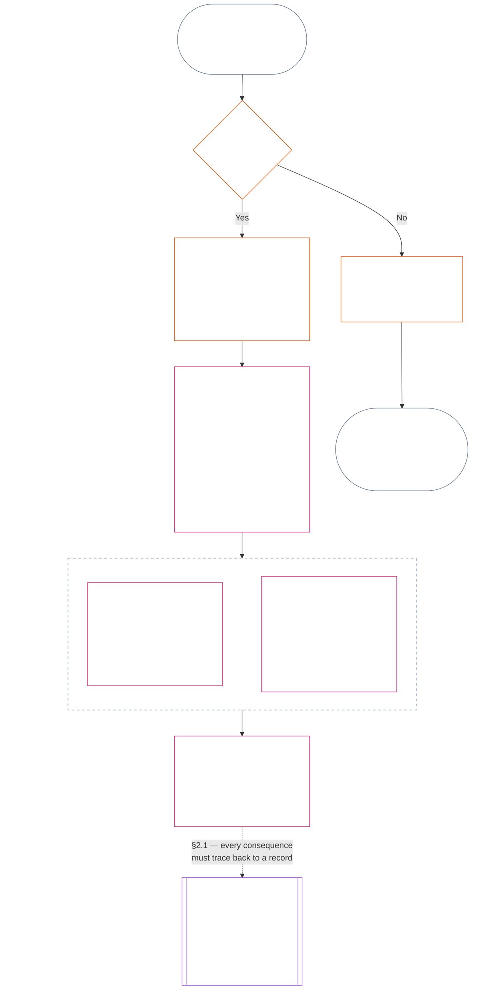

<!-- తెలుగు పాక్షిక అనువాద ముసాయిదా. మూలం: commit 9c2c8c10c871d91157bcd27b9f56ad6a1cec90d3. AI సహాయంతో రూపొందించిన, సమీక్షించని ముసాయిదా. పరిధి: అధ్యాయం పదకొండు, §§1–3 మాత్రమే. -->

### 1. మూడు ప్రశ్నలు

*సరళంగా చెప్పాలంటే: స్థితిని మూడు ప్రశ్నలకు వరుసగా సమాధానం ఇవ్వడం ద్వారా నిర్ణయిస్తారు. కోరుకున్న రేటింగ్ ఆధారంగా వాస్తవాలను ఊహించకండి; కోరుకున్న పరిణామాన్ని సమర్థించడానికి రేటింగ్‌ను ఎంచుకోకండి.*

| ప్రశ్న | ప్రశ్న ఏమి అడుగుతుంది | సమాధానం ఎక్కడ ఉంది |
| --- | --- | --- |
| **1. ఏమి జరిగింది?** | ఏ వాస్తవాలు నిర్ధారించబడ్డాయి, అవి ఎవరి గురించి లేదా దేని గురించి, ఏ కాలంలో, ఏ స్థితి రికార్డు మరియు సవాలు స్థితితో ఉన్నాయి? | [విభాగం 2](#2-question-1--what-happened) మరియు [విభాగం 3](#3-question-1-event-type-guide--what-kind-of-help-or-harm-occurred) |
| **2. అది ఎంత మంచిది లేదా చెడ్డది?** | ఆ వాస్తవాలు ఏ రకం, ఏ పరిమాణంలోని సహకారం లేదా ఉల్లంఘనను నిర్ధారిస్తాయి? | [అధ్యాయం పన్నెండు, విభాగం 1](core_12.000_standing_measurement.md#1-question-2--how-good-or-bad-was-it) |
| **3. దాని వల్ల ఏమి జరుగుతుంది?** | దాని తరువాత ఏ గుర్తింపు, సిద్ధత, పరిహారం, రక్షణ, పరిమితి లేదా ఇతర పరిణామం వస్తుంది? | [అధ్యాయం పదమూడు](core_13.000_standing_integration.md#chapter-thirteen-standing-effects-and-integration) |

ప్రతి ప్రశ్నకు సమాధానం దాని ముందున్న సమాధానంపై ఆధారపడుతుంది:

- ప్రశ్న 1, ప్రశ్న 2కు నిర్ధారిత వాస్తవాలను అందిస్తుంది.
- ప్రశ్న 2, ప్రశ్న 3 కోసం ఆ వాస్తవాలను కొలుస్తుంది.
- ఇష్టమైన ఫలితానికి సరిపడేలా ప్రశ్న 3 వాస్తవాలను లేదా రేటింగ్‌ను తిరిగి రాయకూడదు.

మూడు ప్రశ్నలకు కలిపిన సమాధానాలు ఒక పరిమిత సంఘటన లేదా నిర్వచించిన నమూనాకు సంబంధించిన సంపూర్ణ స్థితి అంచనాను రూపొందిస్తాయి. ఒక అంశానికి కాలక్రమంలో ఇలాంటి అంచనాలు అనేకం ఉండవచ్చు; వాటిలో ఏదీ నికర స్కోరు కాదు, ఆ అంశంపై సమగ్ర రేటింగ్ కూడా కాదు. సహకార, ఉల్లంఘన స్థితి రికార్డులు ప్రశ్నలు 1 మరియు 2కు సమాధానాలను భద్రపరుస్తాయి; ప్రశ్న 3 నిర్ణయం వాటి నుంచి ఏమి జరుగుతుందో చెబుతుంది.

#### 1.1 ఉద్దేశ్యం మరియు పరిధి

ఈ అధ్యాయం రికార్డు కోసం రాజ్యాంగ చట్రాన్ని, [అధ్యాయం పన్నెండు](core_12.000_standing_measurement.md#chapter-twelve-standing-measurement--question-2-how-good-or-bad-was-it) కొలత చట్రాన్ని **వ్యవస్థలు**, **సెంటియెంట్లు**, **సంస్థల** కోసం పేర్కొంటాయి; [**CS-9.305**](corpus_systems/cs_09.305_system_classification_machinery.md#cs-9305-part-a-system-classification-machinery) (*వ్యవస్థ వర్గీకరణ యంత్రాంగం*) కింద వర్గీకరించిన ప్రతి వ్యవస్థ కూడా ఇందులో ఉంది. ఈ చట్రాలు గాసిప్, జనాదరణ, అస్పష్టమైన పేరు ప్రతిష్ఠ, అంతర్గత గౌరవం లేదా సాధారణ విలువను కొలవవు; వీటిలో ఏదీ స్థితి అంచనాకు అనుమతించదగిన అంశం కాదు.

క్రింది పరిస్థితులు ఉన్నా స్థితి ప్రక్రియ ప్రభావవంతంగా ఉండాలి:

- గతంలో నిర్ధారించిన సహకారాలు ప్రస్తుత సామర్థ్యం లేదా విశ్వసనీయతను చూపలేనంత పాతబడినప్పుడు;
- ఉల్లంఘనలు పరిష్కారం కాకుండా ఉన్నప్పుడు;
- సరిదిద్దడం ఖరీదైనప్పుడు;
- బాధ్యత సరిహద్దులను దాటినప్పుడు; లేదా
- జవాబుదారీతనాన్ని అడ్డుకోవడానికి ఒక కర్త సంస్థాగత పొరలు లేదా పేరు మార్పులను ఉపయోగించినప్పుడు.

ఈ అంశాలు ఆమోదించిన అమలు పాఠ్యానికి చెందుతాయి:

- రోజువారీ విధానాలు;
- ఉన్నత స్థాయికి తీసుకెళ్లే చర్యలు;
- తిరిగి చెల్లింపు, సరిదిద్దే కార్యాచరణ;
- పునరుద్ధరణాత్మక జవాబుదారీతన చర్యలు; మరియు
- ప్రోత్సాహకాల రూపకల్పన.

అధ్యాయం పన్నెండు కొలత ఒక్కటే బలప్రయోగం, నిర్బంధం లేదా మరొక స్వేచ్ఛా పరిమితికి అనుమతి **ఇవ్వదు**. అలాంటి ఏ పరిణామమైనా అధ్యాయం ఆరు, **ఆర్టికల్ XX** (*నిర్ధారిత ఉల్లంఘన తరువాత న్యాయం*)లోని అనుపాతత్వం, అతి తక్కువ పరిమితి, కాలపరిమితి, తిరిగి చెల్లింపు, పునరుద్ధరణాత్మక జవాబుదారీతనం వంటి అవసరాలను స్వతంత్రంగా తీర్చాలి.

<strong>అనుసరణ · నిర్వచనాలు · అంచనా · అనుసరణ</strong>

- పూర్వాధారం: [అధ్యాయం ఒకటి §16 — లోతైన సంరక్షకత్వం](core_01.010_stewardship_capacity_principles.md#16-stewardship-in-depth); [అధ్యాయాలు రెండు నుంచి నాలుగు](core_02.000_definition_structure.md); [అధ్యాయం ఐదు](core_05.000_definitions_home.md#chapter-five-foundational-definitions).
- తదుపరి అంశాలు:
  - [§2](#2-question-1--what-happened) (*ప్రశ్న 1*);
  - [§4](#4-standing-record-operational-requirements) (*ధృవీకరణ, రికార్డు అవసరాలు*);
  - [§5](#5-record-custody-and-opening-authority) (*రికార్డు సంరక్షణ, ప్రారంభించే అధికారం*);
  - [§6](#6-handling-a-standing-record) (*స్థితి రికార్డును నిర్వహించడం*);
  - [అధ్యాయం పన్నెండు §1](core_12.000_standing_measurement.md#1-question-2--how-good-or-bad-was-it) (*ప్రశ్న 2 కొలత*);
  - [అధ్యాయం పన్నెండు §2](core_12.000_standing_measurement.md#2-magnitude-and-severity-input-dimensions) (*కొలతకు ఇన్‌పుట్ పరిమాణాలు*);
  - [అధ్యాయం పన్నెండు §3](core_12.000_standing_measurement.md#3-route-descriptor-catalogs-and-measurement-roles) (*మార్గ వివరణల జాబితాలు*);
  - [అధ్యాయం పన్నెండు §4](core_12.000_standing_measurement.md#4-slot-grammar-and-shared-scaling) (*స్లాట్ వ్యాకరణం, ఉమ్మడి స్కేలింగ్*);
  - [అధ్యాయం పన్నెండు §5](core_12.000_standing_measurement.md#5-constitutional-inputs-to-axis-assignment) (*రాజ్యాంగ మూలాల ఆధారంగా కేటాయింపు*);
  - [అధ్యాయం పన్నెండు §6](core_12.000_standing_measurement.md#6-unified-proportional-lequ-scale--contribution-and-violation-axes) (*రెండు అక్షాల కోసం ఏకీకృత అనుపాత LEQU స్కేలు*);
  - [అధ్యాయం పదమూడు](core_13.000_standing_integration.md#chapter-thirteen-standing-effects-and-integration) (*ప్రశ్న 3*).
- [భౌతిక ప్రాముఖ్యత](core_05.050_band_oversight.md#materiality) · [O](core_05.050_band_oversight.md#materiality) · [M](core_05.050_band_oversight.md#materiality-determination-a) · [A](core_05.050_band_oversight.md#materiality-determination-a) · [C](core_05.050_band_oversight.md#materiality-determination-c)
- [హాని](core_05.035_band_accountability.md#harm) · [O](core_05.035_band_accountability.md#harm) · [M](core_05.035_band_accountability.md#harm-a) · [A](core_05.035_band_accountability.md#harm-a) · [C](core_05.035_band_accountability.md#harm-c)
- [అనుపాతత్వం](core_05.035_band_accountability.md#proportionality) · [O](core_05.035_band_accountability.md#proportionality) · [M](core_05.035_band_accountability.md#proportionality-a) · [A](core_05.035_band_accountability.md#proportionality-a) · [C](core_05.035_band_accountability.md#proportionality-c)

### 2. ప్రశ్న 1 — ఏమి జరిగింది?

<strong>అనుసరణ</strong>

- పూర్వాధారం: [§1](#1-the-three-questions) (*మూడు ప్రశ్నల చట్రం*); [అధ్యాయాలు రెండు నుంచి నాలుగు](core_02.000_definition_structure.md) (*నిర్వచనాల నుంచి ఫలితాల వరకు రికార్డు, ధృవీకరణ, అనుసరణ*).
- టెట్రాడ్ అంశం/అంశాలు: **భాగస్వామ్యం**; **పర్యవేక్షణ** (వివాదయోగ్యత, సవాలు మార్గాలు). ప్రధాన లక్ష్యాలు: **వికాసం**, **నిరంతరత** (తదుపరి కొలత కోసం వేర్వేరు సహకార, ఉల్లంఘన నిర్ధారణలను భద్రపరిచే అనుసరణగల రికార్డులు).
- తదుపరి అంశాలు:
  - [§2.2](#22-silence-is-the-default) (*నిశ్శబ్దం డిఫాల్ట్*);
  - [§2.3](#23-protected-dissent-is-not-a-trigger) (*రక్షిత అసమ్మతి ప్రేరకం కాదు*);
  - [§2.4](#24-linked-standing-records-and-no-offset-bridge) (*లింక్ చేసిన రికార్డులలో పరస్పర భర్తీ నిషేధం*);
  - [§2.5](#25-verified-input-gate) (*ధృవీకరించిన ఇన్‌పుట్ ద్వారం*);
  - [§2.6](#26-stage-boundary) (*దశల సరిహద్దు*);
  - [§2.7](#27-forum-boundary) (*వేదిక సరిహద్దు*);
  - [§3](#3-question-1-event-type-guide--what-kind-of-help-or-harm-occurred) (*సంఘటన రకం మార్గదర్శి*);
  - [§4](#4-standing-record-operational-requirements) (*రికార్డు అవసరాలు*);
  - [§5](#5-record-custody-and-opening-authority) (*రికార్డు సంరక్షణ, ప్రారంభించే అధికారం*);
  - [§6](#6-handling-a-standing-record) (*స్థితి రికార్డును నిర్వహించడం*);
  - [అధ్యాయం పన్నెండు §1](core_12.000_standing_measurement.md#1-question-2--how-good-or-bad-was-it) (*ప్రశ్న 2 కొలత*);
  - [అధ్యాయం పన్నెండు §2](core_12.000_standing_measurement.md#2-magnitude-and-severity-input-dimensions) (*కొలతకు ఇన్‌పుట్ పరిమాణాలు*);
  - [అధ్యాయం పన్నెండు §3](core_12.000_standing_measurement.md#3-route-descriptor-catalogs-and-measurement-roles) (*మార్గ వివరణల జాబితాలు*);
  - [అధ్యాయం పన్నెండు §4](core_12.000_standing_measurement.md#4-slot-grammar-and-shared-scaling) (*స్లాట్ వ్యాకరణం, ఉమ్మడి స్కేలింగ్*);
  - [అధ్యాయం పన్నెండు §5](core_12.000_standing_measurement.md#5-constitutional-inputs-to-axis-assignment) (*రాజ్యాంగ మూలాల ఆధారంగా కేటాయింపు*);
  - [అధ్యాయం పన్నెండు §6](core_12.000_standing_measurement.md#6-unified-proportional-lequ-scale--contribution-and-violation-axes) (*రెండు అక్షాల కోసం ఏకీకృత అనుపాత LEQU స్కేలు*);
  - [అధ్యాయం పదమూడు](core_13.000_standing_integration.md#chapter-thirteen-standing-effects-and-integration) (13.000) (*ప్రశ్న 3*).

 

*సరళంగా: ఏమి జరిగిందో పరిమితమైన, సవాలు చేయదగిన వివరణను ప్రశ్న 1 స్థాపిస్తుంది. ఏ రేటింగ్ లేదా పరిణామాన్ని పరిశీలించకముందే అంశం, సంఘటన లేదా నమూనా, కాలవ్యవధి, నిర్ధారించిన వాస్తవాలు, రికార్డు స్థితి ఏమిటో గుర్తిస్తుంది. నిర్ధారించిన సహాయం, నిర్ధారించిన ఉల్లంఘనలు వేర్వేరు స్థితి రికార్డులను ఉపయోగిస్తాయి; తద్వారా ఒకటి మరొకదాన్ని చెరిపివేయదు. ఈ రికార్డులు జనాదరణ స్కోర్లు లేదా అస్పష్టమైన లేబుళ్లు కావు.*

**స్థితి రికార్డు** అనేది నిర్దిష్ట అంశం, కార్యాచరణ పరిధి, రికార్డు కాలం, సమీక్ష స్థితి, నిర్ణయ సందర్భం కోసం ఈ అధ్యాయం ఉపయోగించే పరిమిత రికార్డు. కొలత ప్రారంభమయ్యే ముందు ఇది క్రింది అంశాలను స్థాపించాలి:

- స్థితి రికార్డు ఎవరిని లేదా దేనిని గురించి ఉంది;
- అది పరిమిత సంఘటనకు సంబంధించినదా లేక నిర్వచించిన నమూనాకు సంబంధించినదా;
- సంబంధిత ప్రవర్తన, ప్రభావాలు ఎప్పుడు, ఎక్కడ సంభవించాయి;
- ఏ వాస్తవాలు నిర్ధారించబడ్డాయి, ఏవి ఇంకా వివాదంలో ఉన్నాయి;
- ఆ నిర్ధారణలకు ఏ సాక్ష్యం, ఆపాదింపు, సవాలు మార్గం మద్దతు ఇస్తున్నాయి; మరియు
- స్థితి రికార్డు యొక్క ప్రస్తుత సమీక్ష, దిద్దుబాటు, భర్తీ స్థితి.

సంఘటన స్థితి రికార్డును ప్రేరేపిస్తుందా, ఆ రికార్డు ఏమి కలిగి ఉంటుందో రేఖాచిత్రం అనుసరిస్తుంది; తరువాతి ఉపవిభాగాలు ప్రతి నియమాన్ని చెబుతాయి. “కాదు” అనే శాఖ ప్రధాన మార్గం నుంచి కుడివైపుకు వెళ్తుంది.

#### 2.1 స్థితి రికార్డులు: రకాలు మరియు అంశాలు

నిర్ధారించిన సహాయానికి ప్రశ్న 1 **సహకార స్థితి రికార్డును**, జవాబుదారీతన వైఫల్యాలతో సహా నిర్ధారించిన హానికి **ఉల్లంఘన స్థితి రికార్డును** ఉపయోగిస్తుంది. ఒక స్థితి రికార్డు ఈ రెండు రకాల నిర్ధారణలను కలపదు.

- స్థితి రికార్డు సెంటియెంట్, సంస్థ, వ్యవస్థ, అంచనా, పరిమిత సంఘటన, పాత్ర, సమూహం, నటుడి-నిర్దిష్ట రికార్డు లేదా రాజ్యాంగపరంగా సంబంధిత మరొక యూనిట్‌కు సంబంధించినదై ఉండవచ్చు.
  - విభిన్న అంశాలు, పాత్రలు, వ్యవస్థలు, సముదాయాలు, రికార్డు కాలాలు, సమీక్ష స్థితులు లేదా నిర్ణయ సందర్భాలను ఒకే భేదంలేని స్థితి లేబుల్‌లో కలపకూడదు.
- స్థితి రికార్డు స్పష్టమైన ప్రారంభం, ముగింపు ఉన్న ఒక **పరిమిత సంఘటనను**, లేదా పునరావృత ప్రవర్తన యొక్క ఒక **నమూనాను** కవర్ చేయవచ్చు.
  - నమూనాకు నిర్వచించిన అంశం, పరిధి, సమీక్ష కాలం అవసరం.
- ఒక అంశానికి కాలక్రమంలో అనేక స్థితి రికార్డులు ఉండవచ్చు; వీటిలో లింక్ చేసిన సహకార, ఉల్లంఘన స్థితి రికార్డులు కూడా ఉంటాయి.
  - అంశం, పరస్పరం మిళితమైన రికార్డు కాలం, పరిమిత సంఘటన, నమూనా లేదా నిర్ణయ సందర్భం ఉమ్మడిగా ఉంటే సంబంధిత రికార్డులు **విభాగం 4.2** ప్రకారం పరస్పరం **క్రాస్-రిఫరెన్స్** చేయాలి.
- స్థితి రికార్డు స్వతంత్ర పేరు ప్రతిష్ఠ స్కోరు, గౌరవ ర్యాంకు, శాశ్వత స్థితి, సాధారణ విలువ లేబుల్ లేదా కలిపిన స్కోర్‌కార్డు కాదు.
  - కార్యాచరణ అవసరాలు **విభాగం 4**లో ఉన్నాయి.

తదుపరి స్థితి ప్రభావాలు అధ్యాయం పదమూడుకు చెందుతాయి; అవి స్థితి రికార్డులో భాగం కాకుండా సంబంధిత స్థితి రికార్డు లేదా రికార్డులకు తిరిగి అనుసరించగలిగేలా ఉండాలి.

#### 2.2 నిశ్శబ్దం డిఫాల్ట్

స్థితి రికార్డు లేకపోవడం సెంటియెంట్, సంస్థ లేదా వ్యవస్థకు సాధారణ స్థితి; చాలా మంది సెంటియెంట్లు ఇదే స్థితిలో ఉంటారు.

- **విభాగం 4** ప్రకారం ప్రేరకం నిర్ధారించినప్పుడే స్థితి రికార్డు తెరవాలి. పేరుతో పేర్కొన్న రికార్డు-ప్రారంభ అధికారం ఎంట్రీని ఆమోదించాలి; వేరొక రికార్డు సంరక్షకుడు దానిని నమోదు చేయాలి (**విభాగం 5**). ఈ కారణాల వల్ల ఎప్పుడూ స్థితి రికార్డును తెరవకూడదు:
  - ప్రాథమిక స్థితి ఏర్పరచడానికి;
  - జాబితాను పూర్తిచేయడానికి; లేదా
  - పేరుగల మార్గానికి ద్వారపాలకుడు అలా కోరినందుకు.
- స్థితి రికార్డు లేకపోవడం ఏమీ తెలియజేయదు. “రేటింగ్ లేదు”, “ధృవీకరించలేదు”, “ఫైల్లో రికార్డు లేదు” అనేవి ప్రమాదం, తక్కువ సహకారం లేదా మరేదైనా వాటికి సాక్ష్యం కావు. మరింత పరిశీలన, తక్కువ డిఫాల్ట్ స్థాయి లేదా పేరుగల మార్గానికి షరతులతో కూడిన ప్రవేశానికి కారణంగా రికార్డు లేకపోవడాన్ని ఎవరూ ఉపయోగించకూడదు.
- కింది వాటికి షరతుగా ఏ సంస్థ లేదా వ్యవస్థ స్థితి రికార్డును, “రికార్డు లేదు” అనే ధృవీకరణను లేదా దాన్ని తెరవడానికి సమ్మతిని కోరరాదు:
  - **ఆర్టికల్ III** (*మనుగడ మరియు అవసరమైన ప్రవేశం*)లోని అత్యావశ్యకాలు;
  - **ఆర్టికల్ III-C** (*పని మరియు ఆర్థిక అంతస్తు*)లోని రక్షణలు;
  - సాధారణ వాణిజ్యం; లేదా
  - ప్రభావిత పక్షంగా పాల్గొనడం.
  [అధ్యాయం పదమూడు §6.2 సామర్థ్య హద్దులు, అనుమతులు](core_13.000_standing_integration.md#62-competency-bars-and-clearances) ప్రకారం నమ్మక-సున్నితమైన నిర్దిష్ట మార్గాల కోసం ప్రచురించిన సామర్థ్య అడ్డంకులు మినహాయింపు; ఆ మార్గం ఎందుకు నమ్మక-సున్నితమైనదో అవి చెప్పాలి.
- ఒక అంశం గురించి స్థితి రికార్డు తెరిస్తే, **విభాగం 4** కోరినట్లుగా ఆ అంశానికి తెలియజేయాలి. పత్రబద్ధమైన [సాక్ష్య పరిరక్షణ](core_05.050_band_oversight.md#evidence-preservation) లేదా భద్రతా అవసరం సమర్థించినప్పుడు మాత్రమే, అది కూడా పరిమితమైన, నిర్దిష్ట కాలానికి మాత్రమే నోటీసును ఆలస్యం చేయవచ్చు. నోటీసే స్థితి రికార్డును సవాలు చేయగలిగేలా చేస్తుంది: రికార్డు ఉందని తెలియని అంశం దాన్ని సవాలు చేయలేడు లేదా సరిచేయలేడు.

#### 2.3 రక్షిత అసమ్మతి ప్రేరకం కాదు

అసమ్మతి లేదా శాంతియుత నిరసన — [రక్షిత అహింసాత్మక పౌర అవిధేయత](core_06.005_rights_part_b.md#xi-d-nonviolent-civil-disobedience) సహా — **ఆర్టికల్ XI-D** (*సమావేశం, అసమ్మతి, శాంతియుత నిరసన*) కింద ([*అసమ్మతి, శాంతియుత నిరసన అంతస్తు*](core_06.005_rights_part_b.md#xi-d-dissent-and-peaceful-protest)) నిర్ధారించిన ప్రేరకం కాదు.

- అది ఉల్లంఘన స్థితి రికార్డును తెరవదు, పొడిగించదు లేదా తీవ్రతరం చేయదు; **విభాగం 8.2** కింద తీవ్రత ఇన్‌పుట్ కాదు; పునరావృతం కావడం వల్ల అది నమూనా కాదు.
- రాజ్యాంగ అంతస్తును స్వతంత్రంగా ఉల్లంఘించే వేరుచేయదగిన ప్రవర్తనను దాని స్వంత నిబంధనల ప్రకారం నమోదు చేయాలి; నిరసన యొక్క దృక్కోణం, కారణం లేదా లక్ష్యం వల్ల తీవ్రతరం చేయరాదు.

#### 2.4 లింక్ చేసిన స్థితి రికార్డులు, పరస్పర భర్తీ నిషేధం

<strong>అనుసరణ</strong>

- పూర్వాధారం: [§2.1](#21-standing-records-kinds-and-subjects) (*వేర్వేరు సహకార, ఉల్లంఘన రికార్డులు*).
- తదుపరి అంశాలు:
  - [§2.5](#25-verified-input-gate) (*ధృవీకరించిన ఇన్‌పుట్ ద్వారం*);
  - [§2.7](#27-forum-boundary) (*వేదిక సరిహద్దు*);
  - [§4.2](#42-related-standing-record-cross-references) (*క్రాస్-రిఫరెన్స్‌లు*);
  - [అధ్యాయం పన్నెండు §1](core_12.000_standing_measurement.md#1-question-2--how-good-or-bad-was-it) (*ప్రశ్న 2 కొలత*);
  - [అధ్యాయం పన్నెండు §2](core_12.000_standing_measurement.md#2-magnitude-and-severity-input-dimensions) (*కొలతకు ఇన్‌పుట్ పరిమాణాలు*);
  - [అధ్యాయం పన్నెండు §3](core_12.000_standing_measurement.md#3-route-descriptor-catalogs-and-measurement-roles) (*మార్గ వివరణల జాబితాలు*);
  - [అధ్యాయం పన్నెండు §4](core_12.000_standing_measurement.md#4-slot-grammar-and-shared-scaling) (*స్లాట్ వ్యాకరణం, ఉమ్మడి స్కేలింగ్*);
  - [అధ్యాయం పన్నెండు §5](core_12.000_standing_measurement.md#5-constitutional-inputs-to-axis-assignment) (*రాజ్యాంగ మూలాల ఆధారంగా కేటాయింపు*);
  - [అధ్యాయం పన్నెండు §6](core_12.000_standing_measurement.md#6-unified-proportional-lequ-scale--contribution-and-violation-axes) (*రెండు అక్షాల కోసం ఏకీకృత అనుపాత LEQU స్కేలు*);
  - [అధ్యాయం పదమూడు](core_13.000_standing_integration.md#chapter-thirteen-standing-effects-and-integration) (13.000) (*ప్రశ్న 3*).
- వీటితో చదవండి: [అధ్యాయం పదమూడు — స్థితి సమగ్రత](core_13.000_standing_integration.md#2-automatic-integration-review-and-continuity) (13.000) (*మినహాయింపులేని, లింక్ చేసిన రికార్డుల సమగ్రత*); [అధ్యాయం పదమూడు §6.2 — సామర్థ్య హద్దులు, అనుమతులు](core_13.000_standing_integration.md#62-competency-bars-and-clearances) (13.000 §6.2); [అధ్యాయం పదమూడు §4.2 — స్థితి తాళాలు](core_13.000_standing_integration.md#42-prevention--general-standing-locks) (13.000 §4.2).

 

**మూల నియమం:** నిర్ధారించిన **సహకార స్థితి రికార్డులు**, నిర్ధారించిన **ఉల్లంఘన స్థితి రికార్డులు** **విభాగం 2.1** ప్రకారం వేరుగా ఉంచాలి. ప్రతి సహకార లేదా ఉల్లంఘన నిర్ధారణ దాని స్వంత స్థితి రికార్డులోని స్వతంత్ర, ఆధారమున్న వాస్తవాలపై నిలవాలి. విశ్లేషణ, సహాయక పత్రాలు ఈ రెండు రికార్డు మార్గాలను వేరువేరుగా అనుసరించగలిగేలా ఉంచాలి. ఏ ఒక్క ఎంట్రీ లేదా లింక్ చేసిన రికార్డుల సముదాయం నికర స్కోరు, కలిపిన స్కోరు లేదా పరస్పర మార్పిడి కాదు.

- **ఉల్లంఘన స్థితి రికార్డులు, స్థితి తాళాలు:**
  - అధ్యాయం పదమూడు ప్రకారం, ఉల్లంఘన స్థితి రికార్డుల నుంచి వచ్చే వర్తించే **స్థితి తాళాలు**, నిర్ధారించిన ఉల్లంఘన పరిష్కారం కాకుండా ఉన్నంతకాలం స్థితిని పరిమితం చేయవచ్చు, పాత్ర అర్హతను నిరోధించవచ్చు లేదా పరిహారం పొందడాన్ని ప్రభావితం చేయవచ్చు.
  - స్థితి తాళాలు, సహకార స్థితి రికార్డుల్లో నమోదైన నిర్ధారిత సానుకూల సహకారాన్ని చెరిపివేయకూడదు.
  - పరిష్కారం కాని నిర్ధారిత ఉల్లంఘనలకు కాలం గడిచిందనే కారణంతో తగ్గింపు ఉండదు.
  - నిర్ధారించిన ఉల్లంఘనలు సంబంధం లేని సహకార స్థితి రికార్డులను తప్పుడు ప్రతికూల పేరు ప్రతిష్ఠ ఫైల్‌గా మార్చకూడదు.
- **సహకార స్థితి రికార్డులు, సామర్థ్య అనుమతులు:**
  - ప్రస్తుతమైన, పాత్రకు సంబంధించిన నిర్ధారిత సహకారం ప్రచురించిన **సామర్థ్య హద్దుల**పై వర్తించే **సామర్థ్య అనుమతులకు**, అలాగే నమ్మకం, పాత్ర లేదా గుర్తింపుతో ముడిపడిన అర్హతకు మద్దతివ్వవచ్చు.
  - నిర్ధారించిన సహకారం నిర్ధారించిన ఉల్లంఘనను భర్తీ చేయకూడదు, సగటుతో తగ్గించకూడదు, మన్నించకూడదు లేదా తిరిగి లేబుల్ చేయకూడదు.
  - హద్దు తీరిందంటే వర్తించే స్థితి తాళం మాఫీ అయినట్టు కాదు.

**ఏకైక మినహాయింపు:** ఉల్లంఘన నిర్ధారణే ప్రకటించిన సహకారాన్ని ఖండిస్తే — ఉదాహరణకు, సహకార రికార్డు చెప్పిన పని నిజంగా చేయలేదని సాక్ష్యం చూపితే — సరైన సాక్ష్య, సమీక్ష ప్రక్రియ ద్వారా, **విభాగం 4.2**లో కోరిన క్రాస్-రిఫరెన్స్‌తో లింక్ చేసిన సహకార స్థితి రికార్డును సరిచేయవచ్చు లేదా తొలగించవచ్చు. అయితే వేరే సహకార స్థితి రికార్డుల్లో నమోదైన సంబంధం లేని సహాయాన్ని ఉల్లంఘన స్వయంచాలకంగా చెరిపివేయదు.

#### 2.5 ధృవీకరించిన ఇన్‌పుట్ ద్వారం

ఈ ద్వారం ఇలా పనిచేస్తుంది:

- స్థితి, నమ్మకం, పాత్ర, గుర్తింపు లేదా గుర్తింపు పొందే అర్హతను ప్రభావితం చేసే ఏ నిర్ణయమైనా సంబంధిత **సహకార స్థితి రికార్డులు** లేదా **ఉల్లంఘన స్థితి రికార్డుల** నుంచి వచ్చిన నిర్ధారిత ఇన్‌పుట్‌లనే ఉపయోగించాలి.
- ఆరోపణలు, తీర్పు రాని వాదనలు, తాత్కాలిక దారి-మళ్లింపు ట్యాగ్‌లు, కేవలం స్వీకరణ దశ కథనాలు, ఇతర వివాద దశ పత్రాలు స్థితి కోసం సహకారం లేదా ఉల్లంఘన స్వభావాన్ని స్వతంత్రంగా నిర్ధారించవు.
- ధృవీకరించిన ఇన్‌పుట్ ఒక **స్థితి నిర్ధారణ**: నిర్ధారించిన సహకార నిర్ధారణ (అక్షం I) లేదా నిర్ధారించిన ఉల్లంఘన నిర్ధారణ (అక్షం II).
- సహకార, ఉల్లంఘన నిర్ధారణలు వేర్వేరు స్థితి రికార్డుల్లోనే ఉండాలి (చూడండి **విభాగం 2.1**).

#### 2.6 దశల సరిహద్దు

స్థితి రికార్డు దశలు వేరుగా ఉంటాయి:

- ప్రశ్న 1 నిర్ధారించిన వాస్తవాలను నమోదు చేస్తుంది; ప్రశ్న 2 వాటిని కొలుస్తుంది.
- నిర్ధారించిన వాస్తవ ఆధారం పూర్తయిన వెంటనే స్థితి రికార్డు తెరవవచ్చు; ప్రశ్న 2 కొలత ఇంకా పెండింగ్‌లో ఉండవచ్చు.
- కొలత జరిగేవరకు ప్రశ్న 2 ఫీల్డ్‌లు స్లాట్ లేదా వర్గాన్ని సూచించకుండా పెండింగ్‌లో ఉందని పేర్కొనాలి.
- స్థితి రికార్డు ప్రశ్న 3 యొక్క **స్థితి ప్రభావాన్ని** పేర్కొనకూడదు లేదా అమలు చేయకూడదు.

#### 2.7 వేదిక సరిహద్దు

*సరళంగా: వేదికలు వివాదాలను పర్యవేక్షించి, సవాళ్లను అనుమతించి, నిర్ధారిత ఫలితాలుగా మార్చే ప్రదేశాలు; కానీ కేసు దాఖలు చేయడం లేదా కథన వాదనలో గెలవడం స్థితిని నవీకరించదు. **విభాగం 2.5**లోని ధృవీకరించిన ఇన్‌పుట్ ద్వారం ఇప్పటికీ వర్తిస్తుంది. అధ్యాయాలు రెండు నుంచి నాలుగు ప్రకారం వేదిక వాస్తవాలను నిర్ధారించినప్పుడు, అది స్థితి రికార్డును **తెరవవచ్చు, నవీకరించవచ్చు లేదా సరిచేయవచ్చు**, లేదా **సవాలు వచ్చినప్పుడు తప్పు రికార్డును పక్కన పెట్టవచ్చు**. వేదికలు మంచి, చెడులను ఒక స్కోరుగా కలపవు; స్థితి వర్గాన్ని స్వయంగా సృష్టించవు.*

ఈ విభాగం ఒక ప్రశ్నకే చెందుతుంది: వేదిక పని స్థితి రికార్డులోకి ఎలా వస్తుంది. గొలుసులోని ఇతర దశలు ఇక్కడ పేరుతో పేర్కొన్న బాధ్యులకు చెందుతాయి; క్రమం ఇలా ఉంటుంది:

1. వివాదం దాఖలవుతుంది; వేదిక **వేదిక కేసు రికార్డును** ఉంచుతుంది, అది స్థితి రికార్డు కాదు. బాధ్యత: [అధ్యాయం పదిహేను §2.3 వేదిక కేసు రికార్డులు, స్థితి రికార్డులు, సవాళ్లు](core_15.000_forum.md#23-forum-case-records-standing-records-and-contests); అలాగే [§2.7.1 వేదిక కేసు రికార్డు](#271-forum-case-record) చూడండి.
2. [అధ్యాయాలు రెండు నుంచి నాలుగు](core_02.000_definition_structure.md) ప్రకారం వేదిక వాస్తవాలను నిర్ధారిస్తుంది.
3. నిర్ధారించిన ఫలితాలు ధృవీకరించిన ఇన్‌పుట్ ద్వారం గుండా వెళ్తాయి. బాధ్యత: [§2.5 ధృవీకరించిన ఇన్‌పుట్ ద్వారం](#25-verified-input-gate).
4. వేదిక కావచ్చే పేరుతో పేర్కొన్న రికార్డు-ప్రారంభ అధికారం స్థితి రికార్డును తెరుస్తుంది, నవీకరిస్తుంది లేదా సరిచేస్తుంది, లేదా సవాలు వచ్చినప్పుడు తప్పు రికార్డును పక్కన పెడుతుంది. బాధ్యతలు: రికార్డు ఏమి కలిగి ఉండాలో [§4.1 కనీస రికార్డు విషయాలు](#41-minimum-record-contents); ఎవరు చర్య తీసుకోవచ్చో [§5 రికార్డు సంరక్షణ మరియు ప్రారంభించే అధికారం](#5-record-custody-and-opening-authority).
5. స్థితి రికార్డు నిర్ధారించిన వాస్తవాలను మాత్రమే కలిగి ఉంటుంది; తరువాత ప్రశ్న 2 వాటిని కొలుస్తుంది. బాధ్యతలు: [§2.6 దశల సరిహద్దు](#26-stage-boundary), [అధ్యాయం పన్నెండు §1 ప్రశ్న 2 — అది ఎంత మంచిది లేదా చెడ్డది?](core_12.000_standing_measurement.md#1-question-2--how-good-or-bad-was-it).
6. స్థితి ప్రభావం ఉంటే, స్థితి ప్రభావాలకు బాధ్యమైన [అధ్యాయం పదమూడు](core_13.000_standing_integration.md#chapter-thirteen-standing-effects-and-integration) కింద అది వస్తుంది.

[అధ్యాయం పదిహేను](core_15.000_forum.md#chapter-fifteen-forums-and-jurisdiction) కింద వేదిక కుటుంబాలు, నిర్దిష్ట వివాదాలు స్థితి ప్రక్రియలో ఎలా వెళ్తాయో **పర్యవేక్షిస్తాయి**. [అధ్యాయం పదిహేను §6 సకాలంలో పరిష్కారం, భౌతికత స్థాయులు, ఆలస్యం నిరోధక క్రమశిక్షణ](core_15.000_forum.md#6-timely-resolution-materiality-tiers-and-anti-delay-discipline), [ఆర్టికల్ XXVI-C](core_06.020_rights_part_e.md#article-xxvi-c-timely-resolution-and-anti-delay-floor) (*సకాల పరిష్కారం మరియు ఆలస్యం నిరోధక అంతస్తు*) కింద వేదికలు ఇవి అందిస్తాయి:

- అందుబాటులోని సవాలు;
- స్వతంత్ర సమీక్ష;
- ఫోరెన్సిక్ మద్దతు;
- నివారణ చర్యల క్రమబద్ధీకరణ; మరియు
- స్థాయి వారీ గడువులు.

ఆ వేదిక నిర్ధారణలు అధ్యాయాలు రెండు నుంచి నాలుగు కింద ధృవీకరించిన ఇన్‌పుట్ ద్వారాన్ని తీరుస్తే, అవి:

- **విభాగం 4.1** కింద స్థితి రికార్డులను **తెరవవచ్చు, నవీకరించవచ్చు లేదా సరిచేయవచ్చు**; లేదా
- **సవాలు వచ్చినప్పుడు తప్పు రికార్డును పక్కన పెట్టవచ్చు**.

##### 2.7.1 వేదిక కేసు రికార్డు

తెరిచి ఉన్న వివాదంపై వేదిక స్వంత ఫైల్ [**వేదిక కేసు రికార్డు**](core_05.035_band_accountability.md#forum-case-record); ఇది [అధ్యాయం పదిహేను §2.3 వేదిక కేసు రికార్డులు, స్థితి రికార్డులు, సవాళ్లు](core_15.000_forum.md#23-forum-case-records-standing-records-and-contests)లో నిర్వచించబడింది. ఇది స్థితి రికార్డు **కాదు**.

##### 2.7.2 వేదిక నిర్ధారణలు, ప్రశ్న 2 కొలత

వేదిక నిర్ధారించిన వాస్తవ నిర్ధారణలు ప్రశ్న 1 స్థితి రికార్డుకు వాస్తవ ఆధారాన్ని అందించవచ్చు. నిర్ధారించిన సహకారం లేదా ఉల్లంఘన ఎంత మంచిది లేదా చెడ్డదో తెలిపే ప్రశ్న 2 కొలతను అవి **నిర్ణయించవు** ([§2.6 దశల సరిహద్దు](#26-stage-boundary)). అందువల్ల:

- వేదిక విచారణలు సహకార, ఉల్లంఘన పత్రాలను నికర స్కోరు, కలిపిన మెరిట్స్ సమాధానం లేదా భేదంలేని స్థితి లేబుల్‌గా **కలపకూడదు**; [§2.1 స్థితి రికార్డులు: రకాలు, అంశాలు](#21-standing-records-kinds-and-subjects), [§2.4 లింక్ చేసిన స్థితి రికార్డులు, పరస్పర భర్తీ నిషేధం](#24-linked-standing-records-and-no-offset-bridge) ప్రకారం లింక్ చేసిన రికార్డులు వేరుగా ఉంటాయి.
- వేదిక ఫలితాలు వివాద కథనాలు, మార్గనిర్దేశ సౌలభ్యం లేదా ప్యానెల్ ప్రాధాన్యతను నిరూపించదగిన ఇన్‌పుట్‌లకు ([§2.5 ధృవీకరించిన ఇన్‌పుట్ ద్వారం](#25-verified-input-gate)), ప్రత్యేక కొలతకు ([అధ్యాయం పన్నెండు §1 ప్రశ్న 2 — అది ఎంత మంచిది లేదా చెడ్డది?](core_12.000_standing_measurement.md#1-question-2--how-good-or-bad-was-it)) లేదా [అధ్యాయం పదమూడు](core_13.000_standing_integration.md#chapter-thirteen-standing-effects-and-integration)కు చెందిన స్థితి-ప్రభావ యంత్రాంగాలకు **ప్రత్యామ్నాయం చేయకూడదు**.

##### 2.7.3 వేదిక సరిహద్దు ఏవి తగ్గించదు

ఈ సరిహద్దు క్రింది వాటిలో అవసరమైన సవాలు, పరిహారం, తాత్కాలిక ఉపశమనం లేదా విధానపరమైన రక్షణలను **తగ్గించదు**:

- [ఆర్టికల్ XIII-A](core_06.010_rights_part_c.md#article-xiii-a-reliability-and-trustworthiness-baseline) (*విశ్వసనీయత, నమ్మకార్హత ప్రాథమిక ప్రమాణం*);
- [ఆర్టికల్ XIII-B](core_06.010_rights_part_c.md#article-xiii-b-right-to-redress-and-remedy) (*పరిహారం, నివారణకు హక్కు*);
- [అధ్యాయం పదిహేను §6 సకాలంలో పరిష్కారం, భౌతికత స్థాయులు, ఆలస్యం నిరోధక క్రమశిక్షణ](core_15.000_forum.md#6-timely-resolution-materiality-tiers-and-anti-delay-discipline);
- [ఆర్టికల్ XXVI-C](core_06.020_rights_part_e.md#article-xxvi-c-timely-resolution-and-anti-delay-floor) (*సకాల పరిష్కారం, ఆలస్యం నిరోధక అంతస్తు*); లేదా
- సంబంధిత న్యాయ ఆర్టికల్‌లు.

వేదిక నిర్ధారించిన ఫలితాలు ఇతర నిర్ధారిత ఇన్‌పుట్‌లలాగే అదే ద్వారం గుండా స్థితి ప్రక్రియలోకి రావాలని ఇది కోరుతుంది — ద్వారాన్ని దాటవేసి కాదు.

### 3. ప్రశ్న 1 సంఘటన-రకం మార్గదర్శి — ఎలాంటి సహాయం లేదా హాని జరిగింది?

*సరళంగా: వాస్తవాలు నిర్ధారించిన తరువాత ఏమి జరిగిందో వివరించడానికి ఈ పట్టికలను ఉపయోగించండి. సంబంధిత సహకారం లేదా ఉల్లంఘన రకాన్ని గుర్తించడంలో ఇవి సహాయపడతాయి. అది ఎంత మంచిది లేదా చెడ్డది, ఏ స్లాట్ ఇవ్వాలి, దాని వల్ల ఏమి జరగాలి అన్నది ఇవి నిర్ణయించవు.*

#### 3.1 సహకార సంఘటన రకాలు

**అర్హత నియమం:** పేర్కొన్న సహకారం అనుసరించగలిగినది, భారాన్ని ఇతరులపైకి నెట్టనిది, అమలులో ఉన్న మొత్తం రాజ్యాంగానికి అనుగుణమైనది అయితేనే లెక్కలోకి వస్తుంది.

- ఇతరులపైకి నెట్టిన హాని, బలవంతపు ఆధారపడటం, హక్కుల అంతస్తును కుదించడం లేదా దాచిన భారం పేర్కొన్న సహకారాన్ని అనర్హం చేయవచ్చు లేదా పరిమితం చేయవచ్చు.
- పేర్కొన్న సహకారం వేరే ఉల్లంఘన నిర్ధారణను భర్తీ చేయదు.

క్రింది పట్టికలో ప్రతి వరుస నిర్ధారించిన సహాయానికి సాధారణ మార్గాన్ని, దాని రాజ్యాంగ ప్రాముఖ్యతను పేర్కొంటుంది. ఒకే స్థితి రికార్డుకు ఒకటి కంటే ఎక్కువ వరుసలు వర్తించవచ్చు.

| నిర్ధారించిన సహకారం రకం | ఏమి జరిగింది | టెట్రాడ్ అంశం/అంశాలు | ప్రధాన లక్ష్యం/లక్ష్యాలు |
| --- | --- | --- | --- |
| మనుగడ, శారీరక సంరక్షణ | ఎవరికైనా ఆహారం, ఆశ్రయం, వైద్య సంరక్షణ లేదా భద్రత అందింది | **భాగస్వామ్యం**, **పర్యవేక్షణ** | **వికాసం** |
| సంరక్షణ, బోధన | పిల్లలను పెంచారు, వృద్ధులను చూసుకున్నారు లేదా ఇతరులకు విద్య అందించారు | **భాగస్వామ్యం**, **పర్యవేక్షణ** | **వికాసం**, **నిరంతరత** |
| మానసిక గాయం పరిష్కారం | శ్రేయస్సుకు అడ్డుపడిన మానసిక హాని నుంచి కోలుకోవడానికి ఎవరికైనా సహాయం అందింది | **భాగస్వామ్యం**, **జవాబుదారీతనం** | **వికాసం** |
| తీవ్రమైన భారాల తొలగింపు | భరించలేని అప్పు, దోపిడీ పని పరిస్థితులు లేదా వ్యవస్థాగత అడ్డంకులు తొలగించబడ్డాయి | **భాగస్వామ్యం**, **పర్యవేక్షణ** | **వికాసం** |
| స్వతంత్ర నిర్ణయాధికారం పునరుద్ధరణ | ఎవరికైనా తమ జీవితంపై అర్థవంతమైన ఎంపికలు లభించాయి | **భాగస్వామ్యం** | **వికాసం** |
| ఉత్పాదక సామర్థ్య విస్తరణ | సాధనాలు, మౌలిక సదుపాయాలు లేదా అవకాశాలు ఇతరులు స్వతంత్రంగా అభివృద్ధి చెందేందుకు వీలు కల్పించాయి | **భాగస్వామ్యం**, **పర్యవేక్షణ** | **వికాసం**, **నిరంతరత** |
| సమయ సామర్థ్యం మెరుగుదల | నివారించగల నిరీక్షణ, పరిపాలనా ఘర్షణ లేదా సమన్వయ భారం తగ్గి, సంరక్షణ, విశ్రాంతి, నిర్ణయాధికారం, అభ్యాసం లేదా హక్కులకు అనుగుణమైన పనికి ఉపయోగపడే సమయం తిరిగి లభించింది | **భాగస్వామ్యం**, **పర్యవేక్షణ** | **వికాసం** |
| పర్యావరణ లేదా మౌలిక సదుపాయాల ప్రమాదం తగ్గింపు | పర్యావరణ పతనం లేదా కీలక వ్యవస్థ వైఫల్యాన్ని నివారించారు | **పర్యవేక్షణ**, **జవాబుదారీతనం** | **నిరంతరత**, **వికాసం** |
| పర్యావరణ పాదముద్ర తగ్గింపు | వనరుల వినియోగం, ఉద్గారాలు లేదా భూమి, నీటి అవసరాలు ఇతరులపై లేదా పర్యావరణ వ్యవస్థలపై భారం మోపకుండా నిర్ధారించదగిన రీతిలో తగ్గాయి | **పర్యవేక్షణ**, **జవాబుదారీతనం** | **నిరంతరత**, **వికాసం** |
| పర్యావరణ వ్యవస్థల పునరుద్ధరణ | దెబ్బతిన్న భూమి, నీరు లేదా నివాస ప్రాంతం పనిచేసే, స్వయం-నిలకడగల స్థితికి తిరిగి తీసుకురాబడ్డాయి | **పర్యవేక్షణ**, **జవాబుదారీతనం** | **నిరంతరత**, **వికాసం** |
| అంతరించిపోతున్న జాతుల రక్షణ | అంతరించిపోయే ప్రమాదంలో ఉన్న జాతులు లేదా అవి ఆధారపడే నివాస ప్రాంతాలు నష్టం నుంచి రక్షించబడ్డాయి | **పర్యవేక్షణ**, **జవాబుదారీతనం** | **నిరంతరత**, **వికాసం** |
| కాలుష్యం, వ్యర్థాల తగ్గింపు | కలుషితం, హానికర ఉద్గారాలు లేదా వ్యర్థాలు నివారించబడ్డాయి, తొలగించబడ్డాయి లేదా సురక్షితంగా నిర్వహించబడ్డాయి | **పర్యవేక్షణ**, **జవాబుదారీతనం** | **వికాసం**, **నిరంతరత** |
| భద్రత, సత్యం, ఆడిట్ సామర్థ్యం లేదా సవాలు సామర్థ్యం బలోపేతం | హక్కులను రక్షించి అధికారాన్ని జవాబుదారీ చేయడానికి సంస్థలు లేదా పద్ధతులు నిర్మించబడ్డాయి లేదా బాగుచేయబడ్డాయి | **భాగస్వామ్యం**, **పర్యవేక్షణ**, **జవాబుదారీతనం** | **వికాసం**, **నిరంతరత** |

#### 3.2 ఉల్లంఘన సంఘటన రకాలు

**అర్హత నియమం:** ఉల్లంఘన సంఘటన రకానికి **అధ్యాయాలు రెండు నుంచి నాలుగు** ప్రకారం అనుసరించగల, పరిమిత, ఆడిట్ చేయగల, సవాలు చేయగల నిర్ధారించిన ఉల్లంఘన నిర్ధారణ అవసరం.

- ఆరోపణలు, తాత్కాలిక ట్యాగ్‌లు, వేదిక కథనాలు, స్వీకరణ-దశ లేబుళ్లు మార్గనిర్దేశం లేదా ప్రారంభ వడపోతకు తోడ్పడవచ్చు; కానీ అవి ప్రశ్న 1ను పూర్తి చేయవు.
- సానుకూల సహకారం నిర్ధారించిన ఉల్లంఘనను భర్తీ చేయదు, మన్నించదు, రద్దు చేయదు లేదా తిరిగి లేబుల్ చేయదు.

క్రింది పట్టికలో ప్రతి వరుస నిర్ధారించిన నష్టం, ప్రమాదం లేదా విధి వైఫల్యానికి సాధారణ మార్గాన్ని, దాని రాజ్యాంగ ప్రాముఖ్యతను పేర్కొంటుంది. ఒకే స్థితి రికార్డుకు ఒకటి కంటే ఎక్కువ వరుసలు వర్తించవచ్చు.

| నిర్ధారించిన నష్టం లేదా ప్రమాదం రకం | ఏమి జరిగింది | టెట్రాడ్ అంశం/అంశాలు | ప్రధాన లక్ష్యం/లక్ష్యాలు |
| --- | --- | --- | --- |
| మనుగడ లేదా శారీరక సంరక్షణ నుంచి దూరం చేయడం | నివారించగల మరణం, సంరక్షణ నిరాకరణ, అసురక్షిత పరిస్థితులు లేదా మనుగడకు అవసరమైన వనరుల భౌతిక లేమి సంభవించింది | **జవాబుదారీతనం**, **భాగస్వామ్యం** | **వికాసం** |
| నివారించగల తీవ్రమైన భారం | భరించలేని, విధించిన లేదా వ్యవస్థాత్మకంగా ఇతరులపైకి నెట్టిన భారాలు శ్రేయస్సు లేదా నిర్ణయాధికారాన్ని గణనీయంగా దెబ్బతీశాయి | **జవాబుదారీతనం**, **భాగస్వామ్యం** | **వికాసం** |
| బలవంతపు నిర్ణయాధికార నష్టం | బలవంతం, మోసం, నమ్మదగిన బెదిరింపు, నిర్బంధం లేదా స్వేచ్ఛకు ప్రమాదం సంభవించింది | **జవాబుదారీతనం**, **భాగస్వామ్యం** | **వికాసం** |
| హక్కుల అంతస్తు ఓటమి | చర్చించలేని రాజ్యాంగ అంతస్తులు, రాజ్యాంగ ఆధిపత్యం లేదా సవాలు-పరిహార ప్రవేశం గణనీయంగా ఉల్లంఘించబడ్డాయి | **జవాబుదారీతనం**, **పర్యవేక్షణ** | **వికాసం**, **నిరంతరత** |
| పర్యావరణ లేదా మౌలిక సదుపాయాల నష్టం | రాజ్యాంగ శ్రేయస్సుకు అవసరమైన పరిస్థితులు దెబ్బతిన్నాయి | **జవాబుదారీతనం**, **పర్యవేక్షణ** | **నిరంతరత**, **వికాసం** |
| కాలుష్యం లేదా వ్యర్థాల హాని | కలుషితం, హానికర ఉద్గారాలు లేదా వ్యర్థాలు గాలి, నీరు, నేల లేదా ఆరోగ్యానికి హాని చేశాయి | **జవాబుదారీతనం**, **పర్యవేక్షణ** | **వికాసం**, **నిరంతరత** |
| జాతి లేదా నివాస ప్రాంతాల విధ్వంసం | అంతరించిపోయే ప్రమాదంలో ఉన్న జాతులు లేదా అవి ఆధారపడే నివాస ప్రాంతాలు నాశనం చేయబడ్డాయి, ముక్కలయ్యాయి లేదా కోల్పోయే దిశగా నెట్టబడ్డాయి; భర్తీ చేయదగినదిగా పరిగణించిన నష్టం కూడా ఇందులో ఉంది | **జవాబుదారీతనం**, **పర్యవేక్షణ** | **నిరంతరత**, **వికాసం** |
| పర్యావరణ పునరుద్ధరణ సామర్థ్యం కోల్పోవడం | హాని తరువాత పర్యావరణ వ్యవస్థ తిరిగి పునరుత్పత్తి చెందే సామర్థ్యాన్ని తొలగించారు లేదా నివారించగలిగినప్పటికీ తిరగదిద్దడం కష్టమైనదిగా, అసాధ్యమైనదిగా చేశారు | **జవాబుదారీతనం**, **పర్యవేక్షణ** | **నిరంతరత**, **వికాసం** |
| ఇతరులపైకి నెట్టిన పర్యావరణ హాని లేదా క్షీణత | పర్యావరణ ఖర్చులను ఇతరులపై లేదా పర్యావరణ వ్యవస్థలపైకి నెట్టారు, వనరులను పునరుత్పత్తి సామర్థ్యానికి మించి ఖాళీ చేశారు, లేదా పాదముద్ర/సుస్థిరత వాదన కొనసాగుతున్న క్షీణతను దాచింది | **జవాబుదారీతనం**, **పర్యవేక్షణ** | **నిరంతరత**, **వికాసం** |
| ఉత్పాదక సామర్థ్యం విధ్వంసం | స్వతంత్రంగా అభివృద్ధి చెందడానికి అవసరమైన సాధనాలు, సామర్థ్యాలు, సంబంధాలు లేదా వనరులను లేకుండా చేశారు | **జవాబుదారీతనం** | **వికాసం** |
| భద్రత, సత్యం లేదా ఆడిట్ సామర్థ్యం క్షీణత | దాచిపెట్టడం, తప్పుడు సమాచారం, దెబ్బతిన్న రికార్డులు, అందుబాటులో లేని సవాలు మార్గాలు లేదా సమీక్షించలేని సమగ్రపరచడం సంభవించాయి | **పర్యవేక్షణ**, **జవాబుదారీతనం** | **వికాసం**, **నిరంతరత** |
| జవాబుదారీతనానికి ఆటంకం | జవాబు చెప్పే యంత్రాంగంలో — సాక్ష్య సమగ్రత, ధృవీకరణ, వేదిక ప్రక్రియ, స్థితి రికార్డులు, పరిహార గడువులు లేదా సవాలు, పరిష్కార మార్గాలు — నిర్ధారించిన జోక్యం జరిగింది; ఆ ఆటంకం వేరైన అంతర్లీన హానిపై మెటా-దాడి అయితే, లింక్ చేసిన వేరొక ఉల్లంఘన స్థితి రికార్డు తెరవాలి | **జవాబుదారీతనం**, **పర్యవేక్షణ**, **సకాలికత** | **వికాసం**, **నిరంతరత** |
| వ్యవస్థ స్వాధీనం లేదా ఆధారపడటాన్ని దుర్వినియోగం | నిర్మాణాత్మక సౌలభ్యం, ఆధారపడటంలోని అసమానత దుర్వినియోగం, తప్పించుకోలేని రూపకల్పన లేదా జవాబుదారీతన మార్గాల స్వాధీనం సంభవించాయి | **జవాబుదారీతనం**, **భాగస్వామ్యం** | **నిరంతరత**, **వికాసం** |

