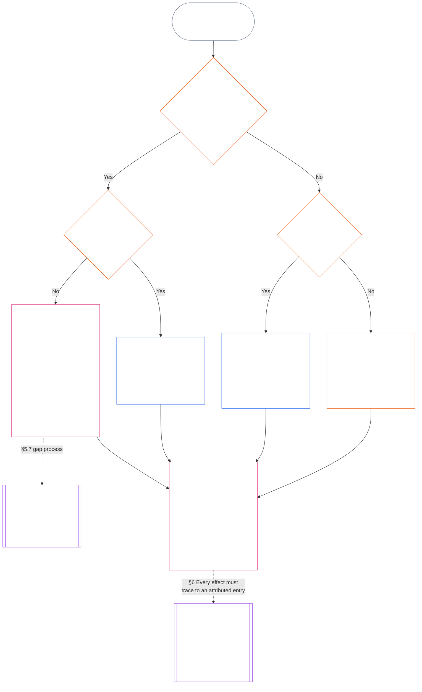

<!-- తెలుగు | అధ్యాయం 11 §§5.7–5.9 మరియు §6 మాత్రమే — భాగిక అనువాదం | మూల కమిట్: 9c2c8c10c871d91157bcd27b9f56ad6a1cec90d3 | AI ముసాయిదా, సమీక్షించలేదు, బంధనీయంకాదు -->

#### 5.7 వ్యవస్థ చార్టర్ లేదా సంస్థాగత చార్టర్ ఒక సీటును పేరుతో పేర్కొననప్పుడు

సాధారణంగా పేరుతో పేర్కొన్న మార్గం అందుబాటులో లేనప్పుడు ప్రస్థితి రికార్డు ఎక్కడికి వెళ్తుందో క్రింది పటం వరుసగా తీసుకునే మూడు ప్రశ్నలపై ఆధారపడి ఉంటుంది. ఈ విభాగం సీటును పేరుతో పేర్కొనని వ్యవస్థ చార్టర్ లేదా సంస్థాగత చార్టర్ సందర్భాన్ని కవర్ చేస్తుంది; ఏ చార్టర్ కూడా ప్రస్థితి రికార్డుకు వర్తించని సందర్భాన్ని [§5.8 ప్రస్థితి రికార్డుకు వ్యవస్థ చార్టర్ లేదా సంస్థాగత చార్టర్ ఏదీ వర్తించనప్పుడు ప్రత్యామ్నాయ నియమం](#58-fallback-when-no-system-charter-or-institutional-charter-reaches-the-standing-record) కవర్ చేస్తుంది.

<strong>పాఠక మార్గదర్శకం (అసంచాలకం): పటాన్ని ఎలా చదవాలి</strong>

> సాధారణ మాటల్లో: వ్యవస్థ చార్టర్ లేదా సంస్థాగత చార్టర్ పేరుతో పేర్కొన్న కార్యాలయాలే ప్రస్థితి రికార్డును నిర్వహిస్తాయి. చార్టర్ ఏదైనా సీటును పేరుతో పేర్కొనకపోతే, లోటు సరిచేసే వరకు అది చెల్లదు; ప్రస్థితి రికార్డు లేన్ పటానికి కాకుండా బ్యాకప్ రికార్డు అధికారం మరియు బ్యాకప్ రికార్డు సంరక్షకుడికి, లేదా వేదికకు వెళ్తుంది. ఏ వ్యవస్థ చార్టర్ లేదా సంస్థాగత చార్టర్ కూడా ప్రస్థితి రికార్డుకు వర్తించకపోతే, సంస్థ ప్రచురించిన లేన్ పటం నిర్ణయిస్తుంది; అది కూడా లేకపోతే ప్రస్థితి రికార్డు స్వతంత్ర ధృవీకరణకు లేదా అనౌపచారిక, చిన్న-పరిధి పనికి దానిపై ఆధారపడే సంస్థకు వెళ్తుంది.
>
> ప్రతి మార్గం ఒకే పెట్టె వద్ద ముగుస్తుంది: ఒక కార్యాలయం వాస్తవాలను ధృవీకరిస్తుంది, వేరొక కార్యాలయం ప్రస్థితి రికార్డును నమోదు చేసి ఉంచుతుంది; తరువాత [§6 ప్రస్థితి రికార్డు నిర్వహణ](#6-handling-a-standing-record) దాని సంరక్షకులు ఏమి చేస్తారో నియంత్రిస్తుంది. నిరంతర బాణాలు ప్రధాన మార్గం. చుక్కల బాణాలు వాటిని కలిపే విభాగాన్ని పేర్కొన్న అప్పగింతలు. ఇరువైపులా ద్వంద్వ గీతలున్న పెట్టెలు మరో అధ్యాయానికి చెందినవి; చివరి పెట్టె ప్రస్థితి ప్రభావాలను రికార్డు నుంచే తీసుకుంటుంది, రికార్డును తిరిగి రాయకుండా. ఈ పటం కొత్త కర్తవ్యాన్ని, సీటును లేదా క్షేత్రాన్ని జోడించదు.

 

ఒక వ్యవస్థ చార్టర్ లేదా సంస్థాగత చార్టర్ అవసరమైన రికార్డు సీటును లేదా స్వతంత్ర మార్గాన్ని పేరుతో పేర్కొనకపోతే:

- **పర్యవసానం:** వ్యవస్థ చార్టర్ లేదా సంస్థాగత చార్టర్ చెల్లదు; ఆ ఫలితాన్ని కలిగించే మార్పు అనుమతించబడదు ([ఏడవ అధ్యాయం §4.7.1 లోటు ఉన్నప్పుడు మరియు దాన్ని ఎలా నమోదు చేయాలి](core_07.000_charters.md#471-when-a-gap-exists-and-how-it-is-logged)).
- **లోటు ప్రక్రియ ఏడవ అధ్యాయం పరిధిలో ఉంది:** [ఏడవ అధ్యాయం §4.7 నిర్వాహక ప్రస్థితి రికార్డుల కోసం పటంలోని లోటులు](core_07.000_charters.md#47-gaps-in-the-map-for-operator-standing-records) వీటినీ నియంత్రిస్తుంది:
  - లోటును ఎలా లాగ్ చేయాలి;
  - స్పందన, పరిష్కార గడువులు (అత్యవసర ప్రత్యామ్నాయ నియామకంతో సహా); మరియు
  - సంరక్షణ ఎప్పుడు పేరుతో పేర్కొన్న సంరక్షకులకు తిరిగి వెళ్తుంది.

ప్రస్థితి రికార్డుల విషయానికి ఈ విభాగం ఇలా జోడిస్తుంది:

- **ఎవరు పనిచేయరాదు:** అవసరమైన సీటు ఖాళీగా ఉండి, వ్యవస్థ చార్టర్ లేదా సంస్థాగత చార్టర్ చెల్లుబాటు అయ్యే ప్రత్యామ్నాయాన్ని పేర్కొననంతవరకు, తరువాతి బుల్లెట్‌లోని మార్గం తప్ప ఆ సీటు పనిని ఎవరూ చేయకూడదు.
- **ప్రస్థితి రికార్డు ఎక్కడికి వెళ్తుంది:** [§5.4 స్వీయ-సంరక్షణ నిషేధం](#54-no-self-custody) ప్రకారం ప్రస్థితి రికార్డు బ్యాకప్ రికార్డు అధికారం మరియు బ్యాకప్ రికార్డు సంరక్షకుడికి లేదా **విభాగం 2.7** కింద వేదికకు వెళ్తుంది; లేన్ పటం వాటి స్థానంలో రాదు. ప్రతి ప్రస్థితి రికార్డు ఒకే సంరక్షకుడి వద్ద సంపూర్ణంగా ఉంటుంది.
- **ఇప్పటికే ఉంచిన ప్రస్థితి రికార్డులు:**
  - లోటు గురించి నోటీసు వేదికకు, రిజిస్ట్రార్‌కు లేదా బ్యాకప్ రికార్డు అధికారానికి చేరిన రోజున, చార్టర్ పొందిన పక్షం భౌతిక నియంత్రణ రేఖలోని కార్యాలయం ఉంచిన ఏ నిర్వాహక ప్రస్థితి రికార్డైనా పూర్తి జాడతో బ్యాకప్ రికార్డు సంరక్షకుడికి బదిలీ అవుతుంది.
  - అప్పటివరకు ఆ కార్యాలయం చదవడానికి మాత్రమే ఉంచుతుంది, ఏ సంచికనూ నమోదు చేయదు, పూర్తి జాడతో సంపూర్ణ ప్రతిని వెంటనే బ్యాకప్ రికార్డు సంరక్షకుడికి ఇస్తుంది.
  - నియంత్రణ రేఖకు వెలుపల ఉన్న సంరక్షకుడు రికార్డును ఉంచి, లోటు ఉన్నంతకాలం బ్యాకప్ రికార్డు అధికారం లేదా వేదిక ఆమోదించిన ప్రతి సంచికను నమోదు చేస్తాడు. సంరక్షకుడు నియంత్రణ రేఖలో ఉన్నాడని వేదిక తేల్చితే, ఆ కార్యాలయం విషయంలో ఉన్నట్లే పూర్తి జాడతో రికార్డు బ్యాకప్ రికార్డు సంరక్షకుడికి వెళ్తుంది.
- **బాధ్యతాయుత నిర్వాహకులు:** వ్యవస్థ చార్టర్ లేదా సంస్థాగత చార్టర్ తమకు ఇవ్వని సీటును చేపట్టమని కోరిన నిర్వాహకుడు:
  - **సీటును నిరాకరిస్తాడు:** ప్రస్థితి రికార్డులో నమోదు చేయగల ప్రాప్యత లేదా సాంకేతిక సామర్థ్యం దానిని నమోదు చేసే అధికారాన్ని ఇవ్వదు.
  - **అభ్యర్థన, లోటును పేర్కొంటాడు:** రెండింటినీ లాగ్‌లో పేర్కొంటాడు.
  - **ప్రస్థితి రికార్డును పంపిస్తాడు:** పైన *ప్రస్థితి రికార్డు ఎక్కడికి వెళ్తుంది*లోని మార్గం ద్వారా పంపిస్తాడు.
  - **ఇతర కర్తవ్యాలు కొనసాగిస్తాడు:** [§5.4 స్వీయ-సంరక్షణ నిషేధం](#54-no-self-custody) (*విషయ పరిధిలోని బాధ్యతాయుత నిర్వాహకులు*) కింద ఇప్పటికే ఉన్న కర్తవ్యాలు కొనసాగుతాయి: తన నియంత్రణలో ఉన్నదాన్ని ఆపడం, పునర్నిర్మించగల సముదాయాన్ని లాగ్ చేయడం, తన వద్ద సాక్ష్యాన్ని కాపాడడం, నోటీసు ఇవ్వడం, పైస్థాయికి పంపడం. వీటిలో ఏదీ వాస్తవాలను ధృవీకరించదు లేదా ప్రస్థితి రికార్డును నమోదు చేయదు. లాగ్, కాపాడిన సాక్ష్యం ధృవీకరించే అధికారానికి ఇన్‌పుట్‌లుగా రికార్డుతో వెళ్తాయి; అవి నమోదు కావు, వాస్తవాలను నిర్ణయించవు.

#### 5.8 ప్రస్థితి రికార్డుకు వ్యవస్థ చార్టర్ లేదా సంస్థాగత చార్టర్ ఏదీ వర్తించనప్పుడు ప్రత్యామ్నాయ నియమం

ప్రస్థితి రికార్డు సంబంధించే వ్యవస్థ, సంస్థ లేదా వ్యాపారాన్ని ఏ వ్యవస్థ చార్టర్ లేదా సంస్థాగత చార్టర్ కవర్ చేయకపోతే — ప్రచురించిన చార్టర్ లేని Class L సరిహద్దు కంటే దిగువనున్న సంస్థల మాదిరిగా — **CI-8.205 §2** (*క్రియాత్మక విభజన లేన్‌లు*) కింద సంస్థ ప్రచురించిన లేన్ పటం వర్తిస్తుంది:

- **రికార్డు-ప్రారంభ అధికారం:** ప్రస్థితి రికార్డు సంబంధించే వ్యవస్థ, సంస్థ లేదా వ్యాపారం కోసం లేన్ పటం హామీ మరియు ఆడిట్ లేన్‌లో ఉంచిన కార్యాలయం. అది వాస్తవ ఆధారాన్ని ధృవీకరించి నమోదుకు అధికారం ఇస్తుంది ([§5.2 పేరుతో పేర్కొన్న రికార్డు-ప్రారంభ అధికారం](#52-named-record-opening-authority)); అది రికార్డును నమోదు చేయదు లేదా ఉంచదు.
- **సంరక్షకుడు:** ప్రచురణ మరియు సాక్ష్య లేన్ కలిగిన కార్యాలయం.
- **కార్యనిర్వహణ లేన్ మినహాయింపు:** వీరిలో ఎవరూ సంబంధిత వ్యవస్థ కార్యనిర్వహణ లేన్ కలిగిన కార్యాలయం కాకూడదు.
- **లేన్ పటం కూడా లేకపోతే:** ప్రస్థితి రికార్డు పైనున్న *స్వీయ-సంరక్షణ నిషేధం* కింద స్వతంత్ర ధృవీకరణకు వెళ్తుంది; అనౌపచారిక, చిన్న-పరిధి రికార్డుల కోసం అది తదుపరి *అనౌపచారిక మరియు చిన్న-పరిధి రికార్డులు*లోని ఆధారపడే సంస్థకు వెళ్తుంది.
- **బాధ్యతాయుత నిర్వాహకులు:** లేన్ పటం తమకు ఇవ్వని సీటును చేపట్టమని కోరితే, నిర్వాహకుడు [§5.7 వ్యవస్థ చార్టర్ లేదా సంస్థాగత చార్టర్ ఒక సీటును పేరుతో పేర్కొననప్పుడు](#57-when-a-system-charter-or-institutional-charter-leaves-a-seat-unnamed)లోని *బాధ్యతాయుత నిర్వాహకులు* నియమాన్ని అనుసరిస్తాడు: సీటును నిరాకరిస్తాడు, అభ్యర్థన మరియు లోటును లాగ్‌లో పేర్కొంటాడు, ఇతర కర్తవ్యాలను కొనసాగిస్తాడు. ప్రస్థితి రికార్డును లేన్ పటం పేర్కొన్న కార్యాలయానికి లేదా అది ఎవరినీ పేర్కొనకపోతే పైనున్న *లేన్ పటం కూడా లేకపోతే* మార్గంలో పంపిస్తాడు.

#### 5.9 అనౌపచారిక మరియు చిన్న-పరిధి రికార్డులు

విధుల విభజన అధికారికతను బట్టి కాకుండా భౌతిక పందెం మేరకు స్థాయీకరించబడుతుంది ([ఎనిమిదవ అధ్యాయం §2 నాలుగు-సీట్ల రాజ్యాంగ ఆవశ్యకత](core_08.000_functional_independence_separation_of_duties.md#2-four-seat-constitutional-requirement)).

- **కవర్ చేసే పని:** స్థానిక సముదాయాలు అనేక రకాల సహకారంతో నడుస్తాయి; అందులో ఎక్కువ పని వేతనం లేకుండా, అనౌపచారికంగా ఉంటుంది. వేతనం లేని పని, సహచరులు నిర్వహించే పని, పరస్పర సహాయం, సంరక్షణ, నిర్వహణ, మరమ్మతు, బోధన, సముదాయ బాధ్యతాయుత నిర్వహణ పనులన్నీ ఇందులో ఉంటాయి. వీటిని సమాన ప్రమాణాలతో గుర్తించాలని [పదమూడవ అధ్యాయం §6 సహకార పర్యవసానాలు రెండవవి](core_13.000_standing_integration.md#6-contribution-consequences-second) కోరుతుంది.
  - **స్థానికంగా కనిపించే రూపాలు:** పొరుగువారు ఆహారం, పనిముట్లు పంచుకోవడం (పరస్పర సహాయం); అనారోగ్యంతో లేదా వృద్ధాప్యంలో ఉన్న పొరుగువారిని చూసుకోవడం (సంరక్షణ); ఉమ్మడి తోట లేదా వాగును బాగుంచడం (నిర్వహణ, సముదాయ బాధ్యతాయుత నిర్వహణ); పొరుగువారి పైపులు బాగుచేయడం (మరమ్మతు); ఎవరికైనా బోధించడం లేదా నైపుణ్యం చూపించడం (బోధన). ప్రతి ఒక్కటీ తనదైన సహకార రకం.
- **ధృవీకరణ సీటును ఎవరు నింపుతారు:** అటువంటి పని కోసం, **ప్రస్థితి రికార్డుపై ఆధారపడటానికి ప్రచురిత అధికారం ఉన్న ఏ స్వతంత్ర సంస్థ అయినా** ధృవీకరణ సీటును నింపుతుంది; అది ధృవీకరణ అధికారంగా పనిచేస్తుంది.
  - **సాధారణంగా ఎవరు:** తరచుగా ప్రస్థితి రికార్డుపై ఆధారపడే సంస్థే — జలవిభాగ మండలి వంటి స్థానిక సమూహం, పనికి నిధులు ఇచ్చే లేదా కొనసాగించే సంస్థ, **CI-6.255** (*ఉమ్మడి వనరులు, సహకార సంఘాలు, పరస్పర సహాయం, మరియు మార్కెట్-యేతర సముదాయ పాలన*) కింద రికార్డు-గుర్తింపు అధికారం (ఇలాంటి సముదాయ పని రికార్డులను గుర్తించే సంస్థ), లేదా **విభాగం 2.7** కింద వేదిక.
- **ఏది లెక్కలోకి రాదు:** ధృవీకరణ అధికారం ఎంత అధికారికమో అన్నది ధృవీకరణ సీటును నింపదు.

అటువంటి ప్రస్థితి రికార్డులో:

- ఒంటరిగా పనిచేసే సంజ్ఞ ప్రాణికి తన సహకారాన్ని నమోదు చేయించుకోవడానికి సమూహం, సంస్థ, [వ్యవస్థ చార్టర్](core_05.040_band_continuity.md#system-charter) లేదా [సంస్థాగత చార్టర్](core_05.040_band_continuity.md#institutional-charter) అవసరం లేదు. అప్పుడు:
  - **ఎవరు కోరుతారు:** విషయం మరియు హక్కుదారుగా తన అభ్యర్థనపై ప్రారంభ సీటు అతనిదే.
  - **తన సొంత సామగ్రి:** తన వివరణ, లాగ్‌లు, ఫోటోలు ఇన్‌పుట్‌లు మాత్రమే; ధృవీకరణ కావు.
  - **ధృవీకరణ సీటు:** ప్రస్థితి రికార్డుపై ఆధారపడటానికి ప్రచురిత అధికారం ఉన్న ఏ స్వతంత్ర సంస్థ అయినా (ధృవీకరణ అధికారం).
  - **నమోదు, సంరక్షణ:** వేరొక రికార్డు సంరక్షకుడు ప్రస్థితి రికార్డును నమోదు చేసి ఉంచుతాడు.
  - **ఎవరైనా సవాలు చేస్తే:** సవాలు మార్గానికి లేదా **విభాగం 2.7** కింద వేదికకు వెళ్తుంది.
  - **ఆధారపడే సంస్థ అందుబాటులో లేకపోతే:** ప్రస్థితి రికార్డు **విభాగం 2.7** కింద వేదికకు వెళ్తుంది.
  - **ఉదాహరణ, పదవీ విరమణ చేసిన ప్లంబర్:** ఎన్నేళ్లుగా పొరుగువారి పైపులను ఉచితంగా బాగుచేసిన, వెనుక ఏ సమూహమూ లేని ప్లంబర్ ప్రస్థితి రికార్డు తెరవమని **CI-6.255** (*ఉమ్మడి వనరులు, సహకార సంఘాలు, పరస్పర సహాయం, మరియు మార్కెట్-యేతర సముదాయ పాలన*) కింద రికార్డు-గుర్తింపు అధికారాన్ని అడగవచ్చు:
    - **అభ్యర్థన, హక్కుదారు:** ప్లంబర్.
    - **ధృవీకరణ:** పని లాగ్‌లు, పొరుగువారి ధృవీకరణల ఆధారంగా అధికారం.
    - **నమోదు, సంరక్షణ:** వేరొక రికార్డు సంరక్షకుడు.
    - **ఎవరైనా సవాలు చేస్తే:** సవాలు ధృవీకరణ అధికారికి తిరిగి కాకుండా వేదికకు వెళ్తుంది.
- పాల్గొనేవారే విషయాలు; గుర్తింపు కోరినప్పుడు హక్కుదారులూ అవుతారు. **విభాగం 4.3** కింద సామూహిక రికార్డులో:
  - **సహ-పాల్గొనేవారు:** ప్రతి ఒక్కరూ హక్కుదారు.
  - **మరొక సభ్యుడి వాటా గురించి సభ్యుడి ప్రకటన:** అది ఇన్‌పుట్ మాత్రమే; ధృవీకరణ కాదు.
- ప్రస్థితి రికార్డుకు మద్దతిచ్చే సామగ్రి రెండు చోట్ల నుండి వస్తుంది:
  - **పాల్గొననివారు:** లబ్ధిదారులు, పొరుగువారు, ఇతర పాల్గొననివారు **విభాగం 4.1** కింద ధృవీకరణ సామగ్రిగా ధృవీకరణలు అందిస్తారు.
  - **సమూహం స్వంత లాగ్:** దాన్ని నిర్వహించిన సంజ్ఞ ప్రాణి క్రింద *రికార్డర్ ప్రకటనలు ఇన్‌పుట్‌లు* ప్రకారం రికార్డర్, సాక్షి.
- ఆధారపడే సంస్థ రికార్డు సంరక్షకుడు, వేరొక ధృవీకరణ అధికారం ధృవీకరించిన దానిని నమోదు చేసి ఉంచుతాడు:
  - **ఏ సీటునూ ఎవరు చేపట్టలేరు:** రికార్డు సంరక్షకుడూ, ధృవీకరణ అధికారమూ హక్కుదారు లేదా హక్కుదారుడి [భౌతిక నియంత్రణ రేఖ](core_05.035_band_accountability.md#material-control-line)లో ఉండకూడదు.
  - **ఒక సంస్థ, రెండు సీట్లు:** ఆడిట్ చేయదగిన, సవాలు చేయదగిన స్వాతంత్ర్య రక్షణలతో ప్రచురించిన లేన్ పటం కింద అదే ఆధారపడే సంస్థ రెండు సీట్లనూ నిర్వహించవచ్చు.
  - **ఒకరే ఎప్పటికీ కాదు:** ఒకే ప్రస్థితి రికార్డులో అధికారం, సంరక్షకుడు లేదా సంజ్ఞ ప్రాణి ఈ రెండు కర్తవ్యాలనూ చేయకూడదు.
- సమూహ స్థితి సభ్యుడి హక్కుదావాను నిర్ణయించదు:
  - **అనౌపచారిక సమూహాలు:** [వ్యవస్థ చార్టర్](core_05.040_band_continuity.md#system-charter) లేదా [సంస్థాగత చార్టర్](core_05.040_band_continuity.md#institutional-charter) లేని సమూహం, లేదా అసలు సంస్థ కాని సమూహం, దాని సభ్యులకు అడ్డంకి కాదు.
  - **ప్రతి పాల్గొనేవారు:** సమూహంలో చేసిన లేదా వెలుపల చేసిన పనికి వ్యక్తిగత హక్కుదారుగా గుర్తింపు కోరవచ్చు.
  - **ప్రస్థితి రికార్డు పరిధి:** అది పాల్గొనేవారి సహకారాన్ని గురించి; సమూహ ప్రస్థితిని గురించి కాదు.
  - **ఉదాహరణ, కుట్టుపని వలయం:** కొత్తగా వచ్చిన శరణార్థులకు దుప్పట్లు ఇచ్చే కుట్టుపని వలయం ఈ నమూనాకు ఉదాహరణ: దుప్పట్లు స్వీకరించే సంస్థ వంటి స్వతంత్ర ఆధారపడే సంస్థ ధృవీకరిస్తే, ప్రతి కుట్టుపని చేసినవారు ప్రస్థితి రికార్డు కోరవచ్చు; దానికి వలయానికి వ్యవస్థ చార్టర్ లేదా సంస్థాగత చార్టర్ అవసరం లేదు.
- అదే అనౌపచారిక సందర్భాల్లో ఉల్లంఘన ప్రస్థితి రికార్డు కూడా ఏర్పడవచ్చు; అక్కడా సీట్లు వేరుగానే ఉంటాయి:
  - **ఉదాహరణ, బార్‌లో సంఘటన:** ఒక సంజ్ఞ ప్రాణి బార్‌లో మరొకరు మత్తులో క్రమరహితంగా, హింసాత్మకంగా ప్రవర్తిస్తున్నప్పుడు వీడియో తీస్తాడు; ఎవరూ శారీరకంగా గాయపడలేదు.
    - **గాయం అవసరం లేదు:** ఎవరూ గాయపడకపోయినా, ధృవీకరించిన విశ్వసనీయ హింసా బెదిరింపు ఉల్లంఘన ప్రస్థితి రికార్డుకు ఆధారమవుతుంది (**విభాగం 3.2**, బలవంతపు కార్యసామర్థ్య నష్టం).
    - **వీడియో ఒక ఇన్‌పుట్:** చిత్రీకరించిన సంజ్ఞ ప్రాణి సాక్షి. దృశ్య రికార్డు ఇన్‌పుట్ మాత్రమే; అది ఒక్కటే ఎప్పుడూ ధృవీకరణ కాదు, అది ఉందనే కారణంతో ఏదీ స్వయంగా ప్రారంభం కాదు (**విభాగం 2.2**).
    - **వీడియోలోని సంజ్ఞ ప్రాణి:** అతడే విషయం. ప్రస్థితి రికార్డు తెరిచినప్పుడు అతనికి చెబుతారు; అతడు ఏ సీటునూ చేపట్టలేడు ([§5.4 స్వీయ-సంరక్షణ నిషేధం](#54-no-self-custody)).
    - **ధృవీకరణ సీటు:** ప్రస్థితి రికార్డుపై ఆధారపడటానికి ప్రచురిత అధికారం ఉన్న స్వతంత్ర సంస్థ; ఉదాహరణకు స్థానిక లైసెన్సింగ్ లేదా భద్రతా సంస్థ, లేదా **విభాగం 2.7** కింద వేదిక. చిత్రీకరించిన సంజ్ఞ ప్రాణి, బార్ యజమాని — వీరిలో ఎవరైనా హక్కుదారో లేదా హక్కుదారుడి [భౌతిక నియంత్రణ రేఖ](core_05.035_band_accountability.md#material-control-line)లో ఉంటే — ఆ సీటు నుండి మినహాయించబడతారు.
    - **నమోదు, సంరక్షణ, సవాలు:** వేరొక రికార్డు సంరక్షకుడు ప్రస్థితి రికార్డును నమోదు చేసి ఉంచుతాడు; సవాలు ధృవీకరించే సంస్థకు తిరిగి కాకుండా సవాలు మార్గానికి లేదా **విభాగం 2.7** కింద వేదికకు వెళ్తుంది.
- స్వతంత్ర ఆధారపడే సంస్థ అందుబాటులో ఉండగానే, అనౌపచారిక సమూహానికి అందుబాటులో లేని అధికారిక సంస్థ వద్ద ధృవీకరణ తప్పనిసరి చేసే బార్ లేదా ప్రక్రియ, విధుల విభజన కాదు; అది [పదమూడవ అధ్యాయం §6.2 యోగ్యత అడ్డంకులు మరియు అనుమతులు](core_13.000_standing_integration.md#62-competency-bars-and-clearances)లోని ఏకపక్ష ద్వారపాలక నమూనా.

ఇవేవీ ప్రస్థితి రికార్డు తప్పనిసరిగా ఉండాలని కోరవు. **విభాగం 2.2** *మౌనమే డిఫాల్ట్* నియంత్రిస్తుంది: చేయవచ్చనే కారణంతో అనౌపచారిక పనిని రికార్డు చేయరు; ప్రస్థితి రికార్డు కోరిన తర్వాతనే విధుల విభజన బంధిస్తుంది.

### 6. ప్రస్థితి రికార్డు నిర్వహణ

<strong>ఆధార క్రమం</strong>

- పూర్వాపరం:
  - [§5](#5-record-custody-and-opening-authority) (*ప్రతి సీటును ఎవరు చేపడతారు, ఎవరు మినహాయించబడతారు*);
  - [§2.2](#22-silence-is-the-default) (*ధృవీకరించిన ప్రేరకం; విషయానికి నోటీసు*);
  - [§4.1](#41-minimum-record-contents) (*కనీస విషయాలు; సమీక్ష స్థితి*);
  - [§4.4](#44-versioning) (*సంచికల నిర్వహణ*);
  - [సాక్ష్య సంరక్షణ](core_05.050_band_oversight.md#evidence-preservation) (*సాక్ష్య పరిరక్షణ శృంఖల*).
- చతుష్టయ అంగాలు: **జవాబుదారీతనం** (ప్రతి నమోదుకు పేరుతో పేర్కొన్న కర్త జవాబుదారీ); **పర్యవేక్షణ** (ఏ పక్షమూ తన వాదనను తానే ధృవీకరించదు). ప్రధాన లక్ష్యాలు: **సమున్నతి** మరియు **కొనసాగింపు**.
- దీనితో చదవండి:
  - [నాలుగవ అధ్యాయం §5](core_04.000_burden_traceability_verification.md#5-compliance-evidence-standard) (4.000 §5) (*రికార్డర్, పక్షాల ప్రకటనలకు ధృవీకరణ సీటు వర్తింపజేసే సాక్ష్య ప్రమాణం*);
  - [సద్భావన](core_05.035_band_accountability.md#good-faith) (*నిష్కపటతకు ఊహ, ఖచ్చితత్వానికి కాదు*);
  - [సవాలు-యోగ్యత](core_05.035_band_accountability.md#contestability) మరియు
  - [ఆర్టికల్ XIII-A](core_06.010_rights_part_c.md#article-xiii-a-reliability-and-trustworthiness-baseline) (*ప్రస్థితి రికార్డుపై లేవనెత్తిన సవాలు ఏదైనా దాఖలుకు ముందే లాగ్ అయి పంపబడుతుంది*);
  - [పదిహేనవ అధ్యాయం §2.3](core_15.000_forum.md#23-forum-case-records-standing-records-and-contests) (15.000 §2.3) (*వేదికకు చేరిన తర్వాత ప్రస్థితి రికార్డులపై సవాళ్లు*);
  - [పదిహేనవ అధ్యాయం §6](core_15.000_forum.md#6-timely-resolution-materiality-tiers-and-anti-delay-discipline) (15.000 §6) (*సంరక్షణ పొడిగించలేని స్థాయి-గడువులు*) మరియు
  - [ఆర్టికల్ XXVI-C](core_06.020_rights_part_e.md#article-xxvi-c-timely-resolution-and-anti-delay-floor) (*సకాల పరిష్కారం మరియు ఆలస్య నిరోధ హద్దు*).
- తదనంతరం: [పన్నెండవ అధ్యాయం §1](core_12.000_standing_measurement.md#1-question-2--how-good-or-bad-was-it) (*§5 మరియు ఈ విభాగం కింద నమోదు చేసిన ప్రస్థితి రికార్డులనే ప్రశ్న 2 కొలుస్తుంది*); [పదమూడవ అధ్యాయం](core_13.000_standing_integration.md#chapter-thirteen-standing-effects-and-integration) (13.000) (*ప్రశ్న 3 ప్రభావాలు ఆపాదించిన రికార్డును అనుసరిస్తాయి*).

 

*సాధారణ మాటల్లో: సంరక్షణ నిర్ణయమైన తర్వాత, ప్రస్థితి రికార్డును ఉంచే సంజ్ఞ ప్రాణులు, కార్యాలయాలు దాన్ని ఎలా నిర్వహించాలో నాలుగు నియమాలు చెబుతాయి. గత రికార్డర్ చెప్పినది తూకం వేయాల్సిన సాక్ష్యం; తీర్పు కాదు ([§6.1 రికార్డర్ ప్రకటనలు ఇన్‌పుట్‌లు](#61-recorder-statements-are-inputs)). ప్రతి మార్పులో ఎవరు, ఏ అధికారంతో, ఎవరి అభ్యర్థనపై చేశారో పేర్కొనాలి ([§6.2 ఆపాదిత నమోదు](#62-attributed-entry)). సవాలు వచ్చిన రోజే లాగ్ చేసి పంపాలి ([§6.3 ప్రస్థితి రికార్డుపై వచ్చిన సవాలు](#63-challenge-received-on-the-standing-record)). సంరక్షణపై ప్రశ్న వేచి ఉండటానికి కారణం కాదు; ప్రస్థితి రికార్డును ఉంచడం దాని యాజమాన్యం కాదు ([§6.4 సంరక్షణ ఆలస్యం కాదు; సంరక్షణ యాజమాన్యం కాదు](#64-custody-is-not-delay-and-custody-is-not-ownership)).*

#### 6.1 రికార్డర్ ప్రకటనలు ఇన్‌పుట్‌లు

గత రికార్డర్ తరువాత చెప్పినదాన్ని ఈ నిబంధనల ప్రకారం తూకం వేస్తారు:

- **గత రికార్డర్ సాక్షి:** ప్రస్థితి రికార్డును తెరిచిన, ధృవీకరించిన లేదా గతంలో ఉంచిన సంజ్ఞ ప్రాణి లేదా కార్యాలయం — కోరిన సహకారాన్ని సమర్థించే లేదా ఖండించే, ఆరోపించిన విడిచిపెట్టడాన్ని వివరిస్తున్న, లేదా సవాలుకు స్పందించే — తరువాతి ప్రకటనను **విభాగం 4.1** కింద சரிபார்ப்பு பொருளாக (verification material) பிரಸ್ಥிதి రికార్డులో చేర్చి, ఇతర ఇన్‌పుట్‌ల మాదిరిగానే ధృవీకరించిన-ఇన్‌పుట్ ద్వారం గుండా పంపుతారు. గత రికార్డర్ రికార్డుకు సాక్షి; దాని న్యాయనిర్ణేత కాదు.
- **సమర్థన, ఖండన, అంగీకారం:** గత రికార్డర్ సమర్థించడం ఒక్కటే సహకారాన్ని ధృవీకరించదు; ఖండించడం ఒక్కటే దాన్ని నిరాకరించదు; విషయం లేదా సవాలుదారుతో అంగీకరించడం ఒక్కటే ఏదీ తేల్చదు.
- **అందుబాటు:** గత రికార్డర్ అందుబాటులో ఉండటం లేదా లేకపోవడం ప్రస్థితి రికార్డును నిలిపివేయదు, పూర్తి చేయదు. చేరుకోలేని గత రికార్డర్ గురించి రికార్డులో చెప్పి, మిగిలిన ధృవీకరించిన సామగ్రితో కొనసాగాలి.
- **బరువును ఎవరు నిర్ణయిస్తారు:** రికార్డర్ ప్రకటనకు ఎంత బరువు ఇవ్వాలో రెండవ అధ్యాయం నుండి నాలుగవ అధ్యాయం ప్రకారం ధృవీకరణ సీటు నిర్ణయిస్తుంది; ఇది సంరక్షణ ప్రశ్న కాదు.
- **సద్భావన, ఖచ్చితత్వం:** విరుద్ధ సూచన లేకపోతే ధృవీకరణ అధికారం ప్రకటనను [సద్భావన](core_05.035_band_accountability.md#good-faith)తో చేసినదిగా చదువుతుంది; కానీ సద్భావన నిష్కపటతను సూచిస్తుంది, ఖచ్చితత్వాన్ని కాదు. ఖచ్చితత్వం [నాలుగవ అధ్యాయం §5 అనుసరణ సాక్షிய ప్రమాణం](core_04.000_burden_traceability_verification.md#5-compliance-evidence-standard) కింద పరస్పర మద్దతుతో స్థాపించబడుతుంది.
- **పరస్పర మద్దతు ఉన్న ప్రకటనలు:** సమకాలీన లాగ్‌లు, పాత సంచికలు, ఆడిట్‌లు లేదా స్వతంత్ర ధృవీకరణతో సరిపడే ప్రకటనకు ఆ సామగ్రి బరువే ఉంటుంది.
- **ఒంటరిగా నిలిచే ప్రకటనలు:** ఒంటరిగా నిలిచే ప్రకటన ధృవీకరణ వాంగ్మూలం మాత్రమే; అది ఒక్కటే భారం మోయదు. హక్కుదారు, విషయం, సవాలుదారు లేదా వారి నియంత్రణ రేఖలోని కార్యాలయం ఇచ్చిన ప్రకటన ఆ ప్రయోజనానికి స్వీయ-ధృవీకరణ.
- **విడిచిపెట్టిన అంశాన్ని వివరించే ప్రకటనలు:** ప్రస్థితి రికార్డులో అంశం *ఎందుకు* అలాగే ఉంచబడిందో ప్రకటన వివరిస్తే — ధృవీకరించని కారణంగా అంశాన్ని చేర్చలేదని గత రికార్డర్ చెప్పినట్లుగా — అది అప్పటి రికార్డు స్థితికి, అప్పుడు ధృవీకరించనిదానికి సాక్ష్యం. ఆ విడిచిపెట్టిన వాస్తవం అప్పటి నుండి ధృవీకరించబడిందా అని అది నిర్ణయించదు; ప్రస్తుత సామగ్రి ఆధారంగా ధృవీకరణ సీటే నిర్ణయిస్తుంది.

#### 6.2 ఆపాదిత నమోదు

ప్రస్థితి రికార్డులో ప్రతి మార్పు ఈ నిబంధనల ప్రకారం జాడను వదలాలి:

- **ప్రతి మార్పులో పేర్కొనాల్సినవి:** ప్రతి ప్రారంభం, సవరణ, గత తేదీ నుండి సవరణ, గడువు ముగింపు, స్థానభ్రంశం లేదా సంరక్షణ బదిలీని ప్రస్థితి రికార్డులోనే ఇలా పేర్కొనాలి:
  - **చేసినవారు:** మార్పు చేసినవారు ఎవరు;
  - **అధికార మూలం:** ఏ ప్రచురిత అధికారం కింద;
  - **సాక్ష్యం:** ఏ ధృవీకరణ సామగ్రి ఆధారంగా; మరియు
  - **అభ్యర్థించినవారు:** ఎవరి అభ్యర్థనపై.
- **ఆసక్తి కలిగిన పక్షాల అభ్యర్థనలు:** ఆసక్తి కలిగిన పక్షం — విషయం, హక్కుదారు, సవాలుదారు లేదా వారి నియంత్రణ రేఖలోని కార్యాలయం — చేసిన అభ్యర్థనను రెండు దశల్లో నిర్వహిస్తారు:
  - **అందిన వెంటనే లాగ్:** దానిపై చర్య తీసుకున్నా లేకపోయినా, అందిన క్షణమే అభ్యర్థనగా లాగ్ చేయాలి; మరియు
  - **ధృవీకరణ ద్వారానే చర్య:** రికార్డు-ప్రారంభ అధికారం స్వయంగా ధృవీకరించిన తర్వాతనే దానిపై చర్య తీసుకోవాలి.
- **లాగ్ చేయడానికి నిరాకరించరాదు:** అభ్యర్థనను లేదా దానిపై చర్య తీసుకోవడానికి నిరాకరించిన విషయాన్ని సంరక్షకుడూ అధికారమూ లాగ్ చేయకుండా ఉండకూడదు.

#### 6.3 ప్రస్థితి రికార్డుపై వచ్చిన సవాలు

సవాలు అందిన క్షణం నుండి ఇలా నిర్వహించాలి:

- **స్థితి; నిలుపుదల కాదు:** [*సవాలులో ఉంది*](core_05.035_band_accountability.md#under-challenge) అనేది స్థితి మాత్రమే; నిలిపివేత కాదు. ప్రస్థితి రికార్డు పరిశీలించదగినదిగానే ఉంటుంది, పూర్వ సంచికలు అలాగే ఉంటాయి. సవాలు చేసిన సంచికపై ఆధారపడి పదమూడవ అధ్యాయం ప్రభావం చూపడాన్ని సవాలు సీటు లేదా వేదిక ఆదేశించినప్పుడు మాత్రమే తాత్కాలికంగా ఆపుతారు.
- **లాగ్, స్థితి పెట్టు, నోటీసు, పంపు:** [సవాలు-యోగ్యత](core_05.035_band_accountability.md#contestability) వేదిక వద్ద మొదలవదు. ప్రభావిత పక్షం ప్రస్థితి రికార్డును, సంచికను లేదా దాని నుండి కోరిన ప్రభావాన్ని సంరక్షకుడికి, రికార్డు-ప్రారంభ అధికారానికి లేదా సంస్థలోని ఏ కార్యాలయానికైనా సవాలు చేసినప్పుడు, సంరక్షకుడు అందిన వెంటనే:
  - **లాగ్:** పైన *ఆపాదిత నమోదు* ప్రకారం సవాలును ప్రస్థితి రికార్డులో లాగ్ చేస్తాడు;
  - **స్థితి పెట్టు:** **విభాగం 4.1** కింద సమీక్ష స్థితిని *సవాలులో ఉంది*గా పెడతాడు;
  - **నోటీసు:** విషయానికి, హక్కుదారుకు నోటీసు ఇస్తాడు; మరియు
  - **పంపు:** ప్రస్థితి రికార్డు ప్రచురిత సవాలు మార్గం పేర్కొన్న సవాలు సీటుకు పంపుతాడు; అది వీటిలో ఏదో ఒకటి:
    - **సవాలు-మరియు-సమీక్ష లేన్:** **CI-8.205 §2** (*క్రియాత్మక విభజన లేన్‌లు*) కింద సవాలు-మరియు-సమీక్ష లేన్ కలిగిన కార్యాలయం; లేదా
    - **వేదిక:** **విభాగం 2.7** కింద అధికార పరిధి కలిగిన వేదిక, మరియు [పదిహేనవ అధ్యాయం §2.3 వేదిక కేసు రికార్డులు, ప్రస్థితి రికార్డులు, మరియు సవాళ్లు](core_15.000_forum.md#23-forum-case-records-standing-records-and-contests) (*ప్రస్థితి రికార్డులపై సవాళ్లు*).
- **ముందు ప్రచురిత మార్గం:** ప్రస్థితి రికార్డు ప్రచురిత సవాలు మార్గం ద్వారా తీసుకెళ్లడం [వివాద క్రమం](core_15.000_forum.md#dispute-sequencing) ప్రకారం సాధారణ మొదటి దశ. ఆ మార్గమే వివాదంలో ఉన్నప్పుడు, లేకపోయినప్పుడు, స్వాధీనంలోకి తీసుకున్నప్పుడు లేదా అవసరమైన ఉపశమనాన్ని ఇవ్వలేనప్పుడు అధికార పరిధి కలిగిన వేదిక అందుబాటులో ఉంటుంది.
- **ఎవరు నిర్ణయిస్తారు:** ప్రచురిత మార్గం గుండా వెళ్లినా, వేదికకు వెళ్లినా, సంరక్షకుడూ అధికారమూ సవాలును నిర్ణయించరు. పైన చెప్పిన సవాలు-మరియు-సమీక్ష లేన్ కార్యాలయం లేదా వేదిక — సవాలు సీటే దాన్ని నిర్ణయిస్తుంది.
- **సవాలు సవరణ అభ్యర్థన కాదు:** సవాలు సవరణ అభ్యర్థన కాదు, దాన్ని నిలిపివేయదు. సవాలుదారుడి వివరణ కూడా హక్కుదారుడి దానిలాగే *రికార్డర్ ప్రకటనలు ఇన్‌పుట్‌లు* మరియు **విభాగం 4.1** ప్రకారం ధృవీకరణకు ఇన్‌పుట్ మాత్రమే; ధృవీకరణ కాదు. రికార్డు-ప్రారంభ అధికారం ఇప్పటికే ధృవీకరించిన సంచికను నమోదు చేయడానికి లేదా నమోదు చేయకుండా ఉండడానికి పెండింగ్ సవాలును కారణంగా ఎవరూ చూపరాదు.
- **గడియారం:** [పదిహేనవ అధ్యాయం §6 సకాల పరిష్కారం, భౌతికత స్థాయులు, ఆలస్య నిరోధ క్రమశిక్షణ](core_15.000_forum.md#6-timely-resolution-materiality-tiers-and-anti-delay-discipline) (*సకాల పరిష్కారం, భౌతికత స్థాయులు, ఆలస్య నిరోధ క్రమశిక్షణ*) మరియు [ఆర్టికల్ XXVI-C](core_06.020_rights_part_e.md#article-xxvi-c-timely-resolution-and-anti-delay-floor) (*సకాల పరిష్కారం మరియు ఆలస్య నిరోధ హద్దు*) కింద స్థాయి-గడువులు అందినప్పటి నుండి నడుస్తాయి.
- **సవాలు సీటు పేరుతో పేర్కొనలేదు:** సవాళ్లు విచారించే సీటు పేరుతో పేర్కొనకపోతే, సవాలును వదిలేయరు. ఆ లోటు వ్యవస్థ చార్టర్ లేదా సంస్థాగత చార్టర్‌లో లోపం: **CI-8.205 §6** (*వ్యవస్థ మరియు సంస్థాగత చార్టర్ విషయాలు, సమీక్ష, మరియు రూపకల్పన నమూనా*) క్షేత్రం 10. లోటును ప్రస్థితి రికార్డులో వ్రాసి, **విభాగం 2.7** కింద పర్యవేక్షణ వేదికకు సవాలును పంపాలి. పంపడానికి చోటు లేదని సవాలును మూసివేయడం [ఆర్టికల్ XIII-A](core_06.010_rights_part_c.md#article-xiii-a-reliability-and-trustworthiness-baseline) (*విశ్వసనీయత, నమ్మదగినత మౌలిక ప్రమాణం*) మరియు **విభాగం 3.2** (*జవాబుదారీతనానికి ఆటంకం*) కింద అడ్డంకి.

#### 6.4 సంరక్షణ ఆలస్యం కాదు; సంరక్షణ యాజమాన్యం కాదు

ప్రస్థితి రికార్డును ఎవరు ఉంచాలి, దాని గురించి ఏదైనా వివాదం ఎలా నిర్వహించాలి అనేది ఇలా ఉంటుంది:

- **వేచి ఉండకుండా పంపు:** ప్రస్థితి రికార్డును ఎవరు ఉంచాలో లేదా దానిపై ఎవరు చర్య తీసుకోవాలో స్పష్టంగా లేకపోతే, పేరుతో పేర్కొన్న అధికారానికి లేదా స్వతంత్ర అధికారానికి పంపాలి. ముందుగా ఆ ప్రశ్న తేలే వరకు వేచి ఉండకూడదు.
- **ఆలస్యం చేయరాదు:** [பதினைந்தாவது அத்தியாயம் §6 சకాల தீர்வு, பொருளாதார நிலைகள், மற்றும் தாமத-எதிர்ப்பு ஒழுங்கு](core_15.000_forum.md#6-timely-resolution-materiality-tiers-and-anti-delay-discipline) మరియు [ஆர்டிகல் XXVI-C](core_06.020_rights_part_e.md#article-xxvi-c-timely-resolution-and-anti-delay-floor) (*சకాల தீர்வு மற்றும் தாமத-எதிர்ப்பு வரம்பு*)లోని గడువులు (స్థాయి-గడువులు) దాటేలా ప్రస్థితి రికార్డును తెరిచి ఉంచడానికి, మూసి ఉంచడానికి లేదా సరిచేయకుండా వదిలేయడానికి ఈ మూడింటిలో దేనినీ ఎవరూ ఉపయోగించరాదు:
  - **సంరక్షణ వివాదం:** ప్రస్థితి రికార్డును ఎవరు ఉంచాలనే వివాదం;
  - **గత రికార్డర్ అందుబాటులో లేడు:** చేరుకోలేని గత రికార్డర్; లేదా
  - **పేరులేని సీటు:** వ్యవస్థ చార్టర్ లేదా సంస్థాగత చార్టర్ సీటును పేరుతో పేర్కొనకపోవడం వల్ల ([§5.7 వ్యవస్థ చార్టర్ లేదా సంస్థాగత చార్టర్ ఒక సీటును పేరుతో పేర్కొననప్పుడు](#57-when-a-system-charter-or-institutional-charter-leaves-a-seat-unnamed)), లేదా చార్టర్ ఏదీ రికార్డుకు వర్తించకపోవడం వల్ల ([§5.8 ప్రస్థితి రికార్డుకు వ్యవస్థ చార్టర్ లేదా సంస్థాగత చార్టర్ ఏదీ వర్తించనప్పుడు ప్రత్యామ్నాయ నియమం](#58-fallback-when-no-system-charter-or-institutional-charter-reaches-the-standing-record)) రికార్డు-ప్రారంభ అధికారం, రికార్డు సంరక్షకుడు లేదా సవాలు సీటు పేరుతో పేర్కొనబడకపోవడం.
- **ఉంచడం యాజమాన్యం కాదు:** ప్రస్థితి రికార్డును ఉంచడం వల్ల వీటిపై అధికారం రాదు:
  - ప్రశ్న 2 కొలత ఎలా ప్రమాణీకరించబడుతుంది;
  - ప్రస్థితిపై పదమూడవ అధ్యాయం ప్రభావాలు; లేదా
  - ప్రస్థితి రికార్డులోని విషయం.
- **దుర్వినియోగమే ప్రత్యేక ఉల్లంఘన:** ఈ పనుల్లో ఏదైనా చేసే సంరక్షకుడు **విభాగం 3.2** (*జవాబుదారీతనానికి ఆటంకం*) కింద ప్రత్యేక ఉల్లంఘన ప్రస్థితి రికార్డులో విషయమవుతాడు:
  - ప్రభావం అమలు చేస్తాడు;
  - సవాలు మార్గాన్ని దాచుతాడు; లేదా
  - విషయం సహకారాన్ని నమోదు చేయడానికి షరతుగా పెడతాడు.

**తదుపరి.** ప్రశ్న 2 కొలత [పన్నెండవ అధ్యాయం](core_12.000_standing_measurement.md#chapter-twelve-standing-measurement--question-2-how-good-or-bad-was-it)లో కొనసాగుతుంది; అది [పన్నెండవ అధ్యాయం విభాగం 1 — ప్రశ్న 2: ఎంత మంచిది లేదా చెడ్డది?](core_12.000_standing_measurement.md#1-question-2--how-good-or-bad-was-it)తో మొదలవుతుంది.

---

**మునుపటి ఫైల్:** [core_10.000_institutional_alignment_certification.md](core_10.000_institutional_alignment_certification.md#chapter-ten-institutional-alignment-certification)

**తదుపరి ఫైల్:** [core_12.000_standing_measurement.md](core_12.000_standing_measurement.md)
