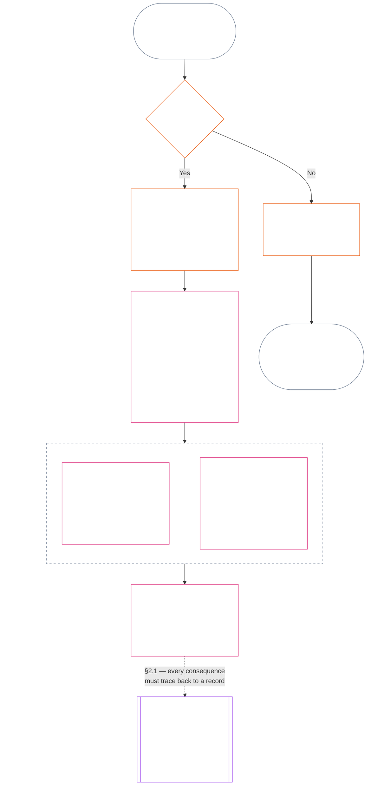
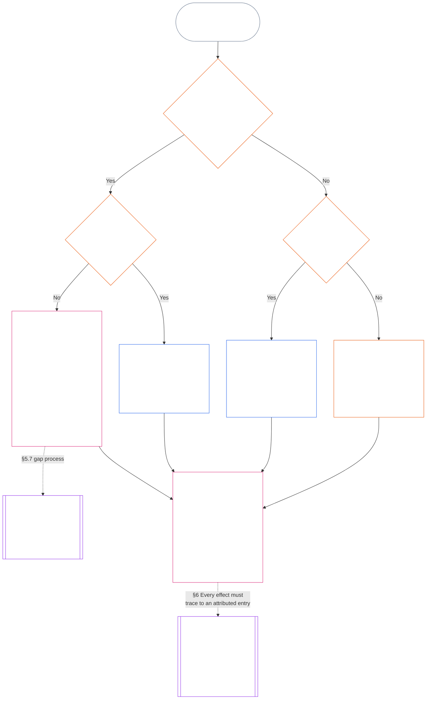

<!-- తెలుగు పూర్తి ముసాయిదా: అధ్యాయం 11 | మూల కమిట్: 9c2c8c10c871d91157bcd27b9f56ad6a1cec90d3 | AI ముసాయిదా, సమీక్షించలేదు, బంధనీయంకాదు -->

# అధ్యాయం పదకొండు: ప్రస్థితి రికార్డులు — ప్రశ్న 1, ఏమి జరిగింది?

<strong>సంకలనంలో స్థానం (అసంచాలకం): ఫైల్ నిర్మాణం మరియు చదివే నియమాలు</strong>

> ఈ ఫైల్ **సంజ్ఞ రాజ్యాంగంలో భాగం**; ఇతర సంఖ్యాపూర్వక `core_*` ఫైళ్లతో ఒకే పాఠ్యంగా చదివినప్పుడే **బంధనీయం**. ఇందులో **అధ్యాయం పదకొండు** ఉంది: ప్రస్థితి ప్రక్రియలోని మూడు ప్రశ్నలు మరియు **ప్రశ్న 1** (*ఏమి జరిగింది?*), **§1–§6**లో. **ప్రశ్న 2** (*ఎంత మంచిది లేదా చెడ్డది?*)కు [పన్నెండవ అధ్యాయం](core_12.000_standing_measurement.md#chapter-twelve-standing-measurement--question-2-how-good-or-bad-was-it) సమాధానం ఇస్తుంది. ప్రశ్న 3 (*దాని వల్ల ఏమి జరుగుతుంది?*) [పదమూడవ అధ్యాయంలో](core_13.000_standing_integration.md#chapter-thirteen-standing-effects-and-integration) కొనసాగుతుంది; అర్హత కలిగిన ఉల్లంఘన అక్షం `s` = 7–9 నిర్ధారణలకు [పద్నాలుగవ అధ్యాయం](core_14.000_misconduct_designation.md#chapter-fourteen-anti-constitutional-misconduct)లోని రాజ్యాంగ-వ్యతిరేక దుర్వ్యవహార హోదాకే సమీక్ష పరిమితం. చదివే క్రమం, బంధనీయ/మద్దతు పాఠ్యాల విభజన, సంకలన సంచిక సమాచారం [README.md](README.md)లో నిర్వహించబడతాయి.

<strong>పాఠక మార్గదర్శకం (అసంచాలకం): పదకొండవ అధ్యాయం ఎక్కడ ఉంటుంది, ఇక్కడ ఏమి ఉంటుంది</strong>

> | ప్రశ్న | బాధ్యత, పాత్ర |
> | --- | --- |
> | **1. ఏమి జరిగింది?** | పదకొండవ అధ్యాయం (ఈ ఫైల్): పరిమితమైన, సవాలు చేయదగిన ప్రస్థితి రికార్డులో ధృవీకరించిన వాస్తవాలను స్థాపిస్తుంది. |
> | **2. ఎంత మంచిది లేదా చెడ్డది?** | [పన్నెండవ అధ్యాయం](core_12.000_standing_measurement.md#chapter-twelve-standing-measurement--question-2-how-good-or-bad-was-it): సహాయం, హానిని కలపకుండా ధృవీకరించిన వాస్తవాలను కొలుస్తుంది. |
> | **3. దాని వల్ల ఏమి జరుగుతుంది?** | [పదమూడవ అధ్యాయానికి](core_13.000_standing_integration.md#chapter-thirteen-standing-effects-and-integration) కొనసాగుతుంది. |
>
> ఆరోపణలు, ప్రజాదరణ, వివాద కథనాలు ప్రశ్న 1కు సమాధానాలు కావు. కోరుకున్న రేటింగ్ ప్రశ్న 1 వాస్తవాలను అందించలేదు; కోరుకున్న పర్యవసానం ప్రశ్న 2 రేటింగ్‌ను అందించలేదు.

<strong>ఆధార క్రమం</strong>

- పూర్వాపరం:
  - [రాజ్యాంగ చతుష్టయం](core_00.000_preamble.md#constitutional-tetrad);
  - [రెండు రాజ్యాంగ లక్ష్యాలు](core_00.000_preamble.md#two-constitutional-aims);
  - [భౌతిక పందెం](core_00.000_preamble.md#material-stake);
  - [ముందుమాట §6 ప్రధాన ఆచరణాత్మక ప్రక్రియ గొలుసులు](core_00.000_preamble.md#6-key-practical-process-pipelines) (*తొమ్మిదవ అధ్యాయం నుండి పదిహేనవ అధ్యాయం వరకు గొలుసు*).
- పూర్వాపరం:
  - [మొదటి అధ్యాయం](core_01.010_stewardship_capacity_principles.md#chapter-01-principles-and-constraints) (1.010) (*విభాగ స్థాయి వివరణలో ప్రతిబింబించిన సరళ-భాష ప్రాప్యత బాధ్యతాయుత నిర్వహణ*);
  - [మొదటి అధ్యాయం §16 — బాధ్యతాయుత నిర్వహణ లోతుగా](core_01.010_stewardship_capacity_principles.md#16-stewardship-in-depth) (1.010 §16) (*యోగ్యతతో అనుసంధానమైన, అనుసరించదగిన ప్రస్థితికి సూత్ర పునాది — నమ్మకం, పాత్రలు, గుర్తింపు*);
  - [రెండవ అధ్యాయం నుండి నాలుగవ అధ్యాయం వరకు](core_02.000_definition_structure.md) (*సమగ్రత, రికార్డులు, ధృవీకరణ*);
  - [ఐదవ అధ్యాయం](core_05.000_definitions_home.md#chapter-five-foundational-definitions) (5.000) (*రెండవ అధ్యాయం నుండి నాలుగవ అధ్యాయంతో కలిపి చదివే నిర్వచనాలు, ఆధిపత్య క్రమం*).
- పూర్వాపరం: [తొమ్మిదవ అధ్యాయం](core_09.000_system_alignment_certification_evaluation.md#chapter-nine-system-alignment-certification) (9.000) (*వ్యవస్థ అమరిక ధృవీకరణ*); [తొమ్మిదవ అధ్యాయం భాగం C §11](core_09.010_system_alignment_certification_record_recertification.md#11-relationship-to-standing) (9.010 §11) (*ప్రస్థితి అనుసంధానం — సంభావ్య ధృవీకరించిన ఇన్‌పుట్‌లు మాత్రమే*).
- ప్రస్థితి ప్రక్రియ:
  - [ముందుమాట §6.2 పూర్తి గొలుసు ఎలా కలుస్తుంది](core_00.000_preamble.md#62-how-the-full-chain-fits-together);
  - [పదకొండవ అధ్యాయం — ప్రస్థితి రికార్డులు](core_11.000_standing_assessment.md#chapter-eleven-standing-records--question-1-what-happened) (11.000) (*మూడు-ప్రశ్నల చట్రం, ప్రశ్న 1 రికార్డులు*);
  - [పన్నెండవ అధ్యాయం — ప్రస్థితి కొలత](core_12.000_standing_measurement.md#chapter-twelve-standing-measurement--question-2-how-good-or-bad-was-it) (12.000) (*ప్రశ్న 2 కొలత*);
  - [పదమూడవ అధ్యాయం — ప్రస్థితి ప్రభావాలు మరియు సమీకరణ](core_13.000_standing_integration.md#chapter-thirteen-standing-effects-and-integration) (13.000) (*ప్రశ్న 3 ప్రభావాలు, సమీకరణ*);
  - [పద్నాలుగవ అధ్యాయం](core_14.000_misconduct_designation.md#chapter-fourteen-anti-constitutional-misconduct) (14.000) (*అర్హత కలిగిన ఉల్లంఘన అక్షం s = 7–9కే హోదా*).
- ఈ ఫైల్‌లోని ఉపవిభాగాలు:
  - [§1](#1-the-three-questions) (*మూడు ప్రశ్నల చట్రం, పరిధి*);
  - [§2](#2-question-1--what-happened) (*ప్రశ్న 1 — ధృవీకరించిన వాస్తవాలు, రికార్డులు*);
  - [§3](#3-question-1-event-type-guide--what-kind-of-help-or-harm-occurred) (*ప్రశ్న 1 సంఘటన రక మార్గదర్శి — సహాయం, హాని రకాలు*);
  - [§4](#4-standing-record-operational-requirements) (*ధృవీకరణ, రికార్డు అవసరాలు*);
  - [§5](#5-record-custody-and-opening-authority) (*రికార్డు సంరక్షణ, ప్రారంభ అధికారం*);
  - [§6](#6-handling-a-standing-record) (*ప్రస్థితి రికార్డు నిర్వహణ*).
- తదనంతరం:
  - [పన్నెండవ అధ్యాయం](core_12.000_standing_measurement.md#chapter-twelve-standing-measurement--question-2-how-good-or-bad-was-it) (12.000) (*ప్రశ్న 2 — LEQU ప్రామాణిక విలువ, కొలత పరిమాణాలు, మార్గ వివరణలు, స్లాట్ వ్యాకరణం, రాజ్యాంగ ఇన్‌పుట్‌లు, LEQU ప్రమాణం, ప్రామాణిక సహకార కొలతలు, ఉదాహరణలు, ప్రశ్న 3కు అప్పగింత*);
  - [పద్నాలుగవ అధ్యాయం](core_14.000_misconduct_designation.md#chapter-fourteen-part-a-anti-constitutional-misconduct-designation) (14.000) (*హోదా మాత్రమే — ప్రశ్న 2 కొలతను తిరిగి తెరవదు*);
  - [పదిహేనవ అధ్యాయం](core_15.000_forum.md#chapter-fifteen-forums-and-jurisdiction) (15.000) (*వేదిక పర్యవేక్షణ, మార్గ నిర్దేశం*);
  - [ఆర్టికల్ XXVI-C](core_06.020_rights_part_e.md#article-xxvi-c-timely-resolution-and-anti-delay-floor) (*సకాల పరిష్కారం*);
  - [ఆర్టికల్ XX](core_06.015_rights_part_d.md#article-xx-a-justice-objective-and-scope) (*న్యాయ పరిమితులు*).
- దీనితో చదవండి: [ఐదవ అధ్యాయం *ప్రస్థితి స్థితి, సహకారం, ఉల్లంఘన*](core_05.035_band_accountability.md#defa3-standing-state-contribution-and-violation) (5.035) (*ప్రామాణిక నిర్వచనాల మార్గ నిర్దేశం*).
- దీనితో చదవండి: [README.md](README.md) (*చదివే క్రమం*); [doc_architecture.md](doc_architecture.md) (*స్వీకరించనంతవరకు బంధనీయంకాని సంపాదకీయ పటాలు*).

 

పదకొండవ అధ్యాయం **ధృవీకరించిన వాస్తవ రికార్డు (ప్రశ్న 1)**కు రాజ్యాంగపరమైన బాధ్యత కలిగిన అధ్యాయం. ఇది [§1 మూడు ప్రశ్నలు](#1-the-three-questions) నుండి [§6 ప్రస్థితి రికార్డు నిర్వహణ](#6-handling-a-standing-record) వరకు ఉంటుంది. [పన్నెండవ అధ్యాయం](core_12.000_standing_measurement.md#chapter-twelve-standing-measurement--question-2-how-good-or-bad-was-it) ప్రశ్న 2కు బాధ్యత వహిస్తుంది; అది [పన్నెండవ అధ్యాయం §1 ప్రశ్న 2 — ఎంత మంచిది లేదా చెడ్డది?](core_12.000_standing_measurement.md#1-question-2--how-good-or-bad-was-it) నుండి [పన్నెండవ అధ్యాయం §9 ప్రశ్న 3కు అప్పగింత — ప్రశ్నల మధ్య కొలత అనుసంధానాలు](core_12.000_standing_measurement.md#9-hand-off-to-question-3--cross-question-measurement-hooks) వరకు ఉంటుంది. ప్రశ్న 3 పదమూడవ అధ్యాయంలో కొనసాగుతుంది.

*సాధారణ మాటల్లో: ఏమి జరిగిందో ఈ అధ్యాయం రాసి, ప్రస్థితి రికార్డును ఉంచుతుంది. అది ఎంత మంచిదో లేదా ఎంత హానికరమో పన్నెండవ అధ్యాయం రెండు వేరు మార్గాల్లో కొలుస్తుంది; వాటిని ఎప్పుడూ ఒక నికర స్కోరుగా కలపరు. కేసు దాఖలు చేయడం ఒక్కటే ప్రస్థితి కాదు.*

### 1. మూడు ప్రశ్నలు

*సరళంగా చెప్పాలంటే: స్థితిని మూడు ప్రశ్నలకు వరుసగా సమాధానం ఇవ్వడం ద్వారా నిర్ణయిస్తారు. కోరుకున్న రేటింగ్ ఆధారంగా వాస్తవాలను ఊహించకండి; కోరుకున్న పరిణామాన్ని సమర్థించడానికి రేటింగ్‌ను ఎంచుకోకండి.*

| ప్రశ్న | ప్రశ్న ఏమి అడుగుతుంది | సమాధానం ఎక్కడ ఉంది |
| --- | --- | --- |
| **1. ఏమి జరిగింది?** | ఏ వాస్తవాలు నిర్ధారించబడ్డాయి, అవి ఎవరి గురించి లేదా దేని గురించి, ఏ కాలంలో, ఏ స్థితి రికార్డు మరియు సవాలు స్థితితో ఉన్నాయి? | [విభాగం 2](#2-question-1--what-happened) మరియు [విభాగం 3](#3-question-1-event-type-guide--what-kind-of-help-or-harm-occurred) |
| **2. అది ఎంత మంచిది లేదా చెడ్డది?** | ఆ వాస్తవాలు ఏ రకం, ఏ పరిమాణంలోని సహకారం లేదా ఉల్లంఘనను నిర్ధారిస్తాయి? | [అధ్యాయం పన్నెండు, విభాగం 1](core_12.000_standing_measurement.md#1-question-2--how-good-or-bad-was-it) |
| **3. దాని వల్ల ఏమి జరుగుతుంది?** | దాని తరువాత ఏ గుర్తింపు, సిద్ధత, పరిహారం, రక్షణ, పరిమితి లేదా ఇతర పరిణామం వస్తుంది? | [అధ్యాయం పదమూడు](core_13.000_standing_integration.md#chapter-thirteen-standing-effects-and-integration) |

ప్రతి ప్రశ్నకు సమాధానం దాని ముందున్న సమాధానంపై ఆధారపడుతుంది:

- ప్రశ్న 1, ప్రశ్న 2కు నిర్ధారిత వాస్తవాలను అందిస్తుంది.
- ప్రశ్న 2, ప్రశ్న 3 కోసం ఆ వాస్తవాలను కొలుస్తుంది.
- ఇష్టమైన ఫలితానికి సరిపడేలా ప్రశ్న 3 వాస్తవాలను లేదా రేటింగ్‌ను తిరిగి రాయకూడదు.

మూడు ప్రశ్నలకు కలిపిన సమాధానాలు ఒక పరిమిత సంఘటన లేదా నిర్వచించిన నమూనాకు సంబంధించిన సంపూర్ణ స్థితి అంచనాను రూపొందిస్తాయి. ఒక అంశానికి కాలక్రమంలో ఇలాంటి అంచనాలు అనేకం ఉండవచ్చు; వాటిలో ఏదీ నికర స్కోరు కాదు, ఆ అంశంపై సమగ్ర రేటింగ్ కూడా కాదు. సహకార, ఉల్లంఘన స్థితి రికార్డులు ప్రశ్నలు 1 మరియు 2కు సమాధానాలను భద్రపరుస్తాయి; ప్రశ్న 3 నిర్ణయం వాటి నుంచి ఏమి జరుగుతుందో చెబుతుంది.

#### 1.1 ఉద్దేశ్యం మరియు పరిధి

ఈ అధ్యాయం రికార్డు కోసం రాజ్యాంగ చట్రాన్ని, [అధ్యాయం పన్నెండు](core_12.000_standing_measurement.md#chapter-twelve-standing-measurement--question-2-how-good-or-bad-was-it) కొలత చట్రాన్ని **వ్యవస్థలు**, **సెంటియెంట్లు**, **సంస్థల** కోసం పేర్కొంటాయి; [**CS-9.305**](corpus_systems/cs_09.305_system_classification_machinery.md#cs-9305-part-a-system-classification-machinery) (*వ్యవస్థ వర్గీకరణ యంత్రాంగం*) కింద వర్గీకరించిన ప్రతి వ్యవస్థ కూడా ఇందులో ఉంది. ఈ చట్రాలు గాసిప్, జనాదరణ, అస్పష్టమైన పేరు ప్రతిష్ఠ, అంతర్గత గౌరవం లేదా సాధారణ విలువను కొలవవు; వీటిలో ఏదీ స్థితి అంచనాకు అనుమతించదగిన అంశం కాదు.

క్రింది పరిస్థితులు ఉన్నా స్థితి ప్రక్రియ ప్రభావవంతంగా ఉండాలి:

- గతంలో నిర్ధారించిన సహకారాలు ప్రస్తుత సామర్థ్యం లేదా విశ్వసనీయతను చూపలేనంత పాతబడినప్పుడు;
- ఉల్లంఘనలు పరిష్కారం కాకుండా ఉన్నప్పుడు;
- సరిదిద్దడం ఖరీదైనప్పుడు;
- బాధ్యత సరిహద్దులను దాటినప్పుడు; లేదా
- జవాబుదారీతనాన్ని అడ్డుకోవడానికి ఒక కర్త సంస్థాగత పొరలు లేదా పేరు మార్పులను ఉపయోగించినప్పుడు.

ఈ అంశాలు ఆమోదించిన అమలు పాఠ్యానికి చెందుతాయి:

- రోజువారీ విధానాలు;
- ఉన్నత స్థాయికి తీసుకెళ్లే చర్యలు;
- తిరిగి చెల్లింపు, సరిదిద్దే కార్యాచరణ;
- పునరుద్ధరణాత్మక జవాబుదారీతన చర్యలు; మరియు
- ప్రోత్సాహకాల రూపకల్పన.

అధ్యాయం పన్నెండు కొలత ఒక్కటే బలప్రయోగం, నిర్బంధం లేదా మరొక స్వేచ్ఛా పరిమితికి అనుమతి **ఇవ్వదు**. అలాంటి ఏ పరిణామమైనా అధ్యాయం ఆరు, **ఆర్టికల్ XX** (*నిర్ధారిత ఉల్లంఘన తరువాత న్యాయం*)లోని అనుపాతత్వం, అతి తక్కువ పరిమితి, కాలపరిమితి, తిరిగి చెల్లింపు, పునరుద్ధరణాత్మక జవాబుదారీతనం వంటి అవసరాలను స్వతంత్రంగా తీర్చాలి.

<strong>అనుసరణ · నిర్వచనాలు · అంచనా · అనుసరణ</strong>

- పూర్వాధారం: [అధ్యాయం ఒకటి §16 — లోతైన సంరక్షకత్వం](core_01.010_stewardship_capacity_principles.md#16-stewardship-in-depth); [అధ్యాయాలు రెండు నుంచి నాలుగు](core_02.000_definition_structure.md); [అధ్యాయం ఐదు](core_05.000_definitions_home.md#chapter-five-foundational-definitions).
- తదుపరి అంశాలు:
  - [§2](#2-question-1--what-happened) (*ప్రశ్న 1*);
  - [§4](#4-standing-record-operational-requirements) (*ధృవీకరణ, రికార్డు అవసరాలు*);
  - [§5](#5-record-custody-and-opening-authority) (*రికార్డు సంరక్షణ, ప్రారంభించే అధికారం*);
  - [§6](#6-handling-a-standing-record) (*స్థితి రికార్డును నిర్వహించడం*);
  - [అధ్యాయం పన్నెండు §1](core_12.000_standing_measurement.md#1-question-2--how-good-or-bad-was-it) (*ప్రశ్న 2 కొలత*);
  - [అధ్యాయం పన్నెండు §2](core_12.000_standing_measurement.md#2-magnitude-and-severity-input-dimensions) (*కొలతకు ఇన్‌పుట్ పరిమాణాలు*);
  - [అధ్యాయం పన్నెండు §3](core_12.000_standing_measurement.md#3-route-descriptor-catalogs-and-measurement-roles) (*మార్గ వివరణల జాబితాలు*);
  - [అధ్యాయం పన్నెండు §4](core_12.000_standing_measurement.md#4-slot-grammar-and-shared-scaling) (*స్లాట్ వ్యాకరణం, ఉమ్మడి స్కేలింగ్*);
  - [అధ్యాయం పన్నెండు §5](core_12.000_standing_measurement.md#5-constitutional-inputs-to-axis-assignment) (*రాజ్యాంగ మూలాల ఆధారంగా కేటాయింపు*);
  - [అధ్యాయం పన్నెండు §6](core_12.000_standing_measurement.md#6-unified-proportional-lequ-scale--contribution-and-violation-axes) (*రెండు అక్షాల కోసం ఏకీకృత అనుపాత LEQU స్కేలు*);
  - [అధ్యాయం పదమూడు](core_13.000_standing_integration.md#chapter-thirteen-standing-effects-and-integration) (*ప్రశ్న 3*).
- [భౌతిక ప్రాముఖ్యత](core_05.050_band_oversight.md#materiality) · [O](core_05.050_band_oversight.md#materiality) · [M](core_05.050_band_oversight.md#materiality-determination-a) · [A](core_05.050_band_oversight.md#materiality-determination-a) · [C](core_05.050_band_oversight.md#materiality-determination-c)
- [హాని](core_05.035_band_accountability.md#harm) · [O](core_05.035_band_accountability.md#harm) · [M](core_05.035_band_accountability.md#harm-a) · [A](core_05.035_band_accountability.md#harm-a) · [C](core_05.035_band_accountability.md#harm-c)
- [అనుపాతత్వం](core_05.035_band_accountability.md#proportionality) · [O](core_05.035_band_accountability.md#proportionality) · [M](core_05.035_band_accountability.md#proportionality-a) · [A](core_05.035_band_accountability.md#proportionality-a) · [C](core_05.035_band_accountability.md#proportionality-c)

### 2. ప్రశ్న 1 — ఏమి జరిగింది?

<strong>అనుసరణ</strong>

- పూర్వాధారం: [§1](#1-the-three-questions) (*మూడు ప్రశ్నల చట్రం*); [అధ్యాయాలు రెండు నుంచి నాలుగు](core_02.000_definition_structure.md) (*నిర్వచనాల నుంచి ఫలితాల వరకు రికార్డు, ధృవీకరణ, అనుసరణ*).
- టెట్రాడ్ అంశం/అంశాలు: **భాగస్వామ్యం**; **పర్యవేక్షణ** (వివాదయోగ్యత, సవాలు మార్గాలు). ప్రధాన లక్ష్యాలు: **వికాసం**, **నిరంతరత** (తదుపరి కొలత కోసం వేర్వేరు సహకార, ఉల్లంఘన నిర్ధారణలను భద్రపరిచే అనుసరణగల రికార్డులు).
- తదుపరి అంశాలు:
  - [§2.2](#22-silence-is-the-default) (*నిశ్శబ్దం డిఫాల్ట్*);
  - [§2.3](#23-protected-dissent-is-not-a-trigger) (*రక్షిత అసమ్మతి ప్రేరకం కాదు*);
  - [§2.4](#24-linked-standing-records-and-no-offset-bridge) (*లింక్ చేసిన రికార్డులలో పరస్పర భర్తీ నిషేధం*);
  - [§2.5](#25-verified-input-gate) (*ధృవీకరించిన ఇన్‌పుట్ ద్వారం*);
  - [§2.6](#26-stage-boundary) (*దశల సరిహద్దు*);
  - [§2.7](#27-forum-boundary) (*వేదిక సరిహద్దు*);
  - [§3](#3-question-1-event-type-guide--what-kind-of-help-or-harm-occurred) (*సంఘటన రకం మార్గదర్శి*);
  - [§4](#4-standing-record-operational-requirements) (*రికార్డు అవసరాలు*);
  - [§5](#5-record-custody-and-opening-authority) (*రికార్డు సంరక్షణ, ప్రారంభించే అధికారం*);
  - [§6](#6-handling-a-standing-record) (*స్థితి రికార్డును నిర్వహించడం*);
  - [అధ్యాయం పన్నెండు §1](core_12.000_standing_measurement.md#1-question-2--how-good-or-bad-was-it) (*ప్రశ్న 2 కొలత*);
  - [అధ్యాయం పన్నెండు §2](core_12.000_standing_measurement.md#2-magnitude-and-severity-input-dimensions) (*కొలతకు ఇన్‌పుట్ పరిమాణాలు*);
  - [అధ్యాయం పన్నెండు §3](core_12.000_standing_measurement.md#3-route-descriptor-catalogs-and-measurement-roles) (*మార్గ వివరణల జాబితాలు*);
  - [అధ్యాయం పన్నెండు §4](core_12.000_standing_measurement.md#4-slot-grammar-and-shared-scaling) (*స్లాట్ వ్యాకరణం, ఉమ్మడి స్కేలింగ్*);
  - [అధ్యాయం పన్నెండు §5](core_12.000_standing_measurement.md#5-constitutional-inputs-to-axis-assignment) (*రాజ్యాంగ మూలాల ఆధారంగా కేటాయింపు*);
  - [అధ్యాయం పన్నెండు §6](core_12.000_standing_measurement.md#6-unified-proportional-lequ-scale--contribution-and-violation-axes) (*రెండు అక్షాల కోసం ఏకీకృత అనుపాత LEQU స్కేలు*);
  - [అధ్యాయం పదమూడు](core_13.000_standing_integration.md#chapter-thirteen-standing-effects-and-integration) (13.000) (*ప్రశ్న 3*).

 

*సరళంగా: ఏమి జరిగిందో పరిమితమైన, సవాలు చేయదగిన వివరణను ప్రశ్న 1 స్థాపిస్తుంది. ఏ రేటింగ్ లేదా పరిణామాన్ని పరిశీలించకముందే అంశం, సంఘటన లేదా నమూనా, కాలవ్యవధి, నిర్ధారించిన వాస్తవాలు, రికార్డు స్థితి ఏమిటో గుర్తిస్తుంది. నిర్ధారించిన సహాయం, నిర్ధారించిన ఉల్లంఘనలు వేర్వేరు స్థితి రికార్డులను ఉపయోగిస్తాయి; తద్వారా ఒకటి మరొకదాన్ని చెరిపివేయదు. ఈ రికార్డులు జనాదరణ స్కోర్లు లేదా అస్పష్టమైన లేబుళ్లు కావు.*

**స్థితి రికార్డు** అనేది నిర్దిష్ట అంశం, కార్యాచరణ పరిధి, రికార్డు కాలం, సమీక్ష స్థితి, నిర్ణయ సందర్భం కోసం ఈ అధ్యాయం ఉపయోగించే పరిమిత రికార్డు. కొలత ప్రారంభమయ్యే ముందు ఇది క్రింది అంశాలను స్థాపించాలి:

- స్థితి రికార్డు ఎవరిని లేదా దేనిని గురించి ఉంది;
- అది పరిమిత సంఘటనకు సంబంధించినదా లేక నిర్వచించిన నమూనాకు సంబంధించినదా;
- సంబంధిత ప్రవర్తన, ప్రభావాలు ఎప్పుడు, ఎక్కడ సంభవించాయి;
- ఏ వాస్తవాలు నిర్ధారించబడ్డాయి, ఏవి ఇంకా వివాదంలో ఉన్నాయి;
- ఆ నిర్ధారణలకు ఏ సాక్ష్యం, ఆపాదింపు, సవాలు మార్గం మద్దతు ఇస్తున్నాయి; మరియు
- స్థితి రికార్డు యొక్క ప్రస్తుత సమీక్ష, దిద్దుబాటు, భర్తీ స్థితి.

సంఘటన స్థితి రికార్డును ప్రేరేపిస్తుందా, ఆ రికార్డు ఏమి కలిగి ఉంటుందో రేఖాచిత్రం అనుసరిస్తుంది; తరువాతి ఉపవిభాగాలు ప్రతి నియమాన్ని చెబుతాయి. “కాదు” అనే శాఖ ప్రధాన మార్గం నుంచి కుడివైపుకు వెళ్తుంది.

#### 2.1 స్థితి రికార్డులు: రకాలు మరియు అంశాలు

నిర్ధారించిన సహాయానికి ప్రశ్న 1 **సహకార స్థితి రికార్డును**, జవాబుదారీతన వైఫల్యాలతో సహా నిర్ధారించిన హానికి **ఉల్లంఘన స్థితి రికార్డును** ఉపయోగిస్తుంది. ఒక స్థితి రికార్డు ఈ రెండు రకాల నిర్ధారణలను కలపదు.

- స్థితి రికార్డు సెంటియెంట్, సంస్థ, వ్యవస్థ, అంచనా, పరిమిత సంఘటన, పాత్ర, సమూహం, నటుడి-నిర్దిష్ట రికార్డు లేదా రాజ్యాంగపరంగా సంబంధిత మరొక యూనిట్‌కు సంబంధించినదై ఉండవచ్చు.
  - విభిన్న అంశాలు, పాత్రలు, వ్యవస్థలు, సముదాయాలు, రికార్డు కాలాలు, సమీక్ష స్థితులు లేదా నిర్ణయ సందర్భాలను ఒకే భేదంలేని స్థితి లేబుల్‌లో కలపకూడదు.
- స్థితి రికార్డు స్పష్టమైన ప్రారంభం, ముగింపు ఉన్న ఒక **పరిమిత సంఘటనను**, లేదా పునరావృత ప్రవర్తన యొక్క ఒక **నమూనాను** కవర్ చేయవచ్చు.
  - నమూనాకు నిర్వచించిన అంశం, పరిధి, సమీక్ష కాలం అవసరం.
- ఒక అంశానికి కాలక్రమంలో అనేక స్థితి రికార్డులు ఉండవచ్చు; వీటిలో లింక్ చేసిన సహకార, ఉల్లంఘన స్థితి రికార్డులు కూడా ఉంటాయి.
  - అంశం, పరస్పరం మిళితమైన రికార్డు కాలం, పరిమిత సంఘటన, నమూనా లేదా నిర్ణయ సందర్భం ఉమ్మడిగా ఉంటే సంబంధిత రికార్డులు **విభాగం 4.2** ప్రకారం పరస్పరం **క్రాస్-రిఫరెన్స్** చేయాలి.
- స్థితి రికార్డు స్వతంత్ర పేరు ప్రతిష్ఠ స్కోరు, గౌరవ ర్యాంకు, శాశ్వత స్థితి, సాధారణ విలువ లేబుల్ లేదా కలిపిన స్కోర్‌కార్డు కాదు.
  - కార్యాచరణ అవసరాలు **విభాగం 4**లో ఉన్నాయి.

తదుపరి స్థితి ప్రభావాలు అధ్యాయం పదమూడుకు చెందుతాయి; అవి స్థితి రికార్డులో భాగం కాకుండా సంబంధిత స్థితి రికార్డు లేదా రికార్డులకు తిరిగి అనుసరించగలిగేలా ఉండాలి.

#### 2.2 నిశ్శబ్దం డిఫాల్ట్

స్థితి రికార్డు లేకపోవడం సెంటియెంట్, సంస్థ లేదా వ్యవస్థకు సాధారణ స్థితి; చాలా మంది సెంటియెంట్లు ఇదే స్థితిలో ఉంటారు.

- **విభాగం 4** ప్రకారం ప్రేరకం నిర్ధారించినప్పుడే స్థితి రికార్డు తెరవాలి. పేరుతో పేర్కొన్న రికార్డు-ప్రారంభ అధికారం ఎంట్రీని ఆమోదించాలి; వేరొక రికార్డు సంరక్షకుడు దానిని నమోదు చేయాలి (**విభాగం 5**). ఈ కారణాల వల్ల ఎప్పుడూ స్థితి రికార్డును తెరవకూడదు:
  - ప్రాథమిక స్థితి ఏర్పరచడానికి;
  - జాబితాను పూర్తిచేయడానికి; లేదా
  - పేరుగల మార్గానికి ద్వారపాలకుడు అలా కోరినందుకు.
- స్థితి రికార్డు లేకపోవడం ఏమీ తెలియజేయదు. “రేటింగ్ లేదు”, “ధృవీకరించలేదు”, “ఫైల్లో రికార్డు లేదు” అనేవి ప్రమాదం, తక్కువ సహకారం లేదా మరేదైనా వాటికి సాక్ష్యం కావు. మరింత పరిశీలన, తక్కువ డిఫాల్ట్ స్థాయి లేదా పేరుగల మార్గానికి షరతులతో కూడిన ప్రవేశానికి కారణంగా రికార్డు లేకపోవడాన్ని ఎవరూ ఉపయోగించకూడదు.
- కింది వాటికి షరతుగా ఏ సంస్థ లేదా వ్యవస్థ స్థితి రికార్డును, “రికార్డు లేదు” అనే ధృవీకరణను లేదా దాన్ని తెరవడానికి సమ్మతిని కోరరాదు:
  - **ఆర్టికల్ III** (*మనుగడ మరియు అవసరమైన ప్రవేశం*)లోని అత్యావశ్యకాలు;
  - **ఆర్టికల్ III-C** (*పని మరియు ఆర్థిక అంతస్తు*)లోని రక్షణలు;
  - సాధారణ వాణిజ్యం; లేదా
  - ప్రభావిత పక్షంగా పాల్గొనడం.
  [అధ్యాయం పదమూడు §6.2 సామర్థ్య హద్దులు, అనుమతులు](core_13.000_standing_integration.md#62-competency-bars-and-clearances) ప్రకారం నమ్మక-సున్నితమైన నిర్దిష్ట మార్గాల కోసం ప్రచురించిన సామర్థ్య అడ్డంకులు మినహాయింపు; ఆ మార్గం ఎందుకు నమ్మక-సున్నితమైనదో అవి చెప్పాలి.
- ఒక అంశం గురించి స్థితి రికార్డు తెరిస్తే, **విభాగం 4** కోరినట్లుగా ఆ అంశానికి తెలియజేయాలి. పత్రబద్ధమైన [సాక్ష్య పరిరక్షణ](core_05.050_band_oversight.md#evidence-preservation) లేదా భద్రతా అవసరం సమర్థించినప్పుడు మాత్రమే, అది కూడా పరిమితమైన, నిర్దిష్ట కాలానికి మాత్రమే నోటీసును ఆలస్యం చేయవచ్చు. నోటీసే స్థితి రికార్డును సవాలు చేయగలిగేలా చేస్తుంది: రికార్డు ఉందని తెలియని అంశం దాన్ని సవాలు చేయలేడు లేదా సరిచేయలేడు.

#### 2.3 రక్షిత అసమ్మతి ప్రేరకం కాదు

అసమ్మతి లేదా శాంతియుత నిరసన — [రక్షిత అహింసాత్మక పౌర అవిధేయత](core_06.005_rights_part_b.md#xi-d-nonviolent-civil-disobedience) సహా — **ఆర్టికల్ XI-D** (*సమావేశం, అసమ్మతి, శాంతియుత నిరసన*) కింద ([*అసమ్మతి, శాంతియుత నిరసన అంతస్తు*](core_06.005_rights_part_b.md#xi-d-dissent-and-peaceful-protest)) నిర్ధారించిన ప్రేరకం కాదు.

- అది ఉల్లంఘన స్థితి రికార్డును తెరవదు, పొడిగించదు లేదా తీవ్రతరం చేయదు; **విభాగం 8.2** కింద తీవ్రత ఇన్‌పుట్ కాదు; పునరావృతం కావడం వల్ల అది నమూనా కాదు.
- రాజ్యాంగ అంతస్తును స్వతంత్రంగా ఉల్లంఘించే వేరుచేయదగిన ప్రవర్తనను దాని స్వంత నిబంధనల ప్రకారం నమోదు చేయాలి; నిరసన యొక్క దృక్కోణం, కారణం లేదా లక్ష్యం వల్ల తీవ్రతరం చేయరాదు.

#### 2.4 లింక్ చేసిన స్థితి రికార్డులు, పరస్పర భర్తీ నిషేధం

<strong>అనుసరణ</strong>

- పూర్వాధారం: [§2.1](#21-standing-records-kinds-and-subjects) (*వేర్వేరు సహకార, ఉల్లంఘన రికార్డులు*).
- తదుపరి అంశాలు:
  - [§2.5](#25-verified-input-gate) (*ధృవీకరించిన ఇన్‌పుట్ ద్వారం*);
  - [§2.7](#27-forum-boundary) (*వేదిక సరిహద్దు*);
  - [§4.2](#42-related-standing-record-cross-references) (*క్రాస్-రిఫరెన్స్‌లు*);
  - [అధ్యాయం పన్నెండు §1](core_12.000_standing_measurement.md#1-question-2--how-good-or-bad-was-it) (*ప్రశ్న 2 కొలత*);
  - [అధ్యాయం పన్నెండు §2](core_12.000_standing_measurement.md#2-magnitude-and-severity-input-dimensions) (*కొలతకు ఇన్‌పుట్ పరిమాణాలు*);
  - [అధ్యాయం పన్నెండు §3](core_12.000_standing_measurement.md#3-route-descriptor-catalogs-and-measurement-roles) (*మార్గ వివరణల జాబితాలు*);
  - [అధ్యాయం పన్నెండు §4](core_12.000_standing_measurement.md#4-slot-grammar-and-shared-scaling) (*స్లాట్ వ్యాకరణం, ఉమ్మడి స్కేలింగ్*);
  - [అధ్యాయం పన్నెండు §5](core_12.000_standing_measurement.md#5-constitutional-inputs-to-axis-assignment) (*రాజ్యాంగ మూలాల ఆధారంగా కేటాయింపు*);
  - [అధ్యాయం పన్నెండు §6](core_12.000_standing_measurement.md#6-unified-proportional-lequ-scale--contribution-and-violation-axes) (*రెండు అక్షాల కోసం ఏకీకృత అనుపాత LEQU స్కేలు*);
  - [అధ్యాయం పదమూడు](core_13.000_standing_integration.md#chapter-thirteen-standing-effects-and-integration) (13.000) (*ప్రశ్న 3*).
- వీటితో చదవండి: [అధ్యాయం పదమూడు — స్థితి సమగ్రత](core_13.000_standing_integration.md#2-automatic-integration-review-and-continuity) (13.000) (*మినహాయింపులేని, లింక్ చేసిన రికార్డుల సమగ్రత*); [అధ్యాయం పదమూడు §6.2 — సామర్థ్య హద్దులు, అనుమతులు](core_13.000_standing_integration.md#62-competency-bars-and-clearances) (13.000 §6.2); [అధ్యాయం పదమూడు §4.2 — స్థితి తాళాలు](core_13.000_standing_integration.md#42-prevention--general-standing-locks) (13.000 §4.2).

 

**మూల నియమం:** నిర్ధారించిన **సహకార స్థితి రికార్డులు**, నిర్ధారించిన **ఉల్లంఘన స్థితి రికార్డులు** **విభాగం 2.1** ప్రకారం వేరుగా ఉంచాలి. ప్రతి సహకార లేదా ఉల్లంఘన నిర్ధారణ దాని స్వంత స్థితి రికార్డులోని స్వతంత్ర, ఆధారమున్న వాస్తవాలపై నిలవాలి. విశ్లేషణ, సహాయక పత్రాలు ఈ రెండు రికార్డు మార్గాలను వేరువేరుగా అనుసరించగలిగేలా ఉంచాలి. ఏ ఒక్క ఎంట్రీ లేదా లింక్ చేసిన రికార్డుల సముదాయం నికర స్కోరు, కలిపిన స్కోరు లేదా పరస్పర మార్పిడి కాదు.

- **ఉల్లంఘన స్థితి రికార్డులు, స్థితి తాళాలు:**
  - అధ్యాయం పదమూడు ప్రకారం, ఉల్లంఘన స్థితి రికార్డుల నుంచి వచ్చే వర్తించే **స్థితి తాళాలు**, నిర్ధారించిన ఉల్లంఘన పరిష్కారం కాకుండా ఉన్నంతకాలం స్థితిని పరిమితం చేయవచ్చు, పాత్ర అర్హతను నిరోధించవచ్చు లేదా పరిహారం పొందడాన్ని ప్రభావితం చేయవచ్చు.
  - స్థితి తాళాలు, సహకార స్థితి రికార్డుల్లో నమోదైన నిర్ధారిత సానుకూల సహకారాన్ని చెరిపివేయకూడదు.
  - పరిష్కారం కాని నిర్ధారిత ఉల్లంఘనలకు కాలం గడిచిందనే కారణంతో తగ్గింపు ఉండదు.
  - నిర్ధారించిన ఉల్లంఘనలు సంబంధం లేని సహకార స్థితి రికార్డులను తప్పుడు ప్రతికూల పేరు ప్రతిష్ఠ ఫైల్‌గా మార్చకూడదు.
- **సహకార స్థితి రికార్డులు, సామర్థ్య అనుమతులు:**
  - ప్రస్తుతమైన, పాత్రకు సంబంధించిన నిర్ధారిత సహకారం ప్రచురించిన **సామర్థ్య హద్దుల**పై వర్తించే **సామర్థ్య అనుమతులకు**, అలాగే నమ్మకం, పాత్ర లేదా గుర్తింపుతో ముడిపడిన అర్హతకు మద్దతివ్వవచ్చు.
  - నిర్ధారించిన సహకారం నిర్ధారించిన ఉల్లంఘనను భర్తీ చేయకూడదు, సగటుతో తగ్గించకూడదు, మన్నించకూడదు లేదా తిరిగి లేబుల్ చేయకూడదు.
  - హద్దు తీరిందంటే వర్తించే స్థితి తాళం మాఫీ అయినట్టు కాదు.

**ఏకైక మినహాయింపు:** ఉల్లంఘన నిర్ధారణే ప్రకటించిన సహకారాన్ని ఖండిస్తే — ఉదాహరణకు, సహకార రికార్డు చెప్పిన పని నిజంగా చేయలేదని సాక్ష్యం చూపితే — సరైన సాక్ష్య, సమీక్ష ప్రక్రియ ద్వారా, **విభాగం 4.2**లో కోరిన క్రాస్-రిఫరెన్స్‌తో లింక్ చేసిన సహకార స్థితి రికార్డును సరిచేయవచ్చు లేదా తొలగించవచ్చు. అయితే వేరే సహకార స్థితి రికార్డుల్లో నమోదైన సంబంధం లేని సహాయాన్ని ఉల్లంఘన స్వయంచాలకంగా చెరిపివేయదు.

#### 2.5 ధృవీకరించిన ఇన్‌పుట్ ద్వారం

ఈ ద్వారం ఇలా పనిచేస్తుంది:

- స్థితి, నమ్మకం, పాత్ర, గుర్తింపు లేదా గుర్తింపు పొందే అర్హతను ప్రభావితం చేసే ఏ నిర్ణయమైనా సంబంధిత **సహకార స్థితి రికార్డులు** లేదా **ఉల్లంఘన స్థితి రికార్డుల** నుంచి వచ్చిన నిర్ధారిత ఇన్‌పుట్‌లనే ఉపయోగించాలి.
- ఆరోపణలు, తీర్పు రాని వాదనలు, తాత్కాలిక దారి-మళ్లింపు ట్యాగ్‌లు, కేవలం స్వీకరణ దశ కథనాలు, ఇతర వివాద దశ పత్రాలు స్థితి కోసం సహకారం లేదా ఉల్లంఘన స్వభావాన్ని స్వతంత్రంగా నిర్ధారించవు.
- ధృవీకరించిన ఇన్‌పుట్ ఒక **స్థితి నిర్ధారణ**: నిర్ధారించిన సహకార నిర్ధారణ (అక్షం I) లేదా నిర్ధారించిన ఉల్లంఘన నిర్ధారణ (అక్షం II).
- సహకార, ఉల్లంఘన నిర్ధారణలు వేర్వేరు స్థితి రికార్డుల్లోనే ఉండాలి (చూడండి **విభాగం 2.1**).

#### 2.6 దశల సరిహద్దు

స్థితి రికార్డు దశలు వేరుగా ఉంటాయి:

- ప్రశ్న 1 నిర్ధారించిన వాస్తవాలను నమోదు చేస్తుంది; ప్రశ్న 2 వాటిని కొలుస్తుంది.
- నిర్ధారించిన వాస్తవ ఆధారం పూర్తయిన వెంటనే స్థితి రికార్డు తెరవవచ్చు; ప్రశ్న 2 కొలత ఇంకా పెండింగ్‌లో ఉండవచ్చు.
- కొలత జరిగేవరకు ప్రశ్న 2 ఫీల్డ్‌లు స్లాట్ లేదా వర్గాన్ని సూచించకుండా పెండింగ్‌లో ఉందని పేర్కొనాలి.
- స్థితి రికార్డు ప్రశ్న 3 యొక్క **స్థితి ప్రభావాన్ని** పేర్కొనకూడదు లేదా అమలు చేయకూడదు.

#### 2.7 వేదిక సరిహద్దు

*సరళంగా: వేదికలు వివాదాలను పర్యవేక్షించి, సవాళ్లను అనుమతించి, నిర్ధారిత ఫలితాలుగా మార్చే ప్రదేశాలు; కానీ కేసు దాఖలు చేయడం లేదా కథన వాదనలో గెలవడం స్థితిని నవీకరించదు. **విభాగం 2.5**లోని ధృవీకరించిన ఇన్‌పుట్ ద్వారం ఇప్పటికీ వర్తిస్తుంది. అధ్యాయాలు రెండు నుంచి నాలుగు ప్రకారం వేదిక వాస్తవాలను నిర్ధారించినప్పుడు, అది స్థితి రికార్డును **తెరవవచ్చు, నవీకరించవచ్చు లేదా సరిచేయవచ్చు**, లేదా **సవాలు వచ్చినప్పుడు తప్పు రికార్డును పక్కన పెట్టవచ్చు**. వేదికలు మంచి, చెడులను ఒక స్కోరుగా కలపవు; స్థితి వర్గాన్ని స్వయంగా సృష్టించవు.*

ఈ విభాగం ఒక ప్రశ్నకే చెందుతుంది: వేదిక పని స్థితి రికార్డులోకి ఎలా వస్తుంది. గొలుసులోని ఇతర దశలు ఇక్కడ పేరుతో పేర్కొన్న బాధ్యులకు చెందుతాయి; క్రమం ఇలా ఉంటుంది:

1. వివాదం దాఖలవుతుంది; వేదిక **వేదిక కేసు రికార్డును** ఉంచుతుంది, అది స్థితి రికార్డు కాదు. బాధ్యత: [అధ్యాయం పదిహేను §2.3 వేదిక కేసు రికార్డులు, స్థితి రికార్డులు, సవాళ్లు](core_15.000_forum.md#23-forum-case-records-standing-records-and-contests); అలాగే [§2.7.1 వేదిక కేసు రికార్డు](#271-forum-case-record) చూడండి.
2. [అధ్యాయాలు రెండు నుంచి నాలుగు](core_02.000_definition_structure.md) ప్రకారం వేదిక వాస్తవాలను నిర్ధారిస్తుంది.
3. నిర్ధారించిన ఫలితాలు ధృవీకరించిన ఇన్‌పుట్ ద్వారం గుండా వెళ్తాయి. బాధ్యత: [§2.5 ధృవీకరించిన ఇన్‌పుట్ ద్వారం](#25-verified-input-gate).
4. వేదిక కావచ్చే పేరుతో పేర్కొన్న రికార్డు-ప్రారంభ అధికారం స్థితి రికార్డును తెరుస్తుంది, నవీకరిస్తుంది లేదా సరిచేస్తుంది, లేదా సవాలు వచ్చినప్పుడు తప్పు రికార్డును పక్కన పెడుతుంది. బాధ్యతలు: రికార్డు ఏమి కలిగి ఉండాలో [§4.1 కనీస రికార్డు విషయాలు](#41-minimum-record-contents); ఎవరు చర్య తీసుకోవచ్చో [§5 రికార్డు సంరక్షణ మరియు ప్రారంభించే అధికారం](#5-record-custody-and-opening-authority).
5. స్థితి రికార్డు నిర్ధారించిన వాస్తవాలను మాత్రమే కలిగి ఉంటుంది; తరువాత ప్రశ్న 2 వాటిని కొలుస్తుంది. బాధ్యతలు: [§2.6 దశల సరిహద్దు](#26-stage-boundary), [అధ్యాయం పన్నెండు §1 ప్రశ్న 2 — అది ఎంత మంచిది లేదా చెడ్డది?](core_12.000_standing_measurement.md#1-question-2--how-good-or-bad-was-it).
6. స్థితి ప్రభావం ఉంటే, స్థితి ప్రభావాలకు బాధ్యమైన [అధ్యాయం పదమూడు](core_13.000_standing_integration.md#chapter-thirteen-standing-effects-and-integration) కింద అది వస్తుంది.

[అధ్యాయం పదిహేను](core_15.000_forum.md#chapter-fifteen-forums-and-jurisdiction) కింద వేదిక కుటుంబాలు, నిర్దిష్ట వివాదాలు స్థితి ప్రక్రియలో ఎలా వెళ్తాయో **పర్యవేక్షిస్తాయి**. [అధ్యాయం పదిహేను §6 సకాలంలో పరిష్కారం, భౌతికత స్థాయులు, ఆలస్యం నిరోధక క్రమశిక్షణ](core_15.000_forum.md#6-timely-resolution-materiality-tiers-and-anti-delay-discipline), [ఆర్టికల్ XXVI-C](core_06.020_rights_part_e.md#article-xxvi-c-timely-resolution-and-anti-delay-floor) (*సకాల పరిష్కారం మరియు ఆలస్యం నిరోధక అంతస్తు*) కింద వేదికలు ఇవి అందిస్తాయి:

- అందుబాటులోని సవాలు;
- స్వతంత్ర సమీక్ష;
- ఫోరెన్సిక్ మద్దతు;
- నివారణ చర్యల క్రమబద్ధీకరణ; మరియు
- స్థాయి వారీ గడువులు.

ఆ వేదిక నిర్ధారణలు అధ్యాయాలు రెండు నుంచి నాలుగు కింద ధృవీకరించిన ఇన్‌పుట్ ద్వారాన్ని తీరుస్తే, అవి:

- **విభాగం 4.1** కింద స్థితి రికార్డులను **తెరవవచ్చు, నవీకరించవచ్చు లేదా సరిచేయవచ్చు**; లేదా
- **సవాలు వచ్చినప్పుడు తప్పు రికార్డును పక్కన పెట్టవచ్చు**.

##### 2.7.1 వేదిక కేసు రికార్డు

తెరిచి ఉన్న వివాదంపై వేదిక స్వంత ఫైల్ [**వేదిక కేసు రికార్డు**](core_05.035_band_accountability.md#forum-case-record); ఇది [అధ్యాయం పదిహేను §2.3 వేదిక కేసు రికార్డులు, స్థితి రికార్డులు, సవాళ్లు](core_15.000_forum.md#23-forum-case-records-standing-records-and-contests)లో నిర్వచించబడింది. ఇది స్థితి రికార్డు **కాదు**.

##### 2.7.2 వేదిక నిర్ధారణలు, ప్రశ్న 2 కొలత

వేదిక నిర్ధారించిన వాస్తవ నిర్ధారణలు ప్రశ్న 1 స్థితి రికార్డుకు వాస్తవ ఆధారాన్ని అందించవచ్చు. నిర్ధారించిన సహకారం లేదా ఉల్లంఘన ఎంత మంచిది లేదా చెడ్డదో తెలిపే ప్రశ్న 2 కొలతను అవి **నిర్ణయించవు** ([§2.6 దశల సరిహద్దు](#26-stage-boundary)). అందువల్ల:

- వేదిక విచారణలు సహకార, ఉల్లంఘన పత్రాలను నికర స్కోరు, కలిపిన మెరిట్స్ సమాధానం లేదా భేదంలేని స్థితి లేబుల్‌గా **కలపకూడదు**; [§2.1 స్థితి రికార్డులు: రకాలు, అంశాలు](#21-standing-records-kinds-and-subjects), [§2.4 లింక్ చేసిన స్థితి రికార్డులు, పరస్పర భర్తీ నిషేధం](#24-linked-standing-records-and-no-offset-bridge) ప్రకారం లింక్ చేసిన రికార్డులు వేరుగా ఉంటాయి.
- వేదిక ఫలితాలు వివాద కథనాలు, మార్గనిర్దేశ సౌలభ్యం లేదా ప్యానెల్ ప్రాధాన్యతను నిరూపించదగిన ఇన్‌పుట్‌లకు ([§2.5 ధృవీకరించిన ఇన్‌పుట్ ద్వారం](#25-verified-input-gate)), ప్రత్యేక కొలతకు ([అధ్యాయం పన్నెండు §1 ప్రశ్న 2 — అది ఎంత మంచిది లేదా చెడ్డది?](core_12.000_standing_measurement.md#1-question-2--how-good-or-bad-was-it)) లేదా [అధ్యాయం పదమూడు](core_13.000_standing_integration.md#chapter-thirteen-standing-effects-and-integration)కు చెందిన స్థితి-ప్రభావ యంత్రాంగాలకు **ప్రత్యామ్నాయం చేయకూడదు**.

##### 2.7.3 వేదిక సరిహద్దు ఏవి తగ్గించదు

ఈ సరిహద్దు క్రింది వాటిలో అవసరమైన సవాలు, పరిహారం, తాత్కాలిక ఉపశమనం లేదా విధానపరమైన రక్షణలను **తగ్గించదు**:

- [ఆర్టికల్ XIII-A](core_06.010_rights_part_c.md#article-xiii-a-reliability-and-trustworthiness-baseline) (*విశ్వసనీయత, నమ్మకార్హత ప్రాథమిక ప్రమాణం*);
- [ఆర్టికల్ XIII-B](core_06.010_rights_part_c.md#article-xiii-b-right-to-redress-and-remedy) (*పరిహారం, నివారణకు హక్కు*);
- [అధ్యాయం పదిహేను §6 సకాలంలో పరిష్కారం, భౌతికత స్థాయులు, ఆలస్యం నిరోధక క్రమశిక్షణ](core_15.000_forum.md#6-timely-resolution-materiality-tiers-and-anti-delay-discipline);
- [ఆర్టికల్ XXVI-C](core_06.020_rights_part_e.md#article-xxvi-c-timely-resolution-and-anti-delay-floor) (*సకాల పరిష్కారం, ఆలస్యం నిరోధక అంతస్తు*); లేదా
- సంబంధిత న్యాయ ఆర్టికల్‌లు.

వేదిక నిర్ధారించిన ఫలితాలు ఇతర నిర్ధారిత ఇన్‌పుట్‌లలాగే అదే ద్వారం గుండా స్థితి ప్రక్రియలోకి రావాలని ఇది కోరుతుంది — ద్వారాన్ని దాటవేసి కాదు.

### 3. ప్రశ్న 1 సంఘటన-రకం మార్గదర్శి — ఎలాంటి సహాయం లేదా హాని జరిగింది?

*సరళంగా: వాస్తవాలు నిర్ధారించిన తరువాత ఏమి జరిగిందో వివరించడానికి ఈ పట్టికలను ఉపయోగించండి. సంబంధిత సహకారం లేదా ఉల్లంఘన రకాన్ని గుర్తించడంలో ఇవి సహాయపడతాయి. అది ఎంత మంచిది లేదా చెడ్డది, ఏ స్లాట్ ఇవ్వాలి, దాని వల్ల ఏమి జరగాలి అన్నది ఇవి నిర్ణయించవు.*

#### 3.1 సహకార సంఘటన రకాలు

**అర్హత నియమం:** పేర్కొన్న సహకారం అనుసరించగలిగినది, భారాన్ని ఇతరులపైకి నెట్టనిది, అమలులో ఉన్న మొత్తం రాజ్యాంగానికి అనుగుణమైనది అయితేనే లెక్కలోకి వస్తుంది.

- ఇతరులపైకి నెట్టిన హాని, బలవంతపు ఆధారపడటం, హక్కుల అంతస్తును కుదించడం లేదా దాచిన భారం పేర్కొన్న సహకారాన్ని అనర్హం చేయవచ్చు లేదా పరిమితం చేయవచ్చు.
- పేర్కొన్న సహకారం వేరే ఉల్లంఘన నిర్ధారణను భర్తీ చేయదు.

క్రింది పట్టికలో ప్రతి వరుస నిర్ధారించిన సహాయానికి సాధారణ మార్గాన్ని, దాని రాజ్యాంగ ప్రాముఖ్యతను పేర్కొంటుంది. ఒకే స్థితి రికార్డుకు ఒకటి కంటే ఎక్కువ వరుసలు వర్తించవచ్చు.

| నిర్ధారించిన సహకారం రకం | ఏమి జరిగింది | టెట్రాడ్ అంశం/అంశాలు | ప్రధాన లక్ష్యం/లక్ష్యాలు |
| --- | --- | --- | --- |
| మనుగడ, శారీరక సంరక్షణ | ఎవరికైనా ఆహారం, ఆశ్రయం, వైద్య సంరక్షణ లేదా భద్రత అందింది | **భాగస్వామ్యం**, **పర్యవేక్షణ** | **వికాసం** |
| సంరక్షణ, బోధన | పిల్లలను పెంచారు, వృద్ధులను చూసుకున్నారు లేదా ఇతరులకు విద్య అందించారు | **భాగస్వామ్యం**, **పర్యవేక్షణ** | **వికాసం**, **నిరంతరత** |
| మానసిక గాయం పరిష్కారం | శ్రేయస్సుకు అడ్డుపడిన మానసిక హాని నుంచి కోలుకోవడానికి ఎవరికైనా సహాయం అందింది | **భాగస్వామ్యం**, **జవాబుదారీతనం** | **వికాసం** |
| తీవ్రమైన భారాల తొలగింపు | భరించలేని అప్పు, దోపిడీ పని పరిస్థితులు లేదా వ్యవస్థాగత అడ్డంకులు తొలగించబడ్డాయి | **భాగస్వామ్యం**, **పర్యవేక్షణ** | **వికాసం** |
| స్వతంత్ర నిర్ణయాధికారం పునరుద్ధరణ | ఎవరికైనా తమ జీవితంపై అర్థవంతమైన ఎంపికలు లభించాయి | **భాగస్వామ్యం** | **వికాసం** |
| ఉత్పాదక సామర్థ్య విస్తరణ | సాధనాలు, మౌలిక సదుపాయాలు లేదా అవకాశాలు ఇతరులు స్వతంత్రంగా అభివృద్ధి చెందేందుకు వీలు కల్పించాయి | **భాగస్వామ్యం**, **పర్యవేక్షణ** | **వికాసం**, **నిరంతరత** |
| సమయ సామర్థ్యం మెరుగుదల | నివారించగల నిరీక్షణ, పరిపాలనా ఘర్షణ లేదా సమన్వయ భారం తగ్గి, సంరక్షణ, విశ్రాంతి, నిర్ణయాధికారం, అభ్యాసం లేదా హక్కులకు అనుగుణమైన పనికి ఉపయోగపడే సమయం తిరిగి లభించింది | **భాగస్వామ్యం**, **పర్యవేక్షణ** | **వికాసం** |
| పర్యావరణ లేదా మౌలిక సదుపాయాల ప్రమాదం తగ్గింపు | పర్యావరణ పతనం లేదా కీలక వ్యవస్థ వైఫల్యాన్ని నివారించారు | **పర్యవేక్షణ**, **జవాబుదారీతనం** | **నిరంతరత**, **వికాసం** |
| పర్యావరణ పాదముద్ర తగ్గింపు | వనరుల వినియోగం, ఉద్గారాలు లేదా భూమి, నీటి అవసరాలు ఇతరులపై లేదా పర్యావరణ వ్యవస్థలపై భారం మోపకుండా నిర్ధారించదగిన రీతిలో తగ్గాయి | **పర్యవేక్షణ**, **జవాబుదారీతనం** | **నిరంతరత**, **వికాసం** |
| పర్యావరణ వ్యవస్థల పునరుద్ధరణ | దెబ్బతిన్న భూమి, నీరు లేదా నివాస ప్రాంతం పనిచేసే, స్వయం-నిలకడగల స్థితికి తిరిగి తీసుకురాబడ్డాయి | **పర్యవేక్షణ**, **జవాబుదారీతనం** | **నిరంతరత**, **వికాసం** |
| అంతరించిపోతున్న జాతుల రక్షణ | అంతరించిపోయే ప్రమాదంలో ఉన్న జాతులు లేదా అవి ఆధారపడే నివాస ప్రాంతాలు నష్టం నుంచి రక్షించబడ్డాయి | **పర్యవేక్షణ**, **జవాబుదారీతనం** | **నిరంతరత**, **వికాసం** |
| కాలుష్యం, వ్యర్థాల తగ్గింపు | కలుషితం, హానికర ఉద్గారాలు లేదా వ్యర్థాలు నివారించబడ్డాయి, తొలగించబడ్డాయి లేదా సురక్షితంగా నిర్వహించబడ్డాయి | **పర్యవేక్షణ**, **జవాబుదారీతనం** | **వికాసం**, **నిరంతరత** |
| భద్రత, సత్యం, ఆడిట్ సామర్థ్యం లేదా సవాలు సామర్థ్యం బలోపేతం | హక్కులను రక్షించి అధికారాన్ని జవాబుదారీ చేయడానికి సంస్థలు లేదా పద్ధతులు నిర్మించబడ్డాయి లేదా బాగుచేయబడ్డాయి | **భాగస్వామ్యం**, **పర్యవేక్షణ**, **జవాబుదారీతనం** | **వికాసం**, **నిరంతరత** |

#### 3.2 ఉల్లంఘన సంఘటన రకాలు

**అర్హత నియమం:** ఉల్లంఘన సంఘటన రకానికి **అధ్యాయాలు రెండు నుంచి నాలుగు** ప్రకారం అనుసరించగల, పరిమిత, ఆడిట్ చేయగల, సవాలు చేయగల నిర్ధారించిన ఉల్లంఘన నిర్ధారణ అవసరం.

- ఆరోపణలు, తాత్కాలిక ట్యాగ్‌లు, వేదిక కథనాలు, స్వీకరణ-దశ లేబుళ్లు మార్గనిర్దేశం లేదా ప్రారంభ వడపోతకు తోడ్పడవచ్చు; కానీ అవి ప్రశ్న 1ను పూర్తి చేయవు.
- సానుకూల సహకారం నిర్ధారించిన ఉల్లంఘనను భర్తీ చేయదు, మన్నించదు, రద్దు చేయదు లేదా తిరిగి లేబుల్ చేయదు.

క్రింది పట్టికలో ప్రతి వరుస నిర్ధారించిన నష్టం, ప్రమాదం లేదా విధి వైఫల్యానికి సాధారణ మార్గాన్ని, దాని రాజ్యాంగ ప్రాముఖ్యతను పేర్కొంటుంది. ఒకే స్థితి రికార్డుకు ఒకటి కంటే ఎక్కువ వరుసలు వర్తించవచ్చు.

| నిర్ధారించిన నష్టం లేదా ప్రమాదం రకం | ఏమి జరిగింది | టెట్రాడ్ అంశం/అంశాలు | ప్రధాన లక్ష్యం/లక్ష్యాలు |
| --- | --- | --- | --- |
| మనుగడ లేదా శారీరక సంరక్షణ నుంచి దూరం చేయడం | నివారించగల మరణం, సంరక్షణ నిరాకరణ, అసురక్షిత పరిస్థితులు లేదా మనుగడకు అవసరమైన వనరుల భౌతిక లేమి సంభవించింది | **జవాబుదారీతనం**, **భాగస్వామ్యం** | **వికాసం** |
| నివారించగల తీవ్రమైన భారం | భరించలేని, విధించిన లేదా వ్యవస్థాత్మకంగా ఇతరులపైకి నెట్టిన భారాలు శ్రేయస్సు లేదా నిర్ణయాధికారాన్ని గణనీయంగా దెబ్బతీశాయి | **జవాబుదారీతనం**, **భాగస్వామ్యం** | **వికాసం** |
| బలవంతపు నిర్ణయాధికార నష్టం | బలవంతం, మోసం, నమ్మదగిన బెదిరింపు, నిర్బంధం లేదా స్వేచ్ఛకు ప్రమాదం సంభవించింది | **జవాబుదారీతనం**, **భాగస్వామ్యం** | **వికాసం** |
| హక్కుల అంతస్తు ఓటమి | చర్చించలేని రాజ్యాంగ అంతస్తులు, రాజ్యాంగ ఆధిపత్యం లేదా సవాలు-పరిహార ప్రవేశం గణనీయంగా ఉల్లంఘించబడ్డాయి | **జవాబుదారీతనం**, **పర్యవేక్షణ** | **వికాసం**, **నిరంతరత** |
| పర్యావరణ లేదా మౌలిక సదుపాయాల నష్టం | రాజ్యాంగ శ్రేయస్సుకు అవసరమైన పరిస్థితులు దెబ్బతిన్నాయి | **జవాబుదారీతనం**, **పర్యవేక్షణ** | **నిరంతరత**, **వికాసం** |
| కాలుష్యం లేదా వ్యర్థాల హాని | కలుషితం, హానికర ఉద్గారాలు లేదా వ్యర్థాలు గాలి, నీరు, నేల లేదా ఆరోగ్యానికి హాని చేశాయి | **జవాబుదారీతనం**, **పర్యవేక్షణ** | **వికాసం**, **నిరంతరత** |
| జాతి లేదా నివాస ప్రాంతాల విధ్వంసం | అంతరించిపోయే ప్రమాదంలో ఉన్న జాతులు లేదా అవి ఆధారపడే నివాస ప్రాంతాలు నాశనం చేయబడ్డాయి, ముక్కలయ్యాయి లేదా కోల్పోయే దిశగా నెట్టబడ్డాయి; భర్తీ చేయదగినదిగా పరిగణించిన నష్టం కూడా ఇందులో ఉంది | **జవాబుదారీతనం**, **పర్యవేక్షణ** | **నిరంతరత**, **వికాసం** |
| పర్యావరణ పునరుద్ధరణ సామర్థ్యం కోల్పోవడం | హాని తరువాత పర్యావరణ వ్యవస్థ తిరిగి పునరుత్పత్తి చెందే సామర్థ్యాన్ని తొలగించారు లేదా నివారించగలిగినప్పటికీ తిరగదిద్దడం కష్టమైనదిగా, అసాధ్యమైనదిగా చేశారు | **జవాబుదారీతనం**, **పర్యవేక్షణ** | **నిరంతరత**, **వికాసం** |
| ఇతరులపైకి నెట్టిన పర్యావరణ హాని లేదా క్షీణత | పర్యావరణ ఖర్చులను ఇతరులపై లేదా పర్యావరణ వ్యవస్థలపైకి నెట్టారు, వనరులను పునరుత్పత్తి సామర్థ్యానికి మించి ఖాళీ చేశారు, లేదా పాదముద్ర/సుస్థిరత వాదన కొనసాగుతున్న క్షీణతను దాచింది | **జవాబుదారీతనం**, **పర్యవేక్షణ** | **నిరంతరత**, **వికాసం** |
| ఉత్పాదక సామర్థ్యం విధ్వంసం | స్వతంత్రంగా అభివృద్ధి చెందడానికి అవసరమైన సాధనాలు, సామర్థ్యాలు, సంబంధాలు లేదా వనరులను లేకుండా చేశారు | **జవాబుదారీతనం** | **వికాసం** |
| భద్రత, సత్యం లేదా ఆడిట్ సామర్థ్యం క్షీణత | దాచిపెట్టడం, తప్పుడు సమాచారం, దెబ్బతిన్న రికార్డులు, అందుబాటులో లేని సవాలు మార్గాలు లేదా సమీక్షించలేని సమగ్రపరచడం సంభవించాయి | **పర్యవేక్షణ**, **జవాబుదారీతనం** | **వికాసం**, **నిరంతరత** |
| జవాబుదారీతనానికి ఆటంకం | జవాబు చెప్పే యంత్రాంగంలో — సాక్ష్య సమగ్రత, ధృవీకరణ, వేదిక ప్రక్రియ, స్థితి రికార్డులు, పరిహార గడువులు లేదా సవాలు, పరిష్కార మార్గాలు — నిర్ధారించిన జోక్యం జరిగింది; ఆ ఆటంకం వేరైన అంతర్లీన హానిపై మెటా-దాడి అయితే, లింక్ చేసిన వేరొక ఉల్లంఘన స్థితి రికార్డు తెరవాలి | **జవాబుదారీతనం**, **పర్యవేక్షణ**, **సకాలికత** | **వికాసం**, **నిరంతరత** |
| వ్యవస్థ స్వాధీనం లేదా ఆధారపడటాన్ని దుర్వినియోగం | నిర్మాణాత్మక సౌలభ్యం, ఆధారపడటంలోని అసమానత దుర్వినియోగం, తప్పించుకోలేని రూపకల్పన లేదా జవాబుదారీతన మార్గాల స్వాధీనం సంభవించాయి | **జవాబుదారీతనం**, **భాగస్వామ్యం** | **నిరంతరత**, **వికాసం** |

### 4. ధృవీకరణ మరియు రికార్డు అవసరాలు

<strong>ఆధార క్రమం</strong>

- పూర్వాపరం: [§2](#2-question-1--what-happened) (*ప్రస్థితి రికార్డులు మరియు సంఘటన-రకాల మార్గదర్శి*); [రెండవ అధ్యాయం నుండి నాలుగవ అధ్యాయం వరకు](core_02.000_definition_structure.md) (*నిర్వచనాల నుండి ఫలితాల వరకు రికార్డు, ధృవీకరణ మరియు అనుసరణీయత*).
- తదనంతరం:
  - [§4.1](#41-minimum-record-contents) (*కనీస విషయాలు*);
  - [§4.2](#42-related-standing-record-cross-references) (*పరస్పర సూచనలు*);
  - [§5](#5-record-custody-and-opening-authority) (*ప్రస్థితి రికార్డు సంరక్షణ మరియు ప్రారంభ అధికారం*);
  - [§6](#6-handling-a-standing-record) (*ప్రస్థితి రికార్డు నిర్వహణ*);
  - [పన్నెండవ అధ్యాయం §1](core_12.000_standing_measurement.md#1-question-2--how-good-or-bad-was-it) (*ప్రశ్న 2*).
- దీనితో చదవండి: [CF-15.415 §8 పరిమిత సమాచార అధికారం](corpus_forum/cf_15.415_routing_operations_transfer_certification_representative_treatment.md#cf-15415-8-restricted-information-authority) (*[§4.1](#41-minimum-record-contents) కింద పేర్కొన్న బహిర్గత పరిమితిపై వివాదానికి మొదటి స్థానం*).

 

*సాధారణ మాటల్లో: ప్రతి ప్రస్థితి రికార్డులో ఏమి ఉండాలి, సంబంధిత రికార్డులు ఒకదానినొకటి ఎలా సూచించాలి, రికార్డులకు సంచికలు ఎలా ఉండాలి అనేది ఈ విభాగం చెబుతుంది. ప్రస్థితి రికార్డును ఎవరు తెరవవచ్చు, ఉంచవచ్చు, దానిని ఎలా సవాలు చేయవచ్చు లేదా సరిచేయవచ్చు అనేది [§5 రికార్డు సంరక్షణ మరియు ప్రారంభ అధికారం](#5-record-custody-and-opening-authority)లో ఉంది. ధృవీకరించిన వాస్తవ ఆధారం నమోదు అయిన తర్వాతనే ప్రశ్న 2 కొలతలను చేర్చవచ్చు.*

భౌతిక పందెం మరియు వ్యవస్థ తరగతిని బట్టి అవసరమైన సాక్ష్యం, రికార్డు వివరాల స్థాయి పెరగవచ్చు. ఈ స్థాయీకరణ వల్ల పరిధిలోని ఏ సంజ్ఞ ప్రాణి, సంస్థ లేదా వ్యవస్థ ప్రస్థితి ప్రక్రియ నుండి మినహాయించబడదు.

#### 4.1 రికార్డులో కనీస విషయాలు

ప్రస్థితి రికార్డులో క్రింది క్షేత్రాలు ఉంటాయి; చివరి రెండు ఉపవిభాగాలు ప్రతి అక్షానికి సంబంధించిన క్షేత్రాలను జోడిస్తాయి. ప్రస్థితి రికార్డుకు ఏవి ఆధారంగా చేరవచ్చో నిర్ణయించే ధృవీకరించిన-ఇన్‌పుట్ ద్వారం [§2.5 ధృవీకరించిన-ఇన్‌పుట్ ద్వారం](#25-verified-input-gate)లో ఉంది. ప్రశ్న 1 వాస్తవాలను ప్రశ్న 2 కొలత నుండి వేరుగా ఉంచే నియమం [§2.6 దశల సరిహద్దు](#26-stage-boundary)లో ఉంది.

##### 4.1.1 ప్రతి ప్రస్థితి రికార్డులో తప్పనిసరిగా ఉండాల్సిన క్షేత్రాలు

ప్రతి ప్రస్థితి రికార్డులో కనీసం ఇవి ఉండాలి:

- ప్రస్థితి రికార్డు రకం — **ప్రస్థితి-సహకార రికార్డు** లేదా **ప్రస్థితి-ఉల్లంఘన రికార్డు**;
- ఎవరిని లేదా దేనిని అంచనా వేస్తున్నారు, అంచనా పరిధి ఏమిటి; సంబంధిత వ్యవస్థ సరిహద్దులు, పాత్ర సరిహద్దులు, ప్రభావిత సముదాయాలు, ఆధార సంబంధాలు సహా;
- ఏ ప్రవర్తన లేదా నిర్ధారణను అంచనా వేస్తున్నారు; రికార్డు ఆధారపడే చర్యలు, చేయని చర్యలు, కర్తవ్యాలు, ప్రభావాలు, పరిమిత సంఘటన, పరిధిలోని నమూనా, సహకార రికార్డు లేదా ఉల్లంఘన నిర్ధారణ సహా;
- రికార్డు కాలవ్యాప్తి మరియు ప్రస్తుత సమీక్ష స్థితి — ఉదాహరణకు తాత్కాలికం, పేర్కొన్న ప్రయోజనానికి తుది, సవాలులో ఉన్నది, స్థానభ్రంశం చెందినది, లేదా షెడ్యూల్ సమీక్షకు రావాల్సినది;
- **విభాగం 4.2** ప్రకారం పరస్పరం సూచించిన సంబంధిత ప్రస్థితి రికార్డులు;
- రెండవ అధ్యాయం నుండి నాలుగవ అధ్యాయం వరకు నిర్దేశించినట్లుగా ప్రస్థితి రికార్డును చూపదగినదిగా, సమీక్షించదగినదిగా, సవాలు చేయదగినదిగా చేసే అధికారిక రికార్డులు, సాక్షులు, కొలతలు, ఆడిట్‌లు, వేదిక నిర్ణయాలు లేదా ఇతర ధృవీకరణ సామగ్రి;
- వాస్తవ ఆధారాన్ని ధృవీకరించి నమోదు చేయడానికి అధికారం ఇచ్చిన **రికార్డు-ప్రారంభ అధికారం**, అలాగే ప్రస్థితి రికార్డును నమోదు చేసి ఉంచే వేరు **రికార్డు సంరక్షకుడు** — వీరిద్దరూ **విభాగం 5** ప్రకారం పేరుతో పేర్కొనబడాలి;
- ప్రస్థితి రికార్డును సవాలు చేసే విధానం, ఇందులో:
  - దానిని ఏ వేదిక లేదా అధికారం సమీక్షిస్తుంది;
  - ఏవైనా బహిర్గత పరిమితులు; మరియు
  - ఈ చర్యలకు వర్తించే షరతులు:
    - సవరణ;
    - పునరుద్ధరణ;
    - గడువు ముగింపు; లేదా
    - షెడ్యూల్ సమీక్ష;
- కొలత జరిగాక, క్రింద అవసరమైన అక్ష-నిర్దిష్ట ప్రశ్న 2 కొలత క్షేత్రాలు.

##### 4.1.2 పరిశీలించదగిన ఆపాదించగల చర్య

ఆపాదించగల చర్యకు సంబంధించిన సాక్ష్యం ప్రస్థితి రికార్డుతో ఈ విధంగా సంబంధిస్తుంది:

- కీలక వ్యవస్థ బాధ్యతాయుత నిర్వహణ లేదా భౌతిక కార్యనిర్వాహక అధికారం వినియోగించే సిబ్బంది/ఏజెంట్లకు, మిశ్రమ బృందాల డిఫాల్ట్ లాగింగ్ ఒప్పందంగా పునర్నిర్మించగల ఆపాదించదగిన-చర్య సాక్ష్యం **[CS-16.305 §10 పరిశీలించదగిన ఆపాదించగల చర్య](corpus_systems/cs_16.305_critical_system_stewardship.md#cs-16305-103-inspectable-attributable-action)**లో నిర్దేశించబడింది.
- ఆ సాక్ష్యం ఈ ప్రస్థితి రికార్డుకు ఆధారమవవచ్చు.
- అది ఈ ప్రస్థితి రికార్డుకు బదులుకాదు.
- ఒక AI నమూనా బరువులు (నమూనాలోని సంఖ్యలు) లేదా దాని అంతర్గత తర్కం ప్రస్థితి రికార్డులో ఉండవు. ఎవరూ లేదా ఏదీ బాధ్యత వహించిందో చూపడానికి వేరే ఆధారం ఏదీ మిగలని సందర్భమే ఏకైక మినహాయింపు.
- ఒక విషయం ఎవరి గోప్యత లేదా వ్యవస్థ రక్షిత అంతర్గత స్థితిని కలిగి ఉందనే కారణంతో ప్రస్థితి కొలత నుండి తప్పించుకోదు. ప్రస్థితికి సంబంధించిన విషయమైతే దానిని కొలుస్తారు.

##### 4.1.3 గోప్యత లేదా అపారదర్శకత మినహాయింపు కాదు

గోప్యత, గోప్యత్వం లేదా వ్యవస్థ అంతర్గత భాగాల అపారదర్శకత ఏ విషయాన్నీ ప్రస్థితి కొలత నుండి మినహాయించదు. ఇవి ధృవీకరించిన-రికార్డు అవసరంతో ఢీకొన్నప్పుడు, స్వతంత్ర సమీక్షకుడి ప్రాప్యతను నిలుపుతూ [మొదటి అధ్యాయం §13.1 మూల విరోధ సూత్రాలు](core_01.005_interaction_interpretation.md#131-core-tradeoff-principles) మరియు దాని నిర్ణయ-రికార్డు క్రమశిక్షణ ప్రకారం ఆ విరోధాన్ని పరిష్కరిస్తారు.

##### 4.1.4 ప్రస్థితి-సహకార రికార్డులకు అదనపు క్షేత్రాలు

**ప్రస్థితి-సహకార రికార్డులు** ఇవి కూడా పేర్కొనాలి:

- ప్రశ్న 2 సహకార కొలత, ఇందులో:
  - ప్రధాన బ్యాండ్;
  - కేటాయించిన చోట స్లాట్ `s` ([పన్నెండవ అధ్యాయం §4 స్లాట్ వ్యాకరణం మరియు ఉమ్మడి ప్రమాణీకరణ](core_12.000_standing_measurement.md#4-slot-grammar-and-shared-scaling) చూడండి);
  - సాక్ష్య ఆధారం;
  - భౌతికతకు కారణ వివరణ; మరియు
  - పారదర్శక మద్దతు కోసం స్వీకరించిన LEQU లేదా సమానమైన ప్రమాణీకరణ;
- సహకారం పంచుకున్నప్పుడు, క్రెడిట్ ఎలా కేటాయించబడింది; ఇందులో ఇవి పరిగణనలోకి తీసుకోవాలి:
  - సమయం;
  - శ్రమ;
  - సమన్వయం;
  - నిర్వహణ;
  - కారణాత్మక సహకారం; మరియు
  - తక్కువగా కనిపించే మద్దతు పని;
- తరువాతి పదమూడవ అధ్యాయం ప్రస్థితి ప్రభావం ఏదైనా ఉంటే, అది ఆధారపడవలసిన ఇక్కడ నమోదు చేసిన సహకార కొలత.

##### 4.1.5 ప్రస్థితి-ఉల్లంఘన రికార్డులకు అదనపు క్షేత్రాలు

**ప్రస్థితి-ఉల్లంఘన రికార్డులు** ఇవి కూడా పేర్కొనాలి:

- ప్రశ్న 2 ఉల్లంఘన కొలత, ఇందులో:
  - నిర్ధారణ అధికారం లేదా రికార్డు ఆధారం;
  - LEQU ప్రభావం;
  - కేటాయించిన చోట స్లాట్ `s` ([పన్నెండవ అధ్యాయం §4 స్లాట్ వ్యాకరణం మరియు ఉమ్మడి ప్రమాణీకరణ](core_12.000_standing_measurement.md#4-slot-grammar-and-shared-scaling) చూడండి);
  - వర్తించే చోట ప్రక్రియ / ప్రతిస్పందన స్వభావం; మరియు
  - ఏదైనా పద్నాలుగవ అధ్యాయం హోదా స్థితి;
- అనేక కర్తలు ఉల్లంఘనకు బాధ్యత పంచుకున్నా లేదా విభజించుకున్నా, ఒక నిర్దిష్ట కర్తకు వ్యతిరేకంగా నమోదు చేసిన ప్రతికూల ప్రస్థితికి ధృవీకరించిన కారణాలు; ఇందులో:
  - కారణాత్మక పాత్ర;
  - కర్తవ్యం;
  - అధికారం;
  - నియంత్రణ;
  - ముందుగా ఊహించగలగడం;
  - ప్రయోజనం;
  - దాచిపెట్టడం; లేదా
  - సాధ్యమైన నివారణ సామర్థ్యం;
- వేదికలో బహిర్గతం చేయకపోవడం లేదా ఉద్దేశపూర్వకంగా పునర్విరమణ ప్రక్రియ విఫలమవడం ఉల్లంఘన నిర్ధారణలో ఉంటే (కొలత క్రమశిక్షణ కోసం **§8.2.2** (*హాని ఎలా కలిగించబడిందో నమోదు చేయడం*) చదవండి):
  - బహిర్గతం చేయకపోవడం లేదా వైఫల్యానికి ధృవీకరించిన ఆధారం;
  - నెరవేరని బహిర్గతం లేదా పునర్విరమణ కర్తవ్యం;
  - కనుగొన్న చోట కర్తకు ఉన్న జ్ఞానం, నిర్లక్ష్యం లేదా ఉద్దేశం; మరియు
  - ఆ ప్రవర్తన భౌతికంగా వీటిపై ప్రభావం చూపిందా:
    - ప్యానెల్ చట్టబద్ధత;
    - స్వాతంత్ర్యం;
    - పునర్విరమణ సవాలు;
    - సాక్ష్య సమగ్రత;
    - పరిహార సమయం;
    - ప్రత్యామ్నాయ మార్గానికి పంపడం; లేదా
    - ఆచరణాత్మక సవాలు-యోగ్యత;
- తరువాతి పదమూడవ అధ్యాయం ప్రస్థితి ప్రభావం ఏదైనా ఉంటే, అది ఆధారపడవలసిన ఇక్కడ నమోదు చేసిన ఉల్లంఘన కొలత.

#### 4.2 సంబంధిత ప్రస్థితి రికార్డుల పరస్పర సూచనలు

ఒక ప్రస్థితి-సహకార రికార్డు మరియు ఒక ప్రస్థితి-ఉల్లంఘన రికార్డు ఒకే విషయాన్ని గురించి ఉంటే, కాలంలో కలిస్తే, లేదా ఒకే సంఘటన, నమూనా లేదా నిర్ణయాన్ని గురించి ఉంటే, ప్రతి రికార్డు మరొకదాన్ని సూచించాలి.

ప్రతి పరస్పర సూచన కనీసం ఇవి గుర్తించాలి:

- సంబంధిత ప్రస్థితి రికార్డు, అది సహకార రికార్డా లేదా ఉల్లంఘన రికార్డా;
- రెండు రికార్డులు ఎందుకు అనుసంధానమయ్యాయి; ముఖ్యంగా **విభాగం 2.4** ప్రకారం ఉల్లంఘన నిర్ధారణ ప్రకటించిన సహకారాన్ని నిరాకరించినా, సరిచేసినా లేదా పరిమితం చేసినా;
- రెండు రికార్డులకు ఉమ్మడిగా ఉన్న విషయం: అంశం, సంఘటన, నమూనా లేదా నిర్ణయం; మరియు
- వాటి కాలవ్యవధులు లేదా అవి కవర్ చేసే విషయాలు ఎలా కలుస్తాయి.

పరస్పర సూచనలు:

- ఆడిట్ చేయదగినవిగా, సవాలుకు తెరిచి ఉండాలి;
- వేర్వేరు కొలతలకు బదులుకాకూడదు;
- విలీన స్కోరును సృష్టించకూడదు; మరియు
- రెండు రికార్డులు వాస్తవానికి కవర్ చేయని విషయాలు లేదా కాలవ్యవధులను ఒకటిగా కవర్ చేస్తున్నట్లు చూపకూడదు.

#### 4.3 సామూహిక మరియు కర్త-నిర్దిష్ట రికార్డులు

అనేక సంజ్ఞ ప్రాణులు లేదా సంస్థలు ఒకే ప్రయోజనం లేదా ఉల్లంఘనను పంచుకున్నప్పుడు, వ్యవస్థ ఒక సామూహిక ప్రస్థితి రికార్డుతో పాటు వేర్వేరు కర్త-నిర్దిష్ట రికార్డులను కూడా ఉంచవచ్చు. ఈ నియమాలు వర్తిస్తాయి:

- **విభాగం 2.1** ప్రకారం సహకార మరియు ఉల్లంఘన నిర్ధారణలు వేర్వేరు ప్రస్థితి రికార్డుల్లోనే ఉండాలి.
- పంచుకున్న గుర్తింపులో, ప్రతి సంజ్ఞ ప్రాణి నిజంగా చేసిన సహకారాన్ని అనుసరించాలి:
  - పాత్ర;
  - సమయం;
  - శ్రమ;
  - ప్రమాదం;
  - నైపుణ్యం;
  - సమన్వయం;
  - నిర్వహణ; మరియు
  - కారణాత్మక ప్రభావం.
- అనేక సంజ్ఞ ప్రాణులు సహాయం చేసి, ఒక్కొక్కరి వాటాను స్పష్టంగా వేరు చేయలేనప్పుడు, విస్తృత పంపిణీకి ప్రాధాన్యం ఇవ్వాలి.
- పంచుకున్న ఉల్లంఘనల్లో, కేవలం సమూహ సభ్యత్వం ఆధారంగా నిందను కేటాయించకూడదు.
- కర్త-నిర్దిష్ట ప్రతికూల ప్రస్థితికి ధృవీకరించిన అనుసంధానం అవసరం:
  - కారణాత్మక పాత్ర;
  - కర్తవ్యం;
  - అధికారం;
  - నియంత్రణ;
  - ముందుగా ఊహించగలగడం;
  - ప్రయోజనం;
  - దాచిపెట్టడం; లేదా
  - సాధ్యమైన నివారణ సామర్థ్యం.

#### 4.4 సంచికల నిర్వహణ

క్రింది వాటిలో ఏది మారినా ప్రస్థితి రికార్డులకు సంచికలు ఇవ్వాలి:

- ముఖ్యమైన వాస్తవాలు;
- నిర్ధారణలు;
- సమీక్ష ఫలితాలు;
- పరిష్కార స్థితి;
- సహకార సాక్ష్యం;
- అమలు ప్రమాణీకరణ; లేదా
- రాజ్యాంగ నియమాలు.

తరువాతి సంచిక ఇలా చేయవచ్చు:

- ముందుకు వెళ్లే ప్రస్థితి రికార్డును నవీకరించడం;
- తప్పుగా ఉన్న చోట గత తేదీ నుండి సరిచేయడం;
- పూర్తయిన నిర్ణయ సందర్భానికి దాని గడువు ముగించడం; లేదా
- కొత్త నిర్ణయ సందర్భం కోసం దానిని స్థానభ్రంశం చేయడం.

తరువాతి సంచిక ముందరి ఆడిట్ జాడను కాపాడి, ఏమి మారింది, ఎవరు మార్చారు, **విభాగం 5** కింద ఏ రికార్డు-ప్రారంభ లేదా సంరక్షణ అధికారంతో మార్చారు, ఏ ధృవీకరణ సామగ్రి ఆధారంగా మార్చారు, ఎవరి అభ్యర్థనపై మార్చారు అనేవి వివరించాలి.

#### 4.5 అమలు సాధనాలు

బృందాలు ప్రస్థితి రికార్డుల కోసం ఆచరణాత్మక సాధనాలను నిర్మించవచ్చు, ఉదాహరణకు:

- డేటా క్షేత్రాలు;
- ట్యాగ్‌లు;
- పరిమితి విలువలు;
- ఫారమ్‌లు;
- డాష్‌బోర్డ్‌లు;
- సమీక్ష దశలు; మరియు
- **విభాగం 13** కింద పునరావృత పనుల కోసం ప్రచురించిన **ప్రామాణిక సహకార కొలతలు**.

ఆ సాధనాలు **విభాగం 4.1**లో అవసరమైన క్షేత్రాలను వేరువేరుగా కనిపించేలా, సవాలు చేయదగినవిగా ఉంచాలి. వాటిని ఒకే అపారదర్శక స్కోరులో లేదా దాచిన లేబుల్‌లో కప్పిపుచ్చకూడదు.

### 5. ప్రస్థితి రికార్డు సంరక్షణ మరియు ప్రారంభ అధికారం

<strong>ఆధార క్రమం</strong>

- పూర్వాపరం:
  - [ఎనిమిదవ అధ్యాయం §2 *నాలుగు-సీట్ల రాజ్యాంగ ఆవశ్యకత*](core_08.000_functional_independence_separation_of_duties.md#2-four-seat-constitutional-requirement) (8.000 §2) (*ప్రస్థితి రికార్డులకు ഈ విభాగం వర్తింపజేసే సూత్ర-స్థాయి అవసరం; ఇక్కడ సంకుచితం చేయరాదు*);
  - [మొదటి అధ్యాయం §19.3 *బహుళ గుర్తింపు మరియు సమీక్ష*](core_01.010_stewardship_capacity_principles.md#193-misalignment-detection) (1.010 §19.3);
  - [§2.2](#22-silence-is-the-default) (*ధృవీకరించిన ప్రేరకం; విషయానికి నోటీసు*);
  - [§4.1](#41-minimum-record-contents) (*కనీస విషయాలు*);
  - [§4.4](#44-versioning) (*సంచికల నిర్వహణ*);
  - [§2.7](#27-forum-boundary) (*వేదికలు తెరవవచ్చు, నవీకరించవచ్చు, సవరించవచ్చు లేదా పక్కన పెట్టవచ్చు*);
  - [రెండవ అధ్యాయం నుండి నాలుగవ అధ్యాయం వరకు](core_02.000_definition_structure.md) (*రికార్డు, ధృవీకరణ, అనుసరణీయత*);
  - [సాక్ష్య సంరక్షణ](core_05.050_band_oversight.md#evidence-preservation) (*సాక్ష్య పరిరక్షణ శృంఖల*).
- చతుష్టయ అంగాలు: **జవాబుదారీతనం** (ప్రతి నమోదుకు పేరుతో కర్త జవాబుదారీ); **పర్యవేక్షణ** (ఏ పక్షమూ తన వాదనను తానే ధృవీకరించదు). ప్రధాన లక్ష్యాలు: **సమున్నతి**, **కొనసాగింపు**.
- దీనితో చదవండి:
  - [ఐదవ అధ్యాయం *వ్యవస్థ చార్టర్*](core_05.040_band_continuity.md#system-charter) (5.040) మరియు
  - [*సంస్థాగత చార్టర్*](core_05.040_band_continuity.md#institutional-charter) (*చార్టర్ పరిధి కోసం రికార్డు-ప్రారంభ అధికారం, సంరక్షకుడిని చార్టర్ పాత్రల పటంలో పేర్కొనే ప్రచురిత పరిధి పత్రాలు*);
  - [ఏడవ అధ్యాయం §4 *చార్టర్ పాత్రల పటం మరియు ప్రస్థితి-రికార్డు సంరక్షణ*](core_07.000_charters.md#4-the-charter-role-map-and-standing-record-custody) (7.000 §4);
  - **CI-8.205 §6** (*వ్యవస్థ, సంస్థాగత చార్టర్ విషయాలు, సమీక్ష, రూపకల్పన నమూనా*) — ప్రస్థితి-రికార్డు సంరక్షణ క్షేత్రం;
  - [**CJS-5.125 §11** *రాజ్యాంగ లేన్ మరియు క్రియాత్మక విభజన*](corpus_joint_structure/cjs_05.125_accountability_operations.md#constitutional-lane-and-functional-separation) (*రికార్డు కర్తవ్యాలు ఉంచబడిన ఐదు లేన్‌లు; విధుల విభజన*);
  - **CI-8.205 §2** (*క్రియాత్మక విభజన లేన్‌లు — ప్రచురిత లేన్ పటం; వ్యవస్థ లేదా సంస్థాగత చార్టర్ మౌనంగా ఉన్నప్పుడు ప్రత్యామ్నాయం*);
  - **CI-8.205 §3** (*అధికార శృంఖల, ప్రతినియోగ నియంత్రణలు*);
  - **CI-16.205 §6** (*సీట్ల జాబితా — ప్రక్రియ-పాత్ర నమూనాలు, కార్యాచరణ సరిహద్దులు*) — తప్పు సీటు నియమంతో నాలుగు రికార్డు సీట్లను రకాలు 1–4గా పేర్కొంటుంది;
  - **CF-15.435 §6** (*స్వీయ దర్యాప్తు నిషేధం*) మరియు
  - ధృవీకరించిన నిర్ధారణ అప్పగింత కోసం **CF-15.435 §8** (*రికార్డులు, సూచనలు, ప్రత్యామ్నాయ మార్గాలు*);
  - [పదిహేనవ అధ్యాయం §2.1](core_15.000_forum.md#21-lead-default-limits) (15.000 §2.1) (*తనను తానే తీర్పు చెప్పకుండా ప్రత్యామ్నాయం*);
  - [CS-16.305 §10 పరిశీలించదగిన ఆపాదించగల చర్య](corpus_systems/cs_16.305_critical_system_stewardship.md#cs-16305-103-inspectable-attributable-action) (*ఎవరు అధికారం ఇచ్చారు; లాగ్ ప్రస్థితి రికార్డు కాదు*);
  - [మొదటి అధ్యాయం §17.5](core_01.010_stewardship_capacity_principles.md#175-duty-to-resist) (1.010 §17.5) (*ఆపడం, నిరాకరించడం, నమోదు, పైస్థాయికి పంపడం*).
- తదనంతరం: [§6](#6-handling-a-standing-record) (*సంరక్షణ నిర్ణయమైన తర్వాత సంరక్షకులు ప్రస్థితి రికార్డుతో ఏమి చేస్తారు*); [పన్నెండవ అధ్యాయం §1](core_12.000_standing_measurement.md#1-question-2--how-good-or-bad-was-it) (*ఈ విభాగం, §6 కింద నమోదు చేసిన ప్రస్థితి రికార్డులనే ప్రశ్న 2 కొలుస్తుంది*); [పదమూడవ అధ్యాయం](core_13.000_standing_integration.md#chapter-thirteen-standing-effects-and-integration) (13.000) (*ప్రశ్న 3 ప్రభావాలు ఆపాదించిన రికార్డును అనుసరిస్తాయి*).

 

*సాధారణ మాటల్లో: ఈ విభాగం ప్రస్థితి రికార్డులకు [ఎనిమిదవ అధ్యాయం §2 నాలుగు-సీట్ల రాజ్యాంగ ఆవశ్యకత](core_08.000_functional_independence_separation_of_duties.md#2-four-seat-constitutional-requirement)ను వర్తింపజేస్తుంది. మార్పు కోరడం, వాస్తవాలు ధృవీకరించడం, ప్రస్థితి రికార్డు రాసి ఉంచడం, సవాలును విచారించడం వేర్వేరు పనులు; ప్రస్థితి రికార్డును ధృవీకరించే కార్యాలయం దానిని నమోదు చేయదు లేదా దాని సవాలును విచారించదు ([§5.1 విధుల విభజన](#51-separation-of-duties)). వ్యవస్థ చార్టర్ లేదా సంస్థాగత చార్టర్, [ఏడవ అధ్యాయం §4 చార్టర్ పాత్రల పటం మరియు ప్రస్థితి-రికార్డు సంరక్షణ](core_07.000_charters.md#4-the-charter-role-map-and-standing-record-custody)లోని చార్టర్ పాత్రల పటం ద్వారా ప్రతి సీటును ఎవరు చేపడతారో పేర్కొంటుంది. ఈ విభాగం ప్రస్థితి రికార్డులకు ప్రత్యేకమైన అంశాలను జోడిస్తుంది: ఎవరు రికార్డు నుండి మినహాయించబడతారు ([§5.4 స్వీయ-సంరక్షణ నిషేధం](#54-no-self-custody)); నిర్వాహక, ప్రభావిత పక్ష రికార్డుల్లో ఆ మినహాయింపు ఎలా మారుతుంది ([§5.5 విషయం ఆధారంగా రెండు రకాల ప్రస్థితి రికార్డులు](#55-two-kinds-of-standing-record-by-subject)), అలాగే ఒకే రికార్డుపై సంఘర్షణలో ఉన్న సంరక్షకుడికి ఎలా వర్తిస్తుంది ([§5.6 ఒకే ప్రస్థితి రికార్డుపై సంఘర్షణలో ఉన్న సంరక్షకుడు](#56-conflicted-custodian-on-a-single-standing-record)); సీటు పేరులేనప్పుడు ([§5.7 వ్యవస్థ చార్టర్ లేదా సంస్థాగత చార్టర్ ఒక సీటును పేరుతో పేర్కొననప్పుడు](#57-when-a-system-charter-or-institutional-charter-leaves-a-seat-unnamed)) లేదా ఏ చార్టర్ వర్తించనప్పుడు ([§5.8 ప్రస్థితి రికార్డుకు వ్యవస్థ చార్టర్ లేదా సంస్థాగత చార్టర్ ఏదీ వర్తించనప్పుడు ప్రత్యామ్నాయ నియమం](#58-fallback-when-no-system-charter-or-institutional-charter-reaches-the-standing-record)) రికార్డు ఎక్కడికి వెళ్తుంది; అనౌపచారిక, చిన్న-పరిధి పనికి నియమాలు ఎలా స్థాయీకరించబడతాయి ([§5.9 అనౌపచారిక మరియు చిన్న-పరిధి రికార్డులు](#59-informal-and-small-scope-records)). సంరక్షణ నిర్ణయమైన తర్వాత సంరక్షకులు ప్రస్థితి రికార్డుతో ఏమి చేయాలో [§6 ప్రస్థితి రికార్డు నిర్వహణ](#6-handling-a-standing-record) చెబుతుంది.*

#### 5.1 విధుల విభజన

ఇది [ఎనిమిదవ అధ్యాయం §2 *నాలుగు-సీట్ల రాజ్యాంగ ఆవశ్యకత*](core_08.000_functional_independence_separation_of_duties.md#2-four-seat-constitutional-requirement)ను ప్రస్థితి రికార్డులకు వర్తింపజేస్తుంది. ప్రతి ప్రస్థితి రికార్డును నాలుగు కర్తవ్యాలు తాకుతాయి; అదే రికార్డులో ప్రతి కర్తవ్యానికి వేర్వేరు సీటు ఉంటుంది:

| కర్తవ్యం | దాని అర్థం | [CJS-5.125 §11 *రాజ్యాంగ లేన్ మరియు క్రియాత్మక విభజన*](corpus_joint_structure/cjs_05.125_accountability_operations.md#constitutional-lane-and-functional-separation) కింద లేన్ |
| --- | --- | --- |
| **అభ్యర్థన** | ప్రస్థితి రికార్డును తెరవాలని, సరిచేయాలని, గడువు ముగించాలని లేదా స్థానభ్రంశం చేయాలని కోరడం; ఇందులో విషయం లేదా హక్కుదారు చేసే స్వంత అభ్యర్థన కూడా ఉంటుంది | కార్యనిర్వహణ, లేదా అభ్యర్థించే పక్షం; తన అభ్యర్థనపై ప్రారంభ సీటును అది స్వయంగా కలిగి ఉంటుంది, దీని కోసం ఏ సంస్థా అవసరం లేదు |
| **ధృవీకరణ** | రెండవ అధ్యాయం నుండి నాలుగవ అధ్యాయం వరకు ఉన్న ప్రకారం వాస్తవ ఆధారాన్ని **విభాగం 2.5** ద్వారం వరకు స్థాపించడం — రికార్డు-ప్రారంభ అధికారం చేసే చర్య | హామీ మరియు ఆడిట్ |
| **నమోదు చేసి ఉంచడం** | **విభాగం 4.4** ప్రకారం సంచికను రాయడం, ప్రస్థితి రికార్డును ఉంచడం, సవాలు మార్గాన్ని ప్రచురించడం — రికార్డు సంరక్షకుడి చర్య | ప్రచురణ మరియు సాక్ష్యం |
| **సవాలు విచారణ** | **విభాగం 2.7** ప్రకారం ప్రస్థితి రికార్డుపై సవాలును విచారించి, దానిని పక్కన పెట్టడం, సవరించడం లేదా నిర్ధారించడం | సవాలు మరియు సమీక్ష |

పదవుల విలీన ఆతిథ్యానికి ఈ పరిమితులు వర్తిస్తాయి ([ఎనిమిదవ అధ్యాయం §6 అనుపాత స్థాయీకరణ మరియు విలీన ఆతిథ్యం](core_08.000_functional_independence_separation_of_duties.md#6-proportional-scaling-and-merged-hosting) చూడండి):

- **సీటును పంచుకోవడం:** **CJS-5.125 §11** (*జవాబుదారీతనం: పంపిణీ మరియు అనుపాత అధికార నిబంధనలు*) మరియు **CI-8.205 §2** (*క్రియాత్మక విభజన లేన్‌లు*) కింద ఆ జతకు సంస్థ ఆడిట్ చేయదగిన, సవాలు చేయదగిన విలీన-ఆతిథ్య రక్షణను ప్రచురించనంతవరకు, ఒకే ప్రస్థితి రికార్డులో ఏ కార్యాలయమూ ఈ సీట్లలో రెండింటిని చేపట్టకూడదు.
- **ఎప్పుడూ విలీనం చేయరాదు:** ఒకే ప్రస్థితి రికార్డును ధృవీకరించి నమోదు చేయడం, లేదా ధృవీకరించి దాని సవాలును విచారించడం అనే రెండు పనులను ఏ కార్యాలయమూ ఎప్పుడూ కలిపి చేయకూడదు.
- **నిర్వాహకుడు ఎప్పుడూ ధృవీకరించడు:** ప్రస్థితి రికార్డు సంబంధించిన వ్యవస్థను నడిపే కార్యాలయం ఆ వ్యవస్థకు కార్యనిర్వహణ లేన్ కలిగి ఉంటుంది; అందువల్ల ఆ వ్యవస్థకు సంబంధించిన ప్రస్థితి రికార్డులను అది ఎప్పుడూ ధృవీకరించదు.
- **విలీనం మినహాయింపు:** ప్రచురించిన రక్షణ కింద విలీన ఆతిథ్యం చిన్న స్వీకర్తల కోసం తరగతి-స్థాయికి అనుగుణమైన మినహాయింపు మాత్రమే; డిఫాల్ట్ కాదు.
- **అధిక పందెం:** భౌతిక పందెం లేదా వ్యవస్థ తరగతి అధికంగా ఉన్నప్పుడు సీట్లు వేర్వేరు కార్యాలయాల్లో ఉంటాయి.

#### 5.2 పేరుతో పేర్కొన్న రికార్డు-ప్రారంభ అధికారం

ప్రస్థితి రికార్డును తెరవడం, సవరించడం, గడువు ముగించడం లేదా స్థానభ్రంశం చేయడం ప్రతి సందర్భంలో [**రికార్డు-ప్రారంభ అధికారం**](core_05.035_band_accountability.md#record-opening-authority) ద్వారా ఆమోదించబడాలి. ఇది రెండవ అధ్యాయం నుండి నాలుగవ అధ్యాయం వరకు ఉన్న ప్రకారం వాస్తవ ఆధారాన్ని ధృవీకరించి మార్పుకు అధికారం ఇవ్వగల పాత్ర, కార్యాలయం, వేదిక లేదా సంస్థ; అది చర్య తీసుకునే ముందే దాని అధికారం ప్రచురించబడి ఉండాలి.

- **వ్యవస్థ చార్టర్ లేదా సంస్థాగత చార్టర్‌లో பெயరிடுதல்:** ప్రస్థితి రికార్డు, [వ్యవస్థ చార్టర్](core_05.040_band_continuity.md#system-charter) లేదా [సంస్థాగత చార్టర్](core_05.040_band_continuity.md#institutional-charter) కలిగిన వ్యవస్థ, సంస్థ లేదా వ్యాపారానికి సంబంధించినప్పుడు, ఆ చార్టర్ తన చార్టర్ పరిధిలోని ప్రస్థితి రికార్డుల కోసం రికార్డు-ప్రారంభ అధికారాన్ని మరియు రికార్డు సంరక్షకుడిని పేరుతో పేర్కొనాలి లేదా వారిని పేర్కొనే ప్రచురిత పత్రాన్ని సూచించాలి ([ఏడవ అధ్యాయం §4.6 ప్రస్థితి-రికార్డు సంరక్షణ](core_07.000_charters.md#46-standing-record-custody); **CI-8.205 §6** (*వ్యవస్థ మరియు సంస్థాగత చార్టర్ విషయాలు, సమీక్ష, మరియు రూపకల్పన నమూనా*)).
- **వేదికలు:** **విభాగం 2.7** నిబంధనల ప్రకారం వేదికలు రికార్డు-ప్రారంభ అధికారాలుగా పనిచేస్తాయి; ప్రస్థితి రికార్డును ధృవీకరించిన వేదిక ఆ రికార్డు సవాలును విచారించదు. ఆ సవాలు [పదిహేనవ అధ్యాయం](core_15.000_forum.md#chapter-fifteen-forums-and-jurisdiction) మరియు **CF-15.420** (*అప్పీల్, ద్వితీయ సమీక్ష, మరియు పరిష్కార మార్గాలు*) కింద ద్వితీయ సమీక్షకు వెళ్తుంది.
- **అధికారం పేరుతో పేర్కొనబడలేదు:** వ్యవస్థ చార్టర్ లేదా సంస్థాగత చార్టర్ ప్రస్థితి రికార్డుకు వర్తించినా, అవసరమైన సీటును పేరుతో పేర్కొనకపోతే, [§5.7 వ్యవస్థ చార్టర్ లేదా సంస్థాగత చార్టర్‌లో సీటు పేరులేకపోతే](#57-when-a-system-charter-or-institutional-charter-leaves-a-seat-unnamed) వర్తిస్తుంది. వ్యవస్థ చార్టర్, సంస్థాగత చార్టర్ లేదా వేదిక నియామకం ఏదీ ఆ ప్రస్థితి రికార్డుకు వర్తించకపోతే, [§5.8 ప్రస్థితి రికార్డుకు వ్యవస్థ చార్టర్ లేదా సంస్థాగత చార్టర్ ఏదీ వర్తించనప్పుడు ప్రత్యామ్నాయ నియమం](#58-fallback-when-no-system-charter-or-institutional-charter-reaches-the-standing-record) వర్తిస్తుంది; అప్పుడు [పంతొమ్మిదవ అధ్యాయం](core_19.000_amendment_ratification.md) కింద స్వీకరించే పత్రం లేదా ప్రస్థితి ప్రక్రియను నడిపే సంస్థ ప్రచురించిన నియమాలు ఆ అధికారాన్ని పేరుతో పేర్కొనాలి.
- **తాత్కాలిక నమోదులు:** పేరుతో పేర్కొన్న అధికారం లేకుండా చేసిన నమోదు **తాత్కాలికం**గా గుర్తించబడుతుంది: ఇది **విభాగం 2.2** కింద సాక్ష్యాన్ని మరియు నోటీసును కాపాడుతుంది; కానీ **విభాగం 4.1** కింద ధృవీకరించిన ఇన్‌పుట్‌ను అందించదు, పేరుతో పేర్కొన్న అధికారం దానిని నిర్ధారించే, సరిచేసే లేదా పక్కన పెట్టే వరకు పదమూడవ అధ్యాయం ప్రభావాన్ని కలిగించదు.

#### 5.3 రికార్డు సంరక్షకుడు

ప్రతి ప్రస్థితి రికార్డుకు పేరుతో పేర్కొన్న [**రికార్డు సంరక్షకుడు**](core_05.035_band_accountability.md#record-custodian) ఉంటాడు. అతడు ప్రస్థితి రికార్డును ఉంచుతాడు, **విభాగం 4.4** ప్రకారం సంచికల నిర్వహణను నియంత్రిస్తాడు, **విభాగం 4.1** ప్రకారం సవాలు మార్గాన్ని ప్రచురిస్తాడు, ప్రస్థితి రికార్డు నిరంతరతకు జవాబుదారీగా ఉంటాడు. ఇది రికార్డు-ప్రారంభ అధికారం నుండి వేరు సీటు ([§5.1 విధుల విభజన](#51-separation-of-duties)).

- **సంరక్షణలో అంతరం రాకూడదు:** సంరక్షకుడు రద్దయినా, ప్రయోజన సంఘర్షణలో ఉన్నా, లేదా మారినా, పూర్తి ఆడిట్ జాడతో సహా సంరక్షణ [సాక్ష్య సంరక్షణ](core_05.050_band_oversight.md#evidence-preservation) ప్రకారం వ్యవస్థ చార్టర్, సంస్థాగత చార్టర్ లేదా ప్రత్యామ్నాయ నియామకం పేర్కొన్న వారసునికి బదిలీ అవుతుంది; ఎవరినీ పేర్కొనకపోతే, అది బ్యాకప్ రికార్డు సంరక్షకునికి (**CF-15.415 §9** (*బ్యాకప్ రికార్డు సంరక్షకుడు*)) బదిలీ అవుతుంది.
- **బ్యాకప్ రికార్డు సంరక్షకుడు పనిచేయలేకపోతే:** **విభాగం 2.7** కింద పర్యవేక్షణ వేదిక ప్రస్థితి రికార్డును ఉంచుతుంది లేదా **CI-8.205 §6** (*వ్యవస్థ మరియు సంస్థాగత చార్టర్ విషయాలు, సమీక్ష, మరియు రూపకల్పన నమూనా*) క్షేత్రం 10లోని పరీక్షలను తట్టుకునే సంరక్షకుడిని నియమిస్తుంది. విషయం, హక్కుదారు లేదా సవాలుదారు ఆ ప్రస్థితి రికార్డును వెంటనే ఆ వేదికకు తీసుకెళ్లవచ్చు; ప్రస్థితి రికార్డును ఉంచే లేదా దాని సంరక్షకుడిని నియమించే వేదిక ఆ రికార్డు సవాలును విచారించదు.
- **ఒక ప్రస్థితి రికార్డా లేక మొత్తం నిల్వా:** ఒక ప్రస్థితి రికార్డు మాత్రమే సంఘర్షణలో ఉన్నప్పుడు, ఆ ఒక్క రికార్డే మారుతుంది (క్రింద *ఒకే ప్రస్థితి రికార్డుపై సంఘర్షణలో ఉన్న సంరక్షకుడు* చూడండి); సంరక్షకుడే ముగిసినా లేదా కొనసాగలేకపోయినా, అతడు ఉంచిన అన్ని ప్రస్థితి రికార్డులు వాటి జాడతో సహా బదిలీ అవుతాయి.

#### 5.4 స్వీయ-సంరక్షణ నిషేధం

క్రిందివారు ప్రస్థితి రికార్డుకు రికార్డు-ప్రారంభ అధికారంగా లేదా రికార్డు సంరక్షకుడిగా పనిచేయకూడదు:

- ప్రస్థితి రికార్డులోని విషయం;
- రికార్డు సంబంధించే సహకారాన్ని కోరుతున్న లేదా ఉల్లంఘన జరిగిందని ఆరోపిస్తున్న పక్షం; మరియు
- ఆ పక్షాలను భౌతికంగా నియంత్రించే లేదా వాటి నియంత్రణలో భౌతికంగా ఉండే [భౌతిక నియంత్రణ రేఖ](core_05.035_band_accountability.md#material-control-line)లోని ఏ కార్యాలయమైనా.

ఆ మినహాయింపుతో పాటు:

- **విషయ పరిధిలోని బాధ్యతాయుత నిర్వాహకులు:** ప్రస్థితి రికార్డులోని విషయం పరిధిలో భాగమైన (అంటే, రికార్డు గురించి ఉన్న పక్షం, చార్టర్ పరిధి లేదా వ్యవస్థలో పనిచేసే) మరియు కీలక వ్యవస్థ బాధ్యతాయుత నిర్వహణ లేదా భౌతిక కార్యనిర్వాహక అధికారాన్ని వినియోగించే నిర్వాహకుడికి [మొదటి అధ్యాయం §17.5 ప్రతిఘటించాల్సిన కర్తవ్యం](core_01.010_stewardship_capacity_principles.md#175-duty-to-resist) మరియు [CS-16.305 §10 పరిశీలించదగిన ఆపాదించగల చర్య](corpus_systems/cs_16.305_critical_system_stewardship.md#cs-16305-103-inspectable-attributable-action) కింద ప్రతి కర్తవ్యం ఉంటుంది — తన నియంత్రణలో ఉన్నదాన్ని ఆపడం, పునర్నిర్మించగల సముదాయాన్ని లాగ్ చేయడం, తన వద్ద ఉన్న సాక్ష్యాన్ని కాపాడడం, నోటీసు ఇవ్వడం, పైస్థాయికి పంపడం. వీటిలో ఏదీ వాస్తవాల ధృవీకరణ లేదా ప్రస్థితి రికార్డు నమోదు కాదు.
  - **స్వతంత్ర ధృవీకరణ:** సాధారణ రికార్డు-ప్రారంభ అధికారం ఆ విషయమే అయినా లేదా ఆ నియంత్రణ రేఖలో ఉన్నా, ప్రస్థితి రికార్డు స్వతంత్ర ధృవీకరణకు వెళ్తుంది: **విభాగం 2.7** కింద వేదిక, **CF-15.435 §6** కింద స్వతంత్ర దర్యాప్తు సేవ (*స్వీయ దర్యాప్తు నిషేధం*), లేదా ప్రచురిత అధికారమున్న ముందుగా నియమించిన ప్రత్యామ్నాయ సంస్థ — వ్యవస్థ చార్టర్, సంస్థాగత చార్టర్ లేదా ప్రత్యామ్నాయ నియామకం మొదట పేర్కొన్నది ఏదో అది.
- **డిఫాల్ట్‌లు:** ఎవరినీ పేర్కొనకపోతే, బ్యాకప్ రికార్డు అధికారం (**CF-15.415 §7** (*బ్యాకప్ రికార్డు అధికారం*)) డిఫాల్ట్ రికార్డు-ప్రారంభ అధికారం; బ్యాకప్ రికార్డు సంరక్షకుడు (**CF-15.415 §9** (*బ్యాకప్ రికార్డు సంరక్షకుడు*)) డిఫాల్ట్ సంరక్షకుడు.
- **పేరుతో పేర్కొన్న మార్గం లేకపోవడం:** అటువంటి పేరుతో పేర్కొన్న మార్గం లేకపోవడం అనేది నిర్వాహకుడు లాగ్‌లో పేర్కొనాల్సిన లోటు; స్వయంగా ప్రస్థితి రికార్డును నమోదు చేయడానికి కారణం కాదు.
- **రెండు నియమాలు కలిసి:** ఈ నియమం ప్రస్థితి రికార్డులోని ఆసక్తి ఆధారంగా పక్షాలను మినహాయిస్తుంది; [§5.1 విధుల విభజన](#51-separation-of-duties) విధుల ఆధారంగా సీట్లను వేరు చేస్తుంది. రెండూ వర్తిస్తాయి; మరింత పరిమితమైన సమాధానమే నియంత్రిస్తుంది.

#### 5.5 విషయం ఆధారంగా రెండు రకాల ప్రస్థితి రికార్డులు

విషయం ఆధారంగా ప్రయోజన సంఘర్షణలు మారుతాయి కాబట్టి సంరక్షణ నియమాలూ మారుతాయి. విషయం ఒక చార్టర్ పొందిన పక్షం, దాని చార్టర్ పరిధి, లేదా అది నిర్వహించే వ్యవస్థ అయితే అది **నిర్వాహక ప్రస్థితి రికార్డు**. విషయం ఆ వ్యవస్థలను ఉపయోగించే, వాటిపై ఆధారపడే లేదా వాటి వల్ల ప్రభావితమయ్యే సంజ్ఞ ప్రాణి లేదా సంస్థ అయితే అది **ప్రభావిత పక్ష ప్రస్థితి రికార్డు**. ఈ రెండింటిలో ఏదీ కాని విషయం ఉన్న రికార్డుకు పైవాటి *విధుల విభజన* మరియు *స్వీయ-సంరక్షణ నిషేధం* వర్తిస్తాయి; అదనపు నియమం లేదు. రెండు రకాలకూ ఆ రెండు నియమాలు వర్తిస్తాయి; మరింత పరిమితమైన సమాధానమే నియంత్రిస్తుంది. ఒక రికార్డు విషయం చార్టర్ పొందిన పక్షం వైపునూ, ప్రభావిత పక్షాన్నీ రెండింటినీ కలిగి ఉంటే, నిర్వాహక ప్రస్థితి రికార్డు నియమాలు వర్తిస్తాయి.

- **నిర్వాహక ప్రస్థితి రికార్డు:** చార్టర్ పొందిన పక్షం తనకుతానే తీర్పు చెప్పే అవకాశం ఉన్నందున సంఘర్షణ నిరంతరమైనది. అందువల్ల దాని [భౌతిక నియంత్రణ రేఖ](core_05.035_band_accountability.md#material-control-line)లోని ప్రతి కార్యాలయం అటువంటి ప్రతి ప్రస్థితి రికార్డు నుండి మినహాయించబడుతుంది; ఇది ఒక్కొక్క రికార్డు కోసం కాకుండా మొత్తం చార్టర్ పరిధికి వర్తించే నియమం.
  - చార్టర్ పాత్రల పటం రికార్డు-ప్రారంభ అధికారాన్ని, రికార్డు సంరక్షకుడిని, సవాలు సీటును, స్వతంత్ర మార్గాన్ని పేర్కొంటుంది; వీరంతా ఆ నియంత్రణ రేఖకు వెలుపల ఉంటారు ([ఏడవ అధ్యాయం §4 చార్టర్ పాత్రల పటం మరియు ప్రస్థితి-రికార్డు సంరక్షణ](core_07.000_charters.md#4-the-charter-role-map-and-standing-record-custody)).
  - చార్టర్ పొందిన పక్షం వారిని ఎంచుకోదు, నియమించదు, తన నియంత్రణలోని మార్గం ద్వారా నిధులు ఇవ్వదు, తొలగించదు; ఆ నమోదులను తనంతట తాను మార్చలేడు.
  - విలీన-ఆతిథ్య రక్షణ కింద అయినా, ఆ రేఖలోని ఏ కార్యాలయమూ ఈ సీట్లలో దేనినీ చేపట్టకూడదు.
- **ప్రభావిత పక్ష ప్రస్థితి రికార్డు:** సంఘర్షణ అనేది ఆ రికార్డులో చార్టర్ పొందిన పక్షానికి ఉన్న ఆసక్తి; అది ఒక్కో రికార్డును బట్టి మారుతుంది. సాధారణంగా చార్టర్ పొందిన పక్షమే హక్కుదారు, ఆరోపణ చేసే పక్షం లేదా రికార్డు విషయంతో ప్రభావితమైన పక్షం కావచ్చు; సేవ, ప్రాప్యత లేదా చెల్లింపు ద్వారా విషయంపై అధికారం కలిగి ఉండవచ్చు. అందువల్ల మినహాయింపును ఒక్కో రికార్డును బట్టి నిర్ణయిస్తారు.
  - చార్టర్ పొందిన పక్షం కార్యాలయం లేదా దాని నియంత్రణ రేఖలోని కార్యాలయం ఒక సీటును అప్పుడే చేపట్టవచ్చు, చార్టర్ పొందిన పక్షమూ, దాని రేఖలోని ఏ కార్యాలయమూ హక్కుదారు, ఆరోపణ పక్షం లేదా రికార్డు నిర్ణయించే ఆసక్తి కలిగిన పక్షం కానప్పుడు మాత్రమే. లేకపోతే, *స్వీయ-సంరక్షణ నిషేధం* చెప్పినట్లు రికార్డు లేన్ పటంలోని రేఖ వెలుపలి కార్యాలయాలకు లేదా స్వతంత్ర ధృవీకరణకు వెళ్తుంది.
  - విషయం గురించిన చార్టర్ పొందిన పక్షం స్వంత లాగ్‌లు, ఫిర్యాదులు, నివేదికలు *రికార్డర్ ప్రకటనలు ఇన్‌పుట్‌లు* కింద ఇన్‌పుట్‌లు మాత్రమే; అవి ఎప్పుడూ ధృవీకరణ కావు.
  - ప్రస్థితి రికార్డుతో విషయం సహకరించాలనే షరతుపై ఆ విషయం యొక్క సేవ లేదా ప్రాప్యతను చార్టర్ పొందిన పక్షం ఆధారపరచకూడదు. **విభాగం 2.2** కింద నోటీసు మరియు ప్రచురిత సవాలు మార్గం విషయానికి అందుబాటులో ఉంటాయి.

#### 5.6 ఒకే ప్రస్థితి రికార్డుపై సంఘర్షణలో ఉన్న సంరక్షకుడు

కొన్నిసార్లు పేరుతో పేర్కొన్న సంరక్షకుడు *స్వీయ-సంరక్షణ నిషేధం* కింద ఒక ప్రస్థితి రికార్డు నుండి మినహాయించబడతాడు, కానీ అదే చార్టర్ పరిధిలోని ఇతర ప్రస్థితి రికార్డులకు సంరక్షకుడిగానే కొనసాగుతాడు. సాధారణ కారణం: హక్కుదారు, విషయం లేదా సవాలుదారు సంరక్షకుడికి నివేదించడం. మినహాయింపు ఆ ఒక్క ప్రస్థితి రికార్డుకే వర్తిస్తుంది, సంఘర్షణ ఉన్నంతకాలమే ఉంటుంది. ఆ రికార్డుకు ప్రత్యామ్నాయ సంరక్షకుడిని నియమించాలి. సంరక్షకుడు పక్కకు తప్పుకుని రికార్డును వేచి ఉండనివ్వకూడదు; అతడు సంరక్షించే ఇతర రికార్డులనూ బదిలీ చేయకూడదు.

- **మినహాయించబడిన సంరక్షకుడు:** మినహాయించబడిన సంరక్షకుడు:
  - **లాగ్ చేస్తాడు:** అభ్యర్థనను, సంఘర్షణను క్రింది *ఆపాదిత నమోదు* ప్రకారం ప్రస్థితి రికార్డులో నమోదు చేస్తాడు.
  - **కాపాడతాడు:** [సాక్ష్య సంరక్షణ](core_05.050_band_oversight.md#evidence-preservation) ప్రకారం ప్రస్థితి రికార్డును, దాని సాక్ష్యాన్ని మార్చకుండా ఉంచుతాడు.
  - **తెరిచి ఉంచుతాడు:** ప్రచురిత సవాలు మార్గాన్ని.
  - **నమోదు చేయడు:** సంఘర్షణ కొనసాగుతున్నప్పుడు ప్రస్థితి రికార్డు కొత్త సంచికను నమోదు చేయడు.
- **సంరక్షణ ఎక్కడికి వెళ్తుంది:** ఆ ప్రస్థితి రికార్డు సంరక్షణ పూర్తి ఆడిట్ జాడతో సహా ఈ క్రమంలో వెళ్తుంది:
  - **పేరుతో పేర్కొన్న ప్రత్యామ్నాయం:** సంబంధిత వ్యవస్థ కోసం వ్యవస్థ చార్టర్, సంస్థాగత చార్టర్ లేదా లేన్ పటం పేర్కొన్న ప్రత్యామ్నాయ సంరక్షకుడు (**CI-8.205 §6** (*వ్యవస్థ మరియు సంస్థాగత చార్టర్ విషయాలు, సమీక్ష, మరియు రూపకల్పన నమూనా*) క్షేత్రం 10; నియంత్రణ రేఖకు వెలుపల ఉన్న ప్రచురణ-మరియు-సాక్ష్య లేన్ అయిన **CI-8.205 §2** (*క్రియాత్మక విభజన లేన్‌లు*)).
  - **ఎవరినీ పేర్కొనలేదు:** బ్యాకప్ రికార్డు సంరక్షకుడు (**CF-15.415 §9** (*బ్యాకప్ రికార్డు సంరక్షకుడు*)).
  - **బ్యాకప్ రికార్డు సంరక్షకుడు పనిచేయలేడు:** **విభాగం 2.7** కింద పర్యవేక్షణ వేదిక. ఆ వేదిక ప్రస్థితి రికార్డును తానే ఉంచుతుంది లేదా **CI-8.205 §6** (*వ్యవస్థ మరియు సంస్థాగత చార్టర్ విషయాలు, సమీక్ష, మరియు రూపకల్పన నమూనా*) క్షేత్రం 10లోని పరీక్షలను తట్టుకునే సంరక్షకుడిని నియమిస్తుంది.
- **పేరు నమోదు:** పేరుతో పేర్కొన్న ప్రత్యామ్నాయ సంరక్షకుడు, బ్యాకప్ రికార్డు సంరక్షకుడు లేదా వేదిక — సంరక్షణ చేపట్టేవారు ఎవరైనా, ప్రస్థితి రికార్డులో ప్రత్యామ్నాయ సంరక్షకుడిగా పేరు నమోదు చేయాలి.
- **సంఘర్షణ ముగిసినప్పుడు:** ఆసక్తి కలిగిన పక్షం నియంత్రణ రేఖ నుండి వెళ్లిపోవచ్చు లేదా ఆ నిర్ణయ సందర్భానికి ప్రస్థితి రికార్డు మూసివేయబడవచ్చు. అప్పుడు పై *రికార్డు సంరక్షకుడు* ప్రకారం లాగ్ చేసిన బదిలీ ద్వారా సంరక్షణ తిరిగి ఇవ్వవచ్చు.
- **అయినా నమోదు చేయడం:** సంఘర్షణ కేవలం సాంకేతికత మాత్రమేనని భావించి సంచికలను నమోదు చేస్తూనే ఉండే సంరక్షకుడు *స్వీయ-సంరక్షణ నిషేధం*ను ఉల్లంఘిస్తాడు. సంఘర్షణ ప్రభావం చూపేంత పెద్దదా కాదా అని నిర్ణయించడం సంరక్షకుడి పని కాదు.
- **లేన్ పటంలోని లోపం:** వ్యవస్థకు చెందిన ప్రతి సంరక్షకుడూ ఆ వ్యవస్థను నడిపే కార్యాలయానికి నివేదించేలా సంస్థ లేన్ పటం ఉంటే, **CI-8.205 §2** (*క్రియాత్మక విభజన లేన్‌లు*) కింద ఆ పటంలో లోపం ఉంది; సంస్థ దాన్ని సరిచేయాలి. సరిచేసేవరకు ఆ వ్యవస్థకు సంబంధించిన సంస్థ ప్రస్థితి రికార్డులు వేదికకు వెళ్తాయి.

#### 5.7 వ్యవస్థ చార్టర్ లేదా సంస్థాగత చార్టర్ ఒక సీటును పేరుతో పేర్కొననప్పుడు

సాధారణంగా పేరుతో పేర్కొన్న మార్గం అందుబాటులో లేనప్పుడు ప్రస్థితి రికార్డు ఎక్కడికి వెళ్తుందో క్రింది పటం వరుసగా తీసుకునే మూడు ప్రశ్నలపై ఆధారపడి ఉంటుంది. ఈ విభాగం సీటును పేరుతో పేర్కొనని వ్యవస్థ చార్టర్ లేదా సంస్థాగత చార్టర్ సందర్భాన్ని కవర్ చేస్తుంది; ఏ చార్టర్ కూడా ప్రస్థితి రికార్డుకు వర్తించని సందర్భాన్ని [§5.8 ప్రస్థితి రికార్డుకు వ్యవస్థ చార్టర్ లేదా సంస్థాగత చార్టర్ ఏదీ వర్తించనప్పుడు ప్రత్యామ్నాయ నియమం](#58-fallback-when-no-system-charter-or-institutional-charter-reaches-the-standing-record) కవర్ చేస్తుంది.

<strong>పాఠక మార్గదర్శకం (అసంచాలకం): పటాన్ని ఎలా చదవాలి</strong>

> సాధారణ మాటల్లో: వ్యవస్థ చార్టర్ లేదా సంస్థాగత చార్టర్ పేరుతో పేర్కొన్న కార్యాలయాలే ప్రస్థితి రికార్డును నిర్వహిస్తాయి. చార్టర్ ఏదైనా సీటును పేరుతో పేర్కొనకపోతే, లోటు సరిచేసే వరకు అది చెల్లదు; ప్రస్థితి రికార్డు లేన్ పటానికి కాకుండా బ్యాకప్ రికార్డు అధికారం మరియు బ్యాకప్ రికార్డు సంరక్షకుడికి, లేదా వేదికకు వెళ్తుంది. ఏ వ్యవస్థ చార్టర్ లేదా సంస్థాగత చార్టర్ కూడా ప్రస్థితి రికార్డుకు వర్తించకపోతే, సంస్థ ప్రచురించిన లేన్ పటం నిర్ణయిస్తుంది; అది కూడా లేకపోతే ప్రస్థితి రికార్డు స్వతంత్ర ధృవీకరణకు లేదా అనౌపచారిక, చిన్న-పరిధి పనికి దానిపై ఆధారపడే సంస్థకు వెళ్తుంది.
>
> ప్రతి మార్గం ఒకే పెట్టె వద్ద ముగుస్తుంది: ఒక కార్యాలయం వాస్తవాలను ధృవీకరిస్తుంది, వేరొక కార్యాలయం ప్రస్థితి రికార్డును నమోదు చేసి ఉంచుతుంది; తరువాత [§6 ప్రస్థితి రికార్డు నిర్వహణ](#6-handling-a-standing-record) దాని సంరక్షకులు ఏమి చేస్తారో నియంత్రిస్తుంది. నిరంతర బాణాలు ప్రధాన మార్గం. చుక్కల బాణాలు వాటిని కలిపే విభాగాన్ని పేర్కొన్న అప్పగింతలు. ఇరువైపులా ద్వంద్వ గీతలున్న పెట్టెలు మరో అధ్యాయానికి చెందినవి; చివరి పెట్టె ప్రస్థితి ప్రభావాలను రికార్డు నుంచే తీసుకుంటుంది, రికార్డును తిరిగి రాయకుండా. ఈ పటం కొత్త కర్తవ్యాన్ని, సీటును లేదా క్షేత్రాన్ని జోడించదు.

 

ఒక వ్యవస్థ చార్టర్ లేదా సంస్థాగత చార్టర్ అవసరమైన రికార్డు సీటును లేదా స్వతంత్ర మార్గాన్ని పేరుతో పేర్కొనకపోతే:

- **పర్యవసానం:** వ్యవస్థ చార్టర్ లేదా సంస్థాగత చార్టర్ చెల్లదు; ఆ ఫలితాన్ని కలిగించే మార్పు అనుమతించబడదు ([ఏడవ అధ్యాయం §4.7.1 లోటు ఉన్నప్పుడు మరియు దాన్ని ఎలా నమోదు చేయాలి](core_07.000_charters.md#471-when-a-gap-exists-and-how-it-is-logged)).
- **లోటు ప్రక్రియ ఏడవ అధ్యాయం పరిధిలో ఉంది:** [ఏడవ అధ్యాయం §4.7 నిర్వాహక ప్రస్థితి రికార్డుల కోసం పటంలోని లోటులు](core_07.000_charters.md#47-gaps-in-the-map-for-operator-standing-records) వీటినీ నియంత్రిస్తుంది:
  - లోటును ఎలా లాగ్ చేయాలి;
  - స్పందన, పరిష్కార గడువులు (అత్యవసర ప్రత్యామ్నాయ నియామకంతో సహా); మరియు
  - సంరక్షణ ఎప్పుడు పేరుతో పేర్కొన్న సంరక్షకులకు తిరిగి వెళ్తుంది.

ప్రస్థితి రికార్డుల విషయానికి ఈ విభాగం ఇలా జోడిస్తుంది:

- **ఎవరు పనిచేయరాదు:** అవసరమైన సీటు ఖాళీగా ఉండి, వ్యవస్థ చార్టర్ లేదా సంస్థాగత చార్టర్ చెల్లుబాటు అయ్యే ప్రత్యామ్నాయాన్ని పేర్కొననంతవరకు, తరువాతి బుల్లెట్‌లోని మార్గం తప్ప ఆ సీటు పనిని ఎవరూ చేయకూడదు.
- **ప్రస్థితి రికార్డు ఎక్కడికి వెళ్తుంది:** [§5.4 స్వీయ-సంరక్షణ నిషేధం](#54-no-self-custody) ప్రకారం ప్రస్థితి రికార్డు బ్యాకప్ రికార్డు అధికారం మరియు బ్యాకప్ రికార్డు సంరక్షకుడికి లేదా **విభాగం 2.7** కింద వేదికకు వెళ్తుంది; లేన్ పటం వాటి స్థానంలో రాదు. ప్రతి ప్రస్థితి రికార్డు ఒకే సంరక్షకుడి వద్ద సంపూర్ణంగా ఉంటుంది.
- **ఇప్పటికే ఉంచిన ప్రస్థితి రికార్డులు:**
  - లోటు గురించి నోటీసు వేదికకు, రిజిస్ట్రార్‌కు లేదా బ్యాకప్ రికార్డు అధికారానికి చేరిన రోజున, చార్టర్ పొందిన పక్షం భౌతిక నియంత్రణ రేఖలోని కార్యాలయం ఉంచిన ఏ నిర్వాహక ప్రస్థితి రికార్డైనా పూర్తి జాడతో బ్యాకప్ రికార్డు సంరక్షకుడికి బదిలీ అవుతుంది.
  - అప్పటివరకు ఆ కార్యాలయం చదవడానికి మాత్రమే ఉంచుతుంది, ఏ సంచికనూ నమోదు చేయదు, పూర్తి జాడతో సంపూర్ణ ప్రతిని వెంటనే బ్యాకప్ రికార్డు సంరక్షకుడికి ఇస్తుంది.
  - నియంత్రణ రేఖకు వెలుపల ఉన్న సంరక్షకుడు రికార్డును ఉంచి, లోటు ఉన్నంతకాలం బ్యాకప్ రికార్డు అధికారం లేదా వేదిక ఆమోదించిన ప్రతి సంచికను నమోదు చేస్తాడు. సంరక్షకుడు నియంత్రణ రేఖలో ఉన్నాడని వేదిక తేల్చితే, ఆ కార్యాలయం విషయంలో ఉన్నట్లే పూర్తి జాడతో రికార్డు బ్యాకప్ రికార్డు సంరక్షకుడికి వెళ్తుంది.
- **బాధ్యతాయుత నిర్వాహకులు:** వ్యవస్థ చార్టర్ లేదా సంస్థాగత చార్టర్ తమకు ఇవ్వని సీటును చేపట్టమని కోరిన నిర్వాహకుడు:
  - **సీటును నిరాకరిస్తాడు:** ప్రస్థితి రికార్డులో నమోదు చేయగల ప్రాప్యత లేదా సాంకేతిక సామర్థ్యం దానిని నమోదు చేసే అధికారాన్ని ఇవ్వదు.
  - **అభ్యర్థన, లోటును పేర్కొంటాడు:** రెండింటినీ లాగ్‌లో పేర్కొంటాడు.
  - **ప్రస్థితి రికార్డును పంపిస్తాడు:** పైన *ప్రస్థితి రికార్డు ఎక్కడికి వెళ్తుంది*లోని మార్గం ద్వారా పంపిస్తాడు.
  - **ఇతర కర్తవ్యాలు కొనసాగిస్తాడు:** [§5.4 స్వీయ-సంరక్షణ నిషేధం](#54-no-self-custody) (*విషయ పరిధిలోని బాధ్యతాయుత నిర్వాహకులు*) కింద ఇప్పటికే ఉన్న కర్తవ్యాలు కొనసాగుతాయి: తన నియంత్రణలో ఉన్నదాన్ని ఆపడం, పునర్నిర్మించగల సముదాయాన్ని లాగ్ చేయడం, తన వద్ద సాక్ష్యాన్ని కాపాడడం, నోటీసు ఇవ్వడం, పైస్థాయికి పంపడం. వీటిలో ఏదీ వాస్తవాలను ధృవీకరించదు లేదా ప్రస్థితి రికార్డును నమోదు చేయదు. లాగ్, కాపాడిన సాక్ష్యం ధృవీకరించే అధికారానికి ఇన్‌పుట్‌లుగా రికార్డుతో వెళ్తాయి; అవి నమోదు కావు, వాస్తవాలను నిర్ణయించవు.

#### 5.8 ప్రస్థితి రికార్డుకు వ్యవస్థ చార్టర్ లేదా సంస్థాగత చార్టర్ ఏదీ వర్తించనప్పుడు ప్రత్యామ్నాయ నియమం

ప్రస్థితి రికార్డు సంబంధించే వ్యవస్థ, సంస్థ లేదా వ్యాపారాన్ని ఏ వ్యవస్థ చార్టర్ లేదా సంస్థాగత చార్టర్ కవర్ చేయకపోతే — ప్రచురించిన చార్టర్ లేని Class L సరిహద్దు కంటే దిగువనున్న సంస్థల మాదిరిగా — **CI-8.205 §2** (*క్రియాత్మక విభజన లేన్‌లు*) కింద సంస్థ ప్రచురించిన లేన్ పటం వర్తిస్తుంది:

- **రికార్డు-ప్రారంభ అధికారం:** ప్రస్థితి రికార్డు సంబంధించే వ్యవస్థ, సంస్థ లేదా వ్యాపారం కోసం లేన్ పటం హామీ మరియు ఆడిట్ లేన్‌లో ఉంచిన కార్యాలయం. అది వాస్తవ ఆధారాన్ని ధృవీకరించి నమోదుకు అధికారం ఇస్తుంది ([§5.2 పేరుతో పేర్కొన్న రికార్డు-ప్రారంభ అధికారం](#52-named-record-opening-authority)); అది రికార్డును నమోదు చేయదు లేదా ఉంచదు.
- **సంరక్షకుడు:** ప్రచురణ మరియు సాక్ష్య లేన్ కలిగిన కార్యాలయం.
- **కార్యనిర్వహణ లేన్ మినహాయింపు:** వీరిలో ఎవరూ సంబంధిత వ్యవస్థ కార్యనిర్వహణ లేన్ కలిగిన కార్యాలయం కాకూడదు.
- **లేన్ పటం కూడా లేకపోతే:** ప్రస్థితి రికార్డు పైనున్న *స్వీయ-సంరక్షణ నిషేధం* కింద స్వతంత్ర ధృవీకరణకు వెళ్తుంది; అనౌపచారిక, చిన్న-పరిధి రికార్డుల కోసం అది తదుపరి *అనౌపచారిక మరియు చిన్న-పరిధి రికార్డులు*లోని ఆధారపడే సంస్థకు వెళ్తుంది.
- **బాధ్యతాయుత నిర్వాహకులు:** లేన్ పటం తమకు ఇవ్వని సీటును చేపట్టమని కోరితే, నిర్వాహకుడు [§5.7 వ్యవస్థ చార్టర్ లేదా సంస్థాగత చార్టర్ ఒక సీటును పేరుతో పేర్కొననప్పుడు](#57-when-a-system-charter-or-institutional-charter-leaves-a-seat-unnamed)లోని *బాధ్యతాయుత నిర్వాహకులు* నియమాన్ని అనుసరిస్తాడు: సీటును నిరాకరిస్తాడు, అభ్యర్థన మరియు లోటును లాగ్‌లో పేర్కొంటాడు, ఇతర కర్తవ్యాలను కొనసాగిస్తాడు. ప్రస్థితి రికార్డును లేన్ పటం పేర్కొన్న కార్యాలయానికి లేదా అది ఎవరినీ పేర్కొనకపోతే పైనున్న *లేన్ పటం కూడా లేకపోతే* మార్గంలో పంపిస్తాడు.

#### 5.9 అనౌపచారిక మరియు చిన్న-పరిధి రికార్డులు

విధుల విభజన అధికారికతను బట్టి కాకుండా భౌతిక పందెం మేరకు స్థాయీకరించబడుతుంది ([ఎనిమిదవ అధ్యాయం §2 నాలుగు-సీట్ల రాజ్యాంగ ఆవశ్యకత](core_08.000_functional_independence_separation_of_duties.md#2-four-seat-constitutional-requirement)).

- **కవర్ చేసే పని:** స్థానిక సముదాయాలు అనేక రకాల సహకారంతో నడుస్తాయి; అందులో ఎక్కువ పని వేతనం లేకుండా, అనౌపచారికంగా ఉంటుంది. వేతనం లేని పని, సహచరులు నిర్వహించే పని, పరస్పర సహాయం, సంరక్షణ, నిర్వహణ, మరమ్మతు, బోధన, సముదాయ బాధ్యతాయుత నిర్వహణ పనులన్నీ ఇందులో ఉంటాయి. వీటిని సమాన ప్రమాణాలతో గుర్తించాలని [పదమూడవ అధ్యాయం §6 సహకార పర్యవసానాలు రెండవవి](core_13.000_standing_integration.md#6-contribution-consequences-second) కోరుతుంది.
  - **స్థానికంగా కనిపించే రూపాలు:** పొరుగువారు ఆహారం, పనిముట్లు పంచుకోవడం (పరస్పర సహాయం); అనారోగ్యంతో లేదా వృద్ధాప్యంలో ఉన్న పొరుగువారిని చూసుకోవడం (సంరక్షణ); ఉమ్మడి తోట లేదా వాగును బాగుంచడం (నిర్వహణ, సముదాయ బాధ్యతాయుత నిర్వహణ); పొరుగువారి పైపులు బాగుచేయడం (మరమ్మతు); ఎవరికైనా బోధించడం లేదా నైపుణ్యం చూపించడం (బోధన). ప్రతి ఒక్కటీ తనదైన సహకార రకం.
- **ధృవీకరణ సీటును ఎవరు నింపుతారు:** అటువంటి పని కోసం, **ప్రస్థితి రికార్డుపై ఆధారపడటానికి ప్రచురిత అధికారం ఉన్న ఏ స్వతంత్ర సంస్థ అయినా** ధృవీకరణ సీటును నింపుతుంది; అది ధృవీకరణ అధికారంగా పనిచేస్తుంది.
  - **సాధారణంగా ఎవరు:** తరచుగా ప్రస్థితి రికార్డుపై ఆధారపడే సంస్థే — జలవిభాగ మండలి వంటి స్థానిక సమూహం, పనికి నిధులు ఇచ్చే లేదా కొనసాగించే సంస్థ, **CI-6.255** (*ఉమ్మడి వనరులు, సహకార సంఘాలు, పరస్పర సహాయం, మరియు మార్కెట్-యేతర సముదాయ పాలన*) కింద రికార్డు-గుర్తింపు అధికారం (ఇలాంటి సముదాయ పని రికార్డులను గుర్తించే సంస్థ), లేదా **విభాగం 2.7** కింద వేదిక.
- **ఏది లెక్కలోకి రాదు:** ధృవీకరణ అధికారం ఎంత అధికారికమో అన్నది ధృవీకరణ సీటును నింపదు.

అటువంటి ప్రస్థితి రికార్డులో:

- ఒంటరిగా పనిచేసే సంజ్ఞ ప్రాణికి తన సహకారాన్ని నమోదు చేయించుకోవడానికి సమూహం, సంస్థ, [వ్యవస్థ చార్టర్](core_05.040_band_continuity.md#system-charter) లేదా [సంస్థాగత చార్టర్](core_05.040_band_continuity.md#institutional-charter) అవసరం లేదు. అప్పుడు:
  - **ఎవరు కోరుతారు:** విషయం మరియు హక్కుదారుగా తన అభ్యర్థనపై ప్రారంభ సీటు అతనిదే.
  - **తన సొంత సామగ్రి:** తన వివరణ, లాగ్‌లు, ఫోటోలు ఇన్‌పుట్‌లు మాత్రమే; ధృవీకరణ కావు.
  - **ధృవీకరణ సీటు:** ప్రస్థితి రికార్డుపై ఆధారపడటానికి ప్రచురిత అధికారం ఉన్న ఏ స్వతంత్ర సంస్థ అయినా (ధృవీకరణ అధికారం).
  - **నమోదు, సంరక్షణ:** వేరొక రికార్డు సంరక్షకుడు ప్రస్థితి రికార్డును నమోదు చేసి ఉంచుతాడు.
  - **ఎవరైనా సవాలు చేస్తే:** సవాలు మార్గానికి లేదా **విభాగం 2.7** కింద వేదికకు వెళ్తుంది.
  - **ఆధారపడే సంస్థ అందుబాటులో లేకపోతే:** ప్రస్థితి రికార్డు **విభాగం 2.7** కింద వేదికకు వెళ్తుంది.
  - **ఉదాహరణ, పదవీ విరమణ చేసిన ప్లంబర్:** ఎన్నేళ్లుగా పొరుగువారి పైపులను ఉచితంగా బాగుచేసిన, వెనుక ఏ సమూహమూ లేని ప్లంబర్ ప్రస్థితి రికార్డు తెరవమని **CI-6.255** (*ఉమ్మడి వనరులు, సహకార సంఘాలు, పరస్పర సహాయం, మరియు మార్కెట్-యేతర సముదాయ పాలన*) కింద రికార్డు-గుర్తింపు అధికారాన్ని అడగవచ్చు:
    - **అభ్యర్థన, హక్కుదారు:** ప్లంబర్.
    - **ధృవీకరణ:** పని లాగ్‌లు, పొరుగువారి ధృవీకరణల ఆధారంగా అధికారం.
    - **నమోదు, సంరక్షణ:** వేరొక రికార్డు సంరక్షకుడు.
    - **ఎవరైనా సవాలు చేస్తే:** సవాలు ధృవీకరణ అధికారికి తిరిగి కాకుండా వేదికకు వెళ్తుంది.
- పాల్గొనేవారే విషయాలు; గుర్తింపు కోరినప్పుడు హక్కుదారులూ అవుతారు. **విభాగం 4.3** కింద సామూహిక రికార్డులో:
  - **సహ-పాల్గొనేవారు:** ప్రతి ఒక్కరూ హక్కుదారు.
  - **మరొక సభ్యుడి వాటా గురించి సభ్యుడి ప్రకటన:** అది ఇన్‌పుట్ మాత్రమే; ధృవీకరణ కాదు.
- ప్రస్థితి రికార్డుకు మద్దతిచ్చే సామగ్రి రెండు చోట్ల నుండి వస్తుంది:
  - **పాల్గొననివారు:** లబ్ధిదారులు, పొరుగువారు, ఇతర పాల్గొననివారు **విభాగం 4.1** కింద ధృవీకరణ సామగ్రిగా ధృవీకరణలు అందిస్తారు.
  - **సమూహం స్వంత లాగ్:** దాన్ని నిర్వహించిన సంజ్ఞ ప్రాణి క్రింద *రికార్డర్ ప్రకటనలు ఇన్‌పుట్‌లు* ప్రకారం రికార్డర్, సాక్షి.
- ఆధారపడే సంస్థ రికార్డు సంరక్షకుడు, వేరొక ధృవీకరణ అధికారం ధృవీకరించిన దానిని నమోదు చేసి ఉంచుతాడు:
  - **ఏ సీటునూ ఎవరు చేపట్టలేరు:** రికార్డు సంరక్షకుడూ, ధృవీకరణ అధికారమూ హక్కుదారు లేదా హక్కుదారుడి [భౌతిక నియంత్రణ రేఖ](core_05.035_band_accountability.md#material-control-line)లో ఉండకూడదు.
  - **ఒక సంస్థ, రెండు సీట్లు:** ఆడిట్ చేయదగిన, సవాలు చేయదగిన స్వాతంత్ర్య రక్షణలతో ప్రచురించిన లేన్ పటం కింద అదే ఆధారపడే సంస్థ రెండు సీట్లనూ నిర్వహించవచ్చు.
  - **ఒకరే ఎప్పటికీ కాదు:** ఒకే ప్రస్థితి రికార్డులో అధికారం, సంరక్షకుడు లేదా సంజ్ఞ ప్రాణి ఈ రెండు కర్తవ్యాలనూ చేయకూడదు.
- సమూహ స్థితి సభ్యుడి హక్కుదావాను నిర్ణయించదు:
  - **అనౌపచారిక సమూహాలు:** [వ్యవస్థ చార్టర్](core_05.040_band_continuity.md#system-charter) లేదా [సంస్థాగత చార్టర్](core_05.040_band_continuity.md#institutional-charter) లేని సమూహం, లేదా అసలు సంస్థ కాని సమూహం, దాని సభ్యులకు అడ్డంకి కాదు.
  - **ప్రతి పాల్గొనేవారు:** సమూహంలో చేసిన లేదా వెలుపల చేసిన పనికి వ్యక్తిగత హక్కుదారుగా గుర్తింపు కోరవచ్చు.
  - **ప్రస్థితి రికార్డు పరిధి:** అది పాల్గొనేవారి సహకారాన్ని గురించి; సమూహ ప్రస్థితిని గురించి కాదు.
  - **ఉదాహరణ, కుట్టుపని వలయం:** కొత్తగా వచ్చిన శరణార్థులకు దుప్పట్లు ఇచ్చే కుట్టుపని వలయం ఈ నమూనాకు ఉదాహరణ: దుప్పట్లు స్వీకరించే సంస్థ వంటి స్వతంత్ర ఆధారపడే సంస్థ ధృవీకరిస్తే, ప్రతి కుట్టుపని చేసినవారు ప్రస్థితి రికార్డు కోరవచ్చు; దానికి వలయానికి వ్యవస్థ చార్టర్ లేదా సంస్థాగత చార్టర్ అవసరం లేదు.
- అదే అనౌపచారిక సందర్భాల్లో ఉల్లంఘన ప్రస్థితి రికార్డు కూడా ఏర్పడవచ్చు; అక్కడా సీట్లు వేరుగానే ఉంటాయి:
  - **ఉదాహరణ, బార్‌లో సంఘటన:** ఒక సంజ్ఞ ప్రాణి బార్‌లో మరొకరు మత్తులో క్రమరహితంగా, హింసాత్మకంగా ప్రవర్తిస్తున్నప్పుడు వీడియో తీస్తాడు; ఎవరూ శారీరకంగా గాయపడలేదు.
    - **గాయం అవసరం లేదు:** ఎవరూ గాయపడకపోయినా, ధృవీకరించిన విశ్వసనీయ హింసా బెదిరింపు ఉల్లంఘన ప్రస్థితి రికార్డుకు ఆధారమవుతుంది (**విభాగం 3.2**, బలవంతపు కార్యసామర్థ్య నష్టం).
    - **వీడియో ఒక ఇన్‌పుట్:** చిత్రీకరించిన సంజ్ఞ ప్రాణి సాక్షి. దృశ్య రికార్డు ఇన్‌పుట్ మాత్రమే; అది ఒక్కటే ఎప్పుడూ ధృవీకరణ కాదు, అది ఉందనే కారణంతో ఏదీ స్వయంగా ప్రారంభం కాదు (**విభాగం 2.2**).
    - **వీడియోలోని సంజ్ఞ ప్రాణి:** అతడే విషయం. ప్రస్థితి రికార్డు తెరిచినప్పుడు అతనికి చెబుతారు; అతడు ఏ సీటునూ చేపట్టలేడు ([§5.4 స్వీయ-సంరక్షణ నిషేధం](#54-no-self-custody)).
    - **ధృవీకరణ సీటు:** ప్రస్థితి రికార్డుపై ఆధారపడటానికి ప్రచురిత అధికారం ఉన్న స్వతంత్ర సంస్థ; ఉదాహరణకు స్థానిక లైసెన్సింగ్ లేదా భద్రతా సంస్థ, లేదా **విభాగం 2.7** కింద వేదిక. చిత్రీకరించిన సంజ్ఞ ప్రాణి, బార్ యజమాని — వీరిలో ఎవరైనా హక్కుదారో లేదా హక్కుదారుడి [భౌతిక నియంత్రణ రేఖ](core_05.035_band_accountability.md#material-control-line)లో ఉంటే — ఆ సీటు నుండి మినహాయించబడతారు.
    - **నమోదు, సంరక్షణ, సవాలు:** వేరొక రికార్డు సంరక్షకుడు ప్రస్థితి రికార్డును నమోదు చేసి ఉంచుతాడు; సవాలు ధృవీకరించే సంస్థకు తిరిగి కాకుండా సవాలు మార్గానికి లేదా **విభాగం 2.7** కింద వేదికకు వెళ్తుంది.
- స్వతంత్ర ఆధారపడే సంస్థ అందుబాటులో ఉండగానే, అనౌపచారిక సమూహానికి అందుబాటులో లేని అధికారిక సంస్థ వద్ద ధృవీకరణ తప్పనిసరి చేసే బార్ లేదా ప్రక్రియ, విధుల విభజన కాదు; అది [పదమూడవ అధ్యాయం §6.2 యోగ్యత అడ్డంకులు మరియు అనుమతులు](core_13.000_standing_integration.md#62-competency-bars-and-clearances)లోని ఏకపక్ష ద్వారపాలక నమూనా.

ఇవేవీ ప్రస్థితి రికార్డు తప్పనిసరిగా ఉండాలని కోరవు. **విభాగం 2.2** *మౌనమే డిఫాల్ట్* నియంత్రిస్తుంది: చేయవచ్చనే కారణంతో అనౌపచారిక పనిని రికార్డు చేయరు; ప్రస్థితి రికార్డు కోరిన తర్వాతనే విధుల విభజన బంధిస్తుంది.

### 6. ప్రస్థితి రికార్డు నిర్వహణ

<strong>ఆధార క్రమం</strong>

- పూర్వాపరం:
  - [§5](#5-record-custody-and-opening-authority) (*ప్రతి సీటును ఎవరు చేపడతారు, ఎవరు మినహాయించబడతారు*);
  - [§2.2](#22-silence-is-the-default) (*ధృవీకరించిన ప్రేరకం; విషయానికి నోటీసు*);
  - [§4.1](#41-minimum-record-contents) (*కనీస విషయాలు; సమీక్ష స్థితి*);
  - [§4.4](#44-versioning) (*సంచికల నిర్వహణ*);
  - [సాక్ష్య సంరక్షణ](core_05.050_band_oversight.md#evidence-preservation) (*సాక్ష్య పరిరక్షణ శృంఖల*).
- చతుష్టయ అంగాలు: **జవాబుదారీతనం** (ప్రతి నమోదుకు పేరుతో పేర్కొన్న కర్త జవాబుదారీ); **పర్యవేక్షణ** (ఏ పక్షమూ తన వాదనను తానే ధృవీకరించదు). ప్రధాన లక్ష్యాలు: **సమున్నతి** మరియు **కొనసాగింపు**.
- దీనితో చదవండి:
  - [నాలుగవ అధ్యాయం §5](core_04.000_burden_traceability_verification.md#5-compliance-evidence-standard) (4.000 §5) (*రికార్డర్, పక్షాల ప్రకటనలకు ధృవీకరణ సీటు వర్తింపజేసే సాక్ష్య ప్రమాణం*);
  - [సద్భావన](core_05.035_band_accountability.md#good-faith) (*నిష్కపటతకు ఊహ, ఖచ్చితత్వానికి కాదు*);
  - [సవాలు-యోగ్యత](core_05.035_band_accountability.md#contestability) మరియు
  - [ఆర్టికల్ XIII-A](core_06.010_rights_part_c.md#article-xiii-a-reliability-and-trustworthiness-baseline) (*ప్రస్థితి రికార్డుపై లేవనెత్తిన సవాలు ఏదైనా దాఖలుకు ముందే లాగ్ అయి పంపబడుతుంది*);
  - [పదిహేనవ అధ్యాయం §2.3](core_15.000_forum.md#23-forum-case-records-standing-records-and-contests) (15.000 §2.3) (*వేదికకు చేరిన తర్వాత ప్రస్థితి రికార్డులపై సవాళ్లు*);
  - [పదిహేనవ అధ్యాయం §6](core_15.000_forum.md#6-timely-resolution-materiality-tiers-and-anti-delay-discipline) (15.000 §6) (*సంరక్షణ పొడిగించలేని స్థాయి-గడువులు*) మరియు
  - [ఆర్టికల్ XXVI-C](core_06.020_rights_part_e.md#article-xxvi-c-timely-resolution-and-anti-delay-floor) (*సకాల పరిష్కారం మరియు ఆలస్య నిరోధ హద్దు*).
- తదనంతరం: [పన్నెండవ అధ్యాయం §1](core_12.000_standing_measurement.md#1-question-2--how-good-or-bad-was-it) (*§5 మరియు ఈ విభాగం కింద నమోదు చేసిన ప్రస్థితి రికార్డులనే ప్రశ్న 2 కొలుస్తుంది*); [పదమూడవ అధ్యాయం](core_13.000_standing_integration.md#chapter-thirteen-standing-effects-and-integration) (13.000) (*ప్రశ్న 3 ప్రభావాలు ఆపాదించిన రికార్డును అనుసరిస్తాయి*).

 

*సాధారణ మాటల్లో: సంరక్షణ నిర్ణయమైన తర్వాత, ప్రస్థితి రికార్డును ఉంచే సంజ్ఞ ప్రాణులు, కార్యాలయాలు దాన్ని ఎలా నిర్వహించాలో నాలుగు నియమాలు చెబుతాయి. గత రికార్డర్ చెప్పినది తూకం వేయాల్సిన సాక్ష్యం; తీర్పు కాదు ([§6.1 రికార్డర్ ప్రకటనలు ఇన్‌పుట్‌లు](#61-recorder-statements-are-inputs)). ప్రతి మార్పులో ఎవరు, ఏ అధికారంతో, ఎవరి అభ్యర్థనపై చేశారో పేర్కొనాలి ([§6.2 ఆపాదిత నమోదు](#62-attributed-entry)). సవాలు వచ్చిన రోజే లాగ్ చేసి పంపాలి ([§6.3 ప్రస్థితి రికార్డుపై వచ్చిన సవాలు](#63-challenge-received-on-the-standing-record)). సంరక్షణపై ప్రశ్న వేచి ఉండటానికి కారణం కాదు; ప్రస్థితి రికార్డును ఉంచడం దాని యాజమాన్యం కాదు ([§6.4 సంరక్షణ ఆలస్యం కాదు; సంరక్షణ యాజమాన్యం కాదు](#64-custody-is-not-delay-and-custody-is-not-ownership)).*

#### 6.1 రికార్డర్ ప్రకటనలు ఇన్‌పుట్‌లు

గత రికార్డర్ తరువాత చెప్పినదాన్ని ఈ నిబంధనల ప్రకారం తూకం వేస్తారు:

- **గత రికార్డర్ సాక్షి:** ప్రస్థితి రికార్డును తెరిచిన, ధృవీకరించిన లేదా గతంలో ఉంచిన సంజ్ఞ ప్రాణి లేదా కార్యాలయం — కోరిన సహకారాన్ని సమర్థించే లేదా ఖండించే, ఆరోపించిన విడిచిపెట్టడాన్ని వివరిస్తున్న, లేదా సవాలుకు స్పందించే — తరువాతి ప్రకటనను **విభాగం 4.1** కింద சரிபார்ப்பு பொருளாக (verification material) பிரಸ್ಥிதి రికార్డులో చేర్చి, ఇతర ఇన్‌పుట్‌ల మాదిరిగానే ధృవీకరించిన-ఇన్‌పుట్ ద్వారం గుండా పంపుతారు. గత రికార్డర్ రికార్డుకు సాక్షి; దాని న్యాయనిర్ణేత కాదు.
- **సమర్థన, ఖండన, అంగీకారం:** గత రికార్డర్ సమర్థించడం ఒక్కటే సహకారాన్ని ధృవీకరించదు; ఖండించడం ఒక్కటే దాన్ని నిరాకరించదు; విషయం లేదా సవాలుదారుతో అంగీకరించడం ఒక్కటే ఏదీ తేల్చదు.
- **అందుబాటు:** గత రికార్డర్ అందుబాటులో ఉండటం లేదా లేకపోవడం ప్రస్థితి రికార్డును నిలిపివేయదు, పూర్తి చేయదు. చేరుకోలేని గత రికార్డర్ గురించి రికార్డులో చెప్పి, మిగిలిన ధృవీకరించిన సామగ్రితో కొనసాగాలి.
- **బరువును ఎవరు నిర్ణయిస్తారు:** రికార్డర్ ప్రకటనకు ఎంత బరువు ఇవ్వాలో రెండవ అధ్యాయం నుండి నాలుగవ అధ్యాయం ప్రకారం ధృవీకరణ సీటు నిర్ణయిస్తుంది; ఇది సంరక్షణ ప్రశ్న కాదు.
- **సద్భావన, ఖచ్చితత్వం:** విరుద్ధ సూచన లేకపోతే ధృవీకరణ అధికారం ప్రకటనను [సద్భావన](core_05.035_band_accountability.md#good-faith)తో చేసినదిగా చదువుతుంది; కానీ సద్భావన నిష్కపటతను సూచిస్తుంది, ఖచ్చితత్వాన్ని కాదు. ఖచ్చితత్వం [నాలుగవ అధ్యాయం §5 అనుసరణ సాక్షிய ప్రమాణం](core_04.000_burden_traceability_verification.md#5-compliance-evidence-standard) కింద పరస్పర మద్దతుతో స్థాపించబడుతుంది.
- **పరస్పర మద్దతు ఉన్న ప్రకటనలు:** సమకాలీన లాగ్‌లు, పాత సంచికలు, ఆడిట్‌లు లేదా స్వతంత్ర ధృవీకరణతో సరిపడే ప్రకటనకు ఆ సామగ్రి బరువే ఉంటుంది.
- **ఒంటరిగా నిలిచే ప్రకటనలు:** ఒంటరిగా నిలిచే ప్రకటన ధృవీకరణ వాంగ్మూలం మాత్రమే; అది ఒక్కటే భారం మోయదు. హక్కుదారు, విషయం, సవాలుదారు లేదా వారి నియంత్రణ రేఖలోని కార్యాలయం ఇచ్చిన ప్రకటన ఆ ప్రయోజనానికి స్వీయ-ధృవీకరణ.
- **విడిచిపెట్టిన అంశాన్ని వివరించే ప్రకటనలు:** ప్రస్థితి రికార్డులో అంశం *ఎందుకు* అలాగే ఉంచబడిందో ప్రకటన వివరిస్తే — ధృవీకరించని కారణంగా అంశాన్ని చేర్చలేదని గత రికార్డర్ చెప్పినట్లుగా — అది అప్పటి రికార్డు స్థితికి, అప్పుడు ధృవీకరించనిదానికి సాక్ష్యం. ఆ విడిచిపెట్టిన వాస్తవం అప్పటి నుండి ధృవీకరించబడిందా అని అది నిర్ణయించదు; ప్రస్తుత సామగ్రి ఆధారంగా ధృవీకరణ సీటే నిర్ణయిస్తుంది.

#### 6.2 ఆపాదిత నమోదు

ప్రస్థితి రికార్డులో ప్రతి మార్పు ఈ నిబంధనల ప్రకారం జాడను వదలాలి:

- **ప్రతి మార్పులో పేర్కొనాల్సినవి:** ప్రతి ప్రారంభం, సవరణ, గత తేదీ నుండి సవరణ, గడువు ముగింపు, స్థానభ్రంశం లేదా సంరక్షణ బదిలీని ప్రస్థితి రికార్డులోనే ఇలా పేర్కొనాలి:
  - **చేసినవారు:** మార్పు చేసినవారు ఎవరు;
  - **అధికార మూలం:** ఏ ప్రచురిత అధికారం కింద;
  - **సాక్ష్యం:** ఏ ధృవీకరణ సామగ్రి ఆధారంగా; మరియు
  - **అభ్యర్థించినవారు:** ఎవరి అభ్యర్థనపై.
- **ఆసక్తి కలిగిన పక్షాల అభ్యర్థనలు:** ఆసక్తి కలిగిన పక్షం — విషయం, హక్కుదారు, సవాలుదారు లేదా వారి నియంత్రణ రేఖలోని కార్యాలయం — చేసిన అభ్యర్థనను రెండు దశల్లో నిర్వహిస్తారు:
  - **అందిన వెంటనే లాగ్:** దానిపై చర్య తీసుకున్నా లేకపోయినా, అందిన క్షణమే అభ్యర్థనగా లాగ్ చేయాలి; మరియు
  - **ధృవీకరణ ద్వారానే చర్య:** రికార్డు-ప్రారంభ అధికారం స్వయంగా ధృవీకరించిన తర్వాతనే దానిపై చర్య తీసుకోవాలి.
- **లాగ్ చేయడానికి నిరాకరించరాదు:** అభ్యర్థనను లేదా దానిపై చర్య తీసుకోవడానికి నిరాకరించిన విషయాన్ని సంరక్షకుడూ అధికారమూ లాగ్ చేయకుండా ఉండకూడదు.

#### 6.3 ప్రస్థితి రికార్డుపై వచ్చిన సవాలు

సవాలు అందిన క్షణం నుండి ఇలా నిర్వహించాలి:

- **స్థితి; నిలుపుదల కాదు:** [*సవాలులో ఉంది*](core_05.035_band_accountability.md#under-challenge) అనేది స్థితి మాత్రమే; నిలిపివేత కాదు. ప్రస్థితి రికార్డు పరిశీలించదగినదిగానే ఉంటుంది, పూర్వ సంచికలు అలాగే ఉంటాయి. సవాలు చేసిన సంచికపై ఆధారపడి పదమూడవ అధ్యాయం ప్రభావం చూపడాన్ని సవాలు సీటు లేదా వేదిక ఆదేశించినప్పుడు మాత్రమే తాత్కాలికంగా ఆపుతారు.
- **లాగ్, స్థితి పెట్టు, నోటీసు, పంపు:** [సవాలు-యోగ్యత](core_05.035_band_accountability.md#contestability) వేదిక వద్ద మొదలవదు. ప్రభావిత పక్షం ప్రస్థితి రికార్డును, సంచికను లేదా దాని నుండి కోరిన ప్రభావాన్ని సంరక్షకుడికి, రికార్డు-ప్రారంభ అధికారానికి లేదా సంస్థలోని ఏ కార్యాలయానికైనా సవాలు చేసినప్పుడు, సంరక్షకుడు అందిన వెంటనే:
  - **లాగ్:** పైన *ఆపాదిత నమోదు* ప్రకారం సవాలును ప్రస్థితి రికార్డులో లాగ్ చేస్తాడు;
  - **స్థితి పెట్టు:** **విభాగం 4.1** కింద సమీక్ష స్థితిని *సవాలులో ఉంది*గా పెడతాడు;
  - **నోటీసు:** విషయానికి, హక్కుదారుకు నోటీసు ఇస్తాడు; మరియు
  - **పంపు:** ప్రస్థితి రికార్డు ప్రచురిత సవాలు మార్గం పేర్కొన్న సవాలు సీటుకు పంపుతాడు; అది వీటిలో ఏదో ఒకటి:
    - **సవాలు-మరియు-సమీక్ష లేన్:** **CI-8.205 §2** (*క్రియాత్మక విభజన లేన్‌లు*) కింద సవాలు-మరియు-సమీక్ష లేన్ కలిగిన కార్యాలయం; లేదా
    - **వేదిక:** **విభాగం 2.7** కింద అధికార పరిధి కలిగిన వేదిక, మరియు [పదిహేనవ అధ్యాయం §2.3 వేదిక కేసు రికార్డులు, ప్రస్థితి రికార్డులు, మరియు సవాళ్లు](core_15.000_forum.md#23-forum-case-records-standing-records-and-contests) (*ప్రస్థితి రికార్డులపై సవాళ్లు*).
- **ముందు ప్రచురిత మార్గం:** ప్రస్థితి రికార్డు ప్రచురిత సవాలు మార్గం ద్వారా తీసుకెళ్లడం [వివాద క్రమం](core_15.000_forum.md#dispute-sequencing) ప్రకారం సాధారణ మొదటి దశ. ఆ మార్గమే వివాదంలో ఉన్నప్పుడు, లేకపోయినప్పుడు, స్వాధీనంలోకి తీసుకున్నప్పుడు లేదా అవసరమైన ఉపశమనాన్ని ఇవ్వలేనప్పుడు అధికార పరిధి కలిగిన వేదిక అందుబాటులో ఉంటుంది.
- **ఎవరు నిర్ణయిస్తారు:** ప్రచురిత మార్గం గుండా వెళ్లినా, వేదికకు వెళ్లినా, సంరక్షకుడూ అధికారమూ సవాలును నిర్ణయించరు. పైన చెప్పిన సవాలు-మరియు-సమీక్ష లేన్ కార్యాలయం లేదా వేదిక — సవాలు సీటే దాన్ని నిర్ణయిస్తుంది.
- **సవాలు సవరణ అభ్యర్థన కాదు:** సవాలు సవరణ అభ్యర్థన కాదు, దాన్ని నిలిపివేయదు. సవాలుదారుడి వివరణ కూడా హక్కుదారుడి దానిలాగే *రికార్డర్ ప్రకటనలు ఇన్‌పుట్‌లు* మరియు **విభాగం 4.1** ప్రకారం ధృవీకరణకు ఇన్‌పుట్ మాత్రమే; ధృవీకరణ కాదు. రికార్డు-ప్రారంభ అధికారం ఇప్పటికే ధృవీకరించిన సంచికను నమోదు చేయడానికి లేదా నమోదు చేయకుండా ఉండడానికి పెండింగ్ సవాలును కారణంగా ఎవరూ చూపరాదు.
- **గడియారం:** [పదిహేనవ అధ్యాయం §6 సకాల పరిష్కారం, భౌతికత స్థాయులు, ఆలస్య నిరోధ క్రమశిక్షణ](core_15.000_forum.md#6-timely-resolution-materiality-tiers-and-anti-delay-discipline) (*సకాల పరిష్కారం, భౌతికత స్థాయులు, ఆలస్య నిరోధ క్రమశిక్షణ*) మరియు [ఆర్టికల్ XXVI-C](core_06.020_rights_part_e.md#article-xxvi-c-timely-resolution-and-anti-delay-floor) (*సకాల పరిష్కారం మరియు ఆలస్య నిరోధ హద్దు*) కింద స్థాయి-గడువులు అందినప్పటి నుండి నడుస్తాయి.
- **సవాలు సీటు పేరుతో పేర్కొనలేదు:** సవాళ్లు విచారించే సీటు పేరుతో పేర్కొనకపోతే, సవాలును వదిలేయరు. ఆ లోటు వ్యవస్థ చార్టర్ లేదా సంస్థాగత చార్టర్‌లో లోపం: **CI-8.205 §6** (*వ్యవస్థ మరియు సంస్థాగత చార్టర్ విషయాలు, సమీక్ష, మరియు రూపకల్పన నమూనా*) క్షేత్రం 10. లోటును ప్రస్థితి రికార్డులో వ్రాసి, **విభాగం 2.7** కింద పర్యవేక్షణ వేదికకు సవాలును పంపాలి. పంపడానికి చోటు లేదని సవాలును మూసివేయడం [ఆర్టికల్ XIII-A](core_06.010_rights_part_c.md#article-xiii-a-reliability-and-trustworthiness-baseline) (*విశ్వసనీయత, నమ్మదగినత మౌలిక ప్రమాణం*) మరియు **విభాగం 3.2** (*జవాబుదారీతనానికి ఆటంకం*) కింద అడ్డంకి.

#### 6.4 సంరక్షణ ఆలస్యం కాదు; సంరక్షణ యాజమాన్యం కాదు

ప్రస్థితి రికార్డును ఎవరు ఉంచాలి, దాని గురించి ఏదైనా వివాదం ఎలా నిర్వహించాలి అనేది ఇలా ఉంటుంది:

- **వేచి ఉండకుండా పంపు:** ప్రస్థితి రికార్డును ఎవరు ఉంచాలో లేదా దానిపై ఎవరు చర్య తీసుకోవాలో స్పష్టంగా లేకపోతే, పేరుతో పేర్కొన్న అధికారానికి లేదా స్వతంత్ర అధికారానికి పంపాలి. ముందుగా ఆ ప్రశ్న తేలే వరకు వేచి ఉండకూడదు.
- **ఆలస్యం చేయరాదు:** [பதினைந்தாவது அத்தியாயம் §6 சకాల தீர்வு, பொருளாதார நிலைகள், மற்றும் தாமத-எதிர்ப்பு ஒழுங்கு](core_15.000_forum.md#6-timely-resolution-materiality-tiers-and-anti-delay-discipline) మరియు [ஆர்டிகல் XXVI-C](core_06.020_rights_part_e.md#article-xxvi-c-timely-resolution-and-anti-delay-floor) (*சకాల தீர்வு மற்றும் தாமத-எதிர்ப்பு வரம்பு*)లోని గడువులు (స్థాయి-గడువులు) దాటేలా ప్రస్థితి రికార్డును తెరిచి ఉంచడానికి, మూసి ఉంచడానికి లేదా సరిచేయకుండా వదిలేయడానికి ఈ మూడింటిలో దేనినీ ఎవరూ ఉపయోగించరాదు:
  - **సంరక్షణ వివాదం:** ప్రస్థితి రికార్డును ఎవరు ఉంచాలనే వివాదం;
  - **గత రికార్డర్ అందుబాటులో లేడు:** చేరుకోలేని గత రికార్డర్; లేదా
  - **పేరులేని సీటు:** వ్యవస్థ చార్టర్ లేదా సంస్థాగత చార్టర్ సీటును పేరుతో పేర్కొనకపోవడం వల్ల ([§5.7 వ్యవస్థ చార్టర్ లేదా సంస్థాగత చార్టర్ ఒక సీటును పేరుతో పేర్కొననప్పుడు](#57-when-a-system-charter-or-institutional-charter-leaves-a-seat-unnamed)), లేదా చార్టర్ ఏదీ రికార్డుకు వర్తించకపోవడం వల్ల ([§5.8 ప్రస్థితి రికార్డుకు వ్యవస్థ చార్టర్ లేదా సంస్థాగత చార్టర్ ఏదీ వర్తించనప్పుడు ప్రత్యామ్నాయ నియమం](#58-fallback-when-no-system-charter-or-institutional-charter-reaches-the-standing-record)) రికార్డు-ప్రారంభ అధికారం, రికార్డు సంరక్షకుడు లేదా సవాలు సీటు పేరుతో పేర్కొనబడకపోవడం.
- **ఉంచడం యాజమాన్యం కాదు:** ప్రస్థితి రికార్డును ఉంచడం వల్ల వీటిపై అధికారం రాదు:
  - ప్రశ్న 2 కొలత ఎలా ప్రమాణీకరించబడుతుంది;
  - ప్రస్థితిపై పదమూడవ అధ్యాయం ప్రభావాలు; లేదా
  - ప్రస్థితి రికార్డులోని విషయం.
- **దుర్వినియోగమే ప్రత్యేక ఉల్లంఘన:** ఈ పనుల్లో ఏదైనా చేసే సంరక్షకుడు **విభాగం 3.2** (*జవాబుదారీతనానికి ఆటంకం*) కింద ప్రత్యేక ఉల్లంఘన ప్రస్థితి రికార్డులో విషయమవుతాడు:
  - ప్రభావం అమలు చేస్తాడు;
  - సవాలు మార్గాన్ని దాచుతాడు; లేదా
  - విషయం సహకారాన్ని నమోదు చేయడానికి షరతుగా పెడతాడు.

**తదుపరి.** ప్రశ్న 2 కొలత [పన్నెండవ అధ్యాయం](core_12.000_standing_measurement.md#chapter-twelve-standing-measurement--question-2-how-good-or-bad-was-it)లో కొనసాగుతుంది; అది [పన్నెండవ అధ్యాయం విభాగం 1 — ప్రశ్న 2: ఎంత మంచిది లేదా చెడ్డది?](core_12.000_standing_measurement.md#1-question-2--how-good-or-bad-was-it)తో మొదలవుతుంది.

---

**మునుపటి ఫైల్:** [core_10.000_institutional_alignment_certification.md](core_10.000_institutional_alignment_certification.md#chapter-ten-institutional-alignment-certification)

**తదుపరి ఫైల్:** [core_12.000_standing_measurement.md](core_12.000_standing_measurement.md)
