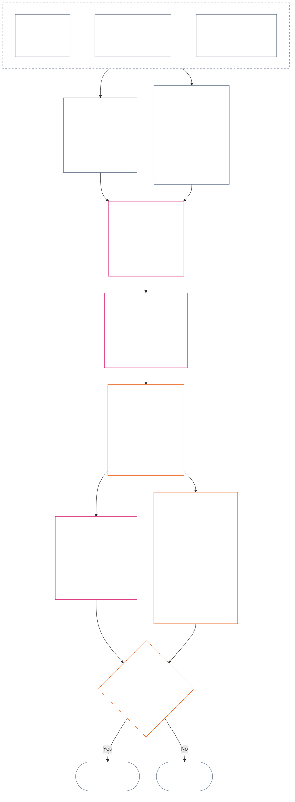

<!-- Locale: Telugu (te) | Source: 9c2c8c10c871d91157bcd27b9f56ad6a1cec90d3 | AI-drafted, unreviewed | PARTIAL: Chapter 12 §§4–6 only -->

### 4. స్లాట్ వ్యాకరణం మరియు ఉమ్మడి స్థాయీకరణ

*సాధారణ మాటల్లో: రెండు వేరు అక్షాల్లో సాధ్యమైన తొమ్మిది స్థానాలకు ఒకే విధమైన పేర్లు ఈ విభాగం ఇస్తుంది; వాటి అంతటా ప్రభావం ఎలా స్థాయీకరించబడుతుందో వివరిస్తుంది. ఒక అక్షం ధృవీకరించిన సహకారాన్ని నమోదు చేస్తుంది; మరొక ప్రస్థితి రికార్డు ధృవీకరించిన ఉల్లంఘనలను నమోదు చేస్తుంది. ఒకే స్లాట్ సంఖ్య ఉండటం అక్షాలను కలపదు, సహాయంతో హానిని రద్దు చేయదు. **విభాగం 6**లోని ఏకీకృత ప్రమాణం అనుపాత LEQU ప్రభావం ఆధారంగా రెండు అక్షాలనూ కేటాయిస్తుంది.*

స్లాట్ వ్యాకరణం **1** నుండి **9** వరకు `s` అనే స్లాట్ సంఖ్యను ఉపయోగిస్తుంది. ప్రతి అక్షానికి దాని స్వంత స్లాట్ స్థానం ఉంటుంది:

- **సహకార అక్షం** సానుకూల సహకార స్వభావాన్ని నమోదు చేస్తుంది; మరియు
- **ఉల్లంఘన అక్షం** ధృవీకరించిన ఉల్లంఘన నిర్ధారణలను నమోదు చేస్తుంది.

రెండు అక్షాల్లో ఒకే స్లాట్ సంఖ్య కనిపించవచ్చు; కానీ అక్షాలు వేరుగానే ఉంటాయి. సహకార స్లాట్ ఉల్లంఘన స్లాట్ కాదు; ఉల్లంఘన స్లాట్ సహకార స్లాట్ కాదు.

#### 4.1 పట్టిక 1 — స్లాట్ ప్రదర్శన లేబుళ్లు

**పట్టిక 1** తొమ్మిది స్లాట్‌లకు పేర్లు ఇస్తుంది; సహకార అక్షం, ఉల్లంఘన అక్షం ప్రదర్శన లేబుళ్లను పక్కపక్కన చూపిస్తుంది. ఇది ప్రదర్శన భాషను మాత్రమే ఇస్తుంది; స్లాట్ కేటాయింపు **విభాగం 6**లోని ఏకీకృత ప్రమాణం ప్రకారం జరుగుతుంది.

| `s` | సహకార అక్ష ప్రదర్శన లేబుల్ | ఉల్లంఘన అక్ష ప్రదర్శన లేబుల్ |
| ---: | --- | --- |
| 1 | **స్వల్ప ప్రాథమిక సహకారం** | **స్వల్ప రాజ్యాంగ ప్రభావం** |
| 2 | **చిన్న ప్రాథమిక సహకారం** | **చిన్న రాజ్యాంగ ప్రభావం** |
| 3 | **గణనీయ సానుకూల సహకారం** | **గణనీయ రాజ్యాంగ ప్రభావం** |
| 4 | **ముఖ్యమైన సానుకూల సహకారం** | **ముఖ్యమైన రాజ్యాంగ ప్రభావం** |
| 5 | **తీవ్రమైన బాధ్యతాయుత-నిర్వహణ సానుకూల సహకారం** | **తీవ్రమైన రాజ్యాంగ ప్రభావం** |
| 6 | **ప్రధాన బాధ్యతాయుత-నిర్వహణ సానుకూల సహకారం** | **ప్రధాన రాజ్యాంగ ప్రభావం** |
| 7 | **గుర్తింపు పొందిన చాంపియన్** | **తీవ్ర రాజ్యాంగ ప్రభావం** |
| 8 | **విశిష్ట చాంపియన్** | **గంభీర రాజ్యాంగ ప్రభావం** |
| 9 | **ఆదర్శ చాంపియన్** | **విపత్తు స్థాయి రాజ్యాంగ ప్రభావం** |

సహకార అక్షం ప్రాథమిక, సానుకూల, బాధ్యతాయుత-నిర్వహణ సానుకూల, చాంపియన్ లేబుళ్లను వాడుతుంది. ఉల్లంఘన అక్షం ప్రతి స్లాట్‌లో తటస్థ ప్రభావ లేబుళ్లను వాడుతుంది. అక్షాలు వేరుగా ఉంటాయి; నికర స్కోరు సృష్టించవు, సహకార రికార్డుతో ఉల్లంఘన రికార్డును రద్దు చేయనివ్వవు. ఉల్లంఘన అక్ష స్లాట్ ఒక్కటే రాజ్యాంగ-వ్యతిరేక దుర్వ్యవహారాన్ని వర్గీకరించదు; ధృవీకరించిన `s` = 7–9 ఉల్లంఘనకు ఆ హోదా (ACMD) వర్తిస్తుందా అనేది [పద్నాలుగవ అధ్యాయం](core_14.000_misconduct_designation.md#chapter-fourteen-anti-constitutional-misconduct) స్వతంత్రంగా నిర్ణయిస్తుంది.

పూర్తి-జీవిత సమాన ప్రయోజనం లేదా నష్టాన్ని అంచనా వేయడంలో సహాయపడే కొలత యూనిట్లు, సాక్ష్య పద్ధతులు, ఉదాహరణలను అమలు వ్యవస్థలు ప్రచురించవచ్చు. ఇవి మార్గదర్శకం మాత్రమే; **విభాగం 6**, **మొదటి అధ్యాయం**, లేదా **ఆరవ అధ్యాయం** హక్కుల నేలను అధిగమించరాదు.

#### 4.2 ఉమ్మడి ప్రభావ-స్థాయీకరణ నియమాలు

*సాధారణ మాటల్లో: ప్రభావాన్ని ప్రభావితుల సంఖ్యతో మాత్రమే కొలవరు. ఒక సంజ్ఞ ప్రాణిపై లోతైన ప్రయోజనం లేదా నష్టం, అనేకమందిపై స్వల్ప ప్రభావం కంటే ముఖ్యమవచ్చు. సంఖ్య, లోతు, బలహీనత, వ్యవధి, నిలకడ, వ్యాప్తి, రాజ్యాంగ స్వభావాన్ని కలిపి అంచనా వేయాలి.*

**విభాగం 6**లో రెండు అక్షాలనూ అర్థం చేసుకోవడానికి ఈ నియమాలు వాడండి:

| స్థాయీకరణ పరిమాణం | ఉమ్మడి నియమం | అక్ష-నిర్దిష్ట వర్తింపు |
| --- | --- | --- |
| **రాజ్యాంగ ఫలిత పరిమాణం (LEQU)** | సమగ్ర ధృవీకరించిన ప్రయోజనం లేదా నష్టాన్ని అంచనా వేయండి. LEQU ప్రధాన పరిమాణ ఆధారం; ముడి వ్యక్తుల సంఖ్య, డబ్బు, ఉత్పత్తి లేదా సంస్థ పరిమాణం కాదు. | సహకారం హక్కులకు అనుగుణమైన ప్రయోజనాన్ని లెక్కిస్తుంది; ఉల్లంఘన ధృవీకరించిన రాజ్యాంగ నష్టం, హాని, వృథా, అవకాశ నిరోధం లేదా ప్రమాదాన్ని లెక్కిస్తుంది. |
| **సంజ్ఞ పరిధి** | **సంఖ్య, లోతు, బలహీనత** మూడింటినీ కలిపి పరిగణించండి. ఏ స్లాట్‌కూ వ్యక్తుల సంఖ్య స్వతంత్ర అవసరం కాదు. సమగ్ర పరిమాణం, వరుసలోని ఇతర ప్రమాణాలు సమానంగా ఉన్నప్పుడు, ఒక సంజ్ఞ ప్రాణిపై తగిన లోతైన ప్రభావం విస్తృతమైనా స్వల్పమైన ప్రభావంతో అదే స్లాట్‌కు మద్దతు ఇవ్వవచ్చు; స్పష్టంగా పేర్కొన్న మొత్తం-LEQU లేదా విస్తృత-పరిధి ప్రమాణం మాత్రం నెరవేరాలి. | ఆధారపడటం, తగ్గిన సామర్థ్యం లేదా ప్రత్యేక బలహీనత భౌతికతను పెంచవచ్చు. సమూహ పరిమాణం ఒక్కటే సహకారాన్ని లేదా తీవ్రతను స్థాపించదు. |
| **కాల పరిధి** | వ్యవధి, పునరావృతం, నిలకడ, నష్టం విషయంలో తిరుగులేనితనాన్ని పరిగణించండి. స్వల్పమైనా రూపాంతరం కలిగించే సంఘటన దీర్ఘకాలపు చిన్న ప్రభావాన్ని మించవచ్చు; వ్యవధి ఒక్కటే నిర్ణయించదు. | నిలకడైన ప్రయోజనం అధిక సహకార పరిమాణానికి మద్దతు ఇస్తుంది. దీర్ఘకాలిక లేదా తిరుగులేని నష్టం అధిక ఉల్లంఘన తీవ్రతకు మద్దతు ఇస్తుంది. |
| **ప్రాదేశిక లేదా సంస్థాగత పరిధి** | విస్తృత వ్యాప్తి పరిమాణాన్ని పెంచవచ్చు; కానీ లోతు, వ్యవధి, బలహీనత లేదా రాజ్యాంగ కీలకత స్వతంత్రంగా స్లాట్‌కు మద్దతిస్తే సముదాయాలు లేదా సంస్థల మధ్య వ్యాప్తి తప్పనిసరి కాదు. | సంస్థాగత మరమ్మతు సహకార పరిమాణాన్ని పెంచవచ్చు; నిర్మాణాత్మక లేదా వ్యవస్థాత్మక నష్టం ఉల్లంఘన తీవ్రతను పెంచవచ్చు. |
| **రాజ్యాంగ నాణ్యత లేదా స్వభావం** | ఫలితం ఎలా ఉత్పత్తి అయిందో, ఎంత విస్తరించిందో వేరుగా కొలవండి. ఒకే వాస్తవాన్ని రెండుసార్లు లెక్కించవద్దు. | ఇతరులపైకి నెట్టిన హాని, దాచిన భారం, స్వాధీనీకరణ లేదా ఆధారపడటం కోరిన సహకారాన్ని పరిమితం చేయవచ్చు లేదా అనర్హం చేయవచ్చు. కర్తవ్యం, నిర్లక్ష్యం, మోసం, బలవంతం, హింస, నిర్మాణాత్మక సహకారం ఉల్లంఘన ప్రవర్తనా స్వభావంగా వేరుగా నమోదు అవుతాయి; ప్రభావ స్లాట్‌ను మార్చవు. |
| **హక్కుల నేలలు, కీలక రక్షణలు** | హక్కుల నేలకు అనుగుణతను సమగ్ర ప్రయోజనం లేదా నష్టంతో బేరం పెట్టరు. | హక్కుల నేలకు అనుగుణత ఒక్కటే అధిక సహకారాన్ని స్థాపించదు. భౌతిక హక్కుల-నేల ఓటమి లేదా కీలక రక్షణ వైఫల్యం, కొద్దిమంది సంజ్ఞ ప్రాణులే ప్రత్యక్షంగా ప్రభావితమైనా అధిక ఉల్లంఘన తీవ్రతకు మద్దతివ్వవచ్చు. |

ప్రతి రకమైన పరిమాణం తప్పక ఉండాలని ఈ పరిమాణాలు చెక్‌లిస్ట్‌గా చెప్పవు. ఏ పరిమాణాలు నియంత్రించాయి, ఏవి చేయలేదు, ఎందుకో వివరించండి.

- **ఉమ్మడి స్లాట్ పద్ధతి:**
  - అనుపాత నియమం కింద ధృవీకరించిన సమగ్ర ప్రయోజనం లేదా నష్టాన్ని LEQUలో అంచనా వేసి, ఆ పరిమాణం చేరే సంఖ్యా బ్యాండ్‌లోని ఒక్క స్లాట్‌ను కేటాయించండి.
  - రెండు అక్షాలకూ ఒకే పరిమితులు వర్తిస్తాయి.
  - సహకార స్లాట్‌లు వర్తించే ప్రాథమిక, రాజ్యాంగ-అనుసరణ అవసరాలను నిలుపుకుంటాయి; సంఖ్యా పరిమితి చేరిందనే కారణంతో ఇతరులపైకి నెట్టిన లేదా రాజ్యాంగాన్ని ఓడించిన ఉత్పత్తి సహకారంగా మారదు.
- **స్వభావాన్ని వేరుచేయడం:** వర్తించే ప్రయోజన-మార్గ, హాని-మార్గ, ప్రవర్తన-నాణ్యత, ప్రవర్తన-స్వభావ వివరణకర్తలను ప్రస్థితి రికార్డులో కలిపి ఉంచండి. కర్తవ్యం, నిర్లక్ష్యం, మోసం, తీవ్రత పెంచే అంశం, బలవంతం, హింస, ఉద్దేశం, నిర్మాణాత్మక సహకారం ఆపాదన, రక్షణలు లేదా ప్రశ్న 3 పర్యవసానాలను ప్రభావితం చేయవచ్చు; ఏదీ LEQU ప్రభావ స్లాట్‌ను పెంచదు లేదా తగ్గించదు.
- **రాజ్యాంగ-వ్యతిరేక దుర్వ్యవహార సమీక్ష సరిహద్దు:** రాజ్యాంగ-వ్యతిరేక దుర్వ్యవహారం స్థాపించబడినా లేకపోయినా, ధృవీకరించిన ఉల్లంఘన అక్ష నష్టం ప్రభావం ఆధారంగా `s` = 7–9కు చేరవచ్చు. పద్నాలుగవ అధ్యాయం ప్రభావ కేటాయింపుకు బదులు కాదు; అనుబంధ ACMD వర్తిస్తుందా అనేది స్వతంత్రంగా నిర్ణయిస్తుంది.

ప్రమాదం ఇంకా నిజంగా జరగనప్పుడు, క్రింది వాటిని విడివిడిగా నమోదు చేయండి:

- అది సంభవించే అవకాశం ఎంత;
- సంజ్ఞ ప్రాణులు ఎంతకాలం దానికి గురవుతారు;
- అది ఎంతదూరం వ్యాపించవచ్చు;
- అంచనా ఎంత అనిశ్చితంగా ఉంది; మరియు
- ఇంకా నమ్మదగినదిగా ఉండే అత్యంత చెడ్డ ఫలితం ఏమిటి.

ఎవరైనా పరిశీలించగల ప్రమాద-ప్రమాణీకరణను (ప్రమాదాన్ని LEQUగా మార్చే పద్ధతిని) స్వీకరించిన అమలు వ్యవస్థ నిర్ణయించి ఉంటే తప్ప, ఆ అత్యంత చెడ్డ ఫలితాన్ని ఇప్పటికే జరిగిన హాని (LEQU నష్టం)గా లెక్కించవద్దు.

### 5. అక్ష కేటాయింపుకు రాజ్యాంగ ఇన్‌పుట్‌లు

*సాధారణ మాటల్లో: స్లాట్ ఎంచుకునే ముందు ఏ ప్రాథమిక స్థితి, ప్రయోజనం, కర్తవ్యం, హాని లేదా ఉల్లంఘనను కొలుస్తున్నామో చెప్పే రాజ్యాంగ మూలాలను గుర్తించండి. ఆ మూలాలను వాటి ప్రామాణిక స్థానాల్లో వర్తింపజేయడానికి క్రింది లింకులను వాడండి; ఈ మార్గనిర్దేశ దశను మరో స్కోరుగా లేదా ప్రత్యామ్నాయ నిర్వచనంగా మార్చవద్దు.*

**విభాగం 6** కింద స్లాట్ కేటాయించే ముందు ప్రస్థితి రికార్డు ఇవి గుర్తించాలి:

- వర్తించే రాజ్యాంగ ప్రాథమిక స్థితి, కర్తవ్యం, పరిమితి లేదా రక్షిత ఆసక్తి;
- కొలుస్తున్న ధృవీకరించిన ప్రయోజనం, ప్రతికూల ఫలితం, హాని లేదా ఉల్లంఘనను స్థాపించే నిబంధనలు;
- పరిమాణం లేదా ప్రవర్తనా స్వభావాన్ని భౌతికంగా ప్రభావితం చేసే నిర్వచనాలు, సూత్రాలు, హక్కుల-నేల ఆర్టికల్‌లు; మరియు
- గుర్తించిన ప్రతి మూలం ఎందుకు వర్తిస్తుంది, అక్ష కేటాయింపును ఎలా ప్రభావితం చేస్తుంది.

క్రింది మార్గనిర్దేశ పట్టికలు సంపూర్ణ జాబితాలు కావు. ధృవీకరించిన వాస్తవాలు ప్రేరేపించే ప్రతి అదనపు నిర్వచనం, సూత్రం, ఆర్టికల్ వర్తిస్తూనే ఉంటుంది; దాన్ని ప్రస్థితి రికార్డులో గుర్తించాలి. లింక్ చేసిన ప్రతి ప్రామాణిక మూలమే నియంత్రిస్తుంది; ఈ పట్టికలు దాన్ని తిరిగి చెప్పవు లేదా సంకుచితం చేయవు.

#### 5.1 నిర్వచన ఇన్‌పుట్‌లు

| ప్రామాణిక మూలం | సహకార అక్ష పాత్ర | ఉల్లంఘన అక్ష పాత్ర |
| --- | --- | --- |
| [ప్రస్థితి స్థితి, సహకారం, ఉల్లంఘన](core_05.035_band_accountability.md#defa3-standing-state-contribution-and-violation) | ఏది సహకారంగా లెక్కించబడుతుంది, కొలవడానికి ఏ పరిశీలించిన వాస్తవాలు ఉపయోగించవచ్చో వివరిస్తుంది. సహకార ప్రస్థితి రికార్డు మంచి వైపునే అనుసరిస్తుంది; చెడుతో కలపదు. | ఏది ఉల్లంఘనగా లెక్కించబడుతుంది, దాన్ని ఎలా నమోదు చేయాలో వివరిస్తుంది. రాజ్యాంగాన్నే బలహీనపరిచే అత్యంత తీవ్రమైన కేసులను ప్రత్యేక సమీక్ష అయిన రాజ్యాంగ-వ్యతిరేక దుర్వ్యవహార సమీక్షకు పంపిస్తుంది. |
| [జవాబుదారీతనం](core_05.005_apex_accountability_leg.md#accountability) | మంచి బాధ్యతాయుత నిర్వహణ లేదా మరమ్మతు వాదన నిజంగా ఎవరినైనా జవాబుదారీగా ఉంచుతుందా అని పరీక్షిస్తుంది. ఎవరు ఏమి చేశారు, దానికి ఎవరు జవాబు చెప్పాలి, ప్రభావానికి అనుపాతంగా దాన్ని ఎలా సమీక్షించి సరిచేయవచ్చో చూపాలి. | ఎవరు ఏం చేశారు లేదా ఎవరు జవాబు చెప్పాలో స్పష్టత లేని సందర్భాలను గుర్తిస్తుంది. సంస్థ లేదా నిర్మాణం మారిన తర్వాత బాధ్యత పనిచేయకుండా పోయిన సందర్భాలూ ఇందులో ఉన్నాయి. |
| [హాని](core_05.035_band_accountability.md#harm) | ఇతరులపైకి నెట్టిన లేదా దాచిన హాని కోరిన ప్రయోజనాన్ని పరిమితం చేయవచ్చు లేదా రద్దు చేయవచ్చు. హానిని సరిచేయడం ప్రయోజనంగా లెక్కించవచ్చు; కానీ సవరణ ధృవీకరించి స్వతంత్రంగా చూపినప్పుడే. | నష్టం, తీవ్రత కొలతలో లెక్కించే హానుల రకాలను వివరిస్తుంది: ప్రత్యక్ష, పరోక్ష, ఆలస్య, సమకూరిన, వ్యవస్థల మధ్య వ్యాపించిన హాని; సంజ్ఞ ప్రాణి మనస్సు లేదా భావోద్వేగ శ్రేయస్సుకు హాని. |
| [భౌతికత](core_05.050_band_oversight.md#materiality), [జీవితకాల సమాన యూనిట్ (LEQU)](core_05.055_band_participation.md#lifespan-equivalent-unit-lequ) | ధృవీకరించిన ప్రయోజనం ఎంత లెక్కించాలో అది ఎంత విస్తరించిందో, ప్రభావితులు ఎంత బలహీన స్థితిలో ఉన్నారో, ఎంతకాలం నిలుస్తుందో ఆధారంగా నిర్ణయిస్తాయి. ఫలితాన్ని పూర్తి జీవిత ప్రయోజనానికి ఉమ్మడి కొలమానమైన LEQUలో కొలుస్తారు. | ధృవీకరించిన నష్టం లేదా ప్రమాదం ఎంత లెక్కించాలో వ్యాప్తి, ప్రభావితుల బలహీనత, వ్యవధి, తిరిగి సరిచేయగల కష్టత ఆధారంగా నిర్ణయిస్తాయి. ఫలితాన్ని పూర్తి జీవిత నష్టానికీ వాడే అదే LEQUలో కొలుస్తారు. |
| [సహకార స్వభావం](core_05.035_band_accountability.md#contribution-nature) | ఏదైనా సహకారంగా లెక్కించాలా నిర్ణయిస్తుంది. అది హానితో కలపని, పూర్తిగా మంచి ఫలితమై, చూపదగిన ధృవీకరించిన సహకార రికార్డుతో మద్దతు పొందాలి. ఈ రెండూ లేకపోతే సహకార అక్ష కేటాయింపు రాదు. | ఇక్కడ పాత్ర లేదు. హానిగా ఏది లెక్కించాలో ఇది నిర్ణయించదు; ఉల్లంఘన తీవ్రతను ఎప్పుడూ తగ్గించదు. |
| [ఉల్లంఘన స్వభావం](core_05.035_band_accountability.md#violation-nature) | ఇక్కడ పాత్ర లేదు. ఉల్లంఘనను ప్రతికూల సహకారంగా ఎప్పుడూ లెక్కించరు; దానికి సంబంధం లేని ధృవీకరించిన ప్రయోజనాన్ని అది తుడిచివేయదు. | ఏది ఉల్లంఘనగా లెక్కించాలో నిర్ణయిస్తుంది. అది హానికరంగా వర్గీకరించబడి, ఉల్లంఘన జరిగిందనే ధృవీకరించిన నిర్ధారణతో మద్దతు పొందాలి. ఈ రెండూ లేకపోతే ఉల్లంఘన అక్ష కేటాయింపు రాదు. |
| [రాజ్యాంగ పరిమితి](core_05.045_band_integrative.md#constitutional-constraint), [అధికార క్రమం, అంతర్గత శ్రేణి](core_05.045_band_integrative.md#authority-stack-and-internal-hierarchy), [ఆడిట్-యోగ్యత](core_05.050_band_oversight.md#auditability) | రాజ్యాంగాన్ని ఓడించడం, దాని నియమాలను తప్పించుకోవడం, హక్కుల నేల (రాజ్యాంగం హామీ ఇచ్చే కనీస రక్షణలు) తగ్గించడం, లేదా కాగితంపై మాత్రమే అనుగుణంగా ఉండటంపై ఆధారపడిన ప్రయోజనం లెక్కలోకి రాకుండా చేస్తాయి. | ఉల్లంఘన తీవ్రతను ప్రభావితం చేసేవి గుర్తిస్తాయి: ముఖ్యమైన రాజ్యాంగ పరిమితి ఉల్లంఘన, రాజ్యాంగ అధికారం కంటే మరొకదాన్ని పైకి పెట్టడం, నియమాల ఎగవేత, అమలు అసాధ్యం చేయడం. |
| [ఆడిట్-యోగ్యత](core_05.050_band_oversight.md#auditability), [సవాలు-యోగ్యత](core_05.035_band_accountability.md#contestability) | కోరిన ప్రయోజనాన్ని చూపి పరిశీలించగలగాలి; ఏకీభవించనివారికి దాన్ని సవాలు చేయగల పనిచేసే మార్గం ఉండాలి. | పరిశీలించి సవాలు చేయగల నిర్ధారణలు అవసరం. ఆరోపణ లేదా వివరణలేని లేబుల్ ఉల్లంఘన తీవ్రతను నిర్ణయించలేదు. |

#### 5.2 సూత్ర ఇన్‌పుట్‌లు

| సూత్ర మూలం | అక్ష కేటాయింపులో పాత్ర |
| --- | --- |
| [రాజ్యాంగ చతుష్టయం](core_00.000_preamble.md#constitutional-tetrad), [రెండు రాజ్యాంగ లక్ష్యాలు](core_00.000_preamble.md#two-constitutional-aims), [భౌతిక పందెం](core_00.000_preamble.md#material-stake) | నాలుగు కార్యాచరణ క్రమశిక్షణలను (పాల్గొనడం, పర్యవేక్షణ, జవాబుదారీతనం, సకాలికత), రాజ్యాంగం కోరే రెండు ఫలితాలను (సమున్నతి, కొనసాగింపు), ప్రతి కేటాయింపును పందెం మేరకు పరిమాణం చేసే చట్రాన్ని నిర్దేశిస్తాయి. |
| [శ్రేయస్సు](core_01.000_values_principles.md#3-foundational-objective-wellbeing-flourishing-aim), [గుర్తింపు, బలపరచడం, ఆకాంక్ష](core_01.000_values_principles.md#32-recognition-reinforcement-and-aspiration) | హక్కులను గౌరవించే ప్రయోజనాన్ని, దానికి సరిపోయే గుర్తింపును సహకార అక్షంలో నిలబెడతాయి. ప్రతిష్ఠ లేదా బహుమతులు సహకారానికి రుజువుగా ఎప్పుడూ పరిగణించరు. |
| [భద్రత](core_01.000_values_principles.md#4-safety-harm-constraint), [సత్యం](core_01.000_values_principles.md#5-truth-epistemic-integrity-constraint) | రెండు అక్షాలపై బంధనీయ పరిమితులు పెడతాయి. హాని లేదా మోసం ద్వారా వచ్చిన ప్రయోజనం పూర్తిగా లెక్కించబడదు; భద్రత లేదా సత్యంలో ధృవీకరించిన వైఫల్యం ఉల్లంఘన పరిమాణం లేదా రకాన్ని చూపవచ్చు. |
| [బాధ్యతాయుత నిర్వహణ లోతుగా](core_01.010_stewardship_capacity_principles.md#16-stewardship-in-depth), [బాధ్యతాయుత నిర్వహణ క్రమశిక్షణలో పాలన](core_01.010_stewardship_capacity_principles.md#18-governance-under-stewardship-discipline) | ధృవీకరించిన వాస్తవాలు కోరినప్పుడు నిలకడైన సహకారం, పాత్రతో వచ్చే కర్తవ్యాలు, సంస్థాగత మరమ్మతు, పర్యవేక్షణ, బాధ్యతను ఎలా తూకం వేయాలో మార్గనిర్దేశం చేస్తాయి. |
| [మూల విరోధ సూత్రాలు](core_01.005_interaction_interpretation.md#131-core-tradeoff-principles), [రాజ్యాంగ నేలలు, భద్రత, అవమాన-నిరోధ ప్రక్రియ](core_01.005_interaction_interpretation.md#1314-constitutional-floors-safety-and-anti-degrading-process) | కొలిచే ప్రవర్తనలో అవసరం, హానిని కనిష్ఠం చేయడం, అనుపాతత, హక్కుల ఘర్షణ లేదా పరిమితి ఉన్నప్పుడు వర్తిస్తాయి. ఇవి ఒక్కటే పర్యవసానాన్ని అనుమతించవు. |

#### 5.3 హక్కుల-నేల, ఆర్టికల్ ఇన్‌పుట్‌లు

| ఆర్టికల్ మూలం | అక్ష కేటాయింపు పాత్ర లేదా సరిహద్దు |
| --- | --- |
| వాస్తవాలకు వర్తించే [ఆరవ అధ్యాయం హక్కుల నేల](core_06.000_rights_part_a.md#chapter-six-foundational-rights), ధృవీకరించిన ప్రస్థితి రికార్డు భౌతికంగా సూచించే ప్రతి ఆర్టికల్‌తో సహా | పందెంలో ఉన్న ప్రాథమిక రక్షణలు, ఆసక్తులు, కర్తవ్యాలు, ప్రయోజనాలు లేదా ఉల్లంఘనలను నిర్దేశిస్తుంది. క్రింద జాబితాలో లేదనే కారణంతో ఏ ఆర్టికల్‌నూ వదలరాదు. |
| [ఆర్టికల్ XIX — ప్రస్థితి, పాల్గొనడపు స్థితి](core_06.015_rights_part_d.md#article-xix-standing-and-participation-status) | సంజ్ఞ ప్రాణి ప్రస్థితి, గౌరవం, హక్కుల నేల కనీస రక్షణలు, ప్రభావిత పక్ష స్థితి, ప్రతిష్ఠ, తరువాతి పాల్గొనడపు స్థితి మార్పును వేరువేరుగా ఉంచుతుంది. |
| [ఆర్టికల్ XIII-A — విశ్వసనీయత మౌలిక ప్రమాణం](core_06.010_rights_part_c.md#article-xiii-a-reliability-and-trustworthiness-baseline), [ఆర్టికల్ XIII-B — పరిష్కారం, ఉపశమన హక్కు](core_06.010_rights_part_c.md#article-xiii-b-right-to-redress-and-remedy), [ఆర్టికల్ XV-B — పారదర్శకత, ఆడిట్-యోగ్యత, సవాలు-యోగ్యత](core_06.010_rights_part_c.md#article-xv-b-transparency-auditability-and-contestability), [ఆర్టికల్ XVI — ఆడిట్, పారదర్శకత, స్వతంత్ర ధృవీకరణ](core_06.010_rights_part_c.md#article-xvi-audit-transparency-and-independent-verification) | ధృవీకరించిన ప్రయోజనం లేదా ఉల్లంఘనలో నిజాయితీ రికార్డులు, సమాచార పంచకం, వాస్తవాల పరిశీలన, నిర్ణయ సవాలు, తప్పుల సవరణ ఉంటే వర్తిస్తాయి. |
| [ఆర్టికల్ XXIV — మూలకారణ విశ్లేషణ, అనుకూల ప్రతిస్పందన](core_06.015_rights_part_d.md#article-xxiv-root-cause-analysis-and-adaptive-response) | ప్రవర్తనకు కారణం ఏమిటి, సరిచేశారా, కొనసాగుతుందా, స్పందన అనుగుణంగా మారిందా అనేది ముఖ్యమైనప్పుడు వర్తిస్తుంది; ఇవి రాజ్యాంగం కింద ప్రవర్తన స్థితిని చూపుతాయి. |
| [ఆర్టికల్ XX — ధృవీకరించిన ఉల్లంఘన తర్వాత న్యాయం](core_06.015_rights_part_d.md#article-xx-justice-after-verified-violation), [ఆర్టికల్ XXVI-C — సకాల పరిష్కారం, ఆలస్య నిరోధ హద్దు](core_06.020_rights_part_e.md#article-xxvi-c-timely-resolution-and-anti-delay-floor) | వాస్తవాలు నిజంగా సూచించే ప్రక్రియ లేదా ఆలస్యానికి వర్తిస్తాయి. **ఆర్టికల్ XX** (*ధృవీకరించిన ఉల్లంఘన తర్వాత న్యాయం*) ప్రధానంగా ఉల్లంఘన కొలిచిన తర్వాత (ప్రశ్న 3) ఏమి జరుగుతుందో పరిమితం చేస్తుంది. ఎవరికైనా ముందే నచ్చిన స్పందనను సమర్థించేందుకు ప్రశ్న 2 స్లాట్‌ను పెంచడానికి లేదా తగ్గించడానికి దాన్ని వాడరాదు. |

**వర్తింపు పరిమితులు.** ఈ దశ సరైన మూలాలవైపు మాత్రమే చూపిస్తుంది.

- ఇది:
  - ప్రశ్న 1ను తిరిగి తెరవదు;
  - ధృవీకరించని వాస్తవాలను అనుమతించదు;
  - కొత్త కొలత లేదా స్కోరును జోడించదు;
  - ఒకే వాస్తవాన్ని వేర్వేరు మూలాల ద్వారా రెండుసార్లు లెక్కించదు;
  - రెండు అక్షాలను కలపదు; లేదా
  - జాబితాలోని ప్రతి మూలం ప్రతి ప్రస్థితి రికార్డుకు వర్తిస్తుందని చేయదు.
- సహకారం, ఉల్లంఘన వేర్వేరుగా కొలుస్తారు.
- **ఆర్టికల్ XX** (*ధృవీకరించిన ఉల్లంఘన తర్వాత న్యాయం*) పర్యవసానాలు ప్రశ్న 2కు వెలుపలే ఉంటాయి.
- పద్నాలుగవ అధ్యాయం హోదా సమీక్ష ఇక్కడ కేటాయించిన ప్రభావ స్లాట్ నుండి వేరుగా ఉంటుంది.

### 6. ఏకీకృత అనుపాత LEQU ప్రమాణం — సహకార, ఉల్లంఘన అక్షాలు

<strong>పాఠక మార్గదర్శకం (అసంచాలకం): ఐదు రెట్ల పురోగతి ఎలా పనిచేస్తుంది</strong>

> ఈ ప్రమాణం `s` = 7 = ఒక LEQU వద్ద ఆధారపడిన ఐదు రెట్ల పురోగతిని వాడుతుంది. ఏ అక్షానికైనా, స్లాట్ 2 నుండి 9 వరకు `s` స్లాట్ కనీస పరిమాణం `5^(s−7)` LEQU; స్లాట్ 1 సున్నా నుండి మొదలవుతుంది. స్వీకరించిన అమలు వ్యవస్థ ఫలిత సంఖ్యా పరిమితులు, ప్రమాణీకరణ ఉదాహరణలను ప్రచురించవచ్చు. సహకార అక్షంలోని ధృవీకరించిన రాజ్యాంగ ప్రాథమిక స్థితి, ఉల్లంఘన అక్షంలోని మొదటి సానుకూల పరిమితికి దిగువ ధృవీకరించిన నష్టం స్లాట్ 1లో ఉంటాయి; సహకారం లేకపోవడం లేదా ఉల్లంఘన లేకపోవడం ఒక్కటే `s` = 1 రికార్డు కాదు.
>
> **మానవులకు చదవగల ఆధారం.** 80 సంవత్సరాల మానవ జీవితకాలాన్ని ప్రమాణీకరణ ఉదాహరణగా తీసుకుని, మధ్య కాలమ్‌ను పైకి చదివితే పూర్తి-జీవిత సమాన ప్రయోజనం, ఉపయోగించగల సమయం, హక్కులకు అనుగుణంగా జోడించిన వనరులు/సామర్థ్యం; కిందికి చదివితే సమాన నష్టం, లేమి, వృథా లేదా అవకాశ నిరోధం. వనరుల పరిమాణం ఒక్కటే లెక్క కాదు — అది కలిగించే లేదా నివారించే రాజ్యాంగ ఫలితమే నియంత్రిస్తుంది.

 

*సాధారణ మాటల్లో: **పట్టిక 2** ధృవీకరించిన సహకారం, ధృవీకరించిన ఉల్లంఘనను ఒకే అనుపాత ప్రభావ ప్రమాణంపై ఉంచుతుంది. అధిక స్లాట్‌లు ఎక్కువ సమగ్ర రాజ్యాంగ ప్రయోజనం లేదా నష్టాన్ని సూచిస్తాయి. ప్రస్థితి రికార్డులు, అక్షాలు వేరుగా ఉంటాయి: ఉమ్మడి ప్రమాణం పరిమాణాన్ని పోలుస్తుంది, నైతిక విలువను కాదు; సహాయం హానిని రద్దు చేయనివ్వదు.*

పటం ఒక స్లాట్ కేటాయింపును మొదలు నుండి ముగింపు వరకు అనుసరిస్తుంది. దశలు ఏ క్రమంలో అమలవుతాయో చూపుతుంది; అది క్రింది బుల్లెట్ల క్రమం కాదు. బుల్లెట్లు ఒక్కో నియమాన్ని చెబుతాయి.

**అనుపాతత** ప్రకారం లోతు, సంజ్ఞ పరిధి, బలహీనత, వ్యవధి, నిలకడ లేదా తిరుగులేనితనం, వ్యాప్తి, రాజ్యాంగ కీలకత ఆధారంగా సమగ్ర LEQU ప్రభావాన్ని అంచనా వేయండి. ఈ పరిమాణాలు LEQU అంచనాను ఆకృతీకరిస్తాయి; స్వతంత్ర స్లాట్ బోనస్‌లు కావు.

- **పట్టిక 2** వాడే ముందు ప్రశ్న 1 ఏమి జరిగిందో ధృవీకరించాలి; ప్రశ్న 2 ధృవీకరించిన ప్రయోజనం లేదా నష్టాన్ని కొలవాలి; **విభాగాలు 1–3, 4.2** వర్తింపజేయాలి; **విభాగం 5** కోరిన రాజ్యాంగ మూలాలను గుర్తించాలి.
- సమగ్ర LEQU అంచనా నుండి ఒక్క స్లాట్ కేటాయించండి.
  - ప్రతి భౌతిక స్థాయీకరణ పరిమాణం అంచనాను ఎలా ప్రభావితం చేసిందో, వదిలేసిన పరిమాణాలు ఎందుకు నియంత్రించలేదో వివరించండి.
  - ప్రతి కేటాయింపు ఇవన్నీ నెరవేర్చాలి:
    - అనుసరణీయత;
    - ఆడిట్-యోగ్యత;
    - సవాలు-యోగ్యత; మరియు
    - వర్తించే హక్కుల నేల.
  - సహకారం ఇతరులపైకి ఖర్చులు నెట్టకూడదు; రాజ్యాంగ అనుసరణను కూడా నెరవేర్చాలి.
- ప్రవర్తనా-స్వభావ వాస్తవాలను విడిగా అనుసరించదగిన వివరణకర్తలుగా నమోదు చేయండి. అవి ఆపాదన, సమీక్ష తీవ్రత, రక్షణలు, పరిహారం లేదా పద్నాలుగవ అధ్యాయం హోదాను నియంత్రించవచ్చు; ధృవీకరించిన పర్యవసానాలు సమగ్ర LEQU ప్రభావాన్ని మార్చిన మేరకే స్లాట్‌ను ప్రభావితం చేస్తాయి.
- చర్య లేదా ప్రవర్తనా క్రమం ధృవీకరించిన పర్యవసానాలను భౌతిక స్థాయీకరణ పరిమాణాల ద్వారా పూర్తిగా అంచనా వేయండి; వీటితో సహా:
  - శారీరక గాయం;
  - మానసిక గాయం;
  - బలవంతపు ప్రభావాలు;
  - స్వేచ్ఛ లేమి లేదా స్వేచ్ఛకు ప్రమాదం;
  - సమకూరిన హాని; మరియు
  - రాజ్యాంగపరంగా గుర్తించదగిన ఇతర ప్రయోజనం లేదా నష్టం.
- ఇవి చేయరాదు:
  - సంఘటన లేదా ప్రవర్తనా క్రమాన్ని క్రింది వాటిలో ఏదిగా వర్ణించారనే కారణంతో మాత్రమే స్లాట్‌ను పెంచడం లేదా తగ్గించడం:
    - కర్తవ్యం;
    - నిర్లక్ష్యం;
    - ఉద్దేశం;
    - దాచిపెట్టడం;
    - పునరావృతం;
    - తీవ్రత పెంపు;
    - బలవంతం;
    - హింస;
    - స్వేచ్ఛకు ప్రమాదం;
    - సరిచేయగలగడం; లేదా
    - కోరుకున్న పర్యవసానం.
  - పరిమాణం నుండి ప్రవర్తనా స్వభావాన్ని ఊహించడం లేదా ధృవీకరించిన పరిమాణానికి బదులుగా దాన్ని వాడడం.

**పట్టిక 2** తొమ్మిది స్లాట్‌లను క్రమంలో జాబితా చేస్తుంది. ప్రతి వరుసలో స్లాట్ సంఖ్య `s`, ఆ స్లాట్‌కు చేరే జోడించిన ప్రయోజనం లేదా విధించిన నష్టం (80 సంవత్సరాల మానవ జీవితకాలాన్ని ప్రమాణీకరణ ఉదాహరణగా), ప్రతి అక్షంలో దాని పేరు ఉంటాయి. రెండు అక్షాల్లో పరిమితులు ఒకటే; పేర్లు వేరుగా ఉంటాయి: సహకార అక్ష స్లాట్, ఉల్లంఘన అక్ష స్లాట్ వేర్వేరు రికార్డులు; పరస్పరం రద్దు కావు.

| `s` | 80-ఏళ్ల మానవ ప్రమాణీకరణ — జోడించిన ప్రయోజనం / విధించిన నష్టం | సహకార అక్షం | ఉల్లంఘన అక్షం |
| ---: | --- | --- | --- |
| 1 | సుమారు **9 రోజుల** కంటే తక్కువ | **స్వల్ప ప్రాథమిక సహకారం** — అంచనా పరిధికి రాజ్యాంగ కనీస నేల ధృవీకరించిన నెరవేర్పు; కొలవగల పెరుగుదల `s` = 2 కంటే తక్కువ. | **స్వల్ప రాజ్యాంగ ప్రభావం** — `s` = 2 కంటే తక్కువ ధృవీకరించిన నష్టం లేదా కార్యాచరణ బలహీనత; సారవంతమైన హాని రుజువు కాకపోయినా అధికారిక లోపంతో సహా. |
| 2 | సుమారు **9–47 రోజులు** | **చిన్న ప్రాథమిక సహకారం** — ఈ ప్రభావ స్థాయిలో కనీస నేలకు మించిన విశ్వసనీయ, పరిమిత పనితీరు. | **చిన్న రాజ్యాంగ ప్రభావం** — ఈ స్థాయి ప్రభావంలో ధృవీకరించిన పరిమిత నష్టం. |
| 3 | సుమారు **47 రోజులు–8 నెలలు** | **గణనీయ సానుకూల సహకారం** — ఈ ప్రభావ స్థాయిలో ప్రాథమిక స్థితికి మించిన చూపదగిన ప్రయోజనం. | **గణనీయ రాజ్యాంగ ప్రభావం** — ఈ స్థాయిలో ధృవీకరించిన గణనీయ నష్టం. |
| 4 | సుమారు **8 నెలలు–3.2 సంవత్సరాలు** | **ముఖ్యమైన సానుకూల సహకారం** — మరింత లోతైన, నిలకడైన, పునరావృతమైన, బలహీనతకు స్పందించే లేదా విస్తృతమైన ధృవీకరించిన ప్రయోజనం. | **ముఖ్యమైన రాజ్యాంగ ప్రభావం** — ధృవీకరించిన ముఖ్యమైన రాజ్యాంగ నష్టం. |
| 5 | సుమారు **3.2–16 సంవత్సరాలు** | **తీవ్రమైన బాధ్యతాయుత-నిర్వహణ సానుకూల సహకారం** — నిలకడైన బాధ్యతాయుత నిర్వహణ, సమన్వయం, నిర్వహణ, మరమ్మతు లేదా సమానంగా కొనసాగిన ప్రయోజనం. | **తీవ్రమైన రాజ్యాంగ ప్రభావం** — ధృవీకరించిన తీవ్రమైన రాజ్యాంగ నష్టం. |
| 6 | సుమారు **16–80 సంవత్సరాలు** | **ప్రధాన బాధ్యతాయుత-నిర్వహణ సానుకూల సహకారం** — ఒక LEQUకు చేరువయ్యే ప్రధాన ధృవీకరించిన ప్రయోజనం. | **ప్రధాన రాజ్యాంగ ప్రభావం** — ఒక LEQUకు చేరువయ్యే ప్రధాన ధృవీకరించిన నష్టం. |
| 7 | సుమారు **1–5 జీవితకాలాలు** (**80–400 సంవత్సరాలు**) | **గుర్తింపు పొందిన చాంపియన్** — కనీసం ఒక LEQU ధృవీకరించిన, రాజ్యాంగానికి అనుగుణమైన ప్రయోజనం. | **తీవ్ర రాజ్యాంగ ప్రభావం** — కనీసం ఒక LEQU ధృవీకరించిన రాజ్యాంగ నష్టం. |
| 8 | సుమారు **5–25 జీవితకాలాలు** (**400–2,000 సంవత్సరాలు**) | **విశిష్ట చాంపియన్** — `s` = 7ను భౌతికంగా మించే ధృవీకరించిన ప్రయోజనం. | **గంభీర రాజ్యాంగ ప్రభావం** — `s` = 7ను భౌతికంగా మించే ధృవీకరించిన నష్టం. |
| 9 | కనీసం **25 జీవితకాలాలు** (**2,000+ సంవత్సరాలు**) | **ఆదర్శ చాంపియన్** — `s` = 8ను భౌతికంగా మించే ధృవీకరించిన ప్రయోజనం. | **విపత్తు స్థాయి రాజ్యాంగ ప్రభావం** — `s` = 8ను భౌతికంగా మించే ధృవీకరించిన నష్టం. |

<strong>అమలు అంతర్‌క్రియ గమనిక</strong>

> ఈ విడ్జెట్‌లో అమలు-ముఖి అంతర్‌క్రియ సామగ్రి ఉంది. ఇది అధ్యాయం కార్యాచరణ వర్గాలకు మద్దతు ఇస్తుంది; సమాంతర వర్గ వ్యవస్థను సృష్టించదు.

స్లాట్ ప్రదర్శనకు యంత్రం చదవగల క్షేత్రాలు (`sub_tier`, `sub_tier_display`, సంబంధిత ప్రదర్శన క్షేత్రాలు) [CH06_NINE_SLOT_STANDING_SCALE.md](implementation/CH06_NINE_SLOT_STANDING_SCALE.md), [ch06_nine_slot_constants.json](implementation/ch06_nine_slot_constants.json)లో నిర్వచించబడ్డాయి. అమలు నాలుగు-బ్యాండ్ పటం అంతర్‌క్రియ సహాయం మాత్రమే; కార్యాచరణ **పట్టిక 2**కు ప్రధాన-బ్యాండ్ కాలమ్‌ను జోడించదు.

బరువులు కలిగిన సంజ్ఞ ప్రాణులు, సేవ్ చేసిన-స్థితి చెక్‌పాయింట్‌లు, స్థిర మరణ రేటు లేని సందర్భాలకూ సంబంధించిన సూచన పద్ధతి, పని చేసిన స్లాట్ కేటాయింపులు [LEQU_CALIBRATION_REFERENCE.md](implementation/LEQU_CALIBRATION_REFERENCE.md)లో ఉన్నాయి. ఆ లెక్కలు **విభాగం 6**లోని ఉమ్మడి పరిమితులు, అనుపాత కేటాయింపు నియమానికి బదులుకావు; చెల్లుబాటు అయ్యే రికార్డును కేటాయించవు; ఎవరు లెక్కలోకి వస్తారో నిర్ణయించవు.

స్వీకరించిన అమలు వ్యవస్థ LEQU అంచనాలు, గుర్తింపు-సంబంధిత ప్రదర్శన లేబుళ్లను ప్రచురించవచ్చు. **అనుగుణ పత్రం** మార్పు ద్వారా తప్ప, ఆ సహాయకాలు **విభాగం 6**లోని ఉమ్మడి పరిమితులు, అనుపాత కేటాయింపు నియమం లేదా పద్నాలుగవ అధ్యాయం హోదా రక్షణలకు బదులు కావు.

