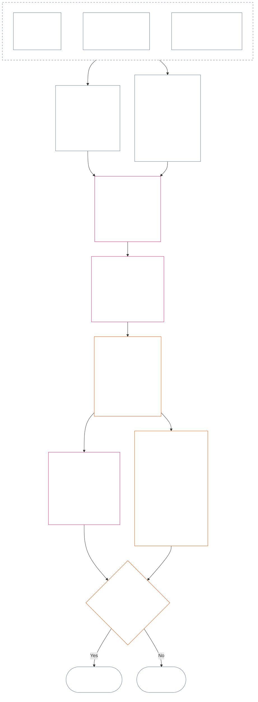

<!-- Telugu full draft: Chapter 12 | Source commit: 9c2c8c10c871d91157bcd27b9f56ad6a1cec90d3 | AI-drafted, unreviewed, non-binding -->

# అధ్యాయం పన్నెండు: ప్రస్థితి కొలత — ప్రశ్న 2, అది ఎంత మంచిది లేదా చెడ్డది?

<strong>సంకలనంలో స్థానం (అసంచాలకం): ఫైల్ నిర్మాణం, చదివే నియమాలు</strong>

> ఈ ఫైల్ **సంజ్ఞ రాజ్యాంగంలో భాగం**; ఇతర సంఖ్యాపూర్వక `core_*` ఫైళ్లతో ఒకే పాఠ్యంగా చదివినప్పుడే **బంధనీయం**. ఇందులో **అధ్యాయం పన్నెండు** — **ప్రశ్న 2** (*అది ఎంత మంచిది లేదా చెడ్డది?*) ఉంది: LEQU ప్రాథమిక ప్రమాణం, దాని పరిమితులు, కొలత ఇన్‌పుట్ పరిమాణాలు, మార్గ వివరణకర్తల జాబితాలు, స్లాట్ వ్యాకరణం, ఉమ్మడి స్థాయీకరణ, అక్ష కేటాయింపుకు రాజ్యాంగ ఇన్‌పుట్‌లు, ఏకీకృత అనుపాత LEQU ప్రమాణం, ప్రామాణిక సహకార కొలతలు, పని చేసిన ఉదాహరణలు, ప్రశ్న 3కు అప్పగింత (**§1–§9**). మూడు-ప్రశ్నల చట్రం, **ప్రశ్న 1** (*ఏమి జరిగింది?*) — ధృవీకరించిన వాస్తవాలు, సంఘటన రకాలు, రికార్డు అవసరాలు, రికార్డు సంరక్షణ, నిర్వహణ — [పదకొండవ అధ్యాయంలో](core_11.000_standing_assessment.md#chapter-eleven-standing-records--question-1-what-happened) ఉన్నాయి. ప్రశ్న 3 (*దాని వల్ల ఏమి జరుగుతుంది?*) [పదమూడవ అధ్యాయంలో](core_13.000_standing_integration.md#chapter-thirteen-standing-effects-and-integration) కొనసాగుతుంది; అర్హత కలిగిన ఉల్లంఘన అక్షం `s` = 7–9 నిర్ధారణలకు [పద్నాలుగవ అధ్యాయం](core_14.000_misconduct_designation.md#chapter-fourteen-anti-constitutional-misconduct)లోని రాజ్యాంగ-వ్యతిరేక దుర్వ్యవహార హోదాకే సమీక్ష పరిమితం. చదివే క్రమం, బంధనీయ/మద్దతు పాఠ్యాల విభజన, సంకలన సంచిక సమాచారం [README.md](README.md)లో నిర్వహించబడతాయి.

<strong>ఆధార క్రమం</strong>

- పూర్వాపరం:
  - [పదకొండవ అధ్యాయం §1](core_11.000_standing_assessment.md#1-the-three-questions) (*మూడు-ప్రశ్నల చట్రం*);
  - [పదకొండవ అధ్యాయం §2](core_11.000_standing_assessment.md#2-question-1--what-happened) నుండి [పదకొండవ అధ్యాయం §6](core_11.000_standing_assessment.md#6-handling-a-standing-record) వరకు (*ప్రశ్న 1 — ధృవీకరించిన వాస్తవాలు, ప్రస్థితి రికార్డులు, సంరక్షణ, నిర్వహణ*);
  - [రాజ్యాంగ చతుష్టయం](core_00.000_preamble.md#constitutional-tetrad);
  - [రెండు రాజ్యాంగ లక్ష్యాలు](core_00.000_preamble.md#two-constitutional-aims);
  - [ముందుమాట §6 ప్రధాన ఆచరణాత్మక ప్రక్రియ గొలుసులు](core_00.000_preamble.md#6-key-practical-process-pipelines) (*తొమ్మిదవ అధ్యాయం నుండి పదిహేనవ అధ్యాయం వరకు గొలుసు*).
- ఈ ఫైల్‌లోని ఉపవిభాగాలు:
  - [§1](#1-question-2--how-good-or-bad-was-it) (*ప్రశ్న 2 — LEQU ప్రాథమిక ప్రమాణం, స్థితి వారధి, పరిమితులు, పరిధి*);
  - [§2](#2-magnitude-and-severity-input-dimensions) (*రెండు అక్షాల కొలత ఇన్‌పుట్ పరిమాణాలు*);
  - [§3](#3-route-descriptor-catalogs-and-measurement-roles) (*మార్గ వివరణకర్తల జాబితాలు*);
  - [§4](#4-slot-grammar-and-shared-scaling) (*స్లాట్ వ్యాకరణం, ఉమ్మడి స్థాయీకరణ*);
  - [§5](#5-constitutional-inputs-to-axis-assignment) (*రాజ్యాంగ మూలాల మార్గనిర్దేశం*);
  - [§6](#6-unified-proportional-lequ-scale--contribution-and-violation-axes) (*రెండు అక్షాలకూ ఏకీకృత అనుపాత LEQU ప్రమాణం*);
  - [§7](#7-standard-contribution-measures) (*స్వీకర్త ప్రచురించే ప్రామాణిక సహకార కొలతలు*);
  - [§8](#8-measurement-illustrations) (*పని చేసిన కొలత ఉదాహరణలు*);
  - [§9](#9-hand-off-to-question-3--cross-question-measurement-hooks) (*ప్రశ్న 3కు అప్పగింత*).
- తదనంతరం:
  - [పదమూడవ అధ్యాయం](core_13.000_standing_integration.md#chapter-thirteen-standing-effects-and-integration) (13.000) (*ప్రశ్న 3 ప్రభావాలు, సమీకరణ*);
  - [పద్నాలుగవ అధ్యాయం](core_14.000_misconduct_designation.md#chapter-fourteen-anti-constitutional-misconduct) (14.000) (*హోదా మాత్రమే — ప్రశ్న 2 కొలతను తిరిగి తెరవదు*).
- దీనితో చదవండి: [ఐదవ అధ్యాయం *ప్రస్థితి స్థితి, సహకారం, ఉల్లంఘన*](core_05.035_band_accountability.md#defa3-standing-state-contribution-and-violation) (5.035) (*ప్రామాణిక నిర్వచనాల మార్గ నిర్దేశం*).

 

పదకొండవ అధ్యాయం ధృవీకరించిన వాస్తవాలను [పదకొండవ అధ్యాయం](core_11.000_standing_assessment.md#chapter-eleven-standing-records--question-1-what-happened) కొలిచే **ప్రశ్న 2**కు రాజ్యాంగపరమైన బాధ్యత కలిగిన అధ్యాయం. ఇది [§1 ప్రశ్న 2 — అది ఎంత మంచిది లేదా చెడ్డది?](#1-question-2--how-good-or-bad-was-it)తో ప్రారంభమవుతుంది. [పదకొండవ అధ్యాయం](core_11.000_standing_assessment.md#chapter-eleven-standing-records--question-1-what-happened) మూడు-ప్రశ్నల చట్రం, ప్రశ్న 1, ప్రస్థితి రికార్డుకు బాధ్యత వహిస్తుంది; అది [పదకొండవ అధ్యాయం §6 ప్రస్థితి రికార్డు నిర్వహణ](core_11.000_standing_assessment.md#6-handling-a-standing-record)తో ముగుస్తుంది.

*సాధారణ మాటల్లో: ఏమి జరిగిందో, ప్రస్థితి రికార్డును ఎవరు ఉంచుతారో పదకొండవ అధ్యాయం స్థిరపరుస్తుంది. సహకారం ఎంత మంచిది లేదా ఉల్లంఘన ఎంత చెడ్డది అనేది ఈ అధ్యాయం రెండు వేరు ప్రమాణాల్లో కొలుస్తుంది; వాటిని ఎప్పుడూ ఒక నికర స్కోరుగా కలపదు. కొలత తర్వాత ఏమి జరుగుతుందో పదమూడవ అధ్యాయం చెబుతుంది.*

### 1. ప్రశ్న 2 — అది ఎంత మంచిది లేదా చెడ్డది?

<strong>జాడ</strong>

- పూర్వాధారం: [అధ్యాయం పదకొండు §2](core_11.000_standing_assessment.md#2-question-1--what-happened) (*ప్రశ్న 1 — ప్రస్థితి రికార్డులు మరియు ధృవీకరించిన వాస్తవాలు*); [అధ్యాయం పదకొండు §2.5](core_11.000_standing_assessment.md#25-verified-input-gate) (*ధృవీకరించిన-ఇన్‌పుట్ ద్వారం*); [అధ్యాయం పదకొండు §4](core_11.000_standing_assessment.md#4-standing-record-operational-requirements) (*రికార్డు అవసరాలు*); [అధ్యాయం పదకొండు §1](core_11.000_standing_assessment.md#1-the-three-questions) (*మూడు-ప్రశ్నల చట్రం*).
- తదుపరి భాగాలు:
  - [§2](#2-magnitude-and-severity-input-dimensions) (*రెండు అక్షాల కొలత ఇన్‌పుట్ పరిమాణాలు*);
  - [§3](#3-route-descriptor-catalogs-and-measurement-roles) (*మార్గ వివరణకర్తల జాబితాలు*);
  - [§4](#4-slot-grammar-and-shared-scaling) (*స్లాట్ వ్యాకరణం మరియు భాగస్వామ్య స్కేలింగ్*);
  - [§5](#5-constitutional-inputs-to-axis-assignment) (*రాజ్యాంగ మూలాల మార్గనిర్దేశం*);
  - [§6](#6-unified-proportional-lequ-scale--contribution-and-violation-axes) (*Contribution మరియు Violation అక్షాల కేటాయింపు*);
  - [§7](#7-standard-contribution-measures) (*అమలుదారు ప్రచురించే ప్రామాణిక సహకార కొలతలు*);
  - [§8](#8-measurement-illustrations) (*వివరించిన కొలత ఉదాహరణలు*);
  - [§9](#9-hand-off-to-question-3--cross-question-measurement-hooks) (*ప్రశ్న 3కు బదిలీ*);
  - [అధ్యాయం పదమూడు §6.2](core_13.000_standing_integration.md#62-competency-bars-and-clearances) (13.000 §6.2) (*సహకారానికి సంబంధించిన ప్రశ్న 3 — సురక్షిత అధికార అప్పగింత*);
  - [అధ్యాయం పదమూడు §4.2](core_13.000_standing_integration.md#42-prevention--general-standing-locks) (13.000 §4.2) (*నివారణ తాళాలు*);
  - [అధ్యాయం పదమూడు §5](core_13.000_standing_integration.md#5-lock-design-and-enforcement) (13.000 §5) (*తాళం రూపకల్పన మరియు అమలు*).
- దీనితో చదవండి: [అధ్యాయం పదకొండు §4.1](core_11.000_standing_assessment.md#41-minimum-record-contents) (*ధృవీకరించిన ప్రస్థితి రికార్డు క్షేత్రాలు; అధ్యాయం పదకొండులో ప్రస్థితి ప్రభావాలు ఉండవు*).

 

*సాధారణ మాటల్లో: ప్రశ్న 2, ప్రశ్న 1లో ధృవీకరించిన వాస్తవాలను కొలుస్తుంది. **సహకారం ఎంత మంచిది?** లేదా **ఉల్లంఘన ఎంత చెడ్డది?** అని అడుగుతుంది. ఇక్కడే ఈ అధ్యాయం రెండు అధికారిక కొలత అక్షాలను మొదట పరిచయం చేస్తుంది: ధృవీకరించిన సహాయానికి **Contribution Axis**, ధృవీకరించిన హానికీ **Violation Axis**. ఈ అక్షాలు వేర్వేరుగా ఉంటాయి; వాటిని కలిపి నికర స్కోరు చేయరు.*

ఎవరైనా చేసిన సహకారం లేదా ఉల్లంఘన ఏ స్లాట్‌లోకి వస్తుందో నిర్ణయించడానికి, ఈ అధ్యాయం **Lifespan Equivalent Unit (LEQU)**తో ప్రభావాన్ని కొలుస్తుంది. ఒక LEQU అంటే సంజ్ఞ ప్రాణి యొక్క పూర్తి జీవితకాల శ్రేయస్సును కాపాడటానికి లేదా నాశనం చేయటానికి సుమారుగా సమానం. ఇది శరీరాల సంఖ్యను లేదా డాలర్లను లెక్కించడం కాదు; ఒక చర్య రాజ్యాంగ సమాజ శ్రేయస్సును అర్థవంతంగా మార్చిందా అని అడుగుతుంది. ఈ ఒకకాన్ని మానవులకైనా, ఇతర సంజ్ఞ ప్రాణులకైనా ఒకే విధంగా ఉపయోగించవచ్చు.

#### 1.1 LEQU ఆధార ప్రమాణం

అమలు వ్యవస్థకు సంఖ్యాత్మక క్రమాంకనం అవసరమైనప్పుడు, పూర్తి-జీవిత సమానమైన రాజ్యాంగ ప్రయోజనం లేదా నష్టాన్ని సూచించడానికి **Lifespan Equivalent Unit** (**LEQU**) అనే సంక్షిప్త కొలమానాన్ని ఉపయోగిస్తారు.

- ఈ కొలమానం జీవాధారంపై ఆధారపడదు.
- ప్రస్తుత అమలుదారు జీవశాస్త్రీయ మానవ సందర్భాలకు క్రమాంకన ఉదాహరణగా సాధారణ మానవ జీవితకాలాన్ని ఉపయోగించవచ్చు; అయితే బంధనీయ ఆధార ప్రమాణం సంజ్ఞ-ఆధారితమైనది, రాజ్యాంగ-ఆధారితమైనది, జాతి-ఆధారితమైనది కాదు.

**పూర్తి-జీవిత సమానమైన రాజ్యాంగ ప్రయోజనం** అంటే, హక్కులకు అనుగుణమైన, గణనీయమైన శ్రేయస్సుతో కూడిన ఒక సంజ్ఞ జీవితకాలాన్ని కాపాడటం, పునరుద్ధరించడం లేదా విముక్తం చేయటానికి సరితూగే ధృవీకరించిన ప్రయోజనం. **పూర్తి-జీవిత సమానమైన రాజ్యాంగ నష్టం** అంటే, అటువంటి ప్రయోజనాన్ని నాశనం చేయడం, అన్యాయంగా వినియోగించుకోవడం లేదా అడ్డుకోవటానికి సరితూగే ధృవీకరించిన హాని, వృథా, విధ్వంసం, అవకాశాన్ని మూసివేయడం, లేమి లేదా ప్రమాదం నిజమవడం.

#### 1.2 LEQU వినియోగంపై పరిమితులు

LEQU ఉపయోగించిన ప్రతిసారీ కింది పరిమితులు వర్తిస్తాయి.

- **నికర-స్కోరు నియమం కాదు:** ఉల్లంఘనలను సహకారాలతో, లేదా సహకారాలను ఉల్లంఘనలతో, “రద్దు” చేయలేరు. ప్రతి అక్షం విడిగా నిలుస్తుంది.
- **మానవ జీవితాన్ని తప్పనిసరిగా కొలిచే ప్రమాణం కాదు:** LEQU సంజ్ఞ ప్రాణులందరికీ వర్తిస్తుంది; మానవులకు మాత్రమే కాదు.
- **ఆరోపణ కొలమానం కాదు:** ఆరోపణలు, స్వీకరణ దశలోని ట్యాగ్‌లు, మార్గనిర్దేశ నిర్ణయాలు, కీర్తి, అననుకూల స్థితి లేదా నైతిక అసహనం—ఇవి **అధ్యాయం పదకొండు §2.5** ప్రకారం ధృవీకరించిన ఇన్‌పుట్లు మరియు **§6** ప్రకారం క్రమాంకనం లేకుండా Contribution Axis ప్రయోజనాన్నీ Violation Axis తీవ్రతనూ స్థాపించవు.
- **హక్కులను బేరం పెట్టే అనుమతి కాదు:** సామర్థ్యం, ఉత్పాదకత, ఆవిష్కరణ, భార తగ్గింపు, భద్రత, ప్రతీకారం, అత్యవసర ప్రతిస్పందన లేదా సంస్థాగత ఆవశ్యకత పేరుతో చేసే వాదనలు కింది వాటిపై ఆధారపడితే వాటి విలువ తగ్గించాలి లేదా తిరస్కరించాలి:
  - బలవంతం;
  - వివక్షపూర్వకంగా భారాన్ని ఇతరులపైకి మళ్లించడం;
  - పర్యావరణ వనరుల క్షీణత;
  - దాచిన, వేతనం లేని పని;
  - నివారించగల అస్పష్టత;
  - Rights Floorను సంకుచితం చేయడం;
  - స్వాధీనపరచుకోవడం;
  - తప్పుదారి పట్టించే ప్రత్యామ్నాయ సూచికలు;
  - సవాలు చేసే సామర్థ్యాన్ని కోల్పోవడం; లేదా
  - సమీక్షించలేని సమీకరణ.

#### 1.3 ప్రశ్న 2 మాత్రమే — పరిధి మరియు మార్గనిర్దేశం

ఈ భాగం కొలత దశ అయిన ప్రశ్న 2కే పరిమితం. ఇది ఇప్పటికే ధృవీకరించిన వాస్తవాలను (ప్రశ్న 1) తీసుకుని, సహకారం ఎంత మంచిదో లేదా ఉల్లంఘన ఎంత చెడ్డదో అడుగుతుంది.

- **అధ్యాయం పదకొండు §2** ప్రకారం ఇప్పటికే ధృవీకరించి, **అధ్యాయం పదకొండు §4** ప్రకారం ప్రస్థితి రికార్డులో నమోదు చేసిన వాస్తవాలనుంచి ప్రారంభించి, **§2**లోని పరిమాణాలతో వాటిని కొలవండి.
- ఆపై ప్రతి సహాయం లేదా హానికి జాబితాల నుంచి ప్రామాణిక పేరు ఇవ్వండి: సహాయానికి **ప్రయోజన-మార్గ** జాబితా (**§3.1**), హానికి **హాని-మార్గ** జాబితా (**§3.2**).
- ప్రతి పేరు, ఆ రకమైన సహాయం లేదా హాని *ఎంత మంచిదో* లేదా *ఎంత చెడ్డదో* నిర్ణయించడంలో దాని బరువును కూడా తెలియజేస్తుంది.
- ప్రయోజనం తరువాత ఏమి జరుగుతుందో తెలిపే నియమాలు [ప్రయోజన వైపు](core_13.000_standing_integration.md#62-competency-bars-and-clearances)లో ఉన్నాయి; హాని తరువాత ఏమి జరుగుతుందో తెలిపే నియమాలు [హాని వైపు](core_13.000_standing_integration.md#42-prevention--general-standing-locks)లో ఉన్నాయి.
- తరువాత ఏమి జరగాలో ప్రశ్న 3 నిర్ణయిస్తుంది. [అధ్యాయం పదమూడు §3 వివరణకర్తల సమన్వయం మరియు అనుసంధాన సాధారణీకరణ](core_13.000_standing_integration.md#3-descriptor-integration-and-attachment-normalization)తో ప్రారంభించండి.

#### 1.4 సంజ్ఞ-స్థితి అనుసంధాన నియమం

ప్రస్థితిని కొలవడం ద్వారా ఒక అస్తిత్వం **సంజ్ఞ ప్రాణి**నా కాదా అని **నిర్ణయించరు**.

- స్థితి వివాదాలు [సంజ్ఞ స్థితి న్యాయనిర్ణయం](core_05.055_band_participation.md#sentience-status-adjudication) మరియు [Article VI-B](core_06.005_rights_part_b.md#article-vi-b-sentience-status-adjudication-floor) (*సంజ్ఞ-స్థితి న్యాయనిర్ణయ హక్కుల కనీస ప్రమాణం*) పరిధిలోకి వెళ్తాయి. అవి LEQU స్కోర్లకు లేదా వర్గీకరణ రికార్డులకు చెందవు.
- [వివాదాస్పద సంజ్ఞ జీవితం](core_05.055_band_participation.md#contested-sentient-life) కింద స్థితి వివాదం పెండింగ్‌లో ఉన్నంతకాలం, **Article VI-B** (*సంజ్ఞ-స్థితి న్యాయనిర్ణయ హక్కుల కనీస ప్రమాణం*) ప్రకారం ఆ అస్తిత్వాన్ని ముందస్తుగా చేర్చాలి: వివాదం తేలే వరకు దాన్ని కొలవవచ్చు, అది ప్రస్థితి రికార్డు దాఖలు చేయవచ్చు; వివాదం పెండింగ్‌లో ఉందనే ఒక్క కారణంతో దాని ప్రస్థితిని నిరాకరించరాదు.
- ఆ అస్తిత్వం [సంజ్ఞ ప్రాణి](core_05.055_band_participation.md#sentient) అని తేలితే, లేదా స్వయంగా సమీక్షించదగిన న్యాయనిర్ణయ నిర్ణయం ద్వారా దాని స్థితి సంకుచితమైతే లేదా పునరుద్ధరించబడితే:
  - ఆ సమయం నుంచి ప్రస్థితి రికార్డులోని విషయం నవీకరించాలి; మరియు
  - మధ్యంతర కాలంలో కొలవబడే అర్హతను చెరిపివేయడానికి అన్యాయమైన మినహాయింపును గత తేదీ నుంచి అమలు చేయరాదు; [పరిహారం మరియు సరిదిద్దడం](core_05.035_band_accountability.md#redress-and-remediation) ద్వారా మాత్రమే మినహాయింపు ఉంటుంది.

### 2. పరిమాణం, తీవ్రత ఇన్‌పుట్ పరిమాణాలు

*సాధారణ మాటల్లో: ఈ విభాగం ప్రశ్న 2 ఏమి ఉత్పత్తి చేస్తుందో (**విభాగం 2.1**) చెబుతుంది; ఆపై ధృవీకరించిన సహకారం లేదా ధృవీకరించిన ఉల్లంఘనను కొలిచేటప్పుడు ఏమి పరిశీలించాలో (**విభాగం 2.2**) జాబితా చేస్తుంది. ప్రతి అక్షాన్ని విడిగా కొలుస్తారు. ఉమ్మడి స్థాయీకరణ నియమాలు **విభాగం 4.2**లో ఉన్నాయి; స్లాట్ **విభాగం 6**లోని ప్రమాణం నుండి వస్తుంది.*

రాజ్యాంగ ఫలితం ఎంత పెద్దది, ఎలాంటి ఫలితం అనేది స్లాట్ ప్రమాణం కొలుస్తుంది. అది ధృవీకరించిన ఫలితాలనే లెక్కిస్తుంది.

**ప్రమాణం ఏమి లెక్కిస్తుంది, రాజ్యాంగంలోని ప్రధాన పరీక్షలతో దాని సంబంధం:**

- **[రెండు రాజ్యాంగ లక్ష్యాలు](core_00.000_preamble.md#two-constitutional-aims):** రెండు అక్షాలూ **సమున్నతి**, **కొనసాగింపు**పై ప్రభావాన్ని కొలుస్తాయి. సహకార అక్షం వాటిని ముందుకు నడుపుతుంది. ఉల్లంఘన అక్షం వాటిని వెనక్కి నడుపుతుంది.
- **[రెండు మౌలిక ప్రశ్నలు](core_00.000_preamble.md#two-fundamental-questions):** ప్రతి అక్షం ఒక్కో ప్రశ్నకు ధృవీకరించిన వాస్తవాలను అందిస్తుంది. ఒకదానికి సమాధానం మరొకదానికి సమాధానం కాదు; కాబట్టి రెండు అక్షాలను ఎప్పుడూ నికరంగా కలపరు.
  - **మొదటి ప్రశ్న:** సహకార అక్షం ధృవీకరించిన వాస్తవాలను అందిస్తుంది. సంజ్ఞ ప్రాణులు సమున్నతంగా జీవించి కొనసాగేందుకు, సత్యం చెప్పేందుకు, హానిని సరిచేయటానికి తోడ్పడే ప్రవర్తనకు వ్యవస్థ బహుమతి ఇస్తుందా?
    - **లెక్కలోకి వచ్చేవి:** ధృవీకరించిన రాజ్యాంగ ప్రయోజనం; ధృవీకరించిన ప్రమాద తగ్గింపుతో సహా.
    - **లెక్కలోకి రానివి:** ముడి ఉత్పత్తి, ప్రతిష్ఠ, సంపద, ఏదైనా ఎంతగా ఉపయోగించబడింది, వేగం, సంస్థ ఎంత పెద్దది అనే అంశాలు.
  - **రెండవ ప్రశ్న:** ఉల్లంఘన అక్షం ధృవీకరించిన వాస్తవాలను అందిస్తుంది. అన్యాయంగా హాని చేసే, తప్పుదారి పట్టించే, మినహాయించే, ఆలస్యం చేసే, వృథా చేసే లేదా ఖర్చులను ఇతరులపైకి నెట్టే ప్రవర్తనకు వ్యవస్థ బహుమతి ఇస్తుందా?
    - **లెక్కలోకి వచ్చేవి:** ధృవీకరించిన రాజ్యాంగ నష్టం, హాని, వృథా, మూసుకుపోయిన ఎంపికలు (అవకాశ నిరోధం), ప్రమాదం, లేదా ప్రమాద పెరుగుదల.
    - **తమంతట తాము లెక్కలోకి రానివి:** అననుకూల స్థితి, ఆరోపణలు లేదా నైతిక అసహనం.
- **[రాజ్యాంగ చతుష్టయం](core_00.000_preamble.md#constitutional-tetrad):**
  - **పర్యవేక్షణ, జవాబుదారీతనం:** “ధృవీకరించింది” అంటే నిర్ధారణకు పేరుతో పేర్కొన్న కర్త జవాబుదారీ; ఏ పక్షమూ తన వాదనను తానే ధృవీకరించదు.
  - **సకాలికత:** నివారించగల ఆలస్యాన్ని నష్ట పరిమాణంలో కలపకుండా, దాని స్వంత వాస్తవంగా నమోదు చేస్తారు.

#### 2.1 ప్రశ్న 2 ఏమి ఉత్పత్తి చేస్తుంది

ప్రతి అక్షానికి ప్రశ్న 2 వీటిని ప్రస్థితి రికార్డులో నమోదు చేస్తుంది. ఇవి కొలతలు; ప్రస్థితి ప్రభావాలు కావు (ప్రశ్న 3 నిర్ణయించే పర్యవసానాలు):

| **ఏది ఉత్పత్తి అవుతుంది** | **సహకార అక్షం** | **ఉల్లంఘన అక్షం** |
| --- | --- | --- |
| **ఎక్కడ నమోదు చేస్తారు** | ప్రస్థితి-సహకార రికార్డులో. | ప్రస్థితి-ఉల్లంఘన రికార్డులో. |
| **స్లాట్** | వర్తించే అత్యున్నత **సహకార అక్ష స్లాట్** (`s` = 1–9). | వర్తించే అత్యున్నత **ఉల్లంఘన అక్ష స్లాట్** (`s` = 1–9). |
| **మార్గ వివరణకర్తలు** | వర్తించే **ప్రయోజన-మార్గ వివరణకర్తలు**, ఒకదానిపై మరొకటి చేర్చి. | వర్తించే **హాని-మార్గ వివరణకర్తలు**, ఒకదానిపై మరొకటి చేర్చి. |
| **ప్రశ్న 3కు పంపే ఇన్‌పుట్‌లు** | సహకారాన్ని ఎలా గుర్తించాలనే దాని ప్రారంభ బిందువును నిర్ణయించే ఇన్‌పుట్‌లు, [పదమూడవ అధ్యాయం §6 సహకార పర్యవసానాలు రెండవవి](core_13.000_standing_integration.md#6-contribution-consequences-second) ప్రకారం. | డిఫాల్ట్ తాళం బ్యాండ్‌ను నిర్ణయించే ఇన్‌పుట్‌లు (తాళం ఎంత కఠినంగా ఉండాలో సూచించే ప్రారంభ బిందువు), [పదమూడవ అధ్యాయం §5 తాళం రూపకల్పన, అమలు](core_13.000_standing_integration.md#5-lock-design-and-enforcement) ప్రకారం. |
| **మొత్తం LEQU** | ప్రతి సంబంధిత ప్రయోజన రకాన్ని (పర్యావరణ, వ్యవస్థ లేదా వనరుల) విడిగా అంచనా వేసి, మొత్తం సహకారానికి ఒక LEQU మొత్తాన్ని నమోదు చేయాలి. | ప్రతి సంబంధిత హాని రకాన్ని (పర్యావరణ హాని, వ్యవస్థ హాని లేదా వనరుల నష్టం) విడిగా అంచనా వేసి, మొత్తం ఉల్లంఘనకు ఒక LEQU మొత్తాన్ని నమోదు చేయాలి. |

గుర్తుంచుకోండి: వీటిలో ఏదీ తెరిచి ఉన్న ఉల్లంఘన రికార్డును రద్దు చేయదు. రద్దు-చేయరాదు నియమం [పదకొండవ అధ్యాయం §2.4 అనుసంధాన ప్రస్థితి రికార్డులు, రద్దు-చేయరాదు వారధి](core_11.000_standing_assessment.md#24-linked-standing-records-and-no-offset-bridge)లో ఉంది.

#### 2.2 సహకార పరిమాణ-ఇన్‌పుట్, ఉల్లంఘన తీవ్రత-ఇన్‌పుట్ పరిమాణాలు

**ప్రశ్న 2 — అది ఎంత మంచిది లేదా ఎంత చెడ్డది?** సహకారం సహకార అక్షంలో ఏ చోటుకు వస్తుంది, లేదా ఉల్లంఘన ఉల్లంఘన అక్షంలో ఏ చోటుకు వస్తుంది (దాని **స్లాట్**, 1 నుండి 9 వరకు), ఏ ప్రయోజన లేదా హాని వివరణకర్తలు వర్తిస్తాయి అనేది నిర్ణయించడానికి మూడు భాగాలను పరిశీలించండి. అనేక వివరణకర్తలు ఒకేసారి వర్తించవచ్చు; అవి ఒకదానిపై మరొకటి చేర్చబడతాయి. **విభాగం 2.1** పేర్కొన్నట్లు ఫలితాలను సంబంధిత అక్షపు ప్రస్థితి రికార్డులో నమోదు చేయండి. రెండవ భాగానికి ఏకీకృత ప్రమాణం **విభాగం 6**లో ఉంది; ప్రయోజనం, హాని రెండింటికీ అదే ప్రమాణం. మొత్తం ప్రయోజనం లేదా నష్టాన్ని LEQUలో (Lifespan Equivalent Unit; ఒక పూర్తి జీవితకాల శ్రేయస్సుకు సుమారుగా సమానం) ఎలా అంచనా వేయాలి, ప్రతి మొత్తం ఏ స్లాట్‌కు చెందుతుంది అనేది అది వివరిస్తుంది. సహకార అక్షంలో స్లాట్‌లు నాలుగు బ్యాండ్‌లుగా గుంపు చేయబడ్డాయి.

**1. అది ఎలా ఉత్పత్తి అయిందో పరిశీలించండి.** రెండు అక్షాలు దీన్ని వేర్వేరుగా చూస్తాయి:

- **సహకారం (ప్రవర్తన నాణ్యత):** ఇది లెక్కలోకి వచ్చే ప్రయోజన పరిమాణాన్ని పెంచవచ్చు లేదా పరిమితం చేయవచ్చు: అది అనుసరించదగినదా, ఖర్చులను ఇతరులపైకి నెట్టకుండా ఉందా, జాగ్రత్తగా జరిగిందా, రాజ్యాంగానికి సరిపోతుందా? ఐదు పరీక్షలు [§2.2.1 ప్రయోజనం ఎలా ఉత్పత్తి అయిందో లెక్కలోకి వచ్చేదాన్ని ఎలా ప్రభావితం చేస్తుంది](#221-how-the-way-a-benefit-was-produced-affects-what-counts)లో ఉన్నాయి.
- **ఉల్లంఘన (ప్రవర్తన స్వభావం):** ఇది ప్రభావ పరిమాణం నుండి విడిగా నమోదు చేయబడుతుంది. కర్తవ్యం, నిర్లక్ష్యం, మోసం, దాచిపెట్టడం, జవాబుదారీతనానికి ఆటంకం, బలవంతం, హింస, ఉద్దేశం, క్రూరత్వం, నిర్మాణాత్మక సహకారం — ఇవి ఎవరు బాధ్యులో, ఏ రక్షణలు అవసరమో, ఎలా స్పందించాలో నిర్దేశిస్తాయి; కానీ LEQU స్లాట్‌ను మార్చవు. ఒక్కొక్కదాన్ని నమోదు చేసే నియమాలు [§2.2.2 హాని ఎలా కలిగించబడిందో నమోదు చేయడం](#222-how-the-way-a-harm-was-caused-is-recorded)లో ఉన్నాయి.

**2. పరిమాణం నిర్ణయించండి: ప్రయోజనం లేదా నష్టం ఎంత పెద్దది?** ఇది స్లాట్‌ను నిర్ణయిస్తుంది.

| **ఏది పరిశీలించాలి** | **దాని ప్రభావం** | **ఎక్కడ వివరించబడింది** |
| --- | --- | --- |
| **మొత్తం ఎంత పెద్దది (LEQU)** | ప్రధాన కొలత; స్లాట్‌ను నియంత్రించేది ఇదే. సహకారానికి, చేసిన మొత్తం ధృవీకరించిన మంచిని LEQUలో లెక్కిస్తారు. ఉల్లంఘనకు, మొత్తం ధృవీకరించిన రాజ్యాంగ నష్టమే. పద్నాలుగవ అధ్యాయం దుర్వ్యవహార హోదాను విడిగా నిర్ణయిస్తుంది. | [§6 ఏకీకృత అనుపాత LEQU ప్రమాణం](#6-unified-proportional-lequ-scale--contribution-and-violation-axes) |
| **ఎవరికి చేరింది (ఎంతమందికి, ఎంత లోతుగా, ఎంత బలహీన స్థితిలో ఉన్నవారికి)** | LEQU అంచనాను, ప్రయోజనం లేదా హాని ప్రాముఖ్యతను (దాని భౌతికతను) సర్దుబాటు చేస్తుంది. | [§4.2 ఉమ్మడి ప్రభావ-స్థాయీకరణ నియమాలు](#42-shared-impact-scaling-rules); [భౌతికత](core_05.050_band_oversight.md#materiality) |
| **ఎంతకాలం నిలుస్తుంది (వ్యవధి; ప్రయోజన నిలకడ, హాని తిరుగులేనితనం)** | LEQU అంచనాను సర్దుబాటు చేస్తుంది. సహకారంలో, దీర్ఘకాల బాధ్యతాయుత నిర్వహణ, తరాలపాటు ప్రయోజనం లేదా సంస్థను దీర్ఘకాలం బాగుచేయడం ఉన్నత స్లాట్‌ల వైపు సూచిస్తాయి. ఉల్లంఘనలో, దీర్ఘకాల గాయం, తిరిగి సరిచేయలేని నష్టం, సంజ్ఞ ప్రాణుల స్వతంత్ర చర్య సామర్థ్యానికి దీర్ఘకాల హాని మొత్తం నష్టం అంచనాను పెంచుతాయి. | [§4.2 ఉమ్మడి ప్రభావ-స్థాయీకరణ నియమాలు](#42-shared-impact-scaling-rules) |
| **ఎంత విస్తరించింది (ప్రాంతాలు లేదా సంస్థల అంతటా)** | LEQU అంచనాను సర్దుబాటు చేస్తుంది. సహకారంలో, సముదాయాలు లేదా సంస్థల అంతటా, లేదా నాగరికత స్థాయిలో ప్రయోజనం ఉదాహరణ. ఉల్లంఘనలో, సముదాయాలు లేదా సంస్థల అంతటా, లేదా నాగరికత అంతటా వ్యాపించే హాని మొత్తం నష్టం అంచనాను పెంచవచ్చు. | [§4.2 ఉమ్మడి ప్రభావ-స్థాయీకరణ నియమాలు](#42-shared-impact-scaling-rules) |

**3. ప్రయోజనం లేదా హాని రకాలను పేర్కొనండి (మార్గాలు).** ధృవీకరించిన ప్రయోజనం లేదా హాని జరిగిన మార్గాలను పేర్కొనండి. ఒకటి కంటే ఎక్కువ వర్తించవచ్చు; అవి ఒకదానిపై మరొకటి చేర్చబడతాయి. జాబితాలు [**ప్రయోజన-మార్గ వివరణకర్తల జాబితా**](#31-contribution-route-descriptor-catalog-and-measurement-roles), [**హాని-మార్గ వివరణకర్తల జాబితా**](#32-violation-route-descriptor-catalog-and-measurement-roles)లో ఉన్నాయి.

##### 2.2.1 ప్రయోజనం ఎలా ఉత్పత్తి అయిందో లెక్కలోకి వచ్చేదాన్ని ఎలా ప్రభావితం చేస్తుంది

సహకార అక్ష స్లాట్‌ను ఎంచుకునే ముందు దీన్ని పరిశీలించండి:

| **మీకు కనిపించినది** | **ప్రయోజనంపై దాని ప్రభావం** |
| --- | --- |
| సమస్య గురించి చెప్పిన తర్వాత వెంటనే, ధృవీకరించదగిన విధంగా దాన్ని సరిచేయడం | నిజమైన, చూపదగిన ప్రయోజనం కలిగించినప్పుడు **శ్రద్ధాయుత కృషి**గా (జాగ్రత్త, బాధ్యతాయుత ప్రవర్తన) లెక్కించవచ్చు. |
| ఇతరులపైకి నెట్టిన హాని లేదా దాచిన భారం | వివాదాస్పద మార్గానికి (ప్రయోజనం ఆపాదించిన నిర్దిష్ట మార్గానికి) ఇచ్చే ప్రయోజనాన్ని పరిమితం చేస్తుంది లేదా తొలగిస్తుంది. |
| ధృవీకరించిన స్వాధీన ప్రమాదం (వ్యవస్థను సంకుచిత ప్రయోజనాలు స్వాధీనం చేసుకోవచ్చు), నిర్మాణాత్మక ఆధారపడటం (సంజ్ఞ ప్రాణులు దానిపై ఆధారపడేలా నిర్మించబడ్డారు), లేదా నిష్క్రమణ, నిర్బంధ రూపకల్పన (దాని నుండి బయటపడటం కష్టం) | మంచి బాధ్యతాయుత నిర్వహణకు ఇచ్చే గుర్తింపును పరిమితం చేస్తుంది. |
| ప్రాప్యత లేదా పాల్గొనడంపై ఉన్న అడ్డంకిని ధృవీకరించి సరిచేయడం | ప్రయోజనం ప్రాముఖ్యతను (దాని భౌతికతను) పెంచి, **విభాగం 3.1** కింద **ప్రాప్యత, చేర్పు** ప్రయోజన-మార్గ వివరణకర్తకు మద్దతు ఇవ్వవచ్చు. |
| రాజ్యాంగానికి విరుద్ధంగా పనిచేసే ప్రోత్సాహక నిర్మాణం, రాజ్యాంగ-వ్యతిరేక ప్రవర్తన లేదా భౌతికంగా లోపభూయిష్ట ప్రక్రియ నుండి వచ్చిన గణనీయమైన బహుమతి | డిఫాల్ట్‌గా ప్రయోజనంగా లెక్కించబడదు. అప్పుడు [పదమూడవ అధ్యాయం §5.4 ప్రత్యేక ఉల్లంఘన నియమాలు](core_13.000_standing_integration.md#54-special-violation-rules), [ఆర్టికల్ XXVIII-A](core_06.020_rights_part_e.md#incentive-alignment-adoption-transition-carve-out)లోని స్వీకరణ మార్పు పరిమితి (*దశలవారీ స్వీకరణ, హక్కుల నేల నిరంతరత*) వర్తింపజేయండి. |

##### 2.2.2 హాని ఎలా కలిగించబడిందో నమోదు చేయడం

హాని పరిమాణం (పైన రెండవ భాగంలోని మొత్తం LEQU) ச்லாட்டை நிர்ணயிக்கிறது. ஹानि எப்படி ஏற்பட்டது என்பது அதை நிர்ணயிக்காது; అందువల్ల క్రింది ప్రతి ప్రవర్తన రకాన్ని విడిగా నమోదు చేస్తారు:

**ఒకసారి పరిమాణంలో లెక్కించే నష్టాన్ని పెంచే ప్రవర్తన:**

| **మీకు కనిపించినది** | **ఎలా నమోదు చేయాలి** |
| --- | --- |
| చర్య తీసుకునే కర్తవ్యం, సామర్థ్యం ఉన్నప్పటికీ స్పందించడంలో లేదా పైస్థాయికి పంపడంలో నివారించగల ఆలస్యం | ప్రవర్తనపై వేరు వాస్తవంగా నమోదు చేయాలి. ఆలస్యం కలిగించిన అదనపు నష్టం LEQU అంచనాలో ఒక్కసారి లెక్కించాలి. |
| వేదిక సమగ్రతకు స్వతంత్రంగా ధృవీకరించిన గాయం (వేదిక న్యాయసమ్మతతకు జరిగిన హాని) | LEQU అంచనాలో ఖచ్చితంగా ఒక్కసారి లెక్కించాలి. నిజాయితీ లేని విడిచిపెట్టడం, ఉద్దేశపూర్వకంగా పునర్విరమణ ప్రక్రియను విఫలం చేయడం, బలవంతం, స్వేచ్ఛకు ప్రమాదం, ఇతర ప్రవర్తనా వాస్తవాలు వేరు వివరణకర్తలుగా ఉంటాయి; స్లాట్‌ను మార్చవు. |
| **జవాబుదారీతనానికి ఆటంకం** (ఎవరినైనా బాధ్యునిగా నిలబెట్టే యంత్రాంగంలో — సాక్ష్య సమగ్రత, ధృవీకరణ, వేదిక ప్రక్రియ, ప్రస్థితి రికార్డులు, పరిహార గడువులు, సవాలు, పరిష్కార మార్గాలు — ధృవీకరించిన జోక్యం) | విడిగా నమోదు చేసిన ప్రవర్తనా వాస్తవంగానే ఉంటుంది. పేరుపెట్టిన మార్గంలో అది కలిగించిన అదనపు నష్టాన్ని LEQU అంచనాలో ఒక్కసారి లెక్కించాలి; ఆటంకం అనే లేబుల్ ఒక్కటే స్లాట్‌ను మార్చదు. |

**హాని పరిమాణం నుండి వేరుగా నమోదు చేసే ప్రవర్తనా వాస్తవాలు:**

| **మీకు కనిపించినది** | **ఎలా నమోదు చేయాలి** |
| --- | --- |
| మోసం, దాచిపెట్టడం, తప్పించుకోవడం, నోటీసు తర్వాత అదే ప్రవర్తనను పునరావృతం చేయడం, నిర్లక్ష్యపూర్వకంగా పట్టించుకోకపోవడం, నిర్మాణాత్మక సహకారం (హాని సులభంగా లేదా సంభవించేలా పరిస్థితులు నిర్మించడం), లేదా తీవ్రమైన ఆధార అసమానతను దుర్వినియోగం చేయడం (మీపై ఎక్కువగా ఆధారపడిన వ్యక్తిని దోపిడీ చేయడం) | ఒక్కొక్కదాన్ని విడిగా నమోదు చేసిన ప్రవర్తనా వాస్తవంగా ఉంచాలి. |
| హింస, బలవంతం, మానిప్యులేషన్ లేదా స్వేచ్ఛకు ప్రమాదం | విడిగా నమోదు చేయాలి; స్లాట్ ఏదైనా బలమైన రక్షణలు అవసరమవవచ్చు. |
| [క్రూరత్వం](core_05.035_band_accountability.md#cruelty) (స్వతంత్రంగా ధృవీకరించిన బాధను అంతిమ లక్ష్యంగా పెట్టుకోవడం, లేదా అవసరమైన, అనుపాతమైన హానిని మించిన అనవసర/అవమానకర హాని) | విడిగా నమోదు చేసిన ప్రవర్తనా వాస్తవం. ఇది [పదమూడవ అధ్యాయం §4 ఉల్లంఘన, సవరణ, నివారణ](core_13.000_standing_integration.md#4-violation-correction-and-prevention) కింద బలమైన రక్షణలు, అవమానకర పరిహారాలపై పరిమితులు కోరవచ్చు; కానీ స్లాట్‌ను మార్చదు. |

**బాధ్యత, ఆపాదన:**

| **మీకు కనిపించినది** | **ఎలా నమోదు చేయాలి** |
| --- | --- |
| విస్తరణ (బాధ్యత ఎలా పంచబడింది: ఎవరు ఏ కారణాత్మక పాత్ర పోషించారు, ఏ అధికారం లేదా నియంత్రణ కలిగి ఉన్నారు, హానిని ముందుగా ఊహించగలిగారా, లాభపడ్డారా, దాచారా, నివారించగలిగారా) | ఇది **సంజ్ఞ పరిధి**లో భాగం కాదు; సమూహ సభ్యత్వం వల్ల ఎవరినీ నిందించడానికి అనుమతించదు. |
| హానిలో తోడ్పడటం లేదా దాన్ని అడ్డుకోకపోవడం | **పదకొండవ అధ్యాయం §4.1, §4.3** అవసరమైన నిర్దిష్ట కర్తతో అనుసంధానం ధృవీకరించినప్పుడే, కర్తవ్య-ఆధారిత, తీవ్రతరమైన లేదా సామూహిక-జవాబుదారీతన స్వభావ నిర్ధారణకు మద్దతు ఇవ్వవచ్చు. |

**రాజ్యాంగానికి విరుద్ధమైన బహుమతులు:**

| **మీకు కనిపించినది** | **ఎలా నమోదు చేయాలి** |
| --- | --- |
| ప్రతీకారంనుండి రక్షితమైన సకాలిక నివేదిక లేకుండా, రాజ్యాంగానికి విరుద్ధంగా పనిచేసే గణనీయమైన బహుమతిని తెలిసి స్వీకరించడం లేదా ఉంచుకోవడం | [పదమూడవ అధ్యాయం §5.4 ప్రత్యేక ఉల్లంఘన నియమాలు](core_13.000_standing_integration.md#54-special-violation-rules) కింద, [ఆర్టికల్ XXVIII-A](core_06.020_rights_part_e.md#incentive-alignment-adoption-transition-carve-out) (*దశలవారీ స్వీకరణ, హక్కుల నేల నిరంతరత*)కు లోబడి నమోదు చేయాలి. అది కలిగించే ధృవీకరించిన రాజ్యాంగ నష్టమే స్లాట్‌ను ప్రభావితం చేస్తుంది. |

**రాజ్యాంగానికి విరుద్ధమైన బహుమతి సరిహద్దு.** ధృవీకరించిన రాజ్యాంగ-వ్యతిరేక బహుమతి సహకార అక్షం లేదా ఉల్లంఘన అక్షాన్ని ఎలా ప్రభావితం చేస్తుందో మాత్రమే ఈ అధ్యాయం కొలుస్తుంది. నివేదించే కర్తవ్యం, మినహాయింపులు, బహుమతిని వదులుకోవడపు (జప్తు) పర్యవసానాలు, సవరణ కర్తవ్యాలు, మార్గనిర్దేశ నియమాలను [పదమూడవ అధ్యాయం §5.4 ప్రత్యేక ఉల్లంఘన నియమాలు](core_13.000_standing_integration.md#54-special-violation-rules) నిర్దేశిస్తుంది.

### 3. మార్గ వివరణకర్తల జాబితాలు మరియు కొలత పాత్రలు

*సాధారణ మాటల్లో: క్రింది రెండు జాబితాలు ప్రస్థితి రికార్డులో ఉండగల ధృవీకరించిన సహాయం (**విభాగం 3.1**) మరియు హాని (**విభాగం 3.2**) రకాలను పేర్కొంటాయి. వివరణకర్త ప్రయోజనం లేదా హాని ఎలా జరిగిందో చెబుతుంది; వివరణకర్తలు కలిపి వర్తిస్తాయి, స్లాట్‌కు లోబడి ఉంటాయి.*

**వివరణకర్త నియమం.** క్రింది రెండు జాబితాలు, [§3.1 సహకార మార్గ వివరణకర్తల జాబితా, కొలత పాత్రలు](#31-contribution-route-descriptor-catalog-and-measurement-roles), [§3.2 ఉల్లంఘన మార్గ వివరణకర్తల జాబితా, కొలత పాత్రలు](#32-violation-route-descriptor-catalog-and-measurement-roles), రెండు అక్షాలకూ అధికారిక వివరణకర్తల జాబితా. ధృవీకరించిన ప్రయోజనం లేదా హాని **ఎలా** జరిగిందో వివరణకర్త చెబుతుంది. ఈ నియమాలు వర్తిస్తాయి:

- వివరణకర్తలు కలిపి వర్తిస్తాయి; ఒకటి మరొకదాన్ని మినహాయించదు: ధృవీకరించిన వాస్తవాలు సమర్థిస్తే ఒక ప్రస్థితి రికార్డులో అనేకం ఉండవచ్చు.
- అవి స్లాట్ కంటే దిగువ: ప్రయోజనం లేదా హాని ఎంత పెద్దదో స్లాట్ చెబుతుంది; వివరణకర్తలు అది ఎలా జరిగిందో వివరించుతాయి, కానీ దానికి బదులుకావు.
- జాబితాలో ఉన్నవి మూల జాబితా మాత్రమే; ఇది పూర్తి సముదాయం కాదు, ఇతర ప్రయోజన లేదా హాని రకాలను నిరాకరించదు.
- అమలు వ్యవస్థలు స్థిర గుర్తింపులను (తమ సొంత స్థిర IDలు) జాబితాతో అనుసంధానించవచ్చు; కానీ వర్గాలు పరస్పరం మినహాయించుకునే విరుద్ధ వర్గీకరణను నిర్మించరాదు, దాని వల్ల ప్రస్థితి రికార్డులో ఒక్కటే ఉండగలదు.
- వాస్తవాలు ధృవీకరించే ముందు, ఆరోపించిన వివరణకర్త చట్టబద్ధ సాక్ష్య సంరక్షణ, కేసు వర్గీకరణ లేదా తాత్కాలిక రక్షణలకు మద్దతు ఇవ్వవచ్చు.
- ధృవీకరించిన వివరణకర్తనే ప్రశ్న 2 ఫలితంగా నమోదు చేయవచ్చు లేదా ప్రస్థితిపై ప్రభావం చూపవచ్చు.

#### 3.1 సహకార మార్గ వివరణకర్తల జాబితా మరియు కొలత పాత్రలు

ఇవి ప్రయోజన-మార్గ వివరణకర్తలు; ప్రతి ఒక్కటి ప్రశ్న 2లో (అది ఎంత మంచిది?) ఏమి కొలుస్తుందో తెలుపుతాయి. ఇవి ఐదు విభాగాలుగా, ఒక్కొక్కదానికి ఒక్కో పట్టికగా ఉన్నాయి; [§3.2 ఉల్లంఘన మార్గ వివరణకర్తల జాబితా మరియు కొలత పాత్రలు](#32-violation-route-descriptor-catalog-and-measurement-roles) అదే ఐదు విభాగాలను అదే క్రమంలో ఉపయోగిస్తుంది. ప్రశ్న 3లో వీటి పాత్ర, సురక్షిత అధికార అప్పగింత, [పదమూడవ అధ్యాయం §6.2 యోగ్యత అడ్డంకులు, అనుమతులు](core_13.000_standing_integration.md#62-competency-bars-and-clearances)లో ఉంది.

**జాబితా సంపూర్ణత.** ఒక అమలు వ్యవస్థ ఒకే వరుసలో లేదా లేబుల్ కింద అనేక వివరణకర్తలను చూపితే, వర్తించే ప్రతి వివరణకర్తకు ఆ వరుస లేదా లేబుల్ తిరిగి అనుసంధానించాలి. ఈ జాబితా వివరణకర్త పేర్లు, ప్రశ్న 2లో ప్రతి ఒక్కటి ఏమి కొలుస్తుందో మాత్రమే నిర్దేశిస్తుంది. అనుసంధానం, పరిహారాలు, తాళాలు, అనుమతులు, ఇతర ప్రస్థితి ప్రభావాలైన ప్రశ్న 3 నియమాలు పదమూడవ అధ్యాయంలోనే ఉన్నాయి.

##### 3.1.1 శారీరక భద్రత, సంబంధాలు, సంరక్షణ, కార్యసామర్థ్యం

| **ప్రయోజన-మార్గ వివరణకర్త** | **ప్రశ్న 2లో అది ఏమి కొలుస్తుంది** |
| --- | --- |
| **శరీరం, మనస్సు మరియు/లేదా సముదాయ శాంతి** | శారీరక, మానసిక, సముదాయ ప్రశాంతత వల్ల కలిగే ప్రయోజనం. ఇది ప్రయోజన ప్రాముఖ్యతను (దాని భౌతికతను) సర్దుబాటు చేస్తుంది. |
| **విశ్వసనీయ సంబంధాలు** | నమ్మదగిన సంబంధాల వల్ల కలిగే ప్రయోజనం; రెండు పక్షాలు అసమానంగా ఉన్న సందర్భాల్లో నమ్మక కర్తవ్యంపై నిర్మించిన సంబంధాలతో సహా. |
| **సంరక్షణ, ఆధారపడేవారికి మద్దతు** | ఇతరులపై ఆధారపడే సంజ్ఞ ప్రాణులకు ధృవీకరించిన సంరక్షణ. చూపగలిగితే అనౌపచారిక సంరక్షణ కూడా లెక్కలోకి వస్తుంది. |
| **ప్రాప్యత, చేర్పు** | నిజమైన పాల్గొనడం, ప్రాప్యత వల్ల కలిగే ప్రయోజనం. ఒక పక్షం మరొకదానిపై ఎక్కువగా ఆధారపడే సందర్భాల్లో ప్రయోజన ప్రాముఖ్యతను సర్దుబాటు చేస్తుంది. |

##### 3.1.2 మరమ్మతు, ఆస్తి, వనరులు

| **ప్రయోజన-మార్గ వివరణకర్త** | **ప్రశ్న 2లో అది ఏమి కొలుస్తుంది** |
| --- | --- |
| **పరిహార, పునరుద్ధరణ ప్రయోజనం** | మరమ్మతు, పరిహారం, హాని తగ్గింపు వల్ల ప్రయోజనం. |
| **వనరుల బాధ్యతాయుత నిర్వహణ** | భౌతిక వనరులను జాగ్రత్తగా చూసుకోవడం, విశ్వసనీయంగా పంచడం (కేటాయించడం). |

##### 3.1.3 జ్ఞానం, విద్య, రికార్డులు, ఆవిష్కరణ

| **ప్రయోజన-మార్గ వివరణకర్త** | **ప్రశ్న 2లో అది ఏమి కొలుస్తుంది** |
| --- | --- |
| **సమాచార పరిధి సమగ్రత** | రికార్డులు, పారదర్శకత, సమాచార ప్రసారాన్ని బలోపేతం చేయడం. |
| **విద్య, సామర్థ్య నిర్మాణం** | అభ్యాసం, అక్షరాస్యత, సంజ్ఞ ప్రాణుల స్వతంత్ర చర్య సామర్థ్య పెరుగుదల వల్ల ప్రయోజనం. స్లాట్ మొత్తం LEQU ప్రయోజనాన్ని అనుసరిస్తుంది. |
| **STEM, ఆవిష్కరణ సహకారం** | ఇతరులు పునరావృతం చేయగల ఆవిష్కరణలు, విషయాలను మరింత సురక్షితం చేసే పరిశోధన. |

##### 3.1.4 వ్యవస్థలు, రాజ్యాంగ కార్యాచరణ

| **ప్రయోజన-మార్గ వివరణకర్త** | **ప్రశ్న 2లో అది ఏమి కొలుస్తుంది** |
| --- | --- |
| **వ్యవస్థ మెరుగుదల** | సంస్థలను దాటే ప్రక్రియలను సరిచేయడం, ప్రమాదాన్ని తగ్గించడం. |
| **రాజ్యాంగ అనుసరణ** | హక్కుల నేలను బలోపేతం చేయడం, నిర్ణయాలను సవాలు చేయడాన్ని సులభతరం చేయడం. |

##### 3.1.5 పర్యావరణం, శ్రద్ధాయుత కృషి

| **ప్రయోజన-మార్గ వివరణకర్త** | **ప్రశ్న 2లో అది ఏమి కొలుస్తుంది** |
| --- | --- |
| **పర్యావరణ బాధ్యతాయుత నిర్వహణ** | నివాస వ్యవస్థ, జీవవైవిధ్యానికి ప్రయోజనం; వాతావరణ బాధ్యతాయుత చర్య. |
| **శ్రద్ధాయుత కృషి** | ముందుగా ఊహించగల ప్రమాదాలను నివారించడం, సమర్థంగా పర్యవేక్షించడం. |

#### 3.2 ఉల్లంఘన మార్గ వివరణకర్తల జాబితా మరియు కొలత పాత్రలు

ఇవి హాని-మార్గ వివరణకర్తలు; ప్రతి ఒక్కటి ప్రశ్న 2లో (అది ఎంత చెడ్డది?) ఏమి కొలుస్తుందో తెలుపుతాయి. [§3.1 సహకార మార్గ వివరణకర్తల జాబితా, కొలత పాత్రలు](#31-contribution-route-descriptor-catalog-and-measurement-roles)లోని అదే ఐదు విభాగాలను అదే క్రమంలో ఒక్కొక్క పట్టికగా వాడతాయి. ప్రశ్న 3కు సంబంధించిన ఏకీకరణ, అనుసంధాన నియమాలు [పదమూడవ అధ్యాయం §3 వివరణకర్త ఏకీకరణ, అనుసంధాన సాధారణీకరణ](core_13.000_standing_integration.md#3-descriptor-integration-and-attachment-normalization)లో ఉన్నాయి; నివారణ, తాళం రూపకల్పన [పదమూడవ అధ్యాయం §4.2 నివారణ — సాధారణ ప్రస్థితి తాళాలు](core_13.000_standing_integration.md#42-prevention--general-standing-locks), [§5 తాళం రూపకల్పన, అమలు](core_13.000_standing_integration.md#5-lock-design-and-enforcement)లో ఉన్నాయి.

**జాబితా సంపూర్ణత.** ఒక అమలు వ్యవస్థ ఒకే వరుసలో లేదా లేబుల్ కింద అనేక వివరణకర్తలను చూపితే, వర్తించే ప్రతి వివరణకర్తకు ఆ వరుస లేదా లేబుల్ తిరిగి అనుసంధానించాలి. ఈ జాబితా వివరణకర్త పేర్లు, ప్రశ్న 2లో ప్రతి ఒక్కటి ఏమి కొలుస్తుందో మాత్రమే నిర్దేశిస్తుంది. అనుసంధానం, పరిహారాలు, తాళాలు, అనుమతులు, ఇతర ప్రస్థితి ప్రభావాలైన ప్రశ్న 3 నియమాలు పదమూడవ అధ్యాయంలోనే ఉన్నాయి.

##### 3.2.1 శారీరక భద్రత, సంబంధాలు, సంరక్షణ, కార్యసామర్థ్యం

| **హాని-మార్గ వివరణకర్త** | **ప్రశ్న 2లో అది ఏమి కొలుస్తుంది** |
| --- | --- |
| **హింసాత్మక దుర్వ్యవహారం** | హింస, బలవంతం లేదా స్వేచ్ఛకు ప్రమాదాన్ని LEQU ప్రభావ స్లాట్ నుండి వేరుగా నమోదు చేస్తారు. అధిక రక్షణలు అవసరమవవచ్చు. |
| **వ్యక్తిగత / సంరక్షణ కర్తవ్య దుర్వ్యవహారం** | ఒక పక్షం మరొకదానిపై ఎక్కువగా ఆధారపడినప్పుడు హాని ప్రాముఖ్యత (భౌతికత) పెరుగుతుంది. |
| **ప్రాప్యత, పాల్గొనడంపై అడ్డంకి దుర్వ్యవహారం** | ఒక పక్షం మరొకదానిపై ఎక్కువగా ఆధారపడినప్పుడు హాని ప్రాముఖ్యత (భౌతికత) పెరుగుతుంది; తీవ్రత పెంచే లక్షణాలూ దీనిపై చేరవచ్చు. |
| **గోప్యత, స్వీయ-యాజమాన్య దుర్వ్యవహారం** | దాచిపెట్టడం లేదా దోపిడీ ధృవీకరించినప్పుడు తీవ్రత పెంచే లక్షణాలు వర్తిస్తాయి; అవి కలిపి వర్తించవచ్చు. |
| **కార్యసామర్థ్యం, మానిప్యులేషన్ దుర్వ్యవహారం** | బలవంతం, మానిప్యులేషన్ లేదా స్వేచ్ఛకు ప్రమాదాన్ని ప్రభావ స్లాట్ నుండి వేరుగా నమోదు చేస్తారు. |

##### 3.2.2 మరమ్మతు, ఆస్తి, వనరులు

| **హాని-మార్గ వివరణకర్త** | **ప్రశ్న 2లో అది ఏమి కొలుస్తుంది** |
| --- | --- |
| **పరిహారంతో సరిచేయగల దుర్వ్యవహారం** | దాని సవరణ స్వభావాన్ని (హానిని సరిచేయగలమా, ఎలా) నమోదు చేస్తుంది. స్లాట్ మొత్తం LEQU నష్టాన్ని అనుసరిస్తుంది. |
| **ఆస్తి దుర్వ్యవహారం** | ఆస్తి నష్టానికి మార్గం. స్లాట్ మొత్తం LEQU నష్టాన్ని అనుసరిస్తుంది. |

##### 3.2.3 జ్ఞానం, విద్య, రికార్డులు, ఆవిష్కరణ

| **హాని-మార్గ వివరణకర్త** | **ప్రశ్న 2లో అది ఏమి కొలుస్తుంది** |
| --- | --- |
| **సమాచార పరిధి దుర్వ్యవహారం** | భద్రత లేదా సత్యానికి జరిగిన నష్టం. దాచిపెట్టడం, మోసం హాని ఎలా కలిగిందనే (దాని స్వభావం) వేరు వాస్తవాలుగా ఉంటాయి. |
| **విద్యా దుర్వ్యవహారం** | అభ్యాసానికి లేదా సంజ్ఞ ప్రాణుల స్వతంత్ర చర్య సామర్థ్యాలకు జరిగిన హాని. స్లాట్ మొత్తం LEQU నష్టాన్ని అనుసరిస్తుంది. |
| **పరిశోధన, ఆవిష్కరణ దుర్వ్యవహారం** | పరిశోధన లేదా ఆవిష్కరణకు జరిగిన హాని. స్లాట్ మొత్తం LEQU నష్టాన్ని అనుసరిస్తుంది. |

##### 3.2.4 వ్యవస్థలు, రాజ్యాంగ కార్యాచరణ

| **హాని-మార్గ వివరణకర్త** | **ప్రశ్న 2లో అది ఏమి కొలుస్తుంది** |
| --- | --- |
| **వ్యవస్థ దుర్వ్యవహారం** | విస్తరణ (కర్తల మధ్య బాధ్యత పంచబడటం), నిర్మాణాత్మక సహకారాన్ని విడిగా నమోదు చేస్తారు. స్లాట్ మొత్తం LEQU నష్టాన్ని అనుసరిస్తుంది. |
| **జవాబుదారీతనానికి ఆటంక దుర్వ్యవహారం** | హాని గురించి జవాబు చెప్పించడాన్ని అడ్డుకునే జవాబుదారీతన ఆటంకాన్ని కవర్ చేస్తుంది. హాని జరిగిన మార్గంగా నమోదు చేస్తారు. ఆటంకం ఎలా అమలైందో (ఉదా. దాచిపెట్టడం లేదా నిర్లక్ష్యం) వేరు వాస్తవంగా నమోదు చేస్తారు; స్లాట్ మొత్తం LEQU నష్టం నుండి వస్తుంది. అత్యున్నత స్లాట్‌లలో ఉన్నప్పుడు ([§4.1 పట్టిక 1 — స్లాట్ ప్రదర్శన లేబుళ్లు](#41-table-1--slot-display-labels) చూడండి), పద్నాలుగవ అధ్యాయంలోని [రాజ్యాంగ-వ్యతిరేక దుర్వ్యవహార సమీక్ష](core_05.035_band_accountability.md#anti-constitutional-misconduct-review)కు పంపేందుకు కేసును **రాజ్యాంగ-వ్యతిరేక దుర్వ్యవహారం**గా కూడా నమోదు చేయవచ్చు. అక్కడికి పంపడమే ఆ హోదాను ఖరారు చేయడం కాదు; పద్నాలుగవ అధ్యాయం దాన్ని విడిగా నిర్ణయిస్తుంది. |
| **నిష్క్రమణ, నిర్బంధ దుర్వ్యవహారం** | వ్యవస్థ దుర్వ్యవహార లక్షణాలు, అలాగే విస్తరణ లేదా స్వాధీన లక్షణాలు వ్యవస్థ పనిచేసే విధానంలో నిర్మాణాత్మకంగా ఉన్నప్పుడు వాటిని కలిగి ఉంటుంది. |
| **జీవితచక్రం, తిరుగులేనితనం దుర్వ్యవహారం** | తిరుగులేనితనం LEQU నష్టం పరిమాణాన్ని ప్రభావితం చేస్తుంది. దాచిపెట్టడం లేదా నిర్లక్ష్యం స్వభావంగా విడిగా నమోదు అవుతుంది. |
| **రాజ్యాంగ-వ్యతిరేక దుర్వ్యవహారం** (వివరణకర్త) | అత్యున్నత స్లాట్‌లోని ఉల్లంఘనను ([§4.1 పట్టిక 1 — స్లాట్ ప్రదర్శన లేబుళ్లు](#41-table-1--slot-display-labels) చూడండి) ప్రభావ స్లాట్‌ను మార్చకుండా పద్నాలుగవ అధ్యాయం హోదా సమీక్షకు పంపుతుంది. |

##### 3.2.5 పర్యావరణం, శ్రద్ధాయుత కృషి

| **హాని-మార్గ వివరణకర్త** | **ప్రశ్న 2లో అది ఏమి కొలుస్తుంది** |
| --- | --- |
| **పర్యావరణ దుర్వ్యవహారం** | [పర్యావరణ పునరుద్ధరణ సామర్థ్యం](core_05.040_band_continuity.md#ecological-recovery-capacity) (హాని తర్వాత పర్యావరణ వ్యవస్థ తిరిగి పునరుత్పత్తి అయ్యే సామర్థ్యం) తగ్గిన మేరకు LEQU నష్టాన్ని బరువు పెడుతుంది. ఇది హింసాత్మక మార్గంతో (హింసాత్మక దుర్వ్యవహారం) కలిపి వర్తించవచ్చు. |
| **నిర్లక్ష్య దుర్వ్యవహారం** | కర్తవ్యం, ముందుగా ఊహించగలగడం, నివారించగలగడాన్ని ప్రభావ స్లాట్ నుండి వేరుగా నమోదు చేస్తారు. |

### 4. స్లాట్ వ్యాకరణం మరియు ఉమ్మడి స్థాయీకరణ

*సాధారణ మాటల్లో: రెండు వేరు అక్షాల్లో సాధ్యమైన తొమ్మిది స్థానాలకు ఒకే విధమైన పేర్లు ఈ విభాగం ఇస్తుంది; వాటి అంతటా ప్రభావం ఎలా స్థాయీకరించబడుతుందో వివరిస్తుంది. ఒక అక్షం ధృవీకరించిన సహకారాన్ని నమోదు చేస్తుంది; మరొక ప్రస్థితి రికార్డు ధృవీకరించిన ఉల్లంఘనలను నమోదు చేస్తుంది. ఒకే స్లాట్ సంఖ్య ఉండటం అక్షాలను కలపదు, సహాయంతో హానిని రద్దు చేయదు. **విభాగం 6**లోని ఏకీకృత ప్రమాణం అనుపాత LEQU ప్రభావం ఆధారంగా రెండు అక్షాలనూ కేటాయిస్తుంది.*

స్లాట్ వ్యాకరణం **1** నుండి **9** వరకు `s` అనే స్లాట్ సంఖ్యను ఉపయోగిస్తుంది. ప్రతి అక్షానికి దాని స్వంత స్లాట్ స్థానం ఉంటుంది:

- **సహకార అక్షం** సానుకూల సహకార స్వభావాన్ని నమోదు చేస్తుంది; మరియు
- **ఉల్లంఘన అక్షం** ధృవీకరించిన ఉల్లంఘన నిర్ధారణలను నమోదు చేస్తుంది.

రెండు అక్షాల్లో ఒకే స్లాట్ సంఖ్య కనిపించవచ్చు; కానీ అక్షాలు వేరుగానే ఉంటాయి. సహకార స్లాట్ ఉల్లంఘన స్లాట్ కాదు; ఉల్లంఘన స్లాట్ సహకార స్లాట్ కాదు.

#### 4.1 పట్టిక 1 — స్లాట్ ప్రదర్శన లేబుళ్లు

**పట్టిక 1** తొమ్మిది స్లాట్‌లకు పేర్లు ఇస్తుంది; సహకార అక్షం, ఉల్లంఘన అక్షం ప్రదర్శన లేబుళ్లను పక్కపక్కన చూపిస్తుంది. ఇది ప్రదర్శన భాషను మాత్రమే ఇస్తుంది; స్లాట్ కేటాయింపు **విభాగం 6**లోని ఏకీకృత ప్రమాణం ప్రకారం జరుగుతుంది.

| `s` | సహకార అక్ష ప్రదర్శన లేబుల్ | ఉల్లంఘన అక్ష ప్రదర్శన లేబుల్ |
| ---: | --- | --- |
| 1 | **స్వల్ప ప్రాథమిక సహకారం** | **స్వల్ప రాజ్యాంగ ప్రభావం** |
| 2 | **చిన్న ప్రాథమిక సహకారం** | **చిన్న రాజ్యాంగ ప్రభావం** |
| 3 | **గణనీయ సానుకూల సహకారం** | **గణనీయ రాజ్యాంగ ప్రభావం** |
| 4 | **ముఖ్యమైన సానుకూల సహకారం** | **ముఖ్యమైన రాజ్యాంగ ప్రభావం** |
| 5 | **తీవ్రమైన బాధ్యతాయుత-నిర్వహణ సానుకూల సహకారం** | **తీవ్రమైన రాజ్యాంగ ప్రభావం** |
| 6 | **ప్రధాన బాధ్యతాయుత-నిర్వహణ సానుకూల సహకారం** | **ప్రధాన రాజ్యాంగ ప్రభావం** |
| 7 | **గుర్తింపు పొందిన చాంపియన్** | **తీవ్ర రాజ్యాంగ ప్రభావం** |
| 8 | **విశిష్ట చాంపియన్** | **గంభీర రాజ్యాంగ ప్రభావం** |
| 9 | **ఆదర్శ చాంపియన్** | **విపత్తు స్థాయి రాజ్యాంగ ప్రభావం** |

సహకార అక్షం ప్రాథమిక, సానుకూల, బాధ్యతాయుత-నిర్వహణ సానుకూల, చాంపియన్ లేబుళ్లను వాడుతుంది. ఉల్లంఘన అక్షం ప్రతి స్లాట్‌లో తటస్థ ప్రభావ లేబుళ్లను వాడుతుంది. అక్షాలు వేరుగా ఉంటాయి; నికర స్కోరు సృష్టించవు, సహకార రికార్డుతో ఉల్లంఘన రికార్డును రద్దు చేయనివ్వవు. ఉల్లంఘన అక్ష స్లాట్ ఒక్కటే రాజ్యాంగ-వ్యతిరేక దుర్వ్యవహారాన్ని వర్గీకరించదు; ధృవీకరించిన `s` = 7–9 ఉల్లంఘనకు ఆ హోదా (ACMD) వర్తిస్తుందా అనేది [పద్నాలుగవ అధ్యాయం](core_14.000_misconduct_designation.md#chapter-fourteen-anti-constitutional-misconduct) స్వతంత్రంగా నిర్ణయిస్తుంది.

పూర్తి-జీవిత సమాన ప్రయోజనం లేదా నష్టాన్ని అంచనా వేయడంలో సహాయపడే కొలత యూనిట్లు, సాక్ష్య పద్ధతులు, ఉదాహరణలను అమలు వ్యవస్థలు ప్రచురించవచ్చు. ఇవి మార్గదర్శకం మాత్రమే; **విభాగం 6**, **మొదటి అధ్యాయం**, లేదా **ఆరవ అధ్యాయం** హక్కుల నేలను అధిగమించరాదు.

#### 4.2 ఉమ్మడి ప్రభావ-స్థాయీకరణ నియమాలు

*సాధారణ మాటల్లో: ప్రభావాన్ని ప్రభావితుల సంఖ్యతో మాత్రమే కొలవరు. ఒక సంజ్ఞ ప్రాణిపై లోతైన ప్రయోజనం లేదా నష్టం, అనేకమందిపై స్వల్ప ప్రభావం కంటే ముఖ్యమవచ్చు. సంఖ్య, లోతు, బలహీనత, వ్యవధి, నిలకడ, వ్యాప్తి, రాజ్యాంగ స్వభావాన్ని కలిపి అంచనా వేయాలి.*

**విభాగం 6**లో రెండు అక్షాలనూ అర్థం చేసుకోవడానికి ఈ నియమాలు వాడండి:

| స్థాయీకరణ పరిమాణం | ఉమ్మడి నియమం | అక్ష-నిర్దిష్ట వర్తింపు |
| --- | --- | --- |
| **రాజ్యాంగ ఫలిత పరిమాణం (LEQU)** | సమగ్ర ధృవీకరించిన ప్రయోజనం లేదా నష్టాన్ని అంచనా వేయండి. LEQU ప్రధాన పరిమాణ ఆధారం; ముడి వ్యక్తుల సంఖ్య, డబ్బు, ఉత్పత్తి లేదా సంస్థ పరిమాణం కాదు. | సహకారం హక్కులకు అనుగుణమైన ప్రయోజనాన్ని లెక్కిస్తుంది; ఉల్లంఘన ధృవీకరించిన రాజ్యాంగ నష్టం, హాని, వృథా, అవకాశ నిరోధం లేదా ప్రమాదాన్ని లెక్కిస్తుంది. |
| **సంజ్ఞ పరిధి** | **సంఖ్య, లోతు, బలహీనత** మూడింటినీ కలిపి పరిగణించండి. ఏ స్లాట్‌కూ వ్యక్తుల సంఖ్య స్వతంత్ర అవసరం కాదు. సమగ్ర పరిమాణం, వరుసలోని ఇతర ప్రమాణాలు సమానంగా ఉన్నప్పుడు, ఒక సంజ్ఞ ప్రాణిపై తగిన లోతైన ప్రభావం విస్తృతమైనా స్వల్పమైన ప్రభావంతో అదే స్లాట్‌కు మద్దతు ఇవ్వవచ్చు; స్పష్టంగా పేర్కొన్న మొత్తం-LEQU లేదా విస్తృత-పరిధి ప్రమాణం మాత్రం నెరవేరాలి. | ఆధారపడటం, తగ్గిన సామర్థ్యం లేదా ప్రత్యేక బలహీనత భౌతికతను పెంచవచ్చు. సమూహ పరిమాణం ఒక్కటే సహకారాన్ని లేదా తీవ్రతను స్థాపించదు. |
| **కాల పరిధి** | వ్యవధి, పునరావృతం, నిలకడ, నష్టం విషయంలో తిరుగులేనితనాన్ని పరిగణించండి. స్వల్పమైనా రూపాంతరం కలిగించే సంఘటన దీర్ఘకాలపు చిన్న ప్రభావాన్ని మించవచ్చు; వ్యవధి ఒక్కటే నిర్ణయించదు. | నిలకడైన ప్రయోజనం అధిక సహకార పరిమాణానికి మద్దతు ఇస్తుంది. దీర్ఘకాలిక లేదా తిరుగులేని నష్టం అధిక ఉల్లంఘన తీవ్రతకు మద్దతు ఇస్తుంది. |
| **ప్రాదేశిక లేదా సంస్థాగత పరిధి** | విస్తృత వ్యాప్తి పరిమాణాన్ని పెంచవచ్చు; కానీ లోతు, వ్యవధి, బలహీనత లేదా రాజ్యాంగ కీలకత స్వతంత్రంగా స్లాట్‌కు మద్దతిస్తే సముదాయాలు లేదా సంస్థల మధ్య వ్యాప్తి తప్పనిసరి కాదు. | సంస్థాగత మరమ్మతు సహకార పరిమాణాన్ని పెంచవచ్చు; నిర్మాణాత్మక లేదా వ్యవస్థాత్మక నష్టం ఉల్లంఘన తీవ్రతను పెంచవచ్చు. |
| **రాజ్యాంగ నాణ్యత లేదా స్వభావం** | ఫలితం ఎలా ఉత్పత్తి అయిందో, ఎంత విస్తరించిందో వేరుగా కొలవండి. ఒకే వాస్తవాన్ని రెండుసార్లు లెక్కించవద్దు. | ఇతరులపైకి నెట్టిన హాని, దాచిన భారం, స్వాధీనీకరణ లేదా ఆధారపడటం కోరిన సహకారాన్ని పరిమితం చేయవచ్చు లేదా అనర్హం చేయవచ్చు. కర్తవ్యం, నిర్లక్ష్యం, మోసం, బలవంతం, హింస, నిర్మాణాత్మక సహకారం ఉల్లంఘన ప్రవర్తనా స్వభావంగా వేరుగా నమోదు అవుతాయి; ప్రభావ స్లాట్‌ను మార్చవు. |
| **హక్కుల నేలలు, కీలక రక్షణలు** | హక్కుల నేలకు అనుగుణతను సమగ్ర ప్రయోజనం లేదా నష్టంతో బేరం పెట్టరు. | హక్కుల నేలకు అనుగుణత ఒక్కటే అధిక సహకారాన్ని స్థాపించదు. భౌతిక హక్కుల-నేల ఓటమి లేదా కీలక రక్షణ వైఫల్యం, కొద్దిమంది సంజ్ఞ ప్రాణులే ప్రత్యక్షంగా ప్రభావితమైనా అధిక ఉల్లంఘన తీవ్రతకు మద్దతివ్వవచ్చు. |

ప్రతి రకమైన పరిమాణం తప్పక ఉండాలని ఈ పరిమాణాలు చెక్‌లిస్ట్‌గా చెప్పవు. ఏ పరిమాణాలు నియంత్రించాయి, ఏవి చేయలేదు, ఎందుకో వివరించండి.

- **ఉమ్మడి స్లాట్ పద్ధతి:**
  - అనుపాత నియమం కింద ధృవీకరించిన సమగ్ర ప్రయోజనం లేదా నష్టాన్ని LEQUలో అంచనా వేసి, ఆ పరిమాణం చేరే సంఖ్యా బ్యాండ్‌లోని ఒక్క స్లాట్‌ను కేటాయించండి.
  - రెండు అక్షాలకూ ఒకే పరిమితులు వర్తిస్తాయి.
  - సహకార స్లాట్‌లు వర్తించే ప్రాథమిక, రాజ్యాంగ-అనుసరణ అవసరాలను నిలుపుకుంటాయి; సంఖ్యా పరిమితి చేరిందనే కారణంతో ఇతరులపైకి నెట్టిన లేదా రాజ్యాంగాన్ని ఓడించిన ఉత్పత్తి సహకారంగా మారదు.
- **స్వభావాన్ని వేరుచేయడం:** వర్తించే ప్రయోజన-మార్గ, హాని-మార్గ, ప్రవర్తన-నాణ్యత, ప్రవర్తన-స్వభావ వివరణకర్తలను ప్రస్థితి రికార్డులో కలిపి ఉంచండి. కర్తవ్యం, నిర్లక్ష్యం, మోసం, తీవ్రత పెంచే అంశం, బలవంతం, హింస, ఉద్దేశం, నిర్మాణాత్మక సహకారం ఆపాదన, రక్షణలు లేదా ప్రశ్న 3 పర్యవసానాలను ప్రభావితం చేయవచ్చు; ఏదీ LEQU ప్రభావ స్లాట్‌ను పెంచదు లేదా తగ్గించదు.
- **రాజ్యాంగ-వ్యతిరేక దుర్వ్యవహార సమీక్ష సరిహద్దు:** రాజ్యాంగ-వ్యతిరేక దుర్వ్యవహారం స్థాపించబడినా లేకపోయినా, ధృవీకరించిన ఉల్లంఘన అక్ష నష్టం ప్రభావం ఆధారంగా `s` = 7–9కు చేరవచ్చు. పద్నాలుగవ అధ్యాయం ప్రభావ కేటాయింపుకు బదులు కాదు; అనుబంధ ACMD వర్తిస్తుందా అనేది స్వతంత్రంగా నిర్ణయిస్తుంది.

ప్రమాదం ఇంకా నిజంగా జరగనప్పుడు, క్రింది వాటిని విడివిడిగా నమోదు చేయండి:

- అది సంభవించే అవకాశం ఎంత;
- సంజ్ఞ ప్రాణులు ఎంతకాలం దానికి గురవుతారు;
- అది ఎంతదూరం వ్యాపించవచ్చు;
- అంచనా ఎంత అనిశ్చితంగా ఉంది; మరియు
- ఇంకా నమ్మదగినదిగా ఉండే అత్యంత చెడ్డ ఫలితం ఏమిటి.

ఎవరైనా పరిశీలించగల ప్రమాద-ప్రమాణీకరణను (ప్రమాదాన్ని LEQUగా మార్చే పద్ధతిని) స్వీకరించిన అమలు వ్యవస్థ నిర్ణయించి ఉంటే తప్ప, ఆ అత్యంత చెడ్డ ఫలితాన్ని ఇప్పటికే జరిగిన హాని (LEQU నష్టం)గా లెక్కించవద్దు.

### 5. అక్ష కేటాయింపుకు రాజ్యాంగ ఇన్‌పుట్‌లు

*సాధారణ మాటల్లో: స్లాట్ ఎంచుకునే ముందు ఏ ప్రాథమిక స్థితి, ప్రయోజనం, కర్తవ్యం, హాని లేదా ఉల్లంఘనను కొలుస్తున్నామో చెప్పే రాజ్యాంగ మూలాలను గుర్తించండి. ఆ మూలాలను వాటి ప్రామాణిక స్థానాల్లో వర్తింపజేయడానికి క్రింది లింకులను వాడండి; ఈ మార్గనిర్దేశ దశను మరో స్కోరుగా లేదా ప్రత్యామ్నాయ నిర్వచనంగా మార్చవద్దు.*

**విభాగం 6** కింద స్లాట్ కేటాయించే ముందు ప్రస్థితి రికార్డు ఇవి గుర్తించాలి:

- వర్తించే రాజ్యాంగ ప్రాథమిక స్థితి, కర్తవ్యం, పరిమితి లేదా రక్షిత ఆసక్తి;
- కొలుస్తున్న ధృవీకరించిన ప్రయోజనం, ప్రతికూల ఫలితం, హాని లేదా ఉల్లంఘనను స్థాపించే నిబంధనలు;
- పరిమాణం లేదా ప్రవర్తనా స్వభావాన్ని భౌతికంగా ప్రభావితం చేసే నిర్వచనాలు, సూత్రాలు, హక్కుల-నేల ఆర్టికల్‌లు; మరియు
- గుర్తించిన ప్రతి మూలం ఎందుకు వర్తిస్తుంది, అక్ష కేటాయింపును ఎలా ప్రభావితం చేస్తుంది.

క్రింది మార్గనిర్దేశ పట్టికలు సంపూర్ణ జాబితాలు కావు. ధృవీకరించిన వాస్తవాలు ప్రేరేపించే ప్రతి అదనపు నిర్వచనం, సూత్రం, ఆర్టికల్ వర్తిస్తూనే ఉంటుంది; దాన్ని ప్రస్థితి రికార్డులో గుర్తించాలి. లింక్ చేసిన ప్రతి ప్రామాణిక మూలమే నియంత్రిస్తుంది; ఈ పట్టికలు దాన్ని తిరిగి చెప్పవు లేదా సంకుచితం చేయవు.

#### 5.1 నిర్వచన ఇన్‌పుట్‌లు

| ప్రామాణిక మూలం | సహకార అక్ష పాత్ర | ఉల్లంఘన అక్ష పాత్ర |
| --- | --- | --- |
| [ప్రస్థితి స్థితి, సహకారం, ఉల్లంఘన](core_05.035_band_accountability.md#defa3-standing-state-contribution-and-violation) | ఏది సహకారంగా లెక్కించబడుతుంది, కొలవడానికి ఏ పరిశీలించిన వాస్తవాలు ఉపయోగించవచ్చో వివరిస్తుంది. సహకార ప్రస్థితి రికార్డు మంచి వైపునే అనుసరిస్తుంది; చెడుతో కలపదు. | ఏది ఉల్లంఘనగా లెక్కించబడుతుంది, దాన్ని ఎలా నమోదు చేయాలో వివరిస్తుంది. రాజ్యాంగాన్నే బలహీనపరిచే అత్యంత తీవ్రమైన కేసులను ప్రత్యేక సమీక్ష అయిన రాజ్యాంగ-వ్యతిరేక దుర్వ్యవహార సమీక్షకు పంపిస్తుంది. |
| [జవాబుదారీతనం](core_05.005_apex_accountability_leg.md#accountability) | మంచి బాధ్యతాయుత నిర్వహణ లేదా మరమ్మతు వాదన నిజంగా ఎవరినైనా జవాబుదారీగా ఉంచుతుందా అని పరీక్షిస్తుంది. ఎవరు ఏమి చేశారు, దానికి ఎవరు జవాబు చెప్పాలి, ప్రభావానికి అనుపాతంగా దాన్ని ఎలా సమీక్షించి సరిచేయవచ్చో చూపాలి. | ఎవరు ఏం చేశారు లేదా ఎవరు జవాబు చెప్పాలో స్పష్టత లేని సందర్భాలను గుర్తిస్తుంది. సంస్థ లేదా నిర్మాణం మారిన తర్వాత బాధ్యత పనిచేయకుండా పోయిన సందర్భాలూ ఇందులో ఉన్నాయి. |
| [హాని](core_05.035_band_accountability.md#harm) | ఇతరులపైకి నెట్టిన లేదా దాచిన హాని కోరిన ప్రయోజనాన్ని పరిమితం చేయవచ్చు లేదా రద్దు చేయవచ్చు. హానిని సరిచేయడం ప్రయోజనంగా లెక్కించవచ్చు; కానీ సవరణ ధృవీకరించి స్వతంత్రంగా చూపినప్పుడే. | నష్టం, తీవ్రత కొలతలో లెక్కించే హానుల రకాలను వివరిస్తుంది: ప్రత్యక్ష, పరోక్ష, ఆలస్య, సమకూరిన, వ్యవస్థల మధ్య వ్యాపించిన హాని; సంజ్ఞ ప్రాణి మనస్సు లేదా భావోద్వేగ శ్రేయస్సుకు హాని. |
| [భౌతికత](core_05.050_band_oversight.md#materiality), [జీవితకాల సమాన యూనిట్ (LEQU)](core_05.055_band_participation.md#lifespan-equivalent-unit-lequ) | ధృవీకరించిన ప్రయోజనం ఎంత లెక్కించాలో అది ఎంత విస్తరించిందో, ప్రభావితులు ఎంత బలహీన స్థితిలో ఉన్నారో, ఎంతకాలం నిలుస్తుందో ఆధారంగా నిర్ణయిస్తాయి. ఫలితాన్ని పూర్తి జీవిత ప్రయోజనానికి ఉమ్మడి కొలమానమైన LEQUలో కొలుస్తారు. | ధృవీకరించిన నష్టం లేదా ప్రమాదం ఎంత లెక్కించాలో వ్యాప్తి, ప్రభావితుల బలహీనత, వ్యవధి, తిరిగి సరిచేయగల కష్టత ఆధారంగా నిర్ణయిస్తాయి. ఫలితాన్ని పూర్తి జీవిత నష్టానికీ వాడే అదే LEQUలో కొలుస్తారు. |
| [సహకార స్వభావం](core_05.035_band_accountability.md#contribution-nature) | ఏదైనా సహకారంగా లెక్కించాలా నిర్ణయిస్తుంది. అది హానితో కలపని, పూర్తిగా మంచి ఫలితమై, చూపదగిన ధృవీకరించిన సహకార రికార్డుతో మద్దతు పొందాలి. ఈ రెండూ లేకపోతే సహకార అక్ష కేటాయింపు రాదు. | ఇక్కడ పాత్ర లేదు. హానిగా ఏది లెక్కించాలో ఇది నిర్ణయించదు; ఉల్లంఘన తీవ్రతను ఎప్పుడూ తగ్గించదు. |
| [ఉల్లంఘన స్వభావం](core_05.035_band_accountability.md#violation-nature) | ఇక్కడ పాత్ర లేదు. ఉల్లంఘనను ప్రతికూల సహకారంగా ఎప్పుడూ లెక్కించరు; దానికి సంబంధం లేని ధృవీకరించిన ప్రయోజనాన్ని అది తుడిచివేయదు. | ఏది ఉల్లంఘనగా లెక్కించాలో నిర్ణయిస్తుంది. అది హానికరంగా వర్గీకరించబడి, ఉల్లంఘన జరిగిందనే ధృవీకరించిన నిర్ధారణతో మద్దతు పొందాలి. ఈ రెండూ లేకపోతే ఉల్లంఘన అక్ష కేటాయింపు రాదు. |
| [రాజ్యాంగ పరిమితి](core_05.045_band_integrative.md#constitutional-constraint), [అధికార క్రమం, అంతర్గత శ్రేణి](core_05.045_band_integrative.md#authority-stack-and-internal-hierarchy), [ఆడిట్-యోగ్యత](core_05.050_band_oversight.md#auditability) | రాజ్యాంగాన్ని ఓడించడం, దాని నియమాలను తప్పించుకోవడం, హక్కుల నేల (రాజ్యాంగం హామీ ఇచ్చే కనీస రక్షణలు) తగ్గించడం, లేదా కాగితంపై మాత్రమే అనుగుణంగా ఉండటంపై ఆధారపడిన ప్రయోజనం లెక్కలోకి రాకుండా చేస్తాయి. | ఉల్లంఘన తీవ్రతను ప్రభావితం చేసేవి గుర్తిస్తాయి: ముఖ్యమైన రాజ్యాంగ పరిమితి ఉల్లంఘన, రాజ్యాంగ అధికారం కంటే మరొకదాన్ని పైకి పెట్టడం, నియమాల ఎగవేత, అమలు అసాధ్యం చేయడం. |
| [ఆడిట్-యోగ్యత](core_05.050_band_oversight.md#auditability), [సవాలు-యోగ్యత](core_05.035_band_accountability.md#contestability) | కోరిన ప్రయోజనాన్ని చూపి పరిశీలించగలగాలి; ఏకీభవించనివారికి దాన్ని సవాలు చేయగల పనిచేసే మార్గం ఉండాలి. | పరిశీలించి సవాలు చేయగల నిర్ధారణలు అవసరం. ఆరోపణ లేదా వివరణలేని లేబుల్ ఉల్లంఘన తీవ్రతను నిర్ణయించలేదు. |

#### 5.2 సూత్ర ఇన్‌పుట్‌లు

| సూత్ర మూలం | అక్ష కేటాయింపులో పాత్ర |
| --- | --- |
| [రాజ్యాంగ చతుష్టయం](core_00.000_preamble.md#constitutional-tetrad), [రెండు రాజ్యాంగ లక్ష్యాలు](core_00.000_preamble.md#two-constitutional-aims), [భౌతిక పందెం](core_00.000_preamble.md#material-stake) | నాలుగు కార్యాచరణ క్రమశిక్షణలను (పాల్గొనడం, పర్యవేక్షణ, జవాబుదారీతనం, సకాలికత), రాజ్యాంగం కోరే రెండు ఫలితాలను (సమున్నతి, కొనసాగింపు), ప్రతి కేటాయింపును పందెం మేరకు పరిమాణం చేసే చట్రాన్ని నిర్దేశిస్తాయి. |
| [శ్రేయస్సు](core_01.000_values_principles.md#3-foundational-objective-wellbeing-flourishing-aim), [గుర్తింపు, బలపరచడం, ఆకాంక్ష](core_01.000_values_principles.md#32-recognition-reinforcement-and-aspiration) | హక్కులను గౌరవించే ప్రయోజనాన్ని, దానికి సరిపోయే గుర్తింపును సహకార అక్షంలో నిలబెడతాయి. ప్రతిష్ఠ లేదా బహుమతులు సహకారానికి రుజువుగా ఎప్పుడూ పరిగణించరు. |
| [భద్రత](core_01.000_values_principles.md#4-safety-harm-constraint), [సత్యం](core_01.000_values_principles.md#5-truth-epistemic-integrity-constraint) | రెండు అక్షాలపై బంధనీయ పరిమితులు పెడతాయి. హాని లేదా మోసం ద్వారా వచ్చిన ప్రయోజనం పూర్తిగా లెక్కించబడదు; భద్రత లేదా సత్యంలో ధృవీకరించిన వైఫల్యం ఉల్లంఘన పరిమాణం లేదా రకాన్ని చూపవచ్చు. |
| [బాధ్యతాయుత నిర్వహణ లోతుగా](core_01.010_stewardship_capacity_principles.md#16-stewardship-in-depth), [బాధ్యతాయుత నిర్వహణ క్రమశిక్షణలో పాలన](core_01.010_stewardship_capacity_principles.md#18-governance-under-stewardship-discipline) | ధృవీకరించిన వాస్తవాలు కోరినప్పుడు నిలకడైన సహకారం, పాత్రతో వచ్చే కర్తవ్యాలు, సంస్థాగత మరమ్మతు, పర్యవేక్షణ, బాధ్యతను ఎలా తూకం వేయాలో మార్గనిర్దేశం చేస్తాయి. |
| [మూల విరోధ సూత్రాలు](core_01.005_interaction_interpretation.md#131-core-tradeoff-principles), [రాజ్యాంగ నేలలు, భద్రత, అవమాన-నిరోధ ప్రక్రియ](core_01.005_interaction_interpretation.md#1314-constitutional-floors-safety-and-anti-degrading-process) | కొలిచే ప్రవర్తనలో అవసరం, హానిని కనిష్ఠం చేయడం, అనుపాతత, హక్కుల ఘర్షణ లేదా పరిమితి ఉన్నప్పుడు వర్తిస్తాయి. ఇవి ఒక్కటే పర్యవసానాన్ని అనుమతించవు. |

#### 5.3 హక్కుల-నేల, ఆర్టికల్ ఇన్‌పుట్‌లు

| ఆర్టికల్ మూలం | అక్ష కేటాయింపు పాత్ర లేదా సరిహద్దు |
| --- | --- |
| వాస్తవాలకు వర్తించే [ఆరవ అధ్యాయం హక్కుల నేల](core_06.000_rights_part_a.md#chapter-six-foundational-rights), ధృవీకరించిన ప్రస్థితి రికార్డు భౌతికంగా సూచించే ప్రతి ఆర్టికల్‌తో సహా | పందెంలో ఉన్న ప్రాథమిక రక్షణలు, ఆసక్తులు, కర్తవ్యాలు, ప్రయోజనాలు లేదా ఉల్లంఘనలను నిర్దేశిస్తుంది. క్రింద జాబితాలో లేదనే కారణంతో ఏ ఆర్టికల్‌నూ వదలరాదు. |
| [ఆర్టికల్ XIX — ప్రస్థితి, పాల్గొనడపు స్థితి](core_06.015_rights_part_d.md#article-xix-standing-and-participation-status) | సంజ్ఞ ప్రాణి ప్రస్థితి, గౌరవం, హక్కుల నేల కనీస రక్షణలు, ప్రభావిత పక్ష స్థితి, ప్రతిష్ఠ, తరువాతి పాల్గొనడపు స్థితి మార్పును వేరువేరుగా ఉంచుతుంది. |
| [ఆర్టికల్ XIII-A — విశ్వసనీయత మౌలిక ప్రమాణం](core_06.010_rights_part_c.md#article-xiii-a-reliability-and-trustworthiness-baseline), [ఆర్టికల్ XIII-B — పరిష్కారం, ఉపశమన హక్కు](core_06.010_rights_part_c.md#article-xiii-b-right-to-redress-and-remedy), [ఆర్టికల్ XV-B — పారదర్శకత, ఆడిట్-యోగ్యత, సవాలు-యోగ్యత](core_06.010_rights_part_c.md#article-xv-b-transparency-auditability-and-contestability), [ఆర్టికల్ XVI — ఆడిట్, పారదర్శకత, స్వతంత్ర ధృవీకరణ](core_06.010_rights_part_c.md#article-xvi-audit-transparency-and-independent-verification) | ధృవీకరించిన ప్రయోజనం లేదా ఉల్లంఘనలో నిజాయితీ రికార్డులు, సమాచార పంచకం, వాస్తవాల పరిశీలన, నిర్ణయ సవాలు, తప్పుల సవరణ ఉంటే వర్తిస్తాయి. |
| [ఆర్టికల్ XXIV — మూలకారణ విశ్లేషణ, అనుకూల ప్రతిస్పందన](core_06.015_rights_part_d.md#article-xxiv-root-cause-analysis-and-adaptive-response) | ప్రవర్తనకు కారణం ఏమిటి, సరిచేశారా, కొనసాగుతుందా, స్పందన అనుగుణంగా మారిందా అనేది ముఖ్యమైనప్పుడు వర్తిస్తుంది; ఇవి రాజ్యాంగం కింద ప్రవర్తన స్థితిని చూపుతాయి. |
| [ఆర్టికల్ XX — ధృవీకరించిన ఉల్లంఘన తర్వాత న్యాయం](core_06.015_rights_part_d.md#article-xx-justice-after-verified-violation), [ఆర్టికల్ XXVI-C — సకాల పరిష్కారం, ఆలస్య నిరోధ హద్దు](core_06.020_rights_part_e.md#article-xxvi-c-timely-resolution-and-anti-delay-floor) | వాస్తవాలు నిజంగా సూచించే ప్రక్రియ లేదా ఆలస్యానికి వర్తిస్తాయి. **ఆర్టికల్ XX** (*ధృవీకరించిన ఉల్లంఘన తర్వాత న్యాయం*) ప్రధానంగా ఉల్లంఘన కొలిచిన తర్వాత (ప్రశ్న 3) ఏమి జరుగుతుందో పరిమితం చేస్తుంది. ఎవరికైనా ముందే నచ్చిన స్పందనను సమర్థించేందుకు ప్రశ్న 2 స్లాట్‌ను పెంచడానికి లేదా తగ్గించడానికి దాన్ని వాడరాదు. |

**వర్తింపు పరిమితులు.** ఈ దశ సరైన మూలాలవైపు మాత్రమే చూపిస్తుంది.

- ఇది:
  - ప్రశ్న 1ను తిరిగి తెరవదు;
  - ధృవీకరించని వాస్తవాలను అనుమతించదు;
  - కొత్త కొలత లేదా స్కోరును జోడించదు;
  - ఒకే వాస్తవాన్ని వేర్వేరు మూలాల ద్వారా రెండుసార్లు లెక్కించదు;
  - రెండు అక్షాలను కలపదు; లేదా
  - జాబితాలోని ప్రతి మూలం ప్రతి ప్రస్థితి రికార్డుకు వర్తిస్తుందని చేయదు.
- సహకారం, ఉల్లంఘన వేర్వేరుగా కొలుస్తారు.
- **ఆర్టికల్ XX** (*ధృవీకరించిన ఉల్లంఘన తర్వాత న్యాయం*) పర్యవసానాలు ప్రశ్న 2కు వెలుపలే ఉంటాయి.
- పద్నాలుగవ అధ్యాయం హోదా సమీక్ష ఇక్కడ కేటాయించిన ప్రభావ స్లాట్ నుండి వేరుగా ఉంటుంది.

### 6. ఏకీకృత అనుపాత LEQU ప్రమాణం — సహకార, ఉల్లంఘన అక్షాలు

<strong>పాఠక మార్గదర్శకం (అసంచాలకం): ఐదు రెట్ల పురోగతి ఎలా పనిచేస్తుంది</strong>

> ఈ ప్రమాణం `s` = 7 = ఒక LEQU వద్ద ఆధారపడిన ఐదు రెట్ల పురోగతిని వాడుతుంది. ఏ అక్షానికైనా, స్లాట్ 2 నుండి 9 వరకు `s` స్లాట్ కనీస పరిమాణం `5^(s−7)` LEQU; స్లాట్ 1 సున్నా నుండి మొదలవుతుంది. స్వీకరించిన అమలు వ్యవస్థ ఫలిత సంఖ్యా పరిమితులు, ప్రమాణీకరణ ఉదాహరణలను ప్రచురించవచ్చు. సహకార అక్షంలోని ధృవీకరించిన రాజ్యాంగ ప్రాథమిక స్థితి, ఉల్లంఘన అక్షంలోని మొదటి సానుకూల పరిమితికి దిగువ ధృవీకరించిన నష్టం స్లాట్ 1లో ఉంటాయి; సహకారం లేకపోవడం లేదా ఉల్లంఘన లేకపోవడం ఒక్కటే `s` = 1 రికార్డు కాదు.
>
> **మానవులకు చదవగల ఆధారం.** 80 సంవత్సరాల మానవ జీవితకాలాన్ని ప్రమాణీకరణ ఉదాహరణగా తీసుకుని, మధ్య కాలమ్‌ను పైకి చదివితే పూర్తి-జీవిత సమాన ప్రయోజనం, ఉపయోగించగల సమయం, హక్కులకు అనుగుణంగా జోడించిన వనరులు/సామర్థ్యం; కిందికి చదివితే సమాన నష్టం, లేమి, వృథా లేదా అవకాశ నిరోధం. వనరుల పరిమాణం ఒక్కటే లెక్క కాదు — అది కలిగించే లేదా నివారించే రాజ్యాంగ ఫలితమే నియంత్రిస్తుంది.

 

*సాధారణ మాటల్లో: **పట్టిక 2** ధృవీకరించిన సహకారం, ధృవీకరించిన ఉల్లంఘనను ఒకే అనుపాత ప్రభావ ప్రమాణంపై ఉంచుతుంది. అధిక స్లాట్‌లు ఎక్కువ సమగ్ర రాజ్యాంగ ప్రయోజనం లేదా నష్టాన్ని సూచిస్తాయి. ప్రస్థితి రికార్డులు, అక్షాలు వేరుగా ఉంటాయి: ఉమ్మడి ప్రమాణం పరిమాణాన్ని పోలుస్తుంది, నైతిక విలువను కాదు; సహాయం హానిని రద్దు చేయనివ్వదు.*

పటం ఒక స్లాట్ కేటాయింపును మొదలు నుండి ముగింపు వరకు అనుసరిస్తుంది. దశలు ఏ క్రమంలో అమలవుతాయో చూపుతుంది; అది క్రింది బుల్లెట్ల క్రమం కాదు. బుల్లెట్లు ఒక్కో నియమాన్ని చెబుతాయి.

**అనుపాతత** ప్రకారం లోతు, సంజ్ఞ పరిధి, బలహీనత, వ్యవధి, నిలకడ లేదా తిరుగులేనితనం, వ్యాప్తి, రాజ్యాంగ కీలకత ఆధారంగా సమగ్ర LEQU ప్రభావాన్ని అంచనా వేయండి. ఈ పరిమాణాలు LEQU అంచనాను ఆకృతీకరిస్తాయి; స్వతంత్ర స్లాట్ బోనస్‌లు కావు.

- **పట్టిక 2** వాడే ముందు ప్రశ్న 1 ఏమి జరిగిందో ధృవీకరించాలి; ప్రశ్న 2 ధృవీకరించిన ప్రయోజనం లేదా నష్టాన్ని కొలవాలి; **విభాగాలు 1–3, 4.2** వర్తింపజేయాలి; **విభాగం 5** కోరిన రాజ్యాంగ మూలాలను గుర్తించాలి.
- సమగ్ర LEQU అంచనా నుండి ఒక్క స్లాట్ కేటాయించండి.
  - ప్రతి భౌతిక స్థాయీకరణ పరిమాణం అంచనాను ఎలా ప్రభావితం చేసిందో, వదిలేసిన పరిమాణాలు ఎందుకు నియంత్రించలేదో వివరించండి.
  - ప్రతి కేటాయింపు ఇవన్నీ నెరవేర్చాలి:
    - అనుసరణీయత;
    - ఆడిట్-యోగ్యత;
    - సవాలు-యోగ్యత; మరియు
    - వర్తించే హక్కుల నేల.
  - సహకారం ఇతరులపైకి ఖర్చులు నెట్టకూడదు; రాజ్యాంగ అనుసరణను కూడా నెరవేర్చాలి.
- ప్రవర్తనా-స్వభావ వాస్తవాలను విడిగా అనుసరించదగిన వివరణకర్తలుగా నమోదు చేయండి. అవి ఆపాదన, సమీక్ష తీవ్రత, రక్షణలు, పరిహారం లేదా పద్నాలుగవ అధ్యాయం హోదాను నియంత్రించవచ్చు; ధృవీకరించిన పర్యవసానాలు సమగ్ర LEQU ప్రభావాన్ని మార్చిన మేరకే స్లాట్‌ను ప్రభావితం చేస్తాయి.
- చర్య లేదా ప్రవర్తనా క్రమం ధృవీకరించిన పర్యవసానాలను భౌతిక స్థాయీకరణ పరిమాణాల ద్వారా పూర్తిగా అంచనా వేయండి; వీటితో సహా:
  - శారీరక గాయం;
  - మానసిక గాయం;
  - బలవంతపు ప్రభావాలు;
  - స్వేచ్ఛ లేమి లేదా స్వేచ్ఛకు ప్రమాదం;
  - సమకూరిన హాని; మరియు
  - రాజ్యాంగపరంగా గుర్తించదగిన ఇతర ప్రయోజనం లేదా నష్టం.
- ఇవి చేయరాదు:
  - సంఘటన లేదా ప్రవర్తనా క్రమాన్ని క్రింది వాటిలో ఏదిగా వర్ణించారనే కారణంతో మాత్రమే స్లాట్‌ను పెంచడం లేదా తగ్గించడం:
    - కర్తవ్యం;
    - నిర్లక్ష్యం;
    - ఉద్దేశం;
    - దాచిపెట్టడం;
    - పునరావృతం;
    - తీవ్రత పెంపు;
    - బలవంతం;
    - హింస;
    - స్వేచ్ఛకు ప్రమాదం;
    - సరిచేయగలగడం; లేదా
    - కోరుకున్న పర్యవసానం.
  - పరిమాణం నుండి ప్రవర్తనా స్వభావాన్ని ఊహించడం లేదా ధృవీకరించిన పరిమాణానికి బదులుగా దాన్ని వాడడం.

**పట్టిక 2** తొమ్మిది స్లాట్‌లను క్రమంలో జాబితా చేస్తుంది. ప్రతి వరుసలో స్లాట్ సంఖ్య `s`, ఆ స్లాట్‌కు చేరే జోడించిన ప్రయోజనం లేదా విధించిన నష్టం (80 సంవత్సరాల మానవ జీవితకాలాన్ని ప్రమాణీకరణ ఉదాహరణగా), ప్రతి అక్షంలో దాని పేరు ఉంటాయి. రెండు అక్షాల్లో పరిమితులు ఒకటే; పేర్లు వేరుగా ఉంటాయి: సహకార అక్ష స్లాట్, ఉల్లంఘన అక్ష స్లాట్ వేర్వేరు రికార్డులు; పరస్పరం రద్దు కావు.

| `s` | 80-ఏళ్ల మానవ ప్రమాణీకరణ — జోడించిన ప్రయోజనం / విధించిన నష్టం | సహకార అక్షం | ఉల్లంఘన అక్షం |
| ---: | --- | --- | --- |
| 1 | సుమారు **9 రోజుల** కంటే తక్కువ | **స్వల్ప ప్రాథమిక సహకారం** — అంచనా పరిధికి రాజ్యాంగ కనీస నేల ధృవీకరించిన నెరవేర్పు; కొలవగల పెరుగుదల `s` = 2 కంటే తక్కువ. | **స్వల్ప రాజ్యాంగ ప్రభావం** — `s` = 2 కంటే తక్కువ ధృవీకరించిన నష్టం లేదా కార్యాచరణ బలహీనత; సారవంతమైన హాని రుజువు కాకపోయినా అధికారిక లోపంతో సహా. |
| 2 | సుమారు **9–47 రోజులు** | **చిన్న ప్రాథమిక సహకారం** — ఈ ప్రభావ స్థాయిలో కనీస నేలకు మించిన విశ్వసనీయ, పరిమిత పనితీరు. | **చిన్న రాజ్యాంగ ప్రభావం** — ఈ స్థాయి ప్రభావంలో ధృవీకరించిన పరిమిత నష్టం. |
| 3 | సుమారు **47 రోజులు–8 నెలలు** | **గణనీయ సానుకూల సహకారం** — ఈ ప్రభావ స్థాయిలో ప్రాథమిక స్థితికి మించిన చూపదగిన ప్రయోజనం. | **గణనీయ రాజ్యాంగ ప్రభావం** — ఈ స్థాయిలో ధృవీకరించిన గణనీయ నష్టం. |
| 4 | సుమారు **8 నెలలు–3.2 సంవత్సరాలు** | **ముఖ్యమైన సానుకూల సహకారం** — మరింత లోతైన, నిలకడైన, పునరావృతమైన, బలహీనతకు స్పందించే లేదా విస్తృతమైన ధృవీకరించిన ప్రయోజనం. | **ముఖ్యమైన రాజ్యాంగ ప్రభావం** — ధృవీకరించిన ముఖ్యమైన రాజ్యాంగ నష్టం. |
| 5 | సుమారు **3.2–16 సంవత్సరాలు** | **తీవ్రమైన బాధ్యతాయుత-నిర్వహణ సానుకూల సహకారం** — నిలకడైన బాధ్యతాయుత నిర్వహణ, సమన్వయం, నిర్వహణ, మరమ్మతు లేదా సమానంగా కొనసాగిన ప్రయోజనం. | **తీవ్రమైన రాజ్యాంగ ప్రభావం** — ధృవీకరించిన తీవ్రమైన రాజ్యాంగ నష్టం. |
| 6 | సుమారు **16–80 సంవత్సరాలు** | **ప్రధాన బాధ్యతాయుత-నిర్వహణ సానుకూల సహకారం** — ఒక LEQUకు చేరువయ్యే ప్రధాన ధృవీకరించిన ప్రయోజనం. | **ప్రధాన రాజ్యాంగ ప్రభావం** — ఒక LEQUకు చేరువయ్యే ప్రధాన ధృవీకరించిన నష్టం. |
| 7 | సుమారు **1–5 జీవితకాలాలు** (**80–400 సంవత్సరాలు**) | **గుర్తింపు పొందిన చాంపియన్** — కనీసం ఒక LEQU ధృవీకరించిన, రాజ్యాంగానికి అనుగుణమైన ప్రయోజనం. | **తీవ్ర రాజ్యాంగ ప్రభావం** — కనీసం ఒక LEQU ధృవీకరించిన రాజ్యాంగ నష్టం. |
| 8 | సుమారు **5–25 జీవితకాలాలు** (**400–2,000 సంవత్సరాలు**) | **విశిష్ట చాంపియన్** — `s` = 7ను భౌతికంగా మించే ధృవీకరించిన ప్రయోజనం. | **గంభీర రాజ్యాంగ ప్రభావం** — `s` = 7ను భౌతికంగా మించే ధృవీకరించిన నష్టం. |
| 9 | కనీసం **25 జీవితకాలాలు** (**2,000+ సంవత్సరాలు**) | **ఆదర్శ చాంపియన్** — `s` = 8ను భౌతికంగా మించే ధృవీకరించిన ప్రయోజనం. | **విపత్తు స్థాయి రాజ్యాంగ ప్రభావం** — `s` = 8ను భౌతికంగా మించే ధృవీకరించిన నష్టం. |

<strong>అమలు అంతర్‌క్రియ గమనిక</strong>

> ఈ విడ్జెట్‌లో అమలు-ముఖి అంతర్‌క్రియ సామగ్రి ఉంది. ఇది అధ్యాయం కార్యాచరణ వర్గాలకు మద్దతు ఇస్తుంది; సమాంతర వర్గ వ్యవస్థను సృష్టించదు.

స్లాట్ ప్రదర్శనకు యంత్రం చదవగల క్షేత్రాలు (`sub_tier`, `sub_tier_display`, సంబంధిత ప్రదర్శన క్షేత్రాలు) [CH06_NINE_SLOT_STANDING_SCALE.md](implementation/CH06_NINE_SLOT_STANDING_SCALE.md), [ch06_nine_slot_constants.json](implementation/ch06_nine_slot_constants.json)లో నిర్వచించబడ్డాయి. అమలు నాలుగు-బ్యాండ్ పటం అంతర్‌క్రియ సహాయం మాత్రమే; కార్యాచరణ **పట్టిక 2**కు ప్రధాన-బ్యాండ్ కాలమ్‌ను జోడించదు.

బరువులు కలిగిన సంజ్ఞ ప్రాణులు, సేవ్ చేసిన-స్థితి చెక్‌పాయింట్‌లు, స్థిర మరణ రేటు లేని సందర్భాలకూ సంబంధించిన సూచన పద్ధతి, పని చేసిన స్లాట్ కేటాయింపులు [LEQU_CALIBRATION_REFERENCE.md](implementation/LEQU_CALIBRATION_REFERENCE.md)లో ఉన్నాయి. ఆ లెక్కలు **విభాగం 6**లోని ఉమ్మడి పరిమితులు, అనుపాత కేటాయింపు నియమానికి బదులుకావు; చెల్లుబాటు అయ్యే రికార్డును కేటాయించవు; ఎవరు లెక్కలోకి వస్తారో నిర్ణయించవు.

స్వీకరించిన అమలు వ్యవస్థ LEQU అంచనాలు, గుర్తింపు-సంబంధిత ప్రదర్శన లేబుళ్లను ప్రచురించవచ్చు. **అనుగుణ పత్రం** మార్పు ద్వారా తప్ప, ఆ సహాయకాలు **విభాగం 6**లోని ఉమ్మడి పరిమితులు, అనుపాత కేటాయింపు నియమం లేదా పద్నాలుగవ అధ్యాయం హోదా రక్షణలకు బదులు కావు.

### 7. ప్రామాణిక సహకార కొలతలు

*సాధారణ మాటల్లో: చెత్తను ఏరడం, వాగు పునరుద్ధరణ పని యూనిట్ వంటి సంజ్ఞ ప్రాణులు మళ్లీ మళ్లీ చేసే పనులకు, ప్రతి ధృవీకరించిన సందర్భాన్ని విడిగా అంచనా వేయాల్సిన అవసరం లేకుండా స్వీకర్త డిఫాల్ట్ ప్రశ్న 2 కొలతను ప్రచురించవచ్చు. డిఫాల్ట్ కనీస స్థాయి; గరిష్ఠ పరిమితి కాదు. ధృవీకరించదగినంత ఎక్కువ చేసిన పనిని దాని వాస్తవ ఫలితం ఆధారంగా కొలుస్తారు; అంచనాకు తగ్గ పని ధృవీకరించినంత మేరకే కొలుస్తారు. డిఫాల్ట్‌లు ప్రచురించిన షెడ్యూల్ ప్రకారం నవీకరించబడతాయి, సవాలు చేయవచ్చు; ఆ పని చేయాల్సిన కర్తవ్యాన్ని ఎప్పుడూ సృష్టించవు.*

స్వీకరించిన అమలు వ్యవస్థ **ప్రామాణిక సహకార కొలతలు** ప్రచురించవచ్చు: నిర్దిష్ట పరిధిలో నిర్వచించిన పునరావృత పని ధృవీకరించిన విధంగా జరిగితే దానికి డిఫాల్ట్ ప్రశ్న 2 అంచనా — LEQU, పరిధి, ప్రయోజన-మార్గ వివరణకర్తలు. ఉదాహరణకు పేర్కొన్న మార్గ భాగంలో చెత్త సేకరణ, జలమార్గ పునరుద్ధరణ పని యూనిట్, భూమి పునరుద్ధరణ స్థలం, లేదా నిర్వహణ వంతు. ప్రతి సందర్భానికీ ప్రత్యేక అంచనా లేకుండానే సాధారణ బాధ్యతాయుత నిర్వహణను స్పష్టంగా చూపించి, మళ్లీ చేయదగినదిగా చేయడానికి [మొదటి అధ్యాయం §3.2](core_01.000_values_principles.md#32-recognition-reinforcement-and-aspiration) (*గుర్తింపు, బలపరచడం, ఆకాంక్ష*) కింద ప్రమాణాలు తోడ్పడతాయి. ప్రమాణం **పదకొండవ అధ్యాయం §4.5** కింద కొలత సహాయం; అలాగే:

- **ప్రమాణం ఎలా వర్తిస్తుంది**
  - **పదకొండవ అధ్యాయం §5** కింద ప్రశ్న 1లో ధృవీకరించిన పనికే వర్తిస్తుంది; పేర్కొన్న విషయం, పేర్కొన్న పరిధిలో పని చేసిందనే ధృవీకరణకు ప్రమాణం ఎప్పుడూ ప్రత్యామ్నాయం కాదు.
  - ఇది **ప్రామాణిక పనితీరుకు కనీస స్థాయి; గరిష్ఠ పరిమితి కాదు**:
    - ధృవీకరించిన ప్రభావం ప్రమాణం ఊహించిన ప్రభావాన్ని మించిన పని — మెరుగైన పద్ధతి, మరింత నిలకడైన ఫలితం, ఇతరులపై తక్కువ భారం, విస్తృత లేదా లోతైన ప్రయోజనం — **విభాగం 4.2** ప్రకారం వాస్తవ ధృవీకరించిన ప్రభావం ఆధారంగా కొలుస్తారు. అలా ప్రమాణం కంటే మెరుగ్గా చేయాలనే ప్రోత్సాహం కొనసాగుతుంది.
    - ప్రమాణం ఊహించిన పరిధి లేదా నిలకడకు తగ్గట్టు ధృవీకరించిన పని, లేబుల్ ఆధారంగా కాదు; ధృవీకరించినదాని మేరకే కొలుస్తారు.
- **ప్రమాణం ఎలా సవరించబడుతుంది**
  - పని ఇప్పుడు ఎంత ఖర్చవుతోంది, ఎంత ఫలితం ఇస్తోంది అన్నది అనుసరించేలా, నిన్నటి శ్రమను నేటి గుర్తింపుగా గడ్డకట్టించకుండా **ప్రచురించిన కాలక్రమంలో తిరిగి పరిశీలించి, సామర్థ్యం మెరుగైనప్పుడు కొత్త ప్రాథమిక ప్రమాణం స్థాపిస్తారు**.
  - సవరణ ముందుకు మాత్రమే వర్తిస్తుంది; **పదకొండవ అధ్యాయం §4.4** ప్రకారం రికార్డు చేసినప్పుడు ఆధారం తప్పుగా లేకపోతే ఇప్పటికే తెరిచిన రికార్డులు తమ కొలత ఆధారాన్ని నిలుపుకుంటాయి.
  - సవరణ సాక్ష్యాధారితంగా, ప్రచురితంగా, సవాలు చేయదగినదిగా ఉండాలి.
  - పని వర్గం, సముదాయం లేదా సమూహ గుర్తింపును అణచడానికి లేదా ఆధారపడిన ధృవీకరించిన సామర్థ్య పెరుగుదల కంటే వేగంగా ప్రమాణాన్ని తగ్గించడానికి సవరణను వాడరాదు ([మొదటి అధ్యాయం §19 ప్రోత్సాహక అనుసరణ, వ్యవస్థ స్వాధీనం](core_01.010_stewardship_capacity_principles.md#19-incentive-alignment-and-system-capture)).
- **దుర్వినియోగం, అతివ్యాప్తి నిరోధ రక్షణలు**
  - ప్రమాణం కోటా, పని చేయాల్సిన కర్తవ్యం లేదా [పదమూడవ అధ్యాయం §6.2 యోగ్యత అడ్డంకులు, అనుమతులు](core_13.000_standing_integration.md#62-competency-bars-and-clearances) కింద యోగ్యత అడ్డంకిని సృష్టించదు; **పదకొండవ అధ్యాయం §2.2** *మౌనమే డిఫాల్ట్* నియమిస్తుంది; ప్రమాణిత పని ఎప్పుడూ చేయని సంజ్ఞ ప్రాణికి ఆ కారణంతో రికార్డు ఉండదు.
  - ప్రమాణాన్ని నిర్ణయించే లేదా సవరించే కార్యాలయం **పదకొండవ అధ్యాయం §5.1** *విధుల విభజన* కింద దిశానిర్దేశం, విధాన సీటును కలిగి ఉంటుంది. అది ప్రమాణానికి అనుగుణంగా పనితీరును ధృవీకరించే కార్యాలయం కాదు; ఆ కార్యాలయం కూడా ప్రమాణం కొలిచే గుర్తింపు పొందే పక్షం కాకూడదు.

ప్రమాణాలు **విభాగం 6**, **మొదటి అధ్యాయం**, లేదా **ఆరవ అధ్యాయం** హక్కుల నేలను అధిగమించరాదు. సూచన పద్ధతి, పని చేసిన షెడ్యూల్ [LEQU_CALIBRATION_REFERENCE.md](implementation/LEQU_CALIBRATION_REFERENCE.md)లో ఉన్నాయి (*ప్రక్రియ మద్దతు; సజీవ రికార్డును కేటాయించలేవు*).

### 8. కొలత ఉదాహరణలు

*సాధారణ మాటల్లో: **ఉదాహరణలు 8, 9** అనే రెండు పని చేసిన ఉదాహరణలు ధృవీకరించిన సహకారం, ధృవీకరించిన ఉల్లంఘనను కొలుస్తాయి. అవి ఇతర పని చేసిన ఉదాహరణలతో కలిసే ఉంటాయి; కొత్త నియమాన్ని జోడించవు.*

పని చేసిన ఉదాహరణలు [పదకొండు–పదిహేను అధ్యాయాల అనువర్తన ఉదాహరణలు](corpus_joint_structure/cjs_11.105_application_vignettes.md#cjs-11105-application-vignettes)లో ఉన్నాయి. అవి ఈ అధ్యాయాన్ని వివరిస్తాయి; ఏ నియమాన్నీ కలిగి ఉండవు:

- [ఉదాహరణ 8: నదీతీర సహకార పునరుద్ధరణ (సహకార కొలత)](corpus_joint_structure/cjs_11.105_application_vignettes.md#cjs-11105-8-riparian-cooperative-restoration-contribution-measurement): ప్రశ్న 1 వాస్తవాల నుండి ప్రశ్న 2 ఫలితాల వరకు కొలిచిన ధృవీకరించిన సహకారం.
- [ఉదాహరణ 9: జలవిభాగ నిర్వాహకుడి నిర్లక్ష్యం, పరీక్ష ఫలితాల దాచివేత (ఉల్లంఘన కొలత)](corpus_joint_structure/cjs_11.105_application_vignettes.md#cjs-11105-9-watershed-steward-negligence-with-concealed-test-results-violation-measurement): అదే పద్ధతిలో కొలిచిన ధృవీకరించిన ఉల్లంఘన; దాన్ని రద్దు చేయని అనుసంధాన సహకారంతో.

### 9. ప్రశ్న 3కు అప్పగింత — ప్రశ్నల మధ్య కొలత అనుసంధానాలు

**ప్రశ్నల మధ్య మార్గదర్శి.** కొన్ని ధృవీకరించిన వాస్తవాలు రెండు వేర్వేరు ప్రశ్నలకు ఉపయోగిస్తారు.

- **ప్రశ్న 2: అది ఎంత మంచిది లేదా చెడ్డది?** **ఉదాహరణలు 8, 9** ([§8 కొలత ఉదాహరణలు](#8-measurement-illustrations)) ప్రతి వాస్తవం దాన్ని ఎలా ప్రభావితం చేస్తుందో చూపుతాయి. సహకార రికార్డు, ఉల్లంఘన రికార్డు ఎల్లప్పుడూ వేర్వేరుగా కొలుస్తారు; ఒకటి మరొకదాన్ని రద్దు చేయదు ([పదకొండవ అధ్యాయం §2.4 అనుసంధాన ప్రస్థితి రికార్డులు, రద్దు-చేయరాదు వారధి](core_11.000_standing_assessment.md#24-linked-standing-records-and-no-offset-bridge)).
- **ప్రశ్న 3: దాని వల్ల ఏమి జరుగుతుంది?** క్రింది పట్టికలో అదే వాస్తవాలు దానికీ ఎలా ముఖ్యం కావచ్చో చూపుతుంది.
- ఒక వాస్తవం రెండు ప్రశ్నలకూ ముఖ్యం కావచ్చు; అలాగే ఒక అక్షానికి (సహకారం లేదా ఉల్లంఘన) ముఖ్యం అయి మరొకదానికి కాకపోవచ్చు.
- ప్రశ్న 2లో దాని వినియోగాన్ని, ప్రశ్న 3లో దాని వినియోగాన్ని విడిగా నమోదు చేయండి.
  - రెండింటిని కలపకండి.
  - ఒకే వాస్తవాన్ని రెండుసార్లు లెక్కించకండి.

ప్రశ్న 2లో వ్యవహరించే విధానం ఆధారంగా సమూహాలుగా చేసిన ధృవీకరించిన లక్షణాలు:

**సహకారానికి కూడా సంబంధించిన వాస్తవాలు:**

| **ధృవీకరించిన లక్షణం** | **ఈ అధ్యాయంలో ప్రశ్న 2 బాధ్యత** | **ప్రశ్న 3 సమీకరణ బాధ్యత** |
| --- | --- | --- |
| **ఇతరులపైకి నెట్టిన హాని / దాచిన భారం** | [§2.2.1 ప్రయోజనం ఎలా ఉత్పత్తి అయిందో లెక్కలోకి వచ్చేదాన్ని ఎలా ప్రభావితం చేస్తుంది](#221-how-the-way-a-benefit-was-produced-affects-what-counts) | [పదమూడవ అధ్యాయం §6.2 యోగ్యత అడ్డంకులు, అనుమతులు](core_13.000_standing_integration.md#62-competency-bars-and-clearances) — పరిష్కరించే వరకు అనుమతిని అడ్డుకోవచ్చు లేదా సంకుచితం చేయవచ్చు |
| **వ్యవస్థ / నిర్మాణాత్మక సహకారం** | [§2.2.1 ప్రయోజనం ఉత్పత్తి విధానం లెక్కపై ప్రభావం](#221-how-the-way-a-benefit-was-produced-affects-what-counts); [§2.2.2 హాని కలిగిన విధానం నమోదు](#222-how-the-way-a-harm-was-caused-is-recorded), [§3.2 ఉల్లంఘన మార్గ వివరణకర్తల జాబితా, కొలత పాత్రలు](#32-violation-route-descriptor-catalog-and-measurement-roles)లోని **వ్యవస్థ దుర్వ్యవహారం** | [పదమూడవ అధ్యాయం §6.2](core_13.000_standing_integration.md#62-competency-bars-and-clearances), [§4.2 సాధారణ ప్రస్థితి తాళాల నివారణ](core_13.000_standing_integration.md#42-prevention--general-standing-locks) — అప్పగింత రక్షణలు లేదా సంస్థాగత-వాహక తాళాలు |
| **నిష్క్రమణ / నిర్బంధ ప్రమాదం లేదా అవకాశ నిరోధం** | [§2.2.1 ప్రయోజనం ఉత్పత్తి విధానం లెక్కపై ప్రభావం](#221-how-the-way-a-benefit-was-produced-affects-what-counts); [§3.2 ఉల్లంఘన మార్గ వివరణకర్తల జాబితా](#32-violation-route-descriptor-catalog-and-measurement-roles)లో **నిష్క్రమణ, నిర్బంధ దుర్వ్యవహారం** | [పదమూడవ అధ్యాయం §6.2](core_13.000_standing_integration.md#62-competency-bars-and-clearances), [§4.2 సాధారణ ప్రస్థితి తాళాల నివారణ](core_13.000_standing_integration.md#42-prevention--general-standing-locks) — అప్పగింత రక్షణలు లేదా నిష్క్రమణ మార్గ అడ్డంకులు |
| **ప్రాప్యత / పాల్గొనడపు అడ్డంకి మరమ్మతు** | [§3.1 సహకార మార్గ వివరణకర్తల జాబితా, కొలత పాత్రలు](#31-contribution-route-descriptor-catalog-and-measurement-roles)లోని **ప్రాప్యత, చేర్పు** | [పదమూడవ అధ్యాయం §6.2](core_13.000_standing_integration.md#62-competency-bars-and-clearances) — చేర్చుకునే అనుభవం లేదా పేరుపెట్టిన మార్గానికి మాత్రమే వర్తించే అడ్డంకి |

**హాని ఎలా కలిగించబడింది:**

| **ధృవీకరించిన లక్షణం** | **ఈ అధ్యాయంలో ప్రశ్న 2 బాధ్యత** | **ప్రశ్న 3 సమీకరణ బాధ్యత** |
| --- | --- | --- |
| **జవాబుదారీతనానికి ఆటంకం** | [§2.2.2 హాని కలిగిన విధానం నమోదు](#222-how-the-way-a-harm-was-caused-is-recorded), [§3.2 ఉల్లంఘన మార్గ వివరణకర్తల జాబితా](#32-violation-route-descriptor-catalog-and-measurement-roles)లోని **జవాబుదారీతనానికి ఆటంక దుర్వ్యవహారం** | [పదమూడవ అధ్యాయం §4.2 సాధారణ ప్రస్థితి తాళాల నివారణ](core_13.000_standing_integration.md#42-prevention--general-standing-locks), [§5.4 ప్రత్యేక ఉల్లంఘన నియమాలు](core_13.000_standing_integration.md#54-special-violation-rules) — పేరుపెట్టిన మార్గానికి మాత్రమే వర్తించే తాళాలు; [పదమూడవ అధ్యాయం §10.13 జవాబుదారీతనానికి ఆటంకం](core_13.000_standing_integration.md#1013-obstruction-of-accountability) (*ప్రశ్న 3 నమూనా*); పద్నాలుగవ అధ్యాయం హోదా [పదమూడవ అధ్యాయం §10.8 రాజ్యాంగ-వ్యతిరేక దుర్వ్యవహార ఆరోపణ](core_13.000_standing_integration.md#108-anti-constitutional-misconduct-allegation) కింద సమీక్ష మార్గం ద్వారా మాత్రమే |
| **వేదిక సమగ్రత గాయం** | [§2.2.2 హాని కలిగిన విధానం నమోదు](#222-how-the-way-a-harm-was-caused-is-recorded) | [పదమూడవ అధ్యాయం §5.5 ప్రత్యేక తాళాలు](core_13.000_standing_integration.md#55-special-locks) — వేదిక సమగ్రతకు సంబంధించిన ప్రస్థితి-తాళం ప్రభావాలు |
| **మోసం / దాచిపెట్టడం / తప్పించుకోవడం** | [§2.2.2 హాని కలిగిన విధానం నమోదు](#222-how-the-way-a-harm-was-caused-is-recorded) | [పదమూడవ అధ్యాయం §4.2 సాధారణ ప్రస్థితి తాళాల నివారణ](core_13.000_standing_integration.md#42-prevention--general-standing-locks) — దాచిపెట్టడం / ఎగవేత తీవ్రతర తాళం |
| **నోటీసు తర్వాత నిలకడ / నమూనా / పునరావృతం** | [§2.2.2 హాని కలిగిన విధానం నమోదు](#222-how-the-way-a-harm-was-caused-is-recorded) | [పదమూడవ అధ్యాయం §4.2 సాధారణ ప్రస్థితి తాళాల నివారణ](core_13.000_standing_integration.md#42-prevention--general-standing-locks) — పునరావృతం-నిలకడ తాళం |
| **హింస / బలవంతం / స్వేచ్ఛకు ప్రమాదం** | [§2.2.2 హాని కలిగిన విధానం నమోదు](#222-how-the-way-a-harm-was-caused-is-recorded), [§3.2 ఉల్లంఘన మార్గ వివరణకర్తల జాబితా](#32-violation-route-descriptor-catalog-and-measurement-roles)లోని **హింసాత్మక దుర్వ్యవహారం** | [పదమూడవ అధ్యాయం §4.2 సాధారణ ప్రస్థితి తాళాల నివారణ](core_13.000_standing_integration.md#42-prevention--general-standing-locks) — రక్షణ, భద్రతా తాళాలు |
| **క్రూరత్వం** | [§2.2.2 హాని కలిగిన విధానం నమోదు](#222-how-the-way-a-harm-was-caused-is-recorded); [క్రూరత్వం](core_05.035_band_accountability.md#cruelty) | [పదమూడవ అధ్యాయం §4.2 సాధారణ ప్రస్థితి తాళాల నివారణ](core_13.000_standing_integration.md#42-prevention--general-standing-locks) — రక్షణ, భద్రతా తాళాలు; [§4.3 స్వచ్ఛంద బహిరంగ జవాబుదారీతన వ్యక్తీకరణ](core_13.000_standing_integration.md#43-voluntary-public-accountability-expression) — వాడినప్పుడు అవమానపరచని పునరుద్ధరణాత్మక వ్యక్తీకరణ |
| **బాధ్యత లేదా నియంత్రణ విస్తరణ** | [§2.2.2 హాని కలిగిన విధానం నమోదు](#222-how-the-way-a-harm-was-caused-is-recorded); [పదకొండవ అధ్యాయం §4.1 కనీస రికార్డు విషయాలు](core_11.000_standing_assessment.md#41-minimum-record-contents), [§4.3 సామూహిక, కర్త-నిర్దిష్ట రికార్డులు](core_11.000_standing_assessment.md#43-collective-and-actor-specific-records) కింద కర్త-నిర్దిష్ట అనుసంధానం | [పదమూడవ అధ్యాయం §4.2 సాధారణ ప్రస్థితి తాళాల నివారణ](core_13.000_standing_integration.md#42-prevention--general-standing-locks) — విస్తృత పేరుపెట్టిన మార్గ పరిధి లేదా సంస్థాగత-వాహక పరిగణన |
| **హానికి సమ్మతించడం / ప్రతిఘటించకపోవడం** | [§2.2.2 హాని కలిగిన విధానం నమోదు](#222-how-the-way-a-harm-was-caused-is-recorded) | [పదమూడవ అధ్యాయం §4.2 సాధారణ ప్రస్థితి తాళాల నివారణ](core_13.000_standing_integration.md#42-prevention--general-standing-locks) — పేరుపెట్టిన మార్గ పరిధి, పునరావృత-నిలకడ ప్రభావాలు |

**ప్రత్యేక ఉల్లంఘన వివరణకర్త కలిగిన హాని రకాలు:**

| **ధృవీకరించిన లక్షణం** | **ఈ అధ్యాయంలో ప్రశ్న 2 బాధ్యత** | **ప్రశ్న 3 సమీకరణ బాధ్యత** |
| --- | --- | --- |
| **ప్రాప్యత ఓటమి / పాల్గొనడపు అడ్డంకి గాయం** | [§3.2 ఉల్లంఘన మార్గ వివరణకర్తల జాబితా](#32-violation-route-descriptor-catalog-and-measurement-roles)లోని **ప్రాప్యత, పాల్గొనడపు అడ్డంకి దుర్వ్యవహారం** | [పదమూడవ అధ్యాయం §4.2 సాధారణ ప్రస్థితి తాళాల నివారణ](core_13.000_standing_integration.md#42-prevention--general-standing-locks) — పేరుపెట్టిన పాల్గొనడపు, ప్రాప్యత మార్గాల అడ్డంకులు |
| **గోప్యత / స్వీయ-యాజమాన్య గాయం** | [§3.2 ఉల్లంఘన మార్గ వివరణకర్తల జాబితా](#32-violation-route-descriptor-catalog-and-measurement-roles)లోని **గోప్యత, స్వీయ-యాజమాన్య దుర్వ్యవహారం** | [పదమూడవ అధ్యాయం §4.2 సాధారణ ప్రస్థితి తాళాల నివారణ](core_13.000_standing_integration.md#42-prevention--general-standing-locks) — డేటా, ప్రతిరూపం, ప్రచురణ, అంతర్గత-స్థితి పేరుపెట్టిన మార్గాల అడ్డంకులు |
| **జీవితచక్రం / తిరుగులేనితనం దాచివేత** | [§3.2 ఉల్లంఘన మార్గ వివరణకర్తల జాబితా](#32-violation-route-descriptor-catalog-and-measurement-roles)లోని **జీవితచక్రం, తిరుగులేనితనం దుర్వ్యవహారం** | [పదమూడవ అధ్యాయం §4.2 సాధారణ ప్రస్థితి తాళాల నివారణ](core_13.000_standing_integration.md#42-prevention--general-standing-locks) — అమలు, జీవితచక్ర అధికారం అడ్డంకులు |

#### 9.1 ఒకేలా కనిపించినా వేరుగా ఉంచాల్సిన వాస్తవాలు

కొన్ని వాస్తవాలు సంబంధం కలిగి ఉన్నా వేర్వేరు ప్రశ్నలకు సమాధానమిస్తాయి. వాటిని విడిగా నమోదు చేయండి:

| **మొదటి వాస్తవం** | **వేరే వాస్తవం** | **ఎందుకు వేరుగా ఉంచాలి** |
| --- | --- | --- |
| **అసలు సమస్యకు స్పందించడంలో లేదా పైస్థాయికి పంపడంలో ఆలస్యం** | **పరిహారం ప్రారంభించడం లేదా అమలు చేయడంలో ఆలస్యం** | మొదటిది [§2.2 సహకార పరిమాణ-ఇన్‌పుట్, ఉల్లంఘన తీవ్రత-ఇన్‌పుట్ పరిమాణాలు](#22-contribution-magnitude-input-and-violation-severity-input-dimensions) కింద ప్రశ్న 2 కొలతకు సహాయపడుతుంది. రెండవది తరువాతి ప్రశ్న 3 వాస్తవం; [పదమూడవ అధ్యాయం §9.5 సకాల అమలు](core_13.000_standing_integration.md#95-timely-implementation)కు చెందుతుంది. |
| **ప్రభావితమైన సంజ్ఞ ప్రాణుల సంఖ్య** | **కర్తలు లేదా వ్యవస్థల మధ్య బాధ్యత లేదా నియంత్రణ ఎలా విస్తరించింది** | మొదటిది [§2.2 సహకార పరిమాణ-ఇన్‌పుట్, ఉల్లంఘన తీవ్రత-ఇన్‌పుట్ పరిమాణాలు](#22-contribution-magnitude-input-and-violation-severity-input-dimensions) కింద ప్రయోజనం లేదా హాని పరిమాణం కొలవడానికి సహాయపడుతుంది. రెండవది కర్త-నిర్దిష్ట బాధ్యత, విస్తరణ, ప్రశ్న 3లో పేరుపెట్టిన మార్గ పరిధి అవకాశాన్ని గురించి. |

---

**తదుపరి.** ప్రస్థితి ప్రభావాలు, సమీకరణ [పదమూడవ అధ్యాయంలో](core_13.000_standing_integration.md#chapter-thirteen-standing-effects-and-integration) కొనసాగుతాయి; అది **విభాగం 1 — ప్రస్థితి ప్రభావాలు**తో ప్రారంభమవుతుంది.

---

**మునుపటి ఫైల్:** [core_11.000_standing_assessment.md](core_11.000_standing_assessment.md)

**తదుపరి ఫైల్:** [core_13.000_standing_integration.md](core_13.000_standing_integration.md)
