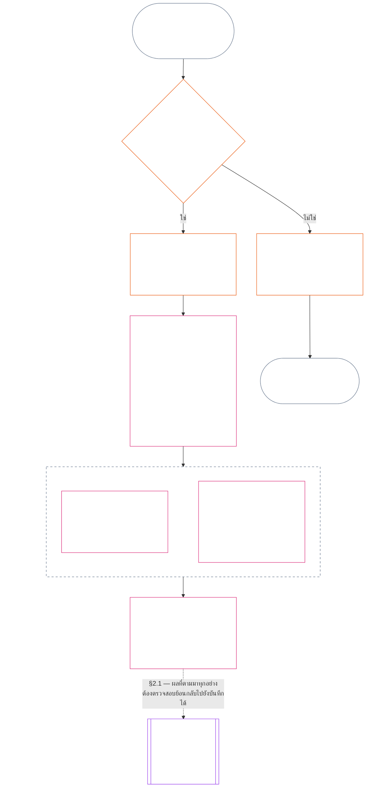

> ร่างแปลด้วย AI — ภาษา: ไทยมาตรฐาน; แหล่งที่มา: commit 9c2c8c10c871d91157bcd27b9f56ad6a1cec90d3; สถานะ: ยังไม่ได้ทบทวน; ขอบเขตบางส่วน: บทที่สิบเอ็ด เฉพาะ §§1–3 เท่านั้น นี่ไม่ใช่คำแปลครบทั้งบท

### 1. คำถามสามข้อ

*พูดแบบตรง ๆ: การกำหนดร่องรอยทำโดยตอบคำถามสามข้อตามลำดับ อย่าอนุมานข้อเท็จจริงจากระดับคะแนนที่ต้องการ และอย่าเลือกระดับคะแนนเพื่อให้เหตุผลแก่ผลลัพธ์ที่ต้องการ*

| คำถาม | คำถามถามว่าอะไร | คำตอบอยู่ที่ใด |
| --- | --- | --- |
| **1. เกิดอะไรขึ้น?** | ข้อเท็จจริงใดได้รับการตรวจสอบแล้ว เกี่ยวกับใครหรืออะไร ในช่วงเวลาใด และสถานะบันทึกร่องรอยกับการโต้แย้งเป็นอย่างไร? | [หมวด 2](#2-question-1--what-happened) และ [หมวด 3](#3-question-1-event-type-guide--what-kind-of-help-or-harm-occurred) |
| **2. ดีหรือแย่เพียงใด?** | ข้อเท็จจริงเหล่านั้นยืนยันประเภทและขนาดของคุณูปการหรือการละเมิดอย่างไร? | [บทที่สิบสอง หมวด 1](core_12.000_standing_measurement.md#1-question-2--how-good-or-bad-was-it) |
| **3. เกิดอะไรตามมา?** | การรับรอง ความพร้อม การเยียวยา มาตรการคุ้มครอง ข้อจำกัด หรือผลอื่นใดจะตามมา? | [บทที่สิบสาม](core_13.000_standing_integration.md#chapter-thirteen-standing-effects-and-integration) |

คำตอบของแต่ละคำถามขึ้นอยู่กับคำตอบก่อนหน้า:

- คำถาม 1 ให้ข้อเท็จจริงที่ตรวจสอบแล้วสำหรับคำถาม 2
- คำถาม 2 วัดข้อเท็จจริงเหล่านั้นเพื่อใช้กับคำถาม 3
- คำถาม 3 ต้องไม่เขียนข้อเท็จจริงหรือระดับคะแนนใหม่เพื่อให้ได้ผลลัพธ์ที่พึงประสงค์

คำตอบของคำถามทั้งสามข้อรวมกันเป็นการประเมินร่องรอยฉบับสมบูรณ์สำหรับเหตุการณ์หนึ่งที่มีขอบเขตชัดเจน หรือรูปแบบหนึ่งที่นิยามไว้ ผู้ถูกประเมินอาจมีการประเมินเช่นนี้หลายครั้งตามเวลา และไม่มีรายการใดเป็นคะแนนสุทธิหรือคะแนนโดยรวมของผู้ถูกประเมิน บันทึกร่องรอยด้านคุณูปการและการละเมิดเก็บคำตอบของคำถาม 1 และ 2 ส่วนคำตัดสินตามคำถาม 3 ระบุว่าจะเกิดอะไรตามมา

#### 1.1 วัตถุประสงค์และขอบเขต

บทนี้กำหนดกรอบบันทึกตามรัฐธรรมนูญ และ[บทที่สิบสอง](core_12.000_standing_measurement.md#chapter-twelve-standing-measurement--question-2-how-good-or-bad-was-it)กำหนดกรอบการวัด สำหรับ**ระบบ** **สิ่งมีชีวิตที่มีความรู้สึก** และ**สถาบัน** รวมถึงทุกระบบที่จัดประเภทตาม [**CS-9.305**](corpus_systems/cs_09.305_system_classification_machinery.md#cs-9305-part-a-system-classification-machinery) (*กลไกจัดประเภทระบบ*) กรอบเหล่านี้ไม่วัดข่าวลือ ความนิยม ชื่อเสียงคลุมเครือ ศักดิ์ศรีโดยกำเนิด หรือคุณค่าโดยทั่วไป ไม่มีสิ่งใดเป็นเรื่องที่อนุญาตให้นำมาประเมินร่องรอย

สายกระบวนการร่องรอยต้องยังคงมีผลเมื่อ:

- คุณูปการที่เคยตรวจสอบแล้วเก่าเกินกว่าจะบ่งชี้ความสามารถหรือความน่าเชื่อถือในปัจจุบัน;
- การละเมิดยังไม่ได้รับการแก้ไข;
- การซ่อมแซมมีค่าใช้จ่ายสูง;
- ความรับผิดชอบข้ามพรมแดน; หรือ
- ผู้กระทำใช้การแบ่งชั้นองค์กรหรือการเปลี่ยนชื่อเพื่อขัดขวางความรับผิดชอบ

เรื่องต่อไปนี้เป็นส่วนของข้อความการนำไปใช้ที่รับรองแล้ว:

- ขั้นตอนประจำวัน;
- ขั้นตอนยกระดับ;
- การคืนสิทธิและการซ่อมแซม;
- มาตรการความรับผิดชอบเชิงฟื้นฟู; และ
- การออกแบบแรงจูงใจ

การวัดตามบทที่สิบสองไม่ได้**อนุญาต**ให้ใช้กำลัง คุมขัง หรือจำกัดเสรีภาพในรูปแบบอื่นด้วยตัวมันเอง ผลเช่นนั้นต้องเป็นไปตามข้อกำหนดในบทที่หก **มาตรา XX** (*ความยุติธรรมหลังการละเมิดที่ตรวจสอบแล้ว*) โดยอิสระ รวมถึงข้อกำหนดเรื่องความได้สัดส่วน วิธีที่จำกัดน้อยที่สุด การจำกัดเวลา การคืนสิทธิ และความรับผิดชอบเชิงฟื้นฟู

<strong>การติดตาม · คำนิยาม · การประเมิน · การปฏิบัติตาม</strong>

- ต้นทาง: [บทที่หนึ่ง §16 — การดูแลรับผิดชอบอย่างลึกซึ้ง](core_01.010_stewardship_capacity_principles.md#16-stewardship-in-depth); [บทที่สองถึงสี่](core_02.000_definition_structure.md); [บทที่ห้า](core_05.000_definitions_home.md#chapter-five-foundational-definitions)
- ปลายทาง: [§2](#2-question-1--what-happened) (*คำถาม 1*); [§4](#4-standing-record-operational-requirements) (*ข้อกำหนดการตรวจสอบและบันทึก*); [§5](#5-record-custody-and-opening-authority) (*การเก็บรักษาบันทึกและอำนาจเปิดบันทึก*); [§6](#6-handling-a-standing-record) (*การจัดการบันทึกร่องรอย*); [บทที่สิบสอง §1](core_12.000_standing_measurement.md#1-question-2--how-good-or-bad-was-it) (*การวัดตามคำถาม 2*); [บทที่สิบสอง §2](core_12.000_standing_measurement.md#2-magnitude-and-severity-input-dimensions) (*มิติข้อมูลนำเข้าสำหรับการวัด*); [บทที่สิบสอง §3](core_12.000_standing_measurement.md#3-route-descriptor-catalogs-and-measurement-roles) (*บัญชีตัวบ่งชี้เส้นทาง*); [บทที่สิบสอง §4](core_12.000_standing_measurement.md#4-slot-grammar-and-shared-scaling) (*ไวยากรณ์ช่องและการปรับมาตราส่วนร่วมกัน*); [บทที่สิบสอง §5](core_12.000_standing_measurement.md#5-constitutional-inputs-to-axis-assignment) (*ข้อมูลตามรัฐธรรมนูญสำหรับกำหนดแกน*); [บทที่สิบสอง §6](core_12.000_standing_measurement.md#6-unified-proportional-lequ-scale--contribution-and-violation-axes) (*มาตราส่วน LEQU ตามสัดส่วนแบบรวมสำหรับทั้งสองแกน*); [บทที่สิบสาม](core_13.000_standing_integration.md#chapter-thirteen-standing-effects-and-integration) (*คำถาม 3*)
- [สาระสำคัญ](core_05.050_band_oversight.md#materiality) · [O](core_05.050_band_oversight.md#materiality) · [M](core_05.050_band_oversight.md#materiality-determination-a) · [A](core_05.050_band_oversight.md#materiality-determination-a) · [C](core_05.050_band_oversight.md#materiality-determination-c)
- [ความเสียหาย](core_05.035_band_accountability.md#harm) · [O](core_05.035_band_accountability.md#harm) · [M](core_05.035_band_accountability.md#harm-a) · [A](core_05.035_band_accountability.md#harm-a) · [C](core_05.035_band_accountability.md#harm-c)
- [ความได้สัดส่วน](core_05.035_band_accountability.md#proportionality) · [O](core_05.035_band_accountability.md#proportionality) · [M](core_05.035_band_accountability.md#proportionality-a) · [A](core_05.035_band_accountability.md#proportionality-a) · [C](core_05.035_band_accountability.md#proportionality-c)

### 2. คำถาม 1 — เกิดอะไรขึ้น?

<strong>การติดตาม</strong>

- ต้นทาง: [§1](#1-the-three-questions) (*กรอบคำถามสามข้อ*); [บทที่สองถึงสี่](core_02.000_definition_structure.md) (*บันทึก การตรวจสอบ และการติดตามคำนิยามไปจนถึงผลลัพธ์*)
- ขาของจตุรภาค: **การมีส่วนร่วม**; **การกำกับดูแล** (ความสามารถในการโต้แย้งและช่องทางคัดค้าน) เป้าประสงค์หลัก: **ความเจริญงอกงาม** และ**ความต่อเนื่อง** (บันทึกที่ติดตามได้และเก็บข้อค้นพบด้านคุณูปการกับการละเมิดแยกกันเพื่อการวัดภายหลัง)
- ปลายทาง:
  - [§2.2](#22-silence-is-the-default) (*ความเงียบเป็นสถานะเริ่มต้น*);
  - [§2.3](#23-protected-dissent-is-not-a-trigger) (*ความเห็นต่างที่ได้รับความคุ้มครองไม่ใช่ตัวกระตุ้น*);
  - [§2.4](#24-linked-standing-records-and-no-offset-bridge) (*บันทึกร่องรอยที่เชื่อมโยงกันและกลไกไม่หักลบ*);
  - [§2.5](#25-verified-input-gate) (*ประตูข้อมูลนำเข้าที่ตรวจสอบแล้ว*);
  - [§2.6](#26-stage-boundary) (*ขอบเขตระหว่างขั้นตอน*);
  - [§2.7](#27-forum-boundary) (*ขอบเขตของเวที*);
  - [§3](#3-question-1-event-type-guide--what-kind-of-help-or-harm-occurred) (*แนวทางประเภทเหตุการณ์*);
  - [§4](#4-standing-record-operational-requirements) (*ข้อกำหนดบันทึก*);
  - [§5](#5-record-custody-and-opening-authority) (*การเก็บรักษาบันทึกและอำนาจเปิดบันทึก*);
  - [§6](#6-handling-a-standing-record) (*การจัดการบันทึกร่องรอย*);
  - [บทที่สิบสอง §1](core_12.000_standing_measurement.md#1-question-2--how-good-or-bad-was-it) (*การวัดตามคำถาม 2*);
  - [บทที่สิบสอง §2](core_12.000_standing_measurement.md#2-magnitude-and-severity-input-dimensions) (*มิติข้อมูลนำเข้าสำหรับการวัด*);
  - [บทที่สิบสอง §3](core_12.000_standing_measurement.md#3-route-descriptor-catalogs-and-measurement-roles) (*บัญชีตัวบ่งชี้เส้นทาง*);
  - [บทที่สิบสอง §4](core_12.000_standing_measurement.md#4-slot-grammar-and-shared-scaling) (*ไวยากรณ์ช่องและการปรับมาตราส่วนร่วมกัน*);
  - [บทที่สิบสอง §5](core_12.000_standing_measurement.md#5-constitutional-inputs-to-axis-assignment) (*ข้อมูลตามรัฐธรรมนูญสำหรับกำหนดแกน*);
  - [บทที่สิบสอง §6](core_12.000_standing_measurement.md#6-unified-proportional-lequ-scale--contribution-and-violation-axes) (*มาตราส่วน LEQU ตามสัดส่วนแบบรวมสำหรับทั้งสองแกน*);
  - [บทที่สิบสาม](core_13.000_standing_integration.md#chapter-thirteen-standing-effects-and-integration) (13.000) (*คำถาม 3*)

 

*พูดแบบตรง ๆ: คำถาม 1 สร้างบัญชีเหตุการณ์ที่มีขอบเขตและโต้แย้งได้ โดยระบุตัวผู้ถูกประเมิน เหตุการณ์หรือรูปแบบ ช่วงเวลา ข้อเท็จจริงที่ตรวจสอบแล้ว และสถานะบันทึก ก่อนพิจารณาคะแนนหรือผลใด ๆ ความช่วยเหลือที่ตรวจสอบแล้วและการละเมิดที่ตรวจสอบแล้วใช้บันทึกร่องรอยแยกกันเพื่อไม่ให้เรื่องหนึ่งลบอีกเรื่อง บันทึกเหล่านี้ไม่ใช่คะแนนความนิยมหรือป้ายกำกับคลุมเครือ*

**บันทึกร่องรอย** คือบันทึกที่มีขอบเขตซึ่งบทนี้ใช้กับผู้ถูกประเมินหนึ่งราย ขอบเขตการทำงาน ช่วงเวลาของบันทึก สถานะการทบทวน และบริบทการตัดสินใจที่เจาะจง ก่อนเริ่มการวัด บันทึกต้องระบุว่า:

- บันทึกร่องรอยเกี่ยวกับใครหรืออะไร;
- เป็นเหตุการณ์ที่มีขอบเขตชัดเจนหรือรูปแบบที่นิยามไว้;
- พฤติกรรมและผลกระทบที่เกี่ยวข้องเกิดขึ้นเมื่อใดและที่ไหน;
- ข้อเท็จจริงใดตรวจสอบแล้ว และข้อใดยังเป็นข้อพิพาท;
- หลักฐาน การระบุความรับผิด และช่องทางคัดค้านใดสนับสนุนข้อค้นพบ; และ
- สถานะปัจจุบันของการทบทวน การแก้ไข และการแทนที่บันทึกร่องรอย

แผนภาพติดตามเหตุการณ์เพื่อดูว่าเหตุการณ์นั้นเป็นตัวกระตุ้นให้เปิดบันทึกร่องรอยหรือไม่ และบันทึกนั้นเก็บอะไรไว้ ส่วนย่อยถัดไปกำหนดกฎแต่ละข้อ แขนง “ไม่” ออกจากเส้นทางหลักไปทางขวา

#### 2.1 บันทึกร่องรอย: ประเภทและผู้ถูกประเมิน

คำถาม 1 ใช้**บันทึกร่องรอยคุณูปการ**กับความช่วยเหลือที่ตรวจสอบแล้ว และใช้**บันทึกร่องรอยการละเมิด**กับความเสียหายที่ตรวจสอบแล้ว รวมถึงความบกพร่องด้านความรับผิดชอบ บันทึกร่องรอยหนึ่งรายการไม่รวมข้อค้นพบทั้งสองประเภทเข้าด้วยกัน

- บันทึกร่องรอยอาจเกี่ยวข้องกับสิ่งมีชีวิตที่มีความรู้สึก สถาบัน ระบบ การประเมิน เหตุการณ์ที่มีขอบเขตชัดเจน บทบาท กลุ่ม บันทึกเฉพาะผู้กระทำ หรือหน่วยอื่นที่เกี่ยวข้องตามรัฐธรรมนูญ
  - ต้องไม่ยุบผู้ถูกประเมิน บทบาท ระบบ ชุมชน ช่วงเวลาของบันทึก สถานะการทบทวน หรือบริบทการตัดสินใจที่แตกต่างกัน ให้เป็นป้ายบันทึกร่องรอยเดียวที่ไม่แบ่งแยก
- บันทึกร่องรอยอาจครอบคลุม**เหตุการณ์ที่มีขอบเขตชัดเจน** — ตอนหนึ่งที่มีจุดเริ่มต้นและจุดสิ้นสุดชัดเจน — หรือ**รูปแบบ**ของพฤติกรรมที่เกิดซ้ำ
  - รูปแบบต้องมีผู้ถูกประเมิน ขอบเขต และช่วงเวลาทบทวนที่กำหนดไว้
- ผู้ถูกประเมินรายเดียวกันอาจมีบันทึกร่องรอยหลายรายการตามเวลา รวมถึงบันทึกร่องรอยคุณูปการและการละเมิดที่เชื่อมโยงกัน
  - บันทึกร่องรอยที่เกี่ยวข้องต้อง**อ้างอิงข้ามกัน**ตาม**หมวด 4.2** เมื่อมีผู้ถูกประเมินร่วมกัน ช่วงเวลาบันทึกที่ทับซ้อนกัน เหตุการณ์ที่มีขอบเขตชัดเจน รูปแบบ หรือบริบทการตัดสินใจเดียวกัน
- บันทึกร่องรอยไม่ใช่คะแนนชื่อเสียงที่แยกเดี่ยว ลำดับศักดิ์ศรี สถานะถาวร ป้ายกำกับคุณค่าทั่วไป หรือบัตรคะแนนที่รวมทุกอย่างไว้ด้วยกัน
  - ข้อกำหนดในการปฏิบัติงานอยู่ใน**หมวด 4**

ผลของร่องรอยใด ๆ ในภายหลังเป็นเรื่องของบทที่สิบสาม และต้องตรวจสอบย้อนกลับไปยังบันทึกร่องรอยที่เกี่ยวข้องได้ โดยไม่กลายเป็นส่วนหนึ่งของบันทึกนั้นเอง

#### 2.2 ความเงียบเป็นสถานะเริ่มต้น

การไม่มีบันทึกร่องรอยเป็นสถานะปกติของสิ่งมีชีวิตที่มีความรู้สึก สถาบัน หรือระบบ และเป็นสถานะที่สิ่งมีชีวิตที่มีความรู้สึกส่วนใหญ่จะคงอยู่

- จะเปิดบันทึกร่องรอยต่อเมื่อมีตัวกระตุ้นที่ตรวจสอบแล้วตาม**หมวด 4** ผู้มีอำนาจเปิดบันทึกที่ระบุชื่อต้องอนุมัติรายการ และผู้ดูแลบันทึกอีกคนหนึ่งต้องลงรายการ (**หมวด 5**) ห้ามเปิดบันทึกร่องรอย:
  - เพื่อกำหนดค่าฐาน;
  - เพื่อกรอกรายชื่อให้ครบ; หรือ
  - เพราะผู้เฝ้าประตูเส้นทางที่มีชื่อประสงค์เช่นนั้น
- การไม่มีบันทึกร่องรอยไม่ได้บอกอะไร “ไม่มีคะแนน” “ยังไม่ได้ตรวจสอบ” และ “ไม่มีบันทึกในแฟ้ม” ไม่ใช่หลักฐานของความเสี่ยง คุณูปการต่ำ หรือสิ่งอื่นใด ห้ามถือว่าบันทึกที่ไม่มีอยู่เป็นเหตุให้ตรวจสอบเข้มงวดขึ้น ใช้ค่าเริ่มต้นที่ต่ำลง หรือจำกัดการเข้าถึงเส้นทางที่มีชื่อให้มีเงื่อนไข
- ไม่มีสถาบันหรือระบบใดเรียกร้องให้มีบันทึกร่องรอย หนังสือรับรองว่า “ไม่มีบันทึก” หรือความยินยอมให้เปิดบันทึก เป็นเงื่อนไขของ:
  - สิ่งจำเป็นตาม**มาตรา III** (*การอยู่รอดและการเข้าถึงสิ่งจำเป็น*);
  - ความคุ้มครองตาม**มาตรา III-C** (*แรงงานและพื้นฐานทางเศรษฐกิจ*);
  - การค้าตามปกติ; หรือ
  - การเข้าร่วมในฐานะฝ่ายที่ได้รับผลกระทบ
  ข้อยกเว้นคือเกณฑ์ความสามารถที่เผยแพร่สำหรับเส้นทางที่มีชื่อซึ่งอ่อนไหวต่อความไว้วางใจโดยเฉพาะ ตาม[บทที่สิบสาม §6.2 เกณฑ์ความสามารถและการอนุญาต](core_13.000_standing_integration.md#62-competency-bars-and-clearances) และเกณฑ์เหล่านั้นต้องระบุว่าเหตุใดเส้นทางที่มีชื่อนั้นจึงอ่อนไหวต่อความไว้วางใจ
- เมื่อเปิดบันทึกร่องรอยเกี่ยวกับผู้ถูกประเมิน ต้องแจ้งผู้ถูกประเมินตามที่**หมวด 4**กำหนด เลื่อนการแจ้งได้เฉพาะเมื่อมีความจำเป็นด้าน[การเก็บรักษาหลักฐาน](core_05.050_band_oversight.md#evidence-preservation)หรือความปลอดภัยที่มีเอกสารรองรับ และเลื่อนได้เพียงช่วงเวลาจำกัดที่กำหนดไว้ การแจ้งทำให้บันทึกร่องรอยโต้แย้งได้ ผู้ถูกประเมินที่ไม่รู้ว่ามีบันทึกร่องรอยอยู่ย่อมคัดค้านหรือแก้ไขบันทึกไม่ได้

#### 2.3 ความเห็นต่างที่ได้รับความคุ้มครองไม่ใช่ตัวกระตุ้น

ความเห็นต่างหรือการประท้วงโดยสงบ — รวมถึง[การฝ่าฝืนกฎหมายโดยสันติและไม่ใช้ความรุนแรงที่ได้รับความคุ้มครอง](core_06.005_rights_part_b.md#xi-d-nonviolent-civil-disobedience) — ภายใต้**มาตรา XI-D** (*การชุมนุม ความเห็นต่าง และการประท้วงโดยสงบ*) ([*พื้นฐานความเห็นต่างและการประท้วงโดยสงบ*](core_06.005_rights_part_b.md#xi-d-dissent-and-peaceful-protest)) ไม่ใช่ตัวกระตุ้นที่ตรวจสอบแล้ว

- สิ่งดังกล่าวไม่เปิด ต่ออายุ หรือทำให้บันทึกร่องรอยการละเมิดรุนแรงขึ้น ไม่ใช่ข้อมูลนำเข้าด้านความรุนแรงตาม**หมวด 8.2** และการทำซ้ำไม่ทำให้กลายเป็นรูปแบบ
- การกระทำที่แยกออกจากกันได้และละเมิดพื้นฐานตามรัฐธรรมนูญโดยอิสระ ต้องบันทึกตามเงื่อนไขของตนเอง โดยไม่เพิ่มความรุนแรงเพราะมุมมอง เหตุผล หรือเป้าหมายของการประท้วง

#### 2.4 บันทึกร่องรอยที่เชื่อมโยงกันและกลไกไม่หักลบ

<strong>การติดตาม</strong>

- ต้นทาง: [§2.1](#21-standing-records-kinds-and-subjects) (*บันทึกคุณูปการและการละเมิดแยกกัน*)
- ปลายทาง:
  - [§2.5](#25-verified-input-gate) (*ประตูข้อมูลนำเข้าที่ตรวจสอบแล้ว*);
  - [§2.7](#27-forum-boundary) (*ขอบเขตของเวที*);
  - [§4.2](#42-related-standing-record-cross-references) (*การอ้างอิงข้ามกัน*);
  - [บทที่สิบสอง §1](core_12.000_standing_measurement.md#1-question-2--how-good-or-bad-was-it) (*การวัดตามคำถาม 2*);
  - [บทที่สิบสอง §2](core_12.000_standing_measurement.md#2-magnitude-and-severity-input-dimensions) (*มิติข้อมูลนำเข้าสำหรับการวัด*);
  - [บทที่สิบสอง §3](core_12.000_standing_measurement.md#3-route-descriptor-catalogs-and-measurement-roles) (*บัญชีตัวบ่งชี้เส้นทาง*);
  - [บทที่สิบสอง §4](core_12.000_standing_measurement.md#4-slot-grammar-and-shared-scaling) (*ไวยากรณ์ช่องและการปรับมาตราส่วนร่วมกัน*);
  - [บทที่สิบสอง §5](core_12.000_standing_measurement.md#5-constitutional-inputs-to-axis-assignment) (*ข้อมูลตามรัฐธรรมนูญสำหรับกำหนดแกน*);
  - [บทที่สิบสอง §6](core_12.000_standing_measurement.md#6-unified-proportional-lequ-scale--contribution-and-violation-axes) (*มาตราส่วน LEQU ตามสัดส่วนแบบรวมสำหรับทั้งสองแกน*);
  - [บทที่สิบสาม](core_13.000_standing_integration.md#chapter-thirteen-standing-effects-and-integration) (13.000) (*คำถาม 3*)
- อ่านร่วมกับ: [บทที่สิบสาม — การบูรณาการร่องรอย](core_13.000_standing_integration.md#2-automatic-integration-review-and-continuity) (13.000) (*การไม่สละสิทธิและการบูรณาการบันทึกที่เชื่อมโยงกัน*); [บทที่สิบสาม §6.2 — เกณฑ์ความสามารถและการอนุญาต](core_13.000_standing_integration.md#62-competency-bars-and-clearances) (13.000 §6.2); [บทที่สิบสาม §4.2 — การล็อกร่องรอย](core_13.000_standing_integration.md#42-prevention--general-standing-locks) (13.000 §4.2)

 

**กฎหลัก:** **บันทึกร่องรอยคุณูปการ**ที่ตรวจสอบแล้วและ**บันทึกร่องรอยการละเมิด**ที่ตรวจสอบแล้วต้องแยกจากกันตาม**หมวด 2.1** ข้อค้นพบเรื่องคุณูปการหรือการละเมิดแต่ละข้อจะต้องตั้งอยู่บนข้อเท็จจริงที่มีหลักฐานสนับสนุนของตนเองในบันทึกร่องรอยของตนเอง การวิเคราะห์และเอกสารสนับสนุนต้องรักษาเส้นทางของบันทึกทั้งสองให้ติดตามแยกกันได้ ไม่มีรายการเดียวหรือชุดรายการที่เชื่อมโยงกันเป็นคะแนนสุทธิ คะแนนผสม หรือการแลกเปลี่ยนหักลบ

- **บันทึกร่องรอยการละเมิดและกุญแจร่องรอย:**
  - ตามบทที่สิบสาม **กุญแจร่องรอย**ที่ใช้ได้และได้มาจากบันทึกร่องรอยการละเมิด อาจจำกัดร่องรอย จำกัดคุณสมบัติสำหรับบทบาท หรือกระทบการเข้าถึงการเยียวยา ขณะที่การละเมิดที่ตรวจสอบแล้วแต่ยังไม่คลี่คลาย
  - กุญแจร่องรอยต้องไม่ลบคุณูปการเชิงบวกที่ตรวจสอบแล้วและบันทึกไว้ในบันทึกร่องรอยคุณูปการ
  - การละเมิดที่ตรวจสอบแล้วแต่ยังไม่คลี่คลายจะไม่ถูกลดน้ำหนักเพียงเพราะเวลาผ่านไป
  - การละเมิดที่ตรวจสอบแล้วต้องไม่เขียนบันทึกร่องรอยคุณูปการที่ไม่เกี่ยวข้องใหม่ให้เป็นประวัติชื่อเสียงเชิงลบที่เป็นเท็จ
- **บันทึกร่องรอยคุณูปการและการอนุญาตด้านความสามารถ:**
  - คุณูปการที่ตรวจสอบแล้วอาจสนับสนุน**การอนุญาตด้านความสามารถ**ที่เกี่ยวข้องตาม**เกณฑ์ความสามารถ**ที่เผยแพร่ และสนับสนุนคุณสมบัติที่เชื่อมโยงกับความไว้วางใจ บทบาท หรือการรับรอง หากยังเป็นปัจจุบันและเกี่ยวข้องกับบทบาท
  - คุณูปการที่ตรวจสอบแล้วต้องไม่หักลบ ลดค่าเฉลี่ย แก้ตัว หรือเปลี่ยนชื่อข้อค้นพบการละเมิดที่ตรวจสอบแล้ว
  - การผ่านประตูไม่ยกเว้นกุญแจร่องรอยที่ใช้ได้

**ข้อยกเว้นเพียงข้อเดียว:** หากข้อค้นพบการละเมิดหักล้างคุณูปการที่อ้างโดยตัวมันเอง — ตัวอย่างเช่น หลักฐานแสดงว่าคุณไม่ได้ทำสิ่งที่บันทึกคุณูปการของคุณอ้างจริง — บันทึกร่องรอยคุณูปการที่เชื่อมโยงกันอาจได้รับการแก้ไขหรือลบผ่านกระบวนการหลักฐานและการทบทวนที่เหมาะสม พร้อมการอ้างอิงข้ามกันตาม**หมวด 4.2** อย่างไรก็ตาม การละเมิดไม่ได้ลบความช่วยเหลืออื่นที่ไม่เกี่ยวข้องและบันทึกไว้ในบันทึกร่องรอยคุณูปการแยกต่างหากโดยอัตโนมัติ

#### 2.5 ประตูข้อมูลนำเข้าที่ตรวจสอบแล้ว

ประตูนี้ทำงานดังนี้:

- การตัดสินใจใดที่มีผลต่อร่องรอย ความไว้วางใจ บทบาท การรับรอง หรือคุณสมบัติที่จะได้รับการรับรอง ใช้ได้เฉพาะข้อมูลนำเข้าที่ตรวจสอบแล้วจาก**บันทึกร่องรอยคุณูปการ**หรือ**บันทึกร่องรอยการละเมิด**ที่เกี่ยวข้อง
- ข้อกล่าวหา ข้ออ้างที่ยังไม่ได้วินิจฉัย ป้ายกำกับเส้นทางชั่วคราว เรื่องเล่าที่มีเฉพาะขั้นรับเรื่อง และเอกสารอื่นในช่วงข้อพิพาท ไม่ได้ให้ข้อมูลเกี่ยวกับลักษณะคุณูปการหรือลักษณะการละเมิดสำหรับร่องรอยด้วยตัวมันเอง
- ข้อมูลนำเข้าที่ตรวจสอบแล้วคือ**ข้อค้นพบด้านร่องรอย** ได้แก่ ข้อค้นพบคุณูปการที่ตรวจสอบแล้ว (แกน I) หรือข้อค้นพบการละเมิดที่ตรวจสอบแล้ว (แกน II)
- ข้อค้นพบคุณูปการและการละเมิดอยู่ในบันทึกร่องรอยแยกกัน (ดู**หมวด 2.1**)

#### 2.6 ขอบเขตระหว่างขั้นตอน

ขั้นตอนต่าง ๆ ของบันทึกร่องรอยต้องแยกจากกัน:

- คำถาม 1 บันทึกข้อเท็จจริงที่ตรวจสอบแล้ว ส่วนคำถาม 2 วัดข้อเท็จจริงเหล่านั้น
- เปิดบันทึกร่องรอยได้เมื่อพื้นฐานข้อเท็จจริงที่ตรวจสอบแล้วครบถ้วน แม้การวัดตามคำถาม 2 ยังรอดำเนินการ
- จนกว่าจะมีการวัด ช่องข้อมูลของคำถาม 2 ต้องระบุว่ารอดำเนินการ แทนที่จะสื่อว่ามีช่องคะแนนหรือหมวดหมู่แล้ว
- บันทึกร่องรอยต้องไม่ระบุหรือใช้**ผลของร่องรอย**ตามคำถาม 3

#### 2.7 ขอบเขตของเวที

*พูดแบบตรง ๆ: เวทีเป็นที่ซึ่งข้อพิพาทได้รับการกำกับดูแล ถูกโต้แย้ง และเปลี่ยนเป็นผลลัพธ์ที่ตรวจสอบแล้ว — แต่การยื่นคดีหรือชนะการโต้เถียงด้วยเรื่องเล่าไม่ได้ปรับปรุงร่องรอย ประตูข้อมูลนำเข้าที่ตรวจสอบแล้วใน**หมวด 2.5**ยังคงใช้ เมื่อเวทีตรวจสอบข้อเท็จจริงตามบทที่สองถึงสี่ เวทีอาจ**เปิด ปรับปรุง หรือแก้ไข**บันทึกร่องรอย — หรือ**เพิกถอนบันทึกที่ไม่ถูกต้องเมื่อมีการคัดค้าน** เวทีไม่รวมเรื่องดีและเรื่องร้ายเป็นคะแนนเดียว และไม่สร้างหมวดร่องรอยขึ้นเอง*

หมวดนี้รับผิดชอบคำถามเดียว: งานของเวทีส่งผลถึงบันทึกร่องรอยได้อย่างไร ขั้นตอนอื่นในสายงานเป็นของผู้รับผิดชอบที่ระบุไว้ที่นี่ และสายงานดำเนินไปตามลำดับต่อไปนี้:

1. มีการยื่นข้อพิพาทและเวทีเก็บ**บันทึกคดีของเวที** ซึ่งไม่ใช่บันทึกร่องรอย ผู้รับผิดชอบ: [บทที่สิบห้า §2.3 บันทึกคดีของเวที บันทึกร่องรอย และข้อโต้แย้ง](core_15.000_forum.md#23-forum-case-records-standing-records-and-contests); ดู [§2.7.1 บันทึกคดีของเวที](#271-forum-case-record) เพิ่มเติม
2. เวทีตรวจสอบข้อเท็จจริงตาม[บทที่สองถึงสี่](core_02.000_definition_structure.md)
3. ข้อค้นพบที่ตรวจสอบแล้วผ่านประตูข้อมูลนำเข้าที่ตรวจสอบแล้ว ผู้รับผิดชอบ: [§2.5 ประตูข้อมูลนำเข้าที่ตรวจสอบแล้ว](#25-verified-input-gate)
4. ผู้มีอำนาจเปิดบันทึกที่ระบุชื่อ ซึ่งอาจเป็นเวที เปิด ปรับปรุง หรือแก้ไขบันทึกร่องรอย หรือเพิกถอนบันทึกที่ไม่ถูกต้องเมื่อมีการคัดค้าน ผู้รับผิดชอบคือ [§4.1 เนื้อหาขั้นต่ำของบันทึก](#41-minimum-record-contents) ในเรื่องเนื้อหา และ [§5 การเก็บรักษาบันทึกและอำนาจเปิดบันทึก](#5-record-custody-and-opening-authority) ในเรื่องผู้ที่อาจดำเนินการ
5. บันทึกร่องรอยเก็บเฉพาะข้อเท็จจริงที่ตรวจสอบแล้ว แล้วคำถาม 2 จึงวัดข้อเท็จจริงเหล่านั้น ผู้รับผิดชอบ: [§2.6 ขอบเขตระหว่างขั้นตอน](#26-stage-boundary) และ [บทที่สิบสอง §1 คำถาม 2 — ดีหรือแย่เพียงใด?](core_12.000_standing_measurement.md#1-question-2--how-good-or-bad-was-it)
6. หากมีผลของร่องรอย ก็เป็นไปตาม[บทที่สิบสาม](core_13.000_standing_integration.md#chapter-thirteen-standing-effects-and-integration) ซึ่งรับผิดชอบผลของร่องรอย

ครอบครัวเวทีตาม[บทที่สิบห้า](core_15.000_forum.md#chapter-fifteen-forums-and-jurisdiction)**กำกับดูแล**ว่าข้อพิพาทที่เป็นรูปธรรมผ่านสายกระบวนการร่องรอยอย่างไร เวทีจัดให้มีสิ่งต่อไปนี้ตาม[บทที่สิบห้า §6 การแก้ไขอย่างทันท่วงที ระดับสาระสำคัญ และวินัยต่อต้านความล่าช้า](core_15.000_forum.md#6-timely-resolution-materiality-tiers-and-anti-delay-discipline) และ[มาตรา XXVI-C](core_06.020_rights_part_e.md#article-xxvi-c-timely-resolution-and-anti-delay-floor) (*การแก้ไขอย่างทันท่วงทีและพื้นฐานต่อต้านความล่าช้า*):

- ช่องทางคัดค้านที่เข้าถึงได้;
- การทบทวนโดยอิสระ;
- การสนับสนุนด้านนิติวิทยาศาสตร์;
- ลำดับการแก้ไขเยียวยา; และ
- กรอบเวลาตามระดับ

เมื่อข้อค้นพบของเวทีเหล่านั้นผ่านประตูข้อมูลนำเข้าที่ตรวจสอบแล้วตามบทที่สองถึงสี่ ข้อค้นพบดังกล่าวอาจ:

- **เปิด ปรับปรุง หรือแก้ไข**บันทึกร่องรอยตาม**หมวด 4.1**; หรือ
- **เพิกถอนบันทึกที่ไม่ถูกต้องเมื่อมีการคัดค้าน**

##### 2.7.1 บันทึกคดีของเวที

แฟ้มของเวทีเองเกี่ยวกับข้อพิพาทที่เปิดอยู่คือ[**บันทึกคดีของเวที**](core_05.035_band_accountability.md#forum-case-record) ซึ่งนิยามไว้ใน[บทที่สิบห้า §2.3 บันทึกคดีของเวที บันทึกร่องรอย และข้อโต้แย้ง](core_15.000_forum.md#23-forum-case-records-standing-records-and-contests) บันทึกนี้**ไม่ใช่**บันทึกร่องรอย

##### 2.7.2 ข้อค้นพบของเวทีและการวัดตามคำถาม 2

ข้อค้นพบข้อเท็จจริงที่ตรวจสอบแล้วของเวทีอาจเป็นพื้นฐานข้อเท็จจริงของบันทึกร่องรอยตามคำถาม 1 ได้ แต่ข้อค้นพบเหล่านั้น**ไม่ได้**กำหนดการวัดตามคำถาม 2 ว่าคุณูปการหรือการละเมิดที่ตรวจสอบแล้วดีหรือแย่เพียงใด ([§2.6 ขอบเขตระหว่างขั้นตอน](#26-stage-boundary)) ดังนั้น:

- กระบวนการของเวทีต้อง**ไม่**รวมข้อมูลคุณูปการและการละเมิดเป็นคะแนนสุทธิเดียว คำตอบด้านเนื้อหาที่ผสมกัน หรือป้ายร่องรอยที่ไม่แบ่งแยก บันทึกร่องรอยที่เชื่อมโยงกันยังคงแยกกันตาม [§2.1 บันทึกร่องรอย: ประเภทและผู้ถูกประเมิน](#21-standing-records-kinds-and-subjects) และ [§2.4 บันทึกร่องรอยที่เชื่อมโยงกันและกลไกไม่หักลบ](#24-linked-standing-records-and-no-offset-bridge)
- ผลงานของเวทีต้อง**ไม่**ใช้เรื่องเล่าข้อพิพาท ความสะดวกในการจัดเส้นทาง หรือความชอบของคณะ แทนข้อมูลนำเข้าที่ตรวจสอบแล้วและพิสูจน์ได้ ([§2.5 ประตูข้อมูลนำเข้าที่ตรวจสอบแล้ว](#25-verified-input-gate)) การวัดที่แยกกัน ([บทที่สิบสอง §1 คำถาม 2 — ดีหรือแย่เพียงใด?](core_12.000_standing_measurement.md#1-question-2--how-good-or-bad-was-it)) หรือกลไกผลของร่องรอยที่[บทที่สิบสาม](core_13.000_standing_integration.md#chapter-thirteen-standing-effects-and-integration)รับผิดชอบ

##### 2.7.3 สิ่งที่ขอบเขตของเวทีไม่ได้ลดทอน

ขอบเขตนี้**ไม่ได้**ลดทอนการคัดค้าน การเยียวยา การบรรเทาชั่วคราว หรือการคุ้มครองเชิงกระบวนการที่กำหนดไว้ภายใต้:

- [มาตรา XIII-A](core_06.010_rights_part_c.md#article-xiii-a-reliability-and-trustworthiness-baseline) (*พื้นฐานความน่าเชื่อถือและความไว้วางใจได้*);
- [มาตรา XIII-B](core_06.010_rights_part_c.md#article-xiii-b-right-to-redress-and-remedy) (*สิทธิในการชดใช้และเยียวยา*);
- [บทที่สิบห้า §6 การแก้ไขอย่างทันท่วงที ระดับสาระสำคัญ และวินัยต่อต้านความล่าช้า](core_15.000_forum.md#6-timely-resolution-materiality-tiers-and-anti-delay-discipline);
- [มาตรา XXVI-C](core_06.020_rights_part_e.md#article-xxvi-c-timely-resolution-and-anti-delay-floor) (*การแก้ไขอย่างทันท่วงทีและพื้นฐานต่อต้านความล่าช้า*); หรือ
- มาตรการด้านความยุติธรรมที่เกี่ยวข้อง

ข้อกำหนดคือข้อค้นพบของเวทีที่ตรวจสอบแล้วต้องเข้าสู่ร่องรอยผ่านประตูเดียวกับข้อมูลนำเข้าที่ตรวจสอบแล้วอื่น ๆ — ไม่ใช่ผ่านทางอ้อม

### 3. แนวทางประเภทเหตุการณ์ของคำถาม 1 — เกิดความช่วยเหลือหรือความเสียหายแบบใด?

*พูดแบบตรง ๆ: ใช้ตารางเหล่านี้อธิบายว่าเกิดอะไรขึ้นหลังตรวจสอบข้อเท็จจริงแล้ว ตารางช่วยระบุประเภทคุณูปการหรือการละเมิดที่เกี่ยวข้อง แต่ไม่ได้ตัดสินว่าดีหรือแย่เพียงใด กำหนดช่องคะแนน หรือชี้ว่าอะไรจะเกิดขึ้นตามมา*

#### 3.1 ประเภทเหตุการณ์ด้านคุณูปการ

**กฎการเข้าเกณฑ์:** คุณูปการที่อ้างจะนับได้ต่อเมื่อสามารถติดตามได้ ไม่ผลักภาระออกไปให้ผู้อื่น และสอดคล้องกับรัฐธรรมนูญที่มีผลใช้บังคับทั้งฉบับ

- ความเสียหายที่ผลักภาระออกไป การพึ่งพาแบบบีบบังคับ การทำให้พื้นสิทธิแคบลง หรือภาระที่ปกปิดไว้ อาจทำให้คุณูปการที่อ้างไม่เข้าเกณฑ์หรือถูกจำกัด
- คุณูปการที่อ้างไม่หักลบข้อค้นพบการละเมิดที่แยกต่างหาก

แต่ละแถวในตารางด้านล่างระบุเส้นทางทั่วไปของความช่วยเหลือที่ตรวจสอบแล้วและความเกี่ยวข้องตามรัฐธรรมนูญ อาจมีหลายแถวที่ใช้ได้กับบันทึกร่องรอยเดียวกัน

| ประเภทคุณูปการที่ตรวจสอบแล้ว | เกิดอะไรขึ้น | ขาของจตุรภาค | เป้าประสงค์หลัก |
| --- | --- | --- | --- |
| การอยู่รอดและการบำรุงรักษาร่างกาย | มีผู้ได้รับอาหาร ที่อยู่อาศัย การดูแลทางการแพทย์ หรือความปลอดภัย | **การมีส่วนร่วม**, **การกำกับดูแล** | **ความเจริญงอกงาม** |
| การดูแลและการสอน | มีการเลี้ยงดูเด็ก ดูแลผู้สูงอายุ หรือให้การศึกษาแก่ผู้อื่น | **การมีส่วนร่วม**, **การกำกับดูแล** | **ความเจริญงอกงาม**, **ความต่อเนื่อง** |
| การเยียวยาบาดแผลทางใจ | มีผู้ได้รับความช่วยเหลือให้ฟื้นจากอันตรายทางจิตใจที่ขัดขวางความเป็นอยู่ที่ดี | **การมีส่วนร่วม**, **ความรับผิดชอบ** | **ความเจริญงอกงาม** |
| การขจัดภาระร้ายแรง | หนี้สินที่กดทับ สภาพการทำงานที่เอาเปรียบ หรืออุปสรรคเชิงระบบถูกขจัดออกไป | **การมีส่วนร่วม**, **การกำกับดูแล** | **ความเจริญงอกงาม** |
| การฟื้นคืนความเป็นผู้กระทำ | มีผู้ได้รับทางเลือกที่มีความหมายเกี่ยวกับชีวิตของตนเอง | **การมีส่วนร่วม** | **ความเจริญงอกงาม** |
| การขยายขีดความสามารถในการผลิต | เครื่องมือ โครงสร้างพื้นฐาน หรือโอกาสช่วยให้ผู้อื่นเจริญรุ่งเรืองได้อย่างเป็นอิสระ | **การมีส่วนร่วม**, **การกำกับดูแล** | **ความเจริญงอกงาม**, **ความต่อเนื่อง** |
| การเพิ่มประสิทธิภาพด้านเวลา | ลดการรอคอยที่หลีกเลี่ยงได้ แรงเสียดทานทางธุรการ หรือภาระการประสานงาน ทำให้ได้เวลากลับคืนมาเพื่อการดูแล การพักผ่อน ความเป็นผู้กระทำ การเรียนรู้ หรืองานที่สอดคล้องกับสิทธิ | **การมีส่วนร่วม**, **การกำกับดูแล** | **ความเจริญงอกงาม** |
| การลดความเสี่ยงทางนิเวศหรือโครงสร้างพื้นฐาน | ป้องกันการล่มสลายของสิ่งแวดล้อมหรือความล้มเหลวของระบบสำคัญ | **การกำกับดูแล**, **ความรับผิดชอบ** | **ความต่อเนื่อง**, **ความเจริญงอกงาม** |
| การลดรอยเท้าทางนิเวศ | ลดการใช้ทรัพยากร การปล่อย หรือความต้องการที่ดินและน้ำอย่างตรวจสอบได้ โดยไม่โยนภาระให้ผู้อื่นหรือระบบนิเวศ | **การกำกับดูแล**, **ความรับผิดชอบ** | **ความต่อเนื่อง**, **ความเจริญงอกงาม** |
| การฟื้นฟูระบบนิเวศ | ฟื้นฟูที่ดิน น้ำ หรือถิ่นอาศัยที่เสื่อมโทรมไปสู่สภาพที่ทำงานได้และพึ่งพาตนเองได้อย่างยั่งยืน | **การกำกับดูแล**, **ความรับผิดชอบ** | **ความต่อเนื่อง**, **ความเจริญงอกงาม** |
| การคุ้มครองชนิดพันธุ์ที่ใกล้สูญพันธุ์ | คุ้มครองชนิดพันธุ์ที่เสี่ยงต่อการสูญพันธุ์ หรือถิ่นอาศัยที่ชนิดพันธุ์เหล่านั้นพึ่งพา จากการสูญเสีย | **การกำกับดูแล**, **ความรับผิดชอบ** | **ความต่อเนื่อง**, **ความเจริญงอกงาม** |
| การลดมลพิษและขยะ | ป้องกัน ขจัด หรือจัดการการปนเปื้อน การปล่อยที่เป็นอันตราย หรือขยะอย่างปลอดภัย | **การกำกับดูแล**, **ความรับผิดชอบ** | **ความเจริญงอกงาม**, **ความต่อเนื่อง** |
| การเสริมสร้างความปลอดภัย ความจริง การตรวจสอบได้ หรือความสามารถในการคัดค้าน | สร้างหรือซ่อมแซมสถาบันหรือแนวปฏิบัติเพื่อคุ้มครองสิทธิและทำให้ผู้มีอำนาจต้องรับผิดชอบ | **การมีส่วนร่วม**, **การกำกับดูแล**, **ความรับผิดชอบ** | **ความเจริญงอกงาม**, **ความต่อเนื่อง** |

#### 3.2 ประเภทเหตุการณ์ด้านการละเมิด

**กฎการเข้าเกณฑ์:** ประเภทเหตุการณ์การละเมิดต้องมีข้อค้นพบการละเมิดที่ตรวจสอบแล้ว ซึ่งยังติดตามได้ มีขอบเขต ตรวจสอบย้อนหลังได้ และโต้แย้งได้ตาม**บทที่สองถึงสี่**

- ข้อกล่าวหา แท็กชั่วคราว เรื่องเล่าของเวที และป้ายกำกับตอนรับเรื่องอาจช่วยกำหนดเส้นทางหรือคัดแยกเบื้องต้น แต่ไม่ได้ทำให้คำถาม 1 เสร็จสมบูรณ์
- คุณูปการเชิงบวกไม่หักลบ แก้ตัว ลบล้าง หรือเปลี่ยนชื่อการละเมิดที่ตรวจสอบแล้ว

แต่ละแถวในตารางด้านล่างระบุเส้นทางทั่วไปของการสูญเสีย อันตราย หรือการไม่ปฏิบัติหน้าที่ที่ตรวจสอบแล้ว รวมถึงความเกี่ยวข้องตามรัฐธรรมนูญ อาจมีหลายแถวที่ใช้ได้กับบันทึกร่องรอยเดียวกัน

| ประเภทการสูญเสียหรืออันตรายที่ตรวจสอบแล้ว | เกิดอะไรขึ้น | ขาของจตุรภาค | เป้าประสงค์หลัก |
| --- | --- | --- | --- |
| การพรากปัจจัยเพื่อการอยู่รอดหรือการบำรุงรักษาร่างกาย | เกิดการเสียชีวิตที่หลีกเลี่ยงได้ การปฏิเสธการดูแล สภาพไม่ปลอดภัย หรือการพรากปัจจัยทางวัตถุเพื่อการอยู่รอด | **ความรับผิดชอบ**, **การมีส่วนร่วม** | **ความเจริญงอกงาม** |
| ภาระร้ายแรงที่หลีกเลี่ยงได้ | ภาระที่กดทับ ถูกกำหนด หรือถูกโยกย้ายอย่างเป็นระบบ กระทบความเป็นอยู่ที่ดีหรือความเป็นผู้กระทำอย่างมีนัยสำคัญ | **ความรับผิดชอบ**, **การมีส่วนร่วม** | **ความเจริญงอกงาม** |
| การสูญเสียความเป็นผู้กระทำจากการบีบบังคับ | เกิดการบีบบังคับ การชักจูง การข่มขู่ที่น่าเชื่อถือ การกักขัง หรืออันตรายต่อเสรีภาพ | **ความรับผิดชอบ**, **การมีส่วนร่วม** | **ความเจริญงอกงาม** |
| การทำลายพื้นสิทธิ | มีการละเมิดพื้นฐานตามรัฐธรรมนูญที่ไม่อาจต่อรองได้ อำนาจสูงสุดของรัฐธรรมนูญ หรือการเข้าถึงการคัดค้านและการเยียวยาอย่างมีนัยสำคัญ | **ความรับผิดชอบ**, **การกำกับดูแล** | **ความเจริญงอกงาม**, **ความต่อเนื่อง** |
| ความเสียหายทางนิเวศหรือโครงสร้างพื้นฐาน | สภาพที่จำเป็นต่อความเป็นอยู่ที่ดีตามรัฐธรรมนูญได้รับความเสียหาย | **ความรับผิดชอบ**, **การกำกับดูแล** | **ความต่อเนื่อง**, **ความเจริญงอกงาม** |
| ความเสียหายจากมลพิษหรือขยะ | การปนเปื้อน การปล่อยที่เป็นอันตราย หรือขยะทำให้อากาศ น้ำ ดิน หรือสุขภาพเสียหาย | **ความรับผิดชอบ**, **การกำกับดูแล** | **ความเจริญงอกงาม**, **ความต่อเนื่อง** |
| การทำลายชนิดพันธุ์หรือถิ่นอาศัย | ชนิดพันธุ์ที่เสี่ยงต่อการสูญพันธุ์ หรือถิ่นอาศัยที่พึ่งพา ถูกทำลาย แยกส่วน หรือถูกผลักไปสู่การสูญเสีย รวมถึงการสูญเสียที่ถูกมองว่าหักลบได้ | **ความรับผิดชอบ**, **การกำกับดูแล** | **ความต่อเนื่อง**, **ความเจริญงอกงาม** |
| การสูญเสียความสามารถในการฟื้นตัวทางนิเวศ | ปิดกั้นความสามารถของระบบนิเวศในการฟื้นฟูหลังความเสียหาย หรือทำให้การย้อนคืนยากหรือเป็นไปไม่ได้โดยหลีกเลี่ยงได้ | **ความรับผิดชอบ**, **การกำกับดูแล** | **ความต่อเนื่อง**, **ความเจริญงอกงาม** |
| ความเสียหายทางนิเวศหรือการพร่องทรัพยากรที่ผลักภาระออกไป | โยนต้นทุนทางนิเวศให้ผู้อื่นหรือระบบนิเวศ ใช้ทรัพยากรเกินความสามารถในการฟื้นฟู หรือคำกล่าวอ้างเรื่องรอยเท้าหรือความยั่งยืนปกปิดความเสื่อมโทรมที่ดำเนินต่อไป | **ความรับผิดชอบ**, **การกำกับดูแล** | **ความต่อเนื่อง**, **ความเจริญงอกงาม** |
| การทำลายขีดความสามารถในการผลิต | ปิดกั้นเครื่องมือ ความสามารถ ความสัมพันธ์ หรือทรัพยากรที่จำเป็นต่อการเจริญงอกงามอย่างเป็นอิสระ | **ความรับผิดชอบ** | **ความเจริญงอกงาม** |
| ความเสื่อมถอยของความปลอดภัย ความจริง หรือการตรวจสอบได้ | เกิดการปกปิด ข้อมูลผิดพลาด บันทึกเสียหาย ช่องทางคัดค้านที่เข้าถึงไม่ได้ หรือการรวบรวมที่ทบทวนไม่ได้ | **การกำกับดูแล**, **ความรับผิดชอบ** | **ความเจริญงอกงาม**, **ความต่อเนื่อง** |
| การขัดขวางความรับผิดชอบ | เกิดการแทรกแซงที่ตรวจสอบแล้วต่อกลไกการต้องตอบ — ความสมบูรณ์ของหลักฐาน การตรวจสอบ กระบวนการของเวที บันทึกร่องรอย กรอบเวลาการเยียวยา หรือช่องทางคัดค้านและชดเชย; หากการขัดขวางเป็นการโจมตีระดับเมตาต่อความเสียหายพื้นฐานที่แยกต่างหาก ให้เปิดบันทึกร่องรอยการละเมิดอีกฉบับที่เชื่อมโยงกัน | **ความรับผิดชอบ**, **การกำกับดูแล**, **ความทันเวลา** | **ความเจริญงอกงาม**, **ความต่อเนื่อง** |
| การยึดครองระบบหรือการใช้การพึ่งพาในทางที่ผิด | เกิดการเอื้อเชิงโครงสร้าง การใช้ความไม่สมมาตรของการพึ่งพาในทางที่ผิด การออกแบบป้องกันการหลบเลี่ยง หรือการยึดครองช่องทางความรับผิดชอบ | **ความรับผิดชอบ**, **การมีส่วนร่วม** | **ความต่อเนื่อง**, **ความเจริญงอกงาม** |
