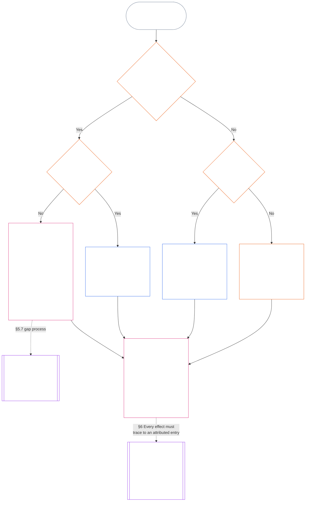

<!-- Locale: Thai (th) | Source: 9c2c8c10c871d91157bcd27b9f56ad6a1cec90d3 | AI-drafted, unreviewed | PARTIAL: Chapter Eleven §§5.7–5.9 only -->

#### 5.7 เมื่อกฎบัตรระบบหรือกฎบัตรสถาบันไม่ได้ระบุที่นั่งหนึ่งไว้

เมื่อไม่มีเส้นทางปกติที่ระบุชื่อไว้ บันทึกร่องรอยจะไปที่ใดขึ้นอยู่กับคำถามสามข้อ ซึ่งแผนภาพด้านล่างเรียงลำดับไว้ ส่วนนี้ครอบคลุมกรณีที่กฎบัตรระบบหรือกฎบัตรสถาบันไม่ได้ระบุที่นั่งหนึ่งไว้; [§5.8 ทางเลือกสำรองเมื่อไม่มีกฎบัตรระบบหรือกฎบัตรสถาบันครอบคลุมบันทึกร่องรอย](#58-fallback-when-no-system-charter-or-institutional-charter-reaches-the-standing-record) ครอบคลุมกรณีที่ไม่มีฉบับใดครอบคลุมบันทึกร่องรอยเลย

<strong>คำแนะนำสำหรับผู้อ่าน (ไม่มีผลเชิงปฏิบัติ): วิธีอ่านแผนภาพ</strong>

> พูดแบบตรง ๆ: หน่วยงานที่กฎบัตรระบบหรือกฎบัตรสถาบันระบุไว้จะจัดการบันทึกร่องรอย หากกฎบัตรระบบหรือกฎบัตรสถาบันไม่ได้ระบุที่นั่งหนึ่งไว้ กฎบัตรนั้นจะใช้ไม่ได้จนกว่าจะแก้ช่องว่าง และบันทึกร่องรอยจะไปยังผู้มีอำนาจบันทึกสำรองและผู้ดูแลบันทึกสำรอง หรือเวที ไม่ใช่แผนผังสายงาน หากไม่มีกฎบัตรระบบหรือกฎบัตรสถาบันใดครอบคลุมบันทึกร่องรอยเลย แผนผังสายงานที่สถาบันเผยแพร่จะเป็นตัวกำหนด และหากไม่มีแผนผัง บันทึกร่องรอยจะไปสู่การตรวจสอบอิสระ หรือในกรณีงานไม่เป็นทางการและมีขอบเขตเล็ก จะไปยังหน่วยงานที่อาศัยบันทึกนั้น
>
> ทุกเส้นทางสิ้นสุดที่กล่องเดียวกัน: หน่วยงานหนึ่งตรวจสอบข้อเท็จจริง และอีกหน่วยงานหนึ่งแยกต่างหากเป็นผู้ลงและเก็บบันทึกร่องรอย จากนั้น [§6 การจัดการบันทึกร่องรอย](#6-handling-a-standing-record) จะกำหนดว่าผู้ถือบันทึกต้องทำอะไรกับบันทึกนั้น ลูกศรทึบคือเส้นทางหลัก ลูกศรประเป็นการส่งต่อและมีป้ายกำกับมาตราที่กำหนดการส่งต่อ กล่องที่มีเส้นคู่ด้านข้างเป็นเรื่องของบทอื่น และกล่องสุดท้ายคือจุดที่วาดผลต่อสถานะโดยอาศัยบันทึกร่องรอย โดยไม่เขียนบันทึกนั้นใหม่ แผนภาพนี้ไม่ได้เพิ่มหน้าที่ ที่นั่ง หรือช่องข้อมูล

 

กฎบัตรระบบหรือกฎบัตรสถาบันที่ไม่ได้ระบุที่นั่งบันทึกที่จำเป็นหรือเส้นทางอิสระไว้:

- **ผลที่ตามมา:** กฎบัตรระบบหรือกฎบัตรสถาบันใช้ไม่ได้ และไม่อนุญาตให้มีการแก้ไขที่ทำให้เกิดผลเช่นนั้น ([บทที่เจ็ด §4.7.1 เมื่อมีช่องว่างและวิธีบันทึกช่องว่าง](core_07.000_charters.md#471-when-a-gap-exists-and-how-it-is-logged))
- **บทที่เจ็ดเป็นเจ้าของกระบวนการจัดการช่องว่าง:** [บทที่เจ็ด §4.7 ช่องว่างในแผนผังสำหรับบันทึกร่องรอยของผู้ดำเนินการ](core_07.000_charters.md#47-gaps-in-the-map-for-operator-standing-records) กำหนดเรื่องต่อไปนี้ด้วย:
  - วิธีบันทึกช่องว่าง;
  - ช่วงเวลาสำหรับตอบสนองและแก้ไข (รวมการแต่งตั้งผู้แทนฉุกเฉิน); และ
  - เวลาที่การดูแลรักษาจะกลับไปยังผู้ถือที่ระบุชื่อไว้

สำหรับบันทึกร่องรอย ส่วนนี้กำหนดเพิ่มเติมว่า:

- **ใครห้ามดำเนินการ:** ขณะที่ที่นั่งที่จำเป็นว่างอยู่และกฎบัตรระบบหรือกฎบัตรสถาบันไม่ได้ระบุผู้แทนที่ถูกต้อง ไม่มีใครทำหน้าที่ของที่นั่งนั้นได้ เว้นแต่ใช้เส้นทางในข้อถัดไป
- **บันทึกร่องรอยไปที่ใด:** ตามที่ [§5.4 ห้ามดูแลบันทึกของตนเอง](#54-no-self-custody) กำหนด บันทึกร่องรอยจะไปยังผู้มีอำนาจบันทึกสำรองและผู้ดูแลบันทึกสำรอง หรือเวทีตาม **§2.7**; แผนผังสายงานใช้แทนไม่ได้ บันทึกร่องรอยแต่ละรายการคงสภาพครบถ้วนโดยมีผู้ดูแลรายเดียว
- **บันทึกร่องรอยที่มีผู้ดูแลอยู่แล้ว:**
  - ในวันที่เวที นายทะเบียน หรือผู้มีอำนาจบันทึกสำรองได้รับแจ้งช่องว่าง บันทึกร่องรอยของผู้ดำเนินการใด ๆ ที่หน่วยงานภายในสายควบคุมเชิงสาระของฝ่ายที่มีสถานะตามกฎบัตรถืออยู่ จะย้ายไปยังผู้ดูแลบันทึกสำรองพร้อมประวัติทั้งหมด
  - จนกว่าจะถึงเวลานั้น หน่วยงานดังกล่าวเก็บบันทึกไว้ให้อ่านอย่างเดียว ไม่ลงฉบับแก้ไขใด ๆ และส่งสำเนาครบถ้วนพร้อมประวัติทั้งหมดให้ผู้ดูแลบันทึกสำรองทันที
  - ผู้ดูแลที่อยู่นอกสายควบคุมเก็บบันทึกร่องรอยไว้ และระหว่างที่มีช่องว่างจะลงฉบับแก้ไขแต่ละฉบับที่ผู้มีอำนาจบันทึกสำรองหรือเวทีอนุญาต หากเวทีพบว่าผู้ดูแลอยู่ภายในสายควบคุม บันทึกร่องรอยจะย้ายไปยังผู้ดูแลบันทึกสำรองพร้อมประวัติทั้งหมด เช่นเดียวกับกรณีหน่วยงานที่อยู่ในสายควบคุม
- **ผู้ดูแลรับผิดชอบ:** ผู้ดูแลที่ได้รับการขอให้รับที่นั่งซึ่งกฎบัตรระบบหรือกฎบัตรสถาบันไม่ได้มอบให้:
  - **ปฏิเสธที่นั่ง:** การมีสิทธิ์เข้าถึงหรือความสามารถทางเทคนิคในการลงบันทึกร่องรอย ไม่ได้ให้อำนาจลงบันทึกนั้น
  - **ระบุคำขอและช่องว่าง:** ระบุทั้งสองเรื่องไว้ในบันทึก
  - **ส่งต่อบันทึกร่องรอย:** ส่งต่อไปตามเส้นทางในข้อ *บันทึกร่องรอยไปที่ใด* ข้างต้น
  - **ทำหน้าที่อื่นต่อไป:** หน้าที่ที่มีอยู่แล้วตาม [§5.4 ห้ามดูแลบันทึกของตนเอง](#54-no-self-custody) (*ผู้ดูแลที่อยู่ภายในฝ่ายซึ่งเป็นประเด็น*) ยังคงมีผล ได้แก่ หยุดสิ่งที่ตนควบคุม บันทึกชุดข้อมูลที่สร้างกลับคืนได้ เก็บรักษาหลักฐานที่ตนมี แจ้งให้ทราบ และยกระดับเรื่อง ไม่มีการกระทำใดในกลุ่มนี้เป็นการตรวจสอบข้อเท็จจริงหรือการลงบันทึกร่องรอย บันทึกและหลักฐานที่เก็บรักษาไว้จะส่งไปพร้อมกับบันทึกร่องรอยเพื่อเป็นข้อมูลแก่ผู้มีอำนาจตรวจสอบ ไม่ใช่รายการบันทึก และไม่ใช่การตัดสินข้อเท็จจริง

#### 5.8 ทางเลือกสำรองเมื่อไม่มีกฎบัตรระบบหรือกฎบัตรสถาบันครอบคลุมบันทึกร่องรอย

หากไม่มีกฎบัตรระบบหรือกฎบัตรสถาบันครอบคลุมระบบ สถาบัน หรือกิจการที่เกี่ยวข้องกับบันทึกร่องรอย — เช่น หน่วยงานที่อยู่ต่ำกว่าเกณฑ์ Class L และไม่ได้เผยแพร่กฎบัตร — ให้ใช้แผนผังสายงานที่สถาบันเผยแพร่ตาม **CI-8.205 §2** (*สายงานการแบ่งแยกหน้าที่*) ดังนี้:

- **ผู้มีอำนาจเปิดบันทึก:** หน่วยงานที่แผนผังสายงานวางไว้ในสายการประกันและการตรวจสอบสำหรับระบบ สถาบัน หรือกิจการที่เกี่ยวข้องกับบันทึกร่องรอย หน่วยงานนั้นตรวจสอบข้อเท็จจริงและอนุญาตให้ลงรายการ ([§5.2 ผู้มีอำนาจเปิดบันทึกที่ระบุชื่อ](#52-named-record-opening-authority)); แต่ไม่ได้ลงหรือเก็บบันทึกร่องรอย
- **ผู้ดูแล:** หน่วยงานที่ถือสายงานการเผยแพร่และหลักฐาน
- **ห้ามสายงานปฏิบัติการ:** ทั้งสองหน้าที่จะเป็นของหน่วยงานที่ถือสายงานปฏิบัติการของระบบที่เกี่ยวข้องไม่ได้
- **ไม่มีแผนผังสายงานเช่นกัน:** บันทึกร่องรอยจะส่งไปตรวจสอบอย่างอิสระตามข้อ *ห้ามดูแลบันทึกของตนเอง* ข้างต้น หรือในกรณีบันทึกที่ไม่เป็นทางการและมีขอบเขตเล็ก จะส่งไปยังหน่วยงานที่อาศัยบันทึกตามข้อ *บันทึกที่ไม่เป็นทางการและมีขอบเขตเล็ก* ถัดไป
- **ผู้ดูแลรับผิดชอบ:** ผู้ดูแลที่ได้รับการขอให้รับที่นั่งซึ่งแผนผังสายงานไม่ได้มอบให้ ต้องปฏิบัติตามกฎ *ผู้ดูแลรับผิดชอบ* ใน [§5.7 เมื่อกฎบัตรระบบหรือกฎบัตรสถาบันไม่ได้ระบุที่นั่งหนึ่งไว้](#57-when-a-system-charter-or-institutional-charter-leaves-a-seat-unnamed): ปฏิเสธที่นั่ง ระบุคำขอและช่องว่างในบันทึก และทำหน้าที่อื่นต่อไป ส่งบันทึกร่องรอยไปยังหน่วยงานที่แผนผังสายงานระบุ หรือหากไม่ได้ระบุหน่วยงาน ให้ใช้เส้นทางในข้อ *ไม่มีแผนผังสายงานเช่นกัน* ข้างต้น

#### 5.9 บันทึกที่ไม่เป็นทางการและมีขอบเขตเล็ก

การแบ่งแยกหน้าที่ปรับขนาดตามส่วนได้เสียที่เป็นสาระ ไม่ใช่ระดับความเป็นทางการ ([บทที่แปด §2 ข้อกำหนดตามรัฐธรรมนูญสี่ที่นั่ง](core_08.000_functional_independence_separation_of_duties.md#2-four-seat-constitutional-requirement))

- **งานที่ครอบคลุม:** ชุมชนท้องถิ่นดำเนินไปด้วยการมีส่วนร่วมหลายประเภท และส่วนมากไม่ได้รับค่าตอบแทนและไม่เป็นทางการ ข้อกำหนดนี้ใช้กับงานที่ไม่ได้รับค่าตอบแทน งานที่เพื่อนร่วมงานจัดกันเอง การช่วยเหลือเกื้อกูล การดูแล การบำรุงรักษา การซ่อมแซม การสอน และการบริหารชุมชนอย่างรับผิดชอบ ซึ่ง [บทที่สิบสาม §6 ผลของการมีส่วนร่วมเป็นลำดับรอง](core_13.000_standing_integration.md#6-contribution-consequences-second) กำหนดให้ยอมรับตามมาตรฐานที่เท่าเทียมกัน
  - **ตัวอย่างในท้องถิ่น:** เพื่อนบ้านแบ่งปันอาหารและเครื่องมือ (ช่วยเหลือเกื้อกูล); ดูแลเพื่อนบ้านที่ป่วยหรือสูงอายุ (การดูแล); ดูแลสวนส่วนรวมหรือลำธารให้อยู่ในสภาพดี (การบำรุงรักษาและการบริหารชุมชนอย่างรับผิดชอบ); ซ่อมท่อให้เพื่อนบ้าน (การซ่อมแซม); สอนพิเศษหรือสาธิตทักษะให้ใครบางคน (การสอน) แต่ละอย่างเป็นการมีส่วนร่วมคนละประเภท
- **ใครดำรงที่นั่งตรวจสอบ:** สำหรับงานดังกล่าว ที่นั่งตรวจสอบถือว่าได้รับการเติมเต็มโดย **หน่วยงานอิสระใด ๆ ที่มีอำนาจเผยแพร่ไว้ให้สามารถอาศัยบันทึกร่องรอยได้** และหน่วยงานนั้นจะทำหน้าที่เป็นผู้มีอำนาจตรวจสอบ
  - **โดยทั่วไปคือใคร:** มักเป็นหน่วยงานที่จะอาศัยบันทึกร่องรอย เช่น กลุ่มท้องถิ่นอย่างสภาลุ่มน้ำ องค์กรที่ให้ทุนหรืองานที่ช่วยให้งานดำเนินต่อไปได้ ผู้มีอำนาจรับรองบันทึกตาม **CI-6.255** (*สาธารณสมบัติ สหกรณ์ การช่วยเหลือเกื้อกูล และการปกครองชุมชนนอกตลาด*) (หน่วยงานที่รับรองบันทึกงานชุมชนประเภทนี้) หรือเวทีตาม **§2.7**
- **สิ่งที่ไม่นับ:** การดำรงที่นั่งตรวจสอบไม่ได้ขึ้นอยู่กับว่าผู้มีอำนาจตรวจสอบเป็นทางการเพียงใด

ในบันทึกร่องรอยประเภทนี้:

- ผู้มีความรู้สึกที่ทำงานเพียงลำพังไม่จำเป็นต้องมีกลุ่ม สถาบัน [กฎบัตรระบบ](core_05.040_band_continuity.md#system-charter) หรือ [กฎบัตรสถาบัน](core_05.040_band_continuity.md#institutional-charter) เพื่อขอบันทึกการมีส่วนร่วมของตนเอง ในกรณีนั้น:
  - **ใครเป็นผู้ขอ:** บุคคลนั้นดำรงที่นั่งผู้เริ่มต้นคำขอของตนเอง ในฐานะผู้เป็นประเด็นและผู้เรียกร้อง
  - **เอกสารของตนเอง:** คำบอกเล่า บันทึก และภาพถ่ายของบุคคลนั้นเป็นข้อมูลประกอบ ไม่ใช่การตรวจสอบ
  - **ที่นั่งตรวจสอบ:** หน่วยงานอิสระใด ๆ ที่มีอำนาจเผยแพร่ไว้ให้สามารถอาศัยบันทึกร่องรอยได้ (ผู้มีอำนาจตรวจสอบ)
  - **การลงและการดูแล:** ผู้ดูแลบันทึกที่แยกต่างหากเป็นผู้ลงและเก็บบันทึกร่องรอย
  - **หากมีผู้โต้แย้ง:** การโต้แย้งจะไปยังสายการโต้แย้งหรือเวทีตาม **§2.7**
  - **ไม่มีหน่วยงานที่อาศัยบันทึก:** หากไม่มีหน่วยงานดังกล่าว บันทึกร่องรอยจะไปยังเวทีตาม **§2.7**
  - **ตัวอย่าง ช่างประปาที่เกษียณแล้ว:** ช่างประปาที่เกษียณแล้วซึ่งซ่อมท่อให้เพื่อนบ้านโดยไม่คิดเงินมาหลายปีและไม่มีกลุ่มสนับสนุน สามารถขอให้ผู้มีอำนาจรับรองบันทึกตาม **CI-6.255** (*สาธารณสมบัติ สหกรณ์ การช่วยเหลือเกื้อกูล และการปกครองชุมชนนอกตลาด*) เปิดบันทึกร่องรอยได้:
    - **ผู้ขอและผู้เรียกร้อง:** ช่างประปา
    - **ผู้ตรวจสอบ:** ผู้มีอำนาจ โดยใช้บันทึกงานและคำรับรองจากเพื่อนบ้าน
    - **ผู้ลงและผู้เก็บ:** ผู้ดูแลบันทึกที่แยกต่างหาก
    - **หากมีผู้โต้แย้ง:** การโต้แย้งไปยังเวที ไม่ย้อนกลับไปยังผู้มีอำนาจตรวจสอบ
- ผู้เข้าร่วมเป็นผู้เป็นประเด็น และหากขอการยอมรับ ก็เป็นผู้เรียกร้องด้วย ในบันทึกร่วมตาม **§4.3**:
  - **ผู้เข้าร่วมร่วมกัน:** แต่ละคนเป็นผู้เรียกร้อง
  - **คำกล่าวของสมาชิกเกี่ยวกับส่วนแบ่งของสมาชิกอีกคน:** เป็นข้อมูลประกอบ ไม่ใช่การตรวจสอบ
- เอกสารสนับสนุนบันทึกร่องรอยมาจากสองแหล่ง:
  - **ผู้ไม่เข้าร่วม:** ผู้ได้รับประโยชน์ เพื่อนบ้าน และผู้ไม่เข้าร่วมคนอื่น ๆ ให้คำรับรองเป็นเอกสารประกอบการตรวจสอบตาม **§4.1**
  - **บันทึกของกลุ่มเอง:** ผู้มีความรู้สึกที่จัดทำบันทึกเป็นผู้บันทึกและพยานตามข้อ *คำกล่าวของผู้บันทึกเป็นข้อมูลประกอบ* ด้านล่าง
- ผู้ดูแลบันทึกของหน่วยงานที่อาศัยบันทึกเป็นผู้ลงและเก็บสิ่งที่ผู้มีอำนาจตรวจสอบอีกหน่วยงานหนึ่งได้ตรวจสอบแล้ว:
  - **ใครห้ามถือที่นั่งทั้งสอง:** ทั้งผู้ดูแลบันทึกและผู้มีอำนาจตรวจสอบห้ามเป็นผู้เรียกร้องหรืออยู่ใน [สายควบคุมเชิงสาระ](core_05.035_band_accountability.md#material-control-line) ของผู้เรียกร้อง
  - **หน่วยงานเดียว สองที่นั่ง:** หน่วยงานเดียวกันที่อาศัยบันทึกอาจจัดให้มีทั้งสองที่นั่งได้ ภายใต้แผนผังสายงานที่เผยแพร่และมีมาตรการคุ้มครองความเป็นอิสระซึ่งตรวจสอบและโต้แย้งได้
  - **ห้ามเป็นคนเดียวกัน:** ไม่มีผู้มีอำนาจ ผู้ดูแล หรือผู้มีความรู้สึกคนใดทำหน้าที่ทั้งสองอย่างในบันทึกร่องรอยเดียวกัน
- สถานะของกลุ่มเองไม่เป็นเงื่อนไขต่อคำเรียกร้องของสมาชิก:
  - **กลุ่มไม่เป็นทางการ:** กลุ่มที่ไม่มี [กฎบัตรระบบ](core_05.040_band_continuity.md#system-charter) หรือ [กฎบัตรสถาบัน](core_05.040_band_continuity.md#institutional-charter) หรือกลุ่มที่ไม่ได้เป็นสถาบันเลย ไม่ขัดขวางสมาชิก
  - **ผู้เข้าร่วมแต่ละคน:** ขอการยอมรับในฐานะผู้เรียกร้องรายบุคคลได้ สำหรับงานที่ทำในกลุ่มหรือนอกกลุ่ม
  - **สิ่งที่บันทึกร่องรอยครอบคลุม:** เกี่ยวกับการมีส่วนร่วมของผู้เข้าร่วม ไม่ใช่สถานะของกลุ่ม
  - **ตัวอย่าง กลุ่มเย็บผ้าห่ม:** กลุ่มเย็บผ้าห่มที่มอบผ้าห่มให้ผู้ลี้ภัยที่เพิ่งเดินทางมาถึงเป็นตัวอย่างตามแบบ สมาชิกแต่ละคนที่เย็บผ้าห่มอาจขอบันทึกร่องรอย โดยให้หน่วยงานอิสระที่อาศัยบันทึก เช่น หน่วยงานที่รับผ้าห่ม เป็นผู้ตรวจสอบ และกลุ่มไม่จำเป็นต้องมีกฎบัตรระบบหรือกฎบัตรสถาบันเพื่อทำเช่นนั้น
- บันทึกร่องรอยการละเมิดอาจเกิดขึ้นในสถานการณ์ไม่เป็นทางการแบบเดียวกัน และที่นั่งก็ยังต้องแยกจากกัน:
  - **ตัวอย่าง เหตุการณ์ในบาร์:** มีผู้ถ่ายวิดีโอผู้มีความรู้สึกอีกคนในบาร์ซึ่งเมาสุรา ก่อความวุ่นวายและใช้ความรุนแรง แม้ไม่มีใครได้รับบาดเจ็บทางกาย
    - **ไม่จำเป็นต้องมีผู้บาดเจ็บ:** ภัยคุกคามด้วยความรุนแรงที่น่าเชื่อถือและได้รับการตรวจสอบแล้วอาจสนับสนุนบันทึกร่องรอยการละเมิดได้ แม้ไม่มีใครได้รับบาดเจ็บ (**§3.2**, การสูญเสียความเป็นผู้กระทำโดยถูกบีบบังคับ)
    - **วิดีโอเป็นข้อมูลประกอบ:** ผู้มีความรู้สึกที่ถ่ายวิดีโอเป็นพยาน ภาพเป็นข้อมูลประกอบและไม่ใช่การตรวจสอบด้วยตัวมันเอง การมีภาพอยู่ก็ไม่ได้ทำให้เกิดกระบวนการใดขึ้นเอง (**§2.2**)
    - **ผู้มีความรู้สึกในวิดีโอ:** บุคคลนั้นเป็นผู้เป็นประเด็น ต้องได้รับแจ้งเมื่อเปิดบันทึกร่องรอย และห้ามดำรงที่นั่งใด ๆ ([§5.4 ห้ามดูแลบันทึกของตนเอง](#54-no-self-custody))
    - **ที่นั่งตรวจสอบ:** หน่วยงานอิสระที่มีอำนาจเผยแพร่ไว้ให้สามารถอาศัยบันทึกร่องรอยได้ เช่น หน่วยงานออกใบอนุญาตหรือความปลอดภัยในท้องถิ่น หรือเวทีตาม **§2.7** ผู้มีความรู้สึกที่ถ่ายวิดีโอและเจ้าของบาร์จะถูกกันออก หากฝ่ายใดฝ่ายหนึ่งเป็นผู้เรียกร้องหรืออยู่ใน [สายควบคุมเชิงสาระ](core_05.035_band_accountability.md#material-control-line) ของผู้เรียกร้อง
    - **การลง การดูแล และการโต้แย้ง:** ผู้ดูแลบันทึกที่แยกต่างหากเป็นผู้ลงและเก็บบันทึกร่องรอย ส่วนการโต้แย้งไปยังสายการโต้แย้งหรือเวทีตาม **§2.7** ไม่ย้อนกลับไปยังหน่วยงานตรวจสอบ
- บาร์หรือกระบวนการที่กำหนดให้สถาบันทางการซึ่งกลุ่มไม่เป็นทางการเข้าถึงไม่ได้เป็นผู้ตรวจสอบ ทั้งที่มีหน่วยงานอิสระที่อาศัยบันทึกได้ ถือเป็นรูปแบบการตั้งเงื่อนไขตามอำเภอใจตาม [บทที่สิบสาม §6.2 อุปสรรคด้านความสามารถและการอนุญาต](core_13.000_standing_integration.md#62-competency-bars-and-clearances) ไม่ใช่การแบ่งแยกหน้าที่

ไม่มีข้อใดในที่นี้กำหนดว่าต้องมีบันทึกร่องรอย **§2.2** *ความเงียบเป็นค่าเริ่มต้น* เป็นข้อกำหนดที่ใช้บังคับ: ไม่บันทึกงานไม่เป็นทางการเพียงเพราะบันทึกได้ และการแบ่งแยกหน้าที่มีผลผูกพันต่อเมื่อมีการขอบันทึกร่องรอยเท่านั้น
