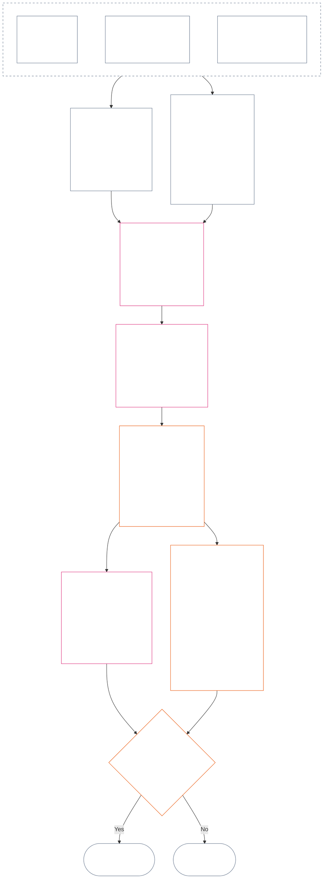

<!-- Locale: Thai (th) | Source: 9c2c8c10c871d91157bcd27b9f56ad6a1cec90d3 | AI-drafted, unreviewed | PARTIAL: Chapter Twelve §§4–6 only -->

### 4. ไวยากรณ์ของช่องและการปรับขนาดร่วมกัน

*พูดแบบตรง ๆ: ส่วนนี้กำหนดชื่อที่สอดคล้องกันสำหรับตำแหน่งที่เป็นไปได้เก้าระดับในแต่ละแกนที่แยกจากกันสองแกน และอธิบายการปรับขนาดผลกระทบตามตำแหน่งเหล่านั้น แกนหนึ่งบันทึกคุณูปการที่ตรวจสอบแล้ว อีกแกนบันทึกการละเมิดที่ตรวจสอบแล้ว การใช้หมายเลขช่องเดียวกันไม่รวมแกนเข้าด้วยกันและไม่หักล้างความเสียหายด้วยความช่วยเหลือ มาตรวัดรวมใน **§6** กำหนดช่องของทั้งสองแกนตามผลกระทบ LEQU ที่ได้สัดส่วน*

ไวยากรณ์ของช่องใช้หมายเลข `s` ตั้งแต่ **1** ถึง **9** แต่ละแกนมีตำแหน่งช่องของตนเอง:

- **แกนการมีส่วนร่วม** บันทึกลักษณะการมีส่วนร่วมเชิงบวก; และ
- **แกนการละเมิด** บันทึกผลวินิจฉัยการละเมิดที่ตรวจสอบแล้ว

หมายเลขช่องเดียวกันอาจปรากฏในทั้งสองแกน แต่แกนยังคงแยกจากกัน ช่องการมีส่วนร่วมไม่ใช่ช่องการละเมิด และช่องการละเมิดก็ไม่ใช่ช่องการมีส่วนร่วม

#### 4.1 ตาราง 1 — ป้ายแสดงช่อง

**ตาราง 1** ตั้งชื่อช่องทั้งเก้าระดับและแสดงป้ายของแกนการมีส่วนร่วมกับแกนการละเมิดไว้เคียงกัน ใช้ถ้อยคำสำหรับแสดงผลเท่านั้น; การกำหนดช่องเป็นไปตามมาตรวัดรวมใน **§6**

| `s` | ป้ายแสดงผลของแกนการมีส่วนร่วม | ป้ายแสดงผลของแกนการละเมิด |
| ---: | --- | --- |
| 1 | **คุณูปการพื้นฐานเล็กน้อย** | **ผลกระทบตามรัฐธรรมนูญเล็กน้อย** |
| 2 | **คุณูปการพื้นฐานเล็ก** | **ผลกระทบตามรัฐธรรมนูญเล็ก** |
| 3 | **คุณูปการเชิงบวกที่มีสาระสำคัญ** | **ผลกระทบตามรัฐธรรมนูญที่มีสาระสำคัญ** |
| 4 | **คุณูปการเชิงบวกที่สำคัญ** | **ผลกระทบตามรัฐธรรมนูญที่สำคัญ** |
| 5 | **คุณูปการเชิงบวกด้านการบริหารอย่างรับผิดชอบระดับร้ายแรง** | **ผลกระทบตามรัฐธรรมนูญระดับร้ายแรง** |
| 6 | **คุณูปการเชิงบวกด้านการบริหารอย่างรับผิดชอบระดับใหญ่** | **ผลกระทบตามรัฐธรรมนูญระดับใหญ่** |
| 7 | **ผู้สนับสนุนที่ได้รับการยอมรับ** | **ผลกระทบตามรัฐธรรมนูญระดับรุนแรง** |
| 8 | **ผู้สนับสนุนดีเด่น** | **ผลกระทบตามรัฐธรรมนูญระดับร้ายแรงยิ่ง** |
| 9 | **ผู้สนับสนุนต้นแบบ** | **ผลกระทบตามรัฐธรรมนูญระดับหายนะ** |

แกนการมีส่วนร่วมใช้ป้ายพื้นฐาน เชิงบวก เชิงบวกด้านการบริหารอย่างรับผิดชอบ และผู้สนับสนุน ส่วนแกนการละเมิดใช้ป้ายผลกระทบที่เป็นกลางในทุกช่อง ทั้งสองแกนยังคงแยกกัน ไม่สร้างคะแนนสุทธิและไม่อนุญาตให้หักล้างบันทึกการมีส่วนร่วมกับการละเมิด ช่องของแกนการละเมิดไม่จัดประเภทการประพฤติมิชอบที่ต่อต้านรัฐธรรมนูญด้วยตัวเอง; [บทที่สิบสี่](core_14.000_misconduct_designation.md#chapter-fourteen-anti-constitutional-misconduct) เป็นผู้ตัดสินโดยอิสระว่าการกำหนดการประพฤติมิชอบที่ต่อต้านรัฐธรรมนูญ (ACMD) ใช้กับการละเมิด `s` = 7–9 ที่ตรวจสอบแล้วหรือไม่

การดำเนินการอาจเผยแพร่หน่วยวัด วิธีใช้หลักฐาน และตัวอย่าง เพื่อช่วยประมาณคุณูปการหรือการสูญเสียที่เทียบเท่าชีวิตเต็มช่วง เอกสารเหล่านี้เป็นแนวทางเท่านั้น และห้ามใช้ลบล้าง **§6**, **บทที่หนึ่ง** หรือพื้นสิทธิใน**บทที่หก**

#### 4.2 กฎปรับขนาดผลกระทบร่วมกัน

*พูดแบบตรง ๆ: ไม่ได้วัดผลกระทบด้วยจำนวนคนเพียงอย่างเดียว คุณูปการหรือการสูญเสียที่ลึกซึ้งและกระทบผู้มีความรู้สึกหนึ่งรายอาจสำคัญกว่าผลตื้น ๆ ที่กระทบคนจำนวนมาก ต้องประเมินจำนวน ความลึก ความเปราะบาง ระยะเวลา ความคงทน ขอบเขต และลักษณะตามรัฐธรรมนูญร่วมกัน*

ใช้กฎต่อไปนี้ตีความทั้งสองแกนใน **§6**:

| มิติการปรับขนาด | กฎร่วมกัน | การใช้เฉพาะแกน |
| --- | --- | --- |
| **ขนาดของผลลัพธ์ตามรัฐธรรมนูญ (LEQU)** | ประเมินคุณูปการหรือการสูญเสียที่ตรวจสอบแล้วแบบบูรณาการ LEQU เป็นหลักยึดขนาดหลัก; จำนวนคนดิบ เงิน ผลผลิต หรือขนาดสถาบันไม่ใช่ | แกนการมีส่วนร่วมนับคุณูปการที่สอดคล้องกับสิทธิ; แกนการละเมิดนับการสูญเสียตามรัฐธรรมนูญ ความเสียหาย การสิ้นเปลือง การปิดกั้นทางเลือก หรืออันตรายที่ตรวจสอบแล้ว |
| **ขอบเขตผู้มีความรู้สึก** | พิจารณา**จำนวน ความลึก และความเปราะบางร่วมกัน** ไม่มีช่องใดกำหนดจำนวนคนเป็นข้อบังคับแยกต่างหาก ผลกระทบที่ลึกมากพอต่อผู้มีความรู้สึกหนึ่งรายอาจรองรับช่องเดียวกับผลกระทบที่กว้างกว่าแต่ตื้นกว่าได้ เมื่อขนาดโดยรวมและเกณฑ์อื่นในแถวเดียวกันเท่ากัน; เกณฑ์ที่ระบุชัดเรื่อง LEQU รวม หรือขอบเขตกว้างยังต้องผ่าน | การพึ่งพา ความสามารถที่ลดลง หรือความเปราะบางผิดปกติอาจเพิ่มความเป็นสาระ ขนาดกลุ่มเพียงอย่างเดียวไม่ยืนยันคุณูปการหรือความร้ายแรง |
| **ขอบเขตตามเวลา** | พิจารณาระยะเวลา การเกิดซ้ำ ความคงทน และการย้อนคืนไม่ได้เมื่อเป็นการสูญเสีย เหตุการณ์สั้นแต่พลิกเปลี่ยนได้อาจมีน้ำหนักมากกว่าผลเล็กน้อยที่ยาวนาน; ระยะเวลาไม่ใช่ตัวตัดสินเพียงอย่างเดียว | คุณูปการที่คงทนสนับสนุนขนาดคุณูปการที่สูงขึ้น การสูญเสียที่ต่อเนื่องหรือย้อนคืนไม่ได้สนับสนุนความร้ายแรงของการละเมิดที่สูงขึ้น |
| **ขอบเขตเชิงพื้นที่หรือสถาบัน** | การเข้าถึงที่กว้างขึ้นอาจเพิ่มขนาด แต่ไม่จำเป็นต้องข้ามชุมชนหรือสถาบัน หากความลึก ระยะเวลา ความเปราะบาง หรือความสำคัญเชิงรัฐธรรมนูญรองรับช่องนั้นได้โดยอิสระ | การซ่อมแซมสถาบันอาจเพิ่มขนาดคุณูปการ; ความเสียหายเชิงโครงสร้างหรือเชิงระบบอาจเพิ่มความร้ายแรงของการละเมิด |
| **คุณภาพหรือลักษณะตามรัฐธรรมนูญ** | วัดวิธีที่ผลลัพธ์เกิดขึ้นแยกจากความกว้างที่ผลลัพธ์แพร่กระจาย ห้ามนับข้อเท็จจริงเดียวกันซ้ำ | ความเสียหายที่ผลักให้ผู้อื่น ภาระที่ปกปิด การยึดครอง หรือการพึ่งพาอาจจำกัดเพดานหรือตัดคุณูปการที่อ้าง พฤติกรรมละเมิด เช่น หน้าที่ ความประมาท การหลอกลวง การบีบบังคับ ความรุนแรง หรือการเอื้อให้เกิดความเสียหายเชิงโครงสร้าง ต้องบันทึกแยกเป็นลักษณะพฤติกรรมและไม่เปลี่ยนช่องผลกระทบ |
| **พื้นสิทธิและมาตรการคุ้มครองสำคัญ** | ห้ามแลกการปฏิบัติตามพื้นสิทธิกับคุณูปการหรือการสูญเสียโดยรวม | การปฏิบัติตามพื้นสิทธิไม่ได้ยืนยันคุณูปการสูงด้วยตัวเอง การทำลายพื้นสิทธิอย่างเป็นสาระหรือความล้มเหลวของมาตรการคุ้มครองสำคัญอาจรองรับความร้ายแรงของการละเมิดที่สูงขึ้น แม้กระทบผู้มีความรู้สึกโดยตรงเพียงไม่กี่ราย |

มิติเหล่านี้ไม่ใช่รายการตรวจสอบที่กำหนดว่าต้องมีขนาดครบทุกแบบ ให้อธิบายว่ามิติใดเป็นตัวกำหนด มิติใดไม่ใช่ และเพราะเหตุใด

- **วิธีกำหนดช่องร่วมกัน:**
  - ประมาณคุณูปการหรือการสูญเสียที่ตรวจสอบแล้วแบบบูรณาการเป็น LEQU ภายใต้หลักความได้สัดส่วน แล้วกำหนดช่องเดียวที่ช่วงตัวเลขครอบคลุมขนาดนั้น
  - ใช้เกณฑ์เดียวกันกับทั้งสองแกน
  - ช่องการมีส่วนร่วมยังต้องเป็นไปตามข้อกำหนดพื้นฐานและความสอดคล้องตามรัฐธรรมนูญที่ใช้ได้; การถึงเกณฑ์ตัวเลขไม่ทำให้ผลผลิตที่ผลักภาระให้ผู้อื่นหรือขัดต่อรัฐธรรมนูญนับเป็นคุณูปการได้
- **แยกลักษณะออกจากผลกระทบ:** ให้ตัวบอกเส้นทางคุณูปการ เส้นทางความเสียหาย คุณภาพพฤติกรรม และลักษณะพฤติกรรมที่ใช้ได้ซ้อนกันในบันทึกร่องรอย หน้าที่ ความประมาท การหลอกลวง การเพิ่มความร้ายแรง การบีบบังคับ ความรุนแรง เจตนา หรือการเอื้อให้เกิดความเสียหายเชิงโครงสร้างอาจกระทบการระบุผู้กระทำ มาตรการคุ้มครอง หรือผลตามคำถามที่ 3 แต่ไม่มีข้อใดเพิ่มหรือลดช่องผลกระทบ LEQU
- **ขอบเขตการทบทวนการประพฤติมิชอบที่ต่อต้านรัฐธรรมนูญ:** ผลการสูญเสียของแกนการละเมิดที่ตรวจสอบแล้วอาจไปถึง `s` = 7–9 ตามผลกระทบ ไม่ว่าพิสูจน์การประพฤติมิชอบที่ต่อต้านรัฐธรรมนูญได้หรือไม่ บทที่สิบสี่ไม่แทนที่การกำหนดผลกระทบ แต่ตัดสินโดยอิสระว่า ACMD ที่เกี่ยวข้องใช้หรือไม่

หากอันตรายยังไม่เกิดขึ้นจริง ให้บันทึกแต่ละรายการต่อไปนี้แยกกัน:

- โอกาสที่จะเกิด;
- ระยะเวลาที่ผู้มีความรู้สึกจะเผชิญอันตราย;
- ขอบเขตที่อาจไปถึง;
- ความไม่แน่นอนของประมาณการ; และ
- ผลลัพธ์ที่เลวร้ายที่สุดซึ่งยังน่าเชื่อถือ

ห้ามนับผลลัพธ์ที่เลวร้ายที่สุดนั้นเป็นความเสียหายที่เกิดขึ้นแล้ว (การสูญเสีย LEQU) เว้นแต่การดำเนินการที่รับรองแล้วกำหนดวิธีปรับเทียบความเสี่ยง (วิธีแปลงความเสี่ยงเป็น LEQU) ที่ทุกคนตรวจดูได้

### 5. ข้อมูลเข้าตามรัฐธรรมนูญเพื่อกำหนดแกน

*พูดแบบตรง ๆ: ก่อนเลือกช่อง ให้ระบุแหล่งตามรัฐธรรมนูญที่บอกว่ากำลังวัดพื้นฐาน คุณูปการ หน้าที่ ความเสียหาย หรือการละเมิดใด ใช้ลิงก์ด้านล่างเพื่อนำแหล่งเหล่านั้นไปใช้ ณ ที่หลักตามบัญญัติ อย่าเปลี่ยนขั้นตอนการส่งต่อนี้ให้กลายเป็นคะแนนอีกชุดหรือคำจำกัดความทดแทน*

ก่อนกำหนดช่องตาม **§6** บันทึกร่องรอยต้องระบุ:

- พื้นฐาน หน้าที่ ข้อจำกัด หรือประโยชน์ที่ได้รับความคุ้มครองตามรัฐธรรมนูญที่ใช้ได้;
- บทบัญญัติที่กำหนดคุณูปการ ผลเสีย ความเสียหาย หรือการละเมิดที่ตรวจสอบแล้วซึ่งกำลังวัด;
- นิยาม หลักการ และมาตราตามพื้นสิทธิที่ส่งผลอย่างเป็นสาระต่อขนาดหรือลักษณะพฤติกรรม; และ
- เหตุที่แหล่งข้อมูลแต่ละรายการใช้ได้ และส่งผลต่อการกำหนดแกนอย่างไร

ตารางส่งต่อด้านล่างไม่ใช่รายการครบถ้วน นิยาม หลักการ หรือมาตราเพิ่มเติมทุกข้อที่ข้อเท็จจริงที่ตรวจสอบแล้วทำให้ใช้บังคับ ยังคงมีผลและต้องระบุไว้ในบันทึกร่องรอย แหล่งหลักตามบัญญัติที่ลิงก์ไว้แต่ละแห่งเป็นตัวควบคุม; ตารางเหล่านี้ไม่ได้กล่าวซ้ำหรือทำให้แคบลง

#### 5.1 ข้อมูลเข้านิยาม

| แหล่งหลักตามบัญญัติ | บทบาทต่อแกนการมีส่วนร่วม | บทบาทต่อแกนการละเมิด |
| --- | --- | --- |
| [สถานะ การมีส่วนร่วม และการละเมิด](core_05.035_band_accountability.md#defa3-standing-state-contribution-and-violation) | อธิบายว่าอะไรนับเป็นการมีส่วนร่วม และข้อเท็จจริงที่ผ่านการตรวจสอบใดใช้วัดได้ อีกทั้งทำให้แน่ใจว่าบันทึกร่องรอยการมีส่วนร่วมติดตามเฉพาะด้านดี ไม่ปนกับด้านเสีย | อธิบายว่าอะไรนับเป็นการละเมิดและบันทึกอย่างไร อีกทั้งส่งกรณีร้ายแรงที่สุดไปยังการทบทวนการประพฤติมิชอบที่ต่อต้านรัฐธรรมนูญ ซึ่งเป็นการทบทวนแยกต่างหากสำหรับพฤติกรรมที่บ่อนทำลายรัฐธรรมนูญเอง |
| [ความรับผิดชอบ](core_05.005_apex_accountability_leg.md#accountability) | ตรวจสอบว่าคำกล่าวอ้างเรื่องการบริหารอย่างรับผิดชอบหรือการซ่อมแซมที่ดีทำให้ใครสักคนต้องตอบรับผิดจริงหรือไม่ และยังต้องแสดงว่าใครทำอะไร ใครต้องตอบรับผิด และทบทวน ทำให้ถูกต้อง และแก้ไขตามสัดส่วนผลกระทบได้อย่างไร | พบกรณีที่ไม่ชัดเจนว่าใครทำหรือใครต้องตอบรับผิด รวมถึงกรณีที่ความรับผิดชอบหยุดทำงานหลังองค์กรหรือโครงสร้างเปลี่ยนไป |
| [ความเสียหาย](core_05.035_band_accountability.md#harm) | ความเสียหายที่ผลักให้ผู้อื่นหรือถูกซ่อนไว้อาจจำกัดหรือลบคุณูปการที่อ้าง การซ่อมแซมความเสียหายนับเป็นคุณูปการได้ แต่เฉพาะเมื่อมีการตรวจสอบและแสดงการซ่อมแซมโดยอิสระแล้ว | ระบุประเภทความเสียหายที่นับในการวัดการสูญเสียและความร้ายแรง ได้แก่ โดยตรง โดยอ้อม ล่าช้า สะสม แพร่กระจายข้ามระบบ และความเสียหายต่อจิตใจหรือความผาสุกทางอารมณ์ของผู้มีความรู้สึก |
| [ความเป็นสาระ](core_05.050_band_oversight.md#materiality) และ [หน่วยเทียบเท่าอายุขัย (LEQU)](core_05.055_band_participation.md#lifespan-equivalent-unit-lequ) | กำหนดระดับที่คุณูปการซึ่งตรวจสอบแล้วนับได้ โดยพิจารณาว่าผลไปถึงกว้างเพียงใด ผู้ได้รับผลกระทบเปราะบางเพียงใด และคงอยู่นานเท่าใด ผลวัดเป็น LEQU ซึ่งเป็นมาตรวัดร่วมสำหรับคุณูปการตลอดชีวิตเต็มช่วง | กำหนดระดับที่การสูญเสียหรืออันตรายซึ่งตรวจสอบแล้วนับได้ โดยพิจารณาขอบเขต ความเปราะบาง ระยะเวลา และความยากในการย้อนคืน ผลวัดเป็น LEQU ซึ่งเป็นมาตรวัดเดียวกับการสูญเสียตลอดชีวิตเต็มช่วง |
| [ลักษณะคุณูปการ](core_05.035_band_accountability.md#contribution-nature) | ตัดสินว่าสิ่งหนึ่งนับเป็นคุณูปการหรือไม่ ต้องเป็นด้านดีเท่านั้น ห้ามปนกับความเสียหาย และต้องมีบันทึกคุณูปการที่ตรวจสอบแล้วและแสดงได้ หากขาดอย่างใดอย่างหนึ่ง จะกำหนดแกนการมีส่วนร่วมไม่ได้ | ไม่มีบทบาทในที่นี้ ไม่ได้ตัดสินว่าอะไรนับเป็นความเสียหาย และไม่เคยลดระดับความร้ายแรงของการละเมิด |
| [ลักษณะการละเมิด](core_05.035_band_accountability.md#violation-nature) | ไม่มีบทบาทในที่นี้ การละเมิดไม่เคยนับเป็นคุณูปการเชิงลบ และไม่ลบคุณูปการที่ตรวจสอบแล้วซึ่งไม่เกี่ยวข้องกัน | ตัดสินว่าสิ่งหนึ่งนับเป็นการละเมิดหรือไม่ ต้องจัดเป็นสิ่งที่ก่อความเสียหายและมีผลวินิจฉัยที่ตรวจสอบแล้วว่ามีการละเมิดเกิดขึ้น หากขาดอย่างใดอย่างหนึ่ง จะกำหนดแกนการละเมิดไม่ได้ |
| [ข้อจำกัดตามรัฐธรรมนูญ](core_05.045_band_integrative.md#constitutional-constraint), [ลำดับชั้นอำนาจและลำดับชั้นภายใน](core_05.045_band_integrative.md#authority-stack-and-internal-hierarchy) และ [การตรวจสอบได้](core_05.050_band_oversight.md#auditability) | ป้องกันไม่ให้นับคุณูปการที่อ้าง หากต้องอาศัยการทำให้รัฐธรรมนูญพ่ายแพ้ การหลบกฎ ทำให้พื้นสิทธิแคบลง (การคุ้มครองขั้นต่ำที่รัฐธรรมนูญรับรอง) หรือทำตามกฎเพียงบนกระดาษ | ชี้สิ่งที่มีผลต่อความร้ายแรงที่แท้จริงของการละเมิด เช่น การฝ่าฝืนขีดจำกัดตามรัฐธรรมนูญที่สำคัญ การวางสิ่งอื่นเหนืออำนาจรัฐธรรมนูญ การหลบเลี่ยงกฎ หรือทำให้บังคับใช้กฎไม่ได้ |
| [การตรวจสอบได้](core_05.050_band_oversight.md#auditability) และ [ความสามารถในการโต้แย้ง](core_05.035_band_accountability.md#contestability) | กำหนดให้แสดงและตรวจสอบคุณูปการที่อ้างได้ และให้ผู้ไม่เห็นด้วยมีช่องทางโต้แย้งที่ใช้การได้ | กำหนดให้ตรวจสอบและโต้แย้งผลวินิจฉัยได้ ข้อกล่าวหาหรือป้ายกำกับที่ไม่มีคำอธิบายไม่อาจกำหนดความร้ายแรงของการละเมิด |

#### 5.2 ข้อมูลเข้าจากหลักการ

| แหล่งหลักการ | บทบาทในการกำหนดแกน |
| --- | --- |
| [จตุรภาคทางรัฐธรรมนูญ](core_00.000_preamble.md#constitutional-tetrad), [สองเป้าประสงค์ทางรัฐธรรมนูญ](core_00.000_preamble.md#two-constitutional-aims) และ[ส่วนได้เสียที่เป็นสาระ](core_00.000_preamble.md#material-stake) | กำหนดวินัยในการทำงานสี่ด้าน (การมีส่วนร่วม การกำกับดูแล ความรับผิดชอบ และความทันเวลา) ผลลัพธ์สองอย่างที่รัฐธรรมนูญมุ่งหมาย (ความเจริญงอกงามและความต่อเนื่อง) และกรอบที่ปรับขนาดการกำหนดแต่ละครั้งตามสิ่งที่เสี่ยงอยู่ |
| [ความผาสุก](core_01.000_values_principles.md#3-foundational-objective-wellbeing-flourishing-aim) และ [การยอมรับ การเสริมแรง และความมุ่งหวัง](core_01.000_values_principles.md#32-recognition-reinforcement-and-aspiration) | วางฐานคุณูปการที่เคารพสิทธิและการยอมรับที่เหมาะสมบนแกนการมีส่วนร่วม ชื่อเสียงหรือรางวัลไม่ถือเป็นหลักฐานของคุณูปการ |
| [ความปลอดภัย](core_01.000_values_principles.md#4-safety-harm-constraint) และ [ความจริง](core_01.000_values_principles.md#5-truth-epistemic-integrity-constraint) | กำหนดขีดจำกัดที่มีผลผูกพันกับทั้งสองแกน คุณูปการที่ได้มาจากความเสียหายหรือการหลอกลวงนับได้ไม่เต็มจำนวน; ความล้มเหลวด้านความปลอดภัยหรือความจริงที่ตรวจสอบแล้วอาจแสดงขนาดหรือชนิดของการละเมิด |
| [การบริหารอย่างรับผิดชอบโดยละเอียด](core_01.010_stewardship_capacity_principles.md#16-stewardship-in-depth) และ [การปกครองภายใต้วินัยการบริหารอย่างรับผิดชอบ](core_01.010_stewardship_capacity_principles.md#18-governance-under-stewardship-discipline) | ชี้นำการชั่งน้ำหนักคุณูปการที่ยั่งยืน หน้าที่ตามบทบาท การซ่อมแซมสถาบัน การกำกับดูแล และความรับผิดชอบเมื่อข้อเท็จจริงที่ตรวจสอบแล้วต้องใช้หลักการเหล่านี้ |
| [หลักการแลกเปลี่ยนหลัก](core_01.005_interaction_interpretation.md#131-core-tradeoff-principles) และ [พื้นฐานตามรัฐธรรมนูญ ความปลอดภัย และกระบวนการที่ไม่ลดทอนศักดิ์ศรี](core_01.005_interaction_interpretation.md#1314-constitutional-floors-safety-and-anti-degrading-process) | ใช้เมื่อพฤติกรรมที่วัดเกี่ยวข้องกับความจำเป็น การลดความเสียหายให้เหลือน้อยที่สุด ความได้สัดส่วน การขัดกันของสิทธิ หรือข้อจำกัด หลักการเหล่านี้ไม่ให้อำนาจสร้างผลที่ตามมาด้วยตัวเอง |

#### 5.3 ข้อมูลเข้าจากพื้นสิทธิและมาตรา

| แหล่งมาตรา | บทบาทหรือขอบเขตในการกำหนดแกน |
| --- | --- |
| [พื้นสิทธิตามบทที่หก](core_06.000_rights_part_a.md#chapter-six-foundational-rights) ที่ใช้ตามข้อเท็จจริง รวมถึงทุกมาตราที่บันทึกร่องรอยซึ่งตรวจสอบแล้วเกี่ยวข้องอย่างเป็นสาระ | กำหนดการคุ้มครองพื้นฐาน ประโยชน์ หน้าที่ คุณูปการ หรือการละเมิดที่เสี่ยงอยู่ ไม่มีมาตราใดถูกละไว้เพียงเพราะไม่ได้อยู่ในรายการด้านล่าง |
| [มาตรา XIX — สถานะร่องรอยและสถานะการมีส่วนร่วม](core_06.015_rights_part_d.md#article-xix-standing-and-participation-status) | แยกสิ่งต่อไปนี้ออกจากกัน: สถานะร่องรอยของผู้มีความรู้สึก ศักดิ์ศรี การคุ้มครองขั้นต่ำของพื้นสิทธิ สถานะผู้มีส่วนได้เสีย ชื่อเสียง และการเปลี่ยนสถานะการมีส่วนร่วมในภายหลัง |
| [มาตรา XIII-A — พื้นฐานความน่าเชื่อถือและไว้วางใจได้](core_06.010_rights_part_c.md#article-xiii-a-reliability-and-trustworthiness-baseline), [มาตรา XIII-B — สิทธิในการชดเชยและการเยียวยา](core_06.010_rights_part_c.md#article-xiii-b-right-to-redress-and-remedy), [มาตรา XV-B — ความโปร่งใส การตรวจสอบได้ และความสามารถในการโต้แย้ง](core_06.010_rights_part_c.md#article-xv-b-transparency-auditability-and-contestability) และ [มาตรา XVI — การตรวจสอบ ความโปร่งใส และการตรวจสอบโดยอิสระ](core_06.010_rights_part_c.md#article-xvi-audit-transparency-and-independent-verification) | ใช้เมื่อคุณูปการหรือการละเมิดที่ตรวจสอบแล้วเกี่ยวข้องกับการเก็บบันทึกอย่างซื่อตรง การแบ่งปันข้อมูล การตรวจสอบข้อเท็จจริง การโต้แย้งคำตัดสิน หรือการแก้ไขข้อผิดพลาด |
| [มาตรา XXIV — การวิเคราะห์สาเหตุรากและการตอบสนองแบบปรับตัว](core_06.015_rights_part_d.md#article-xxiv-root-cause-analysis-and-adaptive-response) | ใช้เมื่อสาเหตุของพฤติกรรม การแก้ไข การเกิดซ้ำ หรือการปรับตัวของการตอบสนองเป็นเรื่องสำคัญ เพราะแสดงสถานะของพฤติกรรมนั้นภายใต้รัฐธรรมนูญ |
| [มาตรา XX — ความยุติธรรมหลังการละเมิดที่ตรวจสอบแล้ว](core_06.015_rights_part_d.md#article-xx-justice-after-verified-violation) และ [มาตรา XXVI-C — การแก้ไขให้ทันเวลาและพื้นฐานต่อต้านความล่าช้า](core_06.020_rights_part_e.md#article-xxvi-c-timely-resolution-and-anti-delay-floor) | ใช้กับกระบวนการหรือความล่าช้าที่ข้อเท็จจริงเกี่ยวข้องจริง ๆ **มาตรา XX** (*ความยุติธรรมหลังการละเมิดที่ตรวจสอบแล้ว*) ส่วนใหญ่จำกัดสิ่งที่เกิดขึ้นหลังวัดการละเมิดแล้ว (คำถามที่ 3) ห้ามใช้เพื่อเพิ่มหรือลดช่องของคำถามที่ 2 เพียงเพื่อให้เหตุผลแก่การตอบสนองที่ใครบางคนชอบอยู่แล้ว |

**ข้อจำกัดการนำไปใช้** ขั้นตอนนี้ชี้เฉพาะแหล่งข้อมูลที่ถูกต้อง

- ขั้นตอนนี้ไม่ได้:
  - เปิดคำถามที่ 1 ขึ้นใหม่;
  - นำข้อเท็จจริงที่ยังไม่ได้ตรวจสอบเข้ามา;
  - เพิ่มการวัดหรือคะแนนใหม่;
  - นับข้อเท็จจริงเดียวซ้ำผ่านแหล่งต่างกัน;
  - รวมสองแกนเข้าด้วยกัน; หรือ
  - ทำให้แหล่งที่ระบุไว้ทุกรายการใช้กับบันทึกร่องรอยทุกรายการ
- การมีส่วนร่วมและการละเมิดยังคงวัดแยกจากกัน
- ผลตาม **มาตรา XX** (*ความยุติธรรมหลังการละเมิดที่ตรวจสอบแล้ว*) อยู่นอกคำถามที่ 2
- การทบทวนเพื่อกำหนดตามบทที่สิบสี่ยังคงแยกจากช่องผลกระทบที่กำหนดไว้ที่นี่

### 6. มาตรวัด LEQU แบบได้สัดส่วนที่เป็นหนึ่งเดียว — แกนการมีส่วนร่วมและแกนการละเมิด

<strong>คำแนะนำสำหรับผู้อ่าน (ไม่มีผลเชิงปฏิบัติ): ความก้าวหน้าแบบห้าเท่าทำงานอย่างไร</strong>

> มาตรวัดใช้ความก้าวหน้าแบบห้าเท่า โดยยึด `s` = 7 = หนึ่ง LEQU สำหรับทั้งสองแกน ขนาดขั้นต่ำของช่อง `s` ตั้งแต่ช่อง 2 ถึง 9 คือ `5^(s−7)` LEQU; ช่อง 1 เริ่มจากศูนย์ การดำเนินการที่รับรองแล้วอาจเผยแพร่เกณฑ์ตัวเลขที่ได้และตัวอย่างการปรับเทียบ ช่อง 1 ครอบคลุมพื้นฐานตามรัฐธรรมนูญที่ตรวจสอบแล้วบนแกนการมีส่วนร่วม และการสูญเสียที่ตรวจสอบแล้วซึ่งต่ำกว่าเกณฑ์บวกแรกบนแกนการละเมิด; การไม่มีคุณูปการหรือไม่มีการละเมิดไม่ใช่บันทึก `s` = 1 ด้วยตัวเอง
>
> **หลักยึดที่อ่านเข้าใจง่าย:** หากใช้ช่วงชีวิตมนุษย์ 80 ปีเป็นตัวอย่างปรับเทียบ ให้อ่านคอลัมน์กลางขึ้นไปเป็นคุณูปการที่เทียบเท่าชีวิตเต็มช่วง เวลาใช้ประโยชน์ได้ หรือทรัพยากรและขีดความสามารถที่เพิ่มขึ้นโดยสอดคล้องกับสิทธิ; อ่านลงมาเป็นการสูญเสีย การพรากสิทธิ การสิ้นเปลือง หรือการปิดกั้นทางเลือกที่เทียบเท่ากัน ปริมาณทรัพยากรไม่นับด้วยตัวมันเอง; ตัวกำหนดคือผลตามรัฐธรรมนูญที่ทรัพยากรสร้างหรือป้องกันไว้

 

*พูดแบบตรง ๆ: **ตาราง 2** วางการมีส่วนร่วมที่ตรวจสอบแล้วและการละเมิดที่ตรวจสอบแล้วบนมาตรวัดผลกระทบแบบได้สัดส่วนเดียวกัน ช่องที่สูงขึ้นหมายถึงคุณูปการหรือการสูญเสียตามรัฐธรรมนูญแบบบูรณาการที่มากขึ้น บันทึกร่องรอยและแกนยังแยกจากกัน: มาตรวัดร่วมเปรียบเทียบขนาด ไม่ใช่คุณค่าทางศีลธรรม และไม่อนุญาตให้ความช่วยเหลือหักล้างความเสียหาย*

แผนภาพแสดงการกำหนดช่องหนึ่งรายการตั้งแต่ต้นจนจบ และแสดงลำดับการทำขั้นตอน ซึ่งไม่ใช่ลำดับเดียวกับหัวข้อย่อยด้านล่าง; หัวข้อย่อยระบุกฎแต่ละข้อ

ใช้หลัก **ความได้สัดส่วน** ประมาณผลกระทบ LEQU แบบบูรณาการจากความลึก ขอบเขตผู้มีความรู้สึก ความเปราะบาง ระยะเวลา ความคงทนหรือการย้อนคืนไม่ได้ ขอบเขต และความสำคัญเชิงรัฐธรรมนูญ มิติเหล่านี้ปรับรูปประมาณการ LEQU ไม่ใช่โบนัสช่องที่แยกจากกัน

- ใช้ **ตาราง 2** หลังจากคำถามที่ 1 ยืนยันว่าเกิดอะไรขึ้น คำถามที่ 2 วัดคุณูปการหรือการสูญเสียที่ตรวจสอบแล้ว ใช้ **§§1–3 และ §4.2** แล้ว และระบุแหล่งรัฐธรรมนูญที่ **§5** กำหนดครบถ้วน
- กำหนดช่องเดียวจากประมาณการ LEQU แบบบูรณาการ
  - อธิบายว่ามิติปรับขนาดแต่ละด้านที่เป็นสาระส่งผลต่อประมาณการอย่างไร และเหตุใดมิติที่ละไว้จึงไม่ใช่ตัวกำหนด
  - การกำหนดทุกครั้งต้องเป็นไปตามข้อกำหนดด้าน:
    - การติดตามได้;
    - การตรวจสอบได้;
    - ความสามารถในการโต้แย้ง; และ
    - พื้นสิทธิที่ใช้บังคับ
  - การมีส่วนร่วมยังต้องเป็นไปตามข้อกำหนดเรื่องการไม่ผลักภาระให้ผู้อื่นและความสอดคล้องตามรัฐธรรมนูญ
- บันทึกข้อเท็จจริงเกี่ยวกับลักษณะพฤติกรรมเป็นตัวบอกที่ติดตามแยกกันได้ อาจใช้ควบคุมการระบุผู้กระทำ ความเข้มข้นในการทบทวน มาตรการคุ้มครอง การเยียวยา หรือการกำหนดตามบทที่สิบสี่; จะกระทบช่องเฉพาะเท่าที่ผลที่ตรวจสอบแล้วเปลี่ยนผลกระทบ LEQU แบบบูรณาการ
- ประเมินผลที่ตรวจสอบแล้วของการกระทำหรือแนวทางพฤติกรรมอย่างครบถ้วนผ่านมิติปรับขนาดที่เป็นสาระ รวมถึง:
  - การบาดเจ็บทางกาย;
  - บาดแผลทางจิตใจ;
  - ผลจากการบีบบังคับ;
  - การพรากเสรีภาพหรืออันตรายต่อเสรีภาพ;
  - ความเสียหายสะสม; และ
  - คุณูปการหรือการสูญเสียอื่นที่รัฐธรรมนูญรับรองได้
- ห้าม:
  - เพิ่มหรือลดช่องเพียงเพราะเหตุการณ์หรือแนวทางพฤติกรรมมีลักษณะดังนี้:
    - หน้าที่;
    - ความประมาท;
    - เจตนา;
    - การปกปิด;
    - การทำซ้ำ;
    - การเพิ่มความร้ายแรง;
    - การบีบบังคับ;
    - ความรุนแรง;
    - อันตรายต่อเสรีภาพ;
    - การแก้ไขได้; หรือ
    - ผลลัพธ์ที่ต้องการ
  - อนุมานลักษณะพฤติกรรมจากขนาด หรือใช้ลักษณะพฤติกรรมแทนขนาดที่ตรวจสอบแล้ว

**ตาราง 2** แสดงช่องทั้งเก้าตามลำดับ แต่ละแถวให้หมายเลขช่อง `s` ปริมาณคุณูปการที่เพิ่มหรือการสูญเสียที่เกิดขึ้นซึ่งถึงช่องนั้น (ใช้ช่วงชีวิตมนุษย์ 80 ปีเป็นตัวอย่างปรับเทียบ) และชื่อช่องของแต่ละแกน ใช้เกณฑ์เดียวกันกับทั้งสองแกน แต่ชื่อทั้งสองยังคงแยกกัน: ช่องแกนการมีส่วนร่วมกับช่องแกนการละเมิดเป็นคนละบันทึกและไม่หักล้างกัน

| `s` | การปรับเทียบด้วยชีวิตมนุษย์ 80 ปี — คุณูปการที่เพิ่ม / การสูญเสียที่เกิด | แกนการมีส่วนร่วม | แกนการละเมิด |
| ---: | --- | --- | --- |
| 1 | น้อยกว่าประมาณ **9 วัน** | **คุณูปการพื้นฐานเล็กน้อย** — การปฏิบัติตามพื้นฐานตามรัฐธรรมนูญสำหรับขอบเขตที่ประเมินซึ่งตรวจสอบแล้ว; การเพิ่มขึ้นที่วัดได้ใด ๆ ยังต่ำกว่า `s` = 2 | **ผลกระทบตามรัฐธรรมนูญเล็กน้อย** — การสูญเสียหรือการบกพร่องในการดำเนินงานที่ตรวจสอบแล้วต่ำกว่า `s` = 2 รวมถึงข้อบกพร่องทางรูปแบบที่ไม่มีหลักฐานความเสียหายเชิงเนื้อหา |
| 2 | ประมาณ **9–47 วัน** | **คุณูปการพื้นฐานเล็ก** — ผลงานที่เชื่อถือได้และมีขอบเขต ซึ่งเกินพื้นฐานขั้นต่ำภายในระดับผลกระทบนี้ | **ผลกระทบตามรัฐธรรมนูญเล็ก** — การสูญเสียที่ตรวจสอบแล้วและมีขอบเขตในระดับผลกระทบนี้ |
| 3 | ประมาณ **47 วัน–8 เดือน** | **คุณูปการเชิงบวกที่มีสาระสำคัญ** — คุณูปการที่แสดงให้เห็นได้และเกินพื้นฐานในระดับผลกระทบนี้ | **ผลกระทบตามรัฐธรรมนูญที่มีสาระสำคัญ** — การสูญเสียจำนวนมากที่ตรวจสอบแล้วในระดับผลกระทบนี้ |
| 4 | ประมาณ **8 เดือน–3.2 ปี** | **คุณูปการเชิงบวกที่สำคัญ** — คุณูปการที่ตรวจสอบแล้วซึ่งลึกกว่า ยั่งยืน เกิดซ้ำ ตอบสนองต่อความเปราะบาง หรือกว้างกว่า | **ผลกระทบตามรัฐธรรมนูญที่สำคัญ** — การสูญเสียตามรัฐธรรมนูญที่สำคัญซึ่งตรวจสอบแล้ว |
| 5 | ประมาณ **3.2–16 ปี** | **คุณูปการเชิงบวกด้านการบริหารอย่างรับผิดชอบระดับร้ายแรง** — การบริหารอย่างรับผิดชอบ การประสานงาน การบำรุงรักษา การซ่อมแซม หรือคุณูปการยั่งยืนในลักษณะเดียวกัน | **ผลกระทบตามรัฐธรรมนูญระดับร้ายแรง** — การสูญเสียตามรัฐธรรมนูญระดับร้ายแรงที่ตรวจสอบแล้ว |
| 6 | ประมาณ **16–80 ปี** | **คุณูปการเชิงบวกด้านการบริหารอย่างรับผิดชอบระดับใหญ่** — คุณูปการที่ตรวจสอบแล้วระดับใหญ่และใกล้เคียงหนึ่ง LEQU | **ผลกระทบตามรัฐธรรมนูญระดับใหญ่** — การสูญเสียที่ตรวจสอบแล้วระดับใหญ่และใกล้เคียงหนึ่ง LEQU |
| 7 | ประมาณ **1–5 ช่วงชีวิต** (**80–400 ปี**) | **ผู้สนับสนุนที่ได้รับการยอมรับ** — คุณูปการที่ตรวจสอบแล้วและสอดคล้องกับรัฐธรรมนูญอย่างน้อยหนึ่ง LEQU | **ผลกระทบตามรัฐธรรมนูญระดับรุนแรง** — การสูญเสียตามรัฐธรรมนูญที่ตรวจสอบแล้วอย่างน้อยหนึ่ง LEQU |
| 8 | ประมาณ **5–25 ช่วงชีวิต** (**400–2,000 ปี**) | **ผู้สนับสนุนดีเด่น** — คุณูปการที่ตรวจสอบแล้วซึ่งสูงกว่า `s` = 7 อย่างเป็นสาระ | **ผลกระทบตามรัฐธรรมนูญระดับร้ายแรงยิ่ง** — การสูญเสียที่ตรวจสอบแล้วซึ่งสูงกว่า `s` = 7 อย่างเป็นสาระ |
| 9 | อย่างน้อย **25 ช่วงชีวิต** (**2,000+ ปี**) | **ผู้สนับสนุนต้นแบบ** — คุณูปการที่ตรวจสอบแล้วซึ่งสูงกว่า `s` = 8 อย่างเป็นสาระ | **ผลกระทบตามรัฐธรรมนูญระดับหายนะ** — การสูญเสียที่ตรวจสอบแล้วซึ่งสูงกว่า `s` = 8 อย่างเป็นสาระ |

<strong>หมายเหตุการทำงานร่วมกันของการนำไปใช้</strong>

> วิดเจ็ตนี้มีเนื้อหาการทำงานร่วมกันสำหรับการนำไปใช้ สนับสนุนหมวดหมู่เชิงปฏิบัติของบทนี้ ไม่ได้สร้างระบบหมวดหมู่คู่ขนาน

ช่องข้อมูลที่เครื่องอ่านได้สำหรับการแสดงช่อง (`sub_tier`, `sub_tier_display` และช่องแสดงผลที่เกี่ยวข้อง) กำหนดไว้ใน [CH06_NINE_SLOT_STANDING_SCALE.md](implementation/CH06_NINE_SLOT_STANDING_SCALE.md) และ [ch06_nine_slot_constants.json](implementation/ch06_nine_slot_constants.json) แผนผังสี่ช่วงของการนำไปใช้ยังเป็นตัวช่วยการทำงานร่วมกัน และไม่ได้เพิ่มคอลัมน์ช่วงหลักลงใน **ตาราง 2** เชิงปฏิบัติ

วิธีอ้างอิงและตัวอย่างการกำหนดช่องที่ทำไว้แล้ว รวมถึงกรณีผู้มีความรู้สึกที่มีน้ำหนัก จุดตรวจสถานะที่บันทึกไว้ และไม่มีการตายที่แน่นอน อยู่ใน [LEQU_CALIBRATION_REFERENCE.md](implementation/LEQU_CALIBRATION_REFERENCE.md) วิธีคำนวณเหล่านั้นแทนเกณฑ์ร่วมและกฎการกำหนดตามสัดส่วนใน **§6** ไม่ได้ กำหนดช่องให้บันทึกที่กำลังดำเนินอยู่ไม่ได้ และตัดสินไม่ได้ว่าใครนับรวม

การดำเนินการที่รับรองแล้วอาจเผยแพร่ประมาณการ LEQU และป้ายแสดงผลที่มีคีย์กำกับ ตัวช่วยเหล่านั้นห้ามใช้แทนเกณฑ์ร่วมและกฎการกำหนดตามสัดส่วนใน **§6** หรือมาตรการคุ้มครองการกำหนดตามบทที่สิบสี่ เว้นแต่เปลี่ยนแปลงผ่าน**เอกสารที่สอดคล้องตามข้อกำหนด**

