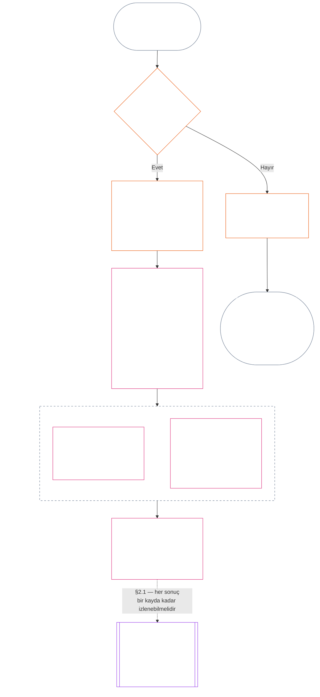

<!-- Locale: Turkish (tr) | Source: 9c2c8c10c871d91157bcd27b9f56ad6a1cec90d3 | AI-drafted, unreviewed | PARTIAL: Chapter Eleven §§1–3 only -->

### 1. Üç soru

*Yalın dille: standing değerlendirmesi, sırasıyla üç soruyu yanıtlayarak yapılır. İstenen bir derecelendirmeden olgu çıkarsamayın ve istenen bir sonucu haklı göstermek için derecelendirme seçmeyin.*

| Soru | Soru neyi soruyor? | Yanıt nerede veriliyor? |
| --- | --- | --- |
| **1. Ne oldu?** | Hangi olgular doğrulandı; kim ya da ne hakkında, hangi dönemde ve hangi standing kaydı ile itiraz durumuyla? | [§2](#2-question-1--what-happened) ve [§3](#3-question-1-event-type-guide--what-kind-of-help-or-harm-occurred) |
| **2. Ne kadar iyi ya da kötüydü?** | Bu olgular ne tür ve ne ölçüde bir katkı ya da ihlal ortaya koyuyor? | [Bölüm On İki §1](core_12.000_standing_measurement.md#1-question-2--how-good-or-bad-was-it) |
| **3. Bunun sonucunda ne olur?** | Hangi tanınma, hazır olma durumu, giderim, güvence, kısıtlama ya da başka sonuç doğar? | [Bölüm On Üç](core_13.000_standing_integration.md#chapter-thirteen-standing-effects-and-integration) |

Her soru, kendisinden önceki yanıtın üzerine kurulur:

- Soru 1, Soru 2 için doğrulanmış olguları sağlar.
- Soru 2, bu olguları Soru 3 için ölçer.
- Soru 3, tercih edilen bir sonuca uyması için olguları ya da derecelendirmeyi yeniden yazmamalıdır.

Üç sorunun yanıtları birlikte, sınırları belirli tek bir olay ya da tanımlı tek bir örüntü için eksiksiz standing değerlendirmesini oluşturur. Bir öznenin zaman içinde bu tür birkaç değerlendirmesi olabilir; bunların hiçbiri öznenin net puanı ya da genel derecelendirmesi değildir. Katkı ve ihlal standing kayıtları Soru 1 ile Soru 2'nin yanıtlarını korur; Soru 3 kararı ise bunlardan ne sonuç çıktığını belirtir.

#### 1.1 Amaç ve kapsam

Bu bölüm **sistemler**, **algılayanlar** ve **kurumlar** için anayasal kayıt çerçevesini belirtir; [Bölüm On İki](core_12.000_standing_measurement.md#chapter-twelve-standing-measurement--question-2-how-good-or-bad-was-it) ölçüm çerçevesini belirtir. Buna [**CS-9.305**](corpus_systems/cs_09.305_system_classification_machinery.md#cs-9305-part-a-system-classification-machinery) (*Sistem sınıflandırma mekanizması*) uyarınca sınıflandırılan her sistem dahildir. Bu çerçeveler dedikoduyu, popülerliği, muğlak itibarı, özsel onuru ya da genel değeri ölçmez; bunların hiçbiri standing değerlendirmesinin izin verilen konusu değildir.

Standing süreci şu durumlarda da etkili kalmalıdır:

- daha önce doğrulanmış katkılar, güncel yeterlilik ya da güvenilirliği göstermeyecek kadar eski hâle geldiğinde;
- ihlaller çözümsüz kaldığında;
- onarım maliyetli olduğunda;
- sorumluluk sınırları aştığında; veya
- bir aktör hesap verebilirliği engellemek için örgütsel katmanlar ya da yeniden adlandırma kullandığında.

Bunlar kabul edilen uygulama metninde ele alınır:

- gündelik usuller;
- üst kademeye taşıma adımları;
- iade ve onarım işlemleri;
- onarıcı hesap verebilirlik tedbirleri; ve
- teşvik tasarımı.

Bölüm On İki'deki ölçüm, tek başına güç kullanma, alıkoyma ya da başka bir özgürlük kısıtlamasına yetki **vermez**. Böyle bir sonuç, Bölüm Altı'daki **Madde XX** (*Doğrulanmış İhlalden Sonra Adalet*) kapsamındaki orantılılık, en az kısıtlama, süre sınırı, iade ve onarıcı hesap verebilirlik gereklilikleri dahil olmak üzere diğer koşulları ayrıca karşılamalıdır.

<strong>İz · Tanımlar · Değerlendirme · Uyum</strong>

- Üst kaynaklar: [Bölüm Bir §16 — Sorumlu yönetim ayrıntıları](core_01.010_stewardship_capacity_principles.md#16-stewardship-in-depth); [Bölüm İki ila Dört](core_02.000_definition_structure.md); [Bölüm Beş](core_05.000_definitions_home.md#chapter-five-foundational-definitions).
- Sonraki adımlar: [§2](#2-question-1--what-happened) (*Soru 1*); [§4](#4-standing-record-operational-requirements) (*doğrulama ve kayıt gereklilikleri*); [§5](#5-record-custody-and-opening-authority) (*kayıt emaneti ve açma yetkisi*); [§6](#6-handling-a-standing-record) (*standing kaydının ele alınması*); [Bölüm On İki §1](core_12.000_standing_measurement.md#1-question-2--how-good-or-bad-was-it) (*Soru 2 ölçümü*); [Bölüm On İki §2](core_12.000_standing_measurement.md#2-magnitude-and-severity-input-dimensions) (*ölçüm girdilerinin boyutları*); [Bölüm On İki §3](core_12.000_standing_measurement.md#3-route-descriptor-catalogs-and-measurement-roles) (*yol tanımlayıcı katalogları*); [Bölüm On İki §4](core_12.000_standing_measurement.md#4-slot-grammar-and-shared-scaling) (*slot dilbilgisi ve ortak ölçekleme*); [Bölüm On İki §5](core_12.000_standing_measurement.md#5-constitutional-inputs-to-axis-assignment) (*anayasal kaynağa göre eksen ataması*); [Bölüm On İki §6](core_12.000_standing_measurement.md#6-unified-proportional-lequ-scale--contribution-and-violation-axes) (*iki eksen için birleşik orantılı LEQU ölçeği*); [Bölüm On Üç](core_13.000_standing_integration.md#chapter-thirteen-standing-effects-and-integration) (*Soru 3*).
- [Önemlilik](core_05.050_band_oversight.md#materiality) · [O](core_05.050_band_oversight.md#materiality) · [M](core_05.050_band_oversight.md#materiality-determination-a) · [A](core_05.050_band_oversight.md#materiality-determination-a) · [C](core_05.050_band_oversight.md#materiality-determination-c)
- [Zarar](core_05.035_band_accountability.md#harm) · [O](core_05.035_band_accountability.md#harm) · [M](core_05.035_band_accountability.md#harm-a) · [A](core_05.035_band_accountability.md#harm-a) · [C](core_05.035_band_accountability.md#harm-c)
- [Orantılılık](core_05.035_band_accountability.md#proportionality) · [O](core_05.035_band_accountability.md#proportionality) · [M](core_05.035_band_accountability.md#proportionality-a) · [A](core_05.035_band_accountability.md#proportionality-a) · [C](core_05.035_band_accountability.md#proportionality-c)

### 2. Soru 1 — Ne oldu?

<strong>İz</strong>

- Üst kaynaklar: [§1](#1-the-three-questions) (*üç sorulu çerçeve*); [Bölüm İki ila Dört](core_02.000_definition_structure.md) (*kayıt, doğrulama ve tanımlardan sonuçlara izlenebilirlik*).
- Dörtlünün ayağı/ayakları: **katılım**; **gözetim** (itiraz edilebilirlik ve itiraz yolları). Birincil amaçlar: **Gelişim** ve **Süreklilik** (sonraki ölçüm için katkı ve ihlal bulgularını ayrı tutan izlenebilir kayıtlar).
- Sonraki adımlar:
  - [§2.2](#22-silence-is-the-default) (*sessizlik varsayılan durumdur*);
  - [§2.3](#23-protected-dissent-is-not-a-trigger) (*korunan muhalefet tetikleyici değildir*);
  - [§2.4](#24-linked-standing-records-and-no-offset-bridge) (*bağlantılı standing kayıtları ve mahsup etmeme köprüsü*);
  - [§2.5](#25-verified-input-gate) (*doğrulanmış girdi kapısı*);
  - [§2.6](#26-stage-boundary) (*aşama sınırı*);
  - [§2.7](#27-forum-boundary) (*forum sınırı*);
  - [§3](#3-question-1-event-type-guide--what-kind-of-help-or-harm-occurred) (*olay türü rehberi*);
  - [§4](#4-standing-record-operational-requirements) (*kayıt gereklilikleri*);
  - [§5](#5-record-custody-and-opening-authority) (*kayıt emaneti ve açma yetkisi*);
  - [§6](#6-handling-a-standing-record) (*standing kaydının ele alınması*);
  - [Bölüm On İki §1](core_12.000_standing_measurement.md#1-question-2--how-good-or-bad-was-it) (*Soru 2 ölçümü*);
  - [Bölüm On İki §2](core_12.000_standing_measurement.md#2-magnitude-and-severity-input-dimensions) (*ölçüm girdilerinin boyutları*);
  - [Bölüm On İki §3](core_12.000_standing_measurement.md#3-route-descriptor-catalogs-and-measurement-roles) (*yol tanımlayıcı katalogları*);
  - [Bölüm On İki §4](core_12.000_standing_measurement.md#4-slot-grammar-and-shared-scaling) (*slot dilbilgisi ve ortak ölçekleme*);
  - [Bölüm On İki §5](core_12.000_standing_measurement.md#5-constitutional-inputs-to-axis-assignment) (*anayasal kaynağa göre eksen ataması*);
  - [Bölüm On İki §6](core_12.000_standing_measurement.md#6-unified-proportional-lequ-scale--contribution-and-violation-axes) (*iki eksen için birleşik orantılı LEQU ölçeği*);
  - [Bölüm On Üç](core_13.000_standing_integration.md#chapter-thirteen-standing-effects-and-integration) (13.000) (*Soru 3*).

 

*Yalın dille: Soru 1, ne olduğuna dair sınırları belirli ve itiraz edilebilir bir anlatım oluşturur. Herhangi bir derecelendirme ya da sonuç değerlendirilmeden önce özneyi, olayı veya örüntüyü, zaman aralığını, doğrulanmış olguları ve kayıt durumunu belirler. Doğrulanmış yardım ile doğrulanmış ihlal, biri diğerini silemesin diye ayrı standing kayıtlarında tutulur. Bu kayıtlar popülerlik puanı ya da belirsiz etiketler değildir.*

**Standing kaydı**, bu bölümde belirli bir özne, işlevsel kapsam, kayıt aralığı, inceleme durumu ve karar bağlamı için kullanılan sınırları belirli kayıttır. Ölçüm başlamadan önce şunları belirlemelidir:

- standing kaydının kimin ya da neyin hakkında olduğunu;
- sınırları belirli bir olayla mı yoksa tanımlı bir örüntüyle mi ilgili olduğunu;
- ilgili davranış ve etkilerin ne zaman ve nerede meydana geldiğini;
- hangi olguların doğrulandığını ve hangilerinin hâlâ tartışmalı olduğunu;
- bulguları destekleyen kanıt, atıf ve itiraz yolunu; ve
- standing kaydının güncel inceleme, düzeltme ve yürürlükten kaldırılma durumunu.

Şema, bir olayın standing kaydını tetikleyip tetiklemediğini ve kaydın sonrasında neleri içerdiğini izler; devamındaki alt bölümler kuralları açıklar. "Hayır" dalı ana yoldan sağa ayrılır.

#### 2.1 Standing kayıtları: türler ve özneler

Soru 1, doğrulanmış yardım için **katkı standing kaydı**, hesap verebilirlik başarısızlıkları da dâhil doğrulanmış zarar için **ihlal standing kaydı** kullanır. Tek bir standing kaydı iki tür bulguyu birleştirmez.

- Bir standing kaydı algılayıcı, kurum, sistem, değerlendirme, sınırları belirli olay, rol, kolektif, aktöre özgü kayıt ya da anayasal açıdan ilgili başka bir birim hakkında olabilir.
  - Farklı özneleri, rolleri, sistemleri, toplulukları, kayıt aralıklarını, inceleme durumlarını ya da karar bağlamlarını tek ve ayrıştırılmamış bir standing etiketi altında toplamamalıdır.
- Bir standing kaydı, açık başlangıç ve bitişi olan tek bir olay anlamında **sınırları belirli bir olayı** veya tekrarlanan davranışın bir **örüntüsünü** kapsayabilir.
  - Örüntü için tanımlı bir özne, kapsam ve inceleme dönemi gerekir.
- Aynı öznenin zaman içinde birden fazla standing kaydı olabilir; bağlantılı katkı ve ihlal standing kayıtları da buna dahildir.
  - İlgili standing kayıtları aynı özneyi, çakışan kayıt aralığını, sınırları belirli olayı, örüntüyü ya da karar bağlamını paylaşıyorsa **§4.2** uyarınca birbirlerine **çapraz atıf** vermelidir.
- Standing kaydı bağımsız bir itibar puanı, onur sıralaması, kalıcı statü, genel değer etiketi ya da birleştirilmiş puan kartı değildir.
  - Operasyonel gereklilikler **§4**'tedir.

Sonradan doğacak her standing etkisi Bölüm On Üç'e aittir ve ilgili standing kaydı ya da kayıtlarına kadar izlenebilmelidir; ancak standing kaydının kendisinin parçası hâline gelmemelidir.

#### 2.2 Sessizlik varsayılan durumdur

Bir algılayanın, kurumun ya da sistemin standing kaydı bulunmaması olağan durumdur ve çoğu algılayan bu durumda kalacaktır.

- Bir standing kaydı yalnızca **§4** uyarınca bir tetikleyici doğrulandığında açılır. Adlandırılmış kayıt açma yetkilisi girişi onaylamalı, ayrı bir kayıt emanetçisi de girişi yapmalıdır (**§5**). Standing kaydı asla şu amaçlarla açılmaz:
  - bir temel ölçüt oluşturmak;
  - bir listeyi tamamlamak; ya da
  - adlandırılmış bir yol bekçisi bunu istediği için.
- Standing kaydı bulunmaması hiçbir şey göstermez. "Derecelendirilmemiş", "doğrulanmamış" ve "dosyada kayıt yok" riskin, düşük katkının ya da başka herhangi bir şeyin kanıtı değildir. Hiç kimse eksik kaydı daha yakından inceleme, daha düşük varsayılan düzey ya da adlandırılmış bir yola koşullu erişim gerekçesi yapamaz.
- Hiçbir kurum ya da sistem, aşağıdakilerin koşulu olarak standing kaydı, "kayıt yok" beyanı ya da kayıt açmaya rıza isteyemez:
  - **Madde III** (*Hayatta Kalma ve Temel Erişim*) kapsamındaki temel ihtiyaçlar;
  - **Madde III-C** (*Emek ve Ekonomik Taban*) korumaları;
  - olağan ticaret; veya
  - etkilenen taraf olarak katılım.
  [Bölüm On Üç §6.2 Yetkinlik eşikleri ve izinler](core_13.000_standing_integration.md#62-competency-bars-and-clearances) kapsamında, güvene duyarlı belirli adlandırılmış yollar için yayımlanan yetkinlik eşikleri istisnadır ve adlandırılmış yolun neden güvene duyarlı olduğunu açıklamalıdır.
- Bir özne hakkında standing kaydı açıldığında **§4** gereğince özneye bildirim yapılmalıdır. Bildirim ancak belgelenmiş bir [Kanıtı Koruma](core_05.050_band_oversight.md#evidence-preservation) ya da Güvenlik ihtiyacı bunu haklı kılıyorsa ve yalnızca sınırlı, belirlenmiş bir süre için ertelenebilir. Bildirim standing kaydını itiraz edilebilir kılar: standing kaydının varlığını bilmeyen özne ona itiraz edemez ya da onu düzeltemez.

#### 2.3 Korunan muhalefet tetikleyici değildir

**Madde XI-D** (*Toplanma, Muhalefet ve Barışçıl Protesto*) kapsamındaki muhalefet ya da barışçıl protesto — [korunan şiddetsiz sivil itaatsizlik](core_06.005_rights_part_b.md#xi-d-nonviolent-civil-disobedience) dâhil — ve [*Muhalefet ve barışçıl protesto tabanı*](core_06.005_rights_part_b.md#xi-d-dissent-and-peaceful-protest), doğrulanmış bir tetikleyici değildir.

- İhlal standing kaydı açmaz, uzatmaz ya da ağırlaştırmaz; **§8.2** uyarınca bir ağırlık girdisi değildir ve tekrarlanması onu örüntü hâline getirmez.
- Bağımsız biçimde anayasal tabanı ihlal eden ve ayrılabilir nitelikteki davranış, protestonun bakış açısı, nedeni ya da hedefi dolayısıyla ağırlaştırılmadan, kendi koşulları içinde kaydedilir.

#### 2.4 Bağlantılı standing kayıtları ve mahsup etmeme köprüsü

<strong>İz</strong>

- Üst kaynak: [§2.1](#21-standing-records-kinds-and-subjects) (*ayrı katkı ve ihlal kayıtları*).
- Sonraki adımlar:
  - [§2.5](#25-verified-input-gate) (*doğrulanmış girdi kapısı*);
  - [§2.7](#27-forum-boundary) (*forum sınırı*);
  - [§4.2](#42-related-standing-record-cross-references) (*çapraz atıflar*);
  - [Bölüm On İki §1](core_12.000_standing_measurement.md#1-question-2--how-good-or-bad-was-it) (*Soru 2 ölçümü*);
  - [Bölüm On İki §2](core_12.000_standing_measurement.md#2-magnitude-and-severity-input-dimensions) (*ölçüm girdilerinin boyutları*);
  - [Bölüm On İki §3](core_12.000_standing_measurement.md#3-route-descriptor-catalogs-and-measurement-roles) (*yol tanımlayıcı katalogları*);
  - [Bölüm On İki §4](core_12.000_standing_measurement.md#4-slot-grammar-and-shared-scaling) (*slot dilbilgisi ve ortak ölçekleme*);
  - [Bölüm On İki §5](core_12.000_standing_measurement.md#5-constitutional-inputs-to-axis-assignment) (*anayasal kaynağa göre eksen ataması*);
  - [Bölüm On İki §6](core_12.000_standing_measurement.md#6-unified-proportional-lequ-scale--contribution-and-violation-axes) (*iki eksen için birleşik orantılı LEQU ölçeği*);
  - [Bölüm On Üç](core_13.000_standing_integration.md#chapter-thirteen-standing-effects-and-integration) (13.000) (*Soru 3*).
- Birlikte okuyun: [Bölüm On Üç — Standing entegrasyonu](core_13.000_standing_integration.md#2-automatic-integration-review-and-continuity) (13.000) (*feragat etmeme ve bağlantılı kayıtların entegrasyonu*); [Bölüm On Üç §6.2 — Yetkinlik eşikleri ve izinler](core_13.000_standing_integration.md#62-competency-bars-and-clearances) (13.000 §6.2); [Bölüm On Üç §4.2 — Standing kilitleri](core_13.000_standing_integration.md#42-prevention--general-standing-locks) (13.000 §4.2).

 

**Temel kural:** Doğrulanmış **katkı standing kayıtları** ile doğrulanmış **ihlal standing kayıtları**, **§2.1** uyarınca ayrı tutulur. Her katkı ya da ihlal bulgusu, kendi standing kaydında desteklenen kendi olgularına dayanmalıdır. Analiz ve destekleyici materyaller iki kayıt yolunu birbirinden ayrı ve izlenebilir tutmalıdır. Tek bir giriş ya da bağlantılı kayıtlar bütünü net puan, harmanlanmış puan ya da ödünleşim değildir.

- **İhlal standing kayıtları ve standing kilitleri:**
  - Bölüm On Üç uyarınca, ihlal standing kayıtlarından doğan uygulanabilir **standing kilitleri**, doğrulanmış bir ihlal çözümsüz kaldığı sürece standing'i sınırlayabilir, rol uygunluğunu kısıtlayabilir ya da giderime erişimi etkileyebilir.
  - Standing kilitleri, katkı standing kayıtlarında kayıtlı doğrulanmış olumlu katkıyı silmemelidir.
  - Çözümsüz doğrulanmış ihlaller, yalnızca zaman geçmesiyle değer kaybetmez.
  - Doğrulanmış ihlaller, ilgisiz katkı standing kayıtlarını yanlış bir olumsuz itibar dosyasına dönüştürmemelidir.
- **Katkı standing kayıtları ve yetkinlik izinleri:**
  - Doğrulanmış katkı, yayımlanmış **yetkinlik eşiklerine** göre uygulanabilir **yetkinlik izinlerini** destekleyebilir; güncel ve rolle ilgili olduğunda güven, rol ya da tanınmayla bağlantılı uygunluğu destekleyebilir.
  - Doğrulanmış katkı, doğrulanmış ihlal bulgusunu mahsup etmemeli, ortalamasını düşürmemeli, mazur göstermemeli ya da yeniden etiketlememelidir.
  - Eşiğin karşılanması, uygulanabilir bir standing kilidinden feragat etmez.

**Tek istisna:** Bir ihlal bulgusu, iddia edilen katkının gerçekleşmediğini bizzat kanıtlarsa — örneğin kanıt, katkı kaydının iddia ettiği işi gerçekte yapmadığınızı gösterirse — bağlantılı katkı standing kaydı uygun kanıt ve inceleme süreciyle, **§4.2** uyarınca gerekli çapraz atıf eklenerek düzeltilebilir ya da kaldırılabilir. Ancak ihlal, ayrı katkı standing kayıtlarında bulunan ilgisiz yardımı kendiliğinden silmez.

#### 2.5 Doğrulanmış girdi kapısı

Kapı şu şekilde işler:

- Standing'i, güveni, rolü, tanınmayı ya da tanınma uygunluğunu etkileyen her karar yalnızca ilgili **katkı standing kayıtları** ya da **ihlal standing kayıtlarındaki** doğrulanmış girdileri kullanabilir.
- İddialar, karara bağlanmamış talepler, geçici yönlendirme etiketleri, yalnızca kabul aşamasındaki anlatılar ve uyuşmazlık aşamasındaki diğer materyaller tek başlarına standing için katkı ya da ihlal niteliği sağlamaz.
- Doğrulanmış girdi bir **standing bulgusudur**: doğrulanmış katkı bulgusu (Eksen I) ya da doğrulanmış ihlal bulgusu (Eksen II).
- Katkı ve ihlal bulguları ayrı standing kayıtlarında kalır (bkz. **§2.1**).

#### 2.6 Aşama sınırı

Standing kaydının aşamaları ayrı kalır:

- Soru 1 doğrulanmış olguları kaydeder; Soru 2 bunları ölçer.
- Soru 2 ölçümü hâlâ beklemede olsa da doğrulanmış olgusal dayanak tamamlandığında standing kaydı açılabilir.
- Ölçüm yapılana kadar Soru 2 alanlarında bir slot ya da kategori ima etmek yerine beklemede olduğu belirtilmelidir.
- Standing kaydı, Soru 3'ün herhangi bir **standing etkisini** belirtmemeli ya da uygulamamalıdır.

#### 2.7 Forum sınırı

*Yalın dille: forumlar uyuşmazlıkların denetlendiği, itiraz edilebildiği ve doğrulanmış sonuçlara dönüştürüldüğü yerlerdir — ancak dava açmak ya da anlatı mücadelesini kazanmak standing'i güncellemez. **§2.5**'teki doğrulanmış girdi kapısı yine geçerlidir. Forum, Bölüm İki ila Dört uyarınca olguları doğruladığında standing kaydını **açabilir, güncelleyebilir ya da düzeltebilir** — veya **itiraz üzerine hatalı bir kaydı bir kenara kaldırabilir**. Forumlar iyiyi ve kötüyü tek puanda birleştirmez ve standing kategorisini kendileri icat etmez.*

Bu bölüm tek bir sorunun sahibidir: forumun çalışması standing kaydına nasıl ulaşır? Zincirin diğer adımları burada belirtilen sahiplerindir ve zincir şu sırayla işler:

1. Bir uyuşmazlık açılır ve forum, standing kaydı olmayan bir **forum dava kaydı** tutar. Sahibi: [Bölüm On Beş §2.3 Forum dava kayıtları, standing kayıtları ve itirazlar](core_15.000_forum.md#23-forum-case-records-standing-records-and-contests); ayrıca [§2.7.1 Forum dava kaydı](#271-forum-case-record) bölümüne bakın.
2. Forum, [Bölüm İki ila Dört](core_02.000_definition_structure.md) uyarınca olguları doğrular.
3. Doğrulanmış bulgular doğrulanmış girdi kapısından geçer. Sahibi: [§2.5 Doğrulanmış girdi kapısı](#25-verified-input-gate).
4. Forum da olabilen adlandırılmış kayıt açma yetkilisi standing kaydını açar, günceller ya da düzeltir veya itiraz üzerine hatalı kaydı bir kenara kaldırır. Standing kaydının ne içerdiğinin sahibi [§4.1 Asgari kayıt içeriği](#41-minimum-record-contents); kimin işlem yapabileceğinin sahibi [§5 Kayıt emaneti ve açma yetkisi](#5-record-custody-and-opening-authority) bölümüdür.
5. Standing kaydı yalnızca doğrulanmış olguları içerir; Soru 2 bunları daha sonra ölçer. Sahipler: [§2.6 Aşama sınırı](#26-stage-boundary) ve [Bölüm On İki §1 Soru 2 — Ne kadar iyi ya da kötüydü?](core_12.000_standing_measurement.md#1-question-2--how-good-or-bad-was-it).
6. Varsa standing etkisi, standing etkilerinin sahibi olan [Bölüm On Üç](core_13.000_standing_integration.md#chapter-thirteen-standing-effects-and-integration) uyarınca doğar.

[Bölüm On Beş](core_15.000_forum.md#chapter-fifteen-forums-and-jurisdiction) altındaki forum aileleri, somut uyuşmazlıkların standing sürecinden nasıl geçtiğini **denetler**. Forumlar, [Bölüm On Beş §6 Zamanında çözüm, önemlilik kademeleri ve gecikme karşıtı disiplin](core_15.000_forum.md#6-timely-resolution-materiality-tiers-and-anti-delay-discipline) ile [Madde XXVI-C](core_06.020_rights_part_e.md#article-xxvi-c-timely-resolution-and-anti-delay-floor) (*Zamanında Çözüm ve Gecikme Karşıtı Taban*) uyarınca şunları sağlar:

- erişilebilir itiraz;
- bağımsız inceleme;
- adli inceleme desteği;
- giderim sıralaması; ve
- kademe süreleri.

Forum bulguları Bölüm İki ila Dört uyarınca doğrulanmış girdi kapısını karşıladığında şunları yapabilir:

- **§4.1** uyarınca standing kayıtlarını **açabilir, güncelleyebilir ya da düzeltebilir**; veya
- **itiraz üzerine hatalı bir kaydı bir kenara kaldırabilir**.

##### 2.7.1 Forum dava kaydı

Açık bir uyuşmazlıkla ilgili forumun kendi dosyası, [**forum dava kaydıdır**](core_05.035_band_accountability.md#forum-case-record) ve [Bölüm On Beş §2.3 Forum dava kayıtları, standing kayıtları ve itirazlar](core_15.000_forum.md#23-forum-case-records-standing-records-and-contests) bölümünde tanımlanmıştır. Bu, standing kaydı **değildir**.

##### 2.7.2 Forum bulguları ve Soru 2 ölçümü

Forumun doğruladığı olgusal bulgular, Soru 1 standing kaydının olgusal temelini sağlayabilir. Doğrulanmış katkı ya da ihlalin ne kadar iyi veya kötü olduğuna ilişkin Soru 2 ölçümünü **belirlemezler** ([§2.6 Aşama sınırı](#26-stage-boundary)). Buna göre:

- Forum süreçleri katkı ve ihlal materyalini net puan, harmanlanmış esas yanıtı ya da ayrıştırılmamış standing etiketi hâlinde **birleştirmemelidir**; bağlantılı standing kayıtları [§2.1 Standing kayıtları: türler ve özneler](#21-standing-records-kinds-and-subjects) ve [§2.4 Bağlantılı standing kayıtları ve mahsup etmeme köprüsü](#24-linked-standing-records-and-no-offset-bridge) uyarınca ayrı kalır.
- Forum çıktıları, uyuşmazlık anlatılarını, yönlendirme kolaylığını ya da kurul tercihini kanıtlanabilir doğrulanmış girdilerin ([§2.5 Doğrulanmış girdi kapısı](#25-verified-input-gate)), ayrı ölçümün ([Bölüm On İki §1 Soru 2 — Ne kadar iyi ya da kötüydü?](core_12.000_standing_measurement.md#1-question-2--how-good-or-bad-was-it)) ya da [Bölüm On Üç](core_13.000_standing_integration.md#chapter-thirteen-standing-effects-and-integration) tarafından sahiplenilen standing etkisi mekanizmalarının yerine **koymamalıdır**.

##### 2.7.3 Forum sınırının azaltmadığı güvenceler

Bu sınır, aşağıdakiler uyarınca gereken itirazı, giderimi, geçici hukuki korumayı ya da usul güvencelerini **azaltmaz**:

- [Madde XIII-A](core_06.010_rights_part_c.md#article-xiii-a-reliability-and-trustworthiness-baseline) (*Güvenilirlik ve İtimada Layık Olma Temeli*);
- [Madde XIII-B](core_06.010_rights_part_c.md#article-xiii-b-right-to-redress-and-remedy) (*Hakkaniyetli Giderim ve Çözüm Hakkı*);
- [Bölüm On Beş §6 Zamanında çözüm, önemlilik kademeleri ve gecikme karşıtı disiplin](core_15.000_forum.md#6-timely-resolution-materiality-tiers-and-anti-delay-discipline);
- [Madde XXVI-C](core_06.020_rights_part_e.md#article-xxvi-c-timely-resolution-and-anti-delay-floor) (*Zamanında Çözüm ve Gecikme Karşıtı Taban*); veya
- ilgili adalet maddeleri.

Bu sınır, forumun doğrulanmış bulgularının diğer doğrulanmış girdilerle aynı kapıdan standing'e girmesini gerektirir — kapının çevresinden dolaşmasını değil.

### 3. Soru 1 olay türü rehberi — ne tür yardım ya da zarar meydana geldi?

*Yalın dille: Olgular doğrulandıktan sonra ne olduğunu anlatmak için bu tabloları kullanın. Tablolar, ilgili katkı ya da ihlalin türünü belirlemeye yardımcı olur. Ne kadar iyi ya da kötü olduğunu karara bağlamaz, slot atamaz ya da bunun sonucunda ne olacağını belirlemez.*

#### 3.1 Katkı olay türleri

**Yeterlilik kuralı:** İddia edilen katkı ancak izlenebilir, maliyeti başkalarına yüklenmemiş ve yürürlükteki Anayasanın tümüyle uyumluysa sayılır.

- Dışsallaştırılmış zararlar, zorlayıcı bağımlılıklar, Haklar Tabanı'nın daraltılması ya da gizlenmiş yükler iddia edilen katkıyı geçersiz kılabilir ya da sınırlayabilir.
- İddia edilen katkı ayrı bir ihlal bulgusunu mahsup etmez.

Aşağıdaki tablonun her satırı, doğrulanmış yardımın yaygın bir yolunu ve anayasal önemini belirtir. Aynı standing kaydına birden fazla satır uygulanabilir.

| Doğrulanmış katkı türü | Ne oldu? | Dörtlünün ayağı/ayakları | Birincil amaç/amaçlar |
| --- | --- | --- | --- |
| Hayatta kalma ve bedensel bakım | Bir kişi yiyecek, barınak, tıbbi bakım ya da güvenlik aldı | **Katılım**, **Gözetim** | **Gelişim** |
| Bakım verme ve öğretme | Çocuklar yetiştirildi, yaşlılara bakıldı ya da başkaları eğitildi | **Katılım**, **Gözetim** | **Gelişim**, **Süreklilik** |
| Travmayı çözme | Bir kişi, esenliğini engelleyen psikolojik zarardan kurtulmak için yardım aldı | **Katılım**, **Hesap verebilirlik** | **Gelişim** |
| Ağır yükleri kaldırma | Ezici borç, sömürücü çalışma koşulları ya da sistemik engeller kaldırıldı | **Katılım**, **Gözetim** | **Gelişim** |
| Özerkliği geri kazandırma | Bir kişi kendi yaşamı hakkında anlamlı seçimler kazandı | **Katılım** | **Gelişim** |
| Üretken kapasiteyi genişletme | Araçlar, altyapı ya da fırsatlar başkalarının bağımsız biçimde gelişmesini sağladı | **Katılım**, **Gözetim** | **Gelişim**, **Süreklilik** |
| Zaman verimliliğini artırma | Önlenebilir bekleme, idari sürtüşme ya da koordinasyon yükü azaltıldı; bakım, dinlenme, özerklik, öğrenme ya da haklarla uyumlu çalışma için kullanılabilir zaman geri kazandırıldı | **Katılım**, **Gözetim** | **Gelişim** |
| Ekolojik ya da altyapı riskini azaltma | Çevresel çöküş ya da kritik sistemin arızalanması önlendi | **Gözetim**, **Hesap verebilirlik** | **Süreklilik**, **Gelişim** |
| Ekolojik ayak izini azaltma | Yük başkalarına ya da ekosistemlere aktarılmadan kaynak kullanımı, emisyonlar veya arazi ve su talebi doğrulanabilir biçimde azaltıldı | **Gözetim**, **Hesap verebilirlik** | **Süreklilik**, **Gelişim** |
| Ekosistemleri iyileştirme | Bozulmuş arazi, su ya da habitat işleyen ve kendi kendini sürdüren bir duruma doğru onarıldı | **Gözetim**, **Hesap verebilirlik** | **Süreklilik**, **Gelişim** |
| Tehlike altındaki türleri koruma | Yok olma riski taşıyan türler ya da bağlı oldukları habitatlar kayıptan korundu | **Gözetim**, **Hesap verebilirlik** | **Süreklilik**, **Gelişim** |
| Kirliliği ve atığı azaltma | Kirlenme, zararlı emisyonlar ya da atık önlendi, giderildi ya da güvenle yönetildi | **Gözetim**, **Hesap verebilirlik** | **Gelişim**, **Süreklilik** |
| Güvenliği, doğruluğu, denetlenebilirliği ya da itiraz kapasitesini güçlendirme | Hakları korumak ve gücü hesap verebilir kılmak için kurumlar ya da uygulamalar kuruldu veya onarıldı | **Katılım**, **Gözetim**, **Hesap verebilirlik** | **Gelişim**, **Süreklilik** |

#### 3.2 İhlal olay türleri

**Yeterlilik kuralı:** Bir ihlal olay türü, **Bölüm İki ila Dört** uyarınca doğrulanmış ve izlenebilir, sınırları belirli, denetlenebilir ve itiraz edilebilir kalmış bir ihlal bulgusu gerektirir.

- İddialar, geçici etiketler, forum anlatıları ve kabul etiketleri yönlendirme ya da önceliklendirmeye yardımcı olabilir; ancak Soru 1'i tek başlarına tamamlamazlar.
- Olumlu katkı doğrulanmış bir ihlali mahsup etmez, mazur göstermez, geri almaz ya da yeniden etiketlemez.

Aşağıdaki tablonun her satırı doğrulanmış kayıp, tehlike ya da görev başarısızlığının yaygın bir yolunu ve anayasal önemini belirtir. Aynı standing kaydına birden fazla satır uygulanabilir.

| Doğrulanmış kayıp ya da tehlike türü | Ne oldu? | Dörtlünün ayağı/ayakları | Birincil amaç/amaçlar |
| --- | --- | --- | --- |
| Hayatta kalma ya da bedensel bakımdan yoksun bırakma | Önlenebilir ölüm, bakımın reddi, güvensiz koşullar ya da maddi hayatta kalma yoksunluğu meydana geldi | **Hesap verebilirlik**, **Katılım** | **Gelişim** |
| Ağır ve önlenebilir yük | Ezici, dayatılmış ya da sistematik biçimde başkalarına aktarılmış yükler esenliği ya da özerkliği maddi olarak bozdu | **Hesap verebilirlik**, **Katılım** | **Gelişim** |
| Zorlayıcı özerklik kaybı | Zorlama, manipülasyon, inandırıcı tehdit, alıkoyma ya da özgürlük tehlikesi meydana geldi | **Hesap verebilirlik**, **Katılım** | **Gelişim** |
| Haklar Tabanı'nın yenilgiye uğratılması | Pazarlığa kapalı anayasal tabanlar, üstünlük ya da itiraz ve giderime erişim maddi olarak ihlal edildi | **Hesap verebilirlik**, **Gözetim** | **Gelişim**, **Süreklilik** |
| Ekolojik ya da altyapısal zarar | Anayasal esenlik için gerekli koşullar zarar gördü | **Hesap verebilirlik**, **Gözetim** | **Süreklilik**, **Gelişim** |
| Kirlilik ya da atık zararı | Kirlenme, zararlı emisyonlar ya da atık hava, su, toprak ya da sağlığa zarar verdi | **Hesap verebilirlik**, **Gözetim** | **Gelişim**, **Süreklilik** |
| Türlerin ya da habitatların yok edilmesi | Yok olma riski taşıyan türler ya da bağlı oldukları habitatlar yok edildi, parçalandı ya da kayba doğru itildi; mahsup edilebilir görülen kayıp da buna dahildir | **Hesap verebilirlik**, **Gözetim** | **Süreklilik**, **Gelişim** |
| Ekolojik iyileşme kapasitesinin kaybı | Bir ekosistemin zarardan sonra yenilenme kapasitesi ortadan kaldırıldı ya da önlenebilir biçimde tersine çevrilmesi zor veya imkânsız hâle getirildi | **Hesap verebilirlik**, **Gözetim** | **Süreklilik**, **Gelişim** |
| Dışsallaştırılmış ekolojik zarar ya da tükenme | Ekolojik maliyetler başkalarına ya da ekosistemlere aktarıldı, kaynaklar yenilenme eşiğinin ötesinde tüketildi ya da ayak izi veya sürdürülebilirlik iddiası süren bozulmayı gizledi | **Hesap verebilirlik**, **Gözetim** | **Süreklilik**, **Gelişim** |
| Üretken kapasitenin yok edilmesi | Bağımsız gelişme için gerekli araçlar, kapasiteler, ilişkiler ya da kaynaklar ortadan kaldırıldı | **Hesap verebilirlik** | **Gelişim** |
| Güvenlik, doğruluk ya da denetlenebilirliğin bozulması | Gizleme, yanlış bilgilendirme, bozuk kayıtlar, erişilemeyen itiraz yolları ya da incelenemeyen birleştirme meydana geldi | **Gözetim**, **Hesap verebilirlik** | **Gelişim**, **Süreklilik** |
| Hesap verebilirliğin engellenmesi | Yanıt verebilirlik mekanizmasına — kanıt bütünlüğü, doğrulama, forum süreci, standing kayıtları, giderim süreleri ya da itiraz ve telafi yollarına — doğrulanmış müdahale oldu; engelleme, ayrı bir temel zarara yönelik meta saldırıysa bağlantılı ve ayrı bir ihlal standing kaydı açın | **Hesap verebilirlik**, **Gözetim**, **Zamanındalık** | **Gelişim**, **Süreklilik** |
| Sistem ele geçirilmesi ya da bağımlılığın kötüye kullanılması | Yapısal kolaylaştırma, bağımlılık asimetrisinin kötüye kullanılması, kaçınma karşıtı tasarım ya da hesap verebilirlik yollarının ele geçirilmesi meydana geldi | **Hesap verebilirlik**, **Katılım** | **Süreklilik**, **Gelişim** |

---

*Kapsam: Bu kısmi taslak yalnızca Bölüm On Bir §§1–3'ü kapsar. §§4–6 ve Bölüm On İki kapsam dışıdır.*
