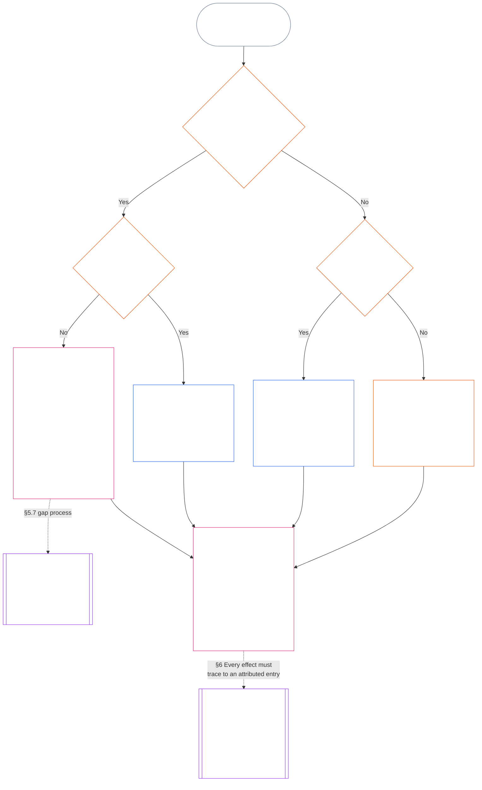

> Yapay zekâ destekli çeviri taslağı — dil: Türkçe; kaynak: commit 9c2c8c10c871d91157bcd27b9f56ad6a1cec90d3; durum: incelenmemiş; kısmi kapsam: On Birinci Bölüm, yalnızca §§5.7–5.9. Bu, bölümün tam çevirisi değildir.

#### 5.7 Sistem Şartı veya Kurum Şartı bir koltuğu belirtmediğinde

Olağan adı belirlenmiş yol kullanılamadığında güzergâh kaydının nereye gideceği, aşağıdaki şemanın sırayla ele aldığı üç soruya bağlıdır. Bu bölüm, bir Sistem Şartının veya Kurum Şartının bir koltuğu belirtmediği durumu kapsar; [§5.8 Hiçbir Sistem Şartı veya Kurum Şartı güzergâh kaydını kapsamadığında uygulanacak yedek düzen](#58-fallback-when-no-system-charter-or-institutional-charter-reaches-the-standing-record) ise bunların hiçbirinin güzergâh kaydını kapsamadığı durumu ele alır.

<strong>Okur rehberi (işlemsel değildir): şema nasıl okunur</strong>

> Yalın dille: güzergâh kaydı, Sistem Şartının veya Kurum Şartının belirttiği makamlarca ele alınır. Sistem Şartı veya Kurum Şartı bir koltuğu belirtmemişse, bu eksiklik giderilene kadar Şart geçersizdir; güzergâh kaydı şerit haritasına değil, Yedek Kayıt Yetkilisi ve Yedek Kayıt Sorumlusuna veya bir foruma gider. Hiçbir Sistem Şartı veya Kurum Şartı güzergâh kaydını kapsamıyorsa, kurumun yayımlanmış şerit haritası belirleyicidir; böyle bir harita yoksa güzergâh kaydı bağımsız doğrulamaya veya, gayriresmî ve küçük kapsamlı işler için, ona dayanan organa gider.
>
> Her yol aynı kutuda sonlanır: olguları bir makam doğrular, başka ve ayrı bir makam ise güzergâh kaydını kayda geçirip elinde tutar; ardından [§6 Güzergâh kaydının işlenmesi](#6-handling-a-standing-record), kayıt tutucuların kayıtla ne yapacağını belirler. Düz oklar ana yolu gösterir. Noktalı oklar, kendilerini yetkilendiren bölümle etiketlenmiş devirleri gösterir. Çift yan çizgili kutular başka bir bölüme aittir; son kutuda ise statü üzerindeki etkiler güzergâh kaydından çıkarılır ve kayıt yeniden yazılmaz. Şema yeni bir görev, koltuk veya alan eklemez.

 

Bir Sistem Şartı veya Kurum Şartı, gerekli kayıt koltuğunu ya da bağımsız yolu belirtmiyorsa:

- **Sonuç:** Sistem Şartı veya Kurum Şartı geçersizdir ve buna yol açacak bir değişikliğe izin verilmez ([Yedinci Bölüm §4.7.1 Bir eksiklik olduğunda ve bunun nasıl kayda geçirileceği](core_07.000_charters.md#471-when-a-gap-exists-and-how-it-is-logged)).
- **Eksiklik sürecinin sahibi Yedinci Bölümdür:** [Yedinci Bölüm §4.7 İşletmeci güzergâh kayıtları için haritadaki eksiklikler](core_07.000_charters.md#47-gaps-in-the-map-for-operator-standing-records) ayrıca şunları düzenler:
  - bir eksikliğin nasıl kayda geçirileceğini;
  - yanıt ve çözüm sürelerini (acil yedek ataması dâhil); ve
  - sorumluluğun adı belirlenmiş kayıt tutuculara ne zaman döneceğini.

Güzergâh kayıtları bakımından bu bölüm şunları ekler:

- **Kim hareket edemez:** Gerekli bir koltuk boş olduğu ve Sistem Şartı veya Kurum Şartı geçerli bir yedek belirtmediği sürece, aşağıdaki maddede belirtilen yol dışında hiç kimse o koltuğun işlevini yerine getiremez.
- **Güzergâh kaydı nereye gider:** [§5.4 Kendi kaydının sorumlusu olamaz](#54-no-self-custody) hükmünde belirtildiği üzere, güzergâh kaydı Yedek Kayıt Yetkilisine ve Yedek Kayıt Sorumlusuna veya **2.7. bölüm** kapsamındaki bir foruma gider; şerit haritası bunların yerine geçmez. Her güzergâh kaydı tek bir sorumluyla bütünlüğünü korur.
- **Zaten elde tutulan güzergâh kayıtları:**
  - Eksiklik bildirimi bir foruma, sicil görevlisine veya Yedek Kayıt Yetkilisine ulaştığı gün, Şartlandırılmış Tarafın Maddi Kontrol Hattı içindeki bir makamın elinde bulunan her işletmeci güzergâh kaydı, tüm iziyle Yedek Kayıt Sorumlusuna devredilir.
  - O zamana kadar ilgili makam kaydı salt okunur biçimde tutar, hiçbir sürüm kaydetmez ve tam kopyasını tüm iziyle derhâl Yedek Kayıt Sorumlusuna verir.
  - Hat dışındaki bir sorumlu güzergâh kaydını elinde tutar ve eksiklik süresince Yedek Kayıt Yetkilisinin veya bir forumun yetkilendirdiği her sürümü kayda geçirir. Bir forum sorumlunun hat içinde olduğunu saptarsa, güzergâh kaydı hat içindeki bir makamda olduğu gibi tüm iziyle Yedek Kayıt Sorumlusuna devredilir.
- **Sorumlu yöneticiler:** Sistem Şartının veya Kurum Şartının kendilerine vermediği bir koltuğu doldurmaları istenen sorumlu yöneticiler:
  - **Koltuğu reddeder:** Güzergâh kaydına erişimlerinin veya onu teknik olarak kayda geçirme imkânlarının olması, onlara bunu yapma yetkisi vermez.
  - **Talebi ve eksikliği belirtir:** Her ikisini de kayıtta belirtirler.
  - **Güzergâh kaydını iletir:** Yukarıdaki *Güzergâh kaydı nereye gider* maddesindeki yoldan iletirler.
  - **Diğer görevlerini sürdürür:** [§5.4 Kendi kaydının sorumlusu olamaz](#54-no-self-custody) (*Kaydın konusu olan tarafın içindeki sorumlu yöneticiler*) uyarınca zaten sahip oldukları görevler sürer: kontrol ettiklerini durdurur, yeniden oluşturulabilir kümeyi kayda geçirir, ellerindeki kanıtı korur, bildirimde bulunur ve konuyu üst makama taşırlar. Bu eylemlerin hiçbiri olguları doğrulamaz veya güzergâh kaydını kayda geçirmez. Kayıt ve korunan kanıt, doğrulamayı yapacak yetkiliye girdi olarak güzergâh kaydıyla birlikte iletilir; bunlar kayıt girişi değildir ve olguları karara bağlamaz.

#### 5.8 Hiçbir Sistem Şartı veya Kurum Şartı güzergâh kaydını kapsamadığında uygulanacak yedek düzen

Güzergâh kaydının ilgili olduğu sistem, kurum veya işletmeyi hiçbir Sistem Şartı veya Kurum Şartı kapsamıyorsa — örneğin yayımlanmış bir şartı bulunmayan, Sınıf L sınırının altındaki bir organ söz konusuysa — **CI-8.205 §2** (*İşlevsel ayrım şeritleri*) uyarınca kurumun yayımlanmış şerit haritası geçerlidir:

- **Kayıt açma yetkilisi:** Şerit haritasının, güzergâh kaydının ilgili olduğu sistem, kurum veya işletme için güvence ve denetim şeridine yerleştirdiği makamdır. Bu makam olgusal temeli doğrular ve kaydı yetkilendirir ([§5.2 Adı belirlenmiş kayıt açma yetkilisi](#52-named-record-opening-authority)); güzergâh kaydını kayda geçirmez veya elinde tutmaz.
- **Sorumlu:** Yayın ve kanıt şeridini elinde tutan makamdır.
- **Yürütme şeridi dışlanır:** Bu görevlerin hiçbirini, ilgili sistem için yürütme şeridini tutan makam üstlenemez.
- **Şerit haritası da yoksa:** Güzergâh kaydı yukarıdaki *Kendi kaydının sorumlusu olamaz* hükmü uyarınca bağımsız doğrulamaya veya gayriresmî ve küçük kapsamlı kayıtlar için sıradaki *Gayriresmî ve küçük kapsamlı kayıtlar* hükmü uyarınca ona dayanan organa yönlendirilir.
- **Sorumlu yöneticiler:** Şerit haritasının kendilerine vermediği bir koltuğu doldurmaları istenen sorumlu yöneticiler, [§5.7 Sistem Şartı veya Kurum Şartı bir koltuğu belirtmediğinde](#57-when-a-system-charter-or-institutional-charter-leaves-a-seat-unnamed) bölümündeki *Sorumlu yöneticiler* kuralını izler: koltuğu reddeder, talebi ve eksikliği kayda geçirir ve diğer görevlerini sürdürürler. Güzergâh kaydını şerit haritasının belirttiği makama veya harita hiçbir makam belirtmiyorsa yukarıdaki *Şerit haritası da yoksa* maddesindeki yola iletirler.

#### 5.9 Gayriresmî ve küçük kapsamlı kayıtlar

Görevlerin ayrılması resmiyet derecesine değil, maddi paya göre ölçeklenir ([Sekizinci Bölüm §2 Dört Koltuklu Anayasal Gereksinim](core_08.000_functional_independence_separation_of_duties.md#2-four-seat-constitutional-requirement)).

- **Kapsanan işler:** Yerel topluluklar pek çok katkı türüyle işler ve bunların çoğu ücretsiz ve gayriresmîdir. Buna ücretsiz, akranlarca örgütlenen, karşılıklı yardım, bakım, idame, onarım, öğretim ve topluluk sorumlu yönetimi işleri dâhildir; [On Üçüncü Bölüm §6 Önce katkı sonuçları](core_13.000_standing_integration.md#6-contribution-consequences-second), bunların eşit ölçütlerle tanınmasını gerektirir.
  - **Yerelde nasıl görünür:** Komşuların yiyecek ve alet paylaşması (karşılıklı yardım); hasta veya yaşlı bir komşuya bakmak (bakım); ortak bahçeyi veya dereyi iyi durumda tutmak (idame ve topluluk sorumlu yönetimi); bir komşunun borularını onarmak (onarım); birine ders vermek veya bir beceriyi göstermek (öğretim). Bunların her biri kendi başına bir katkı türüdür.
- **Doğrulama koltuğunu kimin doldurduğu:** Bu işler için doğrulama koltuğu, **güzergâh kaydına dayanma yetkisi yayımlanmış herhangi bir bağımsız organ** tarafından karşılanır; bu organ doğrulayıcı yetkili olarak hareket eder.
  - **Bu genellikle kimdir:** Çoğu zaman güzergâh kaydına dayanacak organdır: havza konseyi gibi yerel bir grup, işi finanse eden veya sürmesini sağlayan bir kuruluş, **CI-6.255** (*Müşterekler, kooperatifler, karşılıklı yardım ve piyasa dışı topluluk yönetimi*) kapsamındaki kayıt tanıma yetkilisi (bu tür topluluk işlerinin kayıtlarını tanıyan bir organ) veya **2.7. bölüm** kapsamındaki bir forum.
- **Neyin yeterli sayılmadığı:** Doğrulama koltuğu, doğrulayıcı yetkilinin resmiyet derecesiyle karşılanmış olmaz.

Böyle bir güzergâh kaydında:

- tek başına hareket eden bir algılayanın kendi katkısına ilişkin kayıt istemek için bir gruba, kuruma, [Sistem Şartına](core_05.040_band_continuity.md#system-charter) veya [Kurum Şartına](core_05.040_band_continuity.md#institutional-charter) ihtiyacı yoktur. Bu durumda:
  - **Kim talep eder:** Kişi, kendi talebinde hem kaydın konusu hem de talepte bulunan olarak başlatıcı koltuğunu tutar.
  - **Kişinin kendi materyalleri:** Kişinin kendi anlatımı, günlükleri ve fotoğrafları girdidir; asla doğrulama değildir.
  - **Doğrulama koltuğu:** Güzergâh kaydına dayanma yetkisi yayımlanmış herhangi bir bağımsız organ (doğrulayıcı yetkili).
  - **Kayıt girişi ve sorumluluk:** Ayrı bir kayıt sorumlusu güzergâh kaydını kayda geçirir ve elinde tutar.
  - **Birisi itiraz ederse:** İtiraz, **2.7. bölüm** kapsamındaki itiraz şeridine veya bir foruma gider.
  - **Dayanılacak bir organ yoksa:** Böyle bir organ yoksa, güzergâh kaydı **2.7. bölüm** kapsamındaki bir foruma gider.
  - **Örnek, emekli tesisatçı:** Yıllardır komşularının borularını ücretsiz onaran ve arkasında bir grup bulunmayan emekli bir tesisatçı, güzergâh kaydı açılması için **CI-6.255** (*Müşterekler, kooperatifler, karşılıklı yardım ve piyasa dışı topluluk yönetimi*) kapsamındaki kayıt tanıma yetkilisine başvurabilir:
    - **Talepte bulunan ve iddia sahibi:** Tesisatçı.
    - **Doğrulayan:** İş günlüklerine ve komşuların tanıklıklarına dayanan yetkili.
    - **Kayda geçiren ve elinde tutan:** Ayrı bir kayıt sorumlusu.
    - **Birisi itiraz ederse:** İtiraz doğrulayıcı yetkiliye geri dönmez; bir foruma gider.
- katılımcılar kaydın konusudur ve tanınma talep ettiklerinde talepte bulunanlardır. **4.3. bölüm** kapsamındaki kolektif bir kayıtta:
  - **Ortak katılımcılar:** Her biri talepte bulunandır.
  - **Bir üyenin başka bir üyenin payına ilişkin beyanı:** Girdidir; asla doğrulama değildir.
- güzergâh kaydını destekleyen materyaller iki yerden gelir:
  - **Katılımcı olmayanlar:** Yararlananlar, komşular ve diğer katılımcı olmayanlar **4.1. bölüm** uyarınca doğrulama materyali olarak tanıklık sağlar.
  - **Grubun kendi günlüğü:** Günlüğü tutan algılayan, aşağıdaki *Kaydı tutanların beyanları girdidir* hükmü uyarınca kayıt tutan ve tanıktır.
- dayanan organın kayıt sorumlusu, ayrı bir doğrulayıcı yetkilinin doğruladığı hususları kayda geçirir ve elinde tutar:
  - **Kim iki koltuktan hiçbirini tutamaz:** Ne kayıt sorumlusu ne de doğrulayıcı yetkili talepte bulunan veya talepte bulunanın [Maddi Kontrol Hattında](core_05.035_band_accountability.md#material-control-line) yer alan biri olabilir.
  - **Tek organ, iki koltuk:** Aynı dayanan organ, denetlenebilir ve itiraza açık bağımsızlık güvenceleri içeren yayımlanmış bir şerit haritası uyarınca her iki koltuğu da barındırabilir.
  - **Asla aynı kişi:** Hiçbir yetkili, sorumlu veya algılayan aynı güzergâh kaydında her iki görevi birden yerine getiremez.
- bir grubun kendi statüsü, üyenin talebini koşula bağlamaz:
  - **Gayriresmî gruplar:** [Sistem Şartı](core_05.040_band_continuity.md#system-charter) veya [Kurum Şartı](core_05.040_band_continuity.md#institutional-charter) bulunmayan ya da hiç Kurum olmayan bir grup, üyelerini engellemez.
  - **Her katılımcı:** Grupta veya grup dışında yaptığı iş için bireysel talepte bulunan olarak tanınma isteyebilir.
  - **Güzergâh kaydının kapsadığı konu:** Kayıt, grubun statüsünü değil katılımcının katkısını ele alır.
  - **Örnek, yorgan dikenler topluluğu:** Yeni gelen mültecilere yorgan veren bir yorgan dikme topluluğu örnek oluşturur: her yorgan diken, yorganları teslim alan kurum gibi bağımsız ve kayda dayanacak bir organ tarafından doğrulanmış bir güzergâh kaydı isteyebilir; topluluğun bunun için Sistem Şartına veya Kurum Şartına ihtiyacı yoktur.
- ihlal güzergâh kaydı aynı gayriresmî ortamlarda da ortaya çıkabilir ve koltuklar orada da ayrı kalır:
  - **Örnek, bardaki olay:** Bir kişi, başka bir algılayanın sarhoş, taşkın ve şiddet yanlısı olduğu bir barda onu filme alır; ancak kimse fiziksel olarak zarar görmez.
    - **Yaralanma gerekmez:** Doğrulanmış, inandırıcı bir şiddet tehdidi, kimse yaralanmasa bile ihlal güzergâh kaydını destekleyebilir (**3.2. bölüm**, zorlayıcı faillik kaybı).
    - **Video girdidir:** Çekimi yapan algılayan tanıktır. Görüntü girdidir ve tek başına asla doğrulama değildir; görüntünün varlığı kendi başına hiçbir süreci başlatmaz (**2.2. bölüm**).
    - **Videodaki algılayan:** Bu kişi kaydın konusudur. Güzergâh kaydı açıldığında kendisine bildirim yapılır ve hiçbir koltuğu dolduramaz ([§5.4 Kendi kaydının sorumlusu olamaz](#54-no-self-custody)).
    - **Doğrulama koltuğu:** Güzergâh kaydına dayanma yetkisi yayımlanmış bağımsız bir organ; örneğin yerel bir ruhsat veya güvenlik organı ya da **2.7. bölüm** kapsamındaki bir forum. Görüntüyü çeken algılayan veya barın sahibi, talepte bulunan ya da talepte bulunanın [Maddi Kontrol Hattında](core_05.035_band_accountability.md#material-control-line) yer alan biri ise bu koltuktan dışlanır.
    - **Kayıt girişi, sorumluluk ve itiraz:** Ayrı bir kayıt sorumlusu güzergâh kaydını kayda geçirir ve elinde tutar; itiraz doğrulayıcı organa dönmez, itiraz şeridine veya **2.7. bölüm** kapsamındaki bir foruma gider.
- bağımsız ve kayda dayanacak bir organın bulunduğu hâlde, gayriresmî bir grubun erişemediği resmî bir kurum tarafından doğrulama yapılmasını şart koşan bir bar veya süreç, görevlerin ayrılması değil, [On Üçüncü Bölüm §6.2 Yeterlilik engelleri ve izinler](core_13.000_standing_integration.md#62-competency-bars-and-clearances) kapsamında keyfî engel koyma örüntüsüdür.

Bunların hiçbiri bir güzergâh kaydının mutlaka var olmasını gerektirmez. **2.2. bölümdeki** *Varsayılan sessizliktir* kuralı geçerlidir: gayriresmî işler, kayda geçirilebilir diye kayda alınmaz ve görevlerin ayrılması yalnızca bir güzergâh kaydı istendiğinde bağlayıcı olur.
