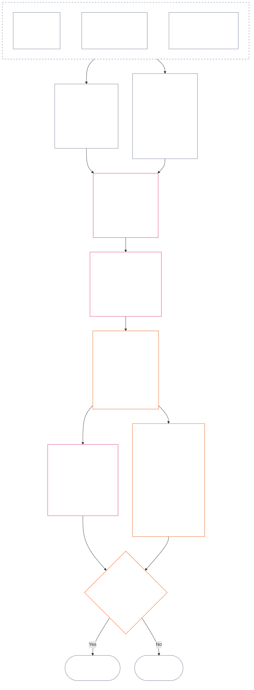

<!-- Locale: Turkish (tr) | Source: 9c2c8c10c871d91157bcd27b9f56ad6a1cec90d3 | AI-drafted, unreviewed | PARTIAL: Chapter Twelve §§4–6 only -->

### 4. Yuva dilbilgisi ve ortak ölçeklendirme

*Yalın dille: bu bölüm, iki ayrı eksenin her birindeki dokuz olası konum için tutarlı adlar verir ve etkinin bu konumlar boyunca nasıl ölçeklendiğini açıklar. Bir eksen doğrulanmış katkıyı, diğeri doğrulanmış ihlalleri güzergâh kayıtlarında tutar. Aynı yuva numarasını paylaşmaları eksenleri birleştirmez veya zararı yardımla mahsup etmez. **§6**'daki birleşik ölçek, orantılı LEQU etkisine göre her iki eksene de yuva atar.*

Yuva dilbilgisi, **1** ile **9** arasında bir `s` yuva numarası kullanır. Her eksenin kendi yuva konumu vardır:

- **Katkı Ekseni** olumlu katkı niteliğini kaydeder; ve
- **İhlal Ekseni** doğrulanmış ihlal bulgularını kaydeder.

Aynı yuva numarası her iki eksende de görünebilir; ancak eksenler ayrı kalır. Katkı yuvası ihlal yuvası değildir; ihlal yuvası da katkı yuvası değildir.

#### 4.1 Tablo 1 — yuva gösterim etiketleri

**Tablo 1**, dokuz yuvaya ad verir ve Katkı Ekseni ile İhlal Ekseninin gösterim etiketlerini yan yana sunar. Yalnızca gösterim dilini sağlar; yuva ataması **§6**'daki birleşik ölçeğe göre yapılır.

| `s` | Katkı Ekseni gösterim etiketi | İhlal Ekseni gösterim etiketi |
| ---: | --- | --- |
| 1 | **Küçük Taban Katkısı** | **Küçük Anayasal Etki** |
| 2 | **Düşük Taban Katkısı** | **Düşük Anayasal Etki** |
| 3 | **Önemli Olumlu Katkı** | **Önemli Anayasal Etki** |
| 4 | **Kayda Değer Olumlu Katkı** | **Kayda Değer Anayasal Etki** |
| 5 | **Ciddi Sorumlu Yönetim Olumlu Katkısı** | **Ciddi Anayasal Etki** |
| 6 | **Büyük Sorumlu Yönetim Olumlu Katkısı** | **Büyük Anayasal Etki** |
| 7 | **Tanınmış Öncü** | **Ağır Anayasal Etki** |
| 8 | **Seçkin Öncü** | **Çok Ağır Anayasal Etki** |
| 9 | **Örnek Öncü** | **Felaket Boyutunda Anayasal Etki** |

Katkı Ekseni taban, olumlu, sorumlu yönetim açısından olumlu ve öncü etiketlerini kullanır. İhlal Ekseni her yuvada tarafsız etki etiketleri kullanır. Eksenler ayrı kalır; net puan oluşturmaz ve katkı ile ihlal kayıtlarının mahsup edilmesine izin vermez. İhlal Ekseni yuvası kendi başına anayasa karşıtı suistimal sınıflandırması yapmaz; [On Dördüncü Bölüm](core_14.000_misconduct_designation.md#chapter-fourteen-anti-constitutional-misconduct), anayasa karşıtı suistimal belirlemesinin (ACMD) doğrulanmış `s` = 7–9 ihlaline uygulanıp uygulanmadığına bağımsız olarak karar verir.

Uygulamalar, tam yaşam eşdeğeri yarar veya kaybı tahmin etmeye yardımcı olmak için ölçüm birimleri, kanıt yöntemleri ve örnekler yayımlayabilir. Bu materyaller yalnızca rehberlik sağlar; **§6**'yı, **Birinci Bölümü** veya **Altıncı Bölümün** Hak Tabanını geçersiz kılamaz.

#### 4.2 Ortak etki ölçeklendirme kuralları

*Yalın dille: etki yalnızca kişi sayısına göre ölçülmez. Tek bir algılayanı etkileyen derin bir yarar veya kayıp, çok sayıda kişiyi yüzeysel biçimde etkileyen sonuçtan daha önemli olabilir. Sayı, derinlik, kırılganlık, süre, kalıcılık, erişim ve anayasal nitelik birlikte değerlendirilmelidir.*

**§6**'da her iki ekseni yorumlamak için aşağıdaki kuralları kullanın:

| Ölçeklendirme boyutu | Ortak kural | Eksene özgü uygulama |
| --- | --- | --- |
| **Anayasal sonucun büyüklüğü (LEQU)** | Bütünleşik doğrulanmış yararı veya kaybı değerlendirin. LEQU temel büyüklük dayanağıdır; ham kişi sayısı, para, çıktı veya kurum büyüklüğü değildir. | Katkı, haklarla uyumlu yararı sayar; ihlal ise doğrulanmış anayasal kaybı, zararı, israfı, seçeneklerin kapanmasını veya tehlikeyi sayar. |
| **Algılayan kapsamı** | **Sayıyı, derinliği ve kırılganlığı birlikte** ele alın. Hiçbir yuvada kişi sayısı tek başına bir koşul değildir. Yeterince derin bir etki, bütünleşik büyüklük ile satırın diğer ölçütleri eşitse, daha geniş fakat daha yüzeysel bir etkinin desteklediği aynı yuvayı tek bir algılayan için de destekleyebilir; açıkça belirtilen toplam LEQU veya geniş kapsam ölçütleri yine karşılanmalıdır. | Bağımlılık, azalmış kapasite veya olağandışı kırılganlık maddi önemi artırabilir. Yalnızca grubun büyüklüğü katkı veya ihlal ağırlığını ortaya koymaz. |
| **Zamansal kapsam** | Süreyi, tekrarı, kalıcılığı ve kayıp söz konusu olduğunda geri döndürülemezliği ele alın. Kısa ama dönüştürücü bir olay, uzun süreli önemsiz bir etkiye ağır basabilir; süre tek başına belirleyici değildir. | Kalıcı yarar, daha yüksek katkı büyüklüğünü destekler. Süreğen veya geri döndürülemez kayıp, ihlal ağırlığını yükseltir. |
| **Mekânsal veya kurumsal kapsam** | Daha geniş erişim büyüklüğü artırabilir; ancak derinlik, süre, kırılganlık veya anayasal kritiklik yuvayı bağımsız olarak destekliyorsa topluluklar ya da kurumlar arası erişim şart değildir. | Kurumsal onarım katkı büyüklüğünü artırabilir; yapısal veya sistemsel zarar ihlal ağırlığını artırabilir. |
| **Anayasal nitelik veya davranışın karakteri** | Sonucun nasıl üretildiğini ne kadar geniş yayıldığından ayrı ölçün. Aynı olguyu iki kez saymayın. | Dışsallaştırılmış zarar, gizli yük, ele geçirilme veya bağımlılık, iddia edilen katkıya üst sınır koyabilir veya onu geçersiz kılabilir. Görev, ihmal, aldatma, zorlama, şiddet veya yapısal kolaylaştırma ihlal davranışının niteliği olarak ayrı kaydedilir ve etki yuvasını değiştirmez. |
| **Hak Tabanları ve kritik güvenceler** | Hak Tabanına uyum, toplam yarar veya kayıpla takas edilmez. | Bir tabana uyum tek başına yüksek katkı oluşturmaz. Maddi ölçüde Hak Tabanı ihlali veya kritik güvence başarısızlığı, doğrudan etkilenen algılayan sayısı az olsa bile daha yüksek ihlal ağırlığını destekleyebilir. |

Boyutlar, her tür ölçeğin bulunmasını zorunlu kılan bir kontrol listesi değildir. Hangi boyutların belirleyici olduğunu, hangilerinin olmadığını ve nedenini açıklayın.

- **Ortak yuva yöntemi:**
  - Orantılılık uyarınca bütünleşik doğrulanmış yararı veya kaybı LEQU cinsinden tahmin edin; ardından büyüklüğün sayısal bandına giren tek yuvayı atayın.
  - Her iki eksende de aynı eşikler uygulanır.
  - Katkı yuvaları, uygulanabilir taban ve anayasal uyum koşullarını korur; sayısal bir eşiğin karşılanması, dışsallaştırılmış veya anayasal bakımdan geçersiz kılınmış çıktıyı katkı hâline getiremez.
- **Nitelik ayrımı:** Uygulanabilir yarar güzergâhı, zarar güzergâhı, davranış kalitesi ve davranış niteliği tanımlayıcılarını güzergâh kaydında birlikte ve ayrı ayrı izlenebilir biçimde tutun. Görev, ihmal, aldatma, ağırlaştırma, zorlama, şiddet, kast veya yapısal kolaylaştırma; atfı, güvenceleri ya da 3. Soru sonuçlarını etkileyebilir, ancak hiçbiri LEQU etki yuvasını yükseltmez veya düşürmez.
- **Anayasa Karşıtı Suistimal İncelemesi sınırı:** Doğrulanmış İhlal Ekseni kaybı, anayasa karşıtı suistimal saptanmış olsun ya da olmasın, etkisine göre `s` = 7–9 düzeyine ulaşabilir. On Dördüncü Bölüm etki atamasının yerine geçmez; ilgili ACMD'nin uygulanıp uygulanmadığını bağımsız olarak belirler.

Bir tehlike henüz fiilen gerçekleşmediyse aşağıdakilerin her birini ayrı kaydedin:

- gerçekleşme olasılığını;
- algılayanların tehlikeye ne kadar süre maruz kalacağını;
- ne kadar geniş bir alana yayılabileceğini;
- tahminin ne ölçüde belirsiz olduğunu; ve
- hâlâ inandırıcı olan en kötü sonucu.

Benimsenmiş uygulama, riskin LEQU'ya nasıl çevrileceğini herkesin inceleyebileceği bir risk ayarlaması belirlemedikçe, bu en kötü sonucu gerçekleşmiş zarar (LEQU kaybı) olarak saymayın.

### 5. Eksen atamasına anayasal girdiler

*Yalın dille: yuva seçmeden önce, hangi taban, yarar, görev, zarar veya ihlalin ölçüldüğünü belirleyen anayasal kaynakları tespit edin. Bu kaynakları kanonik yerlerinde uygulamak için aşağıdaki bağlantıları kullanın; bu yönlendirme adımını yeni bir puana veya tanımın yerine geçecek bir şeye dönüştürmeyin.*

**§6** uyarınca yuva atanmadan önce güzergâh kaydı şunları belirtmelidir:

- uygulanabilir anayasal tabanı, görevi, kısıtı veya korunan menfaati;
- ölçülen doğrulanmış yararı, olumsuz sonucu, zararı veya ihlali belirleyen hükümleri;
- büyüklüğü veya davranışın niteliğini maddi ölçüde etkileyen tanımları, ilkeleri ve Hak Tabanı maddelerini; ve
- belirlenen her kaynağın neden uygulandığını ve eksen atamasını nasıl etkilediğini.

Aşağıdaki yönlendirme tabloları tam liste değildir. Doğrulanmış olguların tetiklediği her ek tanım, ilke veya Madde uygulanmaya devam eder ve güzergâh kaydında belirtilmelidir. Bağlantı verilen kanonik metinlerin her biri belirleyicidir; bu tablolar onları yeniden ifade etmez veya daraltmaz.

#### 5.1 Tanım girdileri

| Kanonik kaynak | Katkı Ekseni rolü | İhlal Ekseni rolü |
| --- | --- | --- |
| [Statü, Katkı ve İhlal](core_05.035_band_accountability.md#defa3-standing-state-contribution-and-violation) | Katkı sayılanları ve ölçümde kullanılabilecek denetlenmiş olguları açıklar. Ayrıca katkı güzergâh kaydının yalnızca iyi tarafı izlemesini, kötülükle karışmamasını sağlar. | İhlal sayılanları ve kayda nasıl geçirildiğini açıklar. En ciddi vakaları, Anayasanın kendisini zayıflatan davranışlara yönelik ayrı bir inceleme olan Anayasa Karşıtı Suistimal İncelemesine de yönlendirir. |
| [Hesap verebilirlik](core_05.005_apex_accountability_leg.md#accountability) | İyi sorumlu yönetim veya onarım iddiasının gerçekten birini hesap verir durumda tutup tutmadığını sınar. Kimin ne yaptığını, kimin hesap vermesi gerektiğini ve etkiye orantılı biçimde bunun nasıl incelenebileceğini, düzeltilebileceğini ve telafi edilebileceğini göstermelidir. | Bir şeyi kimin yaptığının veya kimin hesap vermesi gerektiğinin belirsiz olduğu vakaları saptar. Buna, kuruluş veya yapısı değiştikten sonra sorumluluğun işlememeye başladığı durumlar da dâhildir. |
| [Zarar](core_05.035_band_accountability.md#harm) | Başkalarına aktarılan veya gizlenen zarar, iddia edilen yararı sınırlayabilir ya da ortadan kaldırabilir. Zararı gidermek yarar sayılabilir; ancak yalnızca giderim doğrulanıp bağımsız biçimde gösterildiğinde. | Kayıp ve ağırlık ölçülürken sayılan zarar türlerini açıklar: doğrudan, dolaylı, gecikmiş, birikimli, sistemlere yayılan ve algılayanın zihnine veya duygusal esenliğine verilen zarar. |
| [Maddi Önem](core_05.050_band_oversight.md#materiality) ve [Yaşam Süresi Eşdeğer Birimi (LEQU)](core_05.055_band_participation.md#lifespan-equivalent-unit-lequ) | Doğrulanmış bir yararın; ne kadar geniş alana yayıldığına, etkilenenlerin ne kadar kırılgan olduğuna ve ne kadar sürdüğüne göre ne ölçüde sayılacağını belirler. Sonuç, tam bir yaşam süresinin yararı için ortak ölçüt olan LEQU ile ölçülür. | Doğrulanmış bir kayıp veya tehlikenin; ne kadar geniş alana yayıldığına, etkilenenlerin ne kadar kırılgan olduğuna, ne kadar sürdüğüne ve geri alınmasının ne kadar zor olduğuna göre ne ölçüde sayılacağını belirler. Sonuç, tam bir yaşam süresinin kaybında kullanılan aynı ölçüt LEQU ile ölçülür. |
| [Katkı Niteliği](core_05.035_band_accountability.md#contribution-nature) | Bir şeyin katkı sayılıp sayılmadığını belirler. Yalnızca iyi olmalı, zararla karışmamalı ve gösterilebilir doğrulanmış bir katkı kaydıyla desteklenmelidir. Her ikisi de yoksa Katkı Ekseni ataması yapılamaz. | Burada rolü yoktur. Zarar sayılanları belirlemez ve ihlalin ağırlığını asla azaltmaz. |
| [İhlal Niteliği](core_05.035_band_accountability.md#violation-nature) | Burada rolü yoktur. İhlal hiçbir zaman negatif katkı sayılmaz ve onunla ilgisi olmayan doğrulanmış yararı silmez. | Bir şeyin ihlal sayılıp sayılmadığını belirler. Zararlı olarak sınıflandırılmalı ve ihlalin gerçekleştiğine dair doğrulanmış bulguyla desteklenmelidir. Her ikisi de yoksa İhlal Ekseni ataması yapılamaz. |
| [Anayasal Kısıt](core_05.045_band_integrative.md#constitutional-constraint), [Yetki Hiyerarşisi ve İç Hiyerarşi](core_05.045_band_integrative.md#authority-stack-and-internal-hierarchy) ve [Denetlenebilirlik](core_05.050_band_oversight.md#auditability) | İddia edilen yararın Anayasayı ihlal etmeye, kurallarından kaçınmaya, Hak Tabanını (Anayasanın güvence altına aldığı asgari korumaları) daraltmaya veya yalnızca kâğıt üzerinde uyum göstermeye dayanması hâlinde yararın sayılmasını önler. | İhlalin gerçek ağırlığını etkileyen hususları işaretler: önemli bir anayasal sınırın aşılması, Anayasanın yetkisinin üstüne bir şey konması, kurallardan kaçınılması veya kuralların uygulanmasının imkânsız hâle getirilmesi. |
| [Denetlenebilirlik](core_05.050_band_oversight.md#auditability) ve [İtiraz edilebilirlik](core_05.035_band_accountability.md#contestability) | İddia edilen yararın gösterilip denetlenebilmesini ve katılmayan herkesin işleyen bir itiraz yoluna sahip olmasını gerektirir. | Bulguların denetlenebilmesini ve bunlara itiraz edilebilmesini gerektirir. Bir suçlama veya açıklaması olmayan bir etiket, ihlalin ağırlığını belirleyemez. |

#### 5.2 İlke girdileri

| İlke kaynağı | Eksen atama rolü |
| --- | --- |
| [Anayasal Dörtlü](core_00.000_preamble.md#constitutional-tetrad), [İki Anayasal Amaç](core_00.000_preamble.md#two-constitutional-aims) ve [maddi pay](core_00.000_preamble.md#material-stake) | Dört işleyiş disiplinini (katılım, gözetim, hesap verebilirlik ve zamanındalık), Anayasanın amaçladığı iki sonucu (Gelişim ve Süreklilik) ve her atamayı risk altındaki değere göre ölçeklendiren çerçeveyi belirler. |
| [Esenlik](core_01.000_values_principles.md#3-foundational-objective-wellbeing-flourishing-aim) ve [Tanınma, Pekiştirme ve Özlem](core_01.000_values_principles.md#32-recognition-reinforcement-and-aspiration) | Katkı Ekseninde haklara saygılı yararı ve ona uygun tanınmayı temellendirir. İtibar veya ödüller hiçbir zaman katkının kanıtı sayılmaz. |
| [Güvenlik](core_01.000_values_principles.md#4-safety-harm-constraint) ve [Gerçek](core_01.000_values_principles.md#5-truth-epistemic-integrity-constraint) | Her iki eksende de bağlayıcı sınırlar koyar. Zarar veya aldatma yoluyla elde edilen yarar bütünüyle sayılmaz; güvenlik ya da gerçeğe ilişkin doğrulanmış bir başarısızlık, ihlalin büyüklüğünü veya türünü gösterebilir. |
| [Sorumlu Yönetim Ayrıntılı Olarak](core_01.010_stewardship_capacity_principles.md#16-stewardship-in-depth) ve [Sorumlu Yönetim Disiplini Altında Yönetişim](core_01.010_stewardship_capacity_principles.md#18-governance-under-stewardship-discipline) | Doğrulanmış olgular gerektirdiğinde kalıcı katkının, bir rolle gelen görevlerin, kurumsal onarımın, gözetimin ve sorumluluğun nasıl tartılacağına yol gösterir. |
| [Temel Takas İlkeleri](core_01.005_interaction_interpretation.md#131-core-tradeoff-principles) ve [Anayasal Tabanlar, Güvenlik ve Aşağılayıcı Olmayan Süreç](core_01.005_interaction_interpretation.md#1314-constitutional-floors-safety-and-anti-degrading-process) | Ölçülen davranış zorunluluk, zararı olabildiğince azaltma, orantılılık, haklar arasındaki çatışma veya bir kısıtlama içerdiğinde uygulanır. Tek başlarına hiçbir zaman bir sonuca yetki vermezler. |

#### 5.3 Hak Tabanı ve Madde girdileri

| Madde kaynağı | Eksen atama rolü veya sınırı |
| --- | --- |
| Doğrulanmış güzergâh kaydının maddi ölçüde içerdiği her Madde dâhil, olgular bakımından uygulanabilir [Altıncı Bölüm Hak Tabanı](core_06.000_rights_part_a.md#chapter-six-foundational-rights) | Risk altındaki temel korumaları, menfaatleri, görevleri, yararları veya ihlalleri belirler. Aşağıda listelenmemiş olması hiçbir Maddeyi dışarıda bırakmaz. |
| [XIX. Madde — Statü ve Katılım Durumu](core_06.015_rights_part_d.md#article-xix-standing-and-participation-status) | Bir algılayanın statüsünü, onurunu, Hak Tabanının asgari korumalarını, etkilenen taraf statüsünü, itibarını ve katılım durumundaki olası sonraki değişiklikleri birbirinden ayrı tutar. |
| [XIII-A Maddesi — Güvenilirlik ve Doğruluk Tabanı](core_06.010_rights_part_c.md#article-xiii-a-reliability-and-trustworthiness-baseline), [XIII-B Maddesi — Giderim ve Telafi Hakkı](core_06.010_rights_part_c.md#article-xiii-b-right-to-redress-and-remedy), [XV-B Maddesi — Şeffaflık, Denetlenebilirlik ve İtiraz Edilebilirlik](core_06.010_rights_part_c.md#article-xv-b-transparency-auditability-and-contestability) ve [XVI. Madde — Denetim, Şeffaflık ve Bağımsız Doğrulama](core_06.010_rights_part_c.md#article-xvi-audit-transparency-and-independent-verification) | Doğrulanmış yarar veya ihlal; dürüst kayıt tutmayı, bilgi paylaşımını, olguların denetlenmesini, karara itiraz edebilmeyi veya hataların düzeltilmesini içerdiğinde uygulanır. |
| [XXIV. Madde — Kök Neden Analizi ve Uyarlanabilir Yanıt](core_06.015_rights_part_d.md#article-xxiv-root-cause-analysis-and-adaptive-response) | Davranışa neyin yol açtığı, düzeltilip düzeltilmediği, sürüp sürmediği veya yanıtın uyarlanıp uyarlanmadığı önemli olduğunda uygulanır; bunlar davranışın Anayasa karşısındaki durumunu gösterir. |
| [XX. Madde — Doğrulanmış İhlal Sonrasında Adalet](core_06.015_rights_part_d.md#article-xx-justice-after-verified-violation) ve [XXVI-C Maddesi — Zamanında Çözüm ve Gecikme Karşıtı Taban](core_06.020_rights_part_e.md#article-xxvi-c-timely-resolution-and-anti-delay-floor) | Olguların içerdiği her süreç veya gecikmeye uygulanır. **XX. Madde** (*Doğrulanmış İhlal Sonrasında Adalet*) esas olarak ihlal ölçüldükten sonra olanları (3. Soru) sınırlar. Yalnızca birinin önceden tercih ettiği yanıtı haklı çıkarmak için 2. Soru yuvasını yükseltmek veya düşürmek üzere kullanılamaz. |

**Uygulama sınırları.** Bu adım yalnızca doğru kaynakları gösterir.

- Bu adım:
  - 1. Soruyu yeniden açmaz;
  - doğrulanmamış olguları içeri almaz;
  - yeni bir ölçüm veya puan eklemez;
  - aynı olguyu farklı kaynaklar üzerinden iki kez saymaz;
  - iki ekseni birleştirmez; veya
  - listelenen her kaynağı her güzergâh kaydına uygulanır kılmaz.
- Katkı ve ihlal yine ayrı ayrı ölçülür.
- **XX. Madde** (*Doğrulanmış İhlal Sonrasında Adalet*) kapsamındaki sonuçlar 2. Sorunun dışında kalır.
- On Dördüncü Bölümün belirleme incelemesi, burada atanan etki yuvasından ayrı kalır.

### 6. Birleşik orantılı LEQU ölçeği — Katkı ve İhlal Eksenleri

<strong>Okur rehberi (işlemsel değildir): beş katlı artış nasıl işler</strong>

> Ölçek, `s` = 7 = bir LEQU dayanağı üzerinden beş katlı artış kullanır. Her iki eksende de 2–9 yuvaları için `s` yuvasındaki asgari büyüklük `5^(s−7)` LEQU'dur; 1. yuva sıfırdan başlar. Benimsenmiş uygulama, ortaya çıkan sayısal eşikleri ve ayarlama örneklerini yayımlayabilir. 1. yuva, Katkı Ekseninde doğrulanmış anayasal tabanı; İhlal Ekseninde ise ilk olumlu eşiğin altındaki doğrulanmış kaybı kapsar. Katkı olmaması veya ihlal bulunmaması kendi başına `s` = 1 kaydı değildir.
>
> **İnsanların anlayacağı dayanak.** Ayarlama örneği olarak 80 yıllık insan yaşamı kullanıldığında, orta sütunu yukarı doğru tam yaşam eşdeğeri yarar, kullanılabilir zaman veya eklenen haklarla uyumlu kaynak ve kapasite olarak; aşağı doğru ise eşdeğer kayıp, yoksun bırakma, israf veya seçeneklerin kapanması olarak okuyun. Kaynak miktarı kendi başına sayılmaz; belirleyici olan ürettiği veya önlediği anayasal sonuçtur.

 

*Yalın dille: **Tablo 2**, doğrulanmış katkıyı ve doğrulanmış ihlali aynı orantılı etki ölçeğine yerleştirir. Daha yüksek yuvalar, bütünleşik anayasal yarar veya kaybın daha büyük olduğu anlamına gelir. Güzergâh kayıtları ve eksenler ayrı kalır: ortak ölçek ahlaki değeri değil, büyüklüğü karşılaştırır ve yardımın zararı mahsup etmesine asla izin vermez.*

Şema, tek bir yuva atamasının baştan sona nasıl yapıldığını gösterir. Adımların izlenme sırasını verir; bu sıra aşağıdaki madde işaretlerinin sırası değildir. Maddeler her kuralı açıklar.

Orantılılığı uygulayarak derinlik, algılayan kapsamı, kırılganlık, süre, kalıcılık veya geri döndürülemezlik, erişim ve anayasal kritiklik üzerinden bütünleşik LEQU etkisini tahmin edin. Bu boyutlar LEQU tahminini biçimlendirir; bağımsız yuva bonusları değildir.

- **Tablo 2**'yi, 1. Soru ne olduğunu doğruladıktan, 2. Soru doğrulanmış yararı veya kaybı ölçtükten, **§§1–3 ve §4.2** uygulandıktan ve **§5** uyarınca gerekli anayasal kaynaklar belirlendikten sonra kullanın.
- Bütünleşik LEQU tahmininden tek bir yuva atayın.
  - Her maddi ölçeklendirme boyutunun tahmini nasıl etkilediğini ve dışarıda bırakılan boyutların neden belirleyici olmadığını açıklayın.
  - Her atama şunları karşılamalıdır:
    - izlenebilirlik;
    - denetlenebilirlik;
    - itiraz edilebilirlik; ve
    - uygulanabilir Hak Tabanı.
  - Katkı ayrıca dışsallaştırmama ve anayasal uyum koşullarını karşılamalıdır.
- Davranış niteliğine ilişkin olguları, ayrı ayrı izlenebilir tanımlayıcılar olarak kaydedin. Bunlar atfı, inceleme yoğunluğunu, güvenceleri, giderimi veya On Dördüncü Bölüm belirlemesini etkileyebilir; yuvayı yalnızca doğrulanmış sonuçlar bütünleşik LEQU etkisini değiştirdiği ölçüde etkiler.
- Eylemin veya davranış dizisinin doğrulanmış sonuçlarını maddi ölçeklendirme boyutları üzerinden bütünüyle değerlendirin. Buna şunlar dâhildir:
  - bedensel yaralanma;
  - psikolojik travma;
  - zorlayıcı etkiler;
  - özgürlüğün kısıtlanması veya özgürlüğe yönelik tehlike;
  - birikimli zarar; ve
  - anayasal bakımdan tanınabilir diğer yarar veya kayıplar.
- Şunları yapmayın:
  - Bir olay veya davranış dizisi aşağıdakilerle niteleniyor diye yuvayı yükseltmeyin veya düşürmeyin:
    - görev;
    - ihmal;
    - kast;
    - gizleme;
    - yineleme;
    - ağırlaştırma;
    - zorlama;
    - şiddet;
    - özgürlük tehlikesi;
    - düzeltilebilirlik; veya
    - tercih edilen bir sonuç.
  - Davranışın niteliğini büyüklükten çıkarsamayın veya doğrulanmış büyüklüğün yerine koymayın.

**Tablo 2**, dokuz yuvayı sırayla listeler. Her satırda `s` yuva numarası, bu yuvaya ulaşan eklenmiş yarar veya yüklenen kayıp miktarı (ayarlama örneği olarak 80 yıllık insan yaşamıyla birlikte) ve her eksendeki yuva adı bulunur. Her iki eksende de aynı eşikler uygulanır; ancak iki ad ayrı kalır: Katkı Ekseni yuvası ile İhlal Ekseni yuvası farklı kayıtlardır ve hiçbir zaman birbirini mahsup etmez.

| `s` | 80 yıllık insan yaşamı ayarlaması — eklenen yarar / yüklenen kayıp | Katkı Ekseni | İhlal Ekseni |
| ---: | --- | --- | --- |
| 1 | Yaklaşık **9 günden az** | **Küçük Taban Katkısı** — değerlendirilen kapsam için anayasal tabanın doğrulanmış biçimde karşılanması; ölçülebilir her artış `s` = 2'nin altında kalır. | **Küçük Anayasal Etki** — kanıtlanmış maddi zarar olmasa bile resmî bir kusur dâhil, `s` = 2'nin altındaki doğrulanmış kayıp veya işlevsel bozulma. |
| 2 | Yaklaşık **9–47 gün** | **Düşük Taban Katkısı** — bu etki düzeyinde asgari tabanın üzerinde güvenilir ve sınırlı performans. | **Düşük Anayasal Etki** — bu etki düzeyinde doğrulanmış sınırlı kayıp. |
| 3 | Yaklaşık **47 gün–8 ay** | **Önemli Olumlu Katkı** — bu etki düzeyinde tabanın ötesine geçen gösterilebilir yarar. | **Önemli Anayasal Etki** — bu etki düzeyinde doğrulanmış önemli kayıp. |
| 4 | Yaklaşık **8 ay–3,2 yıl** | **Kayda Değer Olumlu Katkı** — doğrulanmış daha derin, kalıcı, yinelenen, kırılganlıklara duyarlı veya daha geniş yarar. | **Kayda Değer Anayasal Etki** — doğrulanmış kayda değer anayasal kayıp. |
| 5 | Yaklaşık **3,2–16 yıl** | **Ciddi Sorumlu Yönetim Olumlu Katkısı** — kalıcı sorumlu yönetim, eşgüdüm, bakım, onarım veya benzer süreğen yarar. | **Ciddi Anayasal Etki** — doğrulanmış ciddi anayasal kayıp. |
| 6 | Yaklaşık **16–80 yıl** | **Büyük Sorumlu Yönetim Olumlu Katkısı** — bir LEQU'ya yaklaşan büyük doğrulanmış yarar. | **Büyük Anayasal Etki** — bir LEQU'ya yaklaşan büyük doğrulanmış kayıp. |
| 7 | Yaklaşık **1–5 yaşam süresi** (**80–400 yıl**) | **Tanınmış Öncü** — en az bir LEQU tutarında doğrulanmış ve Anayasayla uyumlu yarar. | **Ağır Anayasal Etki** — en az bir LEQU tutarında doğrulanmış anayasal kayıp. |
| 8 | Yaklaşık **5–25 yaşam süresi** (**400–2.000 yıl**) | **Seçkin Öncü** — `s` = 7'yi maddi ölçüde aşan doğrulanmış yarar. | **Çok Ağır Anayasal Etki** — `s` = 7'yi maddi ölçüde aşan doğrulanmış kayıp. |
| 9 | En az **25 yaşam süresi** (**2.000+ yıl**) | **Örnek Öncü** — `s` = 8'i maddi ölçüde aşan doğrulanmış yarar. | **Felaket Boyutunda Anayasal Etki** — `s` = 8'i maddi ölçüde aşan doğrulanmış kayıp. |

<strong>Uygulama birlikte çalışabilirliği notu</strong>

> Bu araç, uygulamaya yönelik birlikte çalışabilirlik materyali içerir. Bölümün işlemsel kategorilerini destekler; paralel bir kategori sistemi oluşturmaz.

Yuva gösterimi (`sub_tier`, `sub_tier_display` ve ilgili gösterim alanları) için makinece okunabilir alanlar [CH06_NINE_SLOT_STANDING_SCALE.md](implementation/CH06_NINE_SLOT_STANDING_SCALE.md) ve [ch06_nine_slot_constants.json](implementation/ch06_nine_slot_constants.json) içinde tanımlanmıştır. Uygulamanın dört bantlı eşlemesi birlikte çalışabilirlik yardımı olarak kalır ve işlemsel **Tablo 2**'ye birincil bant sütunu eklemez.

Ağırlıkları, kaydedilmiş durum kontrol noktaları ve sabit ölüm oranı olmayan algılayanlar için de örnek yuva atamalarını içeren bir başvuru yöntemi [LEQU_CALIBRATION_REFERENCE.md](implementation/LEQU_CALIBRATION_REFERENCE.md) dosyasındadır. Bu çalışmalar **§6**'daki ortak eşiklerin ve orantılı atama kuralının yerini alamaz, etkin bir kayda yuva atayamaz ve kimin kapsama girdiğine karar veremez.

Benimsenmiş uygulama LEQU tahminlerini ve anahtarlı gösterim etiketlerini yayımlayabilir. Bu yardımcılar, **uyumlu bir belge** değişikliği dışında, **§6**'daki ortak eşiklerin ve orantılı atama kuralının veya On Dördüncü Bölümün belirleme güvencelerinin yerini alamaz.

