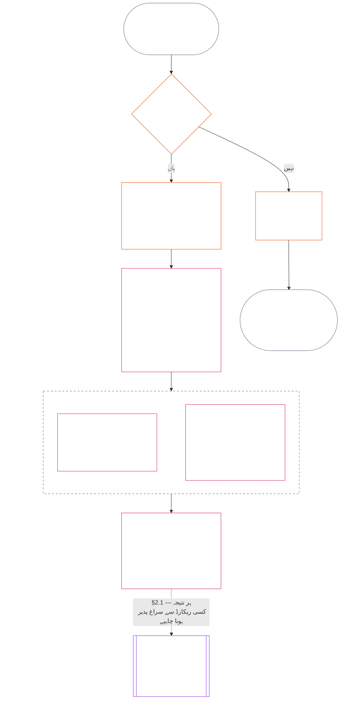

<!-- Locale: Urdu (ur) | Source: 9c2c8c10c871d91157bcd27b9f56ad6a1cec90d3 | AI-drafted, unreviewed | PARTIAL: Chapter Eleven §§1–3 only -->

### 1. تین سوال

*سادہ الفاظ میں: کیفیت کا تعین ترتیب سے تین سوالوں کے جواب دے کر ہوتا ہے۔ مطلوبہ درجہ بندی سے حقائق اخذ نہ کریں اور مطلوبہ نتیجے کو جائز ثابت کرنے کے لیے درجہ بندی نہ چنیں۔*

| سوال | سوال کیا پوچھتا ہے | جواب کہاں دیا گیا ہے |
| --- | --- | --- |
| **1. کیا ہوا؟** | کون سے حقائق کی تصدیق ہوئی، کس کے یا کس چیز کے بارے میں، کس مدت کے دوران، اور کس کیفیت ریکارڈ اور چیلنج کی حالت کے ساتھ؟ | [سیکشن 2](#2-question-1--what-happened) اور [سیکشن 3](#3-question-1-event-type-guide--what-kind-of-help-or-harm-occurred) |
| **2. یہ کتنا اچھا یا برا تھا؟** | یہ حقائق کس نوعیت اور مقدار کی شراکت یا خلاف ورزی ثابت کرتے ہیں؟ | [باب بارہ، سیکشن 1](core_12.000_standing_measurement.md#1-question-2--how-good-or-bad-was-it) |
| **3. اس کے نتیجے میں کیا ہوتا ہے؟** | اس سے کون سی شناخت، تیاری، ازالہ، حفاظتی اقدام، پابندی یا دوسرا نتیجہ نکلتا ہے؟ | [باب تیرہ](core_13.000_standing_integration.md#chapter-thirteen-standing-effects-and-integration) |

ہر سوال کا انحصار اس سے پہلے والے جواب پر ہے:

- سوال 1، سوال 2 کے لیے تصدیق شدہ حقائق فراہم کرتا ہے۔
- سوال 2، سوال 3 کے لیے ان حقائق کی پیمائش کرتا ہے۔
- سوال 3 کو پسندیدہ نتیجے کے مطابق حقائق یا درجہ بندی دوبارہ نہیں لکھنی چاہیے۔

تینوں سوالوں کے جوابات مل کر ایک محدود واقعے یا ایک متعین نمونے کے لیے مکمل کیفیتی جائزہ بناتے ہیں۔ کسی موضوع کے وقت کے ساتھ ایسے کئی جائزے ہو سکتے ہیں، اور ان میں سے کوئی بھی اس موضوع کا خالص اسکور یا مجموعی درجہ بندی نہیں۔ شراکت اور خلاف ورزی کے کیفیتی ریکارڈ سوال 1 اور 2 کے جوابات محفوظ رکھتے ہیں؛ سوال 3 کا فیصلہ بتاتا ہے کہ ان سے آگے کیا ہوتا ہے۔

#### 1.1 مقصد اور دائرۂ کار

یہ باب **نظاموں**، **شعوری وجودوں** اور **اداروں** کے لیے آئینی ریکارڈ کا فریم ورک بیان کرتا ہے، اور [باب بارہ](core_12.000_standing_measurement.md#chapter-twelve-standing-measurement--question-2-how-good-or-bad-was-it) پیمائش کا فریم ورک بیان کرتا ہے۔ اس میں ہر وہ نظام شامل ہے جسے [**CS-9.305**](corpus_systems/cs_09.305_system_classification_machinery.md#cs-9305-part-a-system-classification-machinery) (*نظام کی درجہ بندی کا طریقۂ کار*) کے تحت درجہ بند کیا گیا ہے۔ یہ فریم ورک گپ شپ، مقبولیت، مبہم شہرت، فطری وقار یا عمومی قدر کی پیمائش نہیں کرتے؛ ان میں سے کوئی بھی کیفیتی جائزے کا جائز موضوع نہیں۔

کیفیتی سلسلہ ان حالات میں بھی مؤثر رہنا چاہیے:

- پہلے سے تصدیق شدہ شراکتیں اتنی پرانی ہو جائیں کہ موجودہ اہلیت یا قابلِ اعتماد ہونے کو ظاہر نہ کر سکیں؛
- خلاف ورزیاں غیر حل شدہ رہیں؛
- تلافی مہنگی ہو؛
- ذمہ داری سرحدوں کے پار جائے؛ یا
- کوئی فاعل جوابدہی میں رکاوٹ ڈالنے کے لیے تنظیمی پرتیں یا نئے نام استعمال کرے۔

یہ معاملات منظور شدہ نفاذی متن میں شامل ہوں گے:

- روزمرہ کے طریقۂ کار؛
- درجہ بہ درجہ اضافے کے اقدامات؛
- واپسی اور تلافی کے کام؛
- بحالی پر مبنی جوابدہی کے اقدامات؛ اور
- ترغیبات کی تشکیل۔

باب بارہ کی پیمائش بذاتِ خود طاقت کے استعمال، حراست یا آزادی پر کسی اور پابندی کی اجازت **نہیں** دیتی۔ ایسے ہر نتیجے کو باب ششم کے **آرٹیکل XX** (*تصدیق شدہ خلاف ورزی کے بعد انصاف*) کے تناسب، کم سے کم پابندی، مقررہ مدت، واپسی اور بحالی پر مبنی جوابدہی کے تقاضوں سمیت، آزادانہ طور پر پورا کرنا ہوگا۔

<strong>سراغ · تعریفیں · جائزہ · تعمیل</strong>

- بالائی ماخذ: [باب اول §16 — ذمہ دارانہ انتظام کی تفصیل](core_01.010_stewardship_capacity_principles.md#16-stewardship-in-depth)؛ [باب دوم تا چہارم](core_02.000_definition_structure.md)؛ [باب پنجم](core_05.000_definitions_home.md#chapter-five-foundational-definitions)۔
- اگلا سلسلہ: [§2](#2-question-1--what-happened) (*سوال 1*)؛ [§4](#4-standing-record-operational-requirements) (*تصدیق اور ریکارڈ کے تقاضے*)؛ [§5](#5-record-custody-and-opening-authority) (*ریکارڈ کی تحویل اور کھولنے کا اختیار*)؛ [§6](#6-handling-a-standing-record) (*کیفیتی ریکارڈ کی دیکھ بھال*)؛ [باب بارہ §1](core_12.000_standing_measurement.md#1-question-2--how-good-or-bad-was-it) (*سوال 2 کی پیمائش*)؛ [باب بارہ §2](core_12.000_standing_measurement.md#2-magnitude-and-severity-input-dimensions) (*پیمائش کے ان پٹ کے پہلو*)؛ [باب بارہ §3](core_12.000_standing_measurement.md#3-route-descriptor-catalogs-and-measurement-roles) (*راستے کے وصفی جدول*)؛ [باب بارہ §4](core_12.000_standing_measurement.md#4-slot-grammar-and-shared-scaling) (*سلاٹ کی ساخت اور مشترک پیمانہ بندی*)؛ [باب بارہ §5](core_12.000_standing_measurement.md#5-constitutional-inputs-to-axis-assignment) (*آئینی ماخذ سے محور کی تخصیص*)؛ [باب بارہ §6](core_12.000_standing_measurement.md#6-unified-proportional-lequ-scale--contribution-and-violation-axes) (*دونوں محوروں کے لیے متحدہ متناسب LEQU پیمانہ*)؛ [باب تیرہ](core_13.000_standing_integration.md#chapter-thirteen-standing-effects-and-integration) (*سوال 3*)۔
- [مادیت](core_05.050_band_oversight.md#materiality) · [O](core_05.050_band_oversight.md#materiality) · [M](core_05.050_band_oversight.md#materiality-determination-a) · [A](core_05.050_band_oversight.md#materiality-determination-a) · [C](core_05.050_band_oversight.md#materiality-determination-c)
- [نقصان](core_05.035_band_accountability.md#harm) · [O](core_05.035_band_accountability.md#harm) · [M](core_05.035_band_accountability.md#harm-a) · [A](core_05.035_band_accountability.md#harm-a) · [C](core_05.035_band_accountability.md#harm-c)
- [تناسب](core_05.035_band_accountability.md#proportionality) · [O](core_05.035_band_accountability.md#proportionality) · [M](core_05.035_band_accountability.md#proportionality-a) · [A](core_05.035_band_accountability.md#proportionality-a) · [C](core_05.035_band_accountability.md#proportionality-c)

### 2. سوال 1 — کیا ہوا؟

<strong>سراغ</strong>

- بالائی ماخذ: [§1](#1-the-three-questions) (*تین سوالوں کا فریم ورک*)؛ [باب دوم تا چہارم](core_02.000_definition_structure.md) (*ریکارڈ، تصدیق، اور تعریفوں سے نتائج تک سراغ رسانی*)۔
- آئینی چوکڑی کے ارکان: **شرکت**؛ **نگرانی** (چیلنج پذیری اور چیلنج کے راستے)۔ بنیادی مقاصد: **شگفتگی** اور **استمرار** (سراغ پذیر ریکارڈ جو بعد کی پیمائش کے لیے شراکت اور خلاف ورزی کے الگ نتائج محفوظ رکھتا ہے)۔
- اگلا سلسلہ:
  - [§2.2](#22-silence-is-the-default) (*خاموشی بنیادی حالت ہے*)؛
  - [§2.3](#23-protected-dissent-is-not-a-trigger) (*محفوظ اختلاف کوئی محرک نہیں*)؛
  - [§2.4](#24-linked-standing-records-and-no-offset-bridge) (*منسلک کیفیتی ریکارڈ اور عدمِ تلافی کا پل*)؛
  - [§2.5](#25-verified-input-gate) (*تصدیق شدہ ان پٹ کی حد*)؛
  - [§2.6](#26-stage-boundary) (*مرحلے کی حد*)؛
  - [§2.7](#27-forum-boundary) (*فورم کی حد*)؛
  - [§3](#3-question-1-event-type-guide--what-kind-of-help-or-harm-occurred) (*واقعے کی قسم کا رہنما*)؛
  - [§4](#4-standing-record-operational-requirements) (*ریکارڈ کے تقاضے*)؛
  - [§5](#5-record-custody-and-opening-authority) (*ریکارڈ کی تحویل اور کھولنے کا اختیار*)؛
  - [§6](#6-handling-a-standing-record) (*کیفیتی ریکارڈ کی دیکھ بھال*)؛
  - [باب بارہ §1](core_12.000_standing_measurement.md#1-question-2--how-good-or-bad-was-it) (*سوال 2 کی پیمائش*)؛
  - [باب بارہ §2](core_12.000_standing_measurement.md#2-magnitude-and-severity-input-dimensions) (*پیمائش کے ان پٹ کے پہلو*)؛
  - [باب بارہ §3](core_12.000_standing_measurement.md#3-route-descriptor-catalogs-and-measurement-roles) (*راستے کے وصفی جدول*)؛
  - [باب بارہ §4](core_12.000_standing_measurement.md#4-slot-grammar-and-shared-scaling) (*سلاٹ کی ساخت اور مشترک پیمانہ بندی*)؛
  - [باب بارہ §5](core_12.000_standing_measurement.md#5-constitutional-inputs-to-axis-assignment) (*آئینی ماخذ سے محور کی تخصیص*)؛
  - [باب بارہ §6](core_12.000_standing_measurement.md#6-unified-proportional-lequ-scale--contribution-and-violation-axes) (*دونوں محوروں کے لیے متحدہ متناسب LEQU پیمانہ*)؛
  - [باب تیرہ](core_13.000_standing_integration.md#chapter-thirteen-standing-effects-and-integration) (13.000) (*سوال 3*)۔

 

*سادہ الفاظ میں: سوال 1، جو کچھ ہوا اس کا محدود اور قابلِ چیلنج بیان قائم کرتا ہے۔ کسی درجہ بندی یا نتیجے پر غور کرنے سے پہلے یہ موضوع، واقعہ یا نمونہ، مدت، تصدیق شدہ حقائق اور ریکارڈ کی حالت متعین کرتا ہے۔ تصدیق شدہ مدد اور تصدیق شدہ خلاف ورزی الگ کیفیتی ریکارڈوں میں رہتے ہیں تاکہ ایک دوسرے کو مٹا نہ سکے۔ یہ ریکارڈ مقبولیت کے اسکور یا مبہم لیبل نہیں ہیں۔*

**کیفیتی ریکارڈ** اس باب میں کسی خاص موضوع، عملی دائرے، ریکارڈ کی مدت، جائزے کی حالت اور فیصلے کے سیاق کے لیے استعمال ہونے والا محدود ریکارڈ ہے۔ پیمائش شروع ہونے سے پہلے یہ متعین کرے:

- کیفیتی ریکارڈ کس کے یا کس چیز کے بارے میں ہے؛
- آیا یہ ایک محدود واقعے سے متعلق ہے یا متعین نمونے سے؛
- متعلقہ طرزِ عمل اور اثرات کب اور کہاں پیش آئے؛
- کون سے حقائق کی تصدیق ہوئی اور کون سے متنازع ہیں؛
- نتائج کی تائید میں کون سا ثبوت، نسبت اور چیلنج کا راستہ موجود ہے؛ اور
- کیفیتی ریکارڈ کی موجودہ جائزہ، اصلاح اور متبادل کی حالت کیا ہے۔

خاکہ ایک واقعے کا سراغ لگاتا ہے تاکہ دیکھا جا سکے کہ آیا وہ کیفیتی ریکارڈ کھولنے کا محرک بنتا ہے اور پھر ریکارڈ میں کیا درج ہوتا ہے؛ آگے کے ذیلی حصے ہر اصول بیان کرتے ہیں۔ "نہیں" والی شاخ مرکزی راستے سے دائیں جانب نکلتی ہے۔

#### 2.1 کیفیتی ریکارڈ: اقسام اور موضوعات

سوال 1 تصدیق شدہ مدد کے لیے **شراکت کا کیفیتی ریکارڈ** اور تصدیق شدہ نقصان کے لیے **خلاف ورزی کا کیفیتی ریکارڈ** استعمال کرتا ہے، جس میں جوابدہی کی ناکامیاں بھی شامل ہیں۔ ایک کیفیتی ریکارڈ دونوں قسم کے نتائج کو یکجا نہیں کرتا۔

- کیفیتی ریکارڈ کسی شعوری وجود، ادارے، نظام، جائزے، محدود واقعے، کردار، اجتماعی گروہ، فاعل کے مخصوص ریکارڈ یا کسی اور آئینی طور پر متعلقہ اکائی کے بارے میں ہو سکتا ہے۔
  - اسے مختلف موضوعات، کرداروں، نظاموں، برادریوں، ریکارڈ کی مدتوں، جائزے کی حالتوں یا فیصلے کے سیاق کو ایک غیر ممیز کیفیتی لیبل میں سمیٹنا نہیں چاہیے۔
- کیفیتی ریکارڈ ایک **محدود واقعے** — واضح آغاز اور اختتام والے ایک واقعے — یا بار بار کے طرزِ عمل کے ایک **نمونے** کا احاطہ کر سکتا ہے۔
  - نمونے کے لیے متعین موضوع، دائرۂ کار اور جائزے کی مدت درکار ہے۔
- ایک ہی موضوع کے وقت کے ساتھ کئی کیفیتی ریکارڈ ہو سکتے ہیں، جن میں منسلک شراکت اور خلاف ورزی کے ریکارڈ بھی شامل ہیں۔
  - جب متعلقہ کیفیتی ریکارڈ کا موضوع، باہم متداخل ریکارڈ مدت، محدود واقعہ، نمونہ یا فیصلہ جاتی سیاق مشترک ہو تو انہیں **سیکشن 4.2** کے تحت ایک دوسرے کا **باہمی حوالہ** دینا لازم ہے۔
- کیفیتی ریکارڈ مستقل شہرتی اسکور، وقار کی درجہ بندی، دائمی حیثیت، عمومی قدر کا لیبل یا ملا جلا اسکورکارڈ نہیں ہے۔
  - عملی تقاضے **سیکشن 4** میں ہیں۔

بعد کا کوئی بھی کیفیتی اثر باب تیرہ سے متعلق ہے، اور اسے متعلقہ کیفیتی ریکارڈ یا ریکارڈوں تک سراغ پذیر ہونا چاہیے، مگر وہ خود ریکارڈ کا حصہ نہ بنے۔

#### 2.2 خاموشی بنیادی حالت ہے

کسی شعوری وجود، ادارے یا نظام کا کوئی کیفیتی ریکارڈ نہ ہونا معمول کی حالت ہے، اور زیادہ تر شعوری وجود اسی حالت میں رہیں گے۔

- کیفیتی ریکارڈ صرف اسی وقت کھلتا ہے جب **سیکشن 4** کے مطابق محرک کی تصدیق ہو جائے۔ نامزد ریکارڈ کھولنے کا اختیار رکھنے والے کو اندراج کی منظوری دینی ہوگی، اور الگ ریکارڈ محافظ اسے درج کرے گا (**سیکشن 5**)۔ کیفیتی ریکارڈ کبھی بھی ان وجوہ سے نہیں کھولا جاتا:
  - بنیادی معیار قائم کرنے کے لیے؛
  - فہرست مکمل کرنے کے لیے؛ یا
  - اس لیے کہ نامزد راستے کا دربان ایسا چاہے۔
- کیفیتی ریکارڈ نہ ہونا کچھ نہیں بتاتا۔ "غیر درجہ بند"، "غیر تصدیق شدہ" اور "ریکارڈ موجود نہیں" خطرے، کم شراکت یا کسی اور بات کا ثبوت نہیں۔ کوئی بھی شخص غیر موجود ریکارڈ کو زیادہ جانچ، کم ابتدائی درجہ یا نامزد راستے تک مشروط رسائی کی وجہ نہیں بنا سکتا۔
- کوئی ادارہ یا نظام درج ذیل کی شرط کے طور پر کیفیتی ریکارڈ، "کوئی ریکارڈ نہیں" کی تصدیق یا ریکارڈ کھولنے کی رضامندی طلب نہیں کر سکتا:
  - **آرٹیکل III** (*بقا اور ضروری رسائی*) کی ضروریات؛
  - **آرٹیکل III-C** (*محنت اور معاشی کم از کم*) کے تحفظات؛
  - معمول کی تجارت؛ یا
  - متاثرہ فریق کی حیثیت سے شرکت۔
  [باب تیرہ §6.2 اہلیت کی حدیں اور اجازت نامے](core_13.000_standing_integration.md#62-competency-bars-and-clearances) کے تحت مخصوص، اعتماد سے حساس نامزد راستوں کے لیے شائع شدہ اہلیت کی حدیں مستثنیٰ ہیں؛ ان میں یہ بتانا ہوگا کہ نامزد راستہ اعتماد سے حساس کیوں ہے۔
- کسی موضوع کے بارے میں کیفیتی ریکارڈ کھولا جائے تو **سیکشن 4** کے مطابق اسے اطلاع دینی لازم ہے۔ اطلاع صرف تب مؤخر کی جا سکتی ہے جب درج شدہ [ثبوت کا تحفظ](core_05.050_band_oversight.md#evidence-preservation) یا حفاظتی ضرورت اس کا جواز دے، اور صرف محدود، مقررہ مدت کے لیے۔ اطلاع کیفیتی ریکارڈ کو قابلِ چیلنج بناتی ہے: جس موضوع کو ریکارڈ کے وجود کا علم نہ ہو وہ اسے چیلنج یا درست نہیں کر سکتا۔

#### 2.3 محفوظ اختلاف کوئی محرک نہیں

**آرٹیکل XI-D** (*اجتماع، اختلاف اور پُرامن احتجاج*) کے تحت اختلاف یا پُرامن احتجاج — بشمول [محفوظ پُرامن شہری نافرمانی](core_06.005_rights_part_b.md#xi-d-nonviolent-civil-disobedience) — اور [*اختلاف اور پُرامن احتجاج کے حقوق کی تہہ*](core_06.005_rights_part_b.md#xi-d-dissent-and-peaceful-protest)، تصدیق شدہ محرک نہیں ہیں۔

- اس سے خلاف ورزی کا کیفیتی ریکارڈ نہیں کھلتا، نہ اس کی مدت بڑھتی یا شدت میں اضافہ ہوتا ہے؛ یہ **سیکشن 8.2** کے تحت شدت کا ان پٹ نہیں اور اسے دہرانا نمونہ نہیں بناتا۔
- ایسا الگ کیا جا سکنے والا طرزِ عمل جو آزادانہ طور پر آئینی تہہ کی خلاف ورزی کرے، اپنی بنیاد پر درج ہوگا؛ احتجاج کے نقطۂ نظر، مقصد یا ہدف کی وجہ سے اس کی شدت نہیں بڑھائی جائے گی۔

#### 2.4 منسلک کیفیتی ریکارڈ اور عدمِ تلافی کا پل

<strong>سراغ</strong>

- بالائی ماخذ: [§2.1](#21-standing-records-kinds-and-subjects) (*شراکت اور خلاف ورزی کے الگ ریکارڈ*)۔
- اگلا سلسلہ:
  - [§2.5](#25-verified-input-gate) (*تصدیق شدہ ان پٹ کی حد*)؛
  - [§2.7](#27-forum-boundary) (*فورم کی حد*)؛
  - [§4.2](#42-related-standing-record-cross-references) (*باہمی حوالے*)؛
  - [باب بارہ §1](core_12.000_standing_measurement.md#1-question-2--how-good-or-bad-was-it) (*سوال 2 کی پیمائش*)؛
  - [باب بارہ §2](core_12.000_standing_measurement.md#2-magnitude-and-severity-input-dimensions) (*پیمائش کے ان پٹ کے پہلو*)؛
  - [باب بارہ §3](core_12.000_standing_measurement.md#3-route-descriptor-catalogs-and-measurement-roles) (*راستے کے وصفی جدول*)؛
  - [باب بارہ §4](core_12.000_standing_measurement.md#4-slot-grammar-and-shared-scaling) (*سلاٹ کی ساخت اور مشترک پیمانہ بندی*)؛
  - [باب بارہ §5](core_12.000_standing_measurement.md#5-constitutional-inputs-to-axis-assignment) (*آئینی ماخذ سے محور کی تخصیص*)؛
  - [باب بارہ §6](core_12.000_standing_measurement.md#6-unified-proportional-lequ-scale--contribution-and-violation-axes) (*دونوں محوروں کے لیے متحدہ متناسب LEQU پیمانہ*)؛
  - [باب تیرہ](core_13.000_standing_integration.md#chapter-thirteen-standing-effects-and-integration) (13.000) (*سوال 3*)۔
- ساتھ پڑھیں: [باب تیرہ — کیفیت کا انضمام](core_13.000_standing_integration.md#2-automatic-integration-review-and-continuity) (13.000) (*دستبرداری نہ ہونا اور منسلک ریکارڈ کا انضمام*)؛ [باب تیرہ §6.2 — اہلیت کی حدیں اور اجازت نامے](core_13.000_standing_integration.md#62-competency-bars-and-clearances) (13.000 §6.2)؛ [باب تیرہ §4.2 — کیفیتی تالے](core_13.000_standing_integration.md#42-prevention--general-standing-locks) (13.000 §4.2)۔

 

**بنیادی اصول:** تصدیق شدہ **شراکت کے کیفیتی ریکارڈ** اور تصدیق شدہ **خلاف ورزی کے کیفیتی ریکارڈ** کو **سیکشن 2.1** کے تحت الگ رکھا جاتا ہے۔ شراکت یا خلاف ورزی کا ہر نتیجہ اپنے کیفیتی ریکارڈ میں اپنے تائید شدہ حقائق پر مبنی ہونا چاہیے۔ تجزیے اور معاون مواد میں دونوں ریکارڈ راستوں کو الگ الگ سراغ پذیر رکھنا ہوگا۔ کوئی واحد اندراج یا منسلک اندراجات کا مجموعہ خالص اسکور، ملا جلا اسکور یا سودے بازی نہیں ہے۔

- **خلاف ورزی کے کیفیتی ریکارڈ اور کیفیتی تالے:**
  - باب تیرہ کے تحت، خلاف ورزی کے کیفیتی ریکارڈ سے اخذ کردہ قابلِ اطلاق **کیفیتی تالے**، تصدیق شدہ خلاف ورزی حل نہ ہونے تک کیفیت محدود کر سکتے ہیں، کردار کی اہلیت پر پابندی لگا سکتے ہیں یا ازالے تک رسائی متاثر کر سکتے ہیں۔
  - کیفیتی تالے شراکت کے کیفیتی ریکارڈوں میں درج تصدیق شدہ مثبت شراکت کو مٹا نہیں سکتے۔
  - غیر حل شدہ تصدیق شدہ خلاف ورزیوں کی قدر صرف وقت گزرنے سے کم نہیں ہوتی۔
  - تصدیق شدہ خلاف ورزیوں کو غیر متعلقہ شراکت کے کیفیتی ریکارڈ جھوٹی منفی شہرتی فائل میں دوبارہ نہیں لکھنا چاہیے۔
- **شراکت کے کیفیتی ریکارڈ اور اہلیت کی اجازت:**
  - تصدیق شدہ شراکت شائع شدہ **اہلیت کی حدوں** کے مقابل قابلِ اطلاق **اہلیت کی اجازتوں** کی تائید کر سکتی ہے اور موجودہ و کردار سے متعلق ہونے پر اعتماد، کردار یا شناخت سے وابستہ اہلیت میں مدد دے سکتی ہے۔
  - تصدیق شدہ شراکت کسی تصدیق شدہ خلاف ورزی کے نتیجے کو تلافی، اوسط میں کمی، عذر یا نئے لیبل سے نہیں بدل سکتی۔
  - حد پوری ہونے سے کوئی قابلِ اطلاق کیفیتی تالا ختم نہیں ہوتا۔

**واحد استثنا:** اگر خلاف ورزی کا نتیجہ بذاتِ خود دعویٰ کردہ شراکت کو غلط ثابت کرے — مثلاً ثبوت دکھائے کہ آپ نے وہ کام حقیقتاً کیا ہی نہیں جس کا دعویٰ آپ کے شراکت ریکارڈ میں ہے — تو مناسب ثبوت اور جائزے کے طریقے سے منسلک شراکت کا کیفیتی ریکارڈ درست یا حذف کیا جا سکتا ہے، جس کے ساتھ **سیکشن 4.2** کا مطلوبہ باہمی حوالہ درج ہوگا۔ لیکن خلاف ورزی الگ شراکت کے کیفیتی ریکارڈوں میں درج غیر متعلقہ مدد خود بخود نہیں مٹاتی۔

#### 2.5 تصدیق شدہ ان پٹ کی حد

یہ حد یوں کام کرتی ہے:

- کیفیت، اعتماد، کردار، شناخت یا شناخت کی اہلیت کو متاثر کرنے والا کوئی بھی فیصلہ صرف متعلقہ **شراکت کے کیفیتی ریکارڈ** یا **خلاف ورزی کے کیفیتی ریکارڈ** کے تصدیق شدہ ان پٹ استعمال کر سکتا ہے۔
- الزامات، غیر فیصلہ شدہ دعوے، عارضی راستہ جاتی ٹیگ، صرف وصولی کے مرحلے کی بیانیہ باتیں اور تنازع کے مرحلے کا دیگر مواد بذاتِ خود کیفیت کے لیے شراکت یا خلاف ورزی کی نوعیت فراہم نہیں کرتے۔
- تصدیق شدہ ان پٹ ایک **کیفیتی نتیجہ** ہے: تصدیق شدہ شراکت کا نتیجہ (محور I) یا تصدیق شدہ خلاف ورزی کا نتیجہ (محور II)۔
- شراکت اور خلاف ورزی کے نتائج الگ کیفیتی ریکارڈوں میں رہتے ہیں (دیکھیں **سیکشن 2.1**)۔

#### 2.6 مرحلے کی حد

کیفیتی ریکارڈ کے مراحل الگ رہتے ہیں:

- سوال 1 تصدیق شدہ حقائق درج کرتا ہے؛ سوال 2 ان کی پیمائش کرتا ہے۔
- سوال 2 کی پیمائش زیرِ التوا ہونے کے باوجود، تصدیق شدہ حقائق کی بنیاد مکمل ہونے پر کیفیتی ریکارڈ کھولا جا سکتا ہے۔
- پیمائش ہونے تک سوال 2 کے خانوں میں زیرِ التوا ہونا درج ہونا چاہیے، سلاٹ یا زمرے کا تاثر نہیں دینا چاہیے۔
- کیفیتی ریکارڈ کو سوال 3 کا کوئی **کیفیتی اثر** بیان یا نافذ نہیں کرنا چاہیے۔

#### 2.7 فورم کی حد

*سادہ الفاظ میں: فورم تنازعات کی نگرانی کرتے ہیں، انہیں چیلنج کرنے دیتے ہیں اور تصدیق شدہ نتائج تک پہنچاتے ہیں — مگر مقدمہ دائر کرنے یا بیانیے کی کشمکش جیتنے سے کیفیت تازہ نہیں ہوتی۔ **سیکشن 2.5** کی تصدیق شدہ ان پٹ کی حد پھر بھی لاگو ہے۔ جب فورم باب دوم تا چہارم کے تحت حقائق کی تصدیق کرے تو وہ کیفیتی ریکارڈ **کھول، تازہ یا درست** کر سکتا ہے — یا **چیلنج پر خراب ریکارڈ ایک طرف رکھ** سکتا ہے۔ فورم اچھائی اور برائی کو ایک اسکور میں نہیں ملاتے اور خود کیفیتی زمرہ ایجاد نہیں کرتے۔*

یہ سیکشن صرف ایک سوال کا مالک ہے: فورم کا کام کیفیتی ریکارڈ تک کیسے پہنچتا ہے۔ سلسلے کے دیگر مراحل یہاں نامزد مالکان کے ہیں، اور یہ سلسلہ اس ترتیب سے چلتا ہے:

1. تنازع دائر ہوتا ہے اور فورم **فورم مقدمہ ریکارڈ** رکھتا ہے، جو کیفیتی ریکارڈ نہیں ہے۔ مالک: [باب پندرہ §2.3 فورم مقدمہ ریکارڈ، کیفیتی ریکارڈ اور اعتراضات](core_15.000_forum.md#23-forum-case-records-standing-records-and-contests)؛ [§2.7.1 فورم مقدمہ ریکارڈ](#271-forum-case-record) بھی دیکھیں۔
2. فورم [باب دوم تا چہارم](core_02.000_definition_structure.md) کے تحت حقائق کی تصدیق کرتا ہے۔
3. تصدیق شدہ نتائج، تصدیق شدہ ان پٹ کی حد سے گزرتے ہیں۔ مالک: [§2.5 تصدیق شدہ ان پٹ کی حد](#25-verified-input-gate)۔
4. نامزد ریکارڈ کھولنے کا اختیار رکھنے والا، جو فورم بھی ہو سکتا ہے، کیفیتی ریکارڈ کھولتا، تازہ یا درست کرتا ہے، یا چیلنج پر خراب ریکارڈ ایک طرف رکھتا ہے۔ ریکارڈ میں کیا رکھا جائے اس کا مالک [§4.1 ریکارڈ کا کم از کم مواد](#41-minimum-record-contents) ہے، اور کون عمل کر سکتا ہے اس کا مالک [§5 ریکارڈ کی تحویل اور کھولنے کا اختیار](#5-record-custody-and-opening-authority) ہے۔
5. کیفیتی ریکارڈ میں صرف تصدیق شدہ حقائق ہوتے ہیں، اور سوال 2 بعد میں ان کی پیمائش کرتا ہے۔ مالکان: [§2.6 مرحلے کی حد](#26-stage-boundary) اور [باب بارہ §1 سوال 2 — یہ کتنا اچھا یا برا تھا؟](core_12.000_standing_measurement.md#1-question-2--how-good-or-bad-was-it)۔
6. اگر کوئی کیفیتی اثر ہو تو وہ [باب تیرہ](core_13.000_standing_integration.md#chapter-thirteen-standing-effects-and-integration) کے تحت نکلتا ہے، جس کے پاس کیفیتی اثرات کی ذمہ داری ہے۔

[باب پندرہ](core_15.000_forum.md#chapter-fifteen-forums-and-jurisdiction) کے تحت فورم خاندان **نگرانی** کرتے ہیں کہ ٹھوس تنازعات کیفیتی سلسلے سے کیسے گزرتے ہیں۔ [باب پندرہ §6 بروقت حل، مادیت کے درجے اور تاخیر مخالف نظم](core_15.000_forum.md#6-timely-resolution-materiality-tiers-and-anti-delay-discipline) اور [آرٹیکل XXVI-C](core_06.020_rights_part_e.md#article-xxvi-c-timely-resolution-and-anti-delay-floor) (*بروقت حل اور تاخیر مخالف تہہ*) کے تحت فورم یہ فراہم کرتے ہیں:

- قابلِ رسائی چیلنج؛
- آزاد جائزہ؛
- تفتیشی معاونت؛
- ازالے کی ترتیب؛ اور
- درجے کے مطابق مدتیں۔

جب فورم کے نتائج باب دوم تا چہارم کے تحت تصدیق شدہ ان پٹ کی حد پوری کریں تو وہ:

- **سیکشن 4.1** کے تحت کیفیتی ریکارڈ **کھول، تازہ یا درست** کر سکتے ہیں؛ یا
- **چیلنج پر خراب ریکارڈ ایک طرف رکھ** سکتے ہیں۔

##### 2.7.1 فورم مقدمہ ریکارڈ

کھلے تنازع پر فورم کی اپنی فائل [**فورم مقدمہ ریکارڈ**](core_05.035_band_accountability.md#forum-case-record) ہے، جس کی تعریف [باب پندرہ §2.3 فورم مقدمہ ریکارڈ، کیفیتی ریکارڈ اور اعتراضات](core_15.000_forum.md#23-forum-case-records-standing-records-and-contests) میں کی گئی ہے۔ یہ **کیفیتی ریکارڈ نہیں** ہے۔

##### 2.7.2 فورم کے نتائج اور سوال 2 کی پیمائش

فورم کے تصدیق شدہ حقائق کے نتائج سوال 1 کے کیفیتی ریکارڈ کے لیے حقائق کی بنیاد فراہم کر سکتے ہیں۔ وہ تصدیق شدہ شراکت یا خلاف ورزی کے بارے میں سوال 2 کی پیمائش، یعنی یہ کتنا اچھا یا برا تھا، **متعین نہیں** کرتے ([§2.6 مرحلے کی حد](#26-stage-boundary))۔ لہٰذا:

- فورم کی کارروائیوں کو شراکت اور خلاف ورزی کا مواد ایک خالص اسکور، ملے جلے میرٹ کے جواب یا غیر ممیز کیفیتی لیبل میں **جمع نہیں** کرنا چاہیے؛ منسلک کیفیتی ریکارڈ [§2.1 کیفیتی ریکارڈ: اقسام اور موضوعات](#21-standing-records-kinds-and-subjects) اور [§2.4 منسلک کیفیتی ریکارڈ اور عدمِ تلافی کا پل](#24-linked-standing-records-and-no-offset-bridge) کے تحت الگ رہیں گے۔
- فورم کے نتائج کو تنازع کی کہانیوں، راستہ بندی کی سہولت یا پینل کی ترجیح کو قابلِ ثبوت تصدیق شدہ ان پٹ ([§2.5 تصدیق شدہ ان پٹ کی حد](#25-verified-input-gate))، علیحدہ پیمائش ([باب بارہ §1 سوال 2 — یہ کتنا اچھا یا برا تھا؟](core_12.000_standing_measurement.md#1-question-2--how-good-or-bad-was-it))، یا [باب تیرہ](core_13.000_standing_integration.md#chapter-thirteen-standing-effects-and-integration) کے ذمے کیفیتی اثرات کے طریقۂ کار کی جگہ **نہیں** لینا چاہیے۔

##### 2.7.3 فورم کی حد کن چیزوں کو کم نہیں کرتی

یہ حد درج ذیل کے تحت درکار چیلنج، ازالے، عبوری راحت یا طریقۂ کار کے تحفظات کو **کم نہیں** کرتی:

- [آرٹیکل XIII-A](core_06.010_rights_part_c.md#article-xiii-a-reliability-and-trustworthiness-baseline) (*قابلِ اعتماد ہونے اور دیانت کی بنیادی سطح*)؛
- [آرٹیکل XIII-B](core_06.010_rights_part_c.md#article-xiii-b-right-to-redress-and-remedy) (*داد رسی اور ازالے کا حق*)؛
- [باب پندرہ §6 بروقت حل، مادیت کے درجے اور تاخیر مخالف نظم](core_15.000_forum.md#6-timely-resolution-materiality-tiers-and-anti-delay-discipline)؛
- [آرٹیکل XXVI-C](core_06.020_rights_part_e.md#article-xxvi-c-timely-resolution-and-anti-delay-floor) (*بروقت حل اور تاخیر مخالف تہہ*)؛ یا
- متعلقہ انصاف کے آرٹیکلز۔

اس کا تقاضا ہے کہ فورم کے تصدیق شدہ نتائج دوسرے تصدیق شدہ ان پٹ کی طرح اسی حد سے گزر کر کیفیتی ریکارڈ تک پہنچیں — اس کے گرد سے نہیں۔

### 3. سوال 1 کے واقعے کی قسم کا رہنما — کس قسم کی مدد یا نقصان ہوا؟

*سادہ الفاظ میں: حقائق کی تصدیق کے بعد جو کچھ ہوا اسے بیان کرنے کے لیے یہ جدولیں استعمال کریں۔ یہ متعلقہ شراکت یا خلاف ورزی کی قسم شناخت کرنے میں مدد دیتی ہیں۔ یہ طے نہیں کرتیں کہ یہ کتنا اچھا یا برا تھا، سلاٹ مقرر نہیں کرتیں اور نہ ہی بتاتی ہیں کہ اس کے نتیجے میں کیا ہوگا۔*

#### 3.1 شراکت کے واقعے کی اقسام

**اہلیت کا اصول:** دعویٰ کردہ شراکت صرف اسی وقت شمار ہوگی جب وہ سراغ پذیر ہو، اس کی لاگت دوسروں پر نہ ڈالی گئی ہو، اور وہ پورے نافذ آئین سے مطابقت رکھتی ہو۔

- دوسروں پر ڈالا گیا نقصان، جبری انحصار، حقوق کی تہہ کو تنگ کرنا یا چھپے ہوئے بوجھ دعویٰ کردہ شراکت کو نااہل یا محدود کر سکتے ہیں۔
- دعویٰ کردہ شراکت کسی الگ خلاف ورزی کے نتیجے کی تلافی نہیں کرتی۔

نیچے جدول کی ہر سطر تصدیق شدہ مدد کے ایک عام راستے اور اس کی آئینی اہمیت کا نام بتاتی ہے۔ ایک ہی کیفیتی ریکارڈ پر ایک سے زیادہ سطریں لاگو ہو سکتی ہیں۔

| تصدیق شدہ شراکت کی قسم | کیا ہوا | آئینی چوکڑی کے ارکان | بنیادی مقاصد |
| --- | --- | --- | --- |
| بقا اور جسمانی نگہداشت | کسی کو خوراک، پناہ، طبی نگہداشت یا تحفظ ملا | **شرکت**، **نگرانی** | **شگفتگی** |
| نگہداشت اور تعلیم | بچوں کی پرورش ہوئی، بزرگوں کی دیکھ بھال ہوئی یا دوسروں کو تعلیم دی گئی | **شرکت**، **نگرانی** | **شگفتگی**، **استمرار** |
| صدمے کا حل | کسی کو اس نفسیاتی نقصان سے بحالی میں مدد ملی جس نے بہبود میں رکاوٹ ڈالی تھی | **شرکت**، **جوابدہی** | **شگفتگی** |
| شدید بوجھ ہٹانا | کچل دینے والا قرض، استحصالی کام کے حالات یا نظامی رکاوٹیں ہٹائی گئیں | **شرکت**، **نگرانی** | **شگفتگی** |
| خود اختیاری بحال کرنا | کسی کو اپنی زندگی کے بارے میں بامعنی انتخاب ملے | **شرکت** | **شگفتگی** |
| پیداواری صلاحیت بڑھانا | اوزار، بنیادی ڈھانچے یا مواقع نے دوسروں کو آزادانہ طور پر ترقی کرنے کے قابل بنایا | **شرکت**، **نگرانی** | **شگفتگی**، **استمرار** |
| وقت کی کارکردگی بہتر کرنا | قابلِ گریز انتظار، انتظامی رکاوٹ یا ہم آہنگی کا اضافی بوجھ گھٹا، اور نگہداشت، آرام، خود اختیاری، سیکھنے یا حقوق سے ہم آہنگ کام کے لیے قابلِ استعمال وقت واپس ملا | **شرکت**، **نگرانی** | **شگفتگی** |
| ماحولیاتی یا بنیادی ڈھانچے کا خطرہ کم کرنا | ماحولیاتی تباہی یا اہم نظام کی ناکامی روکی گئی | **نگرانی**، **جوابدہی** | **استمرار**، **شگفتگی** |
| ماحولیاتی اثرات کا نشان کم کرنا | وسائل کا استعمال، اخراج یا زمین اور پانی کی طلب قابلِ تصدیق طور پر گھٹی، اور بوجھ دوسروں یا ماحولیاتی نظام پر نہیں ڈالا گیا | **نگرانی**، **جوابدہی** | **استمرار**، **شگفتگی** |
| ماحولیاتی نظام بحال کرنا | خراب شدہ زمین، پانی یا مسکن کو کارآمد اور خود برقرار رہنے والی حالت کی طرف بحال کیا گیا | **نگرانی**، **جوابدہی** | **استمرار**، **شگفتگی** |
| معدومیت کے خطرے والی انواع کی حفاظت | معدومیت کے خطرے سے دوچار انواع یا ان کے انحصاری مسکن کو نقصان سے بچایا گیا | **نگرانی**، **جوابدہی** | **استمرار**، **شگفتگی** |
| آلودگی اور فضلے میں کمی | آلودگی، نقصان دہ اخراج یا فضلے کو روکا، ہٹایا یا محفوظ طریقے سے سنبھالا گیا | **نگرانی**، **جوابدہی** | **شگفتگی**، **استمرار** |
| تحفظ، سچائی، قابلِ آڈٹ ہونے یا چیلنج کی صلاحیت مضبوط کرنا | حقوق کے تحفظ اور طاقت کو جوابدہ رکھنے کے لیے ادارے یا طریقے بنائے یا درست کیے گئے | **شرکت**، **نگرانی**، **جوابدہی** | **شگفتگی**، **استمرار** |

#### 3.2 خلاف ورزی کے واقعے کی اقسام

**اہلیت کا اصول:** خلاف ورزی کے واقعے کی قسم کے لیے **باب دوم تا چہارم** کے تحت تصدیق شدہ خلاف ورزی کا نتیجہ درکار ہے جو سراغ پذیر، محدود، قابلِ آڈٹ اور قابلِ چیلنج رہے۔

- الزامات، عارضی ٹیگ، فورم کے بیانیے اور ابتدائی وصولی کے لیبل راستہ بندی یا ابتدائی جانچ میں مدد دے سکتے ہیں، مگر یہ بذاتِ خود سوال 1 مکمل نہیں کرتے۔
- مثبت شراکت تصدیق شدہ خلاف ورزی کی تلافی، معافی، تنسیخ یا نیا لیبل نہیں بنتی۔

نیچے جدول کی ہر سطر تصدیق شدہ نقصان، خطرے یا فرض کی ناکامی کے ایک عام راستے اور اس کی آئینی اہمیت کا نام بتاتی ہے۔ ایک ہی کیفیتی ریکارڈ پر ایک سے زیادہ سطریں لاگو ہو سکتی ہیں۔

| تصدیق شدہ نقصان یا خطرے کی قسم | کیا ہوا | آئینی چوکڑی کے ارکان | بنیادی مقاصد |
| --- | --- | --- | --- |
| بقا یا جسمانی نگہداشت سے محرومی | قابلِ گریز موت، نگہداشت سے انکار، غیر محفوظ حالات یا بقا کے وسائل سے مادی محرومی ہوئی | **جوابدہی**، **شرکت** | **شگفتگی** |
| شدید قابلِ گریز بوجھ | کچل دینے والے، مسلط کردہ یا نظامی طور پر دوسروں پر ڈالے گئے بوجھ نے بہبود یا خود اختیاری کو مادی طور پر نقصان پہنچایا | **جوابدہی**، **شرکت** | **شگفتگی** |
| جبر سے خود اختیاری کا نقصان | جبر، ذہنی چال بازی، قابلِ اعتبار دھمکی، قید یا آزادی کو خطرہ پیش آیا | **جوابدہی**، **شرکت** | **شگفتگی** |
| حقوق کی تہہ کو ناکام کرنا | ناقابلِ گفت و شنید آئینی تہوں، آئینی بالادستی یا چیلنج اور ازالے تک رسائی کی مادی خلاف ورزی ہوئی | **جوابدہی**، **نگرانی** | **شگفتگی**، **استمرار** |
| ماحول یا بنیادی ڈھانچے کو نقصان | آئینی بہبود کے لیے ضروری حالات کو نقصان پہنچایا گیا | **جوابدہی**، **نگرانی** | **استمرار**، **شگفتگی** |
| آلودگی یا فضلے سے نقصان | آلودگی، نقصان دہ اخراج یا فضلے نے ہوا، پانی، مٹی یا صحت کو نقصان پہنچایا | **جوابدہی**، **نگرانی** | **شگفتگی**، **استمرار** |
| انواع یا مسکن کی تباہی | معدومیت کے خطرے والی انواع یا ان کے انحصاری مسکن تباہ، ٹکڑے یا نقصان کی طرف دھکیلے گئے، بشمول ایسا نقصان جسے تلافی کے قابل سمجھا گیا | **جوابدہی**، **نگرانی** | **استمرار**، **شگفتگی** |
| ماحولیاتی بحالی کی صلاحیت کا نقصان | نقصان کے بعد دوبارہ پیدا ہونے کی ماحولیاتی نظام کی صلاحیت ختم کر دی گئی یا اسے قابلِ گریز طور پر مشکل یا ناقابلِ واپسی بنایا گیا | **جوابدہی**، **نگرانی** | **استمرار**، **شگفتگی** |
| دوسروں پر ڈالا گیا ماحولیاتی نقصان یا کمی | ماحولیاتی لاگت دوسروں یا ماحولیاتی نظام پر ڈالی گئی، وسائل کو ان کی دوبارہ پیدا ہونے کی صلاحیت سے آگے تک ختم کیا گیا، یا ماحولیاتی نشان یا پائیداری کے دعوے نے مسلسل بگاڑ چھپایا | **جوابدہی**، **نگرانی** | **استمرار**، **شگفتگی** |
| پیداواری صلاحیت تباہ کرنا | آزادانہ ترقی کے لیے درکار اوزار، صلاحیتیں، تعلقات یا وسائل ختم کر دیے گئے | **جوابدہی** | **شگفتگی** |
| تحفظ، سچائی یا قابلِ آڈٹ ہونے کو گھٹانا | چھپاؤ، غلط معلومات، ٹوٹے ہوئے ریکارڈ، ناقابلِ رسائی چیلنج راستے یا ناقابلِ جائزہ مجموعہ بندی ہوئی | **نگرانی**، **جوابدہی** | **شگفتگی**، **استمرار** |
| جوابدہی میں رکاوٹ | جوابدہی کے طریقۂ کار — ثبوت کی سالمیت، تصدیق، فورم کا عمل، کیفیتی ریکارڈ، ازالے کی مدتوں یا چیلنج اور داد رسی کے راستوں — میں تصدیق شدہ مداخلت ہوئی؛ اگر رکاوٹ کسی الگ بنیادی نقصان پر میٹا حملہ ہو تو ایک منسلک مگر الگ خلاف ورزی کا کیفیتی ریکارڈ کھولیں | **جوابدہی**، **نگرانی**، **بروقت کارروائی** | **شگفتگی**، **استمرار** |
| نظام پر قبضہ یا انحصار کا استحصال | ساختی طور پر ممکن بنانا، انحصار کے عدم توازن کا استحصال، بچاؤ مخالف ڈیزائن یا جوابدہی کے راستوں پر قبضہ ہوا | **جوابدہی**، **شرکت** | **استمرار**، **شگفتگی** |

---

*دائرۂ احاطہ: یہ جزوی مسودہ صرف باب گیارہ §§1–3 کا احاطہ کرتا ہے۔ §§4–6 اور باب بارہ اس میں شامل نہیں۔*
