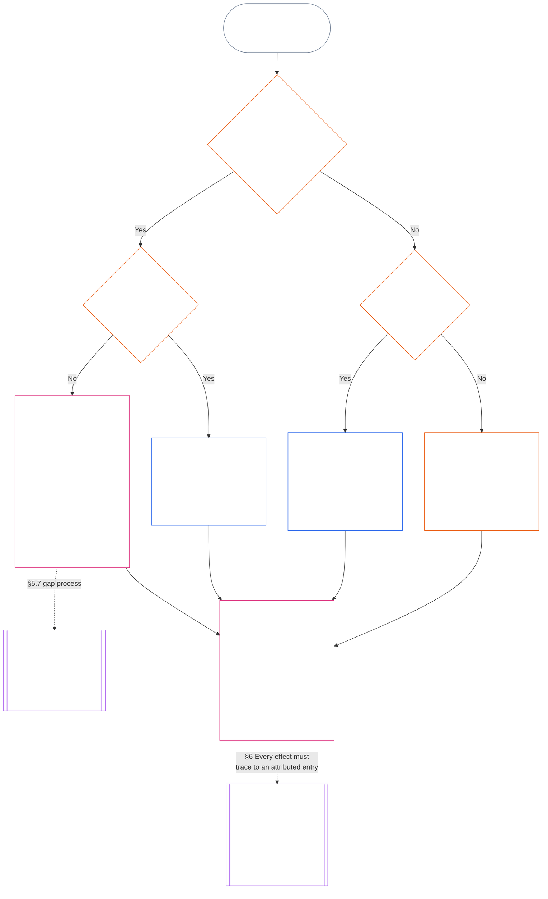

<!-- اردو جزوی ترجمے کا مسودہ — باب گیارہ §§5.4–5.9 اور §6۔ ماخذ: core_11.000_standing_assessment.md؛ ماخذ سنیپ شاٹ: 9c2c8c10c871d91157bcd27b9f56ad6a1cec90d3۔ AI کا مسودہ؛ غیر نظرثانی شدہ؛ غیر پابند۔ -->

#### 5.4 اپنی تحویل ممنوع

درج ذیل افراد یا ادارے کسی کیفیتی ریکارڈ کے لیے ریکارڈ کھولنے والا مجاز ادارہ یا ریکارڈ محافظ نہیں بن سکتے:

- کیفیتی ریکارڈ کا موضوع؛
- وہ فریق جو اس تعاون کا دعویٰ کرے یا اس خلاف ورزی کا الزام لگائے جس سے ریکارڈ متعلق ہے؛ اور
- [مادی کنٹرول لائن](core_05.035_band_accountability.md#material-control-line) میں شامل کوئی دفتر جو ان فریقوں کو مادی طور پر کنٹرول کرتا ہو یا ان کے مادی کنٹرول میں ہو۔

اس اخراج کے علاوہ:

- **موضوع کے اندر ذمہ دار منتظمین:** موضوع کا حصہ بننے والا (یعنی اس فریق، چارٹر کے دائرے یا نظام میں کام کرنے والا جس سے کیفیتی ریکارڈ متعلق ہے) اور اہم نظامی نگہداشت یا مادی عملی اختیار استعمال کرنے والا منتظم، [باب یکم §17.5 مزاحمت کا فرض](core_01.010_stewardship_capacity_principles.md#175-duty-to-resist) اور [CS-16.305 §10 قابلِ معائنہ، منسوب کارروائی](corpus_systems/cs_16.305_critical_system_stewardship.md#cs-16305-103-inspectable-attributable-action) کے تحت اپنے تمام فرائض برقرار رکھتا ہے — اپنے قابو کی چیز روکنا، دوبارہ بنائے جا سکنے والے مجموعے کا لاگ رکھنا، اپنے پاس کے شواہد محفوظ کرنا، اطلاع دینا اور معاملہ آگے بڑھانا — اور ان میں سے کوئی عمل حقائق کی تصدیق یا کیفیتی ریکارڈ کا اندراج نہیں ہے۔
  - **آزادانہ تصدیق:** جب معمول کا ریکارڈ کھولنے والا مجاز ادارہ خود موضوع ہو یا اسی خط میں بیٹھتا ہو، کیفیتی ریکارڈ آزادانہ تصدیق کے لیے بھیجا جائے گا: **سیکشن 2.7** کے تحت فورم، **CF-15.435 §6** (*خود تفتیش نہیں*) کے تحت آزاد تفتیشی خدمت، یا پہلے سے نامزد متبادل ادارہ جسے شائع شدہ اختیار حاصل ہو — ان میں سے جسے نظامی چارٹر، ادارہ جاتی چارٹر یا متبادل نامزدگی پہلے نام دے۔
- **طے شدہ متبادل:** جہاں کسی کا نام نہ دیا گیا ہو، بیک اپ ریکارڈ اتھارٹی (**CF-15.415 §7** (*بیک اپ ریکارڈ اتھارٹی*)) ریکارڈ کھولنے والا طے شدہ مجاز ادارہ ہوگی اور بیک اپ ریکارڈ محافظ (**CF-15.415 §9** (*بیک اپ ریکارڈ محافظ*)) طے شدہ محافظ ہوگا۔
- **نامزد راستہ نہ ہو:** ایسا کوئی نامزد راستہ نہ ہونا ایک خلا ہے جسے منتظم لاگ میں واضح کرے گا، نہ کہ خود کیفیتی ریکارڈ درج کرنے کا جواز۔
- **دونوں قواعد ساتھ:** یہ قاعدہ کیفیتی ریکارڈ میں فریقوں کی دلچسپی کی بنا پر اخراج کرتا ہے؛ [§5.1 فرائض کی علیحدگی](#51-separation-of-duties) کام کے لحاظ سے نشستیں الگ کرتا ہے۔ دونوں لاگو ہیں، اور زیادہ محدود جواب حاکم ہوگا۔

#### 5.5 موضوع کے لحاظ سے کیفیتی ریکارڈ کی دو اقسام

موضوع کے مطابق مفادات کا ٹکراؤ مختلف ہوتا ہے، اس لیے تحویل کے قواعد مختلف ہیں۔ ایسا کیفیتی ریکارڈ جس کا موضوع چارٹر شدہ فریق، اس کا چارٹر شدہ دائرہ یا ایسا نظام ہو جس کی وہ نگہداشت کرتا ہے، **عامل کا کیفیتی ریکارڈ** ہے۔ ایسا ریکارڈ جس کا موضوع کوئی شعوری وجود یا ادارہ ہو جو ان نظاموں کو استعمال کرے، ان پر انحصار کرے یا ان سے متاثر ہو، **متاثر فریق کا کیفیتی ریکارڈ** ہے۔ جس کیفیتی ریکارڈ کا کوئی بھی موضوع نہ ہو، وہ اوپر کے *فرائض کی علیحدگی* اور *اپنی تحویل ممنوع* پر کسی اضافی قاعدے کے بغیر عمل کرتا ہے۔ دونوں اقسام ان دو قواعد کی پابند ہیں، اور زیادہ محدود جواب حاکم ہوگا۔ جہاں کسی ریکارڈ کے موضوع میں چارٹر شدہ فریق کا پہلو اور متاثر فریق دونوں شامل ہوں، عامل کے کیفیتی ریکارڈ کے قواعد حاکم ہوں گے۔

- **عامل کا کیفیتی ریکارڈ:** مفاد کا ٹکراؤ مستقل ہے کیونکہ چارٹر شدہ فریق اپنا ہی فیصلہ کرے گا۔ اس لیے اس کی [مادی کنٹرول لائن](core_05.035_band_accountability.md#material-control-line) کے تمام دفاتر ایسے ہر کیفیتی ریکارڈ سے خارج ہیں؛ یہ پورے چارٹر شدہ دائرے کا قاعدہ ہے، ہر ریکارڈ کا الگ نہیں۔
  - چارٹر کردار نقشہ ریکارڈ کھولنے والے مجاز ادارے، ریکارڈ محافظ، تنازع سننے والی نشست اور آزاد راستے کو نامزد کرتا ہے، اور یہ سب اس لائن سے باہر ہوتے ہیں ([باب سات §4 چارٹر کردار نقشہ اور کیفیتی ریکارڈ کی تحویل](core_07.000_charters.md#4-the-charter-role-map-and-standing-record-custody))۔
  - چارٹر شدہ فریق انہیں منتخب، مقرر یا اپنے قابو کے ذریعے مالی معاونت نہیں دے سکتا، نہ انہیں برطرف کر سکتا ہے، اور نہ اپنے طور پر ان اندراجات کو بدل سکتا ہے۔
  - لائن کے اندر کوئی دفتر ان میں سے کوئی نشست نہیں سنبھال سکتا، تنہا بھی نہیں اور مشترکہ میزبانی کے حفاظتی انتظام کے تحت بھی نہیں۔
- **متاثر فریق کا کیفیتی ریکارڈ:** مفاد کا ٹکراؤ کیفیتی ریکارڈ میں چارٹر شدہ فریق کی دلچسپی ہے، جو ہر ریکارڈ کے ساتھ بدلتی ہے۔ چارٹر شدہ فریق اکثر دعوے دار، الزام لگانے والا فریق یا اس بات سے متاثر فریق ہوتا ہے جس سے ریکارڈ متعلق ہے، اور خدمت، رسائی یا ادائیگی کے ذریعے موضوع پر اختیار رکھتا ہے۔ اس لیے اخراج کا فیصلہ ہر ریکارڈ کے لحاظ سے کیا جاتا ہے۔
  - چارٹر شدہ فریق کا دفتر یا اس کی لائن میں موجود دفتر صرف تب نشست سنبھال سکتا ہے جب نہ چارٹر شدہ فریق، نہ اس کی لائن کا کوئی دفتر دعوے دار، الزام لگانے والا فریق یا اس ریکارڈ کے فیصلے میں دلچسپی رکھنے والا فریق ہو۔ ورنہ ریکارڈ راستہ نقشے کے ان دفاتر کو بھیجا جائے گا جو لائن سے باہر ہوں، یا *اپنی تحویل ممنوع* کے مطابق آزادانہ تصدیق کے لیے جائے گا۔
  - موضوع کے بارے میں چارٹر شدہ فریق کے اپنے لاگ، شکایات اور رپورٹیں *ریکارڈ نویس کے بیانات اِن پٹ ہیں* کے تحت اِن پٹ ہیں، تصدیق ہرگز نہیں۔
  - چارٹر شدہ فریق موضوع کی خدمت یا رسائی کو کیفیتی ریکارڈ میں موضوع کے تعاون سے مشروط نہیں کر سکتا۔ موضوع کو **سیکشن 2.2** کے تحت اطلاع اور شائع شدہ چیلنج راستہ برقرار رہتا ہے۔

#### 5.6 ایک کیفیتی ریکارڈ پر مفادات سے متصادم محافظ

کبھی نامزد محافظ *اپنی تحویل ممنوع* کے تحت ایک کیفیتی ریکارڈ سے خارج ہوتا ہے، جب کہ اسی چارٹر شدہ دائرے کے دوسرے کیفیتی ریکارڈوں کا محافظ رہتا ہے۔ عام وجہ یہ ہوتی ہے کہ دعوے دار، موضوع یا چیلنج کنندہ محافظ کو رپورٹ کرتا ہے۔ اخراج صرف اسی ایک کیفیتی ریکارڈ پر لاگو ہوتا ہے اور صرف تنازع برقرار رہنے تک۔ اس کا حل اس ریکارڈ کے لیے متبادل محافظ ہے۔ محافظ محض الگ ہو کر ریکارڈ کو منتظر نہیں چھوڑتا، اور محافظ کے دوسرے کیفیتی ریکارڈ منتقل نہیں ہوتے۔

- **خارج شدہ محافظ:** خارج شدہ محافظ:
  - **لاگ درج کرتا ہے:** درخواست اور مفاد کا ٹکراؤ ذیل کے *منسوب اندراج* کے تحت کیفیتی ریکارڈ میں درج کرتا ہے۔
  - **محفوظ کرتا ہے:** [شواہد کا تحفظ](core_05.050_band_oversight.md#evidence-preservation) کے تحت کیفیتی ریکارڈ اور اس کے شواہد کو بدلے بغیر رکھتا ہے۔
  - **کھلا رکھتا ہے:** شائع شدہ چیلنج راستہ کھلا رکھتا ہے۔
  - **اندراج نہیں کرتا:** مفاد کا ٹکراؤ برقرار رہنے تک کیفیتی ریکارڈ کا کوئی نیا ورژن درج نہیں کرتا۔
- **تحویل کہاں جاتی ہے:** اس کیفیتی ریکارڈ کی مکمل آڈٹ سراغ کے ساتھ تحویل ان کے پاس جاتی ہے:
  - **نامزد متبادل:** نظام، ادارے یا کاروبار کے لیے نظامی چارٹر، ادارہ جاتی چارٹر یا راستہ نقشہ جس متبادل حامل کو نامزد کرے (**CI-8.205 §6** (*نظامی اور ادارہ جاتی چارٹر کے مندرجات، جائزہ اور تشکیل کا سانچہ*) فیلڈ 10؛ کنٹرول لائن سے باہر **CI-8.205 §2** (*فنکشنل علیحدگی کے راستے*) کا اشاعت و شواہد راستہ)۔
  - **کوئی نامزد نہیں:** بیک اپ ریکارڈ محافظ (**CF-15.415 §9** (*بیک اپ ریکارڈ محافظ*))۔
  - **بیک اپ ریکارڈ محافظ کام نہیں کر سکتا:** **سیکشن 2.7** کے تحت نگران فورم۔ فورم یا تو خود کیفیتی ریکارڈ رکھتا ہے یا ایسا حامل نامزد کرتا ہے جو **CI-8.205 §6** (*نظامی اور ادارہ جاتی چارٹر کے مندرجات، جائزہ اور تشکیل کا سانچہ*) فیلڈ 10 کے امتحانات پر پورا اترے۔
- **نام درج کرنا:** جو بھی تحویل لے — نامزد متبادل، بیک اپ ریکارڈ محافظ یا فورم — اسے کیفیتی ریکارڈ پر متبادل محافظ کے طور پر نامزد کیا جاتا ہے۔
- **مفاد کا ٹکراؤ کب ختم ہوتا ہے:** دلچسپی رکھنے والا فریق کنٹرول لائن سے نکل جائے یا کیفیتی ریکارڈ اپنے فیصلہ جاتی سیاق میں بند ہو جائے۔ پھر تحویل اوپر *ریکارڈ محافظ* کے تحت لاگ شدہ منتقلی کے ذریعے واپس کی جا سکتی ہے۔
- **پھر بھی اندراج کرنا:** جو محافظ مفاد کے ٹکراؤ کو محض فنی بات سمجھ کر ورژن درج کرتا رہے، وہ *اپنی تحویل ممنوع* کی خلاف ورزی کرتا ہے۔ مفاد کا ٹکراؤ اتنا چھوٹا ہے کہ اہم نہ ہو، یہ فیصلہ محافظ کا نہیں۔
- **راستہ نقشے کی خامی:** اگر کسی ادارے کا راستہ نقشہ کسی نظام کے ہر محافظ کو اس دفتر کی رپورٹنگ لائن کے اندر رکھے جو نظام چلاتا ہے، تو **CI-8.205 §2** (*فنکشنل علیحدگی کے راستے*) کے تحت نقشے میں خامی ہے جسے ادارہ درست کرے گا۔ جب تک درست نہ ہو، اس نظام کے ادارہ جاتی کیفیتی ریکارڈ فورم کو بھیجے جائیں گے۔

#### 5.7 جب نظامی چارٹر یا ادارہ جاتی چارٹر کسی نشست کا نام نہ دے

جب معمول کا نامزد راستہ دستیاب نہ ہو تو کیفیتی ریکارڈ کہاں جائے گا، یہ تین سوالوں پر منحصر ہے جنہیں ذیل کا چارٹ ترتیب سے لیتا ہے۔ یہ حصہ ایسے نظامی چارٹر یا ادارہ جاتی چارٹر کے بارے میں ہے جو کسی نشست کا نام نہیں دیتا؛ [§5.8 جب کوئی نظامی چارٹر یا ادارہ جاتی چارٹر کیفیتی ریکارڈ تک نہ پہنچے تو متبادل راستہ](#58-fallback-when-no-system-charter-or-institutional-charter-reaches-the-standing-record) اس حالت کے بارے میں ہے جہاں کوئی چارٹر کیفیتی ریکارڈ تک نہ پہنچتا ہو۔

<strong>قارئین کی رہنمائی (غیر عملی): چارٹ کیسے پڑھیں</strong>

> سادہ الفاظ میں: کیفیتی ریکارڈ ان دفاتر کے ذریعے سنبھالا جاتا ہے جنہیں نظامی چارٹر یا ادارہ جاتی چارٹر نامزد کرتا ہے۔ اگر چارٹر کسی نشست کا نام نہ دے تو خلا دور ہونے تک چارٹر غیر معتبر ہے، اور کیفیتی ریکارڈ بیک اپ ریکارڈ اتھارٹی اور بیک اپ ریکارڈ محافظ، یا کسی فورم کو جاتا ہے، راستہ نقشے کو نہیں۔ اگر کوئی چارٹر کیفیتی ریکارڈ تک بالکل نہ پہنچے تو ادارے کا شائع شدہ راستہ نقشہ فیصلہ کرتا ہے، اور جہاں ایسا نقشہ نہ ہو، کیفیتی ریکارڈ آزادانہ تصدیق یا غیر رسمی اور چھوٹے دائرے کے کام میں اس ادارے کو جاتا ہے جو اس پر انحصار کرے۔
>
> ہر راستہ ایک ہی خانے پر ختم ہوتا ہے: ایک دفتر حقائق کی تصدیق کرتا ہے اور اس سے الگ دفتر کیفیتی ریکارڈ درج کر کے رکھتا ہے؛ پھر [§6 کیفیتی ریکارڈ کو سنبھالنا](#6-handling-a-standing-record) یہ طے کرتا ہے کہ حامل اس کے ساتھ کیا کریں گے۔ ٹھوس تیر مرکزی راستہ ہیں۔ نقطہ دار تیر حوالگی ہیں، جن پر انہیں مقرر کرنے والا سیکشن درج ہے۔ دوہری پہلو والی پٹیوں کے خانے کسی دوسرے باب کے ہیں، اور آخری خانہ وہ ہے جہاں کیفیت پر اثرات کو ریکارڈ سے اخذ کیا جاتا ہے، اسے دوبارہ لکھے بغیر۔ چارٹ کوئی فرض، نشست یا خانہ نہیں بڑھاتا۔

 

ایسا نظامی چارٹر یا ادارہ جاتی چارٹر جو ریکارڈ کی لازمی نشست یا آزاد راستے کو نامزد نہ کرے:

- **نتیجہ:** نظامی چارٹر یا ادارہ جاتی چارٹر غیر معتبر ہے، اور ایسا کرنے والی تبدیلی کی اجازت نہیں ([باب سات §4.7.1 خلا کب موجود ہوتا ہے اور اسے کیسے درج کیا جاتا ہے](core_07.000_charters.md#471-when-a-gap-exists-and-how-it-is-logged))۔
- **خلا کا عمل باب سات کے اختیار میں ہے:** [باب سات §4.7 عامل کے کیفیتی ریکارڈ کے نقشے میں خلا](core_07.000_charters.md#47-gaps-in-the-map-for-operator-standing-records) ان امور کا بھی ذمہ دار ہے:
  - خلا کیسے لاگ ہوتا ہے؛
  - ردِعمل اور حل کی مدتیں (ہنگامی متبادل سمیت)؛ اور
  - تحویل نامزد حاملین کو کب واپس ہوتی ہے۔

کیفیتی ریکارڈوں کے لیے یہ حصہ مزید کہتا ہے:

- **کون عمل نہیں کر سکتا:** جب تک کوئی لازمی نشست خالی ہو اور چارٹر کوئی جائز متبادل نامزد نہ کرے، کوئی بھی اس نشست کا کام انجام نہیں دے سکتا، سوائے اگلے نکتے کے راستے کے۔
- **کیفیتی ریکارڈ کہاں جاتا ہے:** جیسا کہ [§5.4 اپنی تحویل ممنوع](#54-no-self-custody) بتاتا ہے، ریکارڈ بیک اپ ریکارڈ اتھارٹی اور بیک اپ ریکارڈ محافظ یا **سیکشن 2.7** کے فورم کو جاتا ہے؛ راستہ نقشہ ان کا متبادل نہیں۔ ہر ریکارڈ ایک محافظ کے پاس مکمل رہتا ہے۔
- **پہلے سے تحویل میں ریکارڈ:**
  - جس روز خلا کی اطلاع کسی فورم، رجسٹرار یا بیک اپ ریکارڈ اتھارٹی کو پہنچے، اس روز چارٹر شدہ فریق کی مادی کنٹرول لائن کے اندر کسی دفتر کے پاس موجود کوئی عامل کیفیتی ریکارڈ اپنی مکمل سراغی تاریخ سمیت بیک اپ ریکارڈ محافظ کو منتقل ہوتا ہے۔
  - تب تک وہ دفتر اسے صرف پڑھنے کے لیے رکھتا ہے، کوئی نسخہ درج نہیں کرتا، اور مکمل سراغی تاریخ سمیت پوری نقل فوراً بیک اپ ریکارڈ محافظ کو دیتا ہے۔
  - لائن سے باہر کا محافظ کیفیتی ریکارڈ اپنے پاس رکھتا ہے اور خلا کے دوران ہر وہ نسخہ درج کرتا ہے جس کی بیک اپ ریکارڈ اتھارٹی یا فورم اجازت دے۔ اگر فورم پائے کہ محافظ لائن کے اندر ہے تو ریکارڈ اپنی مکمل سراغی تاریخ سمیت بیک اپ ریکارڈ محافظ کو منتقل ہوتا ہے، جیسے لائن کے اندر دفتر کے معاملے میں ہوتا ہے۔
- **ذمہ دار منتظمین:** جس منتظم سے ایسی نشست بھرنے کو کہا جائے جو چارٹر نے اسے نہیں دی:
  - **نشست سے انکار کرتا ہے:** کیفیتی ریکارڈ درج کرنے کی رسائی یا تکنیکی صلاحیت اسے اندراج کا اختیار نہیں دیتی۔
  - **درخواست اور خلا کا نام لیتا ہے:** لاگ میں دونوں درج کرتا ہے۔
  - **ریکارڈ آگے بھیجتا ہے:** اوپر *کیفیتی ریکارڈ کہاں جاتا ہے* میں دیے راستے سے بھیجتا ہے۔
  - **اپنے دیگر فرائض جاری رکھتا ہے:** [§5.4 اپنی تحویل ممنوع](#54-no-self-custody) (*موضوع کے اندر ذمہ دار منتظمین*) کے تحت اس کے فرائض جاری رہتے ہیں: اپنے قابو کی چیز روکنا، دوبارہ بنائے جا سکنے والے مجموعے کا لاگ رکھنا، اپنے پاس کے شواہد محفوظ کرنا، اطلاع دینا اور معاملہ آگے بڑھانا۔ ان میں سے کوئی کام حقائق کی تصدیق یا کیفیتی ریکارڈ کا اندراج نہیں۔ لاگ اور محفوظ شواہد ریکارڈ کے ساتھ تصدیق کرنے والے مجاز ادارے کے لیے اِن پٹ کے طور پر جاتے ہیں؛ یہ اندراج نہیں، اور حقائق کا فیصلہ نہیں کرتے۔

#### 5.8 جب کوئی نظامی چارٹر یا ادارہ جاتی چارٹر کیفیتی ریکارڈ تک نہ پہنچے تو متبادل راستہ

جہاں کوئی چارٹر اس نظام، ادارے یا کاروبار کا احاطہ نہ کرتا ہو جس سے کیفیتی ریکارڈ متعلق ہے — جیسے Class L حد سے نیچے ایسا ادارہ جس نے کوئی چارٹر شائع نہیں کیا — وہاں **CI-8.205 §2** (*فنکشنل علیحدگی کے راستے*) کے تحت ادارے کا شائع شدہ راستہ نقشہ حاکم ہے:

- **ریکارڈ کھولنے والا مجاز ادارہ:** وہ دفتر جسے راستہ نقشہ متعلقہ نظام، ادارے یا کاروبار کے لیے یقین دہانی اور آڈٹ کے راستے میں رکھتا ہے۔ وہ دفتر حقائق کی بنیاد کی تصدیق اور اندراج کی اجازت دیتا ہے ([§5.2 نامزد ریکارڈ کھولنے والا مجاز ادارہ](#52-named-record-opening-authority))؛ وہ کیفیتی ریکارڈ درج یا اپنے پاس نہیں رکھتا۔
- **محافظ:** اشاعت و شواہد کا راستہ رکھنے والا دفتر۔
- **عمل درآمد کا راستہ خارج:** دونوں میں سے کوئی متعلقہ نظام کے عمل درآمد کا راستہ رکھنے والا دفتر نہیں ہو سکتا۔
- **یہاں بھی راستہ نقشہ نہیں:** کیفیتی ریکارڈ اوپر *اپنی تحویل ممنوع* کے تحت آزادانہ تصدیق کو، یا غیر رسمی اور چھوٹے دائرے کے ریکارڈ میں آگے *غیر رسمی اور چھوٹے دائرے کے ریکارڈ* کے تحت انحصار کرنے والے ادارے کو بھیجا جاتا ہے۔
- **ذمہ دار منتظمین:** جس منتظم سے ایسی نشست بھرنے کو کہا جائے جو راستہ نقشہ اسے نہیں دیتا، وہ [§5.7 جب نظامی چارٹر یا ادارہ جاتی چارٹر کسی نشست کا نام نہ دے](#57-when-a-system-charter-or-institutional-charter-leaves-a-seat-unnamed) کے *ذمہ دار منتظمین* والے قاعدے پر عمل کرتا ہے: نشست سے انکار، درخواست اور خلا کا لاگ، اور اپنے دیگر فرائض جاری رکھنا۔ وہ کیفیتی ریکارڈ کو راستہ نقشے کے نامزد دفتر کو بھیجتا ہے، یا اگر کوئی دفتر نامزد نہ ہو تو اوپر *یہاں بھی راستہ نقشہ نہیں* کا راستہ اختیار کرتا ہے۔

#### 5.9 غیر رسمی اور چھوٹے دائرے کے ریکارڈ

فرائض کی علیحدگی رسمی ہونے کے بجائے مادی داؤ کے تناسب سے بڑھتی ہے ([باب آٹھ §2 چار نشستوں کا آئینی تقاضا](core_08.000_functional_independence_separation_of_duties.md#2-four-seat-constitutional-requirement))۔

- **شامل کام:** مقامی برادریاں کئی طرح کے تعاون سے چلتی ہیں اور اس کا بڑا حصہ بلا معاوضہ اور غیر رسمی ہوتا ہے۔ یہ بلا معاوضہ، ہم مرتبہ منظم، باہمی امداد، نگہداشت، دیکھ بھال، مرمت، تعلیم اور برادری کے ذمہ دارانہ انتظام کے کام پر لاگو ہے، جنہیں [باب تیرہ §6 تعاون کے نتائج، دوسرا](core_13.000_standing_integration.md#6-contribution-consequences-second) مساوی معیار پر تسلیم کرنا لازم کرتا ہے۔
  - **مقامی طور پر یہ کیسا دکھتا ہے:** پڑوسیوں کا کھانا اور اوزار بانٹنا (باہمی امداد)؛ بیمار یا عمر رسیدہ پڑوسی کی دیکھ بھال (نگہداشت)؛ مشترکہ باغ یا ندی کو اچھی حالت میں رکھنا (دیکھ بھال اور برادری کا ذمہ دارانہ انتظام)؛ پڑوسی کے پائپ ٹھیک کرنا (مرمت)؛ کسی کو پڑھانا یا ہنر دکھانا (تعلیم)۔ ہر ایک الگ قسم کا تعاون ہے۔
- **تصدیق کی نشست کون سنبھالتا ہے:** ایسے کام کے لیے تصدیق کی نشست **کوئی بھی آزاد ادارہ جسے کیفیتی ریکارڈ پر انحصار کا شائع شدہ اختیار ہو** پوری کر سکتا ہے؛ وہی تصدیق کرنے والا مجاز ادارہ بنتا ہے۔
  - **عموماً کون سا ادارہ:** اکثر وہی ادارہ جو کیفیتی ریکارڈ پر انحصار کرے گا: کوئی مقامی گروہ، مثلاً آبی حوض کی کونسل؛ کام کی مالی معاونت یا اسے جاری رکھنے والی تنظیم؛ **CI-6.255** (*مشترکہ وسائل، کوآپریٹو، باہمی امداد اور غیر بازاری برادری کی حکمرانی*) کا ریکارڈ شناختی مجاز ادارہ (ایسا ادارہ جو اس نوع کی برادری کے کام کے ریکارڈ کو تسلیم کرے)؛ یا **سیکشن 2.7** کے تحت فورم۔
- **کیا کافی نہیں:** تصدیق کرنے والے مجاز ادارے کی رسمی حیثیت سے تصدیق کی نشست پوری نہیں ہوتی۔

ایسے کیفیتی ریکارڈ میں:

- تنہا کام کرنے والے شعوری وجود کو اپنے تعاون کا ریکارڈ طلب کرنے کے لیے کسی گروہ، ادارے، [نظامی چارٹر](core_05.040_band_continuity.md#system-charter) یا [ادارہ جاتی چارٹر](core_05.040_band_continuity.md#institutional-charter) کی ضرورت نہیں۔ اس صورت میں:
  - **کون درخواست کرتا ہے:** وہ اپنی درخواست پر موضوع اور دعوے دار کی حیثیت سے آغاز کی نشست رکھتا ہے۔
  - **اس کا اپنا مواد:** اپنا بیان، لاگ اور تصاویر اِن پٹ ہیں، تصدیق ہرگز نہیں۔
  - **تصدیق کی نشست:** کوئی بھی آزاد ادارہ جسے کیفیتی ریکارڈ پر انحصار کا شائع شدہ اختیار ہو (تصدیق کرنے والا مجاز ادارہ)۔
  - **اندراج اور تحویل:** الگ ریکارڈ محافظ کیفیتی ریکارڈ درج کر کے اپنے پاس رکھتا ہے۔
  - **اگر کوئی چیلنج کرے:** چیلنج، چیلنج راستے یا **سیکشن 2.7** کے تحت فورم کو جاتا ہے۔
  - **انحصار کرنے والا ادارہ دستیاب نہ ہو:** اگر ایسا ادارہ دستیاب نہ ہو تو کیفیتی ریکارڈ **سیکشن 2.7** کے فورم کو جاتا ہے۔
  - **مثال، ریٹائرڈ پلمبر:** ایسا ریٹائرڈ پلمبر جس نے برسوں پڑوسیوں کے پائپ بلا معاوضہ درست کیے اور جس کے پیچھے کوئی گروہ نہ ہو، کیفیتی ریکارڈ کھولنے کے لیے **CI-6.255** (*مشترکہ وسائل، کوآپریٹو، باہمی امداد اور غیر بازاری برادری کی حکمرانی*) کے ریکارڈ شناختی مجاز ادارے سے درخواست کر سکتا ہے:
    - **درخواست اور دعویٰ:** پلمبر۔
    - **تصدیق:** مجاز ادارہ، کام کے لاگ اور پڑوسیوں کی گواہیوں کی بنیاد پر۔
    - **اندراج اور تحویل:** الگ ریکارڈ محافظ۔
    - **اگر کوئی چیلنج کرے:** چیلنج فورم کو جاتا ہے، تصدیق کرنے والے مجاز ادارے کو واپس نہیں۔
- شرکا موضوع ہیں اور جہاں شناخت چاہتے ہوں وہاں دعوے دار بھی۔ **سیکشن 4.3** کے اجتماعی ریکارڈ میں:
  - **شریک شرکا:** ہر ایک دعوے دار ہے۔
  - **ایک رکن کا دوسرے کے حصے کے بارے میں بیان:** اِن پٹ ہے، تصدیق نہیں۔
- کیفیتی ریکارڈ کی تائید کرنے والا مواد دو جگہوں سے آتا ہے:
  - **غیر شرکا:** مستفیدین، پڑوسی اور دوسرے غیر شرکا **سیکشن 4.1** کے تحت تصدیقی مواد کے طور پر گواہیاں دیتے ہیں۔
  - **گروہ کا اپنا لاگ:** اسے رکھنے والا شعوری وجود ذیل کے *ریکارڈ نویس کے بیانات اِن پٹ ہیں* کے تحت ریکارڈ نویس اور گواہ ہے۔
- انحصار کرنے والے ادارے کا ریکارڈ محافظ وہ مواد درج کر کے رکھتا ہے جس کی الگ تصدیقی مجاز ادارے نے تصدیق کی ہو:
  - **کون دونوں میں سے کوئی نشست نہیں رکھ سکتا:** نہ ریکارڈ محافظ، نہ تصدیقی مجاز ادارہ دعوے دار یا دعوے دار کی [مادی کنٹرول لائن](core_05.035_band_accountability.md#material-control-line) میں ہو سکتا ہے۔
  - **ایک ادارہ، دو نشستیں:** وہی انحصار کرنے والا ادارہ شائع شدہ راستہ نقشے کے تحت دونوں نشستوں کی میزبانی کر سکتا ہے، بشرطیکہ آزادی کے حفاظتی انتظامات قابلِ آڈٹ اور قابلِ چیلنج ہوں۔
  - **کبھی ایک ہی نہیں:** کوئی مجاز ادارہ، محافظ یا شعوری وجود ایک ہی کیفیتی ریکارڈ پر دونوں فرائض انجام نہیں دے سکتا۔
- کسی گروہ کی اپنی حیثیت اس کے رکن کے دعوے کی شرط نہیں:
  - **غیر رسمی گروہ:** ایسا گروہ جس کے پاس [نظامی چارٹر](core_05.040_band_continuity.md#system-charter) یا [ادارہ جاتی چارٹر](core_05.040_band_continuity.md#institutional-charter) نہ ہو، یا جو سرے سے ادارہ ہی نہ ہو، اپنے ارکان کو نہیں روکتا۔
  - **ہر شریک:** گروہ میں یا اس سے باہر کیے گئے کام کے لیے انفرادی دعوے دار کے طور پر شناخت طلب کر سکتا ہے۔
  - **کیفیتی ریکارڈ کس بارے میں ہے:** یہ شریک کے تعاون سے متعلق ہے، گروہ کی کیفیت سے نہیں۔
  - **مثال، لحاف سلائی کا حلقہ:** نئے آنے والے مہاجرین کو لحاف دینے والا حلقہ اس نمونے کی مثال ہے: ہر لحاف سلائی کرنے والا کسی آزاد انحصار کرنے والے ادارے، مثلاً لحاف وصول کرنے والی ایجنسی، سے تصدیق شدہ کیفیتی ریکارڈ کی درخواست کر سکتا ہے، اور حلقے کو اس کے لیے نظامی یا ادارہ جاتی چارٹر درکار نہیں۔
- انہی غیر رسمی حالات میں خلاف ورزی کا کیفیتی ریکارڈ بھی بن سکتا ہے، اور وہاں بھی نشستیں الگ رہتی ہیں:
  - **مثال، بار میں واقعہ:** کوئی شخص بار میں دوسرے شعوری وجود کی فلم بناتا ہے، جو نشے میں بدتمیز اور پرتشدد ہو جاتا ہے، حالاں کہ کسی کو جسمانی نقصان نہیں پہنچتا۔
    - **چوٹ ضروری نہیں:** تشدد کا تصدیق شدہ معتبر خطرہ خلاف ورزی کے کیفیتی ریکارڈ کی تائید کر سکتا ہے، چاہے کوئی زخمی نہ ہو (**سیکشن 3.2**، جبر کے ذریعے فاعلیت کا نقصان)۔
    - **ویڈیو اِن پٹ ہے:** فلم بنانے والا شعوری وجود گواہ ہے۔ فوٹیج اِن پٹ ہے اور بذاتِ خود تصدیق کبھی نہیں؛ اس کا وجود اپنے طور پر کچھ شروع نہیں کرتا (**سیکشن 2.2**)۔
    - **ویڈیو میں موجود شعوری وجود:** وہ موضوع ہے۔ کیفیتی ریکارڈ کھلنے پر اسے اطلاع دی جاتی ہے، اور وہ کوئی نشست نہیں سنبھال سکتا ([§5.4 اپنی تحویل ممنوع](#54-no-self-custody))۔
    - **تصدیق کی نشست:** کوئی آزاد ادارہ جسے کیفیتی ریکارڈ پر انحصار کا شائع شدہ اختیار ہو، مثلاً مقامی لائسنسنگ یا حفاظتی ادارہ، یا **سیکشن 2.7** کا فورم۔ اگر فلم بنانے والا شعوری وجود یا بار کا مالک دعوے دار ہو یا کسی دعوے دار کی [مادی کنٹرول لائن](core_05.035_band_accountability.md#material-control-line) میں ہو تو اسے اس نشست سے خارج کیا جاتا ہے۔
    - **اندراج، تحویل اور چیلنج:** الگ ریکارڈ محافظ کیفیتی ریکارڈ درج کر کے رکھتا ہے، اور چیلنج چیلنج راستے یا **سیکشن 2.7** کے تحت فورم کو جاتا ہے، تصدیق کرنے والے ادارے کو واپس نہیں۔
- اگر بار یا عمل ایسی رسمی تنظیم سے تصدیق لازم کرے جس تک غیر رسمی گروہ نہیں پہنچ سکتا، جب کہ آزاد انحصار کرنے والا ادارہ دستیاب ہو، تو یہ [باب تیرہ §6.2 اہلیت کی رکاوٹوں اور منظوریوں](core_13.000_standing_integration.md#62-competency-bars-and-clearances) میں بیان کردہ من مانے دربان کا نمونہ ہے، فرائض کی علیحدگی نہیں۔

ان میں سے کوئی بات کیفیتی ریکارڈ کا وجود لازم نہیں کرتی۔ **سیکشن 2.2** *خاموشی بنیادی اصول ہے* حاکم ہے: غیر رسمی کام صرف اس لیے ریکارڈ نہیں ہوتا کہ ایسا کیا جا سکتا ہے؛ فرائض کی علیحدگی صرف اس وقت پابند ہوتی ہے جب کیفیتی ریکارڈ طلب کیا جائے۔

### 6. کیفیتی ریکارڈ کو سنبھالنا

<strong>سراغ</strong>

- بالادست:
  - [§5](#5-record-custody-and-opening-authority) (*کون ہر نشست رکھتا ہے اور کس کو خارج کیا جاتا ہے*)؛
  - [§2.2](#22-silence-is-the-default) (*تصدیق شدہ محرک؛ موضوع کو اطلاع*)؛
  - [§4.1](#41-minimum-record-contents) (*کم از کم مواد؛ جائزے کی حیثیت*)؛
  - [§4.4](#44-versioning) (*نسخہ بندی*)؛
  - [شواہد کا تحفظ](core_05.050_band_oversight.md#evidence-preservation) (*شواہد کی تحویل کی زنجیر*)۔
- چوکڑی کے ستون: **جوابدہی** (ہر اندراج کے لیے ایک نامزد عامل جواب دہ ہے)؛ **نگرانی** (کوئی فریق اپنے دعوے کی خود تصدیق نہیں کرتا)۔ بنیادی مقاصد: **شگفتگی** اور **استمرار**۔
- ساتھ پڑھیں:
  - [باب چار §5](core_04.000_burden_traceability_verification.md#5-compliance-evidence-standard) (4.000 §5) (*وہ معیارِ شواہد جو تصدیق کی نشست ریکارڈ نویس اور فریق کے بیانات پر لاگو کرتی ہے*)؛
  - [نیک نیتی](core_05.035_band_accountability.md#good-faith) (*صاف گوئی کا مفروضہ، درستگی کا نہیں*)؛
  - [چیلنج پذیری](core_05.035_band_accountability.md#contestability) اور
  - [آرٹیکل XIII-A](core_06.010_rights_part_c.md#article-xiii-a-reliability-and-trustworthiness-baseline) (*کیفیتی ریکارڈ پر اٹھا چیلنج کسی بھی دائر کرنے سے پہلے لاگ اور راستہ بند ہوتا ہے*)؛
  - [باب پندرہ §2.3](core_15.000_forum.md#23-forum-case-records-standing-records-and-contests) (15.000 §2.3) (*فورم تک پہنچنے کے بعد کیفیتی ریکارڈوں کے تنازعات*)؛
  - [باب پندرہ §6](core_15.000_forum.md#6-timely-resolution-materiality-tiers-and-anti-delay-discipline) (15.000 §6) (*وہ درجہ وار مدتیں جنہیں تحویل نہیں بڑھا سکتی*) اور
  - [آرٹیکل XXVI-C](core_06.020_rights_part_e.md#article-xxvi-c-timely-resolution-and-anti-delay-floor) (*بروقت حل اور تاخیر مخالف حقوقی تہہ*)۔
- زیریں: [باب بارہ §1](core_12.000_standing_measurement.md#1-question-2--how-good-or-bad-was-it) (*سوال 2 صرف §5 اور اس سیکشن کے تحت درج کیفیتی ریکارڈ ناپتا ہے*)؛ [باب تیرہ](core_13.000_standing_integration.md#chapter-thirteen-standing-effects-and-integration) (13.000) (*سوال 3 کے اثرات منسوب ریکارڈ تک سراغ پذیر ہیں*)۔

 

*سادہ الفاظ میں: تحویل طے ہونے کے بعد چار قواعد بتاتے ہیں کہ کیفیتی ریکارڈ رکھنے والے شعوری وجود اور دفاتر اسے کیسے سنبھالیں گے۔ پہلے ریکارڈ نویس کا بیان تولا جانے والا ثبوت ہے، فیصلہ نہیں ([§6.1 ریکارڈ نویس کے بیانات اِن پٹ ہیں](#61-recorder-statements-are-inputs))۔ ہر تبدیلی بتاتی ہے کہ اسے کس نے، کس اختیار کے تحت اور کس کی درخواست پر کیا ([§6.2 منسوب اندراج](#62-attributed-entry))۔ چیلنج پہنچنے کے دن ہی لاگ اور راستہ بند ہوتا ہے ([§6.3 کیفیتی ریکارڈ پر موصول چیلنج](#63-challenge-received-on-the-standing-record))۔ اور تحویل کا سوال انتظار کا سبب کبھی نہیں؛ کیفیتی ریکارڈ اپنے پاس رکھنا اس کا مالک ہونا نہیں ([§6.4 تحویل تاخیر نہیں، اور تحویل ملکیت نہیں](#64-custody-is-not-delay-and-custody-is-not-ownership))۔*

#### 6.1 ریکارڈ نویس کے بیانات اِن پٹ ہیں

پہلے ریکارڈ نویس کے بعد میں کہے گئے الفاظ ان شرائط کے مطابق تولے جاتے ہیں:

- **پہلا ریکارڈ نویس گواہ ہے:** اس شعوری وجود یا دفتر کا بعد کا بیان جس نے کیفیتی ریکارڈ کھولا، تصدیق کی یا پہلے اپنے پاس رکھا تھا — چاہے وہ دعویٰ کردہ تعاون، مبینہ کوتاہی یا چیلنج کی حمایت کرے یا تردید — **سیکشن 4.1** کے تحت تصدیقی مواد کے طور پر ریکارڈ میں شامل ہوتا ہے اور دوسرے اِن پٹ جیسی تصدیق شدہ اِن پٹ کی کسوٹی سے گزرتا ہے۔ پہلا ریکارڈ نویس کیفیتی ریکارڈ کا گواہ ہے، جج نہیں۔
- **حمایت، تردید، اتفاق:** پہلے ریکارڈ نویس کی حمایت بذاتِ خود تعاون کی تصدیق نہیں کرتی؛ اس کی تردید بذاتِ خود اسے غلط ثابت نہیں کرتی؛ موضوع یا چیلنج کنندہ سے اتفاق اکیلا کچھ طے نہیں کرتا۔
- **دستیابی:** پہلے ریکارڈ نویس کی دستیابی یا عدم دستیابی نہ ریکارڈ منجمد کرتی ہے، نہ مکمل؛ جہاں اس تک رسائی نہ ہو، ریکارڈ یہ بات بتاتا ہے اور باقی تصدیق شدہ مواد کے ساتھ آگے بڑھتا ہے۔
- **وزن کون طے کرتا ہے:** ریکارڈ نویس کے بیان کو کتنا وزن ملے، یہ باب دو تا چار کا سوال ہے جس کا جواب تصدیق کی نشست دیتی ہے، تحویل کا نہیں۔
- **نیک نیتی اور درستگی:** مخالف اشارے کے بغیر تصدیق کرنے والا ادارہ بیان کو [نیک نیتی](core_05.035_band_accountability.md#good-faith) کے تحت پیش کردہ سمجھتا ہے، مگر نیک نیتی صاف گوئی سے متعلق ہے، درستگی سے نہیں؛ درستگی [باب چار §5 تعمیل کے شواہد کا معیار](core_04.000_burden_traceability_verification.md#5-compliance-evidence-standard) کے تحت تائید سے ثابت ہوتی ہے۔
- **تائید شدہ بیانات:** جو بیان اسی وقت کے لاگ، سابقہ نسخوں، آڈٹ یا آزادانہ توثیق سے متفق ہو، اسے انہی مواد کے برابر وزن ملتا ہے۔
- **تنہا قائم بیانات:** تنہا بیان گواہی ہے اور خود بار نہیں اٹھاتا۔ اس مقصد کے لیے دعوے دار، موضوع، چیلنج کنندہ یا ان کی کنٹرول لائن کے دفتر کا بیان خود گواہی ہے۔
- **کوتاہی کی وضاحت کرنے والے بیانات:** اگر بیان واضح کرے کہ کیفیتی ریکارڈ کو اس حالت میں *کیوں* چھوڑا گیا تھا — مثلاً سابقہ ریکارڈ نویس کہے کہ کوئی شے اس لیے شامل نہیں کی گئی کیونکہ اس کی تصدیق نہ ہوئی تھی — تو یہ اس وقت ریکارڈ کی حالت اور اس وقت غیر تصدیق شدہ چیز کا ثبوت ہے؛ یہ طے نہیں کرتا کہ چھوٹی ہوئی حقیقت بعد میں تصدیق شدہ ہوئی یا نہیں، اس کا فیصلہ موجودہ مواد پر تصدیق کی نشست کرتی ہے۔

#### 6.2 منسوب اندراج

کیفیتی ریکارڈ کی ہر تبدیلی ان شرائط کے مطابق سراغ چھوڑتی ہے:

- **ہر تبدیلی میں کیا نامزد ہوتا ہے:** ہر افتتاح، اصلاح، ماضی سے مؤثر اصلاح، میعاد ختم ہونا، تنسیخ و جانشینی، یا تحویل کی منتقلی میں خود کیفیتی ریکارڈ پر درج ہوتا ہے:
  - **بنانے والا:** تبدیلی کس نے کی؛
  - **اختیار کا ماخذ:** کس شائع شدہ اختیار کے تحت؛
  - **شواہد:** کن تصدیقی مواد پر؛ اور
  - **درخواست گزار:** کس کی درخواست پر۔
- **دلچسپی رکھنے والے فریقوں کی درخواستیں:** دلچسپی رکھنے والے فریق — موضوع، دعوے دار، چیلنج کنندہ یا ان کی کنٹرول لائن کا کوئی دفتر — کی درخواست دو مرحلوں میں سنبھالی جاتی ہے:
  - **وصولی پر لاگ:** وصول ہوتے ہی درخواست کے طور پر درج ہو، چاہے اس پر کارروائی ہو یا نہ ہو؛ اور
  - **صرف تصدیق کے ذریعے کارروائی:** اس پر کارروائی صرف ریکارڈ کھولنے والے مجاز ادارے کی اپنی تصدیق کے ذریعے ہو۔
- **لاگ سے انکار نہیں:** نہ محافظ، نہ مجاز ادارہ کسی درخواست یا اس پر کارروائی سے انکار کو لاگ کرنے سے انکار کر سکتا ہے۔

#### 6.3 کیفیتی ریکارڈ پر موصول چیلنج

چیلنج پہنچتے ہی درج ذیل شرائط کے تحت سنبھالا جاتا ہے:

- **حیثیت، معطلی نہیں:** [*زیرِ چیلنج*](core_05.035_band_accountability.md#under-challenge) معطلی نہیں، ایک حیثیت ہے: کیفیتی ریکارڈ قابلِ معائنہ رہتا ہے، سابقہ نسخے برقرار رہتے ہیں، اور چیلنج شدہ نسخے پر باب تیرہ کے اثر کے لیے انحصار صرف اسی وقت رکتا ہے جب تنازع کی نشست یا فورم ایسا حکم دے۔
- **لاگ، حیثیت مقرر، اطلاع، راستہ بندی:** [چیلنج پذیری](core_05.035_band_accountability.md#contestability) فورم میں شروع نہیں ہوتی۔ جب متاثر فریق کیفیتی ریکارڈ، نسخے یا اس سے اخذ کردہ اثر پر — محافظ، ریکارڈ کھولنے والے مجاز ادارے یا ادارے کے کسی بھی دفتر کے سامنے — اختلاف کرے تو وصول ہوتے ہی محافظ:
  - **لاگ:** اوپر *منسوب اندراج* کے تحت چیلنج کو کیفیتی ریکارڈ پر درج کرے؛
  - **حیثیت مقرر:** **سیکشن 4.1** کے تحت جائزے کی حیثیت *زیرِ چیلنج* رکھے؛
  - **اطلاع:** موضوع اور ہر دعوے دار کو اطلاع دے؛ اور
  - **راستہ بندی:** تنازع کی نشست تک بھیجے، یعنی ان میں سے جسے کیفیتی ریکارڈ کا شائع شدہ چیلنج راستہ نامزد کرے:
    - **چیلنج و جائزہ راستہ:** **CI-8.205 §2** (*فنکشنل علیحدگی کے راستے*) کے تحت چیلنج و جائزہ راستہ رکھنے والا دفتر؛ یا
    - **فورم:** **سیکشن 2.7** اور [باب پندرہ §2.3 فورم کے مقدماتی ریکارڈ، کیفیتی ریکارڈ اور تنازعات](core_15.000_forum.md#23-forum-case-records-standing-records-and-contests) (*کیفیتی ریکارڈ کے تنازعات*) کے تحت دائرۂ اختیار رکھنے والا فورم۔
- **پہلے شائع شدہ راستہ:** کیفیتی ریکارڈ کے شائع شدہ چیلنج راستے سے جانا [تنازع کی ترتیب](core_15.000_forum.md#dispute-sequencing) کے تحت معمول کا پہلا قدم ہے؛ اگر یہی راستہ متنازع، غائب، قبضے میں یا درکار ازالہ دینے سے قاصر ہو تو دائرۂ اختیار رکھنے والا فورم دستیاب ہے۔
- **فیصلہ کون کرتا ہے:** محافظ اور مجاز ادارہ چیلنج کا فیصلہ نہیں کرتے، خواہ وہ شائع شدہ راستے سے جائے یا فورم کو۔ تنازع کی نشست فیصلہ کرتی ہے: اوپر بیان کردہ چیلنج و جائزہ راستہ رکھنے والا دفتر یا فورم۔
- **چیلنج اصلاح کی درخواست نہیں:** چیلنج اصلاح کی درخواست نہیں اور اسے منجمد نہیں کرتا؛ چیلنج کنندہ کا بیان بھی دعوے دار کی طرح *ریکارڈ نویس کے بیانات اِن پٹ ہیں* اور **سیکشن 4.1** کے تحت تصدیق کا اِن پٹ ہے، تصدیق نہیں؛ کوئی فریق زیرِ التوا چیلنج کو اس وجہ کے طور پر استعمال نہیں کر سکتا کہ وہ وہ نسخہ درج کرے یا درج کرنے سے انکار کرے جس کی ریکارڈ کھولنے والے مجاز ادارے نے دوسری صورت میں تصدیق کی ہو۔
- **گھڑی:** [باب پندرہ §6 بروقت حل، مادیت کے درجے اور تاخیر مخالف نظم](core_15.000_forum.md#6-timely-resolution-materiality-tiers-and-anti-delay-discipline) (*بروقت حل، مادیت کے درجے اور تاخیر مخالف نظم*) اور [آرٹیکل XXVI-C](core_06.020_rights_part_e.md#article-xxvi-c-timely-resolution-and-anti-delay-floor) (*بروقت حل اور تاخیر مخالف حقوقی تہہ*) کی درجہ وار مدتیں وصولی سے چلتی ہیں۔
- **تنازع کی نشست نامزد نہیں:** اگر کوئی تنازع کی نشست (چیلنج سننے والا دفتر) نامزد نہ ہو تو چیلنج ترک نہیں کیا جاتا۔ نشست کا نہ ہونا نظامی یا ادارہ جاتی چارٹر میں نقص ہے: **CI-8.205 §6** (*نظامی اور ادارہ جاتی چارٹر کے مندرجات، جائزہ اور تشکیل کا سانچہ*) کا فیلڈ 10۔ نقص کیفیتی ریکارڈ پر لکھا جاتا ہے اور چیلنج **سیکشن 2.7** کے تحت نگران فورم کو جاتا ہے۔ بھیجنے کی جگہ نہ ہونے پر چیلنج بند کرنا [آرٹیکل XIII-A](core_06.010_rights_part_c.md#article-xiii-a-reliability-and-trustworthiness-baseline) (*قابلِ اعتماد ہونے کی بنیاد*) اور **سیکشن 3.2** (*جوابدہی میں رکاوٹ*) کے تحت رکاوٹ ہے۔

#### 6.4 تحویل تاخیر نہیں، اور تحویل ملکیت نہیں

کیفیتی ریکارڈ کون رکھتا ہے اور اس سے متعلق کوئی تنازع، ان شرائط پر سنبھالا جاتا ہے:

- **آگے بھیجیں، انتظار نہ کریں:** اگر واضح نہ ہو کہ ریکارڈ کس کو رکھنا یا اس پر کارروائی کرنی چاہیے تو معاملہ نامزد مجاز ادارے یا کسی آزاد ادارے کو بھیجیں۔ پہلے سوال کے حل ہونے کا انتظار نہ کریں۔
- **رکاوٹ ڈالنا نہیں:** کوئی بھی ان تین باتوں کو استعمال کر کے کیفیتی ریکارڈ کو وقت کی حد (درجہ وار مدتوں) کے بعد کھلا یا بند رکھنے، یا غیر مصحح چھوڑنے کا جواز نہیں بنا سکتا۔ یہ مدتیں [باب پندرہ §6 بروقت حل، مادیت کے درجے اور تاخیر مخالف نظم](core_15.000_forum.md#6-timely-resolution-materiality-tiers-and-anti-delay-discipline) اور [آرٹیکل XXVI-C](core_06.020_rights_part_e.md#article-xxvi-c-timely-resolution-and-anti-delay-floor) (*بروقت حل اور تاخیر مخالف حقوقی تہہ*) میں ہیں:
  - **تحویل کا تنازع:** کیفیتی ریکارڈ کس کے پاس ہے، اس پر اختلاف؛
  - **ریکارڈ نویس غائب:** سابقہ ریکارڈ نویس تک رسائی ممکن نہ ہو؛ یا
  - **غیر نامزد نشست:** کیفیتی ریکارڈ کا ریکارڈ کھولنے والا مجاز ادارہ، محافظ یا تنازع کی نشست نامزد نہ ہو، خواہ نظامی یا ادارہ جاتی چارٹر نے نام نہ دیا ہو ([§5.7 جب نظامی چارٹر یا ادارہ جاتی چارٹر کسی نشست کا نام نہ دے](#57-when-a-system-charter-or-institutional-charter-leaves-a-seat-unnamed)) یا کوئی ایسا چارٹر کیفیتی ریکارڈ تک نہ پہنچتا ہو ([§5.8 جب کوئی نظامی چارٹر یا ادارہ جاتی چارٹر کیفیتی ریکارڈ تک نہ پہنچے تو متبادل راستہ](#58-fallback-when-no-system-charter-or-institutional-charter-reaches-the-standing-record))۔
- **رکھنا، مالک ہونا نہیں:** کیفیتی ریکارڈ رکھنے سے ان امور پر کوئی اختیار نہیں ملتا:
  - سوال 2 کی پیمائش کی پیمانہ بندی کیسے ہو؛
  - باب تیرہ کے کیفیتی اثرات؛ یا
  - کیفیتی ریکارڈ کا موضوع۔
- **غلط استعمال خود الگ خلاف ورزی ہے:** جو محافظ درج ذیل میں سے کوئی عمل کرے وہ **سیکشن 3.2** (*جوابدہی میں رکاوٹ*) کے تحت الگ خلاف ورزی کے کیفیتی ریکارڈ کا موضوع بن جاتا ہے:
  - کوئی اثر نافذ کرے؛
  - چیلنج راستہ چھپائے؛ یا
  - اندراج کو موضوع کے تعاون سے مشروط کرے۔

**تسلسل۔** سوال 2 کی پیمائش [باب بارہ](core_12.000_standing_measurement.md#chapter-twelve-standing-measurement--question-2-how-good-or-bad-was-it) میں جاری ہے، جس کا آغاز [باب بارہ سیکشن 1 — سوال 2: یہ کتنا اچھا یا برا تھا؟](core_12.000_standing_measurement.md#1-question-2--how-good-or-bad-was-it) سے ہوتا ہے۔

---

**پچھلی فائل:** [core_10.000_institutional_alignment_certification.md](core_10.000_institutional_alignment_certification.md#chapter-ten-institutional-alignment-certification)

**اگلی فائل:** [core_12.000_standing_measurement.md](core_12.000_standing_measurement.md)
