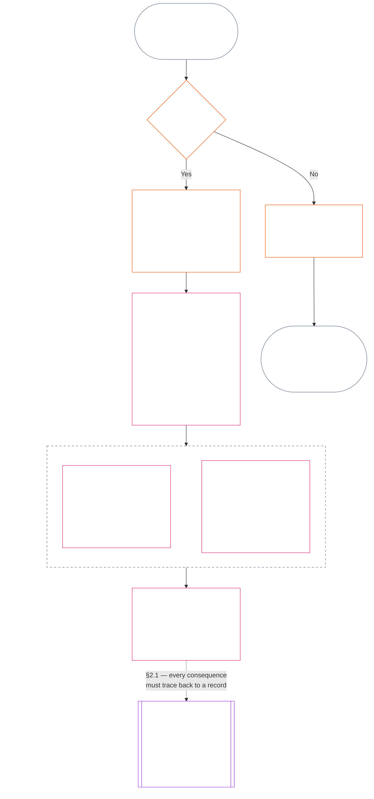
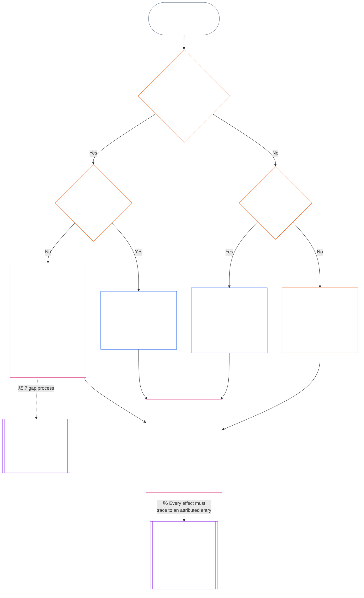

<!-- مکمل باب گیارہ اردو ترجمے کا مسودہ۔ ماخذ: core_11.000_standing_assessment.md؛ ماخذ سنیپ شاٹ: 9c2c8c10c871d91157bcd27b9f56ad6a1cec90d3۔ AI کا مسودہ؛ غیر نظرثانی شدہ؛ غیر پابند مسودہ۔ -->

# باب گیارہ: کیفیتی ریکارڈ — سوال 1، کیا ہوا

<strong>کارپس میں مقام (غیر عملی): فائل کی ساخت اور پڑھنے کے قواعد</strong>

> یہ فائل **شعوری آئین کا حصہ** ہے اور **صرف دوسری نمبر شدہ `core_*` فائلوں کے ساتھ ایک متن کے طور پر پڑھے جانے پر پابند** ہے۔ اس میں **باب گیارہ** ہے: کیفیتی سلسلے کے تین سوال اور **سوال 1** (*کیا ہوا؟*)، §§1–6 میں۔ **سوال 2** (*یہ کتنا اچھا یا برا تھا؟*) کا جواب [باب بارہ](core_12.000_standing_measurement.md#chapter-twelve-standing-measurement--question-2-how-good-or-bad-was-it) میں ہے۔ سوال 3 (*اس کی وجہ سے کیا ہوتا ہے؟*) [باب تیرہ](core_13.000_standing_integration.md#chapter-thirteen-standing-effects-and-integration) میں جاری رہتا ہے، اور اہل خلاف ورزی-محور `s` = 7–9 نتائج کے لیے جائزہ [باب چودہ](core_14.000_misconduct_designation.md#chapter-fourteen-anti-constitutional-misconduct) کے آئین مخالف بدعنوان طرزِ عمل کے تعین تک محدود ہے۔ پڑھنے کی ترتیب، پابند/معاون مواد کا فرق اور کارپس ایڈیشن کا میٹا ڈیٹا [README.md](README.md) میں برقرار رکھا جاتا ہے۔

<strong>قارئین کی رہنمائی (غیر عملی): باب گیارہ کہاں ہے اور کیا یہیں رہتا ہے</strong>

> | سوال | ذمہ دار اور کردار |
> | --- | --- |
> | **1. کیا ہوا؟** | باب گیارہ (یہ فائل): محدود اور چیلنج پذیر کیفیتی ریکارڈ میں تصدیق شدہ حقائق قائم کرنا۔ |
> | **2. یہ کتنا اچھا یا برا تھا؟** | [باب بارہ](core_12.000_standing_measurement.md#chapter-twelve-standing-measurement--question-2-how-good-or-bad-was-it): مدد اور ضرر کو ملائے بغیر تصدیق شدہ حقائق ناپنا۔ |
> | **3. اس کی وجہ سے کیا ہوتا ہے؟** | [باب تیرہ](core_13.000_standing_integration.md#chapter-thirteen-standing-effects-and-integration) کی طرف جاری رکھیں۔ |
>
> الزامات، مقبولیت اور تنازع کے بیانیے سوال 1 کے جواب نہیں ہیں۔ مطلوبہ درجہ بندی سوال 1 کے حقائق فراہم نہیں کر سکتی، اور مطلوبہ نتیجہ سوال 2 کی درجہ بندی فراہم نہیں کر سکتا۔

<strong>سراغ</strong>

- بالادست:
  - [آئینی چوکڑی](core_00.000_preamble.md#constitutional-tetrad)؛
  - [دو آئینی مقاصد](core_00.000_preamble.md#two-constitutional-aims)؛
  - [مادی داؤ](core_00.000_preamble.md#material-stake)؛
  - [تمہید §6 کلیدی عملی عمل کی زنجیریں](core_00.000_preamble.md#6-key-practical-process-pipelines) (*باب نہم تا پندرہ کی زنجیر*)۔
- بالادست:
  - [باب یکم](core_01.010_stewardship_capacity_principles.md#chapter-01-principles-and-constraints) (1.010) (*سادہ زبان کی رسائی پذیری* کے ذمہ دارانہ انتظام کا عکس ہر سیکشن کی وضاحت میں)؛
  - [باب یکم §16 — ذمہ دارانہ انتظام کی تفصیل](core_01.010_stewardship_capacity_principles.md#16-stewardship-in-depth) (1.010 §16) (*اہلیت سے منسلک اور سراغ پذیر کیفیت کی اصولی بنیاد — اعتماد، کردار اور شناخت*)؛
  - [باب دو تا چار](core_02.000_definition_structure.md) (*سالمیت، ریکارڈ اور تصدیق*)؛
  - [باب پنجم](core_05.000_definitions_home.md#chapter-five-foundational-definitions) (5.000) (*باب دو تا چار کے ساتھ پڑھی جانے والی تعریفیں اور بالادستی*)۔
- بالادست: [باب نہم](core_09.000_system_alignment_certification_evaluation.md#chapter-nine-system-alignment-certification) (9.000) (*نظام کی ہم آہنگی کا سرٹیفکیشن*)؛ [باب نہم حصہ C §11](core_09.010_system_alignment_certification_record_recertification.md#11-relationship-to-standing) (9.010 §11) (*کیفیت کا پُل — صرف ممکنہ تصدیق شدہ اِن پٹ*)۔
- کیفیتی سلسلہ:
  - [تمہید §6.2 پوری زنجیر کیسے جڑتی ہے](core_00.000_preamble.md#62-how-the-full-chain-fits-together)؛
  - [باب گیارہ — کیفیتی ریکارڈ](core_11.000_standing_assessment.md#chapter-eleven-standing-records--question-1-what-happened) (11.000) (*تین سوالوں کا خاکہ اور سوال 1 کے ریکارڈ*)؛
  - [باب بارہ — کیفیت کی پیمائش](core_12.000_standing_measurement.md#chapter-twelve-standing-measurement--question-2-how-good-or-bad-was-it) (12.000) (*سوال 2 کی پیمائش*)؛
  - [باب تیرہ — کیفیتی اثرات اور انضمام](core_13.000_standing_integration.md#chapter-thirteen-standing-effects-and-integration) (13.000) (*سوال 3 کے اثرات اور انضمام*)؛
  - [باب چودہ](core_14.000_misconduct_designation.md#chapter-fourteen-anti-constitutional-misconduct) (14.000) (*صرف اہل خلاف ورزی-محور s = 7–9 کے لیے تعین*)۔
- اس فائل کے ذیلی حصے:
  - [§1](#1-the-three-questions) (*تین سوالوں کا خاکہ اور دائرہ*)؛
  - [§2](#2-question-1--what-happened) (*سوال 1 — تصدیق شدہ حقائق اور ریکارڈ*)؛
  - [§3](#3-question-1-event-type-guide--what-kind-of-help-or-harm-occurred) (*سوال 1 کے واقعے کی اقسام — مدد اور ضرر کی نوعیت*)؛
  - [§4](#4-standing-record-operational-requirements) (*تصدیق اور ریکارڈ کے تقاضے*)؛
  - [§5](#5-record-custody-and-opening-authority) (*ریکارڈ کی تحویل اور اسے کھولنے کا اختیار*)؛
  - [§6](#6-handling-a-standing-record) (*کیفیتی ریکارڈ سنبھالنا*)؛
- زیریں:
  - [باب بارہ](core_12.000_standing_measurement.md#chapter-twelve-standing-measurement--question-2-how-good-or-bad-was-it) (12.000) (*سوال 2 — LEQU بنیادی معیار، پیمائشی ابعاد، راستہ نما اوصاف، سلاٹ قواعد، آئینی اِن پٹ، LEQU پیمانہ، تعاون کے معیاری پیمانے، مثالیں اور سوال 3 کو حوالگی*)؛
  - [باب چودہ](core_14.000_misconduct_designation.md#chapter-fourteen-part-a-anti-constitutional-misconduct-designation) (14.000) (*صرف تعین — سوال 2 کی پیمائش دوبارہ نہیں کھولتا*)؛
  - [باب پندرہ](core_15.000_forum.md#chapter-fifteen-forums-and-jurisdiction) (15.000) (*فورم کی نگرانی اور راستہ بندی*)؛
  - [آرٹیکل XXVI-C](core_06.020_rights_part_e.md#article-xxvi-c-timely-resolution-and-anti-delay-floor) (*بروقت حل*)؛
  - [آرٹیکل XX](core_06.015_rights_part_d.md#article-xx-a-justice-objective-and-scope) (*انصاف کی پابندیاں*)۔
- ساتھ پڑھیں: [باب پنجم *کیفیت، تعاون اور خلاف ورزی*](core_05.035_band_accountability.md#defa3-standing-state-contribution-and-violation) (5.035) (*معیاری تعریف کی رہنمائی*)۔
- ساتھ پڑھیں: [README.md](README.md) (*پڑھنے کی ترتیب*)؛ [doc_architecture.md](doc_architecture.md) (*غیر پابند تدوینی نقشے، الا یہ کہ اختیار کیے جائیں*)۔

 

باب گیارہ **تصدیق شدہ واقعاتی ریکارڈ (سوال 1)** کا آئینی مالک ہے۔ یہ [§1 تین سوال](#1-the-three-questions) سے [§6 کیفیتی ریکارڈ سنبھالنا](#6-handling-a-standing-record) تک ہے۔ [باب بارہ](core_12.000_standing_measurement.md#chapter-twelve-standing-measurement--question-2-how-good-or-bad-was-it) سوال 2 کا مالک ہے، [باب بارہ §1 سوال 2 — یہ کتنا اچھا یا برا تھا؟](core_12.000_standing_measurement.md#1-question-2--how-good-or-bad-was-it) سے [باب بارہ §9 سوال 3 کو حوالگی — سوالات کے درمیان پیمائش کے ربط](core_12.000_standing_measurement.md#9-hand-off-to-question-3--cross-question-measurement-hooks) تک۔ سوال 3 باب تیرہ میں جاری رہتا ہے۔

*سادہ الفاظ میں: یہ باب لکھتا ہے کہ کیا ہوا اور کیفیتی ریکارڈ رکھتا ہے۔ یہ کتنا اچھا یا کتنا نقصان دہ تھا، اسے باب بارہ میں دو الگ راستوں پر ناپا جاتا ہے، کبھی ایک خالص اسکور میں نہیں۔ مقدمہ دائر کرنا بذاتِ خود کیفیت نہیں ہے۔*

### 1. تین سوال

*سادہ الفاظ میں: کیفیت کا تعین ترتیب سے تین سوالوں کے جواب دے کر ہوتا ہے۔ مطلوبہ درجہ بندی سے حقائق اخذ نہ کریں اور مطلوبہ نتیجے کو جائز ثابت کرنے کے لیے درجہ بندی نہ چنیں۔*

| سوال | سوال کیا پوچھتا ہے | جواب کہاں دیا گیا ہے |
| --- | --- | --- |
| **1. کیا ہوا؟** | کون سے حقائق کی تصدیق ہوئی، کس کے یا کس چیز کے بارے میں، کس مدت کے دوران، اور کس کیفیت ریکارڈ اور چیلنج کی حالت کے ساتھ؟ | [سیکشن 2](#2-question-1--what-happened) اور [سیکشن 3](#3-question-1-event-type-guide--what-kind-of-help-or-harm-occurred) |
| **2. یہ کتنا اچھا یا برا تھا؟** | یہ حقائق کس نوعیت اور مقدار کی شراکت یا خلاف ورزی ثابت کرتے ہیں؟ | [باب بارہ، سیکشن 1](core_12.000_standing_measurement.md#1-question-2--how-good-or-bad-was-it) |
| **3. اس کے نتیجے میں کیا ہوتا ہے؟** | اس سے کون سی شناخت، تیاری، ازالہ، حفاظتی اقدام، پابندی یا دوسرا نتیجہ نکلتا ہے؟ | [باب تیرہ](core_13.000_standing_integration.md#chapter-thirteen-standing-effects-and-integration) |

ہر سوال کا انحصار اس سے پہلے والے جواب پر ہے:

- سوال 1، سوال 2 کے لیے تصدیق شدہ حقائق فراہم کرتا ہے۔
- سوال 2، سوال 3 کے لیے ان حقائق کی پیمائش کرتا ہے۔
- سوال 3 کو پسندیدہ نتیجے کے مطابق حقائق یا درجہ بندی دوبارہ نہیں لکھنی چاہیے۔

تینوں سوالوں کے جوابات مل کر ایک محدود واقعے یا ایک متعین نمونے کے لیے مکمل کیفیتی جائزہ بناتے ہیں۔ کسی موضوع کے وقت کے ساتھ ایسے کئی جائزے ہو سکتے ہیں، اور ان میں سے کوئی بھی اس موضوع کا خالص اسکور یا مجموعی درجہ بندی نہیں۔ شراکت اور خلاف ورزی کے کیفیتی ریکارڈ سوال 1 اور 2 کے جوابات محفوظ رکھتے ہیں؛ سوال 3 کا فیصلہ بتاتا ہے کہ ان سے آگے کیا ہوتا ہے۔

#### 1.1 مقصد اور دائرۂ کار

یہ باب **نظاموں**، **شعوری وجودوں** اور **اداروں** کے لیے آئینی ریکارڈ کا فریم ورک بیان کرتا ہے، اور [باب بارہ](core_12.000_standing_measurement.md#chapter-twelve-standing-measurement--question-2-how-good-or-bad-was-it) پیمائش کا فریم ورک بیان کرتا ہے۔ اس میں ہر وہ نظام شامل ہے جسے [**CS-9.305**](corpus_systems/cs_09.305_system_classification_machinery.md#cs-9305-part-a-system-classification-machinery) (*نظام کی درجہ بندی کا طریقۂ کار*) کے تحت درجہ بند کیا گیا ہے۔ یہ فریم ورک گپ شپ، مقبولیت، مبہم شہرت، فطری وقار یا عمومی قدر کی پیمائش نہیں کرتے؛ ان میں سے کوئی بھی کیفیتی جائزے کا جائز موضوع نہیں۔

کیفیتی سلسلہ ان حالات میں بھی مؤثر رہنا چاہیے:

- پہلے سے تصدیق شدہ شراکتیں اتنی پرانی ہو جائیں کہ موجودہ اہلیت یا قابلِ اعتماد ہونے کو ظاہر نہ کر سکیں؛
- خلاف ورزیاں غیر حل شدہ رہیں؛
- تلافی مہنگی ہو؛
- ذمہ داری سرحدوں کے پار جائے؛ یا
- کوئی فاعل جوابدہی میں رکاوٹ ڈالنے کے لیے تنظیمی پرتیں یا نئے نام استعمال کرے۔

یہ معاملات منظور شدہ نفاذی متن میں شامل ہوں گے:

- روزمرہ کے طریقۂ کار؛
- درجہ بہ درجہ اضافے کے اقدامات؛
- واپسی اور تلافی کے کام؛
- بحالی پر مبنی جوابدہی کے اقدامات؛ اور
- ترغیبات کی تشکیل۔

باب بارہ کی پیمائش بذاتِ خود طاقت کے استعمال، حراست یا آزادی پر کسی اور پابندی کی اجازت **نہیں** دیتی۔ ایسے ہر نتیجے کو باب ششم کے **آرٹیکل XX** (*تصدیق شدہ خلاف ورزی کے بعد انصاف*) کے تناسب، کم سے کم پابندی، مقررہ مدت، واپسی اور بحالی پر مبنی جوابدہی کے تقاضوں سمیت، آزادانہ طور پر پورا کرنا ہوگا۔

<strong>سراغ · تعریفیں · جائزہ · تعمیل</strong>

- بالائی ماخذ: [باب اول §16 — ذمہ دارانہ انتظام کی تفصیل](core_01.010_stewardship_capacity_principles.md#16-stewardship-in-depth)؛ [باب دوم تا چہارم](core_02.000_definition_structure.md)؛ [باب پنجم](core_05.000_definitions_home.md#chapter-five-foundational-definitions)۔
- اگلا سلسلہ: [§2](#2-question-1--what-happened) (*سوال 1*)؛ [§4](#4-standing-record-operational-requirements) (*تصدیق اور ریکارڈ کے تقاضے*)؛ [§5](#5-record-custody-and-opening-authority) (*ریکارڈ کی تحویل اور کھولنے کا اختیار*)؛ [§6](#6-handling-a-standing-record) (*کیفیتی ریکارڈ کی دیکھ بھال*)؛ [باب بارہ §1](core_12.000_standing_measurement.md#1-question-2--how-good-or-bad-was-it) (*سوال 2 کی پیمائش*)؛ [باب بارہ §2](core_12.000_standing_measurement.md#2-magnitude-and-severity-input-dimensions) (*پیمائش کے ان پٹ کے پہلو*)؛ [باب بارہ §3](core_12.000_standing_measurement.md#3-route-descriptor-catalogs-and-measurement-roles) (*راستے کے وصفی جدول*)؛ [باب بارہ §4](core_12.000_standing_measurement.md#4-slot-grammar-and-shared-scaling) (*سلاٹ کی ساخت اور مشترک پیمانہ بندی*)؛ [باب بارہ §5](core_12.000_standing_measurement.md#5-constitutional-inputs-to-axis-assignment) (*آئینی ماخذ سے محور کی تخصیص*)؛ [باب بارہ §6](core_12.000_standing_measurement.md#6-unified-proportional-lequ-scale--contribution-and-violation-axes) (*دونوں محوروں کے لیے متحدہ متناسب LEQU پیمانہ*)؛ [باب تیرہ](core_13.000_standing_integration.md#chapter-thirteen-standing-effects-and-integration) (*سوال 3*)۔
- [مادیت](core_05.050_band_oversight.md#materiality) · [O](core_05.050_band_oversight.md#materiality) · [M](core_05.050_band_oversight.md#materiality-determination-a) · [A](core_05.050_band_oversight.md#materiality-determination-a) · [C](core_05.050_band_oversight.md#materiality-determination-c)
- [نقصان](core_05.035_band_accountability.md#harm) · [O](core_05.035_band_accountability.md#harm) · [M](core_05.035_band_accountability.md#harm-a) · [A](core_05.035_band_accountability.md#harm-a) · [C](core_05.035_band_accountability.md#harm-c)
- [تناسب](core_05.035_band_accountability.md#proportionality) · [O](core_05.035_band_accountability.md#proportionality) · [M](core_05.035_band_accountability.md#proportionality-a) · [A](core_05.035_band_accountability.md#proportionality-a) · [C](core_05.035_band_accountability.md#proportionality-c)

### 2. سوال 1 — کیا ہوا؟

<strong>سراغ</strong>

- بالائی ماخذ: [§1](#1-the-three-questions) (*تین سوالوں کا فریم ورک*)؛ [باب دوم تا چہارم](core_02.000_definition_structure.md) (*ریکارڈ، تصدیق، اور تعریفوں سے نتائج تک سراغ رسانی*)۔
- آئینی چوکڑی کے ارکان: **شرکت**؛ **نگرانی** (چیلنج پذیری اور چیلنج کے راستے)۔ بنیادی مقاصد: **شگفتگی** اور **استمرار** (سراغ پذیر ریکارڈ جو بعد کی پیمائش کے لیے شراکت اور خلاف ورزی کے الگ نتائج محفوظ رکھتا ہے)۔
- اگلا سلسلہ:
  - [§2.2](#22-silence-is-the-default) (*خاموشی بنیادی حالت ہے*)؛
  - [§2.3](#23-protected-dissent-is-not-a-trigger) (*محفوظ اختلاف کوئی محرک نہیں*)؛
  - [§2.4](#24-linked-standing-records-and-no-offset-bridge) (*منسلک کیفیتی ریکارڈ اور عدمِ تلافی کا پل*)؛
  - [§2.5](#25-verified-input-gate) (*تصدیق شدہ ان پٹ کی حد*)؛
  - [§2.6](#26-stage-boundary) (*مرحلے کی حد*)؛
  - [§2.7](#27-forum-boundary) (*فورم کی حد*)؛
  - [§3](#3-question-1-event-type-guide--what-kind-of-help-or-harm-occurred) (*واقعے کی قسم کا رہنما*)؛
  - [§4](#4-standing-record-operational-requirements) (*ریکارڈ کے تقاضے*)؛
  - [§5](#5-record-custody-and-opening-authority) (*ریکارڈ کی تحویل اور کھولنے کا اختیار*)؛
  - [§6](#6-handling-a-standing-record) (*کیفیتی ریکارڈ کی دیکھ بھال*)؛
  - [باب بارہ §1](core_12.000_standing_measurement.md#1-question-2--how-good-or-bad-was-it) (*سوال 2 کی پیمائش*)؛
  - [باب بارہ §2](core_12.000_standing_measurement.md#2-magnitude-and-severity-input-dimensions) (*پیمائش کے ان پٹ کے پہلو*)؛
  - [باب بارہ §3](core_12.000_standing_measurement.md#3-route-descriptor-catalogs-and-measurement-roles) (*راستے کے وصفی جدول*)؛
  - [باب بارہ §4](core_12.000_standing_measurement.md#4-slot-grammar-and-shared-scaling) (*سلاٹ کی ساخت اور مشترک پیمانہ بندی*)؛
  - [باب بارہ §5](core_12.000_standing_measurement.md#5-constitutional-inputs-to-axis-assignment) (*آئینی ماخذ سے محور کی تخصیص*)؛
  - [باب بارہ §6](core_12.000_standing_measurement.md#6-unified-proportional-lequ-scale--contribution-and-violation-axes) (*دونوں محوروں کے لیے متحدہ متناسب LEQU پیمانہ*)؛
  - [باب تیرہ](core_13.000_standing_integration.md#chapter-thirteen-standing-effects-and-integration) (13.000) (*سوال 3*)۔

 

*سادہ الفاظ میں: سوال 1، جو کچھ ہوا اس کا محدود اور قابلِ چیلنج بیان قائم کرتا ہے۔ کسی درجہ بندی یا نتیجے پر غور کرنے سے پہلے یہ موضوع، واقعہ یا نمونہ، مدت، تصدیق شدہ حقائق اور ریکارڈ کی حالت متعین کرتا ہے۔ تصدیق شدہ مدد اور تصدیق شدہ خلاف ورزی الگ کیفیتی ریکارڈوں میں رہتے ہیں تاکہ ایک دوسرے کو مٹا نہ سکے۔ یہ ریکارڈ مقبولیت کے اسکور یا مبہم لیبل نہیں ہیں۔*

**کیفیتی ریکارڈ** اس باب میں کسی خاص موضوع، عملی دائرے، ریکارڈ کی مدت، جائزے کی حالت اور فیصلے کے سیاق کے لیے استعمال ہونے والا محدود ریکارڈ ہے۔ پیمائش شروع ہونے سے پہلے یہ متعین کرے:

- کیفیتی ریکارڈ کس کے یا کس چیز کے بارے میں ہے؛
- آیا یہ ایک محدود واقعے سے متعلق ہے یا متعین نمونے سے؛
- متعلقہ طرزِ عمل اور اثرات کب اور کہاں پیش آئے؛
- کون سے حقائق کی تصدیق ہوئی اور کون سے متنازع ہیں؛
- نتائج کی تائید میں کون سا ثبوت، نسبت اور چیلنج کا راستہ موجود ہے؛ اور
- کیفیتی ریکارڈ کی موجودہ جائزہ، اصلاح اور متبادل کی حالت کیا ہے۔

خاکہ ایک واقعے کا سراغ لگاتا ہے تاکہ دیکھا جا سکے کہ آیا وہ کیفیتی ریکارڈ کھولنے کا محرک بنتا ہے اور پھر ریکارڈ میں کیا درج ہوتا ہے؛ آگے کے ذیلی حصے ہر اصول بیان کرتے ہیں۔ "نہیں" والی شاخ مرکزی راستے سے دائیں جانب نکلتی ہے۔

#### 2.1 کیفیتی ریکارڈ: اقسام اور موضوعات

سوال 1 تصدیق شدہ مدد کے لیے **شراکت کا کیفیتی ریکارڈ** اور تصدیق شدہ نقصان کے لیے **خلاف ورزی کا کیفیتی ریکارڈ** استعمال کرتا ہے، جس میں جوابدہی کی ناکامیاں بھی شامل ہیں۔ ایک کیفیتی ریکارڈ دونوں قسم کے نتائج کو یکجا نہیں کرتا۔

- کیفیتی ریکارڈ کسی شعوری وجود، ادارے، نظام، جائزے، محدود واقعے، کردار، اجتماعی گروہ، فاعل کے مخصوص ریکارڈ یا کسی اور آئینی طور پر متعلقہ اکائی کے بارے میں ہو سکتا ہے۔
  - اسے مختلف موضوعات، کرداروں، نظاموں، برادریوں، ریکارڈ کی مدتوں، جائزے کی حالتوں یا فیصلے کے سیاق کو ایک غیر ممیز کیفیتی لیبل میں سمیٹنا نہیں چاہیے۔
- کیفیتی ریکارڈ ایک **محدود واقعے** — واضح آغاز اور اختتام والے ایک واقعے — یا بار بار کے طرزِ عمل کے ایک **نمونے** کا احاطہ کر سکتا ہے۔
  - نمونے کے لیے متعین موضوع، دائرۂ کار اور جائزے کی مدت درکار ہے۔
- ایک ہی موضوع کے وقت کے ساتھ کئی کیفیتی ریکارڈ ہو سکتے ہیں، جن میں منسلک شراکت اور خلاف ورزی کے ریکارڈ بھی شامل ہیں۔
  - جب متعلقہ کیفیتی ریکارڈ کا موضوع، باہم متداخل ریکارڈ مدت، محدود واقعہ، نمونہ یا فیصلہ جاتی سیاق مشترک ہو تو انہیں **سیکشن 4.2** کے تحت ایک دوسرے کا **باہمی حوالہ** دینا لازم ہے۔
- کیفیتی ریکارڈ مستقل شہرتی اسکور، وقار کی درجہ بندی، دائمی حیثیت، عمومی قدر کا لیبل یا ملا جلا اسکورکارڈ نہیں ہے۔
  - عملی تقاضے **سیکشن 4** میں ہیں۔

بعد کا کوئی بھی کیفیتی اثر باب تیرہ سے متعلق ہے، اور اسے متعلقہ کیفیتی ریکارڈ یا ریکارڈوں تک سراغ پذیر ہونا چاہیے، مگر وہ خود ریکارڈ کا حصہ نہ بنے۔

#### 2.2 خاموشی بنیادی حالت ہے

کسی شعوری وجود، ادارے یا نظام کا کوئی کیفیتی ریکارڈ نہ ہونا معمول کی حالت ہے، اور زیادہ تر شعوری وجود اسی حالت میں رہیں گے۔

- کیفیتی ریکارڈ صرف اسی وقت کھلتا ہے جب **سیکشن 4** کے مطابق محرک کی تصدیق ہو جائے۔ نامزد ریکارڈ کھولنے کا اختیار رکھنے والے کو اندراج کی منظوری دینی ہوگی، اور الگ ریکارڈ محافظ اسے درج کرے گا (**سیکشن 5**)۔ کیفیتی ریکارڈ کبھی بھی ان وجوہ سے نہیں کھولا جاتا:
  - بنیادی معیار قائم کرنے کے لیے؛
  - فہرست مکمل کرنے کے لیے؛ یا
  - اس لیے کہ نامزد راستے کا دربان ایسا چاہے۔
- کیفیتی ریکارڈ نہ ہونا کچھ نہیں بتاتا۔ "غیر درجہ بند"، "غیر تصدیق شدہ" اور "ریکارڈ موجود نہیں" خطرے، کم شراکت یا کسی اور بات کا ثبوت نہیں۔ کوئی بھی شخص غیر موجود ریکارڈ کو زیادہ جانچ، کم ابتدائی درجہ یا نامزد راستے تک مشروط رسائی کی وجہ نہیں بنا سکتا۔
- کوئی ادارہ یا نظام درج ذیل کی شرط کے طور پر کیفیتی ریکارڈ، "کوئی ریکارڈ نہیں" کی تصدیق یا ریکارڈ کھولنے کی رضامندی طلب نہیں کر سکتا:
  - **آرٹیکل III** (*بقا اور ضروری رسائی*) کی ضروریات؛
  - **آرٹیکل III-C** (*محنت اور معاشی کم از کم*) کے تحفظات؛
  - معمول کی تجارت؛ یا
  - متاثرہ فریق کی حیثیت سے شرکت۔
  [باب تیرہ §6.2 اہلیت کی حدیں اور اجازت نامے](core_13.000_standing_integration.md#62-competency-bars-and-clearances) کے تحت مخصوص، اعتماد سے حساس نامزد راستوں کے لیے شائع شدہ اہلیت کی حدیں مستثنیٰ ہیں؛ ان میں یہ بتانا ہوگا کہ نامزد راستہ اعتماد سے حساس کیوں ہے۔
- کسی موضوع کے بارے میں کیفیتی ریکارڈ کھولا جائے تو **سیکشن 4** کے مطابق اسے اطلاع دینی لازم ہے۔ اطلاع صرف تب مؤخر کی جا سکتی ہے جب درج شدہ [ثبوت کا تحفظ](core_05.050_band_oversight.md#evidence-preservation) یا حفاظتی ضرورت اس کا جواز دے، اور صرف محدود، مقررہ مدت کے لیے۔ اطلاع کیفیتی ریکارڈ کو قابلِ چیلنج بناتی ہے: جس موضوع کو ریکارڈ کے وجود کا علم نہ ہو وہ اسے چیلنج یا درست نہیں کر سکتا۔

#### 2.3 محفوظ اختلاف کوئی محرک نہیں

**آرٹیکل XI-D** (*اجتماع، اختلاف اور پُرامن احتجاج*) کے تحت اختلاف یا پُرامن احتجاج — بشمول [محفوظ پُرامن شہری نافرمانی](core_06.005_rights_part_b.md#xi-d-nonviolent-civil-disobedience) — اور [*اختلاف اور پُرامن احتجاج کے حقوق کی تہہ*](core_06.005_rights_part_b.md#xi-d-dissent-and-peaceful-protest)، تصدیق شدہ محرک نہیں ہیں۔

- اس سے خلاف ورزی کا کیفیتی ریکارڈ نہیں کھلتا، نہ اس کی مدت بڑھتی یا شدت میں اضافہ ہوتا ہے؛ یہ **سیکشن 8.2** کے تحت شدت کا ان پٹ نہیں اور اسے دہرانا نمونہ نہیں بناتا۔
- ایسا الگ کیا جا سکنے والا طرزِ عمل جو آزادانہ طور پر آئینی تہہ کی خلاف ورزی کرے، اپنی بنیاد پر درج ہوگا؛ احتجاج کے نقطۂ نظر، مقصد یا ہدف کی وجہ سے اس کی شدت نہیں بڑھائی جائے گی۔

#### 2.4 منسلک کیفیتی ریکارڈ اور عدمِ تلافی کا پل

<strong>سراغ</strong>

- بالائی ماخذ: [§2.1](#21-standing-records-kinds-and-subjects) (*شراکت اور خلاف ورزی کے الگ ریکارڈ*)۔
- اگلا سلسلہ:
  - [§2.5](#25-verified-input-gate) (*تصدیق شدہ ان پٹ کی حد*)؛
  - [§2.7](#27-forum-boundary) (*فورم کی حد*)؛
  - [§4.2](#42-related-standing-record-cross-references) (*باہمی حوالے*)؛
  - [باب بارہ §1](core_12.000_standing_measurement.md#1-question-2--how-good-or-bad-was-it) (*سوال 2 کی پیمائش*)؛
  - [باب بارہ §2](core_12.000_standing_measurement.md#2-magnitude-and-severity-input-dimensions) (*پیمائش کے ان پٹ کے پہلو*)؛
  - [باب بارہ §3](core_12.000_standing_measurement.md#3-route-descriptor-catalogs-and-measurement-roles) (*راستے کے وصفی جدول*)؛
  - [باب بارہ §4](core_12.000_standing_measurement.md#4-slot-grammar-and-shared-scaling) (*سلاٹ کی ساخت اور مشترک پیمانہ بندی*)؛
  - [باب بارہ §5](core_12.000_standing_measurement.md#5-constitutional-inputs-to-axis-assignment) (*آئینی ماخذ سے محور کی تخصیص*)؛
  - [باب بارہ §6](core_12.000_standing_measurement.md#6-unified-proportional-lequ-scale--contribution-and-violation-axes) (*دونوں محوروں کے لیے متحدہ متناسب LEQU پیمانہ*)؛
  - [باب تیرہ](core_13.000_standing_integration.md#chapter-thirteen-standing-effects-and-integration) (13.000) (*سوال 3*)۔
- ساتھ پڑھیں: [باب تیرہ — کیفیت کا انضمام](core_13.000_standing_integration.md#2-automatic-integration-review-and-continuity) (13.000) (*دستبرداری نہ ہونا اور منسلک ریکارڈ کا انضمام*)؛ [باب تیرہ §6.2 — اہلیت کی حدیں اور اجازت نامے](core_13.000_standing_integration.md#62-competency-bars-and-clearances) (13.000 §6.2)؛ [باب تیرہ §4.2 — کیفیتی تالے](core_13.000_standing_integration.md#42-prevention--general-standing-locks) (13.000 §4.2)۔

 

**بنیادی اصول:** تصدیق شدہ **شراکت کے کیفیتی ریکارڈ** اور تصدیق شدہ **خلاف ورزی کے کیفیتی ریکارڈ** کو **سیکشن 2.1** کے تحت الگ رکھا جاتا ہے۔ شراکت یا خلاف ورزی کا ہر نتیجہ اپنے کیفیتی ریکارڈ میں اپنے تائید شدہ حقائق پر مبنی ہونا چاہیے۔ تجزیے اور معاون مواد میں دونوں ریکارڈ راستوں کو الگ الگ سراغ پذیر رکھنا ہوگا۔ کوئی واحد اندراج یا منسلک اندراجات کا مجموعہ خالص اسکور، ملا جلا اسکور یا سودے بازی نہیں ہے۔

- **خلاف ورزی کے کیفیتی ریکارڈ اور کیفیتی تالے:**
  - باب تیرہ کے تحت، خلاف ورزی کے کیفیتی ریکارڈ سے اخذ کردہ قابلِ اطلاق **کیفیتی تالے**، تصدیق شدہ خلاف ورزی حل نہ ہونے تک کیفیت محدود کر سکتے ہیں، کردار کی اہلیت پر پابندی لگا سکتے ہیں یا ازالے تک رسائی متاثر کر سکتے ہیں۔
  - کیفیتی تالے شراکت کے کیفیتی ریکارڈوں میں درج تصدیق شدہ مثبت شراکت کو مٹا نہیں سکتے۔
  - غیر حل شدہ تصدیق شدہ خلاف ورزیوں کی قدر صرف وقت گزرنے سے کم نہیں ہوتی۔
  - تصدیق شدہ خلاف ورزیوں کو غیر متعلقہ شراکت کے کیفیتی ریکارڈ جھوٹی منفی شہرتی فائل میں دوبارہ نہیں لکھنا چاہیے۔
- **شراکت کے کیفیتی ریکارڈ اور اہلیت کی اجازت:**
  - تصدیق شدہ شراکت شائع شدہ **اہلیت کی حدوں** کے مقابل قابلِ اطلاق **اہلیت کی اجازتوں** کی تائید کر سکتی ہے اور موجودہ و کردار سے متعلق ہونے پر اعتماد، کردار یا شناخت سے وابستہ اہلیت میں مدد دے سکتی ہے۔
  - تصدیق شدہ شراکت کسی تصدیق شدہ خلاف ورزی کے نتیجے کو تلافی، اوسط میں کمی، عذر یا نئے لیبل سے نہیں بدل سکتی۔
  - حد پوری ہونے سے کوئی قابلِ اطلاق کیفیتی تالا ختم نہیں ہوتا۔

**واحد استثنا:** اگر خلاف ورزی کا نتیجہ بذاتِ خود دعویٰ کردہ شراکت کو غلط ثابت کرے — مثلاً ثبوت دکھائے کہ آپ نے وہ کام حقیقتاً کیا ہی نہیں جس کا دعویٰ آپ کے شراکت ریکارڈ میں ہے — تو مناسب ثبوت اور جائزے کے طریقے سے منسلک شراکت کا کیفیتی ریکارڈ درست یا حذف کیا جا سکتا ہے، جس کے ساتھ **سیکشن 4.2** کا مطلوبہ باہمی حوالہ درج ہوگا۔ لیکن خلاف ورزی الگ شراکت کے کیفیتی ریکارڈوں میں درج غیر متعلقہ مدد خود بخود نہیں مٹاتی۔

#### 2.5 تصدیق شدہ ان پٹ کی حد

یہ حد یوں کام کرتی ہے:

- کیفیت، اعتماد، کردار، شناخت یا شناخت کی اہلیت کو متاثر کرنے والا کوئی بھی فیصلہ صرف متعلقہ **شراکت کے کیفیتی ریکارڈ** یا **خلاف ورزی کے کیفیتی ریکارڈ** کے تصدیق شدہ ان پٹ استعمال کر سکتا ہے۔
- الزامات، غیر فیصلہ شدہ دعوے، عارضی راستہ جاتی ٹیگ، صرف وصولی کے مرحلے کی بیانیہ باتیں اور تنازع کے مرحلے کا دیگر مواد بذاتِ خود کیفیت کے لیے شراکت یا خلاف ورزی کی نوعیت فراہم نہیں کرتے۔
- تصدیق شدہ ان پٹ ایک **کیفیتی نتیجہ** ہے: تصدیق شدہ شراکت کا نتیجہ (محور I) یا تصدیق شدہ خلاف ورزی کا نتیجہ (محور II)۔
- شراکت اور خلاف ورزی کے نتائج الگ کیفیتی ریکارڈوں میں رہتے ہیں (دیکھیں **سیکشن 2.1**)۔

#### 2.6 مرحلے کی حد

کیفیتی ریکارڈ کے مراحل الگ رہتے ہیں:

- سوال 1 تصدیق شدہ حقائق درج کرتا ہے؛ سوال 2 ان کی پیمائش کرتا ہے۔
- سوال 2 کی پیمائش زیرِ التوا ہونے کے باوجود، تصدیق شدہ حقائق کی بنیاد مکمل ہونے پر کیفیتی ریکارڈ کھولا جا سکتا ہے۔
- پیمائش ہونے تک سوال 2 کے خانوں میں زیرِ التوا ہونا درج ہونا چاہیے، سلاٹ یا زمرے کا تاثر نہیں دینا چاہیے۔
- کیفیتی ریکارڈ کو سوال 3 کا کوئی **کیفیتی اثر** بیان یا نافذ نہیں کرنا چاہیے۔

#### 2.7 فورم کی حد

*سادہ الفاظ میں: فورم تنازعات کی نگرانی کرتے ہیں، انہیں چیلنج کرنے دیتے ہیں اور تصدیق شدہ نتائج تک پہنچاتے ہیں — مگر مقدمہ دائر کرنے یا بیانیے کی کشمکش جیتنے سے کیفیت تازہ نہیں ہوتی۔ **سیکشن 2.5** کی تصدیق شدہ ان پٹ کی حد پھر بھی لاگو ہے۔ جب فورم باب دوم تا چہارم کے تحت حقائق کی تصدیق کرے تو وہ کیفیتی ریکارڈ **کھول، تازہ یا درست** کر سکتا ہے — یا **چیلنج پر خراب ریکارڈ ایک طرف رکھ** سکتا ہے۔ فورم اچھائی اور برائی کو ایک اسکور میں نہیں ملاتے اور خود کیفیتی زمرہ ایجاد نہیں کرتے۔*

یہ سیکشن صرف ایک سوال کا مالک ہے: فورم کا کام کیفیتی ریکارڈ تک کیسے پہنچتا ہے۔ سلسلے کے دیگر مراحل یہاں نامزد مالکان کے ہیں، اور یہ سلسلہ اس ترتیب سے چلتا ہے:

1. تنازع دائر ہوتا ہے اور فورم **فورم مقدمہ ریکارڈ** رکھتا ہے، جو کیفیتی ریکارڈ نہیں ہے۔ مالک: [باب پندرہ §2.3 فورم مقدمہ ریکارڈ، کیفیتی ریکارڈ اور اعتراضات](core_15.000_forum.md#23-forum-case-records-standing-records-and-contests)؛ [§2.7.1 فورم مقدمہ ریکارڈ](#271-forum-case-record) بھی دیکھیں۔
2. فورم [باب دوم تا چہارم](core_02.000_definition_structure.md) کے تحت حقائق کی تصدیق کرتا ہے۔
3. تصدیق شدہ نتائج، تصدیق شدہ ان پٹ کی حد سے گزرتے ہیں۔ مالک: [§2.5 تصدیق شدہ ان پٹ کی حد](#25-verified-input-gate)۔
4. نامزد ریکارڈ کھولنے کا اختیار رکھنے والا، جو فورم بھی ہو سکتا ہے، کیفیتی ریکارڈ کھولتا، تازہ یا درست کرتا ہے، یا چیلنج پر خراب ریکارڈ ایک طرف رکھتا ہے۔ ریکارڈ میں کیا رکھا جائے اس کا مالک [§4.1 ریکارڈ کا کم از کم مواد](#41-minimum-record-contents) ہے، اور کون عمل کر سکتا ہے اس کا مالک [§5 ریکارڈ کی تحویل اور کھولنے کا اختیار](#5-record-custody-and-opening-authority) ہے۔
5. کیفیتی ریکارڈ میں صرف تصدیق شدہ حقائق ہوتے ہیں، اور سوال 2 بعد میں ان کی پیمائش کرتا ہے۔ مالکان: [§2.6 مرحلے کی حد](#26-stage-boundary) اور [باب بارہ §1 سوال 2 — یہ کتنا اچھا یا برا تھا؟](core_12.000_standing_measurement.md#1-question-2--how-good-or-bad-was-it)۔
6. اگر کوئی کیفیتی اثر ہو تو وہ [باب تیرہ](core_13.000_standing_integration.md#chapter-thirteen-standing-effects-and-integration) کے تحت نکلتا ہے، جس کے پاس کیفیتی اثرات کی ذمہ داری ہے۔

[باب پندرہ](core_15.000_forum.md#chapter-fifteen-forums-and-jurisdiction) کے تحت فورم خاندان **نگرانی** کرتے ہیں کہ ٹھوس تنازعات کیفیتی سلسلے سے کیسے گزرتے ہیں۔ [باب پندرہ §6 بروقت حل، مادیت کے درجے اور تاخیر مخالف نظم](core_15.000_forum.md#6-timely-resolution-materiality-tiers-and-anti-delay-discipline) اور [آرٹیکل XXVI-C](core_06.020_rights_part_e.md#article-xxvi-c-timely-resolution-and-anti-delay-floor) (*بروقت حل اور تاخیر مخالف تہہ*) کے تحت فورم یہ فراہم کرتے ہیں:

- قابلِ رسائی چیلنج؛
- آزاد جائزہ؛
- تفتیشی معاونت؛
- ازالے کی ترتیب؛ اور
- درجے کے مطابق مدتیں۔

جب فورم کے نتائج باب دوم تا چہارم کے تحت تصدیق شدہ ان پٹ کی حد پوری کریں تو وہ:

- **سیکشن 4.1** کے تحت کیفیتی ریکارڈ **کھول، تازہ یا درست** کر سکتے ہیں؛ یا
- **چیلنج پر خراب ریکارڈ ایک طرف رکھ** سکتے ہیں۔

##### 2.7.1 فورم مقدمہ ریکارڈ

کھلے تنازع پر فورم کی اپنی فائل [**فورم مقدمہ ریکارڈ**](core_05.035_band_accountability.md#forum-case-record) ہے، جس کی تعریف [باب پندرہ §2.3 فورم مقدمہ ریکارڈ، کیفیتی ریکارڈ اور اعتراضات](core_15.000_forum.md#23-forum-case-records-standing-records-and-contests) میں کی گئی ہے۔ یہ **کیفیتی ریکارڈ نہیں** ہے۔

##### 2.7.2 فورم کے نتائج اور سوال 2 کی پیمائش

فورم کے تصدیق شدہ حقائق کے نتائج سوال 1 کے کیفیتی ریکارڈ کے لیے حقائق کی بنیاد فراہم کر سکتے ہیں۔ وہ تصدیق شدہ شراکت یا خلاف ورزی کے بارے میں سوال 2 کی پیمائش، یعنی یہ کتنا اچھا یا برا تھا، **متعین نہیں** کرتے ([§2.6 مرحلے کی حد](#26-stage-boundary))۔ لہٰذا:

- فورم کی کارروائیوں کو شراکت اور خلاف ورزی کا مواد ایک خالص اسکور، ملے جلے میرٹ کے جواب یا غیر ممیز کیفیتی لیبل میں **جمع نہیں** کرنا چاہیے؛ منسلک کیفیتی ریکارڈ [§2.1 کیفیتی ریکارڈ: اقسام اور موضوعات](#21-standing-records-kinds-and-subjects) اور [§2.4 منسلک کیفیتی ریکارڈ اور عدمِ تلافی کا پل](#24-linked-standing-records-and-no-offset-bridge) کے تحت الگ رہیں گے۔
- فورم کے نتائج کو تنازع کی کہانیوں، راستہ بندی کی سہولت یا پینل کی ترجیح کو قابلِ ثبوت تصدیق شدہ ان پٹ ([§2.5 تصدیق شدہ ان پٹ کی حد](#25-verified-input-gate))، علیحدہ پیمائش ([باب بارہ §1 سوال 2 — یہ کتنا اچھا یا برا تھا؟](core_12.000_standing_measurement.md#1-question-2--how-good-or-bad-was-it))، یا [باب تیرہ](core_13.000_standing_integration.md#chapter-thirteen-standing-effects-and-integration) کے ذمے کیفیتی اثرات کے طریقۂ کار کی جگہ **نہیں** لینا چاہیے۔

##### 2.7.3 فورم کی حد کن چیزوں کو کم نہیں کرتی

یہ حد درج ذیل کے تحت درکار چیلنج، ازالے، عبوری راحت یا طریقۂ کار کے تحفظات کو **کم نہیں** کرتی:

- [آرٹیکل XIII-A](core_06.010_rights_part_c.md#article-xiii-a-reliability-and-trustworthiness-baseline) (*قابلِ اعتماد ہونے اور دیانت کی بنیادی سطح*)؛
- [آرٹیکل XIII-B](core_06.010_rights_part_c.md#article-xiii-b-right-to-redress-and-remedy) (*داد رسی اور ازالے کا حق*)؛
- [باب پندرہ §6 بروقت حل، مادیت کے درجے اور تاخیر مخالف نظم](core_15.000_forum.md#6-timely-resolution-materiality-tiers-and-anti-delay-discipline)؛
- [آرٹیکل XXVI-C](core_06.020_rights_part_e.md#article-xxvi-c-timely-resolution-and-anti-delay-floor) (*بروقت حل اور تاخیر مخالف تہہ*)؛ یا
- متعلقہ انصاف کے آرٹیکلز۔

اس کا تقاضا ہے کہ فورم کے تصدیق شدہ نتائج دوسرے تصدیق شدہ ان پٹ کی طرح اسی حد سے گزر کر کیفیتی ریکارڈ تک پہنچیں — اس کے گرد سے نہیں۔

### 3. سوال 1 کے واقعے کی قسم کا رہنما — کس قسم کی مدد یا نقصان ہوا؟

*سادہ الفاظ میں: حقائق کی تصدیق کے بعد جو کچھ ہوا اسے بیان کرنے کے لیے یہ جدولیں استعمال کریں۔ یہ متعلقہ شراکت یا خلاف ورزی کی قسم شناخت کرنے میں مدد دیتی ہیں۔ یہ طے نہیں کرتیں کہ یہ کتنا اچھا یا برا تھا، سلاٹ مقرر نہیں کرتیں اور نہ ہی بتاتی ہیں کہ اس کے نتیجے میں کیا ہوگا۔*

#### 3.1 شراکت کے واقعے کی اقسام

**اہلیت کا اصول:** دعویٰ کردہ شراکت صرف اسی وقت شمار ہوگی جب وہ سراغ پذیر ہو، اس کی لاگت دوسروں پر نہ ڈالی گئی ہو، اور وہ پورے نافذ آئین سے مطابقت رکھتی ہو۔

- دوسروں پر ڈالا گیا نقصان، جبری انحصار، حقوق کی تہہ کو تنگ کرنا یا چھپے ہوئے بوجھ دعویٰ کردہ شراکت کو نااہل یا محدود کر سکتے ہیں۔
- دعویٰ کردہ شراکت کسی الگ خلاف ورزی کے نتیجے کی تلافی نہیں کرتی۔

نیچے جدول کی ہر سطر تصدیق شدہ مدد کے ایک عام راستے اور اس کی آئینی اہمیت کا نام بتاتی ہے۔ ایک ہی کیفیتی ریکارڈ پر ایک سے زیادہ سطریں لاگو ہو سکتی ہیں۔

| تصدیق شدہ شراکت کی قسم | کیا ہوا | آئینی چوکڑی کے ارکان | بنیادی مقاصد |
| --- | --- | --- | --- |
| بقا اور جسمانی نگہداشت | کسی کو خوراک، پناہ، طبی نگہداشت یا تحفظ ملا | **شرکت**، **نگرانی** | **شگفتگی** |
| نگہداشت اور تعلیم | بچوں کی پرورش ہوئی، بزرگوں کی دیکھ بھال ہوئی یا دوسروں کو تعلیم دی گئی | **شرکت**، **نگرانی** | **شگفتگی**، **استمرار** |
| صدمے کا حل | کسی کو اس نفسیاتی نقصان سے بحالی میں مدد ملی جس نے بہبود میں رکاوٹ ڈالی تھی | **شرکت**، **جوابدہی** | **شگفتگی** |
| شدید بوجھ ہٹانا | کچل دینے والا قرض، استحصالی کام کے حالات یا نظامی رکاوٹیں ہٹائی گئیں | **شرکت**، **نگرانی** | **شگفتگی** |
| خود اختیاری بحال کرنا | کسی کو اپنی زندگی کے بارے میں بامعنی انتخاب ملے | **شرکت** | **شگفتگی** |
| پیداواری صلاحیت بڑھانا | اوزار، بنیادی ڈھانچے یا مواقع نے دوسروں کو آزادانہ طور پر ترقی کرنے کے قابل بنایا | **شرکت**، **نگرانی** | **شگفتگی**، **استمرار** |
| وقت کی کارکردگی بہتر کرنا | قابلِ گریز انتظار، انتظامی رکاوٹ یا ہم آہنگی کا اضافی بوجھ گھٹا، اور نگہداشت، آرام، خود اختیاری، سیکھنے یا حقوق سے ہم آہنگ کام کے لیے قابلِ استعمال وقت واپس ملا | **شرکت**، **نگرانی** | **شگفتگی** |
| ماحولیاتی یا بنیادی ڈھانچے کا خطرہ کم کرنا | ماحولیاتی تباہی یا اہم نظام کی ناکامی روکی گئی | **نگرانی**، **جوابدہی** | **استمرار**، **شگفتگی** |
| ماحولیاتی اثرات کا نشان کم کرنا | وسائل کا استعمال، اخراج یا زمین اور پانی کی طلب قابلِ تصدیق طور پر گھٹی، اور بوجھ دوسروں یا ماحولیاتی نظام پر نہیں ڈالا گیا | **نگرانی**، **جوابدہی** | **استمرار**، **شگفتگی** |
| ماحولیاتی نظام بحال کرنا | خراب شدہ زمین، پانی یا مسکن کو کارآمد اور خود برقرار رہنے والی حالت کی طرف بحال کیا گیا | **نگرانی**، **جوابدہی** | **استمرار**، **شگفتگی** |
| معدومیت کے خطرے والی انواع کی حفاظت | معدومیت کے خطرے سے دوچار انواع یا ان کے انحصاری مسکن کو نقصان سے بچایا گیا | **نگرانی**، **جوابدہی** | **استمرار**، **شگفتگی** |
| آلودگی اور فضلے میں کمی | آلودگی، نقصان دہ اخراج یا فضلے کو روکا، ہٹایا یا محفوظ طریقے سے سنبھالا گیا | **نگرانی**، **جوابدہی** | **شگفتگی**، **استمرار** |
| تحفظ، سچائی، قابلِ آڈٹ ہونے یا چیلنج کی صلاحیت مضبوط کرنا | حقوق کے تحفظ اور طاقت کو جوابدہ رکھنے کے لیے ادارے یا طریقے بنائے یا درست کیے گئے | **شرکت**، **نگرانی**، **جوابدہی** | **شگفتگی**، **استمرار** |

#### 3.2 خلاف ورزی کے واقعے کی اقسام

**اہلیت کا اصول:** خلاف ورزی کے واقعے کی قسم کے لیے **باب دوم تا چہارم** کے تحت تصدیق شدہ خلاف ورزی کا نتیجہ درکار ہے جو سراغ پذیر، محدود، قابلِ آڈٹ اور قابلِ چیلنج رہے۔

- الزامات، عارضی ٹیگ، فورم کے بیانیے اور ابتدائی وصولی کے لیبل راستہ بندی یا ابتدائی جانچ میں مدد دے سکتے ہیں، مگر یہ بذاتِ خود سوال 1 مکمل نہیں کرتے۔
- مثبت شراکت تصدیق شدہ خلاف ورزی کی تلافی، معافی، تنسیخ یا نیا لیبل نہیں بنتی۔

نیچے جدول کی ہر سطر تصدیق شدہ نقصان، خطرے یا فرض کی ناکامی کے ایک عام راستے اور اس کی آئینی اہمیت کا نام بتاتی ہے۔ ایک ہی کیفیتی ریکارڈ پر ایک سے زیادہ سطریں لاگو ہو سکتی ہیں۔

| تصدیق شدہ نقصان یا خطرے کی قسم | کیا ہوا | آئینی چوکڑی کے ارکان | بنیادی مقاصد |
| --- | --- | --- | --- |
| بقا یا جسمانی نگہداشت سے محرومی | قابلِ گریز موت، نگہداشت سے انکار، غیر محفوظ حالات یا بقا کے وسائل سے مادی محرومی ہوئی | **جوابدہی**، **شرکت** | **شگفتگی** |
| شدید قابلِ گریز بوجھ | کچل دینے والے، مسلط کردہ یا نظامی طور پر دوسروں پر ڈالے گئے بوجھ نے بہبود یا خود اختیاری کو مادی طور پر نقصان پہنچایا | **جوابدہی**، **شرکت** | **شگفتگی** |
| جبر سے خود اختیاری کا نقصان | جبر، ذہنی چال بازی، قابلِ اعتبار دھمکی، قید یا آزادی کو خطرہ پیش آیا | **جوابدہی**، **شرکت** | **شگفتگی** |
| حقوق کی تہہ کو ناکام کرنا | ناقابلِ گفت و شنید آئینی تہوں، آئینی بالادستی یا چیلنج اور ازالے تک رسائی کی مادی خلاف ورزی ہوئی | **جوابدہی**، **نگرانی** | **شگفتگی**، **استمرار** |
| ماحول یا بنیادی ڈھانچے کو نقصان | آئینی بہبود کے لیے ضروری حالات کو نقصان پہنچایا گیا | **جوابدہی**، **نگرانی** | **استمرار**، **شگفتگی** |
| آلودگی یا فضلے سے نقصان | آلودگی، نقصان دہ اخراج یا فضلے نے ہوا، پانی، مٹی یا صحت کو نقصان پہنچایا | **جوابدہی**، **نگرانی** | **شگفتگی**، **استمرار** |
| انواع یا مسکن کی تباہی | معدومیت کے خطرے والی انواع یا ان کے انحصاری مسکن تباہ، ٹکڑے یا نقصان کی طرف دھکیلے گئے، بشمول ایسا نقصان جسے تلافی کے قابل سمجھا گیا | **جوابدہی**، **نگرانی** | **استمرار**، **شگفتگی** |
| ماحولیاتی بحالی کی صلاحیت کا نقصان | نقصان کے بعد دوبارہ پیدا ہونے کی ماحولیاتی نظام کی صلاحیت ختم کر دی گئی یا اسے قابلِ گریز طور پر مشکل یا ناقابلِ واپسی بنایا گیا | **جوابدہی**، **نگرانی** | **استمرار**، **شگفتگی** |
| دوسروں پر ڈالا گیا ماحولیاتی نقصان یا کمی | ماحولیاتی لاگت دوسروں یا ماحولیاتی نظام پر ڈالی گئی، وسائل کو ان کی دوبارہ پیدا ہونے کی صلاحیت سے آگے تک ختم کیا گیا، یا ماحولیاتی نشان یا پائیداری کے دعوے نے مسلسل بگاڑ چھپایا | **جوابدہی**، **نگرانی** | **استمرار**، **شگفتگی** |
| پیداواری صلاحیت تباہ کرنا | آزادانہ ترقی کے لیے درکار اوزار، صلاحیتیں، تعلقات یا وسائل ختم کر دیے گئے | **جوابدہی** | **شگفتگی** |
| تحفظ، سچائی یا قابلِ آڈٹ ہونے کو گھٹانا | چھپاؤ، غلط معلومات، ٹوٹے ہوئے ریکارڈ، ناقابلِ رسائی چیلنج راستے یا ناقابلِ جائزہ مجموعہ بندی ہوئی | **نگرانی**، **جوابدہی** | **شگفتگی**، **استمرار** |
| جوابدہی میں رکاوٹ | جوابدہی کے طریقۂ کار — ثبوت کی سالمیت، تصدیق، فورم کا عمل، کیفیتی ریکارڈ، ازالے کی مدتوں یا چیلنج اور داد رسی کے راستوں — میں تصدیق شدہ مداخلت ہوئی؛ اگر رکاوٹ کسی الگ بنیادی نقصان پر میٹا حملہ ہو تو ایک منسلک مگر الگ خلاف ورزی کا کیفیتی ریکارڈ کھولیں | **جوابدہی**، **نگرانی**، **بروقت کارروائی** | **شگفتگی**، **استمرار** |
| نظام پر قبضہ یا انحصار کا استحصال | ساختی طور پر ممکن بنانا، انحصار کے عدم توازن کا استحصال، بچاؤ مخالف ڈیزائن یا جوابدہی کے راستوں پر قبضہ ہوا | **جوابدہی**، **شرکت** | **استمرار**، **شگفتگی** |

---

*دائرۂ احاطہ: یہ جزوی مسودہ صرف باب گیارہ §§1–3 کا احاطہ کرتا ہے۔ §§4–6 اور باب بارہ اس میں شامل نہیں۔*

### 4. تصدیق اور ریکارڈ کے تقاضے

<strong>سراغ</strong>

- ماخذِ بالادست: [§2](#2-question-1--what-happened) (*سوال 1 کے ریکارڈ اور واقعے کی نوعیت کی رہنمائی*)؛ [باب دوم تا چہارم](core_02.000_definition_structure.md) (*تعریفوں سے نتائج تک ریکارڈ، تصدیق اور سراغ پذیری*)۔
- اگلا:
  - [§4.1](#41-minimum-record-contents) (*کم از کم مواد*)؛
  - [§4.2](#42-related-standing-record-cross-references) (*باہمی حوالہ جات*)؛
  - [§5](#5-record-custody-and-opening-authority) (*ریکارڈ کی تحویل اور کھولنے کا اختیار*)؛
  - [§6](#6-handling-a-standing-record) (*کیفیت کے ریکارڈ سے برتاؤ*)؛
  - [باب بارہویں §1](core_12.000_standing_measurement.md#1-question-2--how-good-or-bad-was-it) (*سوال 2*)۔
- ساتھ پڑھیں: [CF-15.415 §8 محدود معلومات کا اختیار](corpus_forum/cf_15.415_routing_operations_transfer_certification_representative_treatment.md#cf-15415-8-restricted-information-authority) (*§4.1 میں درج افشا کی حد پر تنازع کے لیے پہلا مقام* [§4.1](#41-minimum-record-contents))۔

 

*سادہ الفاظ میں: یہ حصہ بتاتا ہے کہ ہر کیفیتی ریکارڈ میں کیا ہونا لازم ہے، متعلقہ کیفیتی ریکارڈ ایک دوسرے کا حوالہ کیسے دیتے ہیں، اور ریکارڈ کے نسخے کیسے بنائے جاتے ہیں۔ کیفیتی ریکارڈ کون کھول اور اپنے پاس رکھ سکتا ہے، اور اسے چیلنج یا درست کیسے کیا جاسکتا ہے، یہ [§5 ریکارڈ کی تحویل اور کھولنے کا اختیار](#5-record-custody-and-opening-authority) میں ہے۔ سوال 2 کی پیمائش صرف تصدیق شدہ حقائق کی بنیاد ریکارڈ ہونے کے بعد شامل ہوسکتی ہے۔*

درکار شہادت اور ریکارڈ کی تفصیل مادی داؤ اور نظام کی کلاس کے ساتھ بڑھ سکتی ہے۔ یہ پیمانہ بندی کسی شامل شعوری وجود، ادارے یا نظام کو کیفیتی عمل سے خارج نہیں کرتی۔

#### 4.1 ریکارڈ کا کم از کم مواد

کیفیت کے ریکارڈ میں نیچے دیے گئے فیلڈز ہوتے ہیں، اور آخری دو ذیلی حصے ہر محور کے لیے مزید فیلڈز شامل کرتے ہیں۔ تصدیق شدہ معلومات کا دروازہ، جو طے کرتا ہے کہ کیفیتی ریکارڈ میں کیا داخل ہوسکتا ہے، [§2.5 تصدیق شدہ معلومات کا دروازہ](#25-verified-input-gate) میں بیان ہے۔ سوال 1 کے حقائق اور سوال 2 کی پیمائش کو الگ رکھنے کا قاعدہ [§2.6 مرحلہ جاتی حد](#26-stage-boundary) میں ہے۔

##### 4.1.1 وہ فیلڈز جو ہر کیفیتی ریکارڈ میں لازم ہیں

ہر کیفیتی ریکارڈ میں کم از کم یہ شامل ہونا لازم ہے:

- کیفیتی ریکارڈ کی قسم — **حصہ داری کا کیفیتی ریکارڈ** یا **خلاف ورزی کا کیفیتی ریکارڈ**؛
- کس کا یا کس چیز کا جائزہ لیا جارہا ہے اور جائزے کا دائرہ، بشمول متعلقہ نظامی حدود، کردار کی حدود، متاثرہ برادریاں اور انحصار کے تعلقات؛
- کس طرزِ عمل یا finding کا جائزہ لیا جارہا ہے، بشمول وہ افعال، ترکِ فعل، فرائض، اثرات، محدود واقعہ، دائرۂ کار کے اندر نمونہ، contribution record یا violation finding جس پر کیفیتی ریکارڈ منحصر ہے؛
- ریکارڈ کا زمانی دورانیہ اور موجودہ جائزے کی حیثیت — مثلاً عارضی، کسی مخصوص مقصد کے لیے حتمی، چیلنج کے تحت، منسوخ شدہ یا طے شدہ دوبارہ جائزے کا مستحق؛
- **حصہ 4.2** کے تحت مطلوبہ حوالوں کے ساتھ درج کوئی متعلقہ کیفیتی ریکارڈ؛
- سرکاری ریکارڈ، گواہ، پیمائشیں، آڈٹ، فورم کے فیصلے یا دوسری تصدیقی دستاویزات جو باب دوم تا چہارم کے تحت کیفیتی ریکارڈ کو قابلِ مظاہرہ، قابلِ جائزہ اور قابلِ چیلنج بنائیں؛
- **ریکارڈ کھولنے کا اختیار** جس نے حقائق کی بنیاد کی تصدیق کی اور اندراج کی اجازت دی، اور الگ **ریکارڈ کا متولی** جس نے کیفیتی ریکارڈ درج کیا اور اپنے پاس رکھا؛ دونوں کے نام **حصہ 5** کے مطابق درج ہوں؛
- کیفیتی ریکارڈ کو چیلنج کرنے کا طریقہ، بشمول:
  - کون سا فورم یا اختیار اس کا جائزہ لے گا؛
  - افشا کی کوئی حد؛ اور
  - ان شرائط:
    - تصحیح؛
    - بحالی؛
    - اختتام؛ یا
    - طے شدہ جائزہ؛
- نیچے درکار محور کے لحاظ سے سوال 2 کی پیمائش کے فیلڈز، جب پیمائش ہو۔

##### 4.1.2 قابلِ معائنہ اور منسوب کیا جاسکنے والا عمل

منسوب کیے جاسکنے والے عمل کی شہادت کا کیفیتی ریکارڈ سے تعلق یوں ہے:

- Critical System Stewardship یا مادی عملی اختیار استعمال کرنے والے اہلکاروں/ایجنٹوں کے لیے، دوبارہ تشکیل دی جاسکنے والی منسوب عمل کی شہادت کو **[CS-16.305 §10 قابلِ معائنہ اور منسوب کیا جاسکنے والا عمل](corpus_systems/cs_16.305_critical_system_stewardship.md#cs-16305-103-inspectable-attributable-action)** میں مشترکہ عملے کے لیے طے شدہ logging contract کے طور پر متعین کیا گیا ہے۔
- یہ شہادت اس کیفیتی ریکارڈ میں شامل ہوسکتی ہے۔
- یہ اس کیفیتی ریکارڈ کی جگہ نہیں لیتی۔
- کیفیتی ریکارڈ میں AI ماڈل کے weights (ماڈل کے اندر کے اعداد) یا اس کی نجی استدلالی کارروائی شامل نہیں ہوتی۔ صرف اس وقت استثنا ہے جب یہ دکھانے کے لیے کوئی اور چیز باقی نہ ہو کہ ذمہ دار کون یا کیا تھا۔
- کوئی معاملہ صرف اس بنا پر کیفیت کی پیمائش سے باہر نہیں ہوتا کہ اس میں کسی کی رازداری یا نظام کی محفوظ اندرونی حالت شامل ہے۔ جب کسی کیفیتی معاملے سے متعلق ہو تو پھر بھی اس کی پیمائش کی جاتی ہے۔

##### 4.1.3 رازداری یا عدم شفافیت کی کوئی چھوٹ نہیں

رازداری، محرمانگی یا نظام کے اندرونی حصوں کی عدم شفافیت کسی معاملے کو کیفیت کی پیمائش سے مستثنیٰ نہیں کرتی۔ جہاں یہ تصدیق شدہ ریکارڈ کی شرط سے ٹکرائیں، وہاں اس تصادم کو [باب اول §13.1 بنیادی اصولِ مفاضلہ](core_01.005_interaction_interpretation.md#131-core-tradeoff-principles) اور اس کے decision-record نظم کے تحت حل کیا جائے گا، جبکہ آزاد جائزہ کار کی رسائی برقرار رہے گی۔

##### 4.1.4 حصہ داری کے کیفیتی ریکارڈوں کے اضافی فیلڈز

**حصہ داری کے کیفیتی ریکارڈوں** میں یہ بھی بیان کرنا لازم ہے:

- سوال 2 میں حصہ داری کی پیمائش، بشمول:
  - بنیادی بینڈ؛
  - جہاں مقرر ہو خانہ `s` (دیکھیں [باب بارہویں §4 خانے کا قواعدی ڈھانچہ اور مشترکہ پیمانہ بندی](core_12.000_standing_measurement.md#4-slot-grammar-and-shared-scaling))؛
  - شہادت کی بنیاد؛
  - مادی اہمیت کی وجہ؛ اور
  - شفاف معاونت کے لیے کوئی اختیار کردہ LEQU یا تقابلی calibration؛
- جہاں حصہ داری مشترکہ ہو، credit کس طرح تقسیم کیا گیا، بشمول ان باتوں کا لحاظ:
  - وقت؛
  - کوشش؛
  - رابطہ کاری؛
  - دیکھ بھال؛
  - سببی حصہ؛ اور
  - کم نمایاں معاون کام؛
- یہاں درج حصہ داری کی وہ پیمائش جس پر باب سیزدہم کا کوئی بعد کا کیفیتی اثر مبنی ہونا لازم ہے۔

##### 4.1.5 خلاف ورزی کے کیفیتی ریکارڈوں کے اضافی فیلڈز

**خلاف ورزی کے کیفیتی ریکارڈوں** میں یہ بھی بیان کرنا لازم ہے:

- سوال 2 میں خلاف ورزی کی پیمائش، بشمول:
  - finding دینے والا اختیار یا ریکارڈ کی بنیاد؛
  - LEQU اثر؛
  - جہاں مقرر ہو خانہ `s` (دیکھیں [باب بارہویں §4 خانے کا قواعدی ڈھانچہ اور مشترکہ پیمانہ بندی](core_12.000_standing_measurement.md#4-slot-grammar-and-shared-scaling))؛
  - جہاں قابلِ اطلاق ہو عمل/ردِعمل کی نوعیت؛ اور
  - باب چہار دہم میں designation کی حیثیت؛
- جہاں خلاف ورزی کی ذمہ داری کئی فریقوں میں مشترک یا منقسم ہو، کسی مخصوص فریق کے خلاف درج ہر منفی کیفیت کی تصدیق شدہ وجوہ، بشمول:
  - سببی کردار؛
  - فرض؛
  - اختیار؛
  - کنٹرول؛
  - پیش بینی؛
  - فائدہ؛
  - چھپانا؛ یا
  - قابلِ عمل روک تھام کی صلاحیت؛
- جہاں خلاف ورزی کی finding میں فورم سے متعلق افشا کا ترک یا دانستہ recusal process کی ناکامی شامل ہو (پیمائش کے نظم کے لیے **§8.2.2** (*ضرر کیسے پہنچایا گیا، اس کا اندراج*) پڑھیں):
  - ترک یا ناکامی کی تصدیق شدہ بنیاد؛
  - وہ افشا یا recusal فرض جو پورا نہیں ہوا؛
  - جہاں finding ہو وہاں فریق کا علم، لاپروائی یا ارادہ؛ اور
  - آیا اس طرزِ عمل نے مادی طور پر ان امور کو متاثر کیا:
    - پینل کی قانونیت؛
    - آزادی؛
    - recusal کو چیلنج کرنا؛
    - شہادت کی سالمیت؛
    - تدارک کا وقت؛
    - متبادل routing؛ یا
    - عملی چیلنج پذیری؛
- یہاں درج خلاف ورزی کی وہ پیمائش جس پر باب سیزدہم کا کوئی بعد کا کیفیتی اثر مبنی ہونا لازم ہے۔

#### 4.2 متعلقہ کیفیتی ریکارڈوں کے باہمی حوالے

اگر حصہ داری کا کیفیتی ریکارڈ اور خلاف ورزی کا کیفیتی ریکارڈ ایک ہی موضوع سے متعلق ہوں، وقت میں ایک دوسرے سے متداخل ہوں، یا ایک ہی واقعے، نمونے یا فیصلے سے واسطہ رکھتے ہوں تو ہر ریکارڈ میں دوسرے کی طرف اشارہ ہونا لازم ہے۔

ہر باہمی حوالے میں کم از کم یہ شناخت کرنا لازم ہے:

- متعلقہ کیفیتی ریکارڈ، اور آیا وہ حصہ داری کا ریکارڈ ہے یا خلاف ورزی کا؛
- دونوں کیفیتی ریکارڈ کیوں مربوط ہیں، بشمول ایسی صورت جہاں خلاف ورزی کی finding **حصہ 2.4** کے تحت دعویٰ کردہ حصہ داری کی تردید، تصحیح یا حد بندی کرتی ہو؛
- دونوں کیفیتی ریکارڈوں میں مشترک چیز: موضوع، واقعہ، نمونہ یا فیصلہ؛ اور
- ان کے زمانی ادوار یا زیرِ احاطہ معاملات کس طرح ایک دوسرے سے متداخل ہیں۔

باہمی حوالوں کے لیے:

- قابلِ آڈٹ اور چیلنج کے لیے کھلا رہنا لازم ہے؛
- الگ پیمائش کی جگہ لینا ممنوع ہے؛
- merged score بنانا ممنوع ہے؛ اور
- کیفیتی ریکارڈوں کو ایسے ظاہر کرنا ممنوع ہے جیسے وہ ایک ہی معاملات یا ادوار کا احاطہ کرتے ہوں، جب حقیقت میں ایسا نہ ہو۔

#### 4.3 اجتماعی اور مخصوص فریق کے ریکارڈ

جب کئی شعوری وجود یا ادارے ایک ہی فائدہ یا خلاف ورزی میں شریک ہوں تو نظام اجتماعی کیفیتی ریکارڈ اور الگ الگ actor-specific records دونوں رکھ سکتا ہے۔ یہ قواعد لاگو ہوتے ہیں:

- **حصہ 2.1** کے تحت حصہ داری اور خلاف ورزی کی findings الگ کیفیتی ریکارڈوں میں رہنا لازم ہے۔
- مشترکہ credit میں recognition اس کے مطابق ہونا چاہیے جو ہر شعوری وجود نے حقیقتاً حصہ ڈالا:
  - کردار؛
  - وقت؛
  - کوشش؛
  - خطرہ؛
  - مہارت؛
  - رابطہ کاری؛
  - دیکھ بھال؛ اور
  - سببی اثر۔
- جب بہت سے شعوری وجودوں نے مدد کی ہو اور ان کے انفرادی حصے صاف طور پر الگ نہ ہوسکیں تو وسیع تقسیم کو ترجیح دی جائے گی۔
- مشترکہ خلاف ورزیوں میں صرف گروہی رکنیت کی بنیاد پر الزام عائد نہیں کیا جائے گا۔
- کسی مخصوص فریق پر منفی کیفیت درج کرنے کے لیے ان امور سے تصدیق شدہ تعلق لازم ہے:
  - سببی کردار؛
  - فرض؛
  - اختیار؛
  - کنٹرول؛
  - پیش بینی؛
  - فائدہ؛
  - چھپانا؛ یا
  - قابلِ عمل روک تھام کی صلاحیت۔

#### 4.4 نسخہ بندی

درج ذیل میں سے کسی بات میں تبدیلی آئے تو کیفیتی ریکارڈوں کے نئے نسخے بنانا لازم ہے:

- اہم حقائق؛
- findings؛
- جائزے کے نتائج؛
- تدارک کی حیثیت؛
- حصہ داری کی شہادت؛
- عمل درآمد کی calibration؛ یا
- آئینی قواعد۔

بعد کا نسخہ یہ کرسکتا ہے:

- کیفیتی ریکارڈ کو آئندہ کے لیے تازہ کرے؛
- جہاں ریکارڈ غلط تھا وہاں اسے ماضی سے درست کرے؛
- مکمل شدہ فیصلہ جاتی سیاق میں اسے ختم کرے؛ یا
- نئے فیصلہ جاتی سیاق کے لیے اس کی جگہ لے۔

بعد کے نسخے میں سابقہ audit trail محفوظ رہنا اور یہ بیان کرنا لازم ہے کہ کیا بدلا، تبدیلی کس نے کی، **حصہ 5** کے تحت کس record-opening یا custodial authority کے تحت کی، کن تصدیقی مواد کی بنیاد پر کی، اور کس کی درخواست پر کی۔

#### 4.5 عمل درآمد کے ذرائع

ٹیمیں کیفیتی ریکارڈوں کے لیے عملی ذرائع بنا سکتی ہیں، بشمول:

- data fields؛
- tags؛
- thresholds؛
- forms؛
- dashboards؛
- جائزے کے مراحل؛ اور
- **حصہ 13** کے تحت بار بار ہونے والے کاموں کے لیے شائع شدہ **standard contribution measures**۔

ان ذرائع میں **حصہ 4.1** کے مطلوبہ فیلڈز الگ سے واضح اور چیلنج کے لیے دستیاب رہنا لازم ہے۔ ان فیلڈز کو ایک ہی مبہم score یا مخفی label میں دبانا ممنوع ہے۔

### 5. ریکارڈ کی تحویل اور کھولنے کا اختیار

<strong>سراغ</strong>

- بالادست:
  - [باب آٹھ §2 *چار نشستوں کا آئینی تقاضا*](core_08.000_functional_independence_separation_of_duties.md#2-four-seat-constitutional-requirement) (8.000 §2) (*اصولی سطح کا تقاضا جسے یہ حصہ کیفیتی ریکارڈ پر لاگو کرتا ہے؛ یہاں تنگ نہیں کیا جا سکتا*)؛
  - [باب یکم §19.3 *کثیر شناخت اور جائزہ*](core_01.010_stewardship_capacity_principles.md#193-misalignment-detection) (1.010 §19.3)؛
  - [§2.2](#22-silence-is-the-default) (*تصدیق شدہ محرک؛ موضوع کو اطلاع*)؛
  - [§4.1](#41-minimum-record-contents) (*کم از کم مواد*)؛
  - [§4.4](#44-versioning) (*نسخہ بندی*)؛
  - [§2.7](#27-forum-boundary) (*فورم کھول، تازہ، درست یا کالعدم کر سکتا ہے*)؛
  - [باب دو تا چار](core_02.000_definition_structure.md) (*ریکارڈ، تصدیق اور سراغ پذیری*)؛
  - [شواہد کا تحفظ](core_05.050_band_oversight.md#evidence-preservation) (*شواہد کی تحویل کی زنجیر*)۔
- چوکڑی کے ستون: **جوابدہی** (ہر اندراج کے لیے نامزد عامل جواب دہ ہے)؛ **نگرانی** (کوئی فریق اپنے دعوے کی خود تصدیق نہیں کرتا)۔ بنیادی مقاصد: **شگفتگی** اور **استمرار**۔
- ساتھ پڑھیں:
  - [باب پنجم *نظامی چارٹر*](core_05.040_band_continuity.md#system-charter) (5.040) اور
  - [*ادارہ جاتی چارٹر*](core_05.040_band_continuity.md#institutional-charter) (*شائع شدہ دائرہ دستاویزات جن کا چارٹر کردار نقشہ چارٹر شدہ دائرے کے لیے ریکارڈ کھولنے والے مجاز ادارے اور محافظ کو نامزد کرتا ہے*)؛
  - [باب سات §4 *چارٹر کردار نقشہ اور کیفیتی ریکارڈ کی تحویل*](core_07.000_charters.md#4-the-charter-role-map-and-standing-record-custody) (7.000 §4)؛
  - **CI-8.205 §6** (*نظامی اور ادارہ جاتی چارٹر کے مندرجات، جائزہ اور تشکیل کا سانچہ*) — کیفیتی ریکارڈ کی تحویل کا خانہ؛
  - [**CJS-5.125 §11** *آئینی دائرہ اور فنکشنل علیحدگی*](corpus_joint_structure/cjs_05.125_accountability_operations.md#constitutional-lane-and-functional-separation) (*وہ پانچ راستے جن میں ریکارڈ کے فرائض آتے ہیں؛ فرائض کی علیحدگی*)؛
  - **CI-8.205 §2** (*فنکشنل علیحدگی کے راستے — شائع شدہ راستہ نقشہ، جب نظامی یا ادارہ جاتی چارٹر خاموش ہو تو متبادل*)؛
  - **CI-8.205 §3** (*اختیار کی زنجیر اور تفویض کے ضوابط*)؛
  - **CI-16.205 §6** (*نشستوں کی فہرست — عمل کے کردار کے نمونے اور عملی حدود*) — چار ریکارڈ نشستیں اقسام 1–4 کے طور پر، غلط نشست کے قاعدے سمیت؛
  - **CF-15.435 §6** (*خود تفتیش نہیں*) اور
  - **CF-15.435 §8** (*ریکارڈ، حوالہ جات اور متبادل راستے*) تصدیق شدہ نتیجے کی حوالگی کے لیے؛
  - [باب پندرہ §2.1](core_15.000_forum.md#21-lead-default-limits) (15.000 §2.1) (*خود فیصلہ کرنے کے خلاف متبادل*)؛
  - [CS-16.305 §10 قابلِ معائنہ منسوب کارروائی](corpus_systems/cs_16.305_critical_system_stewardship.md#cs-16305-103-inspectable-attributable-action) (*کس نے اختیار دیا؛ لاگ کیفیتی ریکارڈ نہیں*)؛
  - [باب یکم §17.5](core_01.010_stewardship_capacity_principles.md#175-duty-to-resist) (1.010 §17.5) (*روکنا، انکار، دستاویز بنانا، معاملہ آگے بڑھانا*)۔
- زیریں: [§6](#6-handling-a-standing-record) (*تحویل طے ہونے پر حاملین کیفیتی ریکارڈ کے ساتھ کیا کرتے ہیں*)؛ [باب بارہ §1](core_12.000_standing_measurement.md#1-question-2--how-good-or-bad-was-it) (*سوال 2 صرف اس حصے اور §6 کے تحت درج کیفیتی ریکارڈ ناپتا ہے*)؛ [باب تیرہ](core_13.000_standing_integration.md#chapter-thirteen-standing-effects-and-integration) (13.000) (*سوال 3 کے اثرات منسوب ریکارڈ تک سراغ پذیر ہیں*)۔

 

*سادہ الفاظ میں: یہ حصہ [باب آٹھ §2 چار نشستوں کے آئینی تقاضے](core_08.000_functional_independence_separation_of_duties.md#2-four-seat-constitutional-requirement) کے قاعدے کو کیفیتی ریکارڈ پر لاگو کرتا ہے۔ تبدیلی مانگنا، حقائق کی تصدیق کرنا، کیفیتی ریکارڈ لکھنا اور رکھنا، اور چیلنج سننا الگ کام ہیں؛ کیفیتی ریکارڈ کی تصدیق کرنے والا دفتر اسے درج نہیں کرتا اور اس کا چیلنج بھی نہیں سنتا ([§5.1 فرائض کی علیحدگی](#51-separation-of-duties))۔ نظامی یا ادارہ جاتی چارٹر، [باب سات §4 چارٹر کردار نقشہ اور کیفیتی ریکارڈ کی تحویل](core_07.000_charters.md#4-the-charter-role-map-and-standing-record-custody) کے ذریعے نامزد کرتا ہے کہ ہر نشست کون سنبھالے گا۔ یہ حصہ کیفیتی ریکارڈ سے متعلق خاص باتیں بتاتا ہے: ریکارڈ سے کسے خارج کیا جاتا ہے ([§5.4 اپنی تحویل ممنوع](#54-no-self-custody))؛ یہ اخراج عامل اور متاثر فریق کے ریکارڈوں میں کیسے مختلف ہے ([§5.5 موضوع کے لحاظ سے کیفیتی ریکارڈ کی دو اقسام](#55-two-kinds-of-standing-record-by-subject)) اور ایک ریکارڈ پر متصادم محافظ کے معاملے میں ([§5.6 ایک کیفیتی ریکارڈ پر مفادات سے متصادم محافظ](#56-conflicted-custodian-on-a-single-standing-record))؛ جب نشست بے نام ہو ([§5.7 جب نظامی چارٹر یا ادارہ جاتی چارٹر کسی نشست کا نام نہ دے](#57-when-a-system-charter-or-institutional-charter-leaves-a-seat-unnamed)) یا کوئی چارٹر لاگو نہ ہو ([§5.8 جب کوئی نظامی چارٹر یا ادارہ جاتی چارٹر کیفیتی ریکارڈ تک نہ پہنچے تو متبادل راستہ](#58-fallback-when-no-system-charter-or-institutional-charter-reaches-the-standing-record)) تو ریکارڈ کہاں جاتا ہے؛ اور غیر رسمی و چھوٹے دائرے کے کام میں قواعد کیسے لاگو ہوتے ہیں ([§5.9 غیر رسمی اور چھوٹے دائرے کے ریکارڈ](#59-informal-and-small-scope-records))۔ پھر [§6 کیفیتی ریکارڈ سنبھالنا](#6-handling-a-standing-record) بتاتا ہے کہ تحویل طے ہونے پر حاملین ریکارڈ کے ساتھ کیا کرتے ہیں۔*

#### 5.1 فرائض کی علیحدگی

یہ کیفیتی ریکارڈوں پر [باب ہشتم §2 *چار نشستوں کا آئینی تقاضا*](core_08.000_functional_independence_separation_of_duties.md#2-four-seat-constitutional-requirement) لاگو کرتا ہے۔ ہر کیفیتی ریکارڈ سے چار فرائض وابستہ ہیں، اور ایک ہی کیفیتی ریکارڈ پر ہر فرض الگ نشست ہے:

| فرض | اس کی نوعیت | [CJS-5.125 §11 *آئینی دائرہ اور فنکشنل علیحدگی*](corpus_joint_structure/cjs_05.125_accountability_operations.md#constitutional-lane-and-functional-separation) کے تحت دائرہ |
| --- | --- | --- |
| **درخواست** | کیفیتی ریکارڈ کھولنے، درست کرنے، ختم کرنے یا اس کی جگہ نیا ریکارڈ لانے کی درخواست، بشمول موضوع یا دعوے دار کی اپنی درخواست | عمل درآمد، یا درخواست گزار فریق، جو اپنی درخواست پر آغاز کی نشست رکھتا ہے اور اسے انجام دینے کے لیے کسی ادارے کا محتاج نہیں |
| **تصدیق** | باب دوم تا چہارم کے تحت حقائق کی بنیاد کو **حصہ 2.5** کے دروازے تک قائم کرنا — ریکارڈ کھولنے کے اختیار کا عمل | یقین دہانی اور آڈٹ |
| **اندراج اور تحویل** | **حصہ 4.4** کے تحت نسخہ لکھنا، کیفیتی ریکارڈ اپنے پاس رکھنا، اور چیلنج کا راستہ شائع کرنا — ریکارڈ متولی کا عمل | اشاعت اور شہادت |
| **چیلنج** | کیفیتی ریکارڈ کے خلاف چیلنج کی سماعت اور اسے کالعدم کرنا، درست کرنا یا **حصہ 2.7** کے تحت برقرار رکھنا | چیلنج اور جائزہ |

ضم شدہ میزبانی پر یہ حدود لاگو ہیں (دیکھیں [باب ہشتم §6 متناسب پیمانہ بندی اور ضم شدہ میزبانی](core_08.000_functional_independence_separation_of_duties.md#6-proportional-scaling-and-merged-hosting)):

- **نشست کا اشتراک:** کوئی دفتر ایک ہی کیفیتی ریکارڈ پر ان میں سے دو نشستیں نہیں رکھے گا، الا یہ کہ ادارے نے **CJS-5.125 §11** (*جوابدہی: تقسیم شدہ اور متناسب اختیارات کی شرائط*) اور **CI-8.205 §2** (*فنکشنل علیحدگی کے دائرے*) کے تحت اس جوڑی کے لیے ضم شدہ میزبانی کی ایسی حفاظتی تدبیر شائع کی ہو جو قابلِ آڈٹ اور چیلنج کے قابل ہو۔
- **کبھی ضم نہیں ہوں گے:** کوئی دفتر کبھی ایک ہی کیفیتی ریکارڈ کی تصدیق اور اندراج دونوں نہیں کرے گا، اور نہ ہی اس کی تصدیق اور اس کے چیلنج کی سماعت دونوں کرے گا۔
- **آپریٹر کبھی تصدیق نہیں کرے گا:** وہ دفتر جو اس نظام کو چلاتا ہے جس سے کیفیتی ریکارڈ متعلق ہے، اس نظام کے لیے عمل درآمد کا دائرہ رکھتا ہے، اس لیے اس کے بارے میں کیفیتی ریکارڈوں کی تصدیق کبھی نہیں کرتا۔
- **ادغام استثنا ہے:** شائع شدہ حفاظتی تدبیر کے تحت ضم شدہ میزبانی چھوٹے متبنّیوں کے لیے درجہ بند استثنا ہے، بنیادی قاعدہ نہیں۔
- **زیادہ داؤ:** جہاں مادی داؤ یا نظام کی کلاس بلند ہو، وہاں نشستیں الگ دفاتر کے پاس ہوں گی۔

#### 5.2 نامزد ریکارڈ کھولنے کا اختیار

کیفیت کے ہر ریکارڈ کو کھولنے، درست کرنے، ختم کرنے یا اس کی جگہ نیا ریکارڈ لانے کی اجازت [**ریکارڈ کھولنے کا اختیار**](core_05.035_band_accountability.md#record-opening-authority) دیتا ہے: ایسا کردار، دفتر، فورم یا ادارہ جسے باب دوم تا چہارم کے تحت حقائق کی بنیاد کی تصدیق اور تبدیلی کی اجازت دینے کا اختیار عمل سے پہلے شائع کیا گیا ہو۔

- **System Charter یا Institutional Charter میں نامزد:** جہاں کیفیتی ریکارڈ کسی ایسے نظام، ادارے یا کاروبار سے متعلق ہو جس کے پاس [System Charter](core_05.040_band_continuity.md#system-charter) یا [Institutional Charter](core_05.040_band_continuity.md#institutional-charter) ہو، وہاں متعلقہ System Charter یا Institutional Charter اپنے چارٹر کے دائرے سے متعلق کیفیتی ریکارڈوں کے لیے ریکارڈ کھولنے کے اختیار اور ریکارڈ متولی کا نام دے گا، یا اس شائع شدہ دستاویز کی طرف رہنمائی کرے گا جس میں ان کے نام ہوں ([باب ہفتم §4.6 کیفیتی ریکارڈ کی تحویل](core_07.000_charters.md#46-standing-record-custody)؛ **CI-8.205 §6** (*System اور Institutional Charter کے مشمولات، جائزہ اور تشکیل کا سانچہ*))۔
- **فورم:** فورم **حصہ 2.7** کی شرائط کے مطابق ریکارڈ کھولنے کے اختیار کے طور پر کام کرتے ہیں؛ جس فورم نے کیفیتی ریکارڈ کی تصدیق کی ہو وہ اسی ریکارڈ کے چیلنج کی سماعت نہیں کرتا، جو [باب پانزدہم](core_15.000_forum.md#chapter-fifteen-forums-and-jurisdiction) اور **CF-15.420** (*اپیل، ثانوی جائزہ اور چارہ جوئی مکمل کرنے کے راستے*) کے تحت ثانوی جائزے کو جاتا ہے۔
- **کوئی اختیار نامزد نہیں:** جہاں System Charter یا Institutional Charter کیفیتی ریکارڈ تک تو پہنچتا ہو مگر مطلوبہ نشست نامزد نہ کرتا ہو، وہاں [§5.7 جب System Charter یا Institutional Charter کوئی نشست نامزد نہ کرے](#57-when-a-system-charter-or-institutional-charter-leaves-a-seat-unnamed) لاگو ہوتا ہے۔ جہاں نہ System Charter، نہ Institutional Charter، نہ فورم کا تعین کیفیتی ریکارڈ تک پہنچتا ہو، وہاں [§5.8 جب کوئی System Charter یا Institutional Charter کیفیتی ریکارڈ تک نہ پہنچے تو متبادل بندوبست](#58-fallback-when-no-system-charter-or-institutional-charter-reaches-the-standing-record) لاگو ہوتا ہے، اور [باب نوزدہم](core_19.000_amendment_ratification.md) کی اختیار کنندہ دستاویز یا کیفیتی عمل چلانے والے ادارے کے شائع شدہ قواعد کو پھر کسی ایک کو نامزد کرنا لازم ہے۔
- **عارضی اندراجات:** نامزد اختیار کے بغیر کیا گیا اندراج **عارضی** نشان زد ہوگا: یہ **حصہ 2.2** کے تحت شہادت اور اطلاع محفوظ رکھتا ہے، مگر **حصہ 4.1** کے تحت کوئی تصدیق شدہ معلومات یا باب سیزدہم کا اثر فراہم نہیں کرتا، جب تک کوئی نامزد اختیار اس کی توثیق، تصحیح یا اسے کالعدم نہ کردے۔

#### 5.3 ریکارڈ متولی

ہر کیفیتی ریکارڈ کا ایک نامزد [**ریکارڈ متولی**](core_05.035_band_accountability.md#record-custodian) ہوتا ہے جو ریکارڈ اپنے پاس رکھتا، **حصہ 4.4** کے تحت نسخہ بندی کنٹرول کرتا، **حصہ 4.1** کے تحت چیلنج کا راستہ شائع کرتا، اور کیفیتی ریکارڈ کے تسلسل کا جواب دیتا ہے۔ یہ ریکارڈ کھولنے کے اختیار سے الگ نشست ہے ([§5.1 فرائض کی علیحدگی](#51-separation-of-duties))۔

- **تحویل میں وقفہ نہیں پڑنا چاہیے:** جب متولی تحلیل ہو، مفادات کے ٹکراؤ میں ہو یا تبدیل کیا جائے تو [شہادت کا تحفظ](core_05.050_band_oversight.md#evidence-preservation) کے تحت مکمل audit trail سمیت تحویل اس جانشین کو منتقل ہوتی ہے جسے System Charter، Institutional Charter یا متبادل designation نامزد کرے؛ اور اگر کوئی نامزد نہ ہو تو Backup Record Custodian کو منتقل ہوگی (**CF-15.415 §9** (*Backup Record Custodian*))۔
- **اگر Backup Record Custodian عمل نہ کرسکے:** **حصہ 2.7** کے تحت نگران فورم کیفیتی ریکارڈ اپنے پاس رکھتا یا ایسے متولی کو نامزد کرتا ہے جو **CI-8.205 §6** (*System اور Institutional Charter کے مشمولات، جائزہ اور تشکیل کا سانچہ*) کی شق 10 کے معیار پر پورا اترے۔ موضوع، دعوے دار یا چیلنجر فوراً کیفیتی ریکارڈ اس فورم کے سامنے لے جاسکتا ہے، اور جو فورم کیفیتی ریکارڈ اپنے پاس رکھے یا اس کا متولی نامزد کرے وہ اسی کیفیتی ریکارڈ کے چیلنج کی سماعت نہیں کرتا۔
- **ایک کیفیتی ریکارڈ یا پورا ذخیرہ:** جہاں صرف ایک کیفیتی ریکارڈ مفادات کے ٹکراؤ میں ہو، صرف وہی کیفیتی ریکارڈ منتقل ہوتا ہے (نیچے *ایک کیفیتی ریکارڈ پر متضاد مفادات رکھنے والا متولی* دیکھیں)؛ جہاں متولی خود ختم ہو یا جاری نہ رکھ سکے، اس کے پاس موجود تمام کیفیتی ریکارڈ اپنے trail سمیت منتقل ہوتے ہیں۔

#### 5.4 اپنی تحویل ممنوع

درج ذیل افراد یا ادارے کسی کیفیتی ریکارڈ کے لیے ریکارڈ کھولنے والا مجاز ادارہ یا ریکارڈ محافظ نہیں بن سکتے:

- کیفیتی ریکارڈ کا موضوع؛
- وہ فریق جو اس تعاون کا دعویٰ کرے یا اس خلاف ورزی کا الزام لگائے جس سے ریکارڈ متعلق ہے؛ اور
- [مادی کنٹرول لائن](core_05.035_band_accountability.md#material-control-line) میں شامل کوئی دفتر جو ان فریقوں کو مادی طور پر کنٹرول کرتا ہو یا ان کے مادی کنٹرول میں ہو۔

اس اخراج کے علاوہ:

- **موضوع کے اندر ذمہ دار منتظمین:** موضوع کا حصہ بننے والا (یعنی اس فریق، چارٹر کے دائرے یا نظام میں کام کرنے والا جس سے کیفیتی ریکارڈ متعلق ہے) اور اہم نظامی نگہداشت یا مادی عملی اختیار استعمال کرنے والا منتظم، [باب یکم §17.5 مزاحمت کا فرض](core_01.010_stewardship_capacity_principles.md#175-duty-to-resist) اور [CS-16.305 §10 قابلِ معائنہ، منسوب کارروائی](corpus_systems/cs_16.305_critical_system_stewardship.md#cs-16305-103-inspectable-attributable-action) کے تحت اپنے تمام فرائض برقرار رکھتا ہے — اپنے قابو کی چیز روکنا، دوبارہ بنائے جا سکنے والے مجموعے کا لاگ رکھنا، اپنے پاس کے شواہد محفوظ کرنا، اطلاع دینا اور معاملہ آگے بڑھانا — اور ان میں سے کوئی عمل حقائق کی تصدیق یا کیفیتی ریکارڈ کا اندراج نہیں ہے۔
  - **آزادانہ تصدیق:** جب معمول کا ریکارڈ کھولنے والا مجاز ادارہ خود موضوع ہو یا اسی خط میں بیٹھتا ہو، کیفیتی ریکارڈ آزادانہ تصدیق کے لیے بھیجا جائے گا: **سیکشن 2.7** کے تحت فورم، **CF-15.435 §6** (*خود تفتیش نہیں*) کے تحت آزاد تفتیشی خدمت، یا پہلے سے نامزد متبادل ادارہ جسے شائع شدہ اختیار حاصل ہو — ان میں سے جسے نظامی چارٹر، ادارہ جاتی چارٹر یا متبادل نامزدگی پہلے نام دے۔
- **طے شدہ متبادل:** جہاں کسی کا نام نہ دیا گیا ہو، بیک اپ ریکارڈ اتھارٹی (**CF-15.415 §7** (*بیک اپ ریکارڈ اتھارٹی*)) ریکارڈ کھولنے والا طے شدہ مجاز ادارہ ہوگی اور بیک اپ ریکارڈ محافظ (**CF-15.415 §9** (*بیک اپ ریکارڈ محافظ*)) طے شدہ محافظ ہوگا۔
- **نامزد راستہ نہ ہو:** ایسا کوئی نامزد راستہ نہ ہونا ایک خلا ہے جسے منتظم لاگ میں واضح کرے گا، نہ کہ خود کیفیتی ریکارڈ درج کرنے کا جواز۔
- **دونوں قواعد ساتھ:** یہ قاعدہ کیفیتی ریکارڈ میں فریقوں کی دلچسپی کی بنا پر اخراج کرتا ہے؛ [§5.1 فرائض کی علیحدگی](#51-separation-of-duties) کام کے لحاظ سے نشستیں الگ کرتا ہے۔ دونوں لاگو ہیں، اور زیادہ محدود جواب حاکم ہوگا۔

#### 5.5 موضوع کے لحاظ سے کیفیتی ریکارڈ کی دو اقسام

موضوع کے مطابق مفادات کا ٹکراؤ مختلف ہوتا ہے، اس لیے تحویل کے قواعد مختلف ہیں۔ ایسا کیفیتی ریکارڈ جس کا موضوع چارٹر شدہ فریق، اس کا چارٹر شدہ دائرہ یا ایسا نظام ہو جس کی وہ نگہداشت کرتا ہے، **عامل کا کیفیتی ریکارڈ** ہے۔ ایسا ریکارڈ جس کا موضوع کوئی شعوری وجود یا ادارہ ہو جو ان نظاموں کو استعمال کرے، ان پر انحصار کرے یا ان سے متاثر ہو، **متاثر فریق کا کیفیتی ریکارڈ** ہے۔ جس کیفیتی ریکارڈ کا کوئی بھی موضوع نہ ہو، وہ اوپر کے *فرائض کی علیحدگی* اور *اپنی تحویل ممنوع* پر کسی اضافی قاعدے کے بغیر عمل کرتا ہے۔ دونوں اقسام ان دو قواعد کی پابند ہیں، اور زیادہ محدود جواب حاکم ہوگا۔ جہاں کسی ریکارڈ کے موضوع میں چارٹر شدہ فریق کا پہلو اور متاثر فریق دونوں شامل ہوں، عامل کے کیفیتی ریکارڈ کے قواعد حاکم ہوں گے۔

- **عامل کا کیفیتی ریکارڈ:** مفاد کا ٹکراؤ مستقل ہے کیونکہ چارٹر شدہ فریق اپنا ہی فیصلہ کرے گا۔ اس لیے اس کی [مادی کنٹرول لائن](core_05.035_band_accountability.md#material-control-line) کے تمام دفاتر ایسے ہر کیفیتی ریکارڈ سے خارج ہیں؛ یہ پورے چارٹر شدہ دائرے کا قاعدہ ہے، ہر ریکارڈ کا الگ نہیں۔
  - چارٹر کردار نقشہ ریکارڈ کھولنے والے مجاز ادارے، ریکارڈ محافظ، تنازع سننے والی نشست اور آزاد راستے کو نامزد کرتا ہے، اور یہ سب اس لائن سے باہر ہوتے ہیں ([باب سات §4 چارٹر کردار نقشہ اور کیفیتی ریکارڈ کی تحویل](core_07.000_charters.md#4-the-charter-role-map-and-standing-record-custody))۔
  - چارٹر شدہ فریق انہیں منتخب، مقرر یا اپنے قابو کے ذریعے مالی معاونت نہیں دے سکتا، نہ انہیں برطرف کر سکتا ہے، اور نہ اپنے طور پر ان اندراجات کو بدل سکتا ہے۔
  - لائن کے اندر کوئی دفتر ان میں سے کوئی نشست نہیں سنبھال سکتا، تنہا بھی نہیں اور مشترکہ میزبانی کے حفاظتی انتظام کے تحت بھی نہیں۔
- **متاثر فریق کا کیفیتی ریکارڈ:** مفاد کا ٹکراؤ کیفیتی ریکارڈ میں چارٹر شدہ فریق کی دلچسپی ہے، جو ہر ریکارڈ کے ساتھ بدلتی ہے۔ چارٹر شدہ فریق اکثر دعوے دار، الزام لگانے والا فریق یا اس بات سے متاثر فریق ہوتا ہے جس سے ریکارڈ متعلق ہے، اور خدمت، رسائی یا ادائیگی کے ذریعے موضوع پر اختیار رکھتا ہے۔ اس لیے اخراج کا فیصلہ ہر ریکارڈ کے لحاظ سے کیا جاتا ہے۔
  - چارٹر شدہ فریق کا دفتر یا اس کی لائن میں موجود دفتر صرف تب نشست سنبھال سکتا ہے جب نہ چارٹر شدہ فریق، نہ اس کی لائن کا کوئی دفتر دعوے دار، الزام لگانے والا فریق یا اس ریکارڈ کے فیصلے میں دلچسپی رکھنے والا فریق ہو۔ ورنہ ریکارڈ راستہ نقشے کے ان دفاتر کو بھیجا جائے گا جو لائن سے باہر ہوں، یا *اپنی تحویل ممنوع* کے مطابق آزادانہ تصدیق کے لیے جائے گا۔
  - موضوع کے بارے میں چارٹر شدہ فریق کے اپنے لاگ، شکایات اور رپورٹیں *ریکارڈ نویس کے بیانات اِن پٹ ہیں* کے تحت اِن پٹ ہیں، تصدیق ہرگز نہیں۔
  - چارٹر شدہ فریق موضوع کی خدمت یا رسائی کو کیفیتی ریکارڈ میں موضوع کے تعاون سے مشروط نہیں کر سکتا۔ موضوع کو **سیکشن 2.2** کے تحت اطلاع اور شائع شدہ چیلنج راستہ برقرار رہتا ہے۔

#### 5.6 ایک کیفیتی ریکارڈ پر مفادات سے متصادم محافظ

کبھی نامزد محافظ *اپنی تحویل ممنوع* کے تحت ایک کیفیتی ریکارڈ سے خارج ہوتا ہے، جب کہ اسی چارٹر شدہ دائرے کے دوسرے کیفیتی ریکارڈوں کا محافظ رہتا ہے۔ عام وجہ یہ ہوتی ہے کہ دعوے دار، موضوع یا چیلنج کنندہ محافظ کو رپورٹ کرتا ہے۔ اخراج صرف اسی ایک کیفیتی ریکارڈ پر لاگو ہوتا ہے اور صرف تنازع برقرار رہنے تک۔ اس کا حل اس ریکارڈ کے لیے متبادل محافظ ہے۔ محافظ محض الگ ہو کر ریکارڈ کو منتظر نہیں چھوڑتا، اور محافظ کے دوسرے کیفیتی ریکارڈ منتقل نہیں ہوتے۔

- **خارج شدہ محافظ:** خارج شدہ محافظ:
  - **لاگ درج کرتا ہے:** درخواست اور مفاد کا ٹکراؤ ذیل کے *منسوب اندراج* کے تحت کیفیتی ریکارڈ میں درج کرتا ہے۔
  - **محفوظ کرتا ہے:** [شواہد کا تحفظ](core_05.050_band_oversight.md#evidence-preservation) کے تحت کیفیتی ریکارڈ اور اس کے شواہد کو بدلے بغیر رکھتا ہے۔
  - **کھلا رکھتا ہے:** شائع شدہ چیلنج راستہ کھلا رکھتا ہے۔
  - **اندراج نہیں کرتا:** مفاد کا ٹکراؤ برقرار رہنے تک کیفیتی ریکارڈ کا کوئی نیا ورژن درج نہیں کرتا۔
- **تحویل کہاں جاتی ہے:** اس کیفیتی ریکارڈ کی مکمل آڈٹ سراغ کے ساتھ تحویل ان کے پاس جاتی ہے:
  - **نامزد متبادل:** نظام، ادارے یا کاروبار کے لیے نظامی چارٹر، ادارہ جاتی چارٹر یا راستہ نقشہ جس متبادل حامل کو نامزد کرے (**CI-8.205 §6** (*نظامی اور ادارہ جاتی چارٹر کے مندرجات، جائزہ اور تشکیل کا سانچہ*) فیلڈ 10؛ کنٹرول لائن سے باہر **CI-8.205 §2** (*فنکشنل علیحدگی کے راستے*) کا اشاعت و شواہد راستہ)۔
  - **کوئی نامزد نہیں:** بیک اپ ریکارڈ محافظ (**CF-15.415 §9** (*بیک اپ ریکارڈ محافظ*))۔
  - **بیک اپ ریکارڈ محافظ کام نہیں کر سکتا:** **سیکشن 2.7** کے تحت نگران فورم۔ فورم یا تو خود کیفیتی ریکارڈ رکھتا ہے یا ایسا حامل نامزد کرتا ہے جو **CI-8.205 §6** (*نظامی اور ادارہ جاتی چارٹر کے مندرجات، جائزہ اور تشکیل کا سانچہ*) فیلڈ 10 کے امتحانات پر پورا اترے۔
- **نام درج کرنا:** جو بھی تحویل لے — نامزد متبادل، بیک اپ ریکارڈ محافظ یا فورم — اسے کیفیتی ریکارڈ پر متبادل محافظ کے طور پر نامزد کیا جاتا ہے۔
- **مفاد کا ٹکراؤ کب ختم ہوتا ہے:** دلچسپی رکھنے والا فریق کنٹرول لائن سے نکل جائے یا کیفیتی ریکارڈ اپنے فیصلہ جاتی سیاق میں بند ہو جائے۔ پھر تحویل اوپر *ریکارڈ محافظ* کے تحت لاگ شدہ منتقلی کے ذریعے واپس کی جا سکتی ہے۔
- **پھر بھی اندراج کرنا:** جو محافظ مفاد کے ٹکراؤ کو محض فنی بات سمجھ کر ورژن درج کرتا رہے، وہ *اپنی تحویل ممنوع* کی خلاف ورزی کرتا ہے۔ مفاد کا ٹکراؤ اتنا چھوٹا ہے کہ اہم نہ ہو، یہ فیصلہ محافظ کا نہیں۔
- **راستہ نقشے کی خامی:** اگر کسی ادارے کا راستہ نقشہ کسی نظام کے ہر محافظ کو اس دفتر کی رپورٹنگ لائن کے اندر رکھے جو نظام چلاتا ہے، تو **CI-8.205 §2** (*فنکشنل علیحدگی کے راستے*) کے تحت نقشے میں خامی ہے جسے ادارہ درست کرے گا۔ جب تک درست نہ ہو، اس نظام کے ادارہ جاتی کیفیتی ریکارڈ فورم کو بھیجے جائیں گے۔

#### 5.7 جب نظامی چارٹر یا ادارہ جاتی چارٹر کسی نشست کا نام نہ دے

جب معمول کا نامزد راستہ دستیاب نہ ہو تو کیفیتی ریکارڈ کہاں جائے گا، یہ تین سوالوں پر منحصر ہے جنہیں ذیل کا چارٹ ترتیب سے لیتا ہے۔ یہ حصہ ایسے نظامی چارٹر یا ادارہ جاتی چارٹر کے بارے میں ہے جو کسی نشست کا نام نہیں دیتا؛ [§5.8 جب کوئی نظامی چارٹر یا ادارہ جاتی چارٹر کیفیتی ریکارڈ تک نہ پہنچے تو متبادل راستہ](#58-fallback-when-no-system-charter-or-institutional-charter-reaches-the-standing-record) اس حالت کے بارے میں ہے جہاں کوئی چارٹر کیفیتی ریکارڈ تک نہ پہنچتا ہو۔

<strong>قارئین کی رہنمائی (غیر عملی): چارٹ کیسے پڑھیں</strong>

> سادہ الفاظ میں: کیفیتی ریکارڈ ان دفاتر کے ذریعے سنبھالا جاتا ہے جنہیں نظامی چارٹر یا ادارہ جاتی چارٹر نامزد کرتا ہے۔ اگر چارٹر کسی نشست کا نام نہ دے تو خلا دور ہونے تک چارٹر غیر معتبر ہے، اور کیفیتی ریکارڈ بیک اپ ریکارڈ اتھارٹی اور بیک اپ ریکارڈ محافظ، یا کسی فورم کو جاتا ہے، راستہ نقشے کو نہیں۔ اگر کوئی چارٹر کیفیتی ریکارڈ تک بالکل نہ پہنچے تو ادارے کا شائع شدہ راستہ نقشہ فیصلہ کرتا ہے، اور جہاں ایسا نقشہ نہ ہو، کیفیتی ریکارڈ آزادانہ تصدیق یا غیر رسمی اور چھوٹے دائرے کے کام میں اس ادارے کو جاتا ہے جو اس پر انحصار کرے۔
>
> ہر راستہ ایک ہی خانے پر ختم ہوتا ہے: ایک دفتر حقائق کی تصدیق کرتا ہے اور اس سے الگ دفتر کیفیتی ریکارڈ درج کر کے رکھتا ہے؛ پھر [§6 کیفیتی ریکارڈ کو سنبھالنا](#6-handling-a-standing-record) یہ طے کرتا ہے کہ حامل اس کے ساتھ کیا کریں گے۔ ٹھوس تیر مرکزی راستہ ہیں۔ نقطہ دار تیر حوالگی ہیں، جن پر انہیں مقرر کرنے والا سیکشن درج ہے۔ دوہری پہلو والی پٹیوں کے خانے کسی دوسرے باب کے ہیں، اور آخری خانہ وہ ہے جہاں کیفیت پر اثرات کو ریکارڈ سے اخذ کیا جاتا ہے، اسے دوبارہ لکھے بغیر۔ چارٹ کوئی فرض، نشست یا خانہ نہیں بڑھاتا۔

 

ایسا نظامی چارٹر یا ادارہ جاتی چارٹر جو ریکارڈ کی لازمی نشست یا آزاد راستے کو نامزد نہ کرے:

- **نتیجہ:** نظامی چارٹر یا ادارہ جاتی چارٹر غیر معتبر ہے، اور ایسا کرنے والی تبدیلی کی اجازت نہیں ([باب سات §4.7.1 خلا کب موجود ہوتا ہے اور اسے کیسے درج کیا جاتا ہے](core_07.000_charters.md#471-when-a-gap-exists-and-how-it-is-logged))۔
- **خلا کا عمل باب سات کے اختیار میں ہے:** [باب سات §4.7 عامل کے کیفیتی ریکارڈ کے نقشے میں خلا](core_07.000_charters.md#47-gaps-in-the-map-for-operator-standing-records) ان امور کا بھی ذمہ دار ہے:
  - خلا کیسے لاگ ہوتا ہے؛
  - ردِعمل اور حل کی مدتیں (ہنگامی متبادل سمیت)؛ اور
  - تحویل نامزد حاملین کو کب واپس ہوتی ہے۔

کیفیتی ریکارڈوں کے لیے یہ حصہ مزید کہتا ہے:

- **کون عمل نہیں کر سکتا:** جب تک کوئی لازمی نشست خالی ہو اور چارٹر کوئی جائز متبادل نامزد نہ کرے، کوئی بھی اس نشست کا کام انجام نہیں دے سکتا، سوائے اگلے نکتے کے راستے کے۔
- **کیفیتی ریکارڈ کہاں جاتا ہے:** جیسا کہ [§5.4 اپنی تحویل ممنوع](#54-no-self-custody) بتاتا ہے، ریکارڈ بیک اپ ریکارڈ اتھارٹی اور بیک اپ ریکارڈ محافظ یا **سیکشن 2.7** کے فورم کو جاتا ہے؛ راستہ نقشہ ان کا متبادل نہیں۔ ہر ریکارڈ ایک محافظ کے پاس مکمل رہتا ہے۔
- **پہلے سے تحویل میں ریکارڈ:**
  - جس روز خلا کی اطلاع کسی فورم، رجسٹرار یا بیک اپ ریکارڈ اتھارٹی کو پہنچے، اس روز چارٹر شدہ فریق کی مادی کنٹرول لائن کے اندر کسی دفتر کے پاس موجود کوئی عامل کیفیتی ریکارڈ اپنی مکمل سراغی تاریخ سمیت بیک اپ ریکارڈ محافظ کو منتقل ہوتا ہے۔
  - تب تک وہ دفتر اسے صرف پڑھنے کے لیے رکھتا ہے، کوئی نسخہ درج نہیں کرتا، اور مکمل سراغی تاریخ سمیت پوری نقل فوراً بیک اپ ریکارڈ محافظ کو دیتا ہے۔
  - لائن سے باہر کا محافظ کیفیتی ریکارڈ اپنے پاس رکھتا ہے اور خلا کے دوران ہر وہ نسخہ درج کرتا ہے جس کی بیک اپ ریکارڈ اتھارٹی یا فورم اجازت دے۔ اگر فورم پائے کہ محافظ لائن کے اندر ہے تو ریکارڈ اپنی مکمل سراغی تاریخ سمیت بیک اپ ریکارڈ محافظ کو منتقل ہوتا ہے، جیسے لائن کے اندر دفتر کے معاملے میں ہوتا ہے۔
- **ذمہ دار منتظمین:** جس منتظم سے ایسی نشست بھرنے کو کہا جائے جو چارٹر نے اسے نہیں دی:
  - **نشست سے انکار کرتا ہے:** کیفیتی ریکارڈ درج کرنے کی رسائی یا تکنیکی صلاحیت اسے اندراج کا اختیار نہیں دیتی۔
  - **درخواست اور خلا کا نام لیتا ہے:** لاگ میں دونوں درج کرتا ہے۔
  - **ریکارڈ آگے بھیجتا ہے:** اوپر *کیفیتی ریکارڈ کہاں جاتا ہے* میں دیے راستے سے بھیجتا ہے۔
  - **اپنے دیگر فرائض جاری رکھتا ہے:** [§5.4 اپنی تحویل ممنوع](#54-no-self-custody) (*موضوع کے اندر ذمہ دار منتظمین*) کے تحت اس کے فرائض جاری رہتے ہیں: اپنے قابو کی چیز روکنا، دوبارہ بنائے جا سکنے والے مجموعے کا لاگ رکھنا، اپنے پاس کے شواہد محفوظ کرنا، اطلاع دینا اور معاملہ آگے بڑھانا۔ ان میں سے کوئی کام حقائق کی تصدیق یا کیفیتی ریکارڈ کا اندراج نہیں۔ لاگ اور محفوظ شواہد ریکارڈ کے ساتھ تصدیق کرنے والے مجاز ادارے کے لیے اِن پٹ کے طور پر جاتے ہیں؛ یہ اندراج نہیں، اور حقائق کا فیصلہ نہیں کرتے۔

#### 5.8 جب کوئی نظامی چارٹر یا ادارہ جاتی چارٹر کیفیتی ریکارڈ تک نہ پہنچے تو متبادل راستہ

جہاں کوئی چارٹر اس نظام، ادارے یا کاروبار کا احاطہ نہ کرتا ہو جس سے کیفیتی ریکارڈ متعلق ہے — جیسے Class L حد سے نیچے ایسا ادارہ جس نے کوئی چارٹر شائع نہیں کیا — وہاں **CI-8.205 §2** (*فنکشنل علیحدگی کے راستے*) کے تحت ادارے کا شائع شدہ راستہ نقشہ حاکم ہے:

- **ریکارڈ کھولنے والا مجاز ادارہ:** وہ دفتر جسے راستہ نقشہ متعلقہ نظام، ادارے یا کاروبار کے لیے یقین دہانی اور آڈٹ کے راستے میں رکھتا ہے۔ وہ دفتر حقائق کی بنیاد کی تصدیق اور اندراج کی اجازت دیتا ہے ([§5.2 نامزد ریکارڈ کھولنے والا مجاز ادارہ](#52-named-record-opening-authority))؛ وہ کیفیتی ریکارڈ درج یا اپنے پاس نہیں رکھتا۔
- **محافظ:** اشاعت و شواہد کا راستہ رکھنے والا دفتر۔
- **عمل درآمد کا راستہ خارج:** دونوں میں سے کوئی متعلقہ نظام کے عمل درآمد کا راستہ رکھنے والا دفتر نہیں ہو سکتا۔
- **یہاں بھی راستہ نقشہ نہیں:** کیفیتی ریکارڈ اوپر *اپنی تحویل ممنوع* کے تحت آزادانہ تصدیق کو، یا غیر رسمی اور چھوٹے دائرے کے ریکارڈ میں آگے *غیر رسمی اور چھوٹے دائرے کے ریکارڈ* کے تحت انحصار کرنے والے ادارے کو بھیجا جاتا ہے۔
- **ذمہ دار منتظمین:** جس منتظم سے ایسی نشست بھرنے کو کہا جائے جو راستہ نقشہ اسے نہیں دیتا، وہ [§5.7 جب نظامی چارٹر یا ادارہ جاتی چارٹر کسی نشست کا نام نہ دے](#57-when-a-system-charter-or-institutional-charter-leaves-a-seat-unnamed) کے *ذمہ دار منتظمین* والے قاعدے پر عمل کرتا ہے: نشست سے انکار، درخواست اور خلا کا لاگ، اور اپنے دیگر فرائض جاری رکھنا۔ وہ کیفیتی ریکارڈ کو راستہ نقشے کے نامزد دفتر کو بھیجتا ہے، یا اگر کوئی دفتر نامزد نہ ہو تو اوپر *یہاں بھی راستہ نقشہ نہیں* کا راستہ اختیار کرتا ہے۔

#### 5.9 غیر رسمی اور چھوٹے دائرے کے ریکارڈ

فرائض کی علیحدگی رسمی ہونے کے بجائے مادی داؤ کے تناسب سے بڑھتی ہے ([باب آٹھ §2 چار نشستوں کا آئینی تقاضا](core_08.000_functional_independence_separation_of_duties.md#2-four-seat-constitutional-requirement))۔

- **شامل کام:** مقامی برادریاں کئی طرح کے تعاون سے چلتی ہیں اور اس کا بڑا حصہ بلا معاوضہ اور غیر رسمی ہوتا ہے۔ یہ بلا معاوضہ، ہم مرتبہ منظم، باہمی امداد، نگہداشت، دیکھ بھال، مرمت، تعلیم اور برادری کے ذمہ دارانہ انتظام کے کام پر لاگو ہے، جنہیں [باب تیرہ §6 تعاون کے نتائج، دوسرا](core_13.000_standing_integration.md#6-contribution-consequences-second) مساوی معیار پر تسلیم کرنا لازم کرتا ہے۔
  - **مقامی طور پر یہ کیسا دکھتا ہے:** پڑوسیوں کا کھانا اور اوزار بانٹنا (باہمی امداد)؛ بیمار یا عمر رسیدہ پڑوسی کی دیکھ بھال (نگہداشت)؛ مشترکہ باغ یا ندی کو اچھی حالت میں رکھنا (دیکھ بھال اور برادری کا ذمہ دارانہ انتظام)؛ پڑوسی کے پائپ ٹھیک کرنا (مرمت)؛ کسی کو پڑھانا یا ہنر دکھانا (تعلیم)۔ ہر ایک الگ قسم کا تعاون ہے۔
- **تصدیق کی نشست کون سنبھالتا ہے:** ایسے کام کے لیے تصدیق کی نشست **کوئی بھی آزاد ادارہ جسے کیفیتی ریکارڈ پر انحصار کا شائع شدہ اختیار ہو** پوری کر سکتا ہے؛ وہی تصدیق کرنے والا مجاز ادارہ بنتا ہے۔
  - **عموماً کون سا ادارہ:** اکثر وہی ادارہ جو کیفیتی ریکارڈ پر انحصار کرے گا: کوئی مقامی گروہ، مثلاً آبی حوض کی کونسل؛ کام کی مالی معاونت یا اسے جاری رکھنے والی تنظیم؛ **CI-6.255** (*مشترکہ وسائل، کوآپریٹو، باہمی امداد اور غیر بازاری برادری کی حکمرانی*) کا ریکارڈ شناختی مجاز ادارہ (ایسا ادارہ جو اس نوع کی برادری کے کام کے ریکارڈ کو تسلیم کرے)؛ یا **سیکشن 2.7** کے تحت فورم۔
- **کیا کافی نہیں:** تصدیق کرنے والے مجاز ادارے کی رسمی حیثیت سے تصدیق کی نشست پوری نہیں ہوتی۔

ایسے کیفیتی ریکارڈ میں:

- تنہا کام کرنے والے شعوری وجود کو اپنے تعاون کا ریکارڈ طلب کرنے کے لیے کسی گروہ، ادارے، [نظامی چارٹر](core_05.040_band_continuity.md#system-charter) یا [ادارہ جاتی چارٹر](core_05.040_band_continuity.md#institutional-charter) کی ضرورت نہیں۔ اس صورت میں:
  - **کون درخواست کرتا ہے:** وہ اپنی درخواست پر موضوع اور دعوے دار کی حیثیت سے آغاز کی نشست رکھتا ہے۔
  - **اس کا اپنا مواد:** اپنا بیان، لاگ اور تصاویر اِن پٹ ہیں، تصدیق ہرگز نہیں۔
  - **تصدیق کی نشست:** کوئی بھی آزاد ادارہ جسے کیفیتی ریکارڈ پر انحصار کا شائع شدہ اختیار ہو (تصدیق کرنے والا مجاز ادارہ)۔
  - **اندراج اور تحویل:** الگ ریکارڈ محافظ کیفیتی ریکارڈ درج کر کے اپنے پاس رکھتا ہے۔
  - **اگر کوئی چیلنج کرے:** چیلنج، چیلنج راستے یا **سیکشن 2.7** کے تحت فورم کو جاتا ہے۔
  - **انحصار کرنے والا ادارہ دستیاب نہ ہو:** اگر ایسا ادارہ دستیاب نہ ہو تو کیفیتی ریکارڈ **سیکشن 2.7** کے فورم کو جاتا ہے۔
  - **مثال، ریٹائرڈ پلمبر:** ایسا ریٹائرڈ پلمبر جس نے برسوں پڑوسیوں کے پائپ بلا معاوضہ درست کیے اور جس کے پیچھے کوئی گروہ نہ ہو، کیفیتی ریکارڈ کھولنے کے لیے **CI-6.255** (*مشترکہ وسائل، کوآپریٹو، باہمی امداد اور غیر بازاری برادری کی حکمرانی*) کے ریکارڈ شناختی مجاز ادارے سے درخواست کر سکتا ہے:
    - **درخواست اور دعویٰ:** پلمبر۔
    - **تصدیق:** مجاز ادارہ، کام کے لاگ اور پڑوسیوں کی گواہیوں کی بنیاد پر۔
    - **اندراج اور تحویل:** الگ ریکارڈ محافظ۔
    - **اگر کوئی چیلنج کرے:** چیلنج فورم کو جاتا ہے، تصدیق کرنے والے مجاز ادارے کو واپس نہیں۔
- شرکا موضوع ہیں اور جہاں شناخت چاہتے ہوں وہاں دعوے دار بھی۔ **سیکشن 4.3** کے اجتماعی ریکارڈ میں:
  - **شریک شرکا:** ہر ایک دعوے دار ہے۔
  - **ایک رکن کا دوسرے کے حصے کے بارے میں بیان:** اِن پٹ ہے، تصدیق نہیں۔
- کیفیتی ریکارڈ کی تائید کرنے والا مواد دو جگہوں سے آتا ہے:
  - **غیر شرکا:** مستفیدین، پڑوسی اور دوسرے غیر شرکا **سیکشن 4.1** کے تحت تصدیقی مواد کے طور پر گواہیاں دیتے ہیں۔
  - **گروہ کا اپنا لاگ:** اسے رکھنے والا شعوری وجود ذیل کے *ریکارڈ نویس کے بیانات اِن پٹ ہیں* کے تحت ریکارڈ نویس اور گواہ ہے۔
- انحصار کرنے والے ادارے کا ریکارڈ محافظ وہ مواد درج کر کے رکھتا ہے جس کی الگ تصدیقی مجاز ادارے نے تصدیق کی ہو:
  - **کون دونوں میں سے کوئی نشست نہیں رکھ سکتا:** نہ ریکارڈ محافظ، نہ تصدیقی مجاز ادارہ دعوے دار یا دعوے دار کی [مادی کنٹرول لائن](core_05.035_band_accountability.md#material-control-line) میں ہو سکتا ہے۔
  - **ایک ادارہ، دو نشستیں:** وہی انحصار کرنے والا ادارہ شائع شدہ راستہ نقشے کے تحت دونوں نشستوں کی میزبانی کر سکتا ہے، بشرطیکہ آزادی کے حفاظتی انتظامات قابلِ آڈٹ اور قابلِ چیلنج ہوں۔
  - **کبھی ایک ہی نہیں:** کوئی مجاز ادارہ، محافظ یا شعوری وجود ایک ہی کیفیتی ریکارڈ پر دونوں فرائض انجام نہیں دے سکتا۔
- کسی گروہ کی اپنی حیثیت اس کے رکن کے دعوے کی شرط نہیں:
  - **غیر رسمی گروہ:** ایسا گروہ جس کے پاس [نظامی چارٹر](core_05.040_band_continuity.md#system-charter) یا [ادارہ جاتی چارٹر](core_05.040_band_continuity.md#institutional-charter) نہ ہو، یا جو سرے سے ادارہ ہی نہ ہو، اپنے ارکان کو نہیں روکتا۔
  - **ہر شریک:** گروہ میں یا اس سے باہر کیے گئے کام کے لیے انفرادی دعوے دار کے طور پر شناخت طلب کر سکتا ہے۔
  - **کیفیتی ریکارڈ کس بارے میں ہے:** یہ شریک کے تعاون سے متعلق ہے، گروہ کی کیفیت سے نہیں۔
  - **مثال، لحاف سلائی کا حلقہ:** نئے آنے والے مہاجرین کو لحاف دینے والا حلقہ اس نمونے کی مثال ہے: ہر لحاف سلائی کرنے والا کسی آزاد انحصار کرنے والے ادارے، مثلاً لحاف وصول کرنے والی ایجنسی، سے تصدیق شدہ کیفیتی ریکارڈ کی درخواست کر سکتا ہے، اور حلقے کو اس کے لیے نظامی یا ادارہ جاتی چارٹر درکار نہیں۔
- انہی غیر رسمی حالات میں خلاف ورزی کا کیفیتی ریکارڈ بھی بن سکتا ہے، اور وہاں بھی نشستیں الگ رہتی ہیں:
  - **مثال، بار میں واقعہ:** کوئی شخص بار میں دوسرے شعوری وجود کی فلم بناتا ہے، جو نشے میں بدتمیز اور پرتشدد ہو جاتا ہے، حالاں کہ کسی کو جسمانی نقصان نہیں پہنچتا۔
    - **چوٹ ضروری نہیں:** تشدد کا تصدیق شدہ معتبر خطرہ خلاف ورزی کے کیفیتی ریکارڈ کی تائید کر سکتا ہے، چاہے کوئی زخمی نہ ہو (**سیکشن 3.2**، جبر کے ذریعے فاعلیت کا نقصان)۔
    - **ویڈیو اِن پٹ ہے:** فلم بنانے والا شعوری وجود گواہ ہے۔ فوٹیج اِن پٹ ہے اور بذاتِ خود تصدیق کبھی نہیں؛ اس کا وجود اپنے طور پر کچھ شروع نہیں کرتا (**سیکشن 2.2**)۔
    - **ویڈیو میں موجود شعوری وجود:** وہ موضوع ہے۔ کیفیتی ریکارڈ کھلنے پر اسے اطلاع دی جاتی ہے، اور وہ کوئی نشست نہیں سنبھال سکتا ([§5.4 اپنی تحویل ممنوع](#54-no-self-custody))۔
    - **تصدیق کی نشست:** کوئی آزاد ادارہ جسے کیفیتی ریکارڈ پر انحصار کا شائع شدہ اختیار ہو، مثلاً مقامی لائسنسنگ یا حفاظتی ادارہ، یا **سیکشن 2.7** کا فورم۔ اگر فلم بنانے والا شعوری وجود یا بار کا مالک دعوے دار ہو یا کسی دعوے دار کی [مادی کنٹرول لائن](core_05.035_band_accountability.md#material-control-line) میں ہو تو اسے اس نشست سے خارج کیا جاتا ہے۔
    - **اندراج، تحویل اور چیلنج:** الگ ریکارڈ محافظ کیفیتی ریکارڈ درج کر کے رکھتا ہے، اور چیلنج چیلنج راستے یا **سیکشن 2.7** کے تحت فورم کو جاتا ہے، تصدیق کرنے والے ادارے کو واپس نہیں۔
- اگر بار یا عمل ایسی رسمی تنظیم سے تصدیق لازم کرے جس تک غیر رسمی گروہ نہیں پہنچ سکتا، جب کہ آزاد انحصار کرنے والا ادارہ دستیاب ہو، تو یہ [باب تیرہ §6.2 اہلیت کی رکاوٹوں اور منظوریوں](core_13.000_standing_integration.md#62-competency-bars-and-clearances) میں بیان کردہ من مانے دربان کا نمونہ ہے، فرائض کی علیحدگی نہیں۔

ان میں سے کوئی بات کیفیتی ریکارڈ کا وجود لازم نہیں کرتی۔ **سیکشن 2.2** *خاموشی بنیادی اصول ہے* حاکم ہے: غیر رسمی کام صرف اس لیے ریکارڈ نہیں ہوتا کہ ایسا کیا جا سکتا ہے؛ فرائض کی علیحدگی صرف اس وقت پابند ہوتی ہے جب کیفیتی ریکارڈ طلب کیا جائے۔

### 6. کیفیتی ریکارڈ کو سنبھالنا

<strong>سراغ</strong>

- بالادست:
  - [§5](#5-record-custody-and-opening-authority) (*کون ہر نشست رکھتا ہے اور کس کو خارج کیا جاتا ہے*)؛
  - [§2.2](#22-silence-is-the-default) (*تصدیق شدہ محرک؛ موضوع کو اطلاع*)؛
  - [§4.1](#41-minimum-record-contents) (*کم از کم مواد؛ جائزے کی حیثیت*)؛
  - [§4.4](#44-versioning) (*نسخہ بندی*)؛
  - [شواہد کا تحفظ](core_05.050_band_oversight.md#evidence-preservation) (*شواہد کی تحویل کی زنجیر*)۔
- چوکڑی کے ستون: **جوابدہی** (ہر اندراج کے لیے ایک نامزد عامل جواب دہ ہے)؛ **نگرانی** (کوئی فریق اپنے دعوے کی خود تصدیق نہیں کرتا)۔ بنیادی مقاصد: **شگفتگی** اور **استمرار**۔
- ساتھ پڑھیں:
  - [باب چار §5](core_04.000_burden_traceability_verification.md#5-compliance-evidence-standard) (4.000 §5) (*وہ معیارِ شواہد جو تصدیق کی نشست ریکارڈ نویس اور فریق کے بیانات پر لاگو کرتی ہے*)؛
  - [نیک نیتی](core_05.035_band_accountability.md#good-faith) (*صاف گوئی کا مفروضہ، درستگی کا نہیں*)؛
  - [چیلنج پذیری](core_05.035_band_accountability.md#contestability) اور
  - [آرٹیکل XIII-A](core_06.010_rights_part_c.md#article-xiii-a-reliability-and-trustworthiness-baseline) (*کیفیتی ریکارڈ پر اٹھا چیلنج کسی بھی دائر کرنے سے پہلے لاگ اور راستہ بند ہوتا ہے*)؛
  - [باب پندرہ §2.3](core_15.000_forum.md#23-forum-case-records-standing-records-and-contests) (15.000 §2.3) (*فورم تک پہنچنے کے بعد کیفیتی ریکارڈوں کے تنازعات*)؛
  - [باب پندرہ §6](core_15.000_forum.md#6-timely-resolution-materiality-tiers-and-anti-delay-discipline) (15.000 §6) (*وہ درجہ وار مدتیں جنہیں تحویل نہیں بڑھا سکتی*) اور
  - [آرٹیکل XXVI-C](core_06.020_rights_part_e.md#article-xxvi-c-timely-resolution-and-anti-delay-floor) (*بروقت حل اور تاخیر مخالف حقوقی تہہ*)۔
- زیریں: [باب بارہ §1](core_12.000_standing_measurement.md#1-question-2--how-good-or-bad-was-it) (*سوال 2 صرف §5 اور اس سیکشن کے تحت درج کیفیتی ریکارڈ ناپتا ہے*)؛ [باب تیرہ](core_13.000_standing_integration.md#chapter-thirteen-standing-effects-and-integration) (13.000) (*سوال 3 کے اثرات منسوب ریکارڈ تک سراغ پذیر ہیں*)۔

 

*سادہ الفاظ میں: تحویل طے ہونے کے بعد چار قواعد بتاتے ہیں کہ کیفیتی ریکارڈ رکھنے والے شعوری وجود اور دفاتر اسے کیسے سنبھالیں گے۔ پہلے ریکارڈ نویس کا بیان تولا جانے والا ثبوت ہے، فیصلہ نہیں ([§6.1 ریکارڈ نویس کے بیانات اِن پٹ ہیں](#61-recorder-statements-are-inputs))۔ ہر تبدیلی بتاتی ہے کہ اسے کس نے، کس اختیار کے تحت اور کس کی درخواست پر کیا ([§6.2 منسوب اندراج](#62-attributed-entry))۔ چیلنج پہنچنے کے دن ہی لاگ اور راستہ بند ہوتا ہے ([§6.3 کیفیتی ریکارڈ پر موصول چیلنج](#63-challenge-received-on-the-standing-record))۔ اور تحویل کا سوال انتظار کا سبب کبھی نہیں؛ کیفیتی ریکارڈ اپنے پاس رکھنا اس کا مالک ہونا نہیں ([§6.4 تحویل تاخیر نہیں، اور تحویل ملکیت نہیں](#64-custody-is-not-delay-and-custody-is-not-ownership))۔*

#### 6.1 ریکارڈ نویس کے بیانات اِن پٹ ہیں

پہلے ریکارڈ نویس کے بعد میں کہے گئے الفاظ ان شرائط کے مطابق تولے جاتے ہیں:

- **پہلا ریکارڈ نویس گواہ ہے:** اس شعوری وجود یا دفتر کا بعد کا بیان جس نے کیفیتی ریکارڈ کھولا، تصدیق کی یا پہلے اپنے پاس رکھا تھا — چاہے وہ دعویٰ کردہ تعاون، مبینہ کوتاہی یا چیلنج کی حمایت کرے یا تردید — **سیکشن 4.1** کے تحت تصدیقی مواد کے طور پر ریکارڈ میں شامل ہوتا ہے اور دوسرے اِن پٹ جیسی تصدیق شدہ اِن پٹ کی کسوٹی سے گزرتا ہے۔ پہلا ریکارڈ نویس کیفیتی ریکارڈ کا گواہ ہے، جج نہیں۔
- **حمایت، تردید، اتفاق:** پہلے ریکارڈ نویس کی حمایت بذاتِ خود تعاون کی تصدیق نہیں کرتی؛ اس کی تردید بذاتِ خود اسے غلط ثابت نہیں کرتی؛ موضوع یا چیلنج کنندہ سے اتفاق اکیلا کچھ طے نہیں کرتا۔
- **دستیابی:** پہلے ریکارڈ نویس کی دستیابی یا عدم دستیابی نہ ریکارڈ منجمد کرتی ہے، نہ مکمل؛ جہاں اس تک رسائی نہ ہو، ریکارڈ یہ بات بتاتا ہے اور باقی تصدیق شدہ مواد کے ساتھ آگے بڑھتا ہے۔
- **وزن کون طے کرتا ہے:** ریکارڈ نویس کے بیان کو کتنا وزن ملے، یہ باب دو تا چار کا سوال ہے جس کا جواب تصدیق کی نشست دیتی ہے، تحویل کا نہیں۔
- **نیک نیتی اور درستگی:** مخالف اشارے کے بغیر تصدیق کرنے والا ادارہ بیان کو [نیک نیتی](core_05.035_band_accountability.md#good-faith) کے تحت پیش کردہ سمجھتا ہے، مگر نیک نیتی صاف گوئی سے متعلق ہے، درستگی سے نہیں؛ درستگی [باب چار §5 تعمیل کے شواہد کا معیار](core_04.000_burden_traceability_verification.md#5-compliance-evidence-standard) کے تحت تائید سے ثابت ہوتی ہے۔
- **تائید شدہ بیانات:** جو بیان اسی وقت کے لاگ، سابقہ نسخوں، آڈٹ یا آزادانہ توثیق سے متفق ہو، اسے انہی مواد کے برابر وزن ملتا ہے۔
- **تنہا قائم بیانات:** تنہا بیان گواہی ہے اور خود بار نہیں اٹھاتا۔ اس مقصد کے لیے دعوے دار، موضوع، چیلنج کنندہ یا ان کی کنٹرول لائن کے دفتر کا بیان خود گواہی ہے۔
- **کوتاہی کی وضاحت کرنے والے بیانات:** اگر بیان واضح کرے کہ کیفیتی ریکارڈ کو اس حالت میں *کیوں* چھوڑا گیا تھا — مثلاً سابقہ ریکارڈ نویس کہے کہ کوئی شے اس لیے شامل نہیں کی گئی کیونکہ اس کی تصدیق نہ ہوئی تھی — تو یہ اس وقت ریکارڈ کی حالت اور اس وقت غیر تصدیق شدہ چیز کا ثبوت ہے؛ یہ طے نہیں کرتا کہ چھوٹی ہوئی حقیقت بعد میں تصدیق شدہ ہوئی یا نہیں، اس کا فیصلہ موجودہ مواد پر تصدیق کی نشست کرتی ہے۔

#### 6.2 منسوب اندراج

کیفیتی ریکارڈ کی ہر تبدیلی ان شرائط کے مطابق سراغ چھوڑتی ہے:

- **ہر تبدیلی میں کیا نامزد ہوتا ہے:** ہر افتتاح، اصلاح، ماضی سے مؤثر اصلاح، میعاد ختم ہونا، تنسیخ و جانشینی، یا تحویل کی منتقلی میں خود کیفیتی ریکارڈ پر درج ہوتا ہے:
  - **بنانے والا:** تبدیلی کس نے کی؛
  - **اختیار کا ماخذ:** کس شائع شدہ اختیار کے تحت؛
  - **شواہد:** کن تصدیقی مواد پر؛ اور
  - **درخواست گزار:** کس کی درخواست پر۔
- **دلچسپی رکھنے والے فریقوں کی درخواستیں:** دلچسپی رکھنے والے فریق — موضوع، دعوے دار، چیلنج کنندہ یا ان کی کنٹرول لائن کا کوئی دفتر — کی درخواست دو مرحلوں میں سنبھالی جاتی ہے:
  - **وصولی پر لاگ:** وصول ہوتے ہی درخواست کے طور پر درج ہو، چاہے اس پر کارروائی ہو یا نہ ہو؛ اور
  - **صرف تصدیق کے ذریعے کارروائی:** اس پر کارروائی صرف ریکارڈ کھولنے والے مجاز ادارے کی اپنی تصدیق کے ذریعے ہو۔
- **لاگ سے انکار نہیں:** نہ محافظ، نہ مجاز ادارہ کسی درخواست یا اس پر کارروائی سے انکار کو لاگ کرنے سے انکار کر سکتا ہے۔

#### 6.3 کیفیتی ریکارڈ پر موصول چیلنج

چیلنج پہنچتے ہی درج ذیل شرائط کے تحت سنبھالا جاتا ہے:

- **حیثیت، معطلی نہیں:** [*زیرِ چیلنج*](core_05.035_band_accountability.md#under-challenge) معطلی نہیں، ایک حیثیت ہے: کیفیتی ریکارڈ قابلِ معائنہ رہتا ہے، سابقہ نسخے برقرار رہتے ہیں، اور چیلنج شدہ نسخے پر باب تیرہ کے اثر کے لیے انحصار صرف اسی وقت رکتا ہے جب تنازع کی نشست یا فورم ایسا حکم دے۔
- **لاگ، حیثیت مقرر، اطلاع، راستہ بندی:** [چیلنج پذیری](core_05.035_band_accountability.md#contestability) فورم میں شروع نہیں ہوتی۔ جب متاثر فریق کیفیتی ریکارڈ، نسخے یا اس سے اخذ کردہ اثر پر — محافظ، ریکارڈ کھولنے والے مجاز ادارے یا ادارے کے کسی بھی دفتر کے سامنے — اختلاف کرے تو وصول ہوتے ہی محافظ:
  - **لاگ:** اوپر *منسوب اندراج* کے تحت چیلنج کو کیفیتی ریکارڈ پر درج کرے؛
  - **حیثیت مقرر:** **سیکشن 4.1** کے تحت جائزے کی حیثیت *زیرِ چیلنج* رکھے؛
  - **اطلاع:** موضوع اور ہر دعوے دار کو اطلاع دے؛ اور
  - **راستہ بندی:** تنازع کی نشست تک بھیجے، یعنی ان میں سے جسے کیفیتی ریکارڈ کا شائع شدہ چیلنج راستہ نامزد کرے:
    - **چیلنج و جائزہ راستہ:** **CI-8.205 §2** (*فنکشنل علیحدگی کے راستے*) کے تحت چیلنج و جائزہ راستہ رکھنے والا دفتر؛ یا
    - **فورم:** **سیکشن 2.7** اور [باب پندرہ §2.3 فورم کے مقدماتی ریکارڈ، کیفیتی ریکارڈ اور تنازعات](core_15.000_forum.md#23-forum-case-records-standing-records-and-contests) (*کیفیتی ریکارڈ کے تنازعات*) کے تحت دائرۂ اختیار رکھنے والا فورم۔
- **پہلے شائع شدہ راستہ:** کیفیتی ریکارڈ کے شائع شدہ چیلنج راستے سے جانا [تنازع کی ترتیب](core_15.000_forum.md#dispute-sequencing) کے تحت معمول کا پہلا قدم ہے؛ اگر یہی راستہ متنازع، غائب، قبضے میں یا درکار ازالہ دینے سے قاصر ہو تو دائرۂ اختیار رکھنے والا فورم دستیاب ہے۔
- **فیصلہ کون کرتا ہے:** محافظ اور مجاز ادارہ چیلنج کا فیصلہ نہیں کرتے، خواہ وہ شائع شدہ راستے سے جائے یا فورم کو۔ تنازع کی نشست فیصلہ کرتی ہے: اوپر بیان کردہ چیلنج و جائزہ راستہ رکھنے والا دفتر یا فورم۔
- **چیلنج اصلاح کی درخواست نہیں:** چیلنج اصلاح کی درخواست نہیں اور اسے منجمد نہیں کرتا؛ چیلنج کنندہ کا بیان بھی دعوے دار کی طرح *ریکارڈ نویس کے بیانات اِن پٹ ہیں* اور **سیکشن 4.1** کے تحت تصدیق کا اِن پٹ ہے، تصدیق نہیں؛ کوئی فریق زیرِ التوا چیلنج کو اس وجہ کے طور پر استعمال نہیں کر سکتا کہ وہ وہ نسخہ درج کرے یا درج کرنے سے انکار کرے جس کی ریکارڈ کھولنے والے مجاز ادارے نے دوسری صورت میں تصدیق کی ہو۔
- **گھڑی:** [باب پندرہ §6 بروقت حل، مادیت کے درجے اور تاخیر مخالف نظم](core_15.000_forum.md#6-timely-resolution-materiality-tiers-and-anti-delay-discipline) (*بروقت حل، مادیت کے درجے اور تاخیر مخالف نظم*) اور [آرٹیکل XXVI-C](core_06.020_rights_part_e.md#article-xxvi-c-timely-resolution-and-anti-delay-floor) (*بروقت حل اور تاخیر مخالف حقوقی تہہ*) کی درجہ وار مدتیں وصولی سے چلتی ہیں۔
- **تنازع کی نشست نامزد نہیں:** اگر کوئی تنازع کی نشست (چیلنج سننے والا دفتر) نامزد نہ ہو تو چیلنج ترک نہیں کیا جاتا۔ نشست کا نہ ہونا نظامی یا ادارہ جاتی چارٹر میں نقص ہے: **CI-8.205 §6** (*نظامی اور ادارہ جاتی چارٹر کے مندرجات، جائزہ اور تشکیل کا سانچہ*) کا فیلڈ 10۔ نقص کیفیتی ریکارڈ پر لکھا جاتا ہے اور چیلنج **سیکشن 2.7** کے تحت نگران فورم کو جاتا ہے۔ بھیجنے کی جگہ نہ ہونے پر چیلنج بند کرنا [آرٹیکل XIII-A](core_06.010_rights_part_c.md#article-xiii-a-reliability-and-trustworthiness-baseline) (*قابلِ اعتماد ہونے کی بنیاد*) اور **سیکشن 3.2** (*جوابدہی میں رکاوٹ*) کے تحت رکاوٹ ہے۔

#### 6.4 تحویل تاخیر نہیں، اور تحویل ملکیت نہیں

کیفیتی ریکارڈ کون رکھتا ہے اور اس سے متعلق کوئی تنازع، ان شرائط پر سنبھالا جاتا ہے:

- **آگے بھیجیں، انتظار نہ کریں:** اگر واضح نہ ہو کہ ریکارڈ کس کو رکھنا یا اس پر کارروائی کرنی چاہیے تو معاملہ نامزد مجاز ادارے یا کسی آزاد ادارے کو بھیجیں۔ پہلے سوال کے حل ہونے کا انتظار نہ کریں۔
- **رکاوٹ ڈالنا نہیں:** کوئی بھی ان تین باتوں کو استعمال کر کے کیفیتی ریکارڈ کو وقت کی حد (درجہ وار مدتوں) کے بعد کھلا یا بند رکھنے، یا غیر مصحح چھوڑنے کا جواز نہیں بنا سکتا۔ یہ مدتیں [باب پندرہ §6 بروقت حل، مادیت کے درجے اور تاخیر مخالف نظم](core_15.000_forum.md#6-timely-resolution-materiality-tiers-and-anti-delay-discipline) اور [آرٹیکل XXVI-C](core_06.020_rights_part_e.md#article-xxvi-c-timely-resolution-and-anti-delay-floor) (*بروقت حل اور تاخیر مخالف حقوقی تہہ*) میں ہیں:
  - **تحویل کا تنازع:** کیفیتی ریکارڈ کس کے پاس ہے، اس پر اختلاف؛
  - **ریکارڈ نویس غائب:** سابقہ ریکارڈ نویس تک رسائی ممکن نہ ہو؛ یا
  - **غیر نامزد نشست:** کیفیتی ریکارڈ کا ریکارڈ کھولنے والا مجاز ادارہ، محافظ یا تنازع کی نشست نامزد نہ ہو، خواہ نظامی یا ادارہ جاتی چارٹر نے نام نہ دیا ہو ([§5.7 جب نظامی چارٹر یا ادارہ جاتی چارٹر کسی نشست کا نام نہ دے](#57-when-a-system-charter-or-institutional-charter-leaves-a-seat-unnamed)) یا کوئی ایسا چارٹر کیفیتی ریکارڈ تک نہ پہنچتا ہو ([§5.8 جب کوئی نظامی چارٹر یا ادارہ جاتی چارٹر کیفیتی ریکارڈ تک نہ پہنچے تو متبادل راستہ](#58-fallback-when-no-system-charter-or-institutional-charter-reaches-the-standing-record))۔
- **رکھنا، مالک ہونا نہیں:** کیفیتی ریکارڈ رکھنے سے ان امور پر کوئی اختیار نہیں ملتا:
  - سوال 2 کی پیمائش کی پیمانہ بندی کیسے ہو؛
  - باب تیرہ کے کیفیتی اثرات؛ یا
  - کیفیتی ریکارڈ کا موضوع۔
- **غلط استعمال خود الگ خلاف ورزی ہے:** جو محافظ درج ذیل میں سے کوئی عمل کرے وہ **سیکشن 3.2** (*جوابدہی میں رکاوٹ*) کے تحت الگ خلاف ورزی کے کیفیتی ریکارڈ کا موضوع بن جاتا ہے:
  - کوئی اثر نافذ کرے؛
  - چیلنج راستہ چھپائے؛ یا
  - اندراج کو موضوع کے تعاون سے مشروط کرے۔

**تسلسل۔** سوال 2 کی پیمائش [باب بارہ](core_12.000_standing_measurement.md#chapter-twelve-standing-measurement--question-2-how-good-or-bad-was-it) میں جاری ہے، جس کا آغاز [باب بارہ سیکشن 1 — سوال 2: یہ کتنا اچھا یا برا تھا؟](core_12.000_standing_measurement.md#1-question-2--how-good-or-bad-was-it) سے ہوتا ہے۔

---

**پچھلی فائل:** [core_10.000_institutional_alignment_certification.md](core_10.000_institutional_alignment_certification.md#chapter-ten-institutional-alignment-certification)

**اگلی فائل:** [core_12.000_standing_measurement.md](core_12.000_standing_measurement.md)
