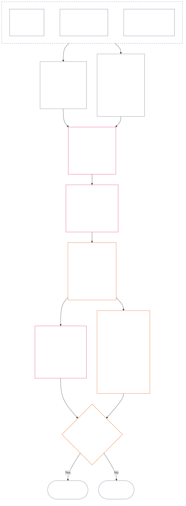

<!-- اردو | جزوی مسودہ: باب 12، حصے 4–6 | ماخذ commit: 9c2c8c10c871d91157bcd27b9f56ad6a1cec90d3 | AI-ڈرافٹ، غیر نظرثانی شدہ -->

### 4. خانے کا قواعدی ڈھانچہ اور مشترکہ پیمانہ بندی

*سادہ الفاظ میں: یہ حصہ دو الگ محوروں میں سے ہر ایک پر ممکنہ نو مقامات کو یکساں نام دیتا ہے اور بتاتا ہے کہ اثر ان میں کیسے پیمانہ بند ہوتا ہے۔ ایک محور تصدیق شدہ حصہ ریکارڈ کرتا ہے؛ دوسرا کیفیت کے ریکارڈ میں تصدیق شدہ خلاف ورزیاں۔ یکساں خانے کا نمبر ہونا دونوں محوروں کو یکجا نہیں کرتا اور نہ نقصان کو مدد سے منہا کرتا ہے۔ **حصہ 6** کا متحدہ پیمانہ دونوں محوروں کو متناسب LEQU اثر کے مطابق متعین کرتا ہے۔*

خانے کا قواعدی ڈھانچہ `s` کے نام سے **1** سے **9** تک خانہ نمبر استعمال کرتا ہے۔ ہر محور پر اپنی الگ خانے کی جگہ ہوتی ہے:

- **Contribution Axis** مثبت حصہ داری کی نوعیت ریکارڈ کرتا ہے؛ اور
- **Violation Axis** تصدیق شدہ خلاف ورزی کے نتائج ریکارڈ کرتا ہے۔

ایک ہی خانے کا نمبر دونوں محوروں پر آسکتا ہے، مگر محور الگ رہتے ہیں۔ حصہ داری کا خانہ خلاف ورزی کا خانہ نہیں اور خلاف ورزی کا خانہ حصہ داری کا خانہ نہیں۔

#### 4.1 جدول 1 — خانہ دکھانے کے لیبل

**جدول 1** نو خانوں کے نام دیتا ہے اور Contribution Axis اور Violation Axis کے دکھانے کے لیبل ساتھ ساتھ دکھاتا ہے۔ یہ صرف دکھانے کی زبان فراہم کرتا ہے؛ خانہ متحدہ پیمانے کے تحت **حصہ 6** میں متعین ہوتا ہے۔

|  `s` | Contribution Axis کا دکھانے کا لیبل | Violation Axis کا دکھانے کا لیبل |
| ---: | --- | --- |
|    1 | **معمولی بنیادی حصہ داری** | **معمولی آئینی اثر** |
|    2 | **چھوٹی بنیادی حصہ داری** | **چھوٹا آئینی اثر** |
|    3 | **نمایاں مثبت حصہ داری** | **نمایاں آئینی اثر** |
|    4 | **اہم مثبت حصہ داری** | **اہم آئینی اثر** |
|    5 | **سنجیدہ ذمہ دارانہ انتظامی مثبت حصہ داری** | **سنجیدہ آئینی اثر** |
|    6 | **بڑی ذمہ دارانہ انتظامی مثبت حصہ داری** | **بڑا آئینی اثر** |
|    7 | **تسلیم شدہ نمایاں خدمت** | **شدید آئینی اثر** |
|    8 | **امتیازی نمایاں خدمت** | **سنگین آئینی اثر** |
|    9 | **مثالی نمایاں خدمت** | **تباہ کن آئینی اثر** |

Contribution Axis بنیادی، مثبت، ذمہ دارانہ انتظامی مثبت، اور نمایاں خدمت کے لیبل استعمال کرتا ہے۔ Violation Axis ہر خانے میں غیر جانب دار اثر کے لیبل استعمال کرتا ہے۔ محور الگ رہتے ہیں، نہ خالص مجموعی اسکور بناتے ہیں اور نہ حصہ داری اور خلاف ورزی کے ریکارڈوں کے درمیان offset کی اجازت دیتے ہیں۔ Violation Axis کا خانہ بذاتِ خود آئین مخالف بدعملی کی درجہ بندی نہیں کرتا؛ [Chapter Fourteen](core_14.000_misconduct_designation.md#chapter-fourteen-anti-constitutional-misconduct) الگ سے طے کرتا ہے کہ آیا تصدیق شدہ `s` = 7–9 خلاف ورزی پر آئین مخالف بدعملی کا تعین (ACMD) لاگو ہوتا ہے۔

عمل درآمد، پوری زندگی کے مساوی فائدے یا نقصان کا اندازہ لگانے میں مدد کے لیے پیمائشی اکائیاں، شہادت کے طریقے اور مثالیں شائع کر سکتا ہے۔ یہ مواد صرف رہنمائی ہے اور **حصہ 6**، **باب اول** یا **باب ششم** کی حقوق کی تہہ پر غالب نہیں آسکتا۔

#### 4.2 اثر کی مشترکہ پیمانہ بندی کے قواعد

*سادہ الفاظ میں: اثر صرف افراد کی تعداد سے نہیں ناپا جاتا۔ ایک شعوری وجود کو متاثر کرنے والا گہرا فائدہ یا نقصان، بہت سے لوگوں پر سطحی اثر سے زیادہ اہم ہو سکتا ہے۔ تعداد، گہرائی، کمزوری، مدت، پائیداری، پھیلاؤ اور آئینی نوعیت کو اکٹھے جانچنا لازم ہے۔*

**حصہ 6** کے دونوں محوروں کی تشریح کے لیے یہ قواعد استعمال کریں:

| پیمانہ بندی کا پہلو | مشترکہ قاعدہ | محور کے لحاظ سے اطلاق |
| --- | --- | --- |
| **آئینی نتیجے کا حجم (LEQU)** | مجموعی تصدیق شدہ فائدے یا نقصان کا جائزہ لیں۔ LEQU حجم کا بنیادی نقطۂ حوالہ ہے؛ خام تعداد، رقم، پیداوار یا ادارے کا حجم نہیں۔ | حصہ داری میں حقوق سے مطابقت رکھنے والا تصدیق شدہ فائدہ شمار ہوتا ہے؛ خلاف ورزی میں تصدیق شدہ آئینی نقصان، ضرر، ضیاع، مواقع کا خاتمہ یا خطرہ شمار ہوتا ہے۔ |
| **شعوری وجود کا دائرہ** | **تعداد، گہرائی اور کمزوری کو ساتھ** دیکھیں۔ کسی خانے کے لیے افراد کی تعداد الگ شرط نہیں۔ ایک شعوری وجود پر کافی گہرا اثر، اسی خانے کی حمایت کر سکتا ہے جس کی وسیع مگر کم گہرائی کا اثر کرے، بشرطیکہ مجموعی حجم اور قطار کے دیگر معیار برابر ہوں؛ مجموعی LEQU یا وسیع دائرے کی کوئی صریح شرط پھر بھی پوری ہونا لازم ہے۔ | انحصار، گھٹی ہوئی صلاحیت یا غیر معمولی کمزوری مادی اہمیت بڑھا سکتی ہے۔ صرف گروہ کا حجم حصہ داری یا شدت ثابت نہیں کرتا۔ |
| **زمانی دائرہ** | مدت، تکرار، پائیداری، اور نقصان کی صورت میں ناقابلِ واپسی کو دیکھیں۔ مختصر مگر تبدیلی پیدا کرنے والا واقعہ طویل مگر معمولی اثر سے بڑھ سکتا ہے؛ صرف مدت فیصلہ کن نہیں۔ | پائیدار فائدہ زیادہ مقدار کی حصہ داری کی تائید کرتا ہے۔ مسلسل یا ناقابلِ واپسی نقصان خلاف ورزی کی زیادہ شدت کی تائید کرتا ہے۔ |
| **مکانی یا ادارہ جاتی دائرہ** | وسیع پھیلاؤ حجم بڑھا سکتا ہے، مگر برادریوں یا اداروں کے پار پھیلاؤ لازم نہیں جب گہرائی، مدت، کمزوری یا آئینی اہمیت بذاتِ خود خانے کی حمایت کرے۔ | ادارہ جاتی مرمت حصہ داری کا حجم بڑھا سکتی ہے؛ ساختی یا نظامی نقصان خلاف ورزی کی شدت بڑھا سکتا ہے۔ |
| **آئینی معیار یا نوعیت** | نتیجہ کیسے پیدا ہوا، اسے اس بات سے الگ ناپیں کہ وہ کتنی دور پھیلا۔ ایک ہی حقیقت کو دو بار شمار نہ کریں۔ | دوسروں پر منتقل کیا گیا نقصان، چھپا ہوا بوجھ، قبضہ گیری یا انحصار، دعویٰ کردہ حصہ داری کو محدود یا نااہل کر سکتا ہے۔ فرض، غفلت، فریب، جبر، تشدد یا ساختی سہولت کاری خلاف ورزی کے طرزِ عمل کی الگ ریکارڈ شدہ نوعیت رہتی ہے اور اثر کے خانے کو نہیں بدلتی۔ |
| **حقوق کی تہیں اور اہم حفاظتی انتظامات** | حقوق کی تہہ کی پابندی کو مجموعی فائدے یا نقصان کے بدلے نہیں کیا جا سکتا۔ | تہہ کی پابندی بذاتِ خود بڑی حصہ داری ثابت نہیں کرتی۔ حقوق کی تہہ کی مادی شکست یا اہم حفاظتی انتظام کی ناکامی زیادہ شدید خلاف ورزی کی حمایت کر سکتی ہے، خواہ براہ راست متاثرہ شعوری وجود کم ہوں۔ |

یہ پہلو ایسی چیک لسٹ نہیں جس میں ہر قسم کا پھیلاؤ لازماً موجود ہو۔ واضح کریں کہ کون سے پہلو فیصلہ کن تھے، کون سے نہیں، اور کیوں۔

- **خانے کا مشترکہ طریقہ:**
  - تناسب کے تحت مجموعی تصدیق شدہ فائدے یا نقصان کا LEQU میں اندازہ لگائیں، پھر وہ واحد خانہ مقرر کریں جس کے عددی دائرے میں وہ مقدار آتی ہے۔
  - دونوں محوروں پر ایک ہی حدیں لاگو ہوتی ہیں۔
  - حصہ داری کے خانوں پر لاگو بنیادی معیار اور آئینی مطابقت کی شرائط برقرار رہتی ہیں؛ عددی حد پوری ہونے سے دوسروں پر منتقل کیا گیا یا آئینی طور پر ناکام نتیجہ حصہ داری شمار نہیں ہوسکتا۔
- **نوعیت کی علیحدگی:** لاگو benefit-route، harm-route، conduct-quality اور conduct-character descriptors کو کیفیت کے ریکارڈ میں جمع شدہ رکھیں۔ فرض، غفلت، فریب، سنگینی، جبر، تشدد، ارادہ یا ساختی سہولت کاری attribution، حفاظتی انتظامات یا سوال 3 کے نتائج کو متاثر کر سکتی ہے، مگر ان میں سے کوئی بھی LEQU اثر کے خانے کو بڑھاتا یا گھٹاتا نہیں۔
- **آئین مخالف بدعملی کے جائزے کی حد:** Violation Axis پر تصدیق شدہ نقصان، اثر کے لحاظ سے `s` = 7–9 تک پہنچ سکتا ہے، خواہ آئین مخالف بدعملی ثابت ہو یا نہ ہو۔ باب چہار دہم اثر کی تعیین کی جگہ نہیں لیتا؛ وہ الگ سے طے کرتا ہے کہ متعلقہ ACMD لاگو ہوتا ہے یا نہیں۔

اگر کوئی خطرہ ابھی حقیقت میں پیش نہیں آیا تو ان میں سے ہر بات الگ درج کریں:

- اس کا امکان کتنا ہے؛
- شعوری وجود کب تک اس کے سامنے رہیں گے؛
- یہ کتنی دور تک پھیل سکتا ہے؛
- اندازے میں کتنی غیر یقینی ہے؛ اور
- بدترین ایسا نتیجہ جو اب بھی قابلِ یقین ہو۔

اس بدترین نتیجے کو ایسا نقصان نہ شمار کریں جو پہلے ہی واقع ہوچکا ہے (LEQU loss)، جب تک منظور شدہ عمل درآمد نے خطرے کی کوئی ایسی calibration (خطرے کو LEQU میں تبدیل کرنے کا طریقہ) مقرر نہ کی ہو جسے ہر کوئی دیکھ سکے۔

### 5. محور کی تعیین کے آئینی ماخذ

*سادہ الفاظ میں: خانہ منتخب کرنے سے پہلے ان آئینی ماخذوں کی شناخت کریں جو ناپے جانے والے بنیادی معیار، فائدے، فرض، نقصان یا خلاف ورزی کا تعین کرتے ہیں۔ ان ماخذوں کو ان کے مستند مقامات پر لاگو کرنے کے لیے نیچے کے روابط استعمال کریں؛ اس routing مرحلے کو ایک اور اسکور یا متبادل تعریف نہ بنائیں۔*

**حصہ 6** کے تحت خانہ مقرر کرنے سے پہلے کیفیت کے ریکارڈ میں یہ شناخت کرنا لازم ہے:

- لاگو آئینی بنیادی معیار، فرض، پابندی یا محفوظ مفاد؛
- وہ دفعات جو ناپے جانے والے تصدیق شدہ فائدے، منفی نتیجے، ضرر یا خلاف ورزی کو قائم کرتی ہیں؛
- وہ تعریفیں، اصول اور حقوق کی تہہ کے آرٹیکلز جو حجم یا طرزِ عمل کی نوعیت پر مادی اثر ڈالتے ہیں؛ اور
- ہر شناخت شدہ ماخذ کیوں لاگو ہوتا ہے اور محور کی تعیین پر اس کا کیا اثر ہے۔

نیچے دیے routing tables مکمل فہرست نہیں ہیں۔ تصدیق شدہ حقائق سے متحرک ہونے والی ہر اضافی تعریف، اصول یا آرٹیکل بھی لاگو رہتی ہے اور اسے کیفیت کے ریکارڈ میں شناخت کرنا لازم ہے۔ ہر منسلک مستند مقام فیصلہ کن ہے؛ یہ جدول اس کے متن کو دوبارہ نہیں لکھتے اور نہ محدود کرتے ہیں۔

#### 5.1 تعریفوں کے ماخذ

| مستند ماخذ | Contribution Axis کا کردار | Violation Axis کا کردار |
| --- | --- | --- |
| [Standing State, Contribution, and Violation](core_05.035_band_accountability.md#defa3-standing-state-contribution-and-violation) | واضح کرتا ہے کہ کیا حصہ داری شمار ہوتا ہے اور اسے ناپنے کے لیے کون سے جانچے ہوئے حقائق استعمال کیے جاسکتے ہیں۔ یہ بھی یقینی بناتا ہے کہ حصہ داری کا کیفیتی ریکارڈ صرف اچھے پہلو کا احاطہ کرے، برے پہلو کے ساتھ کبھی مخلوط نہ ہو۔ | واضح کرتا ہے کہ خلاف ورزی کیا ہے اور اسے کیسے ریکارڈ کیا جاتا ہے۔ یہ سنگین ترین معاملات کو Anti-Constitutional Misconduct Review کی طرف بھیجتا ہے، جو آئین کو خود نقصان پہنچانے والے طرزِ عمل کا الگ جائزہ ہے۔ |
| [Accountability](core_05.005_apex_accountability_leg.md#accountability) | جانچتا ہے کہ اچھے ذمہ دارانہ انتظام یا مرمت کا دعویٰ واقعی کسی کو جوابدہ رکھتا ہے یا نہیں۔ پھر بھی یہ دکھانا لازم ہے کہ کس نے کیا، کس کو جواب دینا ہے، اور اثر کے تناسب سے اس کا جائزہ، تلافی اور تصحیح کیسے ہوسکتی ہے۔ | ایسے معاملات شناخت کرتا ہے جہاں واضح نہیں کہ کس نے کیا یا کس کو جواب دینا ہے۔ اس میں وہ صورتیں بھی شامل ہیں جہاں تنظیم یا اس کی ساخت بدلنے کے بعد ذمہ داری کا نظام کام کرنا چھوڑ دے۔ |
| [Harm](core_05.035_band_accountability.md#harm) | دوسروں پر منتقل یا پوشیدہ ضرر دعویٰ کردہ فائدے کو محدود یا ختم کرسکتا ہے۔ ضرر کی مرمت فائدہ شمار ہوسکتی ہے، مگر صرف تب جب مرمت کی تصدیق ہو اور اسے آزادانہ طور پر ثابت کیا گیا ہو۔ | نقصان اور شدت ناپتے وقت شمار ہونے والے نقصانات کی اقسام واضح کرتا ہے: براہ راست، بالواسطہ، مؤخر، مجموعی، نظاموں میں پھیلا ہوا، اور شعوری وجود کے ذہن یا جذباتی فلاح کو پہنچنے والا ضرر۔ |
| [Materiality](core_05.050_band_oversight.md#materiality) اور [Lifespan Equivalent Unit (LEQU)](core_05.055_band_participation.md#lifespan-equivalent-unit-lequ) | طے کرتے ہیں کہ تصدیق شدہ فائدہ کتنا شمار ہوگا، اس بنیاد پر کہ وہ کتنے وسیع طور پر پہنچا، متاثر ہونے والے کتنے کمزور تھے، اور کتنی دیر قائم رہا۔ نتیجہ LEQU میں ناپا جاتا ہے، جو پوری زندگی کے فائدے کا مشترکہ پیمانہ ہے۔ | طے کرتے ہیں کہ تصدیق شدہ نقصان یا خطرہ کتنا شمار ہوگا، اس بنیاد پر کہ وہ کتنے وسیع طور پر پہنچا، متاثر ہونے والے کتنے کمزور تھے، کتنی دیر قائم رہا، اور اسے پلٹنا کتنا دشوار ہے۔ نتیجہ LEQU میں ناپا جاتا ہے، وہی پیمانہ جو پوری زندگی کے نقصان کے لیے ہے۔ |
| [Contribution Nature](core_05.035_band_accountability.md#contribution-nature) | طے کرتا ہے کہ کوئی چیز حصہ داری شمار ہوتی ہے یا نہیں۔ اسے صرف اچھا ہونا چاہیے، ضرر کے ساتھ مخلوط نہیں، اور ایسے تصدیق شدہ contribution record سے ثابت ہونا چاہیے جسے دکھایا جاسکے۔ دونوں کے بغیر Contribution Axis پر تعیین نہیں ہوسکتی۔ | یہاں اس کا کوئی کردار نہیں۔ یہ طے نہیں کرتا کہ ضرر کیا ہے اور خلاف ورزی کی سنگینی کبھی کم نہیں کرتا۔ |
| [Violation Nature](core_05.035_band_accountability.md#violation-nature) | یہاں اس کا کوئی کردار نہیں۔ خلاف ورزی کو کبھی منفی حصہ داری نہیں شمار کیا جاتا، اور یہ اس سے غیر متعلق تصدیق شدہ فائدہ مٹاتی نہیں۔ | طے کرتا ہے کہ کوئی چیز خلاف ورزی شمار ہوتی ہے یا نہیں۔ اسے نقصان دہ قرار دیا گیا ہو اور تصدیق شدہ finding اس کے وقوع کی تائید کرتی ہو۔ دونوں کے بغیر Violation Axis پر تعیین نہیں ہوسکتی۔ |
| [Constitutional Constraint](core_05.045_band_integrative.md#constitutional-constraint)، [Authority Stack and Internal Hierarchy](core_05.045_band_integrative.md#authority-stack-and-internal-hierarchy)، اور [Auditability](core_05.050_band_oversight.md#auditability) | دعویٰ کردہ فائدے کو شمار ہونے سے روکتے ہیں جب وہ آئین کو ناکام بنانے، اس کے قواعد سے بچنے، حقوق کی تہہ (آئین کی ضمانت کردہ کم سے کم حفاظت) سکیڑنے یا صرف کاغذ پر پابندی دکھانے پر منحصر ہو۔ | ان امور کو نمایاں کرتے ہیں جو خلاف ورزی کی حقیقی سنگینی پر اثرانداز ہوں: اہم آئینی حد توڑنا، آئینی اختیار سے اوپر کسی چیز کو رکھنا، قواعد سے بچ نکلنا یا ان کا نفاذ ناممکن بنانا۔ |
| [Auditability](core_05.050_band_oversight.md#auditability) اور [Contestability](core_05.035_band_accountability.md#contestability) | تقاضا کرتے ہیں کہ دعویٰ کردہ فائدہ دکھایا اور جانچا جاسکے، اور اختلاف کرنے والے کے پاس اسے چیلنج کرنے کا مؤثر طریقہ ہو۔ | تقاضا کرتے ہیں کہ findings جانچی اور چیلنج کی جاسکیں۔ الزام یا بلا توضیح لیبل خلاف ورزی کی سنگینی متعین نہیں کرسکتا۔ |

#### 5.2 اصولوں کے ماخذ

| اصول کا ماخذ | محور کی تعیین میں کردار |
| --- | --- |
| [Constitutional Tetrad](core_00.000_preamble.md#constitutional-tetrad)، [Two Constitutional Aims](core_00.000_preamble.md#two-constitutional-aims)، اور [material stake](core_00.000_preamble.md#material-stake) | کام کے چار نظم (شرکت، نگرانی، جوابدہی اور بروقت کارروائی)، آئین کے دو مقاصد (شگفتگی اور استمرار)، اور وہ فریم مقرر کرتے ہیں جو ہر تعیین کو داؤ پر لگی بات کے مطابق پیمانہ بند کرتا ہے۔ |
| [Wellbeing](core_01.000_values_principles.md#3-foundational-objective-wellbeing-flourishing-aim) اور [Recognition, Reinforcement, and Aspiration](core_01.000_values_principles.md#32-recognition-reinforcement-and-aspiration) | حقوق کا احترام کرنے والے فائدے اور اس کے مطابق recognition کو Contribution Axis پر بنیاد دیتے ہیں۔ وقار یا انعام کو کبھی حصہ داری کا ثبوت نہیں سمجھا جاتا۔ |
| [Safety](core_01.000_values_principles.md#4-safety-harm-constraint) اور [Truth](core_01.000_values_principles.md#5-truth-epistemic-integrity-constraint) | دونوں محوروں پر پابند حدود قائم کرتے ہیں۔ ضرر یا فریب سے حاصل فائدہ مکمل شمار نہیں ہوتا، اور safety یا truth کی تصدیق شدہ ناکامی خلاف ورزی کا حجم یا نوعیت دکھا سکتی ہے۔ |
| [Stewardship In Depth](core_01.010_stewardship_capacity_principles.md#16-stewardship-in-depth) اور [Governance Under Stewardship Discipline](core_01.010_stewardship_capacity_principles.md#18-governance-under-stewardship-discipline) | جہاں تصدیق شدہ حقائق تقاضا کریں، وہاں پائیدار حصہ داری، کردار کے فرائض، ادارہ جاتی مرمت، نگرانی اور ذمہ داری کو تولنے میں رہنمائی کرتے ہیں۔ |
| [Core Tradeoff Principles](core_01.005_interaction_interpretation.md#131-core-tradeoff-principles) اور [Constitutional Floors, Safety, and Anti-Degrading Process](core_01.005_interaction_interpretation.md#1314-constitutional-floors-safety-and-anti-degrading-process) | اس وقت لاگو ہوتے ہیں جب ناپے جانے والے طرزِ عمل میں ضرورت، ضرر کو کم سے کم رکھنا، تناسب، حقوق کا تصادم یا پابندی شامل ہو۔ یہ بذاتِ خود کبھی نتیجے کی اجازت نہیں دیتے۔ |

#### 5.3 حقوق کی تہہ اور آرٹیکل کے ماخذ

| آرٹیکل کا ماخذ | محور کی تعیین میں کردار یا حد |
| --- | --- |
| حقیقتاً لاگو [باب ششم کی حقوق کی تہہ](core_06.000_rights_part_a.md#chapter-six-foundational-rights)، بشمول ہر وہ آرٹیکل جسے تصدیق شدہ کیفیتی ریکارڈ مادی طور پر متاثر کرتا ہو | زیرِ بحث بنیادی حفاظت، مفادات، فرائض، فوائد یا خلاف ورزیوں کا تعین کرتی ہے۔ کوئی آرٹیکل صرف اس وجہ سے خارج نہیں ہوتا کہ وہ نیچے درج نہیں۔ |
| [آرٹیکل XIX — کیفیت اور شرکت کی حیثیت](core_06.015_rights_part_d.md#article-xix-standing-and-participation-status) | شعوری وجود کی کیفیت، اس کے وقار، حقوق کی تہہ کے کم سے کم تحفظ، فریقِ متعلقہ حیثیت، ساکھ، اور شرکت کی حیثیت میں بعد کی کسی تبدیلی کو الگ رکھتا ہے۔ |
| [آرٹیکل XIII-A — اعتماد اور اعتبار کا بنیادی معیار](core_06.010_rights_part_c.md#article-xiii-a-reliability-and-trustworthiness-baseline) اور [آرٹیکل XIII-B — ازالے اور تدارک کا حق](core_06.010_rights_part_c.md#article-xiii-b-right-to-redress-and-remedy)، [آرٹیکل XV-B — شفافیت، قابلِ آڈٹ ہونا اور چیلنج پذیری](core_06.010_rights_part_c.md#article-xv-b-transparency-auditability-and-contestability)، اور [آرٹیکل XVI — آڈٹ، شفافیت اور آزادانہ توثیق](core_06.010_rights_part_c.md#article-xvi-audit-transparency-and-independent-verification) | اس وقت لاگو ہوتے ہیں جب تصدیق شدہ فائدے یا خلاف ورزی میں دیانت دارانہ ریکارڈ رکھنا، معلومات بانٹنا، حقائق جانچنا، فیصلے کو چیلنج کرنے کی صلاحیت یا غلطیوں کی اصلاح شامل ہو۔ |
| [آرٹیکل XXIV — اصل سبب کا تجزیہ اور موافقانہ ردِعمل](core_06.015_rights_part_d.md#article-xxiv-root-cause-analysis-and-adaptive-response) | لاگو ہوتا ہے جب طرزِ عمل کی وجہ، اس کی تصحیح، اس کا جاری رہنا یا ردِعمل کا موافق ہونا اہم ہو، کیونکہ اس سے معلوم ہوتا ہے کہ آئین کے تحت طرزِ عمل کی حیثیت کیا ہے۔ |
| [آرٹیکل XX — تصدیق شدہ خلاف ورزی کے بعد انصاف](core_06.015_rights_part_d.md#article-xx-justice-after-verified-violation) اور [آرٹیکل XXVI-C — بروقت فیصلے اور تاخیر مخالف تہہ](core_06.020_rights_part_e.md#article-xxvi-c-timely-resolution-and-anti-delay-floor) | حقائق سے متعلق کسی بھی عمل یا تاخیر پر لاگو ہوتے ہیں۔ **آرٹیکل XX** (*تصدیق شدہ خلاف ورزی کے بعد انصاف*) بنیادی طور پر خلاف ورزی ناپنے کے بعد کے نتائج (سوال 3) کو محدود کرتا ہے۔ اسے سوال 2 کے خانے کو بڑھانے یا گھٹانے کے لیے استعمال نہیں کرنا چاہیے، صرف اس لیے کہ کوئی پہلے سے پسندیدہ ردِعمل کا جواز چاہتا ہے۔ |

**اطلاق کی حدود۔** یہ قدم صرف درست ماخذوں کی نشان دہی کرتا ہے۔

- یہ:
  - سوال 1 دوبارہ نہیں کھولتا؛
  - غیر تصدیق شدہ حقائق داخل نہیں کرتا؛
  - نیا پیمانہ یا اسکور نہیں جوڑتا؛
  - مختلف ماخذوں کے ذریعے ایک حقیقت کو دو بار نہیں گنتا؛
  - دونوں محوروں کو یکجا نہیں کرتا؛ یا
  - ہر درج شدہ ماخذ کو ہر کیفیتی ریکارڈ پر لاگو نہیں کرتا۔
- حصہ داری اور خلاف ورزی اب بھی الگ ناپے جاتے ہیں۔
- **آرٹیکل XX** (*تصدیق شدہ خلاف ورزی کے بعد انصاف*) کے نتائج سوال 2 سے باہر رہتے ہیں۔
- باب چہار دہم کا designation review یہاں مقرر کردہ اثر کے خانے سے الگ رہتا ہے۔

### 6. متحدہ متناسب LEQU پیمانہ — Contribution اور Violation Axes

<strong>قارئین کے لیے رہنمائی (غیر عملی): پانچ گنا پیش رفت کیسے کام کرتی ہے</strong>

> پیمانہ پانچ گنا پیش رفت استعمال کرتا ہے، جس کا نقطۂ حوالہ `s` = 7 = ایک LEQU ہے۔ کسی بھی محور کے لیے، خانہ 2 سے 9 تک `s` خانے کی کم از کم مقدار `5^(s−7)` LEQU ہے؛ خانہ 1 صفر سے شروع ہوتا ہے۔ منظور شدہ عمل درآمد نتیجے میں نکلنے والی عددی حدیں اور calibration کی مثالیں شائع کر سکتا ہے۔ خانہ 1 میں Contribution Axis پر تصدیق شدہ آئینی بنیادی معیار اور Violation Axis پر پہلی مثبت حد سے کم تصدیق شدہ نقصان شامل ہے؛ حصہ داری کا نہ ہونا یا خلاف ورزی کا نہ ہونا بذاتِ خود `s` = 1 ریکارڈ نہیں ہے۔
>
> **انسان کے لیے قابلِ فہم نقطۂ حوالہ۔** 80 سالہ انسانی عمر کو calibration کی مثال مان کر درمیانی کالم کو اوپر کی طرف پوری زندگی کے مساوی فائدہ، قابلِ استعمال وقت، یا حقوق سے مطابقت رکھنے والے اضافی وسائل اور صلاحیت کے طور پر پڑھیں؛ نیچے کی طرف اسے مساوی نقصان، محرومی، ضیاع یا مواقع کے خاتمے کے طور پر پڑھیں۔ وسائل کی مقدار بذاتِ خود شمار نہیں ہوتی—اس سے پیدا یا روکی جانے والی آئینی صورتِ حال فیصلہ کن ہے۔

 

*سادہ الفاظ میں: **جدول 2** تصدیق شدہ حصہ داری اور تصدیق شدہ خلاف ورزی کو ایک ہی متناسب اثر کے پیمانے پر رکھتا ہے۔ بلند خانے زیادہ بڑے مجموعی آئینی فائدے یا نقصان کو ظاہر کرتے ہیں۔ کیفیتی ریکارڈ اور محور الگ رہتے ہیں: مشترکہ پیمانہ حجم کا موازنہ کرتا ہے، اخلاقی قدر کا نہیں، اور مدد کو نقصان منسوخ کرنے کی اجازت کبھی نہیں دیتا۔*

یہ خاکہ خانے کی ایک تعیین کو ابتدا سے آخر تک دکھاتا ہے۔ اس میں کام کے مراحل کی ترتیب ہے، جو نیچے کے نکات کی ترتیب نہیں؛ نکات ہر قاعدہ بیان کرتے ہیں۔

اثر کے مجموعی LEQU کا اندازہ لگانے کے لیے **تناسب** کو گہرائی، شعوری وجود کے دائرے، کمزوری، مدت، پائیداری یا ناقابلِ واپسی، پھیلاؤ اور آئینی اہمیت کے لحاظ سے لاگو کریں۔ یہ پہلو LEQU کے اندازے کی تشکیل کرتے ہیں؛ یہ خانے کے الگ بونس نہیں۔

- **جدول 2** صرف اس وقت استعمال کریں جب سوال 1 تصدیق کرچکا ہو کہ کیا ہوا، سوال 2 تصدیق شدہ فائدے یا نقصان کی پیمائش کرچکا ہو، **حصے 1–3 اور 4.2** لاگو ہوچکے ہوں، اور **حصہ 5** کے تحت مطلوبہ آئینی ماخذ شناخت ہوچکے ہوں۔
- مجموعی LEQU اندازے سے ایک خانہ مقرر کریں۔
  - واضح کریں کہ ہر مادی پیمانہ بندی کے پہلو نے اندازے کو کیسے متاثر کیا اور خارج کردہ پہلو فیصلہ کن کیوں نہیں تھے۔
  - ہر تعیین کے لیے یہ سب لازم ہے:
    - سراغ پذیری؛
    - قابلِ آڈٹ ہونا؛
    - چیلنج پذیری؛ اور
    - لاگو حقوق کی تہہ۔
  - حصہ داری کے لیے یہ بھی لازم ہے کہ بوجھ دوسروں پر منتقل نہ ہو اور آئینی مطابقت ہو۔
- طرزِ عمل کی نوعیت سے متعلق حقائق الگ، قابلِ سراغ descriptors کے طور پر ریکارڈ کریں۔ وہ attribution، جائزے کی شدت، حفاظتی انتظامات، تدارک یا باب چہار دہم کے designation کو کنٹرول کر سکتے ہیں؛ وہ خانے کو صرف اسی حد تک متاثر کرتے ہیں جس حد تک تصدیق شدہ نتائج مجموعی LEQU اثر بدلیں۔
- عمل یا طرزِ عمل کے سلسلے کے تصدیق شدہ نتائج کو مادی پیمانہ بندی کے پہلوؤں کے ذریعے مکمل طور پر جانچیں، بشمول:
  - جسمانی چوٹ؛
  - نفسیاتی صدمہ؛
  - جبر کے اثرات؛
  - آزادی سے محرومی یا اس کے لیے خطرہ؛
  - مجموعی ضرر؛ اور
  - دیگر آئینی طور پر قابلِ اعتنا فائدہ یا نقصان۔
- یہ نہ کریں:
  - صرف اس بنا پر خانہ نہ بڑھائیں نہ گھٹائیں کہ کسی واقعے یا طرزِ عمل کے سلسلے کو ان میں سے کسی سے متصف کیا گیا ہے:
    - فرض؛
    - غفلت؛
    - ارادہ؛
    - چھپانا؛
    - تکرار؛
    - سنگینی؛
    - جبر؛
    - تشدد؛
    - آزادی کو خطرہ؛
    - قابلِ اصلاح ہونا؛ یا
    - کوئی پسندیدہ نتیجہ۔
  - حجم سے طرزِ عمل کی نوعیت اخذ نہ کریں یا اسے تصدیق شدہ حجم کی جگہ استعمال نہ کریں۔

**جدول 2** نو خانے ترتیب سے درج کرتا ہے۔ ہر قطار `s` خانہ نمبر، اس خانے تک پہنچنے والا شامل کردہ فائدہ یا عائد شدہ نقصان (80 سالہ انسانی عمر کو calibration کی مثال مان کر)، اور ہر محور پر خانے کا نام دیتی ہے۔ دونوں محوروں پر ایک ہی حدیں لاگو ہوتی ہیں، مگر دونوں کے نام الگ رہتے ہیں: Contribution Axis کا خانہ اور Violation Axis کا خانہ الگ ریکارڈ ہیں اور کبھی ایک دوسرے سے منہا نہیں ہوتے۔

| `s` | 80 سالہ انسانی calibration — شامل فائدہ / عائد نقصان | Contribution Axis | Violation Axis |
| ---: | --- | --- | --- |
| 1 | تقریباً **9 دن** سے کم | **معمولی بنیادی حصہ داری** — جانچے گئے دائرے کے لیے آئینی کم از کم معیار کی تصدیق شدہ تکمیل؛ کوئی بھی قابلِ پیمائش بہتری `s` = 2 سے کم رہتی ہے۔ | **معمولی آئینی اثر** — `s` = 2 سے کم تصدیق شدہ نقصان یا عملی کمزوری، بشمول ایسا رسمی نقص جس سے ٹھوس ضرر ثابت نہ ہو۔ |
| 2 | تقریباً **9–47 دن** | **چھوٹی بنیادی حصہ داری** — اس اثر کی سطح میں کم از کم معیار سے بہتر قابلِ اعتماد اور محدود کارکردگی۔ | **چھوٹا آئینی اثر** — اس اثر کی سطح پر تصدیق شدہ محدود نقصان۔ |
| 3 | تقریباً **47 دن–8 ماہ** | **نمایاں مثبت حصہ داری** — اس اثر کی سطح پر بنیادی معیار سے آگے قابلِ مظاہرہ فائدہ۔ | **نمایاں آئینی اثر** — اس اثر کی سطح پر تصدیق شدہ نمایاں نقصان۔ |
| 4 | تقریباً **8 ماہ–3.2 سال** | **اہم مثبت حصہ داری** — زیادہ گہرا، دیرپا، بار بار ہونے والا، کمزوری کا لحاظ رکھنے والا یا وسیع تر تصدیق شدہ فائدہ۔ | **اہم آئینی اثر** — تصدیق شدہ اہم آئینی نقصان۔ |
| 5 | تقریباً **3.2–16 سال** | **سنجیدہ ذمہ دارانہ انتظامی مثبت حصہ داری** — پائیدار ذمہ دارانہ انتظام، رابطہ کاری، دیکھ بھال، مرمت یا اسی نوعیت کا مسلسل فائدہ۔ | **سنجیدہ آئینی اثر** — تصدیق شدہ سنجیدہ آئینی نقصان۔ |
| 6 | تقریباً **16–80 سال** | **بڑی ذمہ دارانہ انتظامی مثبت حصہ داری** — تقریباً ایک LEQU تک پہنچنے والا بڑا تصدیق شدہ فائدہ۔ | **بڑا آئینی اثر** — تقریباً ایک LEQU تک پہنچنے والا بڑا تصدیق شدہ نقصان۔ |
| 7 | تقریباً **1–5 عمریں** (**80–400 سال**) | **تسلیم شدہ نمایاں خدمت** — کم از کم ایک LEQU کا تصدیق شدہ اور آئینی طور پر ہم آہنگ فائدہ۔ | **شدید آئینی اثر** — کم از کم ایک LEQU کا تصدیق شدہ آئینی نقصان۔ |
| 8 | تقریباً **5–25 عمریں** (**400–2,000 سال**) | **امتیازی نمایاں خدمت** — ایسا تصدیق شدہ فائدہ جو `s` = 7 سے مادی طور پر زیادہ ہو۔ | **سنگین آئینی اثر** — ایسا تصدیق شدہ نقصان جو `s` = 7 سے مادی طور پر زیادہ ہو۔ |
| 9 | کم از کم **25 عمریں** (**2,000+ سال**) | **مثالی نمایاں خدمت** — ایسا تصدیق شدہ فائدہ جو `s` = 8 سے مادی طور پر زیادہ ہو۔ | **تباہ کن آئینی اثر** — ایسا تصدیق شدہ نقصان جو `s` = 8 سے مادی طور پر زیادہ ہو۔ |

<strong>عمل درآمد کے باہمی تعامل کا نوٹ</strong>

> یہ ویجیٹ عمل درآمد پر مبنی interoperability مواد رکھتا ہے۔ یہ باب کے عملی زمروں کی معاونت کرتا ہے؛ متوازی زمرہ جاتی نظام نہیں بناتا۔

خانے کے دکھانے کے لیے machine-readable fields (`sub_tier`، `sub_tier_display` اور متعلقہ display fields) [CH06_NINE_SLOT_STANDING_SCALE.md](implementation/CH06_NINE_SLOT_STANDING_SCALE.md) اور [ch06_nine_slot_constants.json](implementation/ch06_nine_slot_constants.json) میں متعین ہیں۔ عمل درآمد کا چار-بینڈی نقشہ interoperability کی معاونت ہی رہتا ہے اور عملی **جدول 2** میں primary-band کالم شامل نہیں کرتا۔

حوالہ جاتی طریقہ اور عملی خانے کی تعیناتیاں، بشمول weights رکھنے والے شعوری وجودوں، saved-state checkpoints اور مقررہ mortality نہ رکھنے والے وجودوں کے لیے، [LEQU_CALIBRATION_REFERENCE.md](implementation/LEQU_CALIBRATION_REFERENCE.md) میں ہیں۔ یہ workings **حصہ 6** کے مشترکہ thresholds اور proportional assignment rule کی جگہ نہیں لے سکتے، کسی live record کو مقرر نہیں کرسکتے اور یہ فیصلہ نہیں کرسکتے کہ کون شمار ہوتا ہے۔

منظور شدہ عمل درآمد LEQU اندازے اور keyed display labels شائع کرسکتا ہے۔ یہ معاون ذرائع **حصہ 6** کے مشترکہ thresholds اور proportional assignment rule یا باب چہار دہم کے designation safeguards کی جگہ نہیں لے سکتے، سوائے ایک **conforming document** تبدیلی کے ذریعے۔

