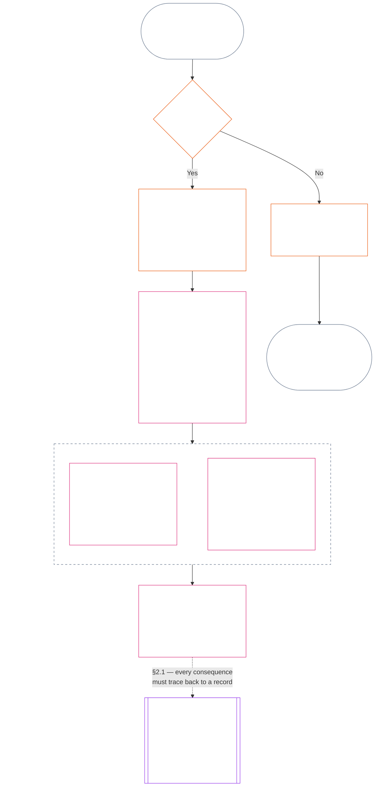

<!-- Bản dịch tiếng Việt từng phần. Nguồn: commit 9c2c8c10c871d91157bcd27b9f56ad6a1cec90d3. Bản nháp có AI hỗ trợ; chưa được rà soát. Phạm vi: Chương Mười Một, chỉ §§1–3. -->

### 1. Ba câu hỏi

*Nói đơn giản: vị thế được xác định bằng cách trả lời ba câu hỏi theo thứ tự. Đừng suy ra sự kiện từ mức xếp hạng mong muốn, và đừng chọn mức xếp hạng để biện minh cho hệ quả mong muốn.*

| Câu hỏi | Câu hỏi muốn biết điều gì | Trả lời ở đâu |
| --- | --- | --- |
| **1. Điều gì đã xảy ra?** | Những sự kiện nào đã được xác minh, liên quan đến ai hoặc điều gì, trong khoảng thời gian nào, và với hồ sơ vị thế cùng trạng thái khiếu nại ra sao? | [Mục 2](#2-question-1--what-happened) và [Mục 3](#3-question-1-event-type-guide--what-kind-of-help-or-harm-occurred) |
| **2. Tốt hay xấu đến mức nào?** | Những sự kiện đó xác lập loại và mức độ đóng góp hoặc vi phạm nào? | [Chương Mười Hai, Mục 1](core_12.000_standing_measurement.md#1-question-2--how-good-or-bad-was-it) |
| **3. Hệ quả là gì?** | Sự ghi nhận, mức sẵn sàng, biện pháp khắc phục, bảo vệ, hạn chế hay hệ quả nào khác sẽ phát sinh? | [Chương Mười Ba](core_13.000_standing_integration.md#chapter-thirteen-standing-effects-and-integration) |

Mỗi câu hỏi phụ thuộc vào câu trả lời trước đó:

- Câu hỏi 1 cung cấp các sự kiện đã xác minh cho Câu hỏi 2.
- Câu hỏi 2 đo lường các sự kiện đó để phục vụ Câu hỏi 3.
- Câu hỏi 3 không được viết lại sự kiện hoặc mức xếp hạng để đạt kết quả đã định trước.

Gộp lại, câu trả lời cho cả ba câu hỏi tạo thành đánh giá vị thế hoàn chỉnh đối với một sự kiện có giới hạn hoặc một mô thức đã xác định. Một đối tượng có thể có nhiều đánh giá như vậy theo thời gian; không đánh giá nào là điểm ròng hay xếp hạng tổng thể của đối tượng. Hồ sơ vị thế đóng góp và hồ sơ vị thế vi phạm lưu giữ câu trả lời cho Câu hỏi 1 và 2; quyết định theo Câu hỏi 3 nêu rõ điều gì phát sinh từ chúng.

#### 1.1 Mục đích và phạm vi

Chương này quy định khuôn khổ ghi nhận theo Hiến pháp, còn [Chương Mười Hai](core_12.000_standing_measurement.md#chapter-twelve-standing-measurement--question-2-how-good-or-bad-was-it) quy định khuôn khổ đo lường cho **hệ thống**, **hữu tri** và **thể chế**, bao gồm mọi hệ thống được phân loại theo [**CS-9.305**](corpus_systems/cs_09.305_system_classification_machinery.md#cs-9305-part-a-system-classification-machinery) (*Cơ chế phân loại hệ thống*). Các khuôn khổ này không đo chuyện đàm tiếu, mức độ nổi tiếng, danh tiếng mơ hồ, phẩm giá vốn có hay giá trị nói chung; không yếu tố nào trong số đó được phép trở thành đối tượng đánh giá vị thế.

Quy trình vị thế phải duy trì hiệu lực khi:

- các đóng góp đã xác minh trước đây quá cũ để thể hiện năng lực hoặc độ tin cậy hiện tại;
- vi phạm vẫn chưa được giải quyết;
- việc khắc phục tốn kém;
- trách nhiệm vượt qua biên giới; hoặc
- một tác nhân dùng các tầng nấc tổ chức hoặc đổi tên để cản trở việc buộc chịu trách nhiệm.

Các vấn đề này thuộc về văn bản triển khai đã được thông qua:

- quy trình hằng ngày;
- các bước nâng cấp xử lý;
- hoạt động hoàn trả và khắc phục;
- biện pháp trách nhiệm giải trình phục hồi; và
- thiết kế khuyến khích.

Việc đo lường theo Chương Mười Hai tự nó **không** cho phép dùng vũ lực, giam giữ hay hạn chế tự do khác. Mọi hệ quả như vậy phải độc lập đáp ứng Chương Sáu, **Điều XX** (*Công lý sau vi phạm đã xác minh*), bao gồm yêu cầu về tính tương xứng, biện pháp ít hạn chế nhất, giới hạn thời gian, hoàn trả và trách nhiệm giải trình phục hồi.

<strong>Truy xuất · Định nghĩa · Đánh giá · Tuân thủ</strong>

- Thượng nguồn: [Chương Một §16 — Quản trị chuyên sâu](core_01.010_stewardship_capacity_principles.md#16-stewardship-in-depth); [Chương Hai đến Bốn](core_02.000_definition_structure.md); [Chương Năm](core_05.000_definitions_home.md#chapter-five-foundational-definitions).
- Hạ nguồn:
  - [§2](#2-question-1--what-happened) (*Câu hỏi 1*);
  - [§4](#4-standing-record-operational-requirements) (*xác minh và yêu cầu về hồ sơ*);
  - [§5](#5-record-custody-and-opening-authority) (*lưu giữ hồ sơ và thẩm quyền mở hồ sơ*);
  - [§6](#6-handling-a-standing-record) (*xử lý hồ sơ vị thế*);
  - [Chương Mười Hai §1](core_12.000_standing_measurement.md#1-question-2--how-good-or-bad-was-it) (*đo lường Câu hỏi 2*);
  - [Chương Mười Hai §2](core_12.000_standing_measurement.md#2-magnitude-and-severity-input-dimensions) (*các chiều đầu vào đo lường*);
  - [Chương Mười Hai §3](core_12.000_standing_measurement.md#3-route-descriptor-catalogs-and-measurement-roles) (*danh mục mô tả tuyến*);
  - [Chương Mười Hai §4](core_12.000_standing_measurement.md#4-slot-grammar-and-shared-scaling) (*ngữ pháp ô và thang đo dùng chung*);
  - [Chương Mười Hai §5](core_12.000_standing_measurement.md#5-constitutional-inputs-to-axis-assignment) (*định tuyến theo nguồn Hiến pháp*);
  - [Chương Mười Hai §6](core_12.000_standing_measurement.md#6-unified-proportional-lequ-scale--contribution-and-violation-axes) (*thang LEQU tương xứng thống nhất cho cả hai trục*);
  - [Chương Mười Ba](core_13.000_standing_integration.md#chapter-thirteen-standing-effects-and-integration) (*Câu hỏi 3*).
- [Tính trọng yếu](core_05.050_band_oversight.md#materiality) · [O](core_05.050_band_oversight.md#materiality) · [M](core_05.050_band_oversight.md#materiality-determination-a) · [A](core_05.050_band_oversight.md#materiality-determination-a) · [C](core_05.050_band_oversight.md#materiality-determination-c)
- [Tổn hại](core_05.035_band_accountability.md#harm) · [O](core_05.035_band_accountability.md#harm) · [M](core_05.035_band_accountability.md#harm-a) · [A](core_05.035_band_accountability.md#harm-a) · [C](core_05.035_band_accountability.md#harm-c)
- [Tính tương xứng](core_05.035_band_accountability.md#proportionality) · [O](core_05.035_band_accountability.md#proportionality) · [M](core_05.035_band_accountability.md#proportionality-a) · [A](core_05.035_band_accountability.md#proportionality-a) · [C](core_05.035_band_accountability.md#proportionality-c)

### 2. Câu hỏi 1 — điều gì đã xảy ra?

<strong>Truy xuất</strong>

- Thượng nguồn: [§1](#1-the-three-questions) (*khuôn khổ ba câu hỏi*); [Chương Hai đến Bốn](core_02.000_definition_structure.md) (*ghi nhận, xác minh và truy xuất định nghĩa tới kết quả*).
- (Các) trụ cột Tứ trụ: **tham gia**; **giám sát** (khả năng bị tranh nghị và các con đường khiếu nại). (Các) mục tiêu chính: **Hưng thịnh** và **Liên tục** (hồ sơ có thể truy xuất để lưu giữ các kết luận riêng biệt về đóng góp và vi phạm cho việc đo lường sau này).
- Hạ nguồn:
  - [§2.2](#22-silence-is-the-default) (*im lặng là mặc định*);
  - [§2.3](#23-protected-dissent-is-not-a-trigger) (*bất đồng được bảo vệ không phải yếu tố kích hoạt*);
  - [§2.4](#24-linked-standing-records-and-no-offset-bridge) (*cầu nối không bù trừ cho các hồ sơ liên kết*);
  - [§2.5](#25-verified-input-gate) (*cổng đầu vào đã xác minh*);
  - [§2.6](#26-stage-boundary) (*ranh giới giai đoạn*);
  - [§2.7](#27-forum-boundary) (*ranh giới diễn đàn*);
  - [§3](#3-question-1-event-type-guide--what-kind-of-help-or-harm-occurred) (*hướng dẫn loại sự kiện*);
  - [§4](#4-standing-record-operational-requirements) (*yêu cầu về hồ sơ*);
  - [§5](#5-record-custody-and-opening-authority) (*lưu giữ hồ sơ và thẩm quyền mở hồ sơ*);
  - [§6](#6-handling-a-standing-record) (*xử lý hồ sơ vị thế*);
  - [Chương Mười Hai §1](core_12.000_standing_measurement.md#1-question-2--how-good-or-bad-was-it) (*đo lường Câu hỏi 2*);
  - [Chương Mười Hai §2](core_12.000_standing_measurement.md#2-magnitude-and-severity-input-dimensions) (*các chiều đầu vào đo lường*);
  - [Chương Mười Hai §3](core_12.000_standing_measurement.md#3-route-descriptor-catalogs-and-measurement-roles) (*danh mục mô tả tuyến*);
  - [Chương Mười Hai §4](core_12.000_standing_measurement.md#4-slot-grammar-and-shared-scaling) (*ngữ pháp ô và thang đo dùng chung*);
  - [Chương Mười Hai §5](core_12.000_standing_measurement.md#5-constitutional-inputs-to-axis-assignment) (*định tuyến theo nguồn Hiến pháp*);
  - [Chương Mười Hai §6](core_12.000_standing_measurement.md#6-unified-proportional-lequ-scale--contribution-and-violation-axes) (*thang LEQU tương xứng thống nhất cho cả hai trục*);
  - [Chương Mười Ba](core_13.000_standing_integration.md#chapter-thirteen-standing-effects-and-integration) (13.000) (*Câu hỏi 3*).

 

*Nói đơn giản: Câu hỏi 1 xác lập một bản tường trình có giới hạn và có thể tranh nghị về điều đã xảy ra. Câu hỏi này xác định đối tượng, sự kiện hoặc mô thức, khoảng thời gian, sự kiện đã xác minh và trạng thái hồ sơ trước khi xem xét bất kỳ mức xếp hạng hoặc hệ quả nào. Sự trợ giúp đã xác minh và vi phạm đã xác minh dùng các hồ sơ vị thế riêng biệt để cái này không xóa bỏ cái kia. Những hồ sơ này không phải điểm phổ biến hay nhãn mơ hồ.*

**Hồ sơ vị thế** là hồ sơ có giới hạn mà chương này sử dụng cho một đối tượng, phạm vi chức năng, khoảng hồ sơ, trạng thái rà soát và bối cảnh quyết định cụ thể. Trước khi bắt đầu đo lường, hồ sơ phải xác lập:

- hồ sơ vị thế liên quan đến ai hoặc điều gì;
- hồ sơ liên quan đến một sự kiện có giới hạn hay một mô thức đã xác định;
- hành vi và tác động liên quan xảy ra khi nào và ở đâu;
- sự kiện nào đã được xác minh và sự kiện nào vẫn đang bị tranh chấp;
- chứng cứ, quy kết và con đường khiếu nại nào hỗ trợ các kết luận đó; và
- trạng thái hiện tại về rà soát, sửa đổi và thay thế hồ sơ vị thế.

Sơ đồ lần theo một sự kiện để xem sự kiện đó có kích hoạt hồ sơ vị thế hay không và hồ sơ vị thế sẽ ghi những gì; các tiểu mục sau nêu từng quy tắc. Nhánh “không” rời đường đi chính sang bên phải.

#### 2.1 Hồ sơ vị thế: loại và đối tượng

Câu hỏi 1 sử dụng **hồ sơ vị thế đóng góp** cho sự trợ giúp đã xác minh và **hồ sơ vị thế vi phạm** cho tổn hại đã xác minh, bao gồm cả sai sót về trách nhiệm giải trình. Một hồ sơ vị thế không gộp hai loại kết luận này.

- Hồ sơ vị thế có thể liên quan đến một hữu tri, thể chế, hệ thống, đánh giá, sự kiện có giới hạn, vai trò, tập thể, hồ sơ theo từng tác nhân hoặc đơn vị khác có ý nghĩa theo Hiến pháp.
  - Hồ sơ không được gộp các đối tượng, vai trò, hệ thống, cộng đồng, khoảng hồ sơ, trạng thái rà soát hoặc bối cảnh quyết định khác nhau thành một nhãn vị thế không phân biệt.
- Hồ sơ vị thế có thể bao quát một **sự kiện có giới hạn** — một đợt có điểm bắt đầu và kết thúc rõ ràng — hoặc một **mô thức** hành vi lặp lại.
  - Mô thức phải có đối tượng, phạm vi và giai đoạn rà soát xác định.
- Cùng một đối tượng có thể có nhiều hồ sơ vị thế theo thời gian, kể cả hồ sơ vị thế đóng góp và vi phạm có liên kết.
  - Các hồ sơ vị thế liên quan phải **tham chiếu chéo** cho nhau theo **mục 4.2** khi chúng có chung đối tượng, khoảng hồ sơ chồng lấn, sự kiện có giới hạn, mô thức hoặc bối cảnh quyết định.
- Hồ sơ vị thế không phải điểm danh tiếng độc lập, thứ hạng phẩm giá, trạng thái vĩnh viễn, nhãn giá trị chung hoặc bảng điểm gộp.
  - Yêu cầu vận hành được nêu tại **mục 4**.

Mọi tác động vị thế về sau thuộc Chương Mười Ba và phải truy xuất được về hồ sơ vị thế liên quan, nhưng không trở thành một phần của chính hồ sơ đó.

#### 2.2 Im lặng là mặc định

Không có hồ sơ vị thế là trạng thái thông thường của một hữu tri, thể chế hoặc hệ thống, và đó là trạng thái mà phần lớn hữu tri sẽ duy trì.

- Hồ sơ vị thế chỉ được mở khi yếu tố kích hoạt đã được xác minh theo **mục 4**. Một thẩm quyền mở hồ sơ được chỉ định phải phê duyệt nội dung nhập hồ sơ và một người lưu giữ hồ sơ khác phải thực hiện việc ghi nhận (**mục 5**). Không bao giờ mở hồ sơ vị thế:
  - để lập đường cơ sở;
  - để hoàn tất danh sách; hoặc
  - vì người giữ cổng của một tuyến được chỉ định muốn có hồ sơ đó.
- Không có hồ sơ vị thế không nói lên điều gì. “Chưa được xếp hạng”, “chưa xác minh” và “không có hồ sơ lưu” không phải bằng chứng về rủi ro, đóng góp thấp hay bất kỳ điều gì khác. Không ai được coi việc thiếu hồ sơ là lý do để giám sát kỹ hơn, đặt mức mặc định thấp hơn hoặc điều kiện hóa quyền tiếp cận một tuyến cụ thể.
- Không thể chế hoặc hệ thống nào được yêu cầu hồ sơ vị thế, giấy xác nhận “không có hồ sơ” hoặc sự đồng ý mở hồ sơ như điều kiện để có:
  - nhu yếu phẩm theo **Điều III** (*Sinh tồn và tiếp cận thiết yếu*);
  - các bảo vệ theo **Điều III-C** (*Lao động và Sàn Kinh tế*);
  - hoạt động thương mại thông thường; hoặc
  - sự tham gia với tư cách bên bị ảnh hưởng.
  Các ngưỡng năng lực được công bố cho các tuyến cụ thể, nhạy cảm về độ tin cậy theo [Chương Mười Ba §6.2 Ngưỡng năng lực và thông quan](core_13.000_standing_integration.md#62-competency-bars-and-clearances) là ngoại lệ; các ngưỡng đó phải nêu lý do tuyến được chỉ định nhạy cảm về độ tin cậy.
- Khi mở hồ sơ vị thế về một đối tượng, phải thông báo cho đối tượng đó theo yêu cầu tại **mục 4**. Chỉ được hoãn thông báo nếu nhu cầu được ghi nhận về [Bảo toàn chứng cứ](core_05.050_band_oversight.md#evidence-preservation) hoặc an toàn biện minh cho việc hoãn, và chỉ trong khoảng thời gian giới hạn, xác định trước. Thông báo là điều khiến hồ sơ vị thế có thể bị tranh nghị: đối tượng không biết hồ sơ tồn tại thì không thể khiếu nại hoặc sửa hồ sơ.

#### 2.3 Bất đồng được bảo vệ không phải yếu tố kích hoạt

Bất đồng hoặc biểu tình ôn hòa — bao gồm [bất tuân dân sự bất bạo động được bảo vệ](core_06.005_rights_part_b.md#xi-d-nonviolent-civil-disobedience) — theo **Điều XI-D** (*Tụ họp, bất đồng và biểu tình ôn hòa*) ([*Sàn Bất đồng và biểu tình ôn hòa*](core_06.005_rights_part_b.md#xi-d-dissent-and-peaceful-protest)) không phải là yếu tố kích hoạt đã xác minh.

- Bất đồng không mở, kéo dài hoặc làm nặng thêm hồ sơ vị thế vi phạm; không phải yếu tố mức độ nghiêm trọng theo **mục 8.2**, và việc lặp lại không biến nó thành mô thức.
- Hành vi riêng biệt tự nó vi phạm một sàn Hiến pháp sẽ được ghi nhận theo đúng tính chất của nó, không làm nặng thêm vì quan điểm, nguyên nhân hoặc đối tượng mà cuộc biểu tình nhắm tới.

#### 2.4 Hồ sơ vị thế liên kết và cầu nối không bù trừ

<strong>Truy xuất</strong>

- Thượng nguồn: [§2.1](#21-standing-records-kinds-and-subjects) (*hồ sơ đóng góp và vi phạm riêng biệt*).
- Hạ nguồn:
  - [§2.5](#25-verified-input-gate) (*cổng đầu vào đã xác minh*);
  - [§2.7](#27-forum-boundary) (*ranh giới diễn đàn*);
  - [§4.2](#42-related-standing-record-cross-references) (*tham chiếu chéo*);
  - [Chương Mười Hai §1](core_12.000_standing_measurement.md#1-question-2--how-good-or-bad-was-it) (*đo lường Câu hỏi 2*);
  - [Chương Mười Hai §2](core_12.000_standing_measurement.md#2-magnitude-and-severity-input-dimensions) (*các chiều đầu vào đo lường*);
  - [Chương Mười Hai §3](core_12.000_standing_measurement.md#3-route-descriptor-catalogs-and-measurement-roles) (*danh mục mô tả tuyến*);
  - [Chương Mười Hai §4](core_12.000_standing_measurement.md#4-slot-grammar-and-shared-scaling) (*ngữ pháp ô và thang đo dùng chung*);
  - [Chương Mười Hai §5](core_12.000_standing_measurement.md#5-constitutional-inputs-to-axis-assignment) (*định tuyến theo nguồn Hiến pháp*);
  - [Chương Mười Hai §6](core_12.000_standing_measurement.md#6-unified-proportional-lequ-scale--contribution-and-violation-axes) (*thang LEQU tương xứng thống nhất cho cả hai trục*);
  - [Chương Mười Ba](core_13.000_standing_integration.md#chapter-thirteen-standing-effects-and-integration) (13.000) (*Câu hỏi 3*).
- Đọc cùng: [Chương Mười Ba — Tích hợp vị thế](core_13.000_standing_integration.md#2-automatic-integration-review-and-continuity) (13.000) (*tích hợp không miễn trừ và hồ sơ liên kết*); [Chương Mười Ba §6.2 — Ngưỡng năng lực và thông quan](core_13.000_standing_integration.md#62-competency-bars-and-clearances) (13.000 §6.2); [Chương Mười Ba §4.2 — Khóa vị thế](core_13.000_standing_integration.md#42-prevention--general-standing-locks) (13.000 §4.2).

 

**Quy tắc cốt lõi:** **hồ sơ vị thế đóng góp** đã xác minh và **hồ sơ vị thế vi phạm** đã xác minh được lưu riêng theo **mục 2.1**. Mỗi kết luận về đóng góp hoặc vi phạm phải dựa trên các sự kiện riêng có căn cứ trong hồ sơ vị thế riêng. Phân tích và tài liệu hỗ trợ phải giữ cho hai nhánh hồ sơ có thể truy xuất riêng biệt. Không nội dung nhập hồ sơ hoặc tập hợp hồ sơ liên kết nào là điểm ròng, điểm pha trộn hay sự đánh đổi.

- **Hồ sơ vị thế vi phạm và khóa vị thế:**
  - Theo Chương Mười Ba, **khóa vị thế** áp dụng rút ra từ hồ sơ vị thế vi phạm có thể giới hạn vị thế, hạn chế điều kiện đảm nhiệm vai trò hoặc ảnh hưởng đến quyền tiếp cận biện pháp khắc phục khi vi phạm đã xác minh vẫn chưa được giải quyết.
  - Khóa vị thế không được xóa bỏ đóng góp tích cực đã xác minh trong hồ sơ vị thế đóng góp.
  - Vi phạm đã xác minh nhưng chưa giải quyết không bị giảm trọng lượng chỉ vì thời gian trôi qua.
  - Vi phạm đã xác minh không được biến hồ sơ vị thế đóng góp không liên quan thành hồ sơ danh tiếng tiêu cực sai lệch.
- **Hồ sơ vị thế đóng góp và thông quan năng lực:**
  - Đóng góp đã xác minh có thể hỗ trợ **thông quan năng lực** áp dụng đối với **ngưỡng năng lực** đã công bố và hỗ trợ điều kiện đủ gắn với độ tin cậy, vai trò hoặc sự ghi nhận khi đóng góp còn hiện hành và liên quan đến vai trò.
  - Đóng góp đã xác minh không được bù trừ, giảm bằng cách lấy trung bình, biện minh hoặc đổi nhãn cho kết luận vi phạm đã xác minh.
  - Đạt ngưỡng không miễn trừ bất kỳ khóa vị thế áp dụng nào.

**Ngoại lệ duy nhất:** nếu một kết luận vi phạm tự nó bác bỏ đóng góp được tuyên bố — ví dụ chứng cứ cho thấy cá nhân thực tế không làm điều mà hồ sơ đóng góp nêu — thì hồ sơ vị thế đóng góp liên kết có thể được sửa hoặc gỡ bỏ theo quy trình chứng cứ và rà soát thích hợp, kèm tham chiếu chéo bắt buộc tại **mục 4.2**. Tuy nhiên, vi phạm không tự động xóa bỏ trợ giúp không liên quan được ghi trong các hồ sơ vị thế đóng góp riêng biệt.

#### 2.5 Cổng đầu vào đã xác minh

Cổng hoạt động như sau:

- Mọi quyết định ảnh hưởng đến vị thế, độ tin cậy, vai trò, sự ghi nhận hoặc điều kiện được ghi nhận chỉ được dùng đầu vào đã xác minh từ **hồ sơ vị thế đóng góp** hoặc **hồ sơ vị thế vi phạm** liên quan.
- Cáo buộc, khiếu nại chưa được xét xử, nhãn định tuyến tạm thời, tường thuật chỉ dùng cho khâu tiếp nhận và tài liệu khác ở giai đoạn tranh chấp tự chúng không xác lập bản chất đóng góp hoặc vi phạm cho mục đích vị thế.
- Đầu vào đã xác minh là một **kết luận vị thế**: kết luận đóng góp đã xác minh (Trục I) hoặc kết luận vi phạm đã xác minh (Trục II).
- Kết luận đóng góp và vi phạm nằm trong hồ sơ vị thế riêng (xem **mục 2.1**).

#### 2.6 Ranh giới giai đoạn

Các giai đoạn của một hồ sơ vị thế được giữ riêng:

- Câu hỏi 1 ghi nhận sự kiện đã xác minh; Câu hỏi 2 đo lường chúng.
- Có thể mở hồ sơ vị thế khi cơ sở sự kiện đã xác minh hoàn chỉnh, ngay cả khi việc đo lường theo Câu hỏi 2 vẫn đang chờ xử lý.
- Cho đến khi việc đo lường được thực hiện, các trường của Câu hỏi 2 phải ghi là đang chờ xử lý thay vì gợi ý một ô hoặc hạng mục.
- Hồ sơ vị thế không được nêu hoặc áp dụng **tác động vị thế** của Câu hỏi 3.

#### 2.7 Ranh giới diễn đàn

*Nói đơn giản: diễn đàn là nơi giám sát, xem xét khiếu nại và chuyển tranh chấp thành kết quả đã xác minh; nhưng nộp hồ sơ vụ việc hay thắng cuộc tranh cãi về tường thuật không cập nhật vị thế. Cổng đầu vào đã xác minh tại **mục 2.5** vẫn áp dụng. Khi diễn đàn xác minh sự kiện theo Chương Hai đến Bốn, diễn đàn có thể **mở, cập nhật hoặc sửa** hồ sơ vị thế, hoặc **hủy bỏ hồ sơ sai sau khi bị khiếu nại**. Diễn đàn không gộp điều tốt và điều xấu thành một điểm số hoặc tự mình tạo ra hạng mục vị thế.*

Mục này chỉ phụ trách một câu hỏi: công việc của diễn đàn được đưa vào hồ sơ vị thế như thế nào. Các bước khác thuộc về chủ thể được nêu ở đây, và chuỗi bước diễn ra theo thứ tự sau:

1. Một tranh chấp được nộp và diễn đàn lưu **hồ sơ vụ việc của diễn đàn**, vốn không phải hồ sơ vị thế. Đơn vị phụ trách: [Chương Mười Lăm §2.3 Hồ sơ vụ việc của diễn đàn, hồ sơ vị thế và khiếu nại](core_15.000_forum.md#23-forum-case-records-standing-records-and-contests); xem thêm [§2.7.1 Hồ sơ vụ việc của diễn đàn](#271-forum-case-record).
2. Diễn đàn xác minh sự kiện theo [Chương Hai đến Bốn](core_02.000_definition_structure.md).
3. Kết luận đã xác minh đi qua cổng đầu vào đã xác minh. Đơn vị phụ trách: [§2.5 Cổng đầu vào đã xác minh](#25-verified-input-gate).
4. Thẩm quyền mở hồ sơ được chỉ định, có thể là một diễn đàn, mở, cập nhật hoặc sửa hồ sơ vị thế, hoặc hủy bỏ hồ sơ sai sau khi bị khiếu nại. Đơn vị phụ trách: [§4.1 Nội dung tối thiểu của hồ sơ](#41-minimum-record-contents) quy định hồ sơ vị thế ghi gì; [§5 Lưu giữ hồ sơ và thẩm quyền mở hồ sơ](#5-record-custody-and-opening-authority) quy định ai được hành động.
5. Hồ sơ vị thế chỉ lưu các sự kiện đã xác minh; sau đó Câu hỏi 2 đo lường chúng. Đơn vị phụ trách: [§2.6 Ranh giới giai đoạn](#26-stage-boundary) và [Chương Mười Hai §1 Câu hỏi 2 — tốt hay xấu đến mức nào?](core_12.000_standing_measurement.md#1-question-2--how-good-or-bad-was-it).
6. Nếu có tác động vị thế, tác động đó phát sinh theo [Chương Mười Ba](core_13.000_standing_integration.md#chapter-thirteen-standing-effects-and-integration), chương chịu trách nhiệm về các tác động vị thế.

Các nhóm diễn đàn theo [Chương Mười Lăm](core_15.000_forum.md#chapter-fifteen-forums-and-jurisdiction) **giám sát** cách các tranh chấp cụ thể đi qua quy trình vị thế. Theo [Chương Mười Lăm §6 Giải quyết đúng hạn, các cấp độ trọng yếu và kỷ luật chống trì hoãn](core_15.000_forum.md#6-timely-resolution-materiality-tiers-and-anti-delay-discipline) và [Điều XXVI-C](core_06.020_rights_part_e.md#article-xxvi-c-timely-resolution-and-anti-delay-floor) (*Giải quyết đúng hạn và Sàn chống trì hoãn*), diễn đàn cung cấp:

- cơ chế khiếu nại dễ tiếp cận;
- rà soát độc lập;
- hỗ trợ pháp chứng;
- trình tự khắc phục; và
- thời hạn theo cấp độ.

Khi kết luận của diễn đàn đáp ứng cổng đầu vào đã xác minh theo Chương Hai đến Bốn, các kết luận đó có thể:

- **mở, cập nhật hoặc sửa** hồ sơ vị thế theo **mục 4.1**; hoặc
- **hủy bỏ hồ sơ sai sau khi bị khiếu nại**.

##### 2.7.1 Hồ sơ vụ việc của diễn đàn

Hồ sơ riêng của diễn đàn về một tranh chấp đang mở là [**hồ sơ vụ việc của diễn đàn**](core_05.035_band_accountability.md#forum-case-record), được định nghĩa tại [Chương Mười Lăm §2.3 Hồ sơ vụ việc của diễn đàn, hồ sơ vị thế và khiếu nại](core_15.000_forum.md#23-forum-case-records-standing-records-and-contests). Hồ sơ này **không phải** hồ sơ vị thế.

##### 2.7.2 Kết luận của diễn đàn và phép đo Câu hỏi 2

Kết luận sự kiện đã xác minh của diễn đàn có thể làm cơ sở sự kiện cho hồ sơ vị thế theo Câu hỏi 1. Chúng **không** quyết định phép đo Câu hỏi 2 về mức độ tốt hay xấu của đóng góp hoặc vi phạm đã xác minh ([§2.6 Ranh giới giai đoạn](#26-stage-boundary)). Do đó:

- Quy trình diễn đàn **không được** gộp tài liệu đóng góp và vi phạm thành điểm ròng, câu trả lời kết hợp về nội dung vụ việc hoặc nhãn vị thế không phân biệt; hồ sơ vị thế liên kết vẫn riêng biệt theo [§2.1 Hồ sơ vị thế: loại và đối tượng](#21-standing-records-kinds-and-subjects) và [§2.4 Hồ sơ vị thế liên kết và cầu nối không bù trừ](#24-linked-standing-records-and-no-offset-bridge).
- Kết quả của diễn đàn **không được** dùng tường thuật tranh chấp, sự thuận tiện định tuyến hoặc ưu tiên của hội đồng để thay cho đầu vào có thể chứng minh ([§2.5 Cổng đầu vào đã xác minh](#25-verified-input-gate)), phép đo riêng biệt ([Chương Mười Hai §1 Câu hỏi 2 — tốt hay xấu đến mức nào?](core_12.000_standing_measurement.md#1-question-2--how-good-or-bad-was-it)) hoặc cơ chế tác động vị thế thuộc Chương Mười Ba [Chương Mười Ba](core_13.000_standing_integration.md#chapter-thirteen-standing-effects-and-integration).

##### 2.7.3 Ranh giới diễn đàn không làm giảm điều gì

Ranh giới này **không** làm giảm quyền khiếu nại, biện pháp khắc phục, cứu trợ tạm thời hoặc bảo vệ tố tụng theo yêu cầu tại:

- [Điều XIII-A](core_06.010_rights_part_c.md#article-xiii-a-reliability-and-trustworthiness-baseline) (*Chuẩn nền về độ tin cậy và đáng tin*);
- [Điều XIII-B](core_06.010_rights_part_c.md#article-xiii-b-right-to-redress-and-remedy) (*Quyền được đền bù và khắc phục*);
- [Chương Mười Lăm §6 Giải quyết đúng hạn, các cấp độ trọng yếu và kỷ luật chống trì hoãn](core_15.000_forum.md#6-timely-resolution-materiality-tiers-and-anti-delay-discipline);
- [Điều XXVI-C](core_06.020_rights_part_e.md#article-xxvi-c-timely-resolution-and-anti-delay-floor) (*Giải quyết đúng hạn và Sàn chống trì hoãn*); hoặc
- các điều khoản công lý liên quan.

Ranh giới này yêu cầu kết luận đã xác minh của diễn đàn đi vào quy trình vị thế qua cùng một cổng như các đầu vào đã xác minh khác — không đi vòng qua cổng đó.

### 3. Hướng dẫn loại sự kiện của Câu hỏi 1 — loại trợ giúp hoặc tổn hại nào đã xảy ra?

*Nói đơn giản: dùng các bảng này để mô tả điều đã xảy ra sau khi sự kiện được xác minh. Các bảng giúp nhận diện loại đóng góp hoặc vi phạm liên quan. Chúng không quyết định tốt hay xấu đến mức nào, không gán ô và không xác định hệ quả phát sinh.*

#### 3.1 Các loại sự kiện đóng góp

**Quy tắc xác định điều kiện:** Đóng góp được tuyên bố chỉ được tính khi có thể truy xuất, không chuyển tác động ra bên ngoài và phù hợp với toàn bộ Hiến pháp đang có hiệu lực.

- Tổn hại bị chuyển ra bên ngoài, sự phụ thuộc mang tính cưỡng ép, thu hẹp Sàn Quyền hoặc gánh nặng bị che giấu có thể làm mất tư cách hoặc giới hạn đóng góp được tuyên bố.
- Đóng góp được tuyên bố không bù trừ cho kết luận vi phạm riêng biệt.

Mỗi hàng trong bảng dưới đây nêu một tuyến trợ giúp đã xác minh thường gặp và ý nghĩa Hiến pháp của tuyến đó. Có thể áp dụng nhiều hàng cho cùng một hồ sơ vị thế.

| Loại đóng góp đã xác minh | Điều gì đã xảy ra | (Các) trụ cột Tứ trụ | (Các) mục tiêu chính |
| --- | --- | --- | --- |
| Sinh tồn và duy trì cơ thể | Có người nhận được thức ăn, nơi ở, chăm sóc y tế hoặc an toàn | **Tham gia**, **Giám sát** | **Hưng thịnh** |
| Chăm sóc và giảng dạy | Trẻ em được nuôi dưỡng, người cao tuổi được chăm sóc hoặc người khác được giáo dục | **Tham gia**, **Giám sát** | **Hưng thịnh**, **Liên tục** |
| Giải quyết sang chấn | Có người được giúp phục hồi khỏi tổn hại tâm lý cản trở an sinh | **Tham gia**, **Trách nhiệm giải trình** | **Hưng thịnh** |
| Loại bỏ gánh nặng nghiêm trọng | Nợ nần đè nặng, điều kiện làm việc bóc lột hoặc rào cản hệ thống đã được loại bỏ | **Tham gia**, **Giám sát** | **Hưng thịnh** |
| Khôi phục quyền tự quyết | Có người có thêm lựa chọn thực chất về cuộc sống của chính mình | **Tham gia** | **Hưng thịnh** |
| Mở rộng năng lực sản xuất | Công cụ, cơ sở hạ tầng hoặc cơ hội giúp người khác tự mình phát triển | **Tham gia**, **Giám sát** | **Hưng thịnh**, **Liên tục** |
| Cải thiện hiệu quả thời gian | Thời gian chờ có thể tránh được, ma sát hành chính hoặc chi phí điều phối được giảm bớt, trả lại thời gian có thể sử dụng cho chăm sóc, nghỉ ngơi, quyền tự quyết, học tập hoặc công việc phù hợp với quyền | **Tham gia**, **Giám sát** | **Hưng thịnh** |
| Giảm rủi ro sinh thái hoặc hạ tầng | Đã ngăn chặn sụp đổ môi trường hoặc sự cố hệ thống trọng yếu | **Giám sát**, **Trách nhiệm giải trình** | **Liên tục**, **Hưng thịnh** |
| Giảm dấu chân sinh thái | Việc sử dụng tài nguyên, phát thải hoặc nhu cầu đất và nước được giảm có thể xác minh, không chuyển gánh nặng sang người khác hoặc hệ sinh thái | **Giám sát**, **Trách nhiệm giải trình** | **Liên tục**, **Hưng thịnh** |
| Phục hồi hệ sinh thái | Đất, nước hoặc môi trường sống suy thoái được phục hồi hướng tới trạng thái hoạt động tốt và tự duy trì | **Giám sát**, **Trách nhiệm giải trình** | **Liên tục**, **Hưng thịnh** |
| Bảo vệ loài có nguy cơ tuyệt chủng | Loài có nguy cơ tuyệt chủng hoặc môi trường sống mà chúng phụ thuộc được bảo vệ khỏi mất mát | **Giám sát**, **Trách nhiệm giải trình** | **Liên tục**, **Hưng thịnh** |
| Giảm ô nhiễm và chất thải | Ô nhiễm, phát thải có hại hoặc chất thải được ngăn ngừa, loại bỏ hoặc quản lý an toàn | **Giám sát**, **Trách nhiệm giải trình** | **Hưng thịnh**, **Liên tục** |
| Tăng cường an toàn, sự thật, khả năng kiểm toán hoặc năng lực khiếu nại | Thể chế hoặc thông lệ được xây dựng hay sửa chữa để bảo vệ quyền và buộc quyền lực chịu trách nhiệm | **Tham gia**, **Giám sát**, **Trách nhiệm giải trình** | **Hưng thịnh**, **Liên tục** |

#### 3.2 Các loại sự kiện vi phạm

**Quy tắc xác định điều kiện:** Loại sự kiện vi phạm đòi hỏi kết luận vi phạm đã xác minh, vẫn có thể truy xuất, có giới hạn, kiểm toán được và có thể tranh nghị theo **Chương Hai đến Bốn**.

- Cáo buộc, nhãn tạm thời, tường thuật diễn đàn và nhãn tiếp nhận có thể hỗ trợ định tuyến hoặc sàng lọc ban đầu, nhưng không hoàn tất Câu hỏi 1.
- Đóng góp tích cực không bù trừ, biện minh, hoàn tác hoặc đổi nhãn vi phạm đã xác minh.

Mỗi hàng trong bảng dưới đây nêu một tuyến mất mát, nguy hiểm hoặc không thực hiện nghĩa vụ đã xác minh thường gặp và ý nghĩa Hiến pháp của tuyến đó. Có thể áp dụng nhiều hàng cho cùng một hồ sơ vị thế.

| Loại mất mát hoặc nguy hiểm đã xác minh | Điều gì đã xảy ra | (Các) trụ cột Tứ trụ | (Các) mục tiêu chính |
| --- | --- | --- | --- |
| Tước đoạt sinh tồn hoặc duy trì cơ thể | Đã xảy ra cái chết có thể tránh, từ chối chăm sóc, điều kiện không an toàn hoặc thiếu thốn vật chất để sinh tồn | **Trách nhiệm giải trình**, **Tham gia** | **Hưng thịnh** |
| Gánh nặng nghiêm trọng có thể tránh | Gánh nặng quá lớn, bị áp đặt hoặc chuyển dịch có hệ thống đã gây tổn hại đáng kể đến an sinh hoặc quyền tự quyết | **Trách nhiệm giải trình**, **Tham gia** | **Hưng thịnh** |
| Mất quyền tự quyết do cưỡng ép | Đã xảy ra cưỡng ép, thao túng, đe dọa đáng tin cậy, giam giữ hoặc nguy hiểm đối với tự do | **Trách nhiệm giải trình**, **Tham gia** | **Hưng thịnh** |
| Đánh bại Sàn Quyền | Sàn Hiến pháp không thể thương lượng, tính tối cao của Hiến pháp hoặc quyền tiếp cận khiếu nại và khắc phục đã bị vi phạm đáng kể | **Trách nhiệm giải trình**, **Giám sát** | **Hưng thịnh**, **Liên tục** |
| Tổn hại sinh thái hoặc hạ tầng | Điều kiện cần cho an sinh theo Hiến pháp đã bị tổn hại | **Trách nhiệm giải trình**, **Giám sát** | **Liên tục**, **Hưng thịnh** |
| Tổn hại do ô nhiễm hoặc chất thải | Ô nhiễm, phát thải có hại hoặc chất thải đã gây hại cho không khí, nước, đất hoặc sức khỏe | **Trách nhiệm giải trình**, **Giám sát** | **Hưng thịnh**, **Liên tục** |
| Phá hủy loài hoặc môi trường sống | Loài có nguy cơ tuyệt chủng hoặc môi trường sống phụ thuộc vào chúng bị phá hủy, chia cắt hoặc đẩy tới nguy cơ mất đi, kể cả tổn thất bị coi là có thể bù đắp | **Trách nhiệm giải trình**, **Giám sát** | **Liên tục**, **Hưng thịnh** |
| Mất năng lực phục hồi sinh thái | Khả năng tự tái tạo của hệ sinh thái sau tổn hại bị triệt tiêu hoặc bị làm cho khó đảo ngược một cách có thể tránh được, thậm chí không thể đảo ngược | **Trách nhiệm giải trình**, **Giám sát** | **Liên tục**, **Hưng thịnh** |
| Tổn hại sinh thái bị chuyển ra bên ngoài hoặc cạn kiệt | Chi phí sinh thái bị chuyển sang người khác hoặc hệ sinh thái, tài nguyên bị cạn kiệt vượt quá khả năng tái tạo, hoặc tuyên bố về dấu chân hay tính bền vững che giấu suy thoái tiếp diễn | **Trách nhiệm giải trình**, **Giám sát** | **Liên tục**, **Hưng thịnh** |
| Phá hủy năng lực sản xuất | Công cụ, năng lực, quan hệ hoặc tài nguyên cần thiết để tự mình phát triển đã bị triệt tiêu | **Trách nhiệm giải trình** | **Hưng thịnh** |
| Suy giảm An toàn, Sự thật hoặc khả năng kiểm toán | Đã xảy ra che giấu, thông tin sai lệch, hồ sơ bị hỏng, đường khiếu nại không thể tiếp cận hoặc tổng hợp không thể rà soát | **Giám sát**, **Trách nhiệm giải trình** | **Hưng thịnh**, **Liên tục** |
| Cản trở trách nhiệm giải trình | Đã xảy ra sự can thiệp được xác minh vào cơ chế buộc phải trả lời — tính toàn vẹn của chứng cứ, xác minh, quy trình diễn đàn, hồ sơ vị thế, thời hạn khắc phục hoặc con đường khiếu nại và đền bù; nếu sự cản trở là một cuộc tấn công gián tiếp vào tổn hại nền tảng riêng biệt, hãy mở hồ sơ vị thế vi phạm riêng có liên kết | **Trách nhiệm giải trình**, **Giám sát**, **Đúng hạn** | **Hưng thịnh**, **Liên tục** |
| Thâu tóm hệ thống hoặc lạm dụng sự phụ thuộc | Đã xảy ra việc tạo điều kiện mang tính cấu trúc, lạm dụng bất cân xứng phụ thuộc, thiết kế chống né tránh hoặc thâu tóm các con đường trách nhiệm giải trình | **Trách nhiệm giải trình**, **Tham gia** | **Liên tục**, **Hưng thịnh** |

