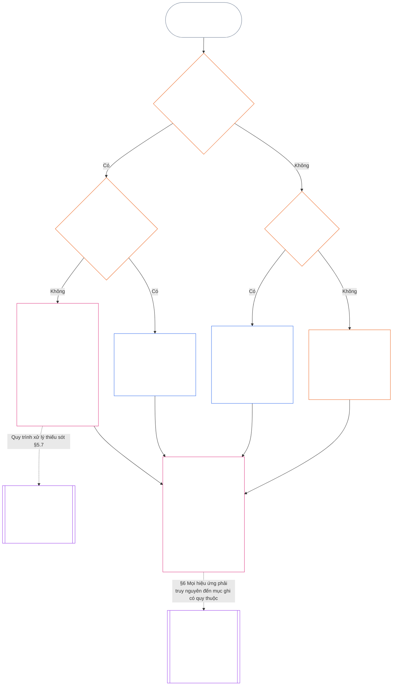

<!-- Bản dịch nháp một phần sang tiếng Việt. Nguồn: core_11.000_standing_assessment.md; snapshot nguồn: 9c2c8c10c871d91157bcd27b9f56ad6a1cec90d3. Do AI soạn; chưa được rà soát. Phạm vi một phần: §§5.7–5.9. -->

#### 5.7 Khi Điều lệ Hệ thống hoặc Điều lệ Thể chế bỏ trống một chỗ

Nơi chuyển hồ sơ địa vị khi lộ trình được nêu tên thông thường không khả dụng tùy thuộc vào ba câu hỏi mà sơ đồ dưới đây lần lượt đặt ra. Mục này đề cập trường hợp Điều lệ Hệ thống hoặc Điều lệ Thể chế bỏ trống một chỗ; [§5.8 Quy tắc dự phòng khi không có Điều lệ Hệ thống hoặc Điều lệ Thể chế áp dụng cho hồ sơ địa vị](#58-fallback-when-no-system-charter-or-institutional-charter-reaches-the-standing-record) đề cập trường hợp không điều lệ nào áp dụng cho hồ sơ địa vị.

<strong>Hướng dẫn người đọc (không vận hành): cách đọc sơ đồ</strong>

> Nói đơn giản: các cơ quan được Điều lệ Hệ thống hoặc Điều lệ Thể chế nêu tên xử lý hồ sơ địa vị. Nếu điều lệ bỏ trống một chỗ, điều lệ không có hiệu lực cho đến khi thiếu sót được khắc phục; hồ sơ địa vị được chuyển cho Cơ quan Mở hồ sơ Dự phòng và Đơn vị lưu giữ hồ sơ Dự phòng, hoặc cho một diễn đàn, chứ không chuyển theo sơ đồ tuyến. Nếu hoàn toàn không có Điều lệ Hệ thống hoặc Điều lệ Thể chế áp dụng cho hồ sơ địa vị, sơ đồ tuyến đã công bố của thể chế sẽ chi phối; nếu không có sơ đồ đó, hồ sơ địa vị được chuyển để xác minh độc lập hoặc, với công việc không chính thức và quy mô nhỏ, cho cơ quan dựa vào hồ sơ.
>
> Mọi lộ trình đều kết thúc tại cùng một ô: một cơ quan xác minh sự kiện, cơ quan khác ghi nhận và lưu giữ hồ sơ địa vị; sau đó [§6 Xử lý hồ sơ địa vị](#6-handling-a-standing-record) quy định việc các bên lưu giữ hồ sơ cần làm. Mũi tên liền là lộ trình chính. Mũi tên chấm là việc chuyển giao, có ghi nhãn mục tạo căn cứ cho việc chuyển giao. Các ô có hai vạch ở hai bên thuộc chương khác; ô cuối là nơi rút ra các hiệu ứng địa vị từ hồ sơ địa vị mà không viết lại hồ sơ. Sơ đồ không bổ sung nghĩa vụ, chỗ hay trường dữ liệu nào.

 

Điều lệ Hệ thống hoặc Điều lệ Thể chế bỏ trống một chỗ bắt buộc trong các chỗ hồ sơ hoặc lộ trình độc lập:

- **Hệ quả:** Điều lệ Hệ thống hoặc Điều lệ Thể chế không có hiệu lực; không được phép thay đổi theo cách tạo ra thiếu sót đó ([Chương Bảy §4.7.1 Khi có thiếu sót và cách ghi vào nhật ký](core_07.000_charters.md#471-when-a-gap-exists-and-how-it-is-logged)).
- **Chương Bảy quản lý quy trình xử lý thiếu sót:** [Chương Bảy §4.7 Các thiếu sót trong sơ đồ đối với hồ sơ địa vị của đơn vị vận hành](core_07.000_charters.md#47-gaps-in-the-map-for-operator-standing-records) cũng quy định:
  - cách ghi thiếu sót vào nhật ký;
  - thời hạn phản hồi và giải quyết (bao gồm thay thế khẩn cấp); và
  - thời điểm chuyển trả quyền lưu giữ cho những bên được nêu tên.

Đối với hồ sơ địa vị, mục này bổ sung:

- **Ai không được hành động:** Khi một chỗ bắt buộc còn khuyết và Điều lệ Hệ thống hoặc Điều lệ Thể chế không nêu tên phương án thay thế hợp lệ, không ai được thực hiện chức năng của chỗ đó, trừ theo lộ trình tại gạch đầu dòng tiếp theo.
- **Chuyển hồ sơ địa vị đến đâu:** Hồ sơ địa vị được chuyển cho Cơ quan Mở hồ sơ Dự phòng và Đơn vị lưu giữ hồ sơ Dự phòng, hoặc cho một diễn đàn theo **§2.7**, như [§5.4 Không tự lưu giữ hồ sơ](#54-no-self-custody) quy định; sơ đồ tuyến không thể thay thế. Mỗi hồ sơ địa vị được giữ nguyên vẹn bởi một đơn vị lưu giữ.
- **Hồ sơ địa vị đang được lưu giữ:**
  - Vào ngày một diễn đàn, một cán bộ đăng ký hoặc Cơ quan Mở hồ sơ Dự phòng nhận được thông báo về thiếu sót, mọi hồ sơ địa vị của đơn vị vận hành do một cơ quan bên trong Tuyến Kiểm soát Trọng yếu của Bên Điều lệ nắm giữ được chuyển cho Đơn vị lưu giữ hồ sơ Dự phòng cùng toàn bộ dấu vết.
  - Cho đến thời điểm đó, cơ quan ấy chỉ lưu giữ ở chế độ chỉ đọc, không lập phiên bản nào và lập tức gửi cho Đơn vị lưu giữ hồ sơ Dự phòng một bản sao đầy đủ cùng toàn bộ dấu vết.
  - Đơn vị lưu giữ ở bên ngoài tuyến tiếp tục giữ hồ sơ địa vị và trong thời gian thiếu sót sẽ ghi từng phiên bản mà Cơ quan Mở hồ sơ Dự phòng hoặc diễn đàn cho phép. Nếu diễn đàn phát hiện đơn vị lưu giữ nằm bên trong tuyến, hồ sơ địa vị được chuyển cho Đơn vị lưu giữ hồ sơ Dự phòng cùng toàn bộ dấu vết, như đối với cơ quan nằm bên trong tuyến.
- **Người quản trị:** Người quản trị được yêu cầu đảm nhiệm một chỗ mà Điều lệ Hệ thống hoặc Điều lệ Thể chế không giao cho họ:
  - **Từ chối chỗ đó:** Có quyền tiếp cận hoặc khả năng kỹ thuật để ghi nhận hồ sơ địa vị không trao cho họ thẩm quyền ghi nhận.
  - **Nêu yêu cầu và thiếu sót:** Nêu cả hai trong nhật ký.
  - **Chuyển hồ sơ địa vị đi:** Chuyển hồ sơ theo lộ trình trong mục *Chuyển hồ sơ địa vị đến đâu* ở trên.
  - **Tiếp tục các nghĩa vụ khác:** Các nghĩa vụ đã có theo [§5.4 Không tự lưu giữ hồ sơ](#54-no-self-custody) (*Người quản trị trong chính đối tượng*) vẫn tiếp tục: dừng những gì mình kiểm soát, ghi nhật ký tập hợp có thể tái dựng, bảo toàn bằng chứng mình nắm giữ, thông báo và chuyển cấp. Không hành động nào trong số đó xác minh sự kiện hoặc ghi nhận hồ sơ địa vị. Nhật ký và bằng chứng được bảo toàn sẽ đi cùng hồ sơ địa vị làm dữ liệu đầu vào cho thẩm quyền xác minh; chúng không phải mục ghi nhận và không quyết định sự kiện.

#### 5.8 Quy tắc dự phòng khi không có Điều lệ Hệ thống hoặc Điều lệ Thể chế áp dụng cho hồ sơ địa vị

Khi không có Điều lệ Hệ thống hoặc Điều lệ Thể chế nào điều chỉnh hệ thống, thể chế hoặc doanh nghiệp mà hồ sơ địa vị đề cập — chẳng hạn một cơ quan dưới ngưỡng Cấp L chưa công bố điều lệ — thì sơ đồ tuyến đã công bố của thể chế theo **CI-8.205 §2** (*Các tuyến phân chia chức năng*) chi phối:

- **Thẩm quyền mở hồ sơ:** Cơ quan mà sơ đồ tuyến đặt vào tuyến bảo đảm và kiểm toán đối với hệ thống, thể chế hoặc doanh nghiệp mà hồ sơ địa vị đề cập. Cơ quan đó xác minh căn cứ sự kiện và cho phép ghi nhận ([§5.2 Thẩm quyền mở hồ sơ được nêu tên](#52-named-record-opening-authority)); cơ quan đó không ghi nhận hoặc lưu giữ hồ sơ địa vị.
- **Đơn vị lưu giữ:** Cơ quan nắm tuyến công bố và bằng chứng.
- **Loại trừ tuyến thực thi:** Không bên nào được là cơ quan nắm tuyến thực thi của hệ thống liên quan.
- **Cũng không có sơ đồ tuyến:** Hồ sơ địa vị được chuyển để xác minh độc lập theo mục *Không tự lưu giữ hồ sơ* ở trên hoặc, đối với hồ sơ không chính thức và quy mô nhỏ, chuyển cho cơ quan dựa vào hồ sơ theo mục *Hồ sơ không chính thức và quy mô nhỏ* tiếp theo.
- **Người quản trị:** Người quản trị được yêu cầu đảm nhiệm một chỗ mà sơ đồ tuyến không giao cho họ tuân theo quy tắc *Người quản trị* tại [§5.7 Khi Điều lệ Hệ thống hoặc Điều lệ Thể chế bỏ trống một chỗ](#57-when-a-system-charter-or-institutional-charter-leaves-a-seat-unnamed): từ chối chỗ đó, nêu yêu cầu và thiếu sót trong nhật ký, đồng thời tiếp tục các nghĩa vụ khác. Họ chuyển hồ sơ địa vị cho cơ quan được sơ đồ tuyến nêu tên hoặc, nếu không cơ quan nào được nêu tên, theo lộ trình trong mục *Cũng không có sơ đồ tuyến* ở trên.

#### 5.9 Hồ sơ không chính thức và quy mô nhỏ

Việc phân chia nhiệm vụ được điều chỉnh theo lợi ích trọng yếu, không theo mức độ hình thức ([Chương Tám §2 Yêu cầu Hiến pháp Bốn chỗ](core_08.000_functional_independence_separation_of_duties.md#2-four-seat-constitutional-requirement)).

- **Công việc thuộc phạm vi:** Cộng đồng địa phương dựa vào nhiều hình thức đóng góp, phần lớn không được trả công và không chính thức. Quy tắc này áp dụng cho công việc không được trả công, do đồng nghiệp tổ chức, tương trợ, chăm sóc, duy trì, sửa chữa, giảng dạy và quản trị cộng đồng; [Chương Mười Ba §6 Hệ quả đóng góp ở bước thứ hai](core_13.000_standing_integration.md#6-contribution-consequences-second) yêu cầu ghi nhận các công việc đó theo cùng tiêu chuẩn.
  - **Biểu hiện tại địa phương:** Hàng xóm chia sẻ thức ăn và dụng cụ (tương trợ); chăm sóc hàng xóm bị bệnh hoặc cao tuổi (chăm sóc); giữ cho vườn chung hoặc con suối ở tình trạng tốt (duy trì và quản trị cộng đồng); sửa ống nước cho hàng xóm (sửa chữa); kèm học hoặc chỉ dạy một kỹ năng (giảng dạy). Mỗi việc là một dạng đóng góp riêng.
- **Ai đảm nhiệm chỗ xác minh:** Đối với công việc đó, chỗ xác minh được đáp ứng bởi **bất kỳ cơ quan độc lập nào có thẩm quyền đã công bố để dựa vào hồ sơ địa vị**; cơ quan đó sau đó hành động với tư cách thẩm quyền xác minh.
  - **Thường là cơ quan nào:** Thường là cơ quan sẽ dựa vào hồ sơ địa vị: một nhóm địa phương như hội đồng lưu vực, tổ chức cấp kinh phí hoặc duy trì công việc, thẩm quyền công nhận hồ sơ theo **CI-6.255** (*Quản trị cộng đồng đối với tài sản chung, hợp tác xã, tương trợ và phi thị trường*) (cơ quan công nhận hồ sơ về công việc cộng đồng như vậy), hoặc một diễn đàn theo **§2.7**.
- **Điều không được tính:** Chỗ xác minh không được đáp ứng chỉ vì thẩm quyền xác minh có hình thức chính thức.

Đối với hồ sơ địa vị như vậy:

- một hữu thể hữu tri hành động một mình không cần nhóm, thể chế, [Điều lệ Hệ thống](core_05.040_band_continuity.md#system-charter) hay [Điều lệ Thể chế](core_05.040_band_continuity.md#institutional-charter) để yêu cầu lập hồ sơ về đóng góp của chính mình. Trong trường hợp đó:
  - **Ai yêu cầu:** Chính họ giữ chỗ khởi xướng cho yêu cầu của mình, với tư cách đối tượng và người khiếu nại.
  - **Tài liệu của chính họ:** Tường trình, nhật ký và ảnh của họ là dữ liệu đầu vào, tuyệt đối không phải xác minh.
  - **Chỗ xác minh:** Bất kỳ cơ quan độc lập nào có thẩm quyền đã công bố để dựa vào hồ sơ địa vị (thẩm quyền xác minh).
  - **Ghi nhận và lưu giữ:** Một đơn vị lưu giữ hồ sơ riêng biệt ghi nhận và lưu giữ hồ sơ địa vị.
  - **Nếu có người phản biện:** Việc phản biện được chuyển đến tuyến phản biện hoặc một diễn đàn theo **§2.7**.
  - **Không có cơ quan nào dựa vào hồ sơ:** Khi không có cơ quan như vậy, hồ sơ địa vị được chuyển đến một diễn đàn theo **§2.7**.
  - **Ví dụ, một thợ sửa ống nước đã nghỉ hưu:** Một thợ sửa ống nước đã nghỉ hưu, nhiều năm qua sửa chữa không nhận tiền đường ống nước cho hàng xóm mà không có nhóm nào đứng sau, có thể yêu cầu thẩm quyền công nhận hồ sơ theo **CI-6.255** (*Quản trị cộng đồng đối với tài sản chung, hợp tác xã, tương trợ và phi thị trường*) mở hồ sơ địa vị:
    - **Yêu cầu và tuyên bố:** Người thợ sửa ống nước.
    - **Xác minh:** Thẩm quyền, dựa vào nhật ký công việc và lời xác nhận của hàng xóm.
    - **Ghi nhận và lưu giữ:** Một đơn vị lưu giữ hồ sơ riêng biệt.
    - **Nếu có người phản biện:** Việc phản biện được chuyển đến một diễn đàn, không chuyển ngược lại cho thẩm quyền xác minh.
- những người tham gia là đối tượng và, khi muốn được ghi nhận, là người khiếu nại. Trong hồ sơ tập thể theo **§4.3**:
  - **Người cùng tham gia:** Mỗi người là một người khiếu nại.
  - **Lời khai của một thành viên về phần đóng góp của thành viên khác:** Là dữ liệu đầu vào, tuyệt đối không phải xác minh.
- tài liệu hỗ trợ hồ sơ địa vị đến từ hai nguồn:
  - **Người không tham gia:** Người thụ hưởng, hàng xóm và những người không tham gia khác cung cấp lời xác nhận làm tài liệu xác minh theo **§4.1**.
  - **Nhật ký của nhóm:** Hữu thể hữu tri ghi nhật ký là người ghi chép và nhân chứng theo quy tắc *Tường trình của người ghi là dữ liệu đầu vào* bên dưới.
- đơn vị lưu giữ hồ sơ của cơ quan dựa vào hồ sơ ghi nhận và lưu giữ những gì thẩm quyền xác minh riêng biệt đã xác minh:
  - **Ai không được nắm giữ hai chỗ đó:** Cả đơn vị lưu giữ hồ sơ lẫn thẩm quyền xác minh đều không được là người khiếu nại hoặc nằm trong [Tuyến Kiểm soát Trọng yếu](core_05.035_band_accountability.md#material-control-line) của người khiếu nại.
  - **Một cơ quan, hai chỗ:** Cùng một cơ quan dựa vào hồ sơ có thể đảm nhiệm cả hai chỗ theo sơ đồ tuyến đã công bố với biện pháp bảo vệ tính độc lập có thể kiểm toán và phản biện.
  - **Không bao giờ là cùng một bên:** Không thẩm quyền, đơn vị lưu giữ hay hữu thể hữu tri nào được thực hiện cả hai nhiệm vụ đối với cùng một hồ sơ địa vị.
- tư cách của một nhóm không phải điều kiện cho yêu cầu của thành viên:
  - **Nhóm không chính thức:** Nhóm không có [Điều lệ Hệ thống](core_05.040_band_continuity.md#system-charter) hoặc [Điều lệ Thể chế](core_05.040_band_continuity.md#institutional-charter), hoặc hoàn toàn không phải là một Thể chế, không ngăn cản các thành viên.
  - **Mỗi người tham gia:** Có thể yêu cầu ghi nhận với tư cách người khiếu nại cá nhân cho công việc đã làm trong nhóm hoặc bên ngoài nhóm.
  - **Phạm vi hồ sơ địa vị:** Hồ sơ đề cập đến đóng góp của người tham gia, không phải địa vị của nhóm.
  - **Ví dụ, nhóm khâu vá:** Nhóm khâu vá tặng chăn cho người tị nạn mới đến là mô thức như vậy: mỗi người khâu vá có thể yêu cầu lập hồ sơ địa vị, được một cơ quan dựa vào hồ sơ độc lập như cơ quan tiếp nhận chăn xác minh; nhóm không cần có Điều lệ Hệ thống hoặc Điều lệ Thể chế.
- hồ sơ địa vị vi phạm cũng có thể phát sinh trong những bối cảnh không chính thức như vậy, và các chỗ vẫn phải tách biệt:
  - **Ví dụ, sự việc ở quán bar:** Một người quay phim hữu thể hữu tri khác tại quán bar; người kia say xỉn, gây rối và có hành vi bạo lực, dù không ai bị thương về thể chất.
    - **Không cần có thương tích:** Mối đe dọa bạo lực đáng tin cậy đã được xác minh có thể làm căn cứ cho hồ sơ địa vị vi phạm ngay cả khi không ai bị thương (**§3.2**, mất quyền tự chủ do cưỡng ép).
    - **Video là dữ liệu đầu vào:** Người quay phim là nhân chứng. Bản ghi hình là dữ liệu đầu vào, tự nó tuyệt đối không phải xác minh; sự tồn tại của video cũng không tự mở hồ sơ nào (**§2.2**).
    - **Hữu thể hữu tri trong video:** Họ là đối tượng. Họ được thông báo khi hồ sơ địa vị được mở và không được đảm nhiệm bất kỳ chỗ nào ([§5.4 Không tự lưu giữ hồ sơ](#54-no-self-custody)).
    - **Chỗ xác minh:** Một cơ quan độc lập có thẩm quyền đã công bố để dựa vào hồ sơ địa vị, chẳng hạn cơ quan cấp phép hoặc an toàn địa phương, hoặc diễn đàn theo **§2.7**. Người quay phim và chủ quán bar bị loại khỏi chỗ này nếu một trong hai là người khiếu nại hoặc nằm trong [Tuyến Kiểm soát Trọng yếu](core_05.035_band_accountability.md#material-control-line) của người khiếu nại.
    - **Ghi nhận, lưu giữ và phản biện:** Một đơn vị lưu giữ hồ sơ riêng biệt ghi nhận và lưu giữ hồ sơ địa vị; việc phản biện được chuyển đến tuyến phản biện hoặc diễn đàn theo **§2.7**, không chuyển ngược lại cho cơ quan xác minh.
- một quán bar hoặc quy trình yêu cầu xác minh từ một thể chế chính thức mà nhóm không chính thức không thể tiếp cận, trong khi có cơ quan độc lập dựa vào hồ sơ, thuộc mô thức **cản trở tùy tiện** theo [Chương Mười Ba §6.2 Các ngưỡng năng lực và sự cho phép](core_13.000_standing_integration.md#62-competency-bars-and-clearances), chứ không phải phân chia nhiệm vụ.

Không nội dung nào trong số này bắt buộc phải có hồ sơ địa vị. Quy tắc **§2.2** *Im lặng là mặc định* chi phối: công việc không chính thức không bị ghi hồ sơ chỉ vì có thể ghi; việc phân chia nhiệm vụ chỉ ràng buộc sau khi có yêu cầu lập hồ sơ địa vị.

