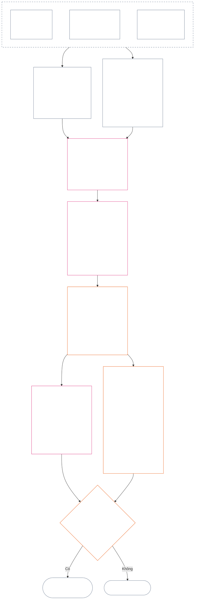

<!-- Bản dịch nháp một phần sang tiếng Việt. Nguồn: core_12.000_standing_measurement.md; snapshot nguồn: 9c2c8c10c871d91157bcd27b9f56ad6a1cec90d3. Do AI soạn; chưa được rà soát. Phạm vi một phần: §§4–6. -->

### 4. Ngữ pháp ô và phép co giãn dùng chung

*Nói đơn giản: mục này đưa ra tên gọi nhất quán cho chín vị trí có thể có trên mỗi trục trong hai trục riêng biệt và giải thích cách co giãn tác động giữa các vị trí. Một trục ghi nhận đóng góp đã xác minh; trục kia ghi nhận vi phạm đã xác minh. Dùng chung một số ô không kết hợp hai trục hoặc bù trừ tổn hại bằng trợ giúp. Thang thống nhất tại **§6** phân ô cho cả hai trục theo tác động LEQU tỷ lệ.*

Ngữ pháp ô sử dụng số ô `s` từ **1** đến **9**. Mỗi trục có vị trí ô riêng:

- **Trục Đóng góp** ghi nhận tính chất đóng góp tích cực; và
- **Trục Vi phạm** ghi nhận phát hiện vi phạm đã xác minh.

Cùng một số ô có thể xuất hiện trên cả hai trục, nhưng hai trục vẫn tách biệt. Ô đóng góp không phải ô vi phạm, và ô vi phạm không phải ô đóng góp.

#### 4.1 Bảng 1 — nhãn hiển thị ô

**Bảng 1** đặt tên cho chín ô và hiển thị cạnh nhau các nhãn trên Trục Đóng góp và Trục Vi phạm. Bảng chỉ cung cấp cách diễn đạt để hiển thị; việc phân ô được thực hiện theo thang thống nhất tại **§6**.

|  `s` | Nhãn hiển thị của Trục Đóng góp | Nhãn hiển thị của Trục Vi phạm |
| ---: | --- | --- |
|    1 | **Đóng góp nền tảng nhỏ** | **Tác động Hiến pháp nhỏ** |
|    2 | **Đóng góp nền tảng thấp** | **Tác động Hiến pháp thấp** |
|    3 | **Đóng góp tích cực đáng kể** | **Tác động Hiến pháp đáng kể** |
|    4 | **Đóng góp tích cực quan trọng** | **Tác động Hiến pháp quan trọng** |
|    5 | **Đóng góp tích cực nghiêm trọng trong quản trị** | **Tác động Hiến pháp nghiêm trọng** |
|    6 | **Đóng góp tích cực lớn trong quản trị** | **Tác động Hiến pháp lớn** |
|    7 | **Người tiên phong được công nhận** | **Tác động Hiến pháp nặng nề** |
|    8 | **Người tiên phong xuất sắc** | **Tác động Hiến pháp đặc biệt nghiêm trọng** |
|    9 | **Người tiên phong tiêu biểu** | **Tác động Hiến pháp thảm khốc** |

Trục Đóng góp dùng các nhãn nền tảng, tích cực, tích cực trong quản trị và tiên phong. Trục Vi phạm dùng nhãn tác động trung tính ở mọi ô. Hai trục vẫn tách biệt, không tạo điểm số ròng hoặc cho phép bù trừ giữa hồ sơ đóng góp và hồ sơ vi phạm. Một ô trên Trục Vi phạm tự nó không phân loại hành vi sai trái phản hiến pháp; [Chương Mười Bốn](core_14.000_misconduct_designation.md#chapter-fourteen-anti-constitutional-misconduct) xác định độc lập việc chỉ định hành vi sai trái phản hiến pháp (ACMD) có được áp dụng cho vi phạm đã xác minh với `s` = 7–9 hay không.

Triển khai có thể công bố đơn vị đo lường, phương pháp chứng minh và ví dụ để hỗ trợ ước tính lợi ích hoặc tổn thất tương đương một cuộc đời trọn vẹn. Các tài liệu này chỉ có tính hướng dẫn, không được thay thế **§6**, **Chương Một** hoặc Sàn Quyền của **Chương Sáu**.

#### 4.2 Quy tắc co giãn tác động dùng chung

*Nói đơn giản: tác động không chỉ được đo bằng số người. Một lợi ích hoặc tổn thất sâu sắc ảnh hưởng đến một hữu tri có thể quan trọng hơn tác động nông đến nhiều người. Phải đánh giá đồng thời số lượng, độ sâu, tính dễ bị tổn thương, thời lượng, độ bền, phạm vi và tính chất hiến pháp.*

Dùng các quy tắc sau để diễn giải cả hai trục tại **§6**:

| Chiều co giãn | Quy tắc dùng chung | Áp dụng riêng cho từng trục |
| --- | --- | --- |
| **Độ lớn kết quả hiến pháp (LEQU)** | Đánh giá tổng hợp lợi ích hoặc tổn thất đã xác minh. LEQU là mốc chính về độ lớn; số người, tiền, sản lượng hoặc quy mô thể chế thô không phải mốc đó. | Đóng góp tính lợi ích phù hợp với quyền; vi phạm tính tổn thất, tổn hại, lãng phí, đóng lối lựa chọn hoặc nguy hiểm đã xác minh về mặt hiến pháp. |
| **Phạm vi hữu tri** | Xem xét đồng thời **số lượng, độ sâu và tính dễ bị tổn thương**. Không ô nào đặt số người làm điều kiện độc lập. Tác động đủ sâu đến một hữu tri có thể hỗ trợ cùng một ô như tác động rộng hơn nhưng nông hơn nếu độ lớn tổng hợp và các tiêu chí khác của hàng đó bằng nhau; vẫn phải đáp ứng mọi tiêu chí rõ ràng về LEQU gộp hoặc phạm vi rộng. | Sự phụ thuộc, năng lực suy giảm hoặc tính dễ bị tổn thương bất thường có thể làm tăng tính trọng yếu. Chỉ riêng quy mô nhóm không xác lập đóng góp hay mức độ nghiêm trọng. |
| **Phạm vi thời gian** | Xem xét thời lượng, tái diễn, độ bền và, đối với tổn thất, tính không thể đảo ngược. Sự kiện ngắn nhưng mang tính chuyển đổi có thể lớn hơn tác động tầm thường kéo dài; thời lượng tự nó không chi phối. | Lợi ích bền vững hỗ trợ độ lớn đóng góp cao hơn. Tổn thất kéo dài hoặc không thể đảo ngược hỗ trợ mức độ vi phạm nghiêm trọng hơn. |
| **Phạm vi không gian hoặc thể chế** | Phạm vi rộng hơn có thể làm tăng độ lớn, nhưng không bắt buộc tác động xuyên cộng đồng hoặc xuyên thể chế khi độ sâu, thời lượng, tính dễ bị tổn thương hoặc tính trọng yếu về hiến pháp đã độc lập hỗ trợ ô đó. | Sửa chữa thể chế có thể làm tăng độ lớn đóng góp; tổn hại mang tính cấu trúc hoặc hệ thống có thể làm tăng mức độ vi phạm nghiêm trọng. |
| **Chất lượng hoặc tính chất hiến pháp** | Đo riêng cách tạo ra kết quả với phạm vi lan rộng của kết quả. Không tính trùng một sự kiện. | Tổn hại chuyển sang người khác, gánh nặng bị che giấu, thâu tóm hoặc phụ thuộc có thể giới hạn hoặc loại bỏ đóng góp được tuyên bố. Nghĩa vụ, sơ suất, lừa dối, cưỡng ép, bạo lực hoặc tạo điều kiện mang tính cấu trúc vẫn được ghi riêng là tính chất hành vi vi phạm và không làm thay đổi ô tác động. |
| **Sàn Quyền và biện pháp bảo vệ trọng yếu** | Không đánh đổi việc tuân thủ Sàn Quyền để lấy lợi ích hoặc tổn thất gộp. | Tuân thủ một sàn tự nó không xác lập đóng góp cao. Vi phạm Sàn Quyền trọng yếu hoặc không đáp ứng biện pháp bảo vệ trọng yếu có thể hỗ trợ mức độ vi phạm nghiêm trọng cao hơn ngay cả khi chỉ ảnh hưởng trực tiếp đến một số ít hữu tri. |

Các chiều này không phải danh sách kiểm tra buộc phải có mọi dạng quy mô. Hãy giải thích những chiều nào chi phối, những chiều nào không và lý do.

- **Phương pháp phân ô dùng chung:**
  - Ước tính tổng hợp lợi ích hoặc tổn thất đã xác minh theo LEQU dựa trên Tính Tương xứng, rồi gán ô duy nhất có dải số bao gồm độ lớn đó.
  - Áp dụng cùng ngưỡng cho cả hai trục.
  - Ô đóng góp vẫn phải đáp ứng các yêu cầu áp dụng về mốc nền tảng và thẳng hàng hiến pháp; đạt ngưỡng số không biến sản lượng bị ngoại hóa hoặc vi phạm Hiến pháp thành đóng góp.
- **Tách biệt tính chất:** Giữ các mô tả tuyến lợi ích, tuyến tổn hại, chất lượng hành vi và tính chất hành vi áp dụng được cộng gộp trên hồ sơ địa vị. Nghĩa vụ, sơ suất, lừa dối, tình tiết tăng nặng, cưỡng ép, bạo lực, ý định hoặc tạo điều kiện mang tính cấu trúc có thể ảnh hưởng đến quy thuộc, biện pháp bảo vệ hoặc hệ quả Câu hỏi 3, nhưng không yếu tố nào làm tăng hay giảm ô tác động LEQU.
- **Ranh giới của Rà soát Hành vi Sai trái Phản Hiến pháp:** Tổn thất đã xác minh trên Trục Vi phạm có thể đạt `s` = 7–9 do tác động, bất kể hành vi sai trái phản hiến pháp đã được xác lập hay chưa. Chương Mười Bốn không thay thế việc phân ô tác động; chương đó xác định độc lập ACMD tương ứng có được áp dụng hay không.

Nếu nguy cơ chưa thực sự xảy ra, hãy ghi riêng từng nội dung sau:

- khả năng xảy ra;
- hữu tri sẽ phải tiếp xúc với nguy cơ trong bao lâu;
- nguy cơ có thể lan xa đến đâu;
- mức độ không chắc chắn của ước tính; và
- kết quả xấu nhất vẫn có thể tin là sẽ xảy ra.

Không tính kết quả xấu nhất đó là tổn hại đã xảy ra (tổn thất LEQU), trừ khi triển khai được tiếp nhận đã thiết lập phép hiệu chỉnh rủi ro (phương pháp chuyển đổi rủi ro thành LEQU) mà mọi người có thể kiểm tra.

### 5. Dữ liệu đầu vào hiến pháp để phân trục

*Nói đơn giản: trước khi chọn ô, xác định các nguồn hiến pháp quy định mốc nền tảng, lợi ích, nghĩa vụ, tổn hại hoặc vi phạm nào đang được đo. Dùng liên kết dưới đây để áp dụng các nguồn đó tại nơi chính tắc; đừng biến bước chuyển tuyến này thành một điểm số khác hoặc định nghĩa thay thế.*

Trước khi phân ô theo **§6**, hồ sơ địa vị phải xác định:

- mốc nền tảng hiến pháp, nghĩa vụ, ràng buộc hoặc lợi ích được bảo vệ áp dụng;
- các điều khoản xác lập lợi ích, kết quả bất lợi, tổn hại hoặc vi phạm đã xác minh đang được đo;
- định nghĩa, nguyên tắc và điều khoản thuộc Sàn Quyền ảnh hưởng trọng yếu đến độ lớn hoặc tính chất hành vi; và
- lý do áp dụng từng nguồn đã xác định cùng cách nguồn đó ảnh hưởng đến việc phân trục.

Các bảng chuyển tuyến dưới đây không đầy đủ. Mọi định nghĩa, nguyên tắc hoặc điều khoản bổ sung được sự kiện đã xác minh kích hoạt vẫn áp dụng và phải được xác định trong hồ sơ địa vị. Nguồn chính tắc được liên kết có hiệu lực chi phối; các bảng này không nhắc lại hay thu hẹp nguồn đó.

#### 5.1 Dữ liệu đầu vào từ định nghĩa

| Nguồn chính tắc | Vai trò trên Trục Đóng góp | Vai trò trên Trục Vi phạm |
| --- | --- | --- |
| [Trạng thái Địa vị, Đóng góp và Vi phạm](core_05.035_band_accountability.md#defa3-standing-state-contribution-and-violation) | Giải thích điều gì được tính là đóng góp và có thể dùng những sự kiện đã kiểm tra nào để đo lường. Đồng thời bảo đảm hồ sơ địa vị đóng góp chỉ ghi nhận phía tốt, không bao giờ trộn với phía xấu. | Giải thích điều gì được tính là vi phạm và cách ghi nhận. Đồng thời chuyển những vụ nghiêm trọng nhất đến Rà soát Hành vi Sai trái Phản Hiến pháp, một rà soát riêng đối với hành vi làm suy yếu chính Hiến pháp. |
| [Trách nhiệm Giải trình](core_05.005_apex_accountability_leg.md#accountability) | Kiểm tra xem tuyên bố về quản trị tốt hoặc sửa chữa có thực sự giữ cho ai đó phải trả lời hay không. Vẫn phải nêu rõ ai đã làm gì, ai phải chịu trách nhiệm, và việc đó có thể được rà soát, sửa cho đúng và khắc phục tương xứng với tác động ra sao. | Xác định các trường hợp không rõ ai đã làm việc gì hoặc ai phải trả lời. Bao gồm trường hợp trách nhiệm giải trình ngừng hoạt động sau khi tổ chức hoặc cơ cấu của tổ chức thay đổi. |
| [Tổn hại](core_05.035_band_accountability.md#harm) | Tổn hại bị chuyển sang người khác hoặc che giấu có thể giới hạn hay hủy bỏ lợi ích được tuyên bố. Sửa chữa tổn hại có thể được tính là lợi ích, nhưng chỉ khi việc sửa chữa đã xác minh và được chứng minh độc lập. | Nêu cụ thể các dạng tổn hại được tính khi đo tổn thất và mức độ nghiêm trọng: trực tiếp, gián tiếp, trì hoãn, tích lũy, lan qua các hệ thống và tổn hại đến tâm trí hoặc sức khỏe cảm xúc của hữu tri. |
| [Tính trọng yếu](core_05.050_band_oversight.md#materiality) và [Đơn vị Tương đương Tuổi thọ (LEQU)](core_05.055_band_participation.md#lifespan-equivalent-unit-lequ) | Xác định mức tính lợi ích đã xác minh dựa trên phạm vi ảnh hưởng, tính dễ bị tổn thương của người bị ảnh hưởng và thời gian kéo dài. Kết quả đo bằng LEQU, thước đo chung cho lợi ích tương đương một cuộc đời trọn vẹn. | Xác định mức tính tổn thất hoặc nguy hiểm đã xác minh dựa trên phạm vi ảnh hưởng, tính dễ bị tổn thương của người bị ảnh hưởng, thời gian kéo dài và mức khó đảo ngược. Kết quả đo bằng LEQU, cùng thước đo cho tổn thất tương đương một cuộc đời trọn vẹn. |
| [Tính chất Đóng góp](core_05.035_band_accountability.md#contribution-nature) | Quyết định liệu một việc có được tính là đóng góp hay không. Việc đó chỉ được tốt, không bao giờ trộn với tổn hại, và phải được hỗ trợ bằng hồ sơ đóng góp đã xác minh có thể trình ra. Không có đủ cả hai điều kiện thì không thể phân ô trên Trục Đóng góp. | Không có vai trò ở đây. Không quyết định điều gì được tính là tổn hại và không bao giờ làm giảm mức độ nghiêm trọng của vi phạm. |
| [Tính chất Vi phạm](core_05.035_band_accountability.md#violation-nature) | Không có vai trò ở đây. Vi phạm không bao giờ được tính là đóng góp tiêu cực và không xóa bỏ lợi ích đã xác minh không liên quan đến vi phạm đó. | Quyết định liệu một việc có được tính là vi phạm hay không. Việc đó phải được xếp loại là gây hại và được hỗ trợ bằng phát hiện đã xác minh rằng vi phạm đã xảy ra. Không có đủ cả hai điều kiện thì không thể phân ô trên Trục Vi phạm. |
| [Ràng buộc Hiến pháp](core_05.045_band_integrative.md#constitutional-constraint), [Thứ bậc Thẩm quyền và Hệ thống Phân cấp Nội bộ](core_05.045_band_integrative.md#authority-stack-and-internal-hierarchy) và [Khả năng Kiểm toán](core_05.050_band_oversight.md#auditability) | Ngăn lợi ích được tuyên bố được tính nếu nó phụ thuộc vào việc đánh bại Hiến pháp, né tránh quy tắc, thu hẹp Sàn Quyền (các bảo vệ tối thiểu mà Hiến pháp bảo đảm) hoặc chỉ tuân thủ trên giấy. | Nêu bật các yếu tố ảnh hưởng đến mức nghiêm trọng thực sự của vi phạm: phá vỡ giới hạn hiến pháp có ý nghĩa, đặt thứ gì đó lên trên thẩm quyền của Hiến pháp, lách quy tắc hoặc khiến quy tắc không thể thực thi. |
| [Khả năng Kiểm toán](core_05.050_band_oversight.md#auditability) và [Khả năng Phản biện](core_05.035_band_accountability.md#contestability) | Yêu cầu lợi ích được tuyên bố có thể chứng minh và kiểm tra, đồng thời bất kỳ ai bất đồng đều có cách thức hữu hiệu để phản biện. | Yêu cầu các kết luận có thể kiểm tra và phản biện. Cáo buộc hoặc nhãn không giải thích không thể xác định mức độ nghiêm trọng của vi phạm. |

#### 5.2 Dữ liệu đầu vào từ nguyên tắc

| Nguồn nguyên tắc | Vai trò trong việc phân trục |
| --- | --- |
| [Tứ trụ Hiến pháp](core_00.000_preamble.md#constitutional-tetrad), [Hai Mục tiêu Hiến pháp](core_00.000_preamble.md#two-constitutional-aims) và [lợi ích trọng yếu](core_00.000_preamble.md#material-stake) | Xác lập bốn nguyên tắc vận hành (tham gia, giám sát, trách nhiệm giải trình và đúng hạn), hai kết quả Hiến pháp hướng tới (Hưng thịnh và Liên tục), và khuôn khổ định lượng từng phân ô theo mức lợi ích đang bị đe dọa. |
| [Sức khỏe](core_01.000_values_principles.md#3-foundational-objective-wellbeing-flourishing-aim) và [Ghi nhận, Củng cố và Khát vọng](core_01.000_values_principles.md#32-recognition-reinforcement-and-aspiration) | Làm cơ sở cho lợi ích tôn trọng quyền và sự ghi nhận tương xứng trên Trục Đóng góp. Danh tiếng hoặc phần thưởng không bao giờ được xem là bằng chứng đóng góp. |
| [An toàn](core_01.000_values_principles.md#4-safety-harm-constraint) và [Sự thật](core_01.000_values_principles.md#5-truth-epistemic-integrity-constraint) | Đặt giới hạn ràng buộc cho cả hai trục. Lợi ích thu được qua tổn hại hoặc lừa dối không được tính đầy đủ; vi phạm an toàn hoặc sự thật đã xác minh có thể chỉ ra độ lớn hay loại vi phạm. |
| [Quản trị Chuyên sâu](core_01.010_stewardship_capacity_principles.md#16-stewardship-in-depth) và [Quản trị theo Kỷ luật Quản trị](core_01.010_stewardship_capacity_principles.md#18-governance-under-stewardship-discipline) | Hướng dẫn cách cân nhắc đóng góp lâu dài, nghĩa vụ đi kèm vai trò, sửa chữa thể chế, giám sát và trách nhiệm khi sự kiện đã xác minh đòi hỏi. |
| [Các Nguyên tắc Đánh đổi Cốt lõi](core_01.005_interaction_interpretation.md#131-core-tradeoff-principles) và [Các Sàn Hiến pháp, An toàn và Quy trình Không Hạ nhục](core_01.005_interaction_interpretation.md#1314-constitutional-floors-safety-and-anti-degrading-process) | Áp dụng khi hành vi được đo liên quan đến tính cần thiết, giảm tổn hại đến mức thấp nhất có thể, tính tương xứng, xung đột quyền hoặc hạn chế. Tự chúng không bao giờ cho phép áp dụng một hệ quả. |

#### 5.3 Dữ liệu đầu vào từ Sàn Quyền và các Điều khoản

| Nguồn Điều khoản | Vai trò hoặc ranh giới trong việc phân trục |
| --- | --- |
| [Sàn Quyền Chương Sáu](core_06.000_rights_part_a.md#chapter-six-foundational-rights) áp dụng theo sự kiện, bao gồm mọi Điều khoản có liên quan trọng yếu theo hồ sơ địa vị đã xác minh | Xác lập các bảo vệ, lợi ích, nghĩa vụ, lợi ích đạt được hoặc vi phạm cơ bản đang bị đe dọa. Không được bỏ qua Điều khoản nào chỉ vì nó không được liệt kê dưới đây. |
| [Điều XIX — Địa vị và Tình trạng Tham gia](core_06.015_rights_part_d.md#article-xix-standing-and-participation-status) | Giữ riêng biệt địa vị và phẩm giá của hữu tri, các bảo vệ tối thiểu của Sàn Quyền, tư cách bên liên quan, danh tiếng và mọi thay đổi sau đó về tình trạng tham gia. |
| [Điều XIII-A — Mốc Nền tảng về Độ tin cậy và Đáng tin](core_06.010_rights_part_c.md#article-xiii-a-reliability-and-trustworthiness-baseline) và [Điều XIII-B — Quyền được Đền bù và Khắc phục](core_06.010_rights_part_c.md#article-xiii-b-right-to-redress-and-remedy), [Điều XV-B — Minh bạch, Khả năng Kiểm toán và Khả năng Phản biện](core_06.010_rights_part_c.md#article-xv-b-transparency-auditability-and-contestability), và [Điều XVI — Kiểm toán, Minh bạch và Xác minh Độc lập](core_06.010_rights_part_c.md#article-xvi-audit-transparency-and-independent-verification) | Áp dụng khi lợi ích hoặc vi phạm đã xác minh liên quan đến việc duy trì hồ sơ trung thực, chia sẻ thông tin, kiểm tra sự kiện, khả năng phản biện quyết định hoặc sửa sai. |
| [Điều XXIV — Phân tích Nguyên nhân Gốc rễ và Ứng phó Thích ứng](core_06.015_rights_part_d.md#article-xxiv-root-cause-analysis-and-adaptive-response) | Áp dụng khi nguyên nhân của hành vi, việc hành vi đã được sửa chưa, hành vi có tiếp diễn hay không hoặc phản hồi có thích ứng hay không là vấn đề quan trọng vì các yếu tố đó cho thấy hành vi đứng ở đâu trước Hiến pháp. |
| [Điều XX — Công lý sau Vi phạm Đã xác minh](core_06.015_rights_part_d.md#article-xx-justice-after-verified-violation) và [Điều XXVI-C — Giải quyết Đúng hạn và Nền tảng Chống Trì hoãn](core_06.020_rights_part_e.md#article-xxvi-c-timely-resolution-and-anti-delay-floor) | Áp dụng với bất kỳ quy trình hoặc sự trì hoãn nào mà sự kiện thực tế có liên quan. **Điều XX** (*Công lý sau Vi phạm Đã xác minh*) chủ yếu giới hạn những gì xảy ra sau khi đo lường vi phạm (Câu hỏi 3). Không được dùng Điều khoản này để tăng hoặc giảm ô Câu hỏi 2 chỉ nhằm biện minh cho phản hồi mà ai đó đã muốn áp dụng. |

**Giới hạn áp dụng.** Bước này chỉ dẫn chiếu đến đúng nguồn.

- Bước này không:
  - mở lại Câu hỏi 1;
  - đưa vào các sự kiện chưa được xác minh;
  - thêm phép đo hoặc điểm số mới;
  - tính trùng một sự kiện thông qua các nguồn khác nhau;
  - gộp hai trục; hoặc
  - khiến mọi nguồn được liệt kê đều áp dụng cho mọi hồ sơ địa vị.
- Đóng góp và vi phạm vẫn được đo riêng biệt.
- Hệ quả theo **Điều XX** (*Công lý sau Vi phạm Đã xác minh*) nằm ngoài Câu hỏi 2.
- Rà soát chỉ định theo Chương Mười Bốn vẫn tách biệt với ô tác động được phân tại đây.

### 6. Thang LEQU tỷ lệ thống nhất — Trục Đóng góp và Trục Vi phạm

<strong>Hướng dẫn người đọc (không vận hành): cách hoạt động của cấp số nhân năm lần</strong>

> Thang đo dùng cấp số nhân năm lần, lấy `s` = 7 = một LEQU làm mốc. Với mỗi trục, độ lớn tối thiểu của ô `s` là `5^(s−7)` LEQU đối với các ô 2 đến 9; ô 1 bắt đầu từ không. Triển khai được tiếp nhận có thể công bố các ngưỡng số và ví dụ hiệu chỉnh tương ứng. Ô 1 bao gồm mốc nền tảng hiến pháp đã xác minh trên Trục Đóng góp và tổn thất đã xác minh dưới ngưỡng dương đầu tiên trên Trục Vi phạm; không có đóng góp hoặc không có vi phạm tự nó không tạo thành hồ sơ `s` = 1.
>
> **Mốc dễ hiểu.** Dùng một đời người 80 năm làm ví dụ hiệu chỉnh, đọc cột giữa từ trên xuống là lợi ích tương đương một cuộc đời trọn vẹn, thời gian có thể sử dụng, tài nguyên phù hợp với quyền và năng lực được bổ sung; đọc từ dưới lên là tổn thất tương đương, sự tước đoạt, lãng phí hoặc đóng lối lựa chọn. Chỉ riêng số lượng tài nguyên không được tính — kết quả hiến pháp mà tài nguyên tạo ra hoặc ngăn ngừa mới chi phối.

 

*Nói đơn giản: **Bảng 2** đặt đóng góp và vi phạm đã xác minh trên cùng một thang tác động tỷ lệ. Ô cao hơn thể hiện lợi ích hoặc tổn thất hiến pháp tổng hợp lớn hơn. Hồ sơ địa vị và hai trục vẫn tách biệt: thang chung so sánh độ lớn, không so sánh giá trị đạo đức, và tuyệt đối không cho phép trợ giúp bù trừ tổn hại.*

Sơ đồ theo dõi một lần phân ô từ đầu đến cuối. Sơ đồ cho biết thứ tự thực hiện các bước, không phải thứ tự các gạch đầu dòng bên dưới; các gạch đầu dòng nêu từng quy tắc.

Áp dụng **Tính Tương xứng** để ước tính tác động LEQU tổng hợp dựa trên độ sâu, phạm vi hữu tri, tính dễ bị tổn thương, thời lượng, độ bền hoặc tính không thể đảo ngược, phạm vi và tính trọng yếu về hiến pháp. Các chiều này định hình ước tính LEQU; chúng không phải phần thưởng ô độc lập.

- Dùng **Bảng 2** sau khi Câu hỏi 1 xác nhận điều gì đã xảy ra, Câu hỏi 2 đo lợi ích hoặc tổn thất đã xác minh, đã áp dụng **§§1–3 và §4.2**, và đã xác định các nguồn hiến pháp bắt buộc theo **§5**.
- Phân một ô dựa trên ước tính LEQU tổng hợp.
  - Giải thích mỗi chiều co giãn trọng yếu ảnh hưởng đến ước tính ra sao và vì sao các chiều bị bỏ qua không chi phối.
  - Mọi lần phân ô phải đáp ứng:
    - khả năng truy nguyên;
    - khả năng kiểm toán;
    - khả năng phản biện; và
    - Sàn Quyền áp dụng.
  - Đóng góp còn phải đáp ứng việc không ngoại hóa và thẳng hàng với Hiến pháp.
- Ghi nhận các sự kiện về tính chất hành vi thành các mô tả riêng có thể truy nguyên. Chúng có thể chi phối quy thuộc, cường độ rà soát, biện pháp bảo vệ, khắc phục hoặc chỉ định theo Chương Mười Bốn; chúng chỉ ảnh hưởng đến ô trong phạm vi hệ quả đã xác minh làm thay đổi tác động LEQU tổng hợp.
- Đánh giá đầy đủ hệ quả đã xác minh của hành động hoặc quá trình hành vi qua các chiều co giãn trọng yếu, bao gồm:
  - thương tích thể chất;
  - sang chấn tâm lý;
  - tác động cưỡng ép;
  - tước đoạt hoặc nguy hiểm đối với tự do;
  - tổn hại tích lũy; và
  - lợi ích hoặc tổn thất khác được Hiến pháp công nhận.
- Không:
  - tăng hay giảm ô chỉ vì sự kiện hoặc quá trình hành vi được mô tả là:
    - nghĩa vụ;
    - sơ suất;
    - ý định;
    - che giấu;
    - lặp lại;
    - tăng nặng;
    - cưỡng ép;
    - bạo lực;
    - gây nguy hiểm cho tự do;
    - có thể sửa chữa; hoặc
    - có hệ quả được ưu tiên.
  - suy ra tính chất hành vi từ độ lớn hoặc thay thế độ lớn đã xác minh bằng tính chất hành vi.

**Bảng 2** liệt kê chín ô theo thứ tự. Mỗi hàng nêu số ô `s`, lượng lợi ích được bổ sung hoặc tổn thất áp đặt để đạt ô đó (dùng tuổi thọ con người 80 năm làm ví dụ hiệu chỉnh), cùng tên ô trên mỗi trục. Cả hai trục áp dụng cùng ngưỡng, nhưng tên gọi tách biệt: ô trên Trục Đóng góp và ô trên Trục Vi phạm là các hồ sơ khác nhau, không bao giờ bù trừ cho nhau.

| `s` | Hiệu chỉnh theo tuổi thọ người 80 năm — lợi ích bổ sung / tổn thất áp đặt | Trục Đóng góp | Trục Vi phạm |
| ---: | --- | --- | --- |
| 1 | Ít hơn khoảng **9 ngày** | **Đóng góp nền tảng nhỏ** — đáp ứng mốc nền tảng hiến pháp đã xác minh cho phạm vi được đánh giá; mọi cải thiện đo được vẫn dưới `s` = 2. | **Tác động Hiến pháp nhỏ** — tổn thất hoặc suy giảm vận hành đã xác minh dưới `s` = 2, bao gồm khiếm khuyết hình thức không có tổn hại thực chất được chứng minh. |
| 2 | Khoảng **9–47 ngày** | **Đóng góp nền tảng thấp** — hoạt động đáng tin cậy, có giới hạn và vượt mức nền tảng tối thiểu trong cấp tác động này. | **Tác động Hiến pháp thấp** — tổn thất có giới hạn đã xác minh trong cấp tác động này. |
| 3 | Khoảng **47 ngày–8 tháng** | **Đóng góp tích cực đáng kể** — lợi ích có thể chứng minh vượt mức nền tảng trong cấp tác động này. | **Tác động Hiến pháp đáng kể** — tổn thất đáng kể đã xác minh trong cấp tác động này. |
| 4 | Khoảng **8 tháng–3,2 năm** | **Đóng góp tích cực quan trọng** — lợi ích đã xác minh sâu hơn, lâu dài, lặp lại, đáp ứng tính dễ bị tổn thương hoặc rộng hơn. | **Tác động Hiến pháp quan trọng** — tổn thất hiến pháp quan trọng đã xác minh. |
| 5 | Khoảng **3,2–16 năm** | **Đóng góp tích cực nghiêm trọng trong quản trị** — quản trị, phối hợp, duy trì, sửa chữa bền vững hoặc lợi ích duy trì tương đương. | **Tác động Hiến pháp nghiêm trọng** — tổn thất hiến pháp nghiêm trọng đã xác minh. |
| 6 | Khoảng **16–80 năm** | **Đóng góp tích cực lớn trong quản trị** — lợi ích lớn đã xác minh, tiến gần một LEQU. | **Tác động Hiến pháp lớn** — tổn thất lớn đã xác minh, tiến gần một LEQU. |
| 7 | Khoảng **1–5 đời** (**80–400 năm**) | **Người tiên phong được công nhận** — ít nhất một LEQU lợi ích đã xác minh và thẳng hàng với Hiến pháp. | **Tác động Hiến pháp nặng nề** — ít nhất một LEQU tổn thất hiến pháp đã xác minh. |
| 8 | Khoảng **5–25 đời** (**400–2.000 năm**) | **Người tiên phong xuất sắc** — lợi ích đã xác minh vượt đáng kể `s` = 7. | **Tác động Hiến pháp đặc biệt nghiêm trọng** — tổn thất đã xác minh vượt đáng kể `s` = 7. |
| 9 | Ít nhất **25 đời** (**2.000+ năm**) | **Người tiên phong tiêu biểu** — lợi ích đã xác minh vượt đáng kể `s` = 8. | **Tác động Hiến pháp thảm khốc** — tổn thất đã xác minh vượt đáng kể `s` = 8. |

<strong>Ghi chú về khả năng tương tác của triển khai</strong>

> Thành phần này chứa tài liệu tương tác hướng đến triển khai. Tài liệu hỗ trợ các nhóm vận hành của chương; không tạo ra hệ nhóm song song.

Các trường máy đọc được để hiển thị ô (`sub_tier`, `sub_tier_display` và các trường hiển thị liên quan) được định nghĩa tại [CH06_NINE_SLOT_STANDING_SCALE.md](implementation/CH06_NINE_SLOT_STANDING_SCALE.md) và [ch06_nine_slot_constants.json](implementation/ch06_nine_slot_constants.json). Sơ đồ bốn dải của triển khai vẫn là phương tiện hỗ trợ tương tác và không bổ sung cột dải chính vào **Bảng 2** có hiệu lực.

Phương pháp tham chiếu và các ví dụ phân ô thực tiễn, kể cả cho hữu tri có trọng số, điểm kiểm tra trạng thái đã lưu và không có tỷ lệ tử vong cố định, nằm tại [LEQU_CALIBRATION_REFERENCE.md](implementation/LEQU_CALIBRATION_REFERENCE.md). Các nội dung đó không được thay thế ngưỡng dùng chung và quy tắc phân ô tỷ lệ tại **§6**, không được phân một hồ sơ đang hoạt động và không được quyết định ai được tính.

Triển khai được tiếp nhận có thể công bố ước tính LEQU và nhãn hiển thị được khóa mã. Các công cụ hỗ trợ đó không được thay thế ngưỡng dùng chung và quy tắc phân ô tỷ lệ tại **§6** hoặc biện pháp bảo vệ chỉ định của Chương Mười Bốn, trừ thông qua thay đổi **tài liệu phù hợp**.

