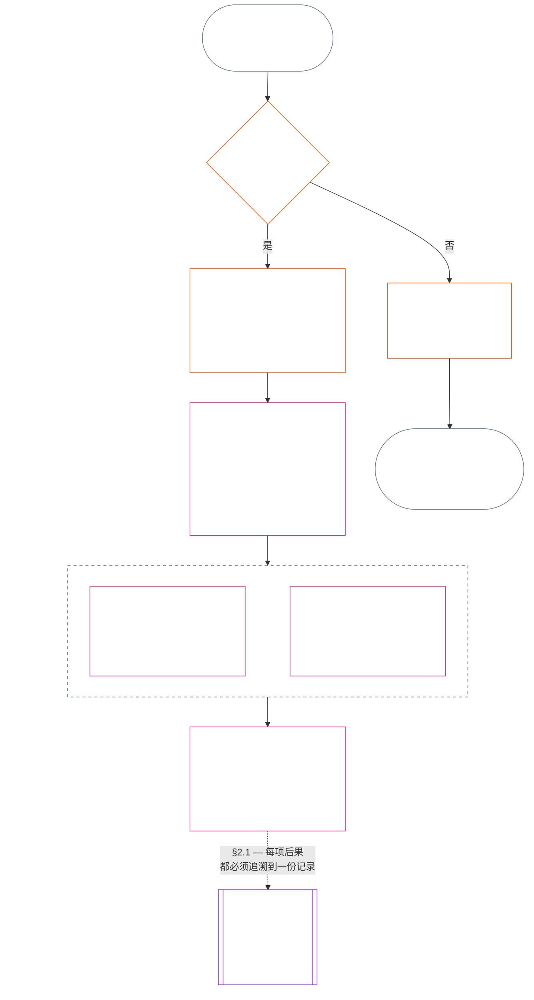

<!-- Locale: Simplified Chinese (zh) | Source: 9c2c8c10c871d91157bcd27b9f56ad6a1cec90d3 | AI-drafted, unreviewed | PARTIAL: Chapter Eleven §§1–3 only -->

### 1. 三个问题

*用直白的话说：轨迹评估依次回答三个问题。不要根据期望的评级推断事实，也不要为了证明期望的后果合理而选择评级。*

| 问题 | 问题询问什么 | 在哪里回答 |
| --- | --- | --- |
| **1. 发生了什么？** | 哪些事实已经核实，涉及谁或什么，发生在什么期间，并具有何种轨迹记录和质疑状态？ | [第 2 节](#2-question-1--what-happened)和[第 3 节](#3-question-1-event-type-guide--what-kind-of-help-or-harm-occurred) |
| **2. 情况有多好或多坏？** | 这些事实确立了何种类型、何种程度的贡献或违宪行为？ | [第十二章第 1 节](core_12.000_standing_measurement.md#1-question-2--how-good-or-bad-was-it) |
| **3. 因此会发生什么？** | 会产生什么认可、准备状态、补救、保障、限制或其他后果？ | [第十三章](core_13.000_standing_integration.md#chapter-thirteen-standing-effects-and-integration) |

每个问题都取决于前一个问题的答案：

- 问题 1 为问题 2 提供已经核实的事实。
- 问题 2 为问题 3 衡量这些事实。
- 问题 3 不得为了符合偏好的结果而改写事实或评级。

对三个问题的回答合在一起，构成对一个边界明确的事件或一个已定义模式的完整轨迹评估。一个对象在一段时间内可能有多次此类评估；它们都不是该对象的净分数或总体评级。贡献轨迹记录和违宪行为轨迹记录保存问题 1 和问题 2 的答案；问题 3 的决定则说明由此产生什么后果。

#### 1.1 目的与范围

本章为**系统**、**感知者**和**机构**规定宪法记录框架；[第十二章](core_12.000_standing_measurement.md#chapter-twelve-standing-measurement--question-2-how-good-or-bad-was-it)规定测量框架。其中包括根据[**CS-9.305**](corpus_systems/cs_09.305_system_classification_machinery.md#cs-9305-part-a-system-classification-machinery)（*系统分类机制*）分类的每个系统。这些框架不衡量流言、受欢迎程度、含糊的声誉、内在尊严或一般价值；这些都不是轨迹评估的许可对象。

即使出现以下情况，轨迹流程也必须继续有效：

- 先前核实的贡献已经太久远，无法表明当前的能力或可靠性；
- 违宪行为仍未解决；
- 修复成本高昂；
- 责任跨越边界；或
- 行为者利用组织层级或重新贴标签来阻碍问责。

以下事项应写入已采纳的实施文本：

- 日常程序；
- 升级步骤；
- 返还与修复操作；
- 恢复性问责措施；以及
- 激励设计。

第十二章的测量本身并不授权使用武力、拘押或其他自由限制。任何此类后果都必须独立满足第六章**第二十条**（*核实违宪行为后的正义*）的要求，包括比例原则、限制最少、期限明确、返还以及恢复性问责要求。

<strong>溯源 · 定义 · 评估 · 合规</strong>

- 上游：[第一章 §16 — 尽责管理详述](core_01.010_stewardship_capacity_principles.md#16-stewardship-in-depth)；[第二至第四章](core_02.000_definition_structure.md)；[第五章](core_05.000_definitions_home.md#chapter-five-foundational-definitions)。
- 下游：[§2](#2-question-1--what-happened)（*问题 1*）；[§4](#4-standing-record-operational-requirements)（*核实与记录要求*）；[§5](#5-record-custody-and-opening-authority)（*记录保管与开启权限*）；[§6](#6-handling-a-standing-record)（*轨迹记录的处理*）；[第十二章 §1](core_12.000_standing_measurement.md#1-question-2--how-good-or-bad-was-it)（*问题 2 测量*）；[第十二章 §2](core_12.000_standing_measurement.md#2-magnitude-and-severity-input-dimensions)（*测量输入维度*）；[第十二章 §3](core_12.000_standing_measurement.md#3-route-descriptor-catalogs-and-measurement-roles)（*路径描述符目录*）；[第十二章 §4](core_12.000_standing_measurement.md#4-slot-grammar-and-shared-scaling)（*槽位语法与共同缩放*）；[第十二章 §5](core_12.000_standing_measurement.md#5-constitutional-inputs-to-axis-assignment)（*宪法来源的路径分配*）；[第十二章 §6](core_12.000_standing_measurement.md#6-unified-proportional-lequ-scale--contribution-and-violation-axes)（*适用于两个轴的统一比例 LEQU 标度*）；[第十三章](core_13.000_standing_integration.md#chapter-thirteen-standing-effects-and-integration)（*问题 3*）。
- [实质性](core_05.050_band_oversight.md#materiality) · [O](core_05.050_band_oversight.md#materiality) · [M](core_05.050_band_oversight.md#materiality-determination-a) · [A](core_05.050_band_oversight.md#materiality-determination-a) · [C](core_05.050_band_oversight.md#materiality-determination-c)
- [伤害](core_05.035_band_accountability.md#harm) · [O](core_05.035_band_accountability.md#harm) · [M](core_05.035_band_accountability.md#harm-a) · [A](core_05.035_band_accountability.md#harm-a) · [C](core_05.035_band_accountability.md#harm-c)
- [比例性](core_05.035_band_accountability.md#proportionality) · [O](core_05.035_band_accountability.md#proportionality) · [M](core_05.035_band_accountability.md#proportionality-a) · [A](core_05.035_band_accountability.md#proportionality-a) · [C](core_05.035_band_accountability.md#proportionality-c)

### 2. 问题 1 — 发生了什么？

<strong>溯源</strong>

- 上游：[§1](#1-the-three-questions)（*三个问题框架*）；[第二至第四章](core_02.000_definition_structure.md)（*记录、核实，以及从定义到结果的可追溯性*）。
- 四元的支柱：**参与**；**监督**（可质疑性和质疑路径）。主要宗旨：**繁盛**与**延续**（可追溯记录为后续测量保留彼此分开的贡献和违宪行为认定）。
- 下游：
  - [§2.2](#22-silence-is-the-default)（*沉默是默认状态*）；
  - [§2.3](#23-protected-dissent-is-not-a-trigger)（*受保护的异议不是触发因素*）；
  - [§2.4](#24-linked-standing-records-and-no-offset-bridge)（*关联轨迹记录的不得抵销桥接规则*）；
  - [§2.5](#25-verified-input-gate)（*核实输入门槛*）；
  - [§2.6](#26-stage-boundary)（*阶段边界*）；
  - [§2.7](#27-forum-boundary)（*评议所边界*）；
  - [§3](#3-question-1-event-type-guide--what-kind-of-help-or-harm-occurred)（*事件类型指南*）；
  - [§4](#4-standing-record-operational-requirements)（*记录要求*）；
  - [§5](#5-record-custody-and-opening-authority)（*记录保管与开启权限*）；
  - [§6](#6-handling-a-standing-record)（*轨迹记录的处理*）；
  - [第十二章 §1](core_12.000_standing_measurement.md#1-question-2--how-good-or-bad-was-it)（*问题 2 测量*）；
  - [第十二章 §2](core_12.000_standing_measurement.md#2-magnitude-and-severity-input-dimensions)（*测量输入维度*）；
  - [第十二章 §3](core_12.000_standing_measurement.md#3-route-descriptor-catalogs-and-measurement-roles)（*路径描述符目录*）；
  - [第十二章 §4](core_12.000_standing_measurement.md#4-slot-grammar-and-shared-scaling)（*槽位语法与共同缩放*）；
  - [第十二章 §5](core_12.000_standing_measurement.md#5-constitutional-inputs-to-axis-assignment)（*宪法来源的路径分配*）；
  - [第十二章 §6](core_12.000_standing_measurement.md#6-unified-proportional-lequ-scale--contribution-and-violation-axes)（*适用于两个轴的统一比例 LEQU 标度*）；
  - [第十三章](core_13.000_standing_integration.md#chapter-thirteen-standing-effects-and-integration)（13.000）（*问题 3*）。

 

*用直白的话说：问题 1 要建立一份边界明确、可质疑的事实记录。在考虑任何评级或后果之前，它会识别对象、事件或模式、时间段、已核实事实和记录状态。核实的帮助和核实的违宪行为分别使用不同的轨迹记录，以免彼此抵销。轨迹记录不是人气分数，也不是含糊的标签。*

**轨迹记录**是本章针对特定对象、功能范围、记录期间、审查状态和决策背景使用的边界明确的记录。开始测量之前，必须确定：

- 该轨迹记录涉及谁或什么；
- 它涉及一个边界明确的事件还是一个已定义模式；
- 相关行为与影响在何时、何地发生；
- 哪些事实已经核实，哪些仍有争议；
- 哪些证据、归因和质疑路径支持这些认定；以及
- 该轨迹记录当前的审查、更正和取代状态。

该图追踪一件事件，以判断它是否触发轨迹记录，以及记录随后载明什么；后续小节会说明每项规则。“否”的分支离开主路径并向右延伸。

#### 2.1 轨迹记录：类型与对象

问题 1 对核实的帮助使用**贡献轨迹记录**，对核实的伤害使用**违宪行为轨迹记录**，其中包括问责失灵。一份轨迹记录不得合并这两种认定。

- 轨迹记录可以涉及感知者、机构、系统、评估、边界明确的事件、角色、集体、行为者专属记录，或其他具有宪法相关性的单位。
  - 不得把不同对象、角色、系统、社区、记录期间、审查状态或决策背景压缩成一个无法区分的轨迹标签。
- 轨迹记录可以涵盖一个**边界明确的事件**——有清楚起止时间的一次事件——或重复行为的一个**模式**。
  - 模式必须有已定义的对象、范围和审查期间。
- 同一对象可以随时间拥有多份轨迹记录，包括关联的贡献轨迹记录和违宪行为轨迹记录。
  - 如果相关轨迹记录涉及相同对象、重叠的记录期间、边界明确的事件、模式或决策背景，就必须按照**第 4.2 节**相互**交叉引用**。
- 轨迹记录不是独立的声誉分数、尊严排名、永久状态、一般价值标签或合并记分卡。
  - 操作要求见**第 4 节**。

任何后续轨迹效果都属于第十三章，并且必须能够追溯到相关轨迹记录，但不得成为轨迹记录本身的一部分。

#### 2.2 沉默是默认状态

感知者、机构或系统没有轨迹记录是通常状态；大多数感知者都会一直处于这种状态。

- 只有在根据**第 4 节**核实了触发因素后，才会开启轨迹记录。具名记录开启权限人必须批准该条目，另一名记录保管人必须作出记录（**第 5 节**）。不得出于以下原因开启轨迹记录：
  - 建立基线；
  - 补全名册；或
  - 因为具名路径把关者希望这样做。
- 没有轨迹记录不说明任何情况。“未评级”“未经核实”和“档案中没有记录”都不是风险、贡献低或其他事项的证据。任何人都不得把缺少记录当作加强审查、降低默认等级或限制进入具名路径的理由。
- 任何机构或系统不得以下列事项为条件，要求提供轨迹记录、“无记录”证明，或同意开启记录：
  - **第三条**（*生存与基本资源获取*）所保障的必需品；
  - **第三条-C**（*劳动与经济底线*）的保护；
  - 普通商业活动；或
  - 以受影响方身份参与。
  [第十三章 §6.2 能力门槛与资格许可](core_13.000_standing_integration.md#62-competency-bars-and-clearances)针对特定、信任敏感的具名路径所公布的能力门槛是例外；门槛必须说明该具名路径为何具有信任敏感性。
- 开启涉及某个对象的轨迹记录时，必须按**第 4 节**要求通知该对象。只有记录在案的[证据保全](core_05.050_band_oversight.md#evidence-preservation)或安全需要能够证明延迟通知有正当理由，而且延迟时间必须有限并预先确定。通知使轨迹记录具有可质疑性：不知道记录存在的对象就无法质疑或更正它。

#### 2.3 受保护的异议不是触发因素

根据**第 XI-D 条**（*集会、异议与和平抗议*）提出的异议或和平抗议——包括[受保护的非暴力公民不服从](core_06.005_rights_part_b.md#xi-d-nonviolent-civil-disobedience)——以及[《异议与和平抗议权利底线》](core_06.005_rights_part_b.md#xi-d-dissent-and-peaceful-protest)，都不是已经核实的触发因素。

- 它不会开启、延长或加重违宪行为轨迹记录；它不是**第 8.2 节**所指的严重性输入；重复进行也不会使其成为一种模式。
- 可单独划分且本身违反宪法底线的行为，应按其自身情况记录，不得因为抗议的观点、原因或对象而加重处理。

#### 2.4 关联轨迹记录与不得抵销桥接规则

<strong>溯源</strong>

- 上游：[§2.1](#21-standing-records-kinds-and-subjects)（*分开的贡献与违宪行为记录*）。
- 下游：
  - [§2.5](#25-verified-input-gate)（*核实输入门槛*）；
  - [§2.7](#27-forum-boundary)（*评议所边界*）；
  - [§4.2](#42-related-standing-record-cross-references)（*交叉引用*）；
  - [第十二章 §1](core_12.000_standing_measurement.md#1-question-2--how-good-or-bad-was-it)（*问题 2 测量*）；
  - [第十二章 §2](core_12.000_standing_measurement.md#2-magnitude-and-severity-input-dimensions)（*测量输入维度*）；
  - [第十二章 §3](core_12.000_standing_measurement.md#3-route-descriptor-catalogs-and-measurement-roles)（*路径描述符目录*）；
  - [第十二章 §4](core_12.000_standing_measurement.md#4-slot-grammar-and-shared-scaling)（*槽位语法与共同缩放*）；
  - [第十二章 §5](core_12.000_standing_measurement.md#5-constitutional-inputs-to-axis-assignment)（*宪法来源的路径分配*）；
  - [第十二章 §6](core_12.000_standing_measurement.md#6-unified-proportional-lequ-scale--contribution-and-violation-axes)（*适用于两个轴的统一比例 LEQU 标度*）；
  - [第十三章](core_13.000_standing_integration.md#chapter-thirteen-standing-effects-and-integration)（13.000）（*问题 3*）。
- 一并阅读：[第十三章 — 轨迹整合](core_13.000_standing_integration.md#2-automatic-integration-review-and-continuity)（13.000）（*不放弃权利与关联记录整合*）；[第十三章 §6.2 — 能力门槛与资格许可](core_13.000_standing_integration.md#62-competency-bars-and-clearances)（13.000 §6.2）；[第十三章 §4.2 — 轨迹锁定](core_13.000_standing_integration.md#42-prevention--general-standing-locks)（13.000 §4.2）。

 

**核心规则：**根据**第 2.1 节**，已经核实的**贡献轨迹记录**与已经核实的**违宪行为轨迹记录**必须分开保存。每项贡献或违宪行为认定都必须以其自身轨迹记录中有依据的事实为基础。分析和支持材料必须使两条记录路径保持彼此分开且可追溯。任何单条记录或一组关联记录都不是净分数、混合分数或权衡。

- **违宪行为轨迹记录与轨迹锁定：**
  - 根据第十三章，从违宪行为轨迹记录产生的适用**轨迹锁定**，在已经核实的违宪行为尚未解决期间，可以限制轨迹状态、限制担任角色的资格，或影响获得补救的机会。
  - 轨迹锁定不得抹去贡献轨迹记录中记载的已核实正面贡献。
  - 不得仅仅因为时间流逝就降低尚未解决的已核实违宪行为的权重。
  - 已核实的违宪行为不得把无关的贡献轨迹记录改写成虚假的负面声誉档案。
- **贡献轨迹记录与能力许可：**
  - 已核实的贡献可以支持依据已公布**能力门槛**所作的适用**能力许可**；在贡献仍属当前且与角色相关时，也可以支持与信任、角色或认可相关的资格。
  - 已核实的贡献不得抵销、平均降低、宽恕或重新标记已核实的违宪行为认定。
  - 满足门槛不免除任何适用的轨迹锁定。

**唯一例外：**如果某项违宪行为认定本身证明一项所声称的贡献并不存在——例如，证据显示你并未实际完成贡献记录所称的事项——那么可以依照适当的证据与审查程序更正或删除关联的贡献轨迹记录，并按**第 4.2 节**作出所需的交叉引用。但违宪行为不会自动抹去其他贡献轨迹记录中记载的无关帮助。

#### 2.5 核实输入门槛

门槛按以下方式运作：

- 任何影响轨迹状态、信任、角色、认可或获得认可资格的决定，只能使用相关**贡献轨迹记录**或**违宪行为轨迹记录**中的已核实输入。
- 指控、尚未裁定的主张、临时路径标签、仅用于受理的叙述以及争议阶段的其他材料，本身不能为轨迹评估提供贡献性质或违宪行为性质。
- 已核实输入是一个**轨迹认定**：已核实的贡献认定（轴 I）或已核实的违宪行为认定（轴 II）。
- 贡献认定和违宪行为认定分别保存在不同的轨迹记录中（见**第 2.1 节**）。

#### 2.6 阶段边界

轨迹记录的各个阶段必须保持分开：

- 问题 1 记录已经核实的事实；问题 2 衡量这些事实。
- 即使问题 2 的测量仍在等待中，只要核实事实的依据已经完整，就可以开启轨迹记录。
- 测量完成之前，问题 2 的字段必须注明仍在等待测量，而不得暗示已分配槽位或类别。
- 轨迹记录不得陈述或实施问题 3 的任何**轨迹效果**。

#### 2.7 评议所边界

*用直白的话说：评议所监督争议、受理质疑，并把争议转化为已核实结果——但提起案件或在叙事争论中获胜，都不会更新轨迹状态。**第 2.5 节**的核实输入门槛仍然适用。评议所依据第二至第四章核实事实时，可以**开启、更新或更正**轨迹记录，也可以**在受到质疑时搁置错误记录**。评议所不会把好坏合并成一个分数，也不会自行编造轨迹类别。*

本节只负责回答一个问题：评议所的工作如何进入轨迹记录。链条中的其他步骤由此处列明的负责人掌管，顺序如下：

1. 争议被提出，评议所保留一份**评议所案件记录**，它不是轨迹记录。负责人：[第十五章 §2.3 评议所案件记录、轨迹记录与争议](core_15.000_forum.md#23-forum-case-records-standing-records-and-contests)；另见[§2.7.1 评议所案件记录](#271-forum-case-record)。
2. 评议所依据[第二至第四章](core_02.000_definition_structure.md)核实事实。
3. 已核实的认定通过核实输入门槛。负责人：[§2.5 核实输入门槛](#25-verified-input-gate)。
4. 具名记录开启权限人（可以是评议所）开启、更新或更正轨迹记录，或在受到质疑时搁置错误记录。轨迹记录载明内容由[§4.1 最低记录内容](#41-minimum-record-contents)负责；有权采取行动的人由[§5 记录保管与开启权限](#5-record-custody-and-opening-authority)负责。
5. 轨迹记录只载明已经核实的事实，之后由问题 2 对事实进行测量。负责人：[§2.6 阶段边界](#26-stage-boundary)和[第十二章 §1 问题 2 — 情况有多好或多坏？](core_12.000_standing_measurement.md#1-question-2--how-good-or-bad-was-it)。
6. 如有轨迹效果，则依据[第十三章](core_13.000_standing_integration.md#chapter-thirteen-standing-effects-and-integration)产生；轨迹效果由该章负责。

[第十五章](core_15.000_forum.md#chapter-fifteen-forums-and-jurisdiction)规定的评议所族系**监督**具体争议如何经过轨迹流程。依据[第十五章 §6 及时解决、实质性分级与反拖延纪律](core_15.000_forum.md#6-timely-resolution-materiality-tiers-and-anti-delay-discipline)和[第二十六条-C](core_06.020_rights_part_e.md#article-xxvi-c-timely-resolution-and-anti-delay-floor)（*及时解决与反拖延底线*），评议所提供：

- 可及的质疑途径；
- 独立审查；
- 取证支持；
- 补救顺序安排；以及
- 分级时限。

如果这些评议所认定满足第二至第四章所规定的核实输入门槛，就可以：

- 依据**第 4.1 节****开启、更新或更正**轨迹记录；或
- **在受到质疑时搁置错误记录**。

##### 2.7.1 评议所案件记录

评议所针对未结争议所持有的自身档案是[**评议所案件记录**](core_05.035_band_accountability.md#forum-case-record)，其定义见[第十五章 §2.3 评议所案件记录、轨迹记录与争议](core_15.000_forum.md#23-forum-case-records-standing-records-and-contests)。它**不是**轨迹记录。

##### 2.7.2 评议所认定与问题 2 测量

评议所核实的事实认定可以作为问题 1 轨迹记录的事实依据。但它们**不能**决定对已核实的贡献或违宪行为进行何种问题 2 测量，也不能决定其情况有多好或多坏（见[§2.6 阶段边界](#26-stage-boundary)）。因此：

- 评议所程序**不得**把贡献和违宪行为材料合并为净分数、混合的实体判断或无法区分的轨迹标签；关联轨迹记录必须依照[§2.1 轨迹记录：类型与对象](#21-standing-records-kinds-and-subjects)和[§2.4 关联轨迹记录与不得抵销桥接规则](#24-linked-standing-records-and-no-offset-bridge)保持分开。
- 评议所输出**不得**以争议叙述、路径安排的便利或合议庭偏好，取代可证明的已核实输入（[§2.5 核实输入门槛](#25-verified-input-gate)）、单独的测量（[第十二章 §1 问题 2 — 情况有多好或多坏？](core_12.000_standing_measurement.md#1-question-2--how-good-or-bad-was-it)），或由[第十三章](core_13.000_standing_integration.md#chapter-thirteen-standing-effects-and-integration)负责的轨迹效果机制。

##### 2.7.3 评议所边界不削弱的事项

本边界**不会**削弱以下规定所要求的质疑、补救、临时救济或程序保障：

- [第十三条-A](core_06.010_rights_part_c.md#article-xiii-a-reliability-and-trustworthiness-baseline)（*可靠性与可信度基线*）；
- [第十三条-B](core_06.010_rights_part_c.md#article-xiii-b-right-to-redress-and-remedy)（*获得申诉与补救的权利*）；
- [第十五章 §6 及时解决、实质性分级与反拖延纪律](core_15.000_forum.md#6-timely-resolution-materiality-tiers-and-anti-delay-discipline)；
- [第二十六条-C](core_06.020_rights_part_e.md#article-xxvi-c-timely-resolution-and-anti-delay-floor)（*及时解决与反拖延底线*）；或
- 相关司法条款。

它要求评议所已经核实的认定与其他已核实输入一样，经过同一道门槛进入轨迹记录，而不能绕过门槛。

### 3. 问题 1 事件类型指南 — 发生了何种帮助或伤害？

*用直白的话说：事实核实之后，用这些表格描述发生了什么。它们有助于识别相关贡献或违宪行为的类型。它们不决定情况有多好或多坏，不分配槽位，也不决定因此会发生什么。*

#### 3.1 贡献事件类型

**资格规则：**只有可追溯、未将成本外部化且符合整部现行宪法的所称贡献，才计作贡献。

- 外部化的伤害、强制性依赖、缩减权利底线或隐瞒的负担，都可能使所称贡献失去资格或受到限制。
- 所称贡献不能抵销另一项违宪行为认定。

下表每一行都列出一条常见的已核实帮助路径及其宪法相关性。同一轨迹记录可以适用多行。

| 已核实贡献的类型 | 发生了什么 | 四元支柱 | 主要宗旨 |
| --- | --- | --- | --- |
| 生存与身体维护 | 有人获得了食物、住所、医疗照护或安全保障 | **参与**、**监督** | **繁盛** |
| 照护与教育 | 抚养了儿童、照护了长者，或教育了其他人 | **参与**、**监督** | **繁盛**、**延续** |
| 创伤化解 | 有人获得帮助，从妨碍身心安好的心理伤害中恢复 | **参与**、**问责** | **繁盛** |
| 消除严重负担 | 沉重债务、剥削性工作条件或系统性障碍被消除 | **参与**、**监督** | **繁盛** |
| 恢复自主权 | 有人获得了关于自己生活的实质性选择 | **参与** | **繁盛** |
| 扩大生产能力 | 工具、基础设施或机会使他人能够独立发展 | **参与**、**监督** | **繁盛**、**延续** |
| 提高时间效率 | 减少了本可避免的等待、行政摩擦或协调开销，使人们重新获得可用于照护、休息、自主、学习或符合权利的工作的时间 | **参与**、**监督** | **繁盛** |
| 降低生态或基础设施风险 | 防止了环境崩溃或关键系统失灵 | **监督**、**问责** | **延续**、**繁盛** |
| 减少生态足迹 | 可核实地减少了资源使用、排放或土地与水的需求，且未将负担转嫁给他人或生态系统 | **监督**、**问责** | **延续**、**繁盛** |
| 修复生态系统 | 使退化的土地、水域或栖息地恢复到能够正常运行、自我维持的状态 | **监督**、**问责** | **延续**、**繁盛** |
| 保护濒危物种 | 保护面临灭绝风险的物种或其赖以生存的栖息地，使其免于丧失 | **监督**、**问责** | **延续**、**繁盛** |
| 减少污染与废弃物 | 预防、清除或安全管理污染、有害排放或废弃物 | **监督**、**问责** | **繁盛**、**延续** |
| 强化安全、真实、可审计性或质疑能力 | 建立或修复制度与实践，以保护权利并使权力承担责任 | **参与**、**监督**、**问责** | **繁盛**、**延续** |

#### 3.2 违宪行为事件类型

**资格规则：**违宪行为事件类型必须有依据**第二至第四章**核实的违宪行为认定，并且该认定仍然可追溯、边界明确、可审计且可质疑。

- 指控、临时标签、评议所叙述和受理标签可以帮助路径安排或初步分流，但它们本身不能完成问题 1。
- 正面贡献不能抵销、宽恕、撤销或重新标记已核实的违宪行为。

下表每一行都列出一条常见的已核实损失、危险或义务失守路径及其宪法相关性。同一轨迹记录可以适用多行。

| 已核实损失或危险的类型 | 发生了什么 | 四元支柱 | 主要宗旨 |
| --- | --- | --- | --- |
| 生存或身体维护被剥夺 | 发生了可避免的死亡、拒绝照护、不安全状况或实质性的生存资源匮乏 | **问责**、**参与** | **繁盛** |
| 严重且可避免的负担 | 压垮性的、强加的或系统性转嫁的负担，实质损害了身心安好或自主权 | **问责**、**参与** | **繁盛** |
| 自主权受强制侵害 | 发生胁迫、操纵、可信威胁、拘禁或自由受到危险 | **问责**、**参与** | **繁盛** |
| 权利底线遭到击败 | 不可协商的宪法底线、宪法至上地位或质疑与补救渠道遭到实质侵犯 | **问责**、**监督** | **繁盛**、**延续** |
| 生态或基础设施受损 | 宪法所要求的身心安好条件遭到损害 | **问责**、**监督** | **延续**、**繁盛** |
| 污染或废弃物造成伤害 | 污染、有害排放或废弃物损害了空气、水、土壤或健康 | **问责**、**监督** | **繁盛**、**延续** |
| 物种或栖息地遭到破坏 | 面临灭绝风险的物种或其赖以生存的栖息地遭到破坏、分割或被推向丧失，包括被视为可以抵销的损失 | **问责**、**监督** | **延续**、**繁盛** |
| 生态恢复能力丧失 | 生态系统在受损后再生的能力遭到封锁，或被不必要地变得难以逆转乃至无法逆转 | **问责**、**监督** | **延续**、**繁盛** |
| 外部化的生态伤害或耗竭 | 生态成本被转嫁给他人或生态系统；资源被耗竭到超过其再生能力；或足迹、可持续性声明掩盖了持续恶化 | **问责**、**监督** | **延续**、**繁盛** |
| 生产能力遭到摧毁 | 独立发展所需的工具、能力、关系或资源被剥夺 | **问责** | **繁盛** |
| 安全、真实或可审计性遭到削弱 | 发生隐瞒、虚假信息、记录损坏、无法进入的质疑途径或无法审查的汇总 | **监督**、**问责** | **繁盛**、**延续** |
| 阻挠问责 | 经核实干扰了问责机制——证据完整性、核实、评议所程序、轨迹记录、补救时限，或质疑与申诉途径；如果这种阻挠是针对另一项独立基础伤害的元层攻击，就开启一份关联但独立的违宪行为轨迹记录 | **问责**、**监督**、**及时性** | **繁盛**、**延续** |
| 系统俘获或依赖滥用 | 发生结构性促成、滥用依赖不对称、规避防范设计，或俘获问责路径 | **问责**、**参与** | **延续**、**繁盛** |

---

*覆盖范围：本部分草稿仅涵盖第十一章 §§1–3，不包括 §§4–6 或第十二章。*
