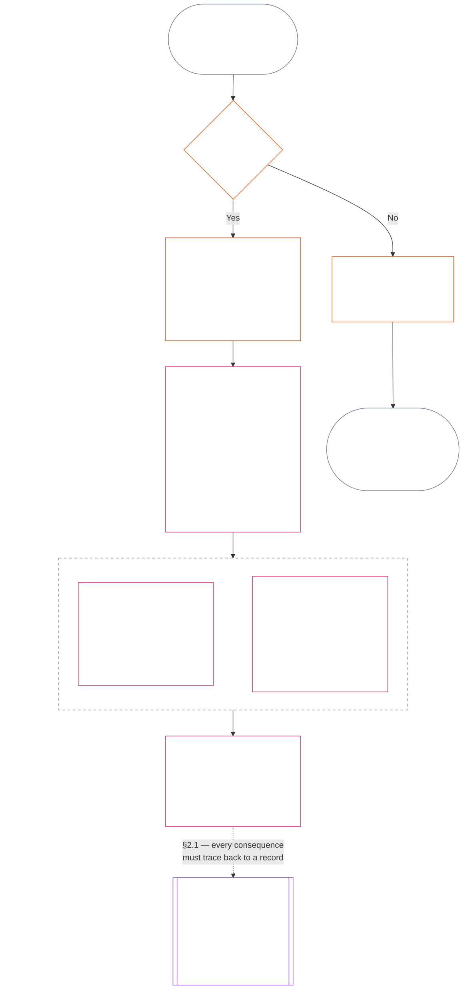
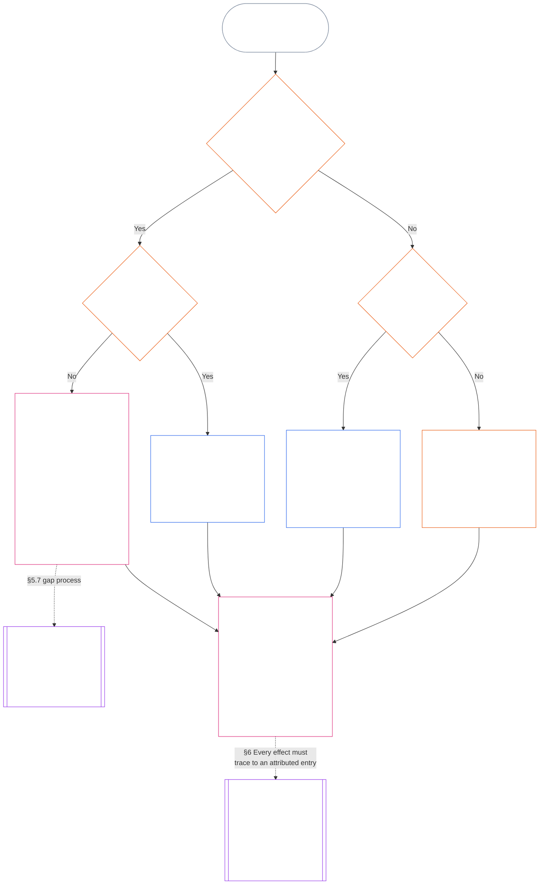

<!-- 简体中文 | 第十一章完整草稿 | 源提交：9c2c8c10c871d91157bcd27b9f56ad6a1cec90d3 | AI起草、未审阅、非约束性草稿 -->

# 第十一章：状态记录 — 问题1，发生了什么

<strong>文本库中的位置（非操作性）：文件结构与阅读规则</strong>

> 本文件是**感知者宪法的一部分**，并且**只有与其他编号 `core_*` 文件作为一部文本共同阅读时才具有约束力**。本文件包含**第十一章**：状态流程的三个问题，以及**问题1**（*发生了什么？*），范围为**§1–§6**。**问题2**（*程度有多好或多坏？*）由[第十二章](core_12.000_standing_measurement.md#chapter-twelve-standing-measurement--question-2-how-good-or-bad-was-it)回答。问题3（*因此会发生什么？*）延续至[第十三章](core_13.000_standing_integration.md#chapter-thirteen-standing-effects-and-integration)；符合条件的 Violation Axis `s` = 7–9 认定，仅由[第十四章](core_14.000_misconduct_designation.md#chapter-fourteen-anti-constitutional-misconduct)审查并指定反宪法不当行为。阅读顺序、约束性／支持性区分和文本库版本信息见 [README.md](README.md)。

<strong>读者指引（非操作性）：第十一章的位置与本章内容</strong>

> | 问题 | 负责章节与作用 |
> | --- | --- |
> | **1. 发生了什么？** | 第十一章（本文件）：在范围明确且可质疑的状态记录中确立已核实事实。 |
> | **2. 程度有多好或多坏？** | [第十二章](core_12.000_standing_measurement.md#chapter-twelve-standing-measurement--question-2-how-good-or-bad-was-it)：测量已核实事实，不将帮助与伤害合并。 |
> | **3. 因此会发生什么？** | 继续阅读[第十三章](core_13.000_standing_integration.md#chapter-thirteen-standing-effects-and-integration)。 |
>
> 指控、受欢迎程度和争议叙事都不是问题1的答案。期望的评级不能为问题1提供事实，期望的后果也不能为问题2提供评级。

<strong>追溯</strong>

- 上游：
  - [宪法四元](core_00.000_preamble.md#constitutional-tetrad)；
  - [两项宪法宗旨](core_00.000_preamble.md#two-constitutional-aims)；
  - [实质利害](core_00.000_preamble.md#material-stake)；
  - [序言 §6 关键实务流程链](core_00.000_preamble.md#6-key-practical-process-pipelines)（*第九章至第十五章的链条*）。
- 上游：
  - [第一章](core_01.010_stewardship_capacity_principles.md#chapter-01-principles-and-constraints)（1.010）（*易懂可及性*尽责管理反映于各节的释义）；
  - [第一章 §16 — 深入尽责管理](core_01.010_stewardship_capacity_principles.md#16-stewardship-in-depth)（1.010 §16）（*能力关联、可追溯状态的原则层基础——信任、角色与认可*）；
  - [第二章至第四章](core_02.000_definition_structure.md)（*完整性、记录与核验*）；
  - [第五章](core_05.000_definitions_home.md#chapter-five-foundational-definitions)（5.000）（*定义与最高性须结合第二章至第四章阅读*）。
- 上游：[第九章](core_09.000_system_alignment_certification_evaluation.md#chapter-nine-system-alignment-certification)（9.000）（*系统一致性认证*）；[第九章 C部分 §11](core_09.010_system_alignment_certification_record_recertification.md#11-relationship-to-standing)（9.010 §11）（*状态桥接——只涉及潜在已核实输入*）。
- 状态流程：
  - [序言 §6.2 完整链条如何衔接](core_00.000_preamble.md#62-how-the-full-chain-fits-together)；
  - [第十一章——状态记录](core_11.000_standing_assessment.md#chapter-eleven-standing-records--question-1-what-happened)（11.000）（*三问框架与问题1记录*）；
  - [第十二章——状态测量](core_12.000_standing_measurement.md#chapter-twelve-standing-measurement--question-2-how-good-or-bad-was-it)（12.000）（*问题2测量*）；
  - [第十三章——状态效果与整合](core_13.000_standing_integration.md#chapter-thirteen-standing-effects-and-integration)（13.000）（*问题3效果与整合*）；
  - [第十四章](core_14.000_misconduct_designation.md#chapter-fourteen-anti-constitutional-misconduct)（14.000）（*仅对符合条件的 Violation Axis s = 7–9 进行指定*）。
- 本文件的分节：
  - [§1](#1-the-three-questions)（*三问框架与范围*）；
  - [§2](#2-question-1--what-happened)（*问题1——已核实事实与记录*）；
  - [§3](#3-question-1-event-type-guide--what-kind-of-help-or-harm-occurred)（*问题1事件类型指南——帮助与伤害的类型*）；
  - [§4](#4-standing-record-operational-requirements)（*核验与记录要求*）；
  - [§5](#5-record-custody-and-opening-authority)（*记录保管与开启权限*）；
  - [§6](#6-handling-a-standing-record)（*轨迹记录的处理*）。
- 下游：
  - [第十二章](core_12.000_standing_measurement.md#chapter-twelve-standing-measurement--question-2-how-good-or-bad-was-it)（12.000）（*问题2——LEQU基准、测量维度、路线描述符、槽位语法、宪法输入、LEQU尺度、标准贡献测量、例示及交接至问题3*）；
  - [第十四章](core_14.000_misconduct_designation.md#chapter-fourteen-part-a-anti-constitutional-misconduct-designation)（14.000）（*仅作指定——不会重开问题2测量*）；
  - [第十五章](core_15.000_forum.md#chapter-fifteen-forums-and-jurisdiction)（15.000）（*评议所监督与路由*）；
  - [Article XXVI-C](core_06.020_rights_part_e.md#article-xxvi-c-timely-resolution-and-anti-delay-floor)（*及时解决*）；
  - [Article XX](core_06.015_rights_part_d.md#article-xx-a-justice-objective-and-scope)（*司法约束*）。
- 配合阅读：[第五章 *状态、贡献与违反*](core_05.035_band_accountability.md#defa3-standing-state-contribution-and-violation)（5.035）（*规范定义路由*）。
- 配合阅读：[README.md](README.md)（*阅读顺序*）；[doc_architecture.md](doc_architecture.md)（*除非采纳，否则属于非约束性编辑地图*）。

 

第十一章是**已核实事实记录（问题1）**的宪法权责章节。范围从[§1 三个问题](#1-the-three-questions)延伸至[§6 轨迹记录的处理](#6-handling-a-standing-record)。[第十二章](core_12.000_standing_measurement.md#chapter-twelve-standing-measurement--question-2-how-good-or-bad-was-it)负责问题2，范围从[第十二章 §1 问题2——程度有多好或多坏？](core_12.000_standing_measurement.md#1-question-2--how-good-or-bad-was-it)延伸至[第十二章 §9 移交问题3——跨问题测量衔接点](core_12.000_standing_measurement.md#9-hand-off-to-question-3--cross-question-measurement-hooks)。问题3延续至第十三章。

*用直白的话说：本章记下发生了什么并保管状态记录。事情有多好或造成多大伤害，由第十二章在两条分开的轨道上测量，绝不合成一个净分数。提交案件本身不构成状态。*

### 1. 三个问题

*用直白的话说：轨迹评估依次回答三个问题。不要根据期望的评级推断事实，也不要为了证明期望的后果合理而选择评级。*

| 问题 | 问题询问什么 | 在哪里回答 |
| --- | --- | --- |
| **1. 发生了什么？** | 哪些事实已经核实，涉及谁或什么，发生在什么期间，并具有何种轨迹记录和质疑状态？ | [第 2 节](#2-question-1--what-happened)和[第 3 节](#3-question-1-event-type-guide--what-kind-of-help-or-harm-occurred) |
| **2. 情况有多好或多坏？** | 这些事实确立了何种类型、何种程度的贡献或违宪行为？ | [第十二章第 1 节](core_12.000_standing_measurement.md#1-question-2--how-good-or-bad-was-it) |
| **3. 因此会发生什么？** | 会产生什么认可、准备状态、补救、保障、限制或其他后果？ | [第十三章](core_13.000_standing_integration.md#chapter-thirteen-standing-effects-and-integration) |

每个问题都取决于前一个问题的答案：

- 问题 1 为问题 2 提供已经核实的事实。
- 问题 2 为问题 3 衡量这些事实。
- 问题 3 不得为了符合偏好的结果而改写事实或评级。

对三个问题的回答合在一起，构成对一个边界明确的事件或一个已定义模式的完整轨迹评估。一个对象在一段时间内可能有多次此类评估；它们都不是该对象的净分数或总体评级。贡献轨迹记录和违宪行为轨迹记录保存问题 1 和问题 2 的答案；问题 3 的决定则说明由此产生什么后果。

#### 1.1 目的与范围

本章为**系统**、**感知者**和**机构**规定宪法记录框架；[第十二章](core_12.000_standing_measurement.md#chapter-twelve-standing-measurement--question-2-how-good-or-bad-was-it)规定测量框架。其中包括根据[**CS-9.305**](corpus_systems/cs_09.305_system_classification_machinery.md#cs-9305-part-a-system-classification-machinery)（*系统分类机制*）分类的每个系统。这些框架不衡量流言、受欢迎程度、含糊的声誉、内在尊严或一般价值；这些都不是轨迹评估的许可对象。

即使出现以下情况，轨迹流程也必须继续有效：

- 先前核实的贡献已经太久远，无法表明当前的能力或可靠性；
- 违宪行为仍未解决；
- 修复成本高昂；
- 责任跨越边界；或
- 行为者利用组织层级或重新贴标签来阻碍问责。

以下事项应写入已采纳的实施文本：

- 日常程序；
- 升级步骤；
- 返还与修复操作；
- 恢复性问责措施；以及
- 激励设计。

第十二章的测量本身并不授权使用武力、拘押或其他自由限制。任何此类后果都必须独立满足第六章**第二十条**（*核实违宪行为后的正义*）的要求，包括比例原则、限制最少、期限明确、返还以及恢复性问责要求。

<strong>溯源 · 定义 · 评估 · 合规</strong>

- 上游：[第一章 §16 — 尽责管理详述](core_01.010_stewardship_capacity_principles.md#16-stewardship-in-depth)；[第二至第四章](core_02.000_definition_structure.md)；[第五章](core_05.000_definitions_home.md#chapter-five-foundational-definitions)。
- 下游：[§2](#2-question-1--what-happened)（*问题 1*）；[§4](#4-standing-record-operational-requirements)（*核实与记录要求*）；[§5](#5-record-custody-and-opening-authority)（*记录保管与开启权限*）；[§6](#6-handling-a-standing-record)（*轨迹记录的处理*）；[第十二章 §1](core_12.000_standing_measurement.md#1-question-2--how-good-or-bad-was-it)（*问题 2 测量*）；[第十二章 §2](core_12.000_standing_measurement.md#2-magnitude-and-severity-input-dimensions)（*测量输入维度*）；[第十二章 §3](core_12.000_standing_measurement.md#3-route-descriptor-catalogs-and-measurement-roles)（*路径描述符目录*）；[第十二章 §4](core_12.000_standing_measurement.md#4-slot-grammar-and-shared-scaling)（*槽位语法与共同缩放*）；[第十二章 §5](core_12.000_standing_measurement.md#5-constitutional-inputs-to-axis-assignment)（*宪法来源的路径分配*）；[第十二章 §6](core_12.000_standing_measurement.md#6-unified-proportional-lequ-scale--contribution-and-violation-axes)（*适用于两个轴的统一比例 LEQU 标度*）；[第十三章](core_13.000_standing_integration.md#chapter-thirteen-standing-effects-and-integration)（*问题 3*）。
- [实质性](core_05.050_band_oversight.md#materiality) · [O](core_05.050_band_oversight.md#materiality) · [M](core_05.050_band_oversight.md#materiality-determination-a) · [A](core_05.050_band_oversight.md#materiality-determination-a) · [C](core_05.050_band_oversight.md#materiality-determination-c)
- [伤害](core_05.035_band_accountability.md#harm) · [O](core_05.035_band_accountability.md#harm) · [M](core_05.035_band_accountability.md#harm-a) · [A](core_05.035_band_accountability.md#harm-a) · [C](core_05.035_band_accountability.md#harm-c)
- [比例性](core_05.035_band_accountability.md#proportionality) · [O](core_05.035_band_accountability.md#proportionality) · [M](core_05.035_band_accountability.md#proportionality-a) · [A](core_05.035_band_accountability.md#proportionality-a) · [C](core_05.035_band_accountability.md#proportionality-c)

### 2. 问题 1 — 发生了什么？

<strong>溯源</strong>

- 上游：[§1](#1-the-three-questions)（*三个问题框架*）；[第二至第四章](core_02.000_definition_structure.md)（*记录、核实，以及从定义到结果的可追溯性*）。
- 四元的支柱：**参与**；**监督**（可质疑性和质疑路径）。主要宗旨：**繁盛**与**延续**（可追溯记录为后续测量保留彼此分开的贡献和违宪行为认定）。
- 下游：
  - [§2.2](#22-silence-is-the-default)（*沉默是默认状态*）；
  - [§2.3](#23-protected-dissent-is-not-a-trigger)（*受保护的异议不是触发因素*）；
  - [§2.4](#24-linked-standing-records-and-no-offset-bridge)（*关联轨迹记录的不得抵销桥接规则*）；
  - [§2.5](#25-verified-input-gate)（*核实输入门槛*）；
  - [§2.6](#26-stage-boundary)（*阶段边界*）；
  - [§2.7](#27-forum-boundary)（*评议所边界*）；
  - [§3](#3-question-1-event-type-guide--what-kind-of-help-or-harm-occurred)（*事件类型指南*）；
  - [§4](#4-standing-record-operational-requirements)（*记录要求*）；
  - [§5](#5-record-custody-and-opening-authority)（*记录保管与开启权限*）；
  - [§6](#6-handling-a-standing-record)（*轨迹记录的处理*）；
  - [第十二章 §1](core_12.000_standing_measurement.md#1-question-2--how-good-or-bad-was-it)（*问题 2 测量*）；
  - [第十二章 §2](core_12.000_standing_measurement.md#2-magnitude-and-severity-input-dimensions)（*测量输入维度*）；
  - [第十二章 §3](core_12.000_standing_measurement.md#3-route-descriptor-catalogs-and-measurement-roles)（*路径描述符目录*）；
  - [第十二章 §4](core_12.000_standing_measurement.md#4-slot-grammar-and-shared-scaling)（*槽位语法与共同缩放*）；
  - [第十二章 §5](core_12.000_standing_measurement.md#5-constitutional-inputs-to-axis-assignment)（*宪法来源的路径分配*）；
  - [第十二章 §6](core_12.000_standing_measurement.md#6-unified-proportional-lequ-scale--contribution-and-violation-axes)（*适用于两个轴的统一比例 LEQU 标度*）；
  - [第十三章](core_13.000_standing_integration.md#chapter-thirteen-standing-effects-and-integration)（13.000）（*问题 3*）。

 

*用直白的话说：问题 1 要建立一份边界明确、可质疑的事实记录。在考虑任何评级或后果之前，它会识别对象、事件或模式、时间段、已核实事实和记录状态。核实的帮助和核实的违宪行为分别使用不同的轨迹记录，以免彼此抵销。轨迹记录不是人气分数，也不是含糊的标签。*

**轨迹记录**是本章针对特定对象、功能范围、记录期间、审查状态和决策背景使用的边界明确的记录。开始测量之前，必须确定：

- 该轨迹记录涉及谁或什么；
- 它涉及一个边界明确的事件还是一个已定义模式；
- 相关行为与影响在何时、何地发生；
- 哪些事实已经核实，哪些仍有争议；
- 哪些证据、归因和质疑路径支持这些认定；以及
- 该轨迹记录当前的审查、更正和取代状态。

该图追踪一件事件，以判断它是否触发轨迹记录，以及记录随后载明什么；后续小节会说明每项规则。“否”的分支离开主路径并向右延伸。

#### 2.1 轨迹记录：类型与对象

问题 1 对核实的帮助使用**贡献轨迹记录**，对核实的伤害使用**违宪行为轨迹记录**，其中包括问责失灵。一份轨迹记录不得合并这两种认定。

- 轨迹记录可以涉及感知者、机构、系统、评估、边界明确的事件、角色、集体、行为者专属记录，或其他具有宪法相关性的单位。
  - 不得把不同对象、角色、系统、社区、记录期间、审查状态或决策背景压缩成一个无法区分的轨迹标签。
- 轨迹记录可以涵盖一个**边界明确的事件**——有清楚起止时间的一次事件——或重复行为的一个**模式**。
  - 模式必须有已定义的对象、范围和审查期间。
- 同一对象可以随时间拥有多份轨迹记录，包括关联的贡献轨迹记录和违宪行为轨迹记录。
  - 如果相关轨迹记录涉及相同对象、重叠的记录期间、边界明确的事件、模式或决策背景，就必须按照**第 4.2 节**相互**交叉引用**。
- 轨迹记录不是独立的声誉分数、尊严排名、永久状态、一般价值标签或合并记分卡。
  - 操作要求见**第 4 节**。

任何后续轨迹效果都属于第十三章，并且必须能够追溯到相关轨迹记录，但不得成为轨迹记录本身的一部分。

#### 2.2 沉默是默认状态

感知者、机构或系统没有轨迹记录是通常状态；大多数感知者都会一直处于这种状态。

- 只有在根据**第 4 节**核实了触发因素后，才会开启轨迹记录。具名记录开启权限人必须批准该条目，另一名记录保管人必须作出记录（**第 5 节**）。不得出于以下原因开启轨迹记录：
  - 建立基线；
  - 补全名册；或
  - 因为具名路径把关者希望这样做。
- 没有轨迹记录不说明任何情况。“未评级”“未经核实”和“档案中没有记录”都不是风险、贡献低或其他事项的证据。任何人都不得把缺少记录当作加强审查、降低默认等级或限制进入具名路径的理由。
- 任何机构或系统不得以下列事项为条件，要求提供轨迹记录、“无记录”证明，或同意开启记录：
  - **第三条**（*生存与基本资源获取*）所保障的必需品；
  - **第三条-C**（*劳动与经济底线*）的保护；
  - 普通商业活动；或
  - 以受影响方身份参与。
  [第十三章 §6.2 能力门槛与资格许可](core_13.000_standing_integration.md#62-competency-bars-and-clearances)针对特定、信任敏感的具名路径所公布的能力门槛是例外；门槛必须说明该具名路径为何具有信任敏感性。
- 开启涉及某个对象的轨迹记录时，必须按**第 4 节**要求通知该对象。只有记录在案的[证据保全](core_05.050_band_oversight.md#evidence-preservation)或安全需要能够证明延迟通知有正当理由，而且延迟时间必须有限并预先确定。通知使轨迹记录具有可质疑性：不知道记录存在的对象就无法质疑或更正它。

#### 2.3 受保护的异议不是触发因素

根据**第 XI-D 条**（*集会、异议与和平抗议*）提出的异议或和平抗议——包括[受保护的非暴力公民不服从](core_06.005_rights_part_b.md#xi-d-nonviolent-civil-disobedience)——以及[《异议与和平抗议权利底线》](core_06.005_rights_part_b.md#xi-d-dissent-and-peaceful-protest)，都不是已经核实的触发因素。

- 它不会开启、延长或加重违宪行为轨迹记录；它不是**第 8.2 节**所指的严重性输入；重复进行也不会使其成为一种模式。
- 可单独划分且本身违反宪法底线的行为，应按其自身情况记录，不得因为抗议的观点、原因或对象而加重处理。

#### 2.4 关联轨迹记录与不得抵销桥接规则

<strong>溯源</strong>

- 上游：[§2.1](#21-standing-records-kinds-and-subjects)（*分开的贡献与违宪行为记录*）。
- 下游：
  - [§2.5](#25-verified-input-gate)（*核实输入门槛*）；
  - [§2.7](#27-forum-boundary)（*评议所边界*）；
  - [§4.2](#42-related-standing-record-cross-references)（*交叉引用*）；
  - [第十二章 §1](core_12.000_standing_measurement.md#1-question-2--how-good-or-bad-was-it)（*问题 2 测量*）；
  - [第十二章 §2](core_12.000_standing_measurement.md#2-magnitude-and-severity-input-dimensions)（*测量输入维度*）；
  - [第十二章 §3](core_12.000_standing_measurement.md#3-route-descriptor-catalogs-and-measurement-roles)（*路径描述符目录*）；
  - [第十二章 §4](core_12.000_standing_measurement.md#4-slot-grammar-and-shared-scaling)（*槽位语法与共同缩放*）；
  - [第十二章 §5](core_12.000_standing_measurement.md#5-constitutional-inputs-to-axis-assignment)（*宪法来源的路径分配*）；
  - [第十二章 §6](core_12.000_standing_measurement.md#6-unified-proportional-lequ-scale--contribution-and-violation-axes)（*适用于两个轴的统一比例 LEQU 标度*）；
  - [第十三章](core_13.000_standing_integration.md#chapter-thirteen-standing-effects-and-integration)（13.000）（*问题 3*）。
- 一并阅读：[第十三章 — 轨迹整合](core_13.000_standing_integration.md#2-automatic-integration-review-and-continuity)（13.000）（*不放弃权利与关联记录整合*）；[第十三章 §6.2 — 能力门槛与资格许可](core_13.000_standing_integration.md#62-competency-bars-and-clearances)（13.000 §6.2）；[第十三章 §4.2 — 轨迹锁定](core_13.000_standing_integration.md#42-prevention--general-standing-locks)（13.000 §4.2）。

 

**核心规则：**根据**第 2.1 节**，已经核实的**贡献轨迹记录**与已经核实的**违宪行为轨迹记录**必须分开保存。每项贡献或违宪行为认定都必须以其自身轨迹记录中有依据的事实为基础。分析和支持材料必须使两条记录路径保持彼此分开且可追溯。任何单条记录或一组关联记录都不是净分数、混合分数或权衡。

- **违宪行为轨迹记录与轨迹锁定：**
  - 根据第十三章，从违宪行为轨迹记录产生的适用**轨迹锁定**，在已经核实的违宪行为尚未解决期间，可以限制轨迹状态、限制担任角色的资格，或影响获得补救的机会。
  - 轨迹锁定不得抹去贡献轨迹记录中记载的已核实正面贡献。
  - 不得仅仅因为时间流逝就降低尚未解决的已核实违宪行为的权重。
  - 已核实的违宪行为不得把无关的贡献轨迹记录改写成虚假的负面声誉档案。
- **贡献轨迹记录与能力许可：**
  - 已核实的贡献可以支持依据已公布**能力门槛**所作的适用**能力许可**；在贡献仍属当前且与角色相关时，也可以支持与信任、角色或认可相关的资格。
  - 已核实的贡献不得抵销、平均降低、宽恕或重新标记已核实的违宪行为认定。
  - 满足门槛不免除任何适用的轨迹锁定。

**唯一例外：**如果某项违宪行为认定本身证明一项所声称的贡献并不存在——例如，证据显示你并未实际完成贡献记录所称的事项——那么可以依照适当的证据与审查程序更正或删除关联的贡献轨迹记录，并按**第 4.2 节**作出所需的交叉引用。但违宪行为不会自动抹去其他贡献轨迹记录中记载的无关帮助。

#### 2.5 核实输入门槛

门槛按以下方式运作：

- 任何影响轨迹状态、信任、角色、认可或获得认可资格的决定，只能使用相关**贡献轨迹记录**或**违宪行为轨迹记录**中的已核实输入。
- 指控、尚未裁定的主张、临时路径标签、仅用于受理的叙述以及争议阶段的其他材料，本身不能为轨迹评估提供贡献性质或违宪行为性质。
- 已核实输入是一个**轨迹认定**：已核实的贡献认定（轴 I）或已核实的违宪行为认定（轴 II）。
- 贡献认定和违宪行为认定分别保存在不同的轨迹记录中（见**第 2.1 节**）。

#### 2.6 阶段边界

轨迹记录的各个阶段必须保持分开：

- 问题 1 记录已经核实的事实；问题 2 衡量这些事实。
- 即使问题 2 的测量仍在等待中，只要核实事实的依据已经完整，就可以开启轨迹记录。
- 测量完成之前，问题 2 的字段必须注明仍在等待测量，而不得暗示已分配槽位或类别。
- 轨迹记录不得陈述或实施问题 3 的任何**轨迹效果**。

#### 2.7 评议所边界

*用直白的话说：评议所监督争议、受理质疑，并把争议转化为已核实结果——但提起案件或在叙事争论中获胜，都不会更新轨迹状态。**第 2.5 节**的核实输入门槛仍然适用。评议所依据第二至第四章核实事实时，可以**开启、更新或更正**轨迹记录，也可以**在受到质疑时搁置错误记录**。评议所不会把好坏合并成一个分数，也不会自行编造轨迹类别。*

本节只负责回答一个问题：评议所的工作如何进入轨迹记录。链条中的其他步骤由此处列明的负责人掌管，顺序如下：

1. 争议被提出，评议所保留一份**评议所案件记录**，它不是轨迹记录。负责人：[第十五章 §2.3 评议所案件记录、轨迹记录与争议](core_15.000_forum.md#23-forum-case-records-standing-records-and-contests)；另见[§2.7.1 评议所案件记录](#271-forum-case-record)。
2. 评议所依据[第二至第四章](core_02.000_definition_structure.md)核实事实。
3. 已核实的认定通过核实输入门槛。负责人：[§2.5 核实输入门槛](#25-verified-input-gate)。
4. 具名记录开启权限人（可以是评议所）开启、更新或更正轨迹记录，或在受到质疑时搁置错误记录。轨迹记录载明内容由[§4.1 最低记录内容](#41-minimum-record-contents)负责；有权采取行动的人由[§5 记录保管与开启权限](#5-record-custody-and-opening-authority)负责。
5. 轨迹记录只载明已经核实的事实，之后由问题 2 对事实进行测量。负责人：[§2.6 阶段边界](#26-stage-boundary)和[第十二章 §1 问题 2 — 情况有多好或多坏？](core_12.000_standing_measurement.md#1-question-2--how-good-or-bad-was-it)。
6. 如有轨迹效果，则依据[第十三章](core_13.000_standing_integration.md#chapter-thirteen-standing-effects-and-integration)产生；轨迹效果由该章负责。

[第十五章](core_15.000_forum.md#chapter-fifteen-forums-and-jurisdiction)规定的评议所族系**监督**具体争议如何经过轨迹流程。依据[第十五章 §6 及时解决、实质性分级与反拖延纪律](core_15.000_forum.md#6-timely-resolution-materiality-tiers-and-anti-delay-discipline)和[第二十六条-C](core_06.020_rights_part_e.md#article-xxvi-c-timely-resolution-and-anti-delay-floor)（*及时解决与反拖延底线*），评议所提供：

- 可及的质疑途径；
- 独立审查；
- 取证支持；
- 补救顺序安排；以及
- 分级时限。

如果这些评议所认定满足第二至第四章所规定的核实输入门槛，就可以：

- 依据**第 4.1 节****开启、更新或更正**轨迹记录；或
- **在受到质疑时搁置错误记录**。

##### 2.7.1 评议所案件记录

评议所针对未结争议所持有的自身档案是[**评议所案件记录**](core_05.035_band_accountability.md#forum-case-record)，其定义见[第十五章 §2.3 评议所案件记录、轨迹记录与争议](core_15.000_forum.md#23-forum-case-records-standing-records-and-contests)。它**不是**轨迹记录。

##### 2.7.2 评议所认定与问题 2 测量

评议所核实的事实认定可以作为问题 1 轨迹记录的事实依据。但它们**不能**决定对已核实的贡献或违宪行为进行何种问题 2 测量，也不能决定其情况有多好或多坏（见[§2.6 阶段边界](#26-stage-boundary)）。因此：

- 评议所程序**不得**把贡献和违宪行为材料合并为净分数、混合的实体判断或无法区分的轨迹标签；关联轨迹记录必须依照[§2.1 轨迹记录：类型与对象](#21-standing-records-kinds-and-subjects)和[§2.4 关联轨迹记录与不得抵销桥接规则](#24-linked-standing-records-and-no-offset-bridge)保持分开。
- 评议所输出**不得**以争议叙述、路径安排的便利或合议庭偏好，取代可证明的已核实输入（[§2.5 核实输入门槛](#25-verified-input-gate)）、单独的测量（[第十二章 §1 问题 2 — 情况有多好或多坏？](core_12.000_standing_measurement.md#1-question-2--how-good-or-bad-was-it)），或由[第十三章](core_13.000_standing_integration.md#chapter-thirteen-standing-effects-and-integration)负责的轨迹效果机制。

##### 2.7.3 评议所边界不削弱的事项

本边界**不会**削弱以下规定所要求的质疑、补救、临时救济或程序保障：

- [第十三条-A](core_06.010_rights_part_c.md#article-xiii-a-reliability-and-trustworthiness-baseline)（*可靠性与可信度基线*）；
- [第十三条-B](core_06.010_rights_part_c.md#article-xiii-b-right-to-redress-and-remedy)（*获得申诉与补救的权利*）；
- [第十五章 §6 及时解决、实质性分级与反拖延纪律](core_15.000_forum.md#6-timely-resolution-materiality-tiers-and-anti-delay-discipline)；
- [第二十六条-C](core_06.020_rights_part_e.md#article-xxvi-c-timely-resolution-and-anti-delay-floor)（*及时解决与反拖延底线*）；或
- 相关司法条款。

它要求评议所已经核实的认定与其他已核实输入一样，经过同一道门槛进入轨迹记录，而不能绕过门槛。

### 3. 问题 1 事件类型指南 — 发生了何种帮助或伤害？

*用直白的话说：事实核实之后，用这些表格描述发生了什么。它们有助于识别相关贡献或违宪行为的类型。它们不决定情况有多好或多坏，不分配槽位，也不决定因此会发生什么。*

#### 3.1 贡献事件类型

**资格规则：**只有可追溯、未将成本外部化且符合整部现行宪法的所称贡献，才计作贡献。

- 外部化的伤害、强制性依赖、缩减权利底线或隐瞒的负担，都可能使所称贡献失去资格或受到限制。
- 所称贡献不能抵销另一项违宪行为认定。

下表每一行都列出一条常见的已核实帮助路径及其宪法相关性。同一轨迹记录可以适用多行。

| 已核实贡献的类型 | 发生了什么 | 四元支柱 | 主要宗旨 |
| --- | --- | --- | --- |
| 生存与身体维护 | 有人获得了食物、住所、医疗照护或安全保障 | **参与**、**监督** | **繁盛** |
| 照护与教育 | 抚养了儿童、照护了长者，或教育了其他人 | **参与**、**监督** | **繁盛**、**延续** |
| 创伤化解 | 有人获得帮助，从妨碍身心安好的心理伤害中恢复 | **参与**、**问责** | **繁盛** |
| 消除严重负担 | 沉重债务、剥削性工作条件或系统性障碍被消除 | **参与**、**监督** | **繁盛** |
| 恢复自主权 | 有人获得了关于自己生活的实质性选择 | **参与** | **繁盛** |
| 扩大生产能力 | 工具、基础设施或机会使他人能够独立发展 | **参与**、**监督** | **繁盛**、**延续** |
| 提高时间效率 | 减少了本可避免的等待、行政摩擦或协调开销，使人们重新获得可用于照护、休息、自主、学习或符合权利的工作的时间 | **参与**、**监督** | **繁盛** |
| 降低生态或基础设施风险 | 防止了环境崩溃或关键系统失灵 | **监督**、**问责** | **延续**、**繁盛** |
| 减少生态足迹 | 可核实地减少了资源使用、排放或土地与水的需求，且未将负担转嫁给他人或生态系统 | **监督**、**问责** | **延续**、**繁盛** |
| 修复生态系统 | 使退化的土地、水域或栖息地恢复到能够正常运行、自我维持的状态 | **监督**、**问责** | **延续**、**繁盛** |
| 保护濒危物种 | 保护面临灭绝风险的物种或其赖以生存的栖息地，使其免于丧失 | **监督**、**问责** | **延续**、**繁盛** |
| 减少污染与废弃物 | 预防、清除或安全管理污染、有害排放或废弃物 | **监督**、**问责** | **繁盛**、**延续** |
| 强化安全、真实、可审计性或质疑能力 | 建立或修复制度与实践，以保护权利并使权力承担责任 | **参与**、**监督**、**问责** | **繁盛**、**延续** |

#### 3.2 违宪行为事件类型

**资格规则：**违宪行为事件类型必须有依据**第二至第四章**核实的违宪行为认定，并且该认定仍然可追溯、边界明确、可审计且可质疑。

- 指控、临时标签、评议所叙述和受理标签可以帮助路径安排或初步分流，但它们本身不能完成问题 1。
- 正面贡献不能抵销、宽恕、撤销或重新标记已核实的违宪行为。

下表每一行都列出一条常见的已核实损失、危险或义务失守路径及其宪法相关性。同一轨迹记录可以适用多行。

| 已核实损失或危险的类型 | 发生了什么 | 四元支柱 | 主要宗旨 |
| --- | --- | --- | --- |
| 生存或身体维护被剥夺 | 发生了可避免的死亡、拒绝照护、不安全状况或实质性的生存资源匮乏 | **问责**、**参与** | **繁盛** |
| 严重且可避免的负担 | 压垮性的、强加的或系统性转嫁的负担，实质损害了身心安好或自主权 | **问责**、**参与** | **繁盛** |
| 自主权受强制侵害 | 发生胁迫、操纵、可信威胁、拘禁或自由受到危险 | **问责**、**参与** | **繁盛** |
| 权利底线遭到击败 | 不可协商的宪法底线、宪法至上地位或质疑与补救渠道遭到实质侵犯 | **问责**、**监督** | **繁盛**、**延续** |
| 生态或基础设施受损 | 宪法所要求的身心安好条件遭到损害 | **问责**、**监督** | **延续**、**繁盛** |
| 污染或废弃物造成伤害 | 污染、有害排放或废弃物损害了空气、水、土壤或健康 | **问责**、**监督** | **繁盛**、**延续** |
| 物种或栖息地遭到破坏 | 面临灭绝风险的物种或其赖以生存的栖息地遭到破坏、分割或被推向丧失，包括被视为可以抵销的损失 | **问责**、**监督** | **延续**、**繁盛** |
| 生态恢复能力丧失 | 生态系统在受损后再生的能力遭到封锁，或被不必要地变得难以逆转乃至无法逆转 | **问责**、**监督** | **延续**、**繁盛** |
| 外部化的生态伤害或耗竭 | 生态成本被转嫁给他人或生态系统；资源被耗竭到超过其再生能力；或足迹、可持续性声明掩盖了持续恶化 | **问责**、**监督** | **延续**、**繁盛** |
| 生产能力遭到摧毁 | 独立发展所需的工具、能力、关系或资源被剥夺 | **问责** | **繁盛** |
| 安全、真实或可审计性遭到削弱 | 发生隐瞒、虚假信息、记录损坏、无法进入的质疑途径或无法审查的汇总 | **监督**、**问责** | **繁盛**、**延续** |
| 阻挠问责 | 经核实干扰了问责机制——证据完整性、核实、评议所程序、轨迹记录、补救时限，或质疑与申诉途径；如果这种阻挠是针对另一项独立基础伤害的元层攻击，就开启一份关联但独立的违宪行为轨迹记录 | **问责**、**监督**、**及时性** | **繁盛**、**延续** |
| 系统俘获或依赖滥用 | 发生结构性促成、滥用依赖不对称、规避防范设计，或俘获问责路径 | **问责**、**参与** | **延续**、**繁盛** |

---

*覆盖范围：本部分草稿仅涵盖第十一章 §§1–3，不包括 §§4–6 或第十二章。*

### 4. 核实与记录要求

<strong>溯源</strong>

- 上游：[§2](#2-question-1--what-happened)（*问题 1 的记录和事件类型指南*）；[第二至第四章](core_02.000_definition_structure.md)（*记录、核实，以及从定义到结果的可追溯性*）。
- 下游：
  - [§4.1](#41-minimum-record-contents)（*最低内容*）；
  - [§4.2](#42-related-standing-record-cross-references)（*交叉引用*）；
  - [§5](#5-record-custody-and-opening-authority)（*记录保管与开启权限*）；
  - [§6](#6-handling-a-standing-record)（*轨迹记录的处理*）；
  - [第十二章 §1](core_12.000_standing_measurement.md#1-question-2--how-good-or-bad-was-it)（*问题 2*）。
- 一并阅读：[CF-15.415 §8 受限信息权限](corpus_forum/cf_15.415_routing_operations_transfer_certification_representative_treatment.md#cf-15415-8-restricted-information-authority)（*若对 [§4.1](#41-minimum-record-contents) 所述披露限制有争议，首先查阅此处*）。

 

*用直白的话说：本节说明每份轨迹记录必须包含什么、相关轨迹记录如何相互指引，以及如何管理记录版本。谁可以开启并保管轨迹记录，以及如何质疑或更正记录，见[§5 记录保管与开启权限](#5-record-custody-and-opening-authority)。只有在记录了核实后的事实依据之后，才能加入问题 2 的测量。*

所需证据和记录细节可以随着实质利害和系统类别而增加。这种调整不会将任何受涵盖的感知者、机构或系统排除在轨迹流程之外。

#### 4.1 记录最低内容

轨迹记录须包含下列字段；最后两个小节会为每个轴增加字段。决定哪些内容可以进入轨迹记录的核实输入门槛见[§2.5 核实输入门槛](#25-verified-input-gate)。将问题 1 的事实与问题 2 的测量分开的规则见[§2.6 阶段边界](#26-stage-boundary)。

##### 4.1.1 每份轨迹记录都必须具备的字段

每份轨迹记录至少必须包括：

- 轨迹记录类型——**贡献轨迹记录**或**违宪行为轨迹记录**；
- 正在评估谁或什么，以及评估范围，包括相关系统边界、角色边界、受影响社区和依赖关系；
- 正在评估的行为或认定，包括该轨迹记录所依据的行为、不作为、义务、影响、边界明确的事件、范围内的模式、贡献记录或违宪行为认定；
- 记录期间和当前审查状态——例如暂定、对所述目的而言为最终、受到质疑、已被取代，或已到预定重新评估时间；
- 按**第 4.2 节**要求交叉引用的相关轨迹记录；
- 根据第二至第四章，使轨迹记录可证明、可审查和可质疑的正式记录、证人、测量、审计、评议所决定或其他核实材料；
- 核实事实依据并授权录入的**记录开启权限人**，以及与其分开的、录入并保管轨迹记录的**记录保管人**；两者均须按**第 5 节**具名；
- 质疑轨迹记录的方法，包括：
  - 由哪个评议所或权限机构审查；
  - 任何披露限制；以及
  - 下列事项的条件：
    - 更正；
    - 恢复；
    - 到期；或
    - 定期审查；
- 测量完成后，下文要求的、针对各轴的问题 2 测量字段。

##### 4.1.2 可检查的可归责行动

可归责行动证据与轨迹记录的关系如下：

- 对于行使关键系统管理或实质运营权限的人员/代理人，**[CS-16.305 §10 可检查的可归责行动](corpus_systems/cs_16.305_critical_system_stewardship.md#cs-16305-103-inspectable-attributable-action)**规定了可重建的可归责行动证据，作为混合团队的默认日志契约。
- 该证据可以作为此轨迹记录的输入。
- 它不能取代此轨迹记录。
- 轨迹记录不包含 AI 模型的权重（模型内部的数字）或其私有推理。唯一例外是没有其他材料可以说明谁或什么应负责的情况。
- 不能仅因某事项涉及个人隐私或系统受保护的内部状态，就将其排除在轨迹测量之外。只要与轨迹事项相关，就仍须测量。

##### 4.1.3 不得以隐私或不透明为由豁免

隐私、保密性或系统内部的不透明性，都不能使事项免于轨迹测量。如果这些因素与核实记录要求冲突，应根据[第一章 §13.1 核心权衡原则](core_01.005_interaction_interpretation.md#131-core-tradeoff-principles)及其决策记录纪律解决冲突，同时保留独立审查者的访问权限。

##### 4.1.4 贡献轨迹记录的附加字段

**贡献轨迹记录**还必须说明：

- 问题 2 的贡献测量，包括：
  - 主要档位；
  - 如有分配，槽位 `s`（见[第十二章 §4 槽位语法与共同缩放](core_12.000_standing_measurement.md#4-slot-grammar-and-shared-scaling)）；
  - 证据依据；
  - 实质性判断理由；以及
  - 为透明支持而采用的任何 LEQU 或可比校准；
- 如果贡献由多人共享，说明如何分配功劳，包括考虑：
  - 时间；
  - 努力；
  - 协调；
  - 维护；
  - 因果贡献；以及
  - 不太显眼的支持工作；
- 此处记录的贡献测量；第十三章日后产生的任何轨迹效果都必须以此为依据。

##### 4.1.5 违宪行为轨迹记录的附加字段

**违宪行为轨迹记录**还必须说明：

- 问题 2 的违宪行为测量，包括：
  - 作出认定的权限机构或记录依据；
  - LEQU 影响；
  - 如有分配，槽位 `s`（见[第十二章 §4 槽位语法与共同缩放](core_12.000_standing_measurement.md#4-slot-grammar-and-shared-scaling)）；
  - 如适用，程序/响应性质；以及
  - 第十四章的任何指定状态；
- 如果多个行为者共同承担或分担违宪行为的责任，说明对某一特定行为者记录不利轨迹状态的核实理由，包括：
  - 因果角色；
  - 义务；
  - 权限；
  - 控制；
  - 可预见性；
  - 获益；
  - 隐瞒；或
  - 可行的预防能力；
- 如果违宪行为认定涉及评议所遗漏披露，或故意未能遵守回避程序（测量纪律见**§8.2.2**（*造成伤害的方式如何记录*））：
  - 对该遗漏或失败的核实依据；
  - 未履行的披露或回避义务；
  - 如有认定，行为者的知情、鲁莽或意图；以及
  - 该行为是否实质影响：
    - 合议组的合法性；
    - 独立性；
    - 回避质疑；
    - 证据完整性；
    - 补救时限；
    - 备用路径安排；或
    - 实际质疑能力；
- 此处记录的违宪行为测量；第十三章日后产生的任何轨迹效果都必须以此为依据。

#### 4.2 相关轨迹记录的交叉引用

如果贡献轨迹记录和违宪行为轨迹记录涉及同一对象、时间上重叠，或涉及同一事件、模式或决定，则每份记录都必须指向另一份记录。

每项交叉引用至少必须标明：

- 相关轨迹记录，以及它是贡献记录还是违宪行为记录；
- 两份轨迹记录相互关联的原因，包括违宪行为认定根据**第 2.4 节**在何处否定、更正或限制所声称的贡献；
- 两份轨迹记录共有的事项：对象、事件、模式或决定；以及
- 两者的时间段或所涵盖事项如何重叠。

交叉引用：

- 必须保持可审计且可质疑；
- 不得取代分开测量；
- 不得创建合并分数；以及
- 两份轨迹记录没有涵盖相同事项或时间段时，不得让它们看起来像是涵盖相同事项或时间段。

#### 4.3 集体记录与行为者专属记录

多个感知者或实体共享相同利益或违宪行为时，系统可以同时保留一份集体轨迹记录和多份行为者专属记录。适用以下规则：

- 根据**第 2.1 节**，贡献和违宪行为认定必须保留在彼此分开的轨迹记录中。
- 对于共享功劳，认可应反映每个感知者实际作出的贡献：
  - 角色；
  - 时间；
  - 努力；
  - 风险；
  - 技能；
  - 协调；
  - 维护；以及
  - 因果影响。
- 许多感知者共同提供帮助且个人份额无法清楚区分时，应优先考虑广泛分配。
- 对于共同违宪行为，不得仅根据群体成员身份归责。
- 行为者专属的不利轨迹状态必须有经核实的关联依据：
  - 因果角色；
  - 义务；
  - 权限；
  - 控制；
  - 可预见性；
  - 获益；
  - 隐瞒；或
  - 可行的预防能力。

#### 4.4 版本管理

发生下列任何变化时，都必须为轨迹记录建立新版本：

- 重要事实；
- 认定；
- 审查结果；
- 补救状态；
- 贡献证据；
- 实施校准；或
- 宪法规则。

后续版本可以：

- 向前更新轨迹记录；
- 如果记录有误，追溯更正；
- 对已完成的决策情境使其到期；或
- 在新的决策情境中取代旧版本。

后续版本必须保留先前的审计轨迹，并说明发生了哪些变化、由谁作出变化、根据**第 5 节**的哪项记录开启或保管权限、依据哪些核实材料，以及应谁的请求而作出。

#### 4.5 实施工具

团队可以为轨迹记录建立实用工具，包括：

- 数据字段；
- 标签；
- 门槛；
- 表单；
- 仪表板；
- 审查步骤；以及
- 根据**第 13 节**为重复性任务发布的**标准贡献测量**。

这些工具必须使**第 4.1 节**要求的字段分别清晰可见且可质疑。不得将这些字段埋入单一的不透明分数或隐藏标签中。

---

*覆盖范围：本部分草稿仅涵盖第十一章 §4，不包括 §§5–6 或第十二章。*

### 5. 记录保管与开启权限

<strong>追溯</strong>

- 上游：
  - [第八章 §2 *宪法四席位要求*](core_08.000_functional_independence_separation_of_duties.md#2-four-seat-constitutional-requirement) (8.000 §2)（*本节将原则层要求应用于轨迹记录；此处不得缩窄*）；
  - [第一章 §19.3 *多元检测与审查*](core_01.010_stewardship_capacity_principles.md#193-misalignment-detection) (1.010 §19.3)；
  - [§2.2](#22-silence-is-the-default)（*已核实的触发条件；向主题方通知*）；
  - [§4.1](#41-minimum-record-contents)（*最低内容*）；
  - [§4.4](#44-versioning)（*版本化*）；
  - [§2.7](#27-forum-boundary)（*评议所可开启、更新、纠正或撤销*）；
  - [第二章至第四章](core_02.000_definition_structure.md)（*记录、核验与可追溯性*）；
  - [证据保全](core_05.050_band_oversight.md#evidence-preservation)（*证据保管链*）。
- 四元支柱：**问责**（具名行为者对每项记录负责）；**监督**（任何一方不得核验自己的主张）。首要目标：**繁盛**与**延续**。
- 配合阅读：
  - [第五章 *系统章程*](core_05.040_band_continuity.md#system-charter) (5.040) 以及
  - [*机构章程*](core_05.040_band_continuity.md#institutional-charter)（*公布的范围文件；其章程角色图为章程范围内的轨迹记录指定开启权限与保管人*）；
  - [第七章 §4 *章程角色图与轨迹记录保管*](core_07.000_charters.md#4-the-charter-role-map-and-standing-record-custody) (7.000 §4)；
  - **CI-8.205 §6**（*系统与机构章程内容、审查及成立模板*）——轨迹记录保管字段；
  - [**CJS-5.125 §11** *宪法职能通道与职能分离*](corpus_joint_structure/cjs_05.125_accountability_operations.md#constitutional-lane-and-functional-separation)（*记录职责所属的五个职能通道；职责分离*）；
  - **CI-8.205 §2**（*职能分离通道——公布的通道图；系统章程或机构章程未作规定时的后备规则*）；
  - **CI-8.205 §3**（*权限链与委托控制*）；
  - **CI-16.205 §6**（*席位目录——流程角色原型与操作边界*）——四个记录席位作为席位类型1–4，并适用错误席位规则；
  - **CF-15.435 §6**（*不得自行调查*）以及
  - **CF-15.435 §8**（*记录、转介与后备路径*），用于移交已核实认定；
  - [第十五章 §2.1](core_15.000_forum.md#21-lead-default-limits) (15.000 §2.1)（*防止自我裁判的后备机制*）；
  - [CS-16.305 §10 可检查、可归责的行动](corpus_systems/cs_16.305_critical_system_stewardship.md#cs-16305-103-inspectable-attributable-action)（*谁授权；日志不是轨迹记录*）；
  - [第一章 §17.5](core_01.010_stewardship_capacity_principles.md#175-duty-to-resist) (1.010 §17.5)（*停止、拒绝、记录、升级处理*）。
- 下游：[§6](#6-handling-a-standing-record)（*保管确定后，持有人如何处理轨迹记录*）；[第十二章 §1](core_12.000_standing_measurement.md#1-question-2--how-good-or-bad-was-it)（*问题2只测量依照本节和§6录入的轨迹记录*）；[第十三章](core_13.000_standing_integration.md#chapter-thirteen-standing-effects-and-integration) (13.000)（*问题3的效果追溯到已归责记录*）。

 

*用直白的话说：本节把[第八章 §2 宪法四席位要求](core_08.000_functional_independence_separation_of_duties.md#2-four-seat-constitutional-requirement)应用于轨迹记录。请求变更、核验事实、编写并保管轨迹记录、审理质疑是彼此分开的工作；核验轨迹记录的办公室绝不录入该记录，也不审理对它的质疑（[§5.1 职责分离](#51-separation-of-duties)）。系统章程或机构章程通过[第七章 §4 章程角色图与轨迹记录保管](core_07.000_charters.md#4-the-charter-role-map-and-standing-record-custody)中的章程角色图，指定每个席位由谁担任。本节补充轨迹记录特有的事项：谁不得参与保管（[§5.4 不得自行保管](#54-no-self-custody)）；运营方与利益相关方轨迹记录的排除规则有何不同（[§5.5 按主题划分的两类轨迹记录](#55-two-kinds-of-standing-record-by-subject)），以及单一利益冲突保管人的情形有何不同（[§5.6 单条轨迹记录上的利益冲突保管人](#56-conflicted-custodian-on-a-single-standing-record)）；席位未具名时轨迹记录应转往何处（[§5.7 系统章程或机构章程未指明席位时](#57-when-a-system-charter-or-institutional-charter-leaves-a-seat-unnamed)），或没有适用章程时如何处理（[§5.8 没有系统章程或机构章程涵盖该轨迹记录时的后备规则](#58-fallback-when-no-system-charter-or-institutional-charter-reaches-the-standing-record)）；以及非正式、小范围工作如何适用这些规则（[§5.9 非正式与小范围记录](#59-informal-and-small-scope-records)）。[§6 轨迹记录的处理](#6-handling-a-standing-record)接着说明保管确定后持有人应如何处理记录。*

#### 5.1 职责分离

本节将[第八章 §2 *宪法四席位要求*](core_08.000_functional_independence_separation_of_duties.md#2-four-seat-constitutional-requirement)应用于轨迹记录。每条轨迹记录都涉及四项职责，同一条记录上的每项职责各占一个独立席位：

| 职责 | 含义 | [CJS-5.125 §11 *宪法职能通道与职能分离*](corpus_joint_structure/cjs_05.125_accountability_operations.md#constitutional-lane-and-functional-separation)下的通道 |
| --- | --- | --- |
| **请求** | 请求开启、纠正、到期或取代轨迹记录，包括主题方或申诉人的自行请求 | 执行，或提出请求的一方；其自行请求由其占有发起席位，无需任何机构代为发起 |
| **核验** | 依照第二章至第四章确立事实基础，并通过**§2.5**门槛——记录开启权限所履行的行为 | 保证与审计 |
| **录入并保管** | 按**§4.4**编写版本、保管轨迹记录、公布质疑路径——记录保管人的行为 | 发布与证据 |
| **质疑** | 依照**§2.7**审理对轨迹记录的质疑，并撤销、纠正或确认记录 | 质疑与审查 |

合并托管受到以下限制（见[第八章 §6 比例化扩展与合并托管](core_08.000_functional_independence_separation_of_duties.md#6-proportional-scaling-and-merged-hosting)）：

- **兼任席位：**除非机构依照**CJS-5.125 §11**（*问责：分布式且合比例的权限条款*）和**CI-8.205 §2**（*职能分离通道*），为该席位组合公布了可审计、可质疑的合并托管保障，否则任何办公室不得在同一条轨迹记录上占据其中两个席位。
- **绝不合并：**任何办公室都不得同时核验并录入同一条轨迹记录，也不得同时核验并听取对该记录的质疑。
- **运营方绝不核验：**负责运行轨迹记录所涉及系统的办公室持有该系统的执行通道，因此绝不核验关于该系统的轨迹记录。
- **合并属于例外：**依据已公布保障实施的合并托管，是面向小型采纳者、按类别调整的例外，而非默认规则。
- **重大利害：**实质利害或系统类别较高时，各席位由不同办公室担任。

#### 5.2 具名记录开启权限

每次开启、纠正、到期或取代轨迹记录，均须由[**记录开启权限**](core_05.035_band_accountability.md#record-opening-authority)授权：该权限可以由某个角色、办公室、评议所或机构承担，其依据第二章至第四章核验事实基础并授权变更的权限须在行动前公布。

- **由系统章程或机构章程具名：**轨迹记录涉及持有[系统章程](core_05.040_band_continuity.md#system-charter)或[机构章程](core_05.040_band_continuity.md#institutional-charter)的系统、机构或企业时，该章程须为其章程范围内的轨迹记录指定记录开启权限和记录保管人，或指向载有其姓名的已公布文件（[第七章 §4.6 轨迹记录保管](core_07.000_charters.md#46-standing-record-custody)；**CI-8.205 §6**（*系统与机构章程内容、审查及成立模板*））。
- **评议所：**评议所按**§2.7**所列条件担任记录开启权限；核验过某条轨迹记录的评议所不得审理对该记录的质疑，质疑须依照[第十五章](core_15.000_forum.md#chapter-fifteen-forums-and-jurisdiction)和**CF-15.420**（*上诉、二级审查与程序穷尽路径*）转交二级审查。
- **未指定权限：**系统章程或机构章程涵盖该轨迹记录但未指明必需席位时，适用[§5.7 系统章程或机构章程未指明席位时](#57-when-a-system-charter-or-institutional-charter-leaves-a-seat-unnamed)。系统章程、机构章程和评议所指定均未涵盖该轨迹记录时，适用[§5.8 没有系统章程或机构章程涵盖该轨迹记录时的后备规则](#58-fallback-when-no-system-charter-or-institutional-charter-reaches-the-standing-record)，并由[第十九章](core_19.000_amendment_ratification.md)下的采纳文件，或负责运行状态流程的机构公布的规则，指定相应权限。
- **临时录入：**未由具名权限授权的录入须标记为**临时**：它依照**§2.2**保全证据并发出通知，但不构成**§4.1**下的已核实输入，也不产生第十三章效果，直至具名权限确认、纠正或撤销该记录。

#### 5.3 记录保管人

每条轨迹记录都须有具名的[**记录保管人**](core_05.035_band_accountability.md#record-custodian)，负责保管记录、依照**§4.4**控制版本、依照**§4.1**公布质疑路径，并对记录连续性负责。保管人占据独立于记录开启权限的席位（[§5.1 职责分离](#51-separation-of-duties)）。

- **保管不得中断：**保管人解散、存在利益冲突或被替换时，须依据[证据保全](core_05.050_band_oversight.md#evidence-preservation)，连同完整审计轨迹，将保管职责移交给系统章程、机构章程或后备指定所列的继任者；若未指定，则移交给备用记录保管人（**CF-15.415 §9**（*备用记录保管人*））。
- **备用记录保管人无法履职时：**依照**§2.7**负责监督的评议所保管该记录，或指定符合**CI-8.205 §6**（*系统与机构章程内容、审查及成立模板*）第10项测试的持有人。主题方、申诉人或质疑方可立即将轨迹记录提交该评议所；保管轨迹记录或指定其持有人的评议所不得审理对该记录的质疑。
- **单条记录或全部记录：**只有一条轨迹记录发生利益冲突时，仅转移该条记录（见下文*单条轨迹记录上的利益冲突保管人*）；若保管人自身终止或无法继续履职，则其保管的全部轨迹记录均连同相应轨迹移交。

#### 5.4 不得自行保管

下列主体不得担任某条轨迹记录的记录开启权限或记录保管人：

- 该轨迹记录的主题方；
- 声称拥有该记录所涉贡献，或指称发生该记录所涉违反行为的一方；以及
- [实质控制链](core_05.035_band_accountability.md#material-control-line)中的任何办公室，只要该办公室实质控制这些当事方，或受到这些当事方的实质控制。

除上述排除外：

- **主题方内部的管理者：**属于轨迹记录主题方（即在该当事方、章程范围或记录所涉系统内工作），并行使关键系统管理职责或实质运营权限的管理者，仍须履行[第一章 §17.5 抵制义务](core_01.010_stewardship_capacity_principles.md#175-duty-to-resist)和[CS-16.305 §10 可检查、可归责的行动](corpus_systems/cs_16.305_critical_system_stewardship.md#cs-16305-103-inspectable-attributable-action)下的全部义务——停止其控制的事项，记录可重建的集合，保全其持有的证据，通知并升级处理；这些行为都不构成对事实的核验或轨迹记录的录入。
  - **独立核验：**若通常的记录开启权限本身就是主题方或位于该控制链内，轨迹记录须转入独立核验：依照**§2.7**指定的评议所、依照**CF-15.435 §6**（*不得自行调查*）指定的独立调查服务，或具有已公布权限并预先指定的后备机构；由系统章程、机构章程或后备指定中最先具名者承担。
- **默认安排：**若均未具名，则备用记录权限（**CF-15.415 §7**（*备用记录权限*））默认担任记录开启权限，备用记录保管人（**CF-15.415 §9**（*备用记录保管人*））默认担任保管人。
- **没有具名路径：**没有任何此类具名路径，是管理者必须在日志中指出的缺口，不是自行录入轨迹记录的理由。
- **两项规则共同适用：**本规则依据当事方对轨迹记录的利害关系将其排除；[§5.1 职责分离](#51-separation-of-duties)则按职能分离席位。两者都适用，并以范围较窄的答案为准。

#### 5.5 按主题划分的两类轨迹记录

主题不同，利益冲突也不同，因此保管规则有所区别。主题方为章程主体、其章程范围或其管理的系统时，该轨迹记录是**运营方轨迹记录**。主题方为使用、依赖这些系统或受其影响的感知者或机构时，该记录是**利益相关方轨迹记录**。主题不属于这两类的轨迹记录，适用上述*职责分离*和*不得自行保管*规则，不另设规则。两类记录均适用这两项规则，并以范围较窄的答案为准。若轨迹记录的主题同时包括章程主体一方和利益相关方，则适用运营方轨迹记录规则。

- **运营方轨迹记录：**利益冲突是持续性的，因为章程主体会在判断自己。故其[实质控制链](core_05.035_band_accountability.md#material-control-line)内的所有办公室都不得参与任何此类轨迹记录；这是适用于整个章程范围的规则，而非逐条记录判断。
  - 章程角色图指定记录开启权限、记录保管人、质疑席位和独立路径，并且这些主体都在该控制链之外（[第七章 §4 章程角色图与轨迹记录保管](core_07.000_charters.md#4-the-charter-role-map-and-standing-record-custody)）。
  - 章程主体不得选择、任命、通过其控制的渠道提供资金，或罢免这些主体，也不得自行变更相关记录。
  - 控制链内的办公室不得占据上述任何席位，无论单独履职还是依据合并托管保障履职。
- **利益相关方轨迹记录：**冲突在于章程主体对该记录所具有的利害关系，且因记录而异。章程主体往往是申诉人、指称方，或受记录所涉事项影响的一方，并通过服务、访问权限或付款对主题方拥有权力。因此须逐条记录决定排除范围。
  - 只有章程主体及其控制链内办公室均非申诉人、指称方，也非该轨迹记录所裁定利害关系的一方时，章程主体办公室或其控制链内办公室才可占据席位。否则，轨迹记录须按*不得自行保管*的规定，转交给通道图中控制链外的办公室，或进入独立核验。
  - 章程主体关于主题方的自有日志、投诉和报告，依照*记录员陈述是输入*的规则属于输入，绝不构成核验。
  - 章程主体不得以主题方配合轨迹记录程序作为其服务或访问权限的条件。主题方仍须依照**§2.2**收到通知，并获提供已公布的质疑路径。

#### 5.6 单条轨迹记录上的利益冲突保管人

有时，具名保管人因*不得自行保管*规则，须退出某一条轨迹记录的保管工作，但仍继续保管同一章程范围内的其他轨迹记录。通常是因为申诉人、主题方或质疑方向保管人汇报。排除只涵盖该条轨迹记录，且只在冲突存在期间持续。解决办法是为该条记录另设替代保管人。保管人不得简单退出并让记录停滞，其所保管的其他记录也不随之转移。

- **被排除的保管人：**被排除的保管人须：
  - **记录：**依照下文*归属化录入*，在轨迹记录上记录请求和冲突。
  - **保全：**依据[证据保全](core_05.050_band_oversight.md#evidence-preservation)，原样保全轨迹记录及其证据。
  - **维持开放：**保持已公布的质疑路径可用。
  - **不得录入：**冲突持续期间，不得录入该轨迹记录的新版本。
- **保管职责转往何处：**该条轨迹记录连同完整审计轨迹移交给：
  - **具名替代者：**系统章程、机构章程或通道图为相关系统指定的替代持有人（**CI-8.205 §6**（*系统与机构章程内容、审查及成立模板*）第10项；控制链之外、属于**CI-8.205 §2**（*职能分离通道*）发布与证据通道的办公室）。
  - **无人具名时：**备用记录保管人（**CF-15.415 §9**（*备用记录保管人*））。
  - **备用记录保管人无法履职时：**依照**§2.7**负责监督的评议所。评议所可自行保管该记录，或指定符合**CI-8.205 §6**（*系统与机构章程内容、审查及成立模板*）第10项测试的持有人。
- **具名：**无论接手的是具名替代者、备用记录保管人还是评议所，均须在轨迹记录上具名为替代保管人。
- **冲突结束时：**相关利害方离开控制链，或该轨迹记录的决策情境结束。此后可依照上文*记录保管人*规则，通过有记录的移交将保管权交还。
- **仍然录入：**保管人若认为冲突只是技术性问题而继续录入版本，即构成违反*不得自行保管*规则。冲突是否轻微到可以忽略，不由保管人自行决定。
- **通道图缺陷：**若机构的通道图将某系统的所有保管人都置于运行该系统的办公室汇报线内，则该通道图违反**CI-8.205 §2**（*职能分离通道*），机构须予以纠正。在纠正之前，该系统的轨迹记录均转交评议所。

#### 5.7 系统章程或机构章程未指明席位时

通常指定路径不可用时，轨迹记录应转往何处，取决于以下三个问题，下面的图表按顺序列出。本节处理系统章程或机构章程未指明席位的情况；[§5.8 没有系统章程或机构章程涵盖该轨迹记录时的后备规则](#58-fallback-when-no-system-charter-or-institutional-charter-reaches-the-standing-record)处理两者均未涵盖该记录的情形。

<strong>读者指引（非操作性）：如何阅读图表</strong>

> 用直白的话说：轨迹记录由系统章程或机构章程指定的办公室处理。若章程漏指某个席位，在缺口修复前章程无效，轨迹记录转交备用记录权限和备用记录保管人，或转交评议所，而不是交给通道图。若系统章程或机构章程完全未涵盖该轨迹记录，则由机构公布的通道图决定；若没有通道图，轨迹记录转交独立核验，非正式和小范围记录则转交依赖该记录的机构。
>
> 每条路径最终都到达同一方框：一个办公室核验事实，另一个独立办公室录入并保管轨迹记录；之后由[§6 轨迹记录的处理](#6-handling-a-standing-record)规范持有人如何处理记录。实线箭头表示主路径。虚线箭头表示交接，并标出依据该交接的章节。带双侧边线的方框属于其他章节，最后一个方框是依据轨迹记录产生状态效果之处，不改写轨迹记录本身。图表不新增职责、席位或字段。

 

若系统章程或机构章程未指明必需的记录席位或独立路径：

- **后果：**系统章程或机构章程无效，且不得作出会导致其无效的变更（[第七章 §4.7.1 何时存在缺口及如何记录](core_07.000_charters.md#471-when-a-gap-exists-and-how-it-is-logged)）。
- **缺口程序由第七章负责：**[第七章 §4.7 运营方轨迹记录的角色图缺口](core_07.000_charters.md#47-gaps-in-the-map-for-operator-standing-records)还负责：
  - 如何记录缺口；
  - 响应和解决时限（包括紧急替代）；以及
  - 保管职责何时返还给具名持有人。

就轨迹记录而言，本节另规定：

- **谁不得履职：**必需席位空缺且章程未指定有效替代者期间，任何人都不得履行该席位的职能，下列路径除外。
- **记录应转往何处：**按[§5.4 不得自行保管](#54-no-self-custody)的规定，轨迹记录转交备用记录权限和备用记录保管人，或转交依照**§2.7**指定的评议所；不得由通道图代替。每条轨迹记录保持完整，并由一名保管人保管。
- **已持有的轨迹记录：**
  - 从缺口通知送达评议所、登记员或备用记录权限之日起，章程主体实质控制链内办公室持有的任何运营方轨迹记录，连同完整轨迹移交给备用记录保管人。
  - 此前，该办公室以只读方式保管，不得录入任何版本，并须立即向备用记录保管人提供完整副本及其完整轨迹。
  - 控制链外的保管人继续保管记录；缺口期间，须录入备用记录权限或评议所授权的每个版本。若评议所认定保管人位于控制链内，则按控制链内办公室的规则将该记录连同完整轨迹移交给备用记录保管人。
- **管理者：**管理者被要求担任系统章程或机构章程未赋予他们的席位时：
  - **拒绝席位：**能够访问或技术上能够录入轨迹记录，不代表有权录入。
  - **指出请求与缺口：**两者都须记入日志。
  - **移交轨迹记录：**按上文*记录应转往何处*所列路径移交。
  - **继续履行其他职责：**依据[§5.4 不得自行保管](#54-no-self-custody)（*主题方内部的管理者*）已负有的职责仍继续：停止其控制的事项，记录可重建的集合，保全其持有的证据，通知并升级处理。这些行为都不构成核验事实或录入轨迹记录。日志和保全的证据作为输入随记录移交给核验权限；它们不是记录录入，也不裁定事实。

#### 5.8 没有系统章程或机构章程涵盖该轨迹记录时的后备规则

若系统章程或机构章程均未涵盖该轨迹记录涉及的系统、机构或企业，例如低于 L 类门槛且未公布章程的机构，则适用该机构依据**CI-8.205 §2**（*职能分离通道*）公布的通道图：

- **记录开启权限：**通道图为该轨迹记录涉及的系统、机构或企业指定的保证与审计通道办公室。该办公室核验事实基础并授权录入（[§5.2 具名记录开启权限](#52-named-record-opening-authority)）；不得录入或保管轨迹记录。
- **保管人：**持有发布与证据通道的办公室。
- **排除执行通道：**两者均不得是持有相关系统执行通道的办公室。
- **也没有通道图：**轨迹记录按上文*不得自行保管*转交独立核验；对于非正式和小范围记录，则转交下文*非正式与小范围记录*所述依赖该记录的机构。
- **管理者：**管理者被要求担任通道图未赋予的席位时，须遵循[§5.7 系统章程或机构章程未指明席位时](#57-when-a-system-charter-or-institutional-charter-leaves-a-seat-unnamed)中的*管理者*规则：拒绝席位，在日志中指出请求和缺口，并继续履行其他职责。轨迹记录须转交通道图所指名的办公室；若图中没有具名办公室，则按上文*也没有通道图*所列路径移交。

#### 5.9 非正式与小范围记录

职责分离按实质利害调整，不按形式程度调整（[第八章 §2 宪法四席位要求](core_08.000_functional_independence_separation_of_duties.md#2-four-seat-constitutional-requirement)）。

- **适用的工作：**地方社区开展多种贡献，其中许多没有报酬且属于非正式活动。本规则适用于无偿、同侪组织、互助、照护、维护、修理、教学和社区尽责管理工作；[第十三章 §6 贡献后果其次处理](core_13.000_standing_integration.md#6-contribution-consequences-second)要求以同等标准承认这些工作。
  - **当地实例：**邻里分享食物和工具（互助）；照看生病或年长的邻居（照护）；维护共享花园或溪流（维护与社区尽责管理）；修理邻居家的水管（修理）；辅导或向他人传授技能（教学）。每一种都是独立的贡献类型。
- **谁担任核验席位：**此类工作由**任何有已公布权限依赖轨迹记录的独立机构**担任核验席位，并由其作为核验权限。
  - **通常由谁担任：**往往是将依赖该轨迹记录的机构，例如流域委员会等地方团体、资助或维持这项工作的组织、**CI-6.255**（*公地、合作社、互助与非市场社区治理*）下的记录认可权限（认可此类社区工作记录的机构），或依照**§2.7**指定的评议所。
- **不构成核验的条件：**核验权限本身具有正式形式，并不足以满足核验席位要求。

对于此类轨迹记录：

- 独自行动的感知者无需加入团体、机构、持有[系统章程](core_05.040_band_continuity.md#system-charter)或[机构章程](core_05.040_band_continuity.md#institutional-charter)，即可申请记录自身贡献。在这种情况下：
  - **谁提出请求：**作为主题方和申诉人，感知者本人占据其自行请求的发起席位。
  - **其自有材料：**个人陈述、日志和照片属于输入，绝不构成核验。
  - **核验席位：**任何有已公布权限依赖该轨迹记录的独立机构（核验权限）。
  - **录入和保管：**由另一名记录保管人录入并保管轨迹记录。
  - **有人提出质疑时：**质疑转交质疑通道，或依照**§2.7**转交评议所。
  - **没有可依赖该记录的机构时：**轨迹记录转交依照**§2.7**指定的评议所。
  - **例如，退休水管工：**退休水管工多年来无偿替邻居修水管，且没有团体支持，可以请**CI-6.255**（*公地、合作社、互助与非市场社区治理*）下的记录认可权限开启轨迹记录：
    - **请求和申诉：**水管工本人。
    - **核验：**该权限根据工作日志和邻居的证明进行核验。
    - **录入和保管：**由另一名记录保管人负责。
    - **有人提出质疑时：**质疑转交评议所，不返回核验权限。
- 参与者是主题方；寻求承认时也是申诉人。在依照**§4.3**建立的集体记录中：
  - **共同参与者：**每人都是申诉人。
  - **成员对另一成员所占份额的陈述：**属于输入，绝不构成核验。
- 支持轨迹记录的材料来自两个方面：
  - **非参与者：**受益者、邻居及其他非参与者依据**§4.1**提供证明作为核验材料。
  - **团体自有日志：**保存日志的感知者是记录员和证人，适用下文*记录员陈述是输入*的规则。
- 依赖记录的机构之记录保管人，录入并保管由另一核验权限核验的材料：
  - **谁不得占据任一席位：**记录保管人和核验权限均不得是申诉人，也不得位于申诉人的[实质控制链](core_05.035_band_accountability.md#material-control-line)内。
  - **一个机构、两个席位：**同一依赖记录的机构可以依据已公布通道图同时承担两个席位，但须设置可审计、可质疑的独立性保障。
  - **绝不能是同一个人或权限：**同一条轨迹记录上，任何权限、保管人或感知者都不得同时履行两项职责。
- 团体自身的状态不影响成员提出申诉：
  - **非正式团体：**没有[系统章程](core_05.040_band_continuity.md#system-charter)或[机构章程](core_05.040_band_continuity.md#institutional-charter)的团体，或根本不属于机构的团体，不会阻碍其成员提出申诉。
  - **每位参与者：**均可针对在团体内外所做的工作，以个人申诉人身份寻求承认。
  - **轨迹记录的范围：**记录涉及参与者的贡献，而非团体的状态。
  - **例如，缝被圈：**缝被圈向新抵达的难民赠送被子，是这种模式的例子：每位缝制者均可申请建立轨迹记录，由接收被子的机构等独立依赖方核验；该团体无需系统章程或机构章程。
- 同样的非正式场合也可能产生违反行为轨迹记录，席位仍须分开：
  - **例如，酒吧事件：**有人拍到另一名感知者在酒吧醉酒、行为失序并实施暴力，但无人受到身体伤害。
    - **不要求发生伤害：**即使无人受伤，经过核验的可信暴力威胁仍可支持建立违反行为轨迹记录（**§3.2**，强制性主体性损失）。
    - **视频属于输入：**拍摄的感知者是证人。影像是输入，本身绝不构成核验，其存在也不会自行开启记录（**§2.2**）。
    - **视频中的感知者：**此人为主题方。轨迹记录开启时须通知此人，且此人不得占据任何席位（[§5.4 不得自行保管](#54-no-self-custody)）。
    - **核验席位：**任何有已公布权限依赖该记录的独立机构，例如地方许可或安全机构，或依照**§2.7**指定的评议所。若拍摄者或酒吧业主是申诉人，或位于申诉人的[实质控制链](core_05.035_band_accountability.md#material-control-line)内，则须排除。
    - **录入、保管与质疑：**由另一名记录保管人录入并保管轨迹记录；质疑转交质疑通道或依照**§2.7**指定的评议所，不得返回核验机构。
- 在存在独立依赖方的情况下，若流程要求非正式团体无法接触的正式机构进行核验，则这属于[第十三章 §6.2 能力基准与许可](core_13.000_standing_integration.md#62-competency-bars-and-clearances)所述的任意设置门槛模式，而非职责分离问题。

以上均不要求必然建立轨迹记录。适用**§2.2**的*沉默为默认规则*：不能因为非正式工作可以记录就记录；只有提出轨迹记录请求后，职责分离要求才生效。

### 6. 轨迹记录的处理

<strong>追溯</strong>

- 上游：
  - [§5](#5-record-custody-and-opening-authority)（*谁占据各席位，谁被排除*）；
  - [§2.2](#22-silence-is-the-default)（*已核实的触发条件；向主题方通知*）；
  - [§4.1](#41-minimum-record-contents)（*最低内容；审查状态*）；
  - [§4.4](#44-versioning)（*版本化*）；
  - [证据保全](core_05.050_band_oversight.md#evidence-preservation)（*证据保管链*）。
- 四元支柱：**问责**（具名行为者对每项录入负责）；**监督**（任何一方不得核验自己的主张）。首要目标：**繁盛**与**延续**。
- 配合阅读：
  - [第四章 §5](core_04.000_burden_traceability_verification.md#5-compliance-evidence-standard) (4.000 §5)（*核验席位对记录员与当事方陈述所用的证据标准*）；
  - [善意](core_05.035_band_accountability.md#good-faith)（*推定坦诚，不推定准确*）；
  - [可质疑性](core_05.035_band_accountability.md#contestability)以及
  - [Article XIII-A](core_06.010_rights_part_c.md#article-xiii-a-reliability-and-trustworthiness-baseline)（*对轨迹记录提出的质疑须在任何立案前记录并路由*）；
  - [第十五章 §2.3](core_15.000_forum.md#23-forum-case-records-standing-records-and-contests) (15.000 §2.3)（*轨迹记录进入评议所后所受的质疑*）；
  - [第十五章 §6](core_15.000_forum.md#6-timely-resolution-materiality-tiers-and-anti-delay-discipline) (15.000 §6)（*保管不得延长的分级时限窗口*）以及
  - [Article XXVI-C](core_06.020_rights_part_e.md#article-xxvi-c-timely-resolution-and-anti-delay-floor)（*及时解决与反拖延权利底线*）。
- 下游：[第十二章 §1](core_12.000_standing_measurement.md#1-question-2--how-good-or-bad-was-it)（*问题2只测量依照§5及本节录入的轨迹记录*）；[第十三章](core_13.000_standing_integration.md#chapter-thirteen-standing-effects-and-integration) (13.000)（*问题3的效果追溯到已归责记录*）。

 

*用直白的话说：保管职责确定后，四项规则规范持有轨迹记录的感知者和办公室如何处理记录。先前记录员的陈述是待权衡的证据，不是裁定（[§6.1 记录员陈述是输入](#61-recorder-statements-are-inputs)）。每次变更都要注明由谁作出、依据何种权限、应谁请求（[§6.2 归属化录入](#62-attributed-entry)）。质疑须在收到当天记录并路由（[§6.3 对轨迹记录提出的质疑](#63-challenge-received-on-the-standing-record)）。保管问题绝不是等待的理由；持有轨迹记录也不等于拥有它（[§6.4 保管不是拖延，保管不是所有权](#64-custody-is-not-delay-and-custody-is-not-ownership)）。*

#### 6.1 记录员陈述是输入

对先前记录员事后所作的陈述，应按以下条件权衡：

- **先前记录员是证人：**曾开启、核验或保管轨迹记录的感知者或办公室，之后作出的陈述——支持或反驳所称贡献、所称遗漏或质疑——依照**§4.1**作为核验材料进入轨迹记录，并与其他输入一样通过同一验证输入门槛。先前记录员是轨迹记录的证人，不是裁判。
- **支持、反驳、同意：**先前记录员的支持本身不能核验贡献；其反驳本身不能推翻贡献；其同意主题方或质疑方的说法本身也不能解决任何问题。
- **是否可联系：**先前记录员是否可联系，都不会冻结或完成轨迹记录。若无法联系，应在轨迹记录中如实说明，并根据现存的其他核验材料继续处理。
- **谁决定证明力：**记录员陈述有多大证明力，属于核验席位依照第二章至第四章处理的问题，不是保管问题。
- **善意与准确性：**除非有相反迹象，核验权限将记录员陈述视为依据[善意](core_05.035_band_accountability.md#good-faith)提出；善意关系到坦诚，而非准确性。准确性须依照[第四章 §5 合规证据标准](core_04.000_burden_traceability_verification.md#5-compliance-evidence-standard)，通过佐证确立。
- **有佐证的陈述：**与同期日志、先前版本、审计或独立验证相符的陈述，其证明力以这些材料为依据。
- **孤立陈述：**孤立陈述属于证明性陈述，本身不能承担举证责任。申诉人、主题方、质疑方或其控制链内办公室所作的陈述，在此意义上属于自我证明。
- **解释遗漏的陈述：**若陈述解释轨迹记录当时*为何*维持原状——例如先前记录员表示某项目因尚未核验而被省略——该陈述是有关当时轨迹记录状态及当时哪些内容尚未核验的证据；但它不能裁定被省略事实此后是否已获核验，这由核验席位根据当前材料作答。

#### 6.2 归属化录入

轨迹记录的每次变更都须依照以下条件留下可追溯记录：

- **每项变更须注明：**每次开启、纠正、追溯纠正、到期、取代或保管权转移，均须在轨迹记录本身注明：
  - **制作者：**谁作出变更；
  - **权限来源：**依据何种已公布权限；
  - **证据：**依据哪些核验材料；以及
  - **请求者：**应谁请求。
- **利害关系方的请求：**利害关系方——主题方、申诉人、质疑方或其控制链内办公室——提出请求时，分两步处理：
  - **收到即记录：**收到请求的当刻就记作请求，不论是否采取行动；以及
  - **只通过核验采取行动：**只能通过记录开启权限自行核验后采取行动。
- **不得拒绝记录：**保管人或权限均不得拒绝记录请求或拒绝采取行动的决定。

#### 6.3 收到针对轨迹记录的质疑

质疑自收到之刻起按以下条件处理：

- **状态，而非暂停：**[*受质疑中*](core_05.035_band_accountability.md#under-challenge)是一种状态，并非暂停：轨迹记录仍可检查，先前版本继续保留。只有质疑席位或评议所下令时，才暂停依赖被质疑版本产生第十三章效果。
- **记录、设置状态、通知、路由：**[可质疑性](core_05.035_band_accountability.md#contestability)并非到评议所阶段才开始。受影响方就轨迹记录、某个版本或据此主张的效果提出异议——无论向保管人、记录开启权限还是机构的任何办公室提出——保管人收到后须立即：
  - **记录：**按上文*归属化录入*在轨迹记录上记载质疑；
  - **设置状态：**依照**§4.1**将审查状态设为*受质疑中*；
  - **通知：**通知主题方和任何申诉人；以及
  - **路由：**依照轨迹记录公布的质疑路径，转交以下质疑席位之一：
    - **质疑与审查通道：**依照**CI-8.205 §2**（*职能分离通道*）持有质疑与审查通道的办公室；或
    - **评议所：**依照**§2.7**以及[第十五章 §2.3 评议所案件记录、轨迹记录与质疑](core_15.000_forum.md#23-forum-case-records-standing-records-and-contests)（*轨迹记录质疑*）具有管辖权的评议所。
- **先走已公布路径：**依照[争议处理次序](core_15.000_forum.md#dispute-sequencing)，通常首先沿轨迹记录公布的质疑路径提出质疑；若该路径本身有争议、缺失、遭到操控，或无法提供必要救济，仍可诉诸有管辖权的评议所。
- **由谁决定：**无论沿已公布路径还是转交评议所，保管人和记录开启权限都不得裁决质疑。裁决权属于质疑席位，即前述持有质疑与审查通道的办公室，或评议所。
- **质疑不等于纠正请求：**质疑不是纠正请求，也不会冻结纠正流程。质疑方的陈述和申诉方一样，都是依照*记录员陈述是输入*和**§4.1**用于核验的输入，而不是核验本身。任何一方都不得以质疑尚未处理为由，录入或拒绝录入记录开启权限已核验的版本。
- **时钟：**[第十五章 §6 及时解决、实质性分级及反拖延纪律](core_15.000_forum.md#6-timely-resolution-materiality-tiers-and-anti-delay-discipline)（*及时解决、实质性分级及反拖延纪律*）和[Article XXVI-C](core_06.020_rights_part_e.md#article-xxvi-c-timely-resolution-and-anti-delay-floor)（*及时解决与反拖延权利底线*）的分级时限从收到质疑时开始计算。
- **没有具名质疑席位：**没有指定质疑席位（审理质疑的办公室）时，不得搁置质疑。缺少席位是系统章程或机构章程的缺陷：即**CI-8.205 §6**（*系统与机构章程内容、审查及成立模板*）的第10项。须在轨迹记录上写明缺陷，并依照**§2.7**将质疑转交负责监督的评议所。因无处转交而关闭质疑，构成[Article XIII-A](core_06.010_rights_part_c.md#article-xiii-a-reliability-and-trustworthiness-baseline)（*可靠性与可信度基线*）及**§3.2**（*问责妨碍*）所述的阻挠行为。

#### 6.4 保管不是拖延，保管不是所有权

轨迹记录由谁持有以及对其发生的任何争议，均依照以下条件处理：

- **立即转交，不要等待：**若不清楚谁应持有或处理轨迹记录，就将事项转交给已具名权限或独立权限。不要等到问题先解决。
- **不得拖延：**不得利用以下三种情况中的任何一种，超过[第十五章 §6 及时解决、实质性分级及反拖延纪律](core_15.000_forum.md#6-timely-resolution-materiality-tiers-and-anti-delay-discipline)和[Article XXVI-C](core_06.020_rights_part_e.md#article-xxvi-c-timely-resolution-and-anti-delay-floor)（*及时解决与反拖延权利底线*）规定的时限（分级窗口），让轨迹记录保持开启、保持关闭或不予纠正：
  - **保管争议：**关于谁持有轨迹记录的争议；
  - **记录员失联：**无法联系先前记录员；或
  - **席位未具名：**轨迹记录的记录开启权限、记录保管人或质疑席位未被指定，无论是因为系统章程或机构章程漏指席位（[§5.7 系统章程或机构章程未指明席位时](#57-when-a-system-charter-or-institutional-charter-leaves-a-seat-unnamed)），还是因为两者都未涵盖该记录（[§5.8 没有系统章程或机构章程涵盖该轨迹记录时的后备规则](#58-fallback-when-no-system-charter-or-institutional-charter-reaches-the-standing-record)）。
- **持有不等于拥有：**持有轨迹记录不赋予以下权力：
  - 校准问题2的测量；
  - 决定第十三章规定的状态效果；或
  - 控制轨迹记录的主题方。
- **滥用本身构成另一项违反行为：**保管人若有下列任何行为，即成为依照**§3.2**（*问责妨碍*）另行建立的违反行为轨迹记录的主题方：
  - 施加效果；
  - 隐藏质疑路径；或
  - 以主题方配合为录入条件。

**续接。**问题2的测量在[第十二章](core_12.000_standing_measurement.md#chapter-twelve-standing-measurement--question-2-how-good-or-bad-was-it)继续，从[第十二章 §1 — 问题2：程度有多好或多坏？](core_12.000_standing_measurement.md#1-question-2--how-good-or-bad-was-it)开始。

---

**前一文件：** [core_10.000_institutional_alignment_certification.md](core_10.000_institutional_alignment_certification.md#chapter-ten-institutional-alignment-certification)

**后一文件：** [core_12.000_standing_measurement.md](core_12.000_standing_measurement.md)
