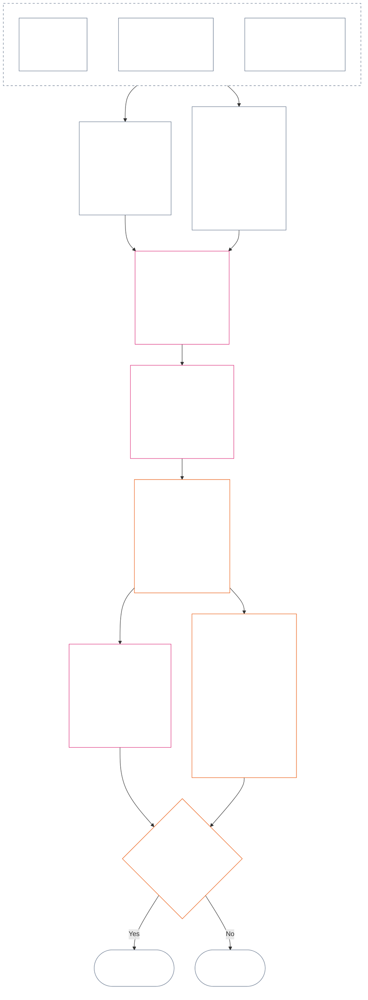

<!-- 简体中文 | 部分草稿：第十二章 §§4–6 | 源提交：9c2c8c10c871d91157bcd27b9f56ad6a1cec90d3 | AI 起草，未审阅 -->

### 4. 槽位语法与共同尺度化

*用直白的话说：本节为两个独立轴上的九个可能位置设定一致名称，并解释影响如何在各位置间尺度化。一个轴记录已核实贡献，另一个轴记录状态记录中的已核实违反行为。共享槽位编号不会合并两个轴，也不会以帮助抵消伤害。**§6**的统一尺度依据按比例计算的 LEQU 影响为两个轴指定槽位。*

槽位语法使用 `s` 表示槽位编号，范围从**1**到**9**。每个轴都有自己的槽位位置：

- **Contribution Axis**记录正向贡献性质；并且
- **Violation Axis**记录已核实的违反行为认定。

两个轴上可以出现相同的槽位编号，但两轴仍然分开。贡献槽位不是违反行为槽位，反之亦然。

#### 4.1 表1——槽位显示标签

**表1**为九个槽位命名，并并列展示 Contribution Axis 与 Violation Axis 的显示标签。本表仅提供显示用语；槽位依照**§6**的统一尺度指定。

| `s` | Contribution Axis 显示标签 | Violation Axis 显示标签 |
| ---: | --- | --- |
| 1 | **轻微基线贡献** | **轻微宪法影响** |
| 2 | **小幅基线贡献** | **小幅宪法影响** |
| 3 | **实质性正向贡献** | **实质性宪法影响** |
| 4 | **显著正向贡献** | **显著宪法影响** |
| 5 | **严重尽责管理正向贡献** | **严重宪法影响** |
| 6 | **重大尽责管理正向贡献** | **重大宪法影响** |
| 7 | **获认可的模范者** | **严峻宪法影响** |
| 8 | **杰出的模范者** | **严重宪法影响** |
| 9 | **典范模范者** | **灾难性宪法影响** |

Contribution Axis 使用基线、正向、尽责管理正向及模范者标签。Violation Axis 在所有槽位使用中性的影响标签。两个轴保持分离，不产生净分数，也不允许贡献记录与违反行为记录相互抵消。Violation Axis 槽位本身不会将行为归类为反宪法不当行为；[第十四章](core_14.000_misconduct_designation.md#chapter-fourteen-anti-constitutional-misconduct)会独立判定该反宪法不当行为指定（ACMD）是否适用于已核实且 `s` = 7–9 的违反行为。

实现可公布测量单位、证据方法和示例，帮助估算全生命周期等值利益或损失。这些材料仅供指引，不得凌驾于**§6**、**第一章**或**第六章**的 Rights Floor。

#### 4.2 共同影响尺度化规则

*用直白的话说：影响不能只按人数衡量。影响一名感知者的深刻利益或损失，可能比影响许多人的浅层效果更重大。人数、深度、脆弱性、持续时间、持久性、范围和宪法性质必须综合评估。*

用以下规则解释**§6**中的两个轴：

| 尺度维度 | 共同规则 | 轴的具体应用 |
| --- | --- | --- |
| **宪法结果量级（LEQU）** | 评估综合后的已核实利益或损失。LEQU 是量级的主要锚点；原始人数、金钱、产出或机构规模不是。 | 贡献计算符合权利要求的利益；违反行为计算已核实的宪法损失、伤害、浪费、机会封闭或危险。 |
| **感知者范围** | **同时考虑人数、深度与脆弱性**。没有任何槽位把人数单独列为门槛。如果综合量级及该行其他标准相同，对一名感知者足够深的影响可以支持与范围更广但深度更浅的影响相同的槽位；但仍须满足任何明文规定的 LEQU 总量或广泛范围标准。 | 依赖关系、能力降低或异常脆弱性可能提高实质性。仅凭群体规模不能确立贡献或严重程度。 |
| **时间范围** | 考虑持续时间、复发、持久性；若为损失，还要考虑不可逆性。短暂但带来转变的事件可能超过长期但轻微的效果；持续时间本身并非决定因素。 | 持久利益支持较高的贡献量级。持续或不可逆损失支持较高的违反行为严重程度。 |
| **空间或机构范围** | 更广的范围可能提高量级；但若深度、持续时间、脆弱性或宪法关键性本身即可支持该槽位，则无需证明影响跨越社区或机构。 | 机构修复可能提高贡献量级；结构性或系统性损害可能提高违反行为严重程度。 |
| **宪法质量或性质** | 将结果如何产生与结果传播多广分开衡量。同一事实不得重复计算。 | 转嫁出去的伤害、隐瞒的负担、俘获或依赖可能限制或取消所称贡献。义务、疏忽、欺骗、强制、暴力或结构性促成因素，仍作为违反行为性质单独记录，不改变影响槽位。 |
| **Rights Floor 与关键保障** | 不得以总体利益或损失来交换对 Rights Floor 的遵守。 | 遵守底线本身不能证明贡献较高。即使直接受影响的感知者人数很少，实质性地破坏 Rights Floor 或未能维持关键保障，也可能支持较高的违反行为严重程度。 |

这些维度不是要求每种规模形式都必须满足的清单。应说明哪些维度具有决定作用、哪些没有，以及原因。

- **共同槽位方法：**
  - 依据比例原则，以 LEQU 估算综合的已核实利益或损失，再指定唯一一个数值区间包含该量级的槽位。
  - 两个轴适用相同阈值。
  - 贡献槽位仍须满足适用的基线要求和宪法一致性要求；达到数值阈值，不能使转嫁伤害或违背宪法的产出算作贡献。
- **性质分离：**将适用的利益路线、伤害路线、行为质量和行为性质描述符叠加记录于状态记录中。义务、疏忽、欺骗、加重因素、强制、暴力、意图或结构性促成因素，可能影响归责、保障或问题3的后果，但均不得提高或降低 LEQU 影响槽位。
- **反宪法不当行为审查的边界：**已核实的 Violation Axis 损失可因影响达到 `s` = 7–9，不论是否确立反宪法不当行为。第十四章不取代影响槽位的指定；它另行判定相应 ACMD 是否适用。

如果危险尚未实际发生，须将下列事项分别记录：

- 发生可能性；
- 感知者会暴露于该危险多久；
- 影响可能延伸多远；
- 估算的不确定性；以及
- 仍属可信范围内的最坏结果。

除非采纳后的实施已设定任何人都可查阅的风险校准（将风险换算为 LEQU 的方法），不得将最坏结果计作已经发生的伤害（LEQU 损失）。

### 5. 用于指定轴的宪法输入

*用直白的话说：选择槽位前，先确认哪些宪法来源规定了正在测量的基线、利益、义务、伤害或违反行为。用下列链接在其规范性来源位置应用这些规定；不得把这一步路由变成另一种评分或替代定义。*

依照**§6**指定槽位前，状态记录必须指出：

- 适用的宪法基线、义务、约束或受保护利益；
- 确立所测量的已核实利益、不利结果、伤害或违反行为的条款；
- 对量级或行为性质有实质影响的定义、原则和 Rights Floor 条款；以及
- 每一项所列来源为何适用，以及它如何影响轴的指定。

下列路由表并非穷尽清单。已核实事实触发的任何其他定义、原则或条款仍然适用，且必须在状态记录中列明。每个链接指向的规范来源均有控制力；本表不重述或缩窄其内容。

#### 5.1 定义输入

| 规范来源 | Contribution Axis 的作用 | Violation Axis 的作用 |
| --- | --- | --- |
| [状态、贡献与违反行为](core_05.035_band_accountability.md#defa3-standing-state-contribution-and-violation) | 说明何为贡献，以及可以用哪些经检查的事实衡量贡献；同时确保贡献状态记录只记录正向，不与负向混杂。 | 说明何为违反行为以及如何记录，并将最严重的案件送交反宪法不当行为审查；该审查单独处理破坏宪法本身的行为。 |
| [问责](core_05.005_apex_accountability_leg.md#accountability) | 检查良好尽责管理或修复的主张是否真正使某人承担责任。仍须显示谁做了什么、谁须对此负责，以及如何依影响程度对其审查、补救和纠正。 | 发现无法确定由谁实施或由谁负责的案件，包括组织或结构改变后责任机制失效的情形。 |
| [伤害](core_05.035_band_accountability.md#harm) | 转嫁给他人或被隐瞒的伤害，可能限制或抵消所称利益。修复伤害可以算作利益，但只有在修复经核实并获独立证明时才可以。 | 说明衡量损失和严重程度时计入的损害类型：直接、间接、延迟、累积、跨系统传播的损害，以及对感知者心智或情绪福祉的伤害。 |
| [实质性](core_05.050_band_oversight.md#materiality)与[寿命等值单位（LEQU）](core_05.055_band_participation.md#lifespan-equivalent-unit-lequ) | 根据利益影响范围、受影响者脆弱程度和持续时间，确定已核实利益的计入程度。结果以 LEQU 测量，这是完整生命利益的共同尺度。 | 根据已核实损失或危险的影响范围、受影响者脆弱程度、持续时间及可逆难度，确定计入程度。结果以 LEQU 测量，与完整生命损失使用同一尺度。 |
| [贡献性质](core_05.035_band_accountability.md#contribution-nature) | 决定某事项是否构成贡献。该事项必须纯属正向，不得混有伤害，并须有可展示的已核实贡献记录。缺少任何一项都不能指定 Contribution Axis。 | 在此不发挥作用。它不决定何为伤害，也绝不降低违反行为的严重程度。 |
| [违反行为性质](core_05.035_band_accountability.md#violation-nature) | 在此不发挥作用。违反行为绝不算作负贡献，也不会抹去与其无关的已核实利益。 | 决定某事项是否构成违反行为。必须将其归类为有害，并有已核实认定支持违反行为确已发生。缺少任何一项都不能指定 Violation Axis。 |
| [宪法约束](core_05.045_band_integrative.md#constitutional-constraint)、[权限层级与内部等级](core_05.045_band_integrative.md#authority-stack-and-internal-hierarchy)及[可审计性](core_05.050_band_oversight.md#auditability) | 若所称利益依赖于挫败宪法、规避规则、缩减 Rights Floor（宪法保障的最低保护）或仅在纸面上合规，则阻止其计入。 | 标示影响违反行为真实严重程度的事项：破坏重要宪法限制、把某事置于宪法权限之上、规避规则或使规则无法执行。 |
| [可审计性](core_05.050_band_oversight.md#auditability)与[可质疑性](core_05.035_band_accountability.md#contestability) | 要求所称利益可以展示和核查，且任何异议方都有有效的质疑途径。 | 要求认定可以核查和质疑。没有说明的指控或标签不能确定违反行为的严重程度。 |

#### 5.2 原则输入

| 原则来源 | 在轴指定中的作用 |
| --- | --- |
| [宪法四元](core_00.000_preamble.md#constitutional-tetrad)、[两项宪法宗旨](core_00.000_preamble.md#two-constitutional-aims)与[实质利害](core_00.000_preamble.md#material-stake) | 设定四项工作纪律（参与、监督、问责与及时性）、宪法追求的两项结果（繁盛与延续），以及按利害事项规模化每项指定的框架。 |
| [福祉](core_01.000_values_principles.md#3-foundational-objective-wellbeing-flourishing-aim)与[认可、强化和追求](core_01.000_values_principles.md#32-recognition-reinforcement-and-aspiration) | 在 Contribution Axis 上为符合权利的利益及相称认可奠定基础。声望或奖励绝不作为贡献证明。 |
| [安全](core_01.000_values_principles.md#4-safety-harm-constraint)与[真实](core_01.000_values_principles.md#5-truth-epistemic-integrity-constraint) | 对两个轴设定有约束力的限制。通过伤害或欺骗取得的利益不得全额计入；安全或真实方面经核实的失败可表明违反行为的量级或种类。 |
| [深入尽责管理](core_01.010_stewardship_capacity_principles.md#16-stewardship-in-depth)与[尽责管理纪律下的治理](core_01.010_stewardship_capacity_principles.md#18-governance-under-stewardship-discipline) | 在已核实事实需要时，指导如何权衡持久贡献、角色义务、机构修复、监督和责任。 |
| [核心权衡原则](core_01.005_interaction_interpretation.md#131-core-tradeoff-principles)与[宪法底线、安全与反贬损程序](core_01.005_interaction_interpretation.md#1314-constitutional-floors-safety-and-anti-degrading-process) | 在所测量行为涉及必要性、尽量减少伤害、比例原则、权利冲突或限制时适用。它们本身绝不授权任何后果。 |

#### 5.3 Rights Floor 与条款输入

| 条款来源 | 在轴指定中的作用或边界 |
| --- | --- |
| 事实适用的[第六章 Rights Floor](core_06.000_rights_part_a.md#chapter-six-foundational-rights)，包括已核实状态记录实质涉及的每一条款 | 确立争议中的基本保护、利益、义务、利益项或违反行为。不得仅因某条款未列于下方而将其遗漏。 |
| [Article XIX——状态与参与状态](core_06.015_rights_part_d.md#article-xix-standing-and-participation-status) | 区分感知者的状态、尊严、Rights Floor 最低保护、利益相关方状态、声誉，以及参与状态的任何后续变化。 |
| [Article XIII-A——可靠性与可信度基线](core_06.010_rights_part_c.md#article-xiii-a-reliability-and-trustworthiness-baseline)、[Article XIII-B——救济与补救权](core_06.010_rights_part_c.md#article-xiii-b-right-to-redress-and-remedy)、[Article XV-B——透明度、可审计性与可质疑性](core_06.010_rights_part_c.md#article-xv-b-transparency-auditability-and-contestability)及[Article XVI——审计、透明度与独立核验](core_06.010_rights_part_c.md#article-xvi-audit-transparency-and-independent-verification) | 当已核实利益或违反行为涉及诚信记录、信息共享、事实核查、质疑决定或纠正错误时适用。 |
| [Article XXIV——根本原因分析与适应性响应](core_06.015_rights_part_d.md#article-xxiv-root-cause-analysis-and-adaptive-response) | 当行为原因、是否纠正、是否持续发生或响应是否调整具有重要性时适用，因为这些事项表明该行为在宪法下的性质。 |
| [Article XX——已核实违反行为后的正义](core_06.015_rights_part_d.md#article-xx-justice-after-verified-violation)与[Article XXVI-C——及时解决与反拖延底线](core_06.020_rights_part_e.md#article-xxvi-c-timely-resolution-and-anti-delay-floor) | 适用于事实实际涉及的任何程序或延迟。**Article XX**（*已核实违反行为后的正义*）主要限制违反行为测量完成后发生的事项（问题3）。不得仅为论证某人预先偏好的响应而用它提高或降低问题2槽位。 |

**适用限制。**本步骤只指向适当来源。

- 本步骤不会：
  - 重开问题1；
  - 引入尚未核实的事实；
  - 增加新测量或分数；
  - 通过不同来源重复计算同一事实；
  - 合并两个轴；或
  - 要求所有列出的来源都适用于每条状态记录。
- 贡献和违反行为仍分别测量。
- **Article XX**（*已核实违反行为后的正义*）的后果不属于问题2。
- 第十四章指定审查与此处指定的影响槽位仍然分开。

### 6. 统一比例 LEQU 尺度——Contribution 与 Violation Axes

<strong>读者指引（非操作性）：五倍递进如何运作</strong>

> 尺度采用五倍递进，以 `s` = 7 = 一个 LEQU 为锚点。两个轴均适用：槽位 `s` 在2至9时，其最低量级为 `5^(s−7)` LEQU；槽位1从零开始。采纳后的实施可公布所得数值阈值与校准示例。槽位1在 Contribution Axis 上包括已核实的宪法基线，在 Violation Axis 上包括低于首个正向阈值的已核实损失；没有贡献或没有违反行为本身都不是 `s` = 1 记录。
>
> **便于理解的锚点。**以80年人类寿命作为校准示例，向上读中间列，表示新增的全生命周期等值利益、可用时间或符合权利的资源与能力；向下读则表示等值损失、剥夺、浪费或机会封闭。资源数量本身不计入，起决定作用的是它造成或避免的宪法结果。

 

*用直白的话说：**表2**将已核实贡献与已核实违反行为放在同一比例影响尺度上。槽位越高，综合宪法利益或损失越大。状态记录与轴仍然分开：共同尺度比较量级，不比较道德价值，也绝不允许帮助抵消伤害。*

下图从头到尾展示一次槽位指定。它显示实际处理步骤的顺序，与下方项目符号顺序不同；项目符号逐项说明规则。

依照**比例原则**，根据深度、感知者范围、脆弱性、持续时间、持久性或不可逆性、范围以及宪法关键性，估算综合 LEQU 影响。这些维度决定 LEQU 估算；不是独立的槽位加分。

- **表2**只可在问题1确认发生事项、问题2测量已核实利益或损失、适用**§§1–3和§4.2**，且已依照**§5**识别所需宪法来源后使用。
- 根据综合 LEQU 估算指定一个槽位。
  - 说明每个实质尺度化维度如何影响估算，以及未纳入的维度为何不起决定作用。
  - 每项指定均须满足：
    - 可追溯性；
    - 可审计性；
    - 可质疑性；以及
    - 适用的 Rights Floor。
  - 贡献还须满足不向外转嫁和宪法一致性要求。
- 将行为性质事实作为可单独追溯的描述符记录。它们可影响归责、审查强度、保障、救济或第十四章的指定；只有在已核实后果改变综合 LEQU 影响时，才会影响槽位。
- 通过实质尺度化维度，充分评估行动或行为过程的已核实后果，包括：
  - 身体伤害；
  - 心理创伤；
  - 强制效果；
  - 剥夺自由或自由受到威胁；
  - 累积伤害；以及
  - 其他宪法上可识别的利益或损失。
- 不得：
  - 仅因某事件或行为过程被描述为具有以下特征而提高或降低槽位：
    - 义务；
    - 疏忽；
    - 意图；
    - 隐瞒；
    - 重复；
    - 加重；
    - 强制；
    - 暴力；
    - 自由受威胁；
    - 可纠正性；或
    - 某人偏好的后果。
  - 从量级推断行为性质，或以行为性质取代已核实量级。

**表2**按顺序列出九个槽位。每行均列明槽位编号 `s`、达到该槽位的利益增量或损失量（以80年人类寿命作为校准示例），以及该槽位在两个轴上的名称。两个轴的阈值相同，但名称保持分开：Contribution Axis 槽位与 Violation Axis 槽位是不同记录，绝不相互抵消。

| `s` | 80年人类校准——增加的利益／造成的损失 | Contribution Axis | Violation Axis |
| ---: | --- | --- | --- |
| 1 | 少于约**9天** | **轻微基线贡献**——针对所评估范围，已核实满足宪法底线；任何可测量的提升仍低于 `s` = 2。 | **轻微宪法影响**——低于 `s` = 2 的已核实损失或运行损害，包括尚未证明实质伤害的正式缺陷。 |
| 2 | 约**9–47天** | **小幅基线贡献**——在此影响等级内，可靠且范围有限地超过最低底线。 | **小幅宪法影响**——在此影响等级内，经核实的有限损失。 |
| 3 | 约**47天–8个月** | **实质性正向贡献**——在此影响等级内，超越基线且可证明的利益。 | **实质性宪法影响**——在此影响等级内，经核实的重大损失。 |
| 4 | 约**8个月–3.2年** | **显著正向贡献**——更深、持久、反复发生、响应脆弱性或范围更广的已核实利益。 | **显著宪法影响**——经核实的显著宪法损失。 |
| 5 | 约**3.2–16年** | **严重尽责管理正向贡献**——持久的尽责管理、协调、维护、修复或类似的持续利益。 | **严重宪法影响**——经核实的严重宪法损失。 |
| 6 | 约**16–80年** | **重大尽责管理正向贡献**——重大且已核实、接近一个 LEQU 的利益。 | **重大宪法影响**——重大且已核实、接近一个 LEQU 的损失。 |
| 7 | 约**1–5个生命周期**（**80–400年**） | **获认可的模范者**——至少一个 LEQU、已核实且符合宪法的利益。 | **严峻宪法影响**——至少一个 LEQU 的已核实宪法损失。 |
| 8 | 约**5–25个生命周期**（**400–2,000年**） | **杰出的模范者**——实质性超过 `s` = 7 的已核实利益。 | **严重宪法影响**——实质性超过 `s` = 7 的已核实损失。 |
| 9 | 至少**25个生命周期**（**2,000年以上**） | **典范模范者**——实质性超过 `s` = 8 的已核实利益。 | **灾难性宪法影响**——实质性超过 `s` = 8 的已核实损失。 |

<strong>实施互操作性说明</strong>

> 此组件包含面向实施的互操作性材料，用于支持本章的操作类别，不会建立并行的类别体系。

槽位显示的机器可读字段（`sub_tier`、`sub_tier_display`及相关显示字段）定义于[CH06_NINE_SLOT_STANDING_SCALE.md](implementation/CH06_NINE_SLOT_STANDING_SCALE.md)和[ch06_nine_slot_constants.json](implementation/ch06_nine_slot_constants.json)。实施中的四区间映射仍是互操作性辅助工具，不会给操作性**表2**增加主要区间列。

参考方法及槽位指定实例（包括针对具有权重、保存状态检查点且没有固定死亡期限的感知者）见[LEQU_CALIBRATION_REFERENCE.md](implementation/LEQU_CALIBRATION_REFERENCE.md)。这些内容不得取代**§6**中的共同阈值和比例指定规则，不得指定一条正在处理的记录，也不得决定谁算作感知者。

采纳后的实施可公布 LEQU 估值和键控显示标签。这些辅助工具不得取代**§6**中的共同阈值与比例指定规则，也不得取代第十四章的指定保障，除非通过**符合性文件**变更。

