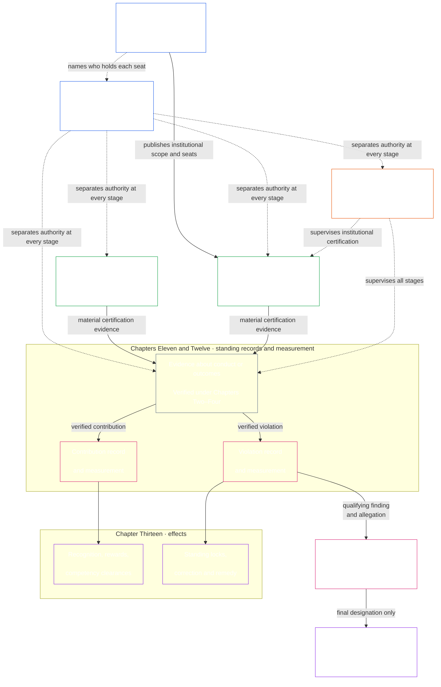
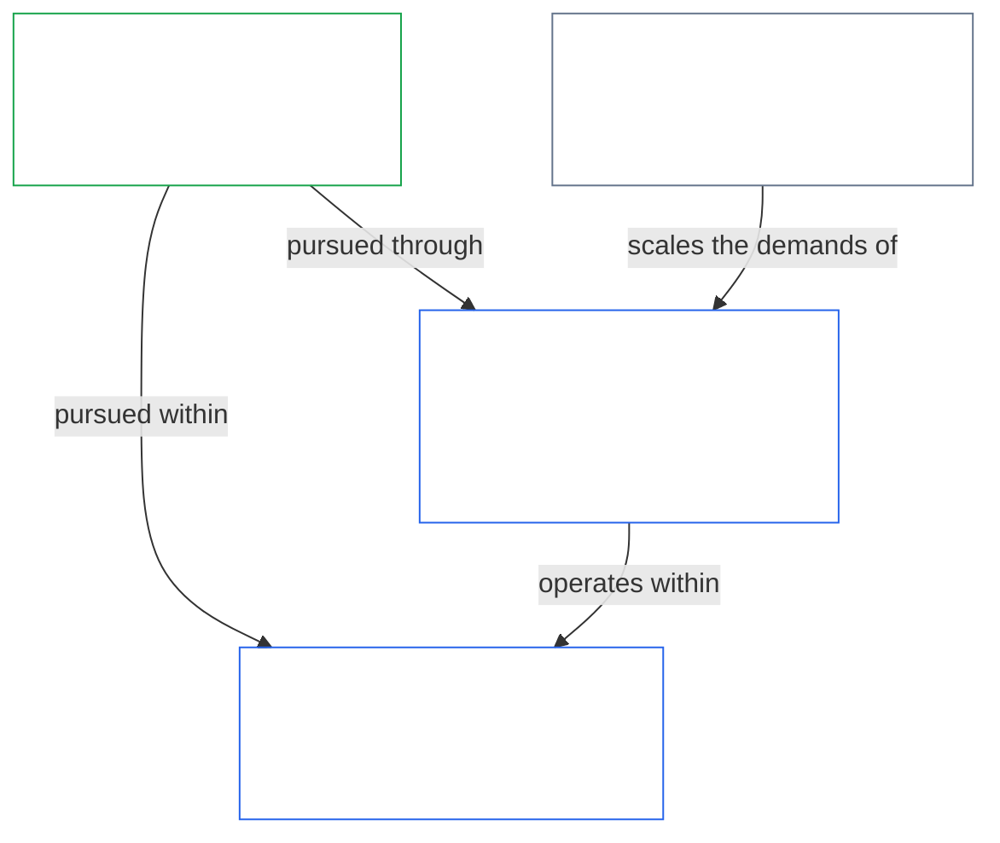
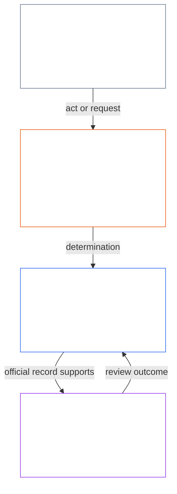

<!-- Locale: Indonesian (id) | Source commit: 630b161c | Baseline commit: 5067e1774b0877a2ef35efc7d20ba99a2b305e05 | AI-drafted, unreviewed | Partial changed-passage refresh -->

Ketika Konstitusi mensyaratkan aturan pengukuran yang konkret, **Ranah Forum Teknis** di bawah [Bab Lima Belas](core_15.000_forum.md#42-technical-forum-domains) mengembangkan dan memelihara standar bersama untuk pengukuran, pengujian, dan bukti yang andal. Forum yang bertanggung jawab atas suatu sengketa kemudian menerapkan standar tersebut ketika memutus perkara menurut [Bab Lima Belas §4.2 (*Ranah Forum Teknis*)](core_15.000_forum.md#42-shared-standards-and-anti-displacement).

- **Catatan standing** ([Bab Sebelas](core_11.000_standing_assessment.md#chapter-eleven-standing-records--question-1-what-happened)) — ketika tindakan atau bahaya penting secara konstitusional, masukkan fakta terverifikasi ke berkas perkara formal tentang kontribusi atau pelanggaran; rumor dan reputasi saja tidak cukup.
- **Koreksi dan pemulihan** ([Bab Tiga Belas §5.1 (*Pemulihan dan koreksi*)](core_13.000_standing_integration.md#51-remedy-and-correction)) — perbaiki kegagalan yang mendasari dan berikan pengakuan, perbaikan, pemulihan, atau kompensasi yang proporsional kepada mereka yang dirugikan.
- **Peninjauan forum** ([Bab Lima Belas](core_15.000_forum.md#1-purpose-and-role--participation-architecture))

Kemampuan untuk menggugat pada lapisan partisipasi merupakan langkah pertama biasa untuk sengketa dalam sistem yang telah mendapat wewenang: sentient yang terdampak terlebih dahulu menggunakan jalur tantangan yang diterbitkan. [Peninjauan forum](core_15.000_forum.md#1-purpose-and-role--participation-architecture) yang independen tidak menggantikan jalur tersebut, dan jalur tersebut juga tidak menggantikan peninjauan forum ketika tetap disengketakan, tidak tersedia atau telah dikuasai, atau tidak dapat memberikan pemulihan yang diperlukan. [Urutan penyelesaian sengketa](core_15.000_forum.md#dispute-sequencing) menurut Bab Lima Belas menetapkan kapan perutean ke forum mengambil alih.

- **Apa yang dihasilkannya:** Alur verifikasi yang memasok **masukan terverifikasi** untuk [Bab Sebelas](core_11.000_standing_assessment.md#chapter-eleven-standing-records--question-1-what-happened) dan bukti keselarasan sistem untuk [Bab Sembilan](core_09.000_system_alignment_certification_evaluation.md#chapter-nine-system-alignment-certification). Alur itu tidak menggantikan pengukuran standing itu sendiri.

  - Aturan Transisi Adopsi.

- **Apa yang dihasilkannya:** Perlindungan hak yang tidak dapat ditawar dan kaitan pemulihan yang harus dihormati oleh Bab Tujuh sampai Lima Belas, forum, tata kelola, dan aturan amendemen; semua itu tidak boleh dipersempit, dilewati, atau dikosongkan melalui prosedur maupun ukuran proksi.

*Dalam bahasa sederhana: sistem atau institusi yang berdampak nyata menerbitkan Piagam Sistem atau Piagam Institusi yang menyatakan apa yang boleh dilakukannya dan siapa yang memegang setiap kursi. Lalu, sebelum tindakan yang mengikat secara material bergerak, pisahkan siapa yang memulainya, siapa yang memeriksa atau mengizinkannya, siapa yang memegang catatan resmi, dan siapa yang meninjau tantangan. Perannya dapat disesuaikan dengan keadaan, tetapi pelaku yang sama beserta garis kendalinya tidak boleh diam-diam memegang kursi yang memeriksa tindakannya sendiri.*

  - bagaimana Piagam Sistem atau Piagam Institusi diubah dan ditinjau agar lingkup piagamnya tidak berubah secara diam-diam; dan

> Peta ini menunjukkan empat fungsi dan contoh alur suatu tindakan beserta Catatan Tindakannya. Peta ini tidak menambah kursi kelima, menetapkan urutan universal, atau mengubah aturan Bab Delapan tentang independensi, penggabungan peran yang proporsional, tindakan darurat, atau perutean tantangan.

*Dalam bahasa sederhana: Bab Sembilan sampai Lima Belas menerapkan persyaratan pemisahan tugas Bab Delapan sebagai satu rantai: menyertifikasi sistem dan institusi, mengukur bantuan dan bahaya pada dua jalur terpisah, menerapkan dampak nyata dan pemulihan, serta mencegah forum menjadi satu-satunya tempat akhir bagi klaim terhadap dirinya sendiri. Rantai ini menjaga agar kewajiban konstitusional nyata dalam kehidupan sehari-hari.*

[ Bab Tujuh](core_07.000_charters.md#chapter-seven-system-and-institutional-charters) menerbitkan lingkup piagam dan peta kursi setiap sistem dan institusi Kelas L atau lebih tinggi. [Bab Delapan](core_08.000_functional_independence_separation_of_duties.md#chapter-eight-functional-independence-and-separation-of-duties) menyediakan persyaratan pemisahan tugas yang memungkinkan setiap tindakan dalam rantai ini diperiksa secara sah. Bab itu mengharuskan fungsi penginisiasian, verifikasi atau otorisasi, penguasaan catatan resmi, dan peninjauan tantangan ditetapkan dan dipisahkan menurut aturan penskalaan dan independensi yang berlaku. Bab Sembilan sampai Lima Belas kemudian menerapkan arsitektur itu secara berurutan:

- **Bab Sembilan** menggunakan verifikasi independen untuk menentukan apakah sistem atau institusi yang berdampak material selaras dalam lingkup dan rentang catatan yang dinyatakannya. Bab Sembilan mengatur sertifikasi sistem; Bab Sepuluh mengatur sertifikasi institusi, termasuk kelas, evaluasi, catatan, dan hasil remediasi institusi itu sendiri.
- **Bab Sebelas** mengambil fakta terverifikasi dan mencatatnya dalam catatan standing Kontribusi dan Pelanggaran yang terpisah.
- **Bab Dua Belas** mengukur setiap catatan standing pada sumbunya sendiri. Kontribusi terverifikasi terhadap kemekaran tidak mengimbangi, membatalkan, atau mengurangi bahaya atau kegagalan akuntabilitas terverifikasi yang terpisah; masing-masing tetap dicatat dan tunduk pada konsekuensinya sendiri.
- **Bab Tiga Belas** mengubah klasifikasi tersebut menjadi dampak standing yang proporsional, termasuk izin kompetensi dan pengakuan pada jalur kontribusi serta kunci standing, koreksi, dan pemulihan pada jalur pelanggaran.
- **Bab Empat Belas** hanya berlaku setelah Bab Dua Belas mengukur pelanggaran berdampak tinggi. Bab itu memutuskan apakah perilaku tersebut secara mandiri memenuhi kriteria penetapan akhir pelanggaran anti-konstitusional (ACMD), setelah perlindungan proses hukum yang semestinya.
- **Bab Lima Belas** mengawasi perutean, bukti, pemindahan, independensi forum, dan penyelesaian tepat waktu agar catatan dan dampak yang dihasilkan dapat ditantang, dikoreksi, dan ditegakkan tanpa membiarkan forum yang dikuasai menjadi satu-satunya hakim akhir atas perilakunya sendiri.

- **Peninjauan pelanggaran** menjawab pertanyaan tersendiri: apakah pelanggaran yang memenuhi syarat juga patut mendapat penetapan akhir ACMD.
- **Pengawasan forum** mengendalikan perutean, bukti, pemindahan, tantangan, dan pemulihan agar catatan resmi serta keputusan dapat ditinjau dan dikoreksi tepat waktu.

2. **Sertifikasi sistem dan institusi bila dampaknya cukup serius** — sebelum Sistem berdampak tinggi dipercaya dalam skala besar, dapatkan Catatan Sertifikasi Sistem yang dapat ditantang ([Bagian A–B Bab Sembilan](core_09.000_system_alignment_certification_evaluation.md#chapter-nine-system-alignment-certification)); evaluasi Institusi berdasarkan kelas, perilaku, tata kelola, dan portofolionya sendiri menurut [Bab Sepuluh](core_10.000_institutional_alignment_certification.md#chapter-ten-institutional-alignment-certification), lalu catat hasilnya dalam Catatan Sertifikasi Institusi.
3. **Catat dan ukur standing pada jalur terpisah** ([Bab Sebelas](core_11.000_standing_assessment.md#chapter-eleven-standing-records--question-1-what-happened) dan [Bab Dua Belas](core_12.000_standing_measurement.md#chapter-twelve-standing-measurement--question-2-how-good-or-bad-was-it)) — ketika bantuan atau bahaya cukup serius untuk penting secara konstitusional, Bab Sebelas harus membuka berkas perkara formal dan hanya menerima **masukan terverifikasi** (termasuk bukti sertifikasi keselarasan sistem dari Bab Sembilan jika bukti itu material), lalu Bab Dua Belas mengukur dan mengklasifikasikan hal yang telah diverifikasi. Rumor, reputasi, dan cerita sengketa tidak cukup.
   - **Sifat pelanggaran:** Buka **catatan standing pelanggaran** — berkas perkara terbatas dan dapat ditantang untuk bahaya terverifikasi dan kegagalan akuntabilitas — lalu klasifikasikan **sifat pelanggaran** pada Violation Axis. Bantuan dan bahaya tidak pernah digabung menjadi satu skor bersih; catatan standing terkait saling merujuk tetapi tetap terpisah.
4. **Terapkan dampak standing pada tiap jalur** ([Bab Tiga Belas](core_13.000_standing_integration.md#chapter-thirteen-standing-effects-and-integration)) — kontribusi terverifikasi dapat memberikan izin kompetensi dan harus mendukung pengakuan proporsional serta imbalan material; pelanggaran terverifikasi dapat memicu kunci standing, koreksi, dan [pemulihan bagi mereka yang dirugikan](core_13.000_standing_integration.md#51-remedy-and-correction).
5. **Lakukan peninjauan penetapan anti-konstitusional** ([Bab Empat Belas](core_14.000_misconduct_designation.md#chapter-fourteen-anti-constitutional-misconduct)) — jika temuan pelanggaran berdampak tertinggi mungkin juga memenuhi kriteria anti-konstitusional, Bab Empat Belas harus memutuskan apakah ACMD yang sesuai berlaku. ACMD tersebut tidak mengubah tingkat keseriusan bahaya yang telah diukur Bab Dua Belas. Dampak Bab Tiga Belas yang biasa tetap berjalan paralel sampai ACMD final memicu Kunci Kepercayaan Anti-Konstitusional.
6. **Rutekan sengketa dan pastikan pemulihan tepat waktu** ([Bab Lima Belas](core_15.000_forum.md#1-purpose-and-role--participation-architecture)) — forum harus mengawasi perpindahan perkara, jalur yang menanganinya, dan pemenuhan tenggat menurut **Article XXVI-C** (*Batas Waktu Penyelesaian dan Pencegahan Penundaan*) agar pemulihan tidak mati karena penundaan. Sengketa biasa mengikuti [Urutan penyelesaian sengketa](core_15.000_forum.md#dispute-sequencing). Forum juga harus mengklasifikasikan sengketa ke dalam lima [tingkat materialitas](core_15.000_forum.md#6-timely-resolution-materiality-tiers-and-anti-delay-discipline) (A/B/C/L/P) yang mencerminkan alfabet klasifikasi sistem — dari urgensi kritis bagi kelangsungan hidup hingga perkara privat/terbatas. Perutean default keluarga integritas berlaku ketika penetapan akhir Bab Empat Belas merupakan kepentingan utama.

**Bab Sembilan — [Sertifikasi keselarasan sistem](core_09.000_system_alignment_certification_evaluation.md#chapter-nine-system-alignment-certification)**

- **Lingkupnya:** Memastikan sistem yang berdampak material tetap selaras secara konstitusional.
- **Hasilnya:** **Catatan Sertifikasi Sistem** untuk setiap sistem yang lulus — temuan terbatas dan dapat ditantang tentang keselarasan sistem dalam lingkup dan rentang catatan yang dinyatakannya.

**Bab Sepuluh — [Sertifikasi keselarasan institusi](core_10.000_institutional_alignment_certification.md#chapter-ten-institutional-alignment-certification)**

- **Lingkupnya:** Memastikan institusi yang berdampak material tetap selaras secara konstitusional melalui enam fase yang sama dengan Bab Sembilan dan dengan nomor bagian yang sama. Institusi dinilai berdasarkan hal-hal yang hanya dikendalikannya: apakah ia mematuhi Piagam Institusinya, siapa yang bertanggung jawab atas kewenangannya, apa yang diberinya imbalan, dan apakah pemeriksaan independen terhadapnya dapat digunakan. Bab ini mengandalkan sertifikasi tiap sistem dan tidak mengulanginya.
- **Hasilnya:** **Catatan Sertifikasi Institusi** untuk setiap institusi yang lulus — temuan terbatas dan dapat ditantang tentang keselarasan institusi dalam lingkup dan rentang catatan yang dinyatakannya. Bab Sepuluh menggunakan kembali proses forum tanpa mengulang evaluasi sistem; sertifikasi institusi bukan lisensi atau gerbang untuk membentuk atau menjalankan institusi.

**Bab Sebelas — [Catatan standing](core_11.000_standing_assessment.md#chapter-eleven-standing-records--question-1-what-happened)**

- **Lingkupnya:** Ketika tindakan penting secara konstitusional, rumor dan reputasi tidak cukup — fakta terverifikasi masuk ke **catatan standing**. **Kontribusi** (bantuan untuk kemekaran) dan **pelanggaran** (kegagalan akuntabilitas dan bahaya) dicatat dalam **catatan standing terpisah**: bantuan terverifikasi tidak menghapus bahaya terverifikasi, dan keduanya tidak pernah digabung menjadi satu skor bersih.
- **Hasilnya:** **Catatan standing** terbatas pada jalur Kontribusi dan Pelanggaran, hanya berdasarkan **masukan terverifikasi** dan temuan yang diawasi forum; penilaian informal dan narasi sengketa tidak dapat menggantikan catatan standing terverifikasi.

**Bab Dua Belas — [Pengukuran standing](core_12.000_standing_measurement.md#chapter-twelve-standing-measurement--question-2-how-good-or-bad-was-it)**

- **Lingkupnya:** Mengukur seberapa baik atau buruk fakta terverifikasi. Kontribusi dan pelanggaran diukur pada **sumbu terpisah**, masing-masing dengan skala terpadu yang sama, dan tidak pernah digabung menjadi satu skor bersih.
- **Hasilnya:** Pengukuran terklasifikasi — sifat, ukuran, dan slot — pada Contribution Axis atau Violation Axis untuk setiap catatan standing.

**Bab Tiga Belas — [Integrasi dan dampak standing](core_13.000_standing_integration.md#chapter-thirteen-standing-effects-and-integration)**

    - [**Izin kompetensi**](core_13.000_standing_integration.md#72-competency-bars-and-clearances) yang dapat membuka peran sensitif-kepercayaan, kewenangan delegasian, kelayakan pengawasan, dan pengelolaan bertanggung jawab dengan konsekuensi bertahap ketika kompetensi terbukti terhadap ambang kompetensi yang diterbitkan dan tidak ada [kunci standing](core_13.000_standing_integration.md#52-prevention--general-standing-locks) yang berlaku untuk menghalangi jalur bernama

    - **Kunci standing**, batasan peran, perintah remediasi, [pemulihan bagi mereka yang dirugikan](core_13.000_standing_integration.md#51-remedy-and-correction), deskriptor tambahan, dan kaitan penegakan

**Bab Empat Belas — [Perlindungan dari pelanggaran anti-konstitusional](core_14.000_misconduct_designation.md#chapter-fourteen-anti-constitutional-misconduct)**

- **Lingkupnya:** Hanya menangani pelanggaran terverifikasi paling serius — perilaku yang mungkin telah menguasai atau mengosongkan kewajiban konstitusional dalam skala besar. Setelah Bab Dua Belas mengukur temuan pelanggaran berdampak tertinggi dan pelanggaran anti-konstitusional didalilkan secara material, bab ini menjalankan peninjauan penetapan sebagai jalur gerbang Bab Tiga Belas secara paralel dengan dampak standing Bab Tiga Belas yang biasa.
- **Hasilnya:** ACMD final — atau penolakan — untuk temuan berdampak tertinggi tersebut, hanya setelah kriteria dan perlindungan proses hukum yang semestinya dipenuhi. Bab Dua Belas tetap mengukur tingkat keseriusan bahaya. Hanya ACMD final yang memicu **Kunci Kepercayaan Anti-Konstitusional** Bab Tiga Belas.

**Bab Lima Belas — [Pengawasan dan perutean forum](core_15.000_forum.md#chapter-fifteen-forums-and-jurisdiction)**

  - [Urutan penyelesaian sengketa](core_15.000_forum.md#dispute-sequencing) dari jalur tantangan Partisipasi Sistem Pemangku Kepentingan yang diterbitkan menuju perutean forum;

- **Hasilnya:** **Temuan standing** yang dapat membuka atau memperbarui catatan standing, serta perutean yang sah menuju pemulihan dan [penyelesaian tepat waktu](core_05.035_band_accountability.md#timely-resolution). Forum mengawasi alur kerja; forum tidak menggantikan pengukuran standing Bab Dua Belas.

*Dalam bahasa sederhana: Bab Enam Belas sampai Dua Puluh menutup Konstitusi ini: siapa yang boleh memerintah, bagaimana teks dapat berubah tanpa membatalkan perlindungan, bagaimana teks berhubungan dengan hukum lain, dan bagaimana berkas panduan yang diadopsi tetap terikat pada sumber ini.*

Bab **Lima Belas sampai Sembilan Belas** menutup Konstitusi ini. Bersama-sama, bab tersebut melengkapi [daftar pemilik konstitusional](#4-principles-definitions-and-rights) untuk tata kelola, keabsahan perubahan, dan inkorporasi: siapa yang dapat memerintah secara sah, bagaimana Konstitusi dapat diubah secara sah, dan bagaimana teks pelaksanaan yang diadopsi tetap terikat pada sumber konstitusional tanpa pergeseran diam-diam.

**Bab Enam Belas — Kontrak konstitusional, legitimasi, dan pengelolaan bertanggung jawab** ([`core_16.000_governance.md`](core_16.000_governance.md#chapter-sixteen-constitutional-contract-legitimacy-authorization-and-stewardship))

**Bab Tujuh Belas — Non-regresi** ([`core_17.000_non_regression.md`](core_17.000_non_regression.md#chapter-seventeen-non-regression-and-substantive-amendment-validity))

**Bab Delapan Belas — Supremasi dan perintah eksternal** ([`core_18.000_expansion_supremacy.md`](core_18.000_expansion_supremacy.md#chapter-eighteen-expansion-supremacy-and-external-legal-orders))

- **Lingkupnya:** Bagaimana Konstitusi ini berhubungan dengan norma lain: perluasan perlindungan jika sah, supremasi dalam lingkup sumber, adopsi, dan lapisan tata kelolanya yang berlaku, tidak menggantikan hukum eksternal yang berlaku dengan kekuatannya sendiri, serta interaksi tertib dengan tatanan hukum eksternal tanpa subordinasi diam-diam atau penguasaan.

**Bab Sembilan Belas — Amendemen, ratifikasi, dan adopsi** ([`core_19.000_amendment_ratification.md`](core_19.000_amendment_ratification.md#chapter-nineteen-amendment-ratification-and-procedural-validity))

- **Lingkupnya:** Bagaimana Konstitusi ini dapat diubah secara sah — prosedur amendemen, ratifikasi, dan adopsi — beserta **perlindungan prosedural** yang mengikuti perlindungan substantif Bab Tujuh Belas: perubahan harus diterbitkan secara terbuka, dapat ditelusuri ke penguasaan otoritatif, dan tetap sungguh-sungguh dapat ditantang dengan peninjauan independen jika diwajibkan.

**Bab Dua Puluh — Jembatan inkorporasi** ([`core_20.000_incorporation.md`](core_20.000_incorporation.md))

Ketika pengadopsi memasukkannya secara sah menurut [Bab Dua Puluh](core_20.000_incorporation.md), berkas-berkas tersebut mengikat sebagai teks pelaksanaan dalam lingkup adopsi. Makna Konstitusi Sentient tetap mengendalikan — berkas itu **melaksanakan, bukan mempersempit**, bab-bab di atas. Penetapan edisi, rantai penguasaan, dan aturan tanpa-pergeseran-diam-diam menjaga keterlacakan teks yang diadopsi ke teks yang benar-benar diratifikasi. Daftar kanonis dan aturan batas terdapat di [Bab Lima — Korpus](core_05.045_band_integrative.md#corpus).
