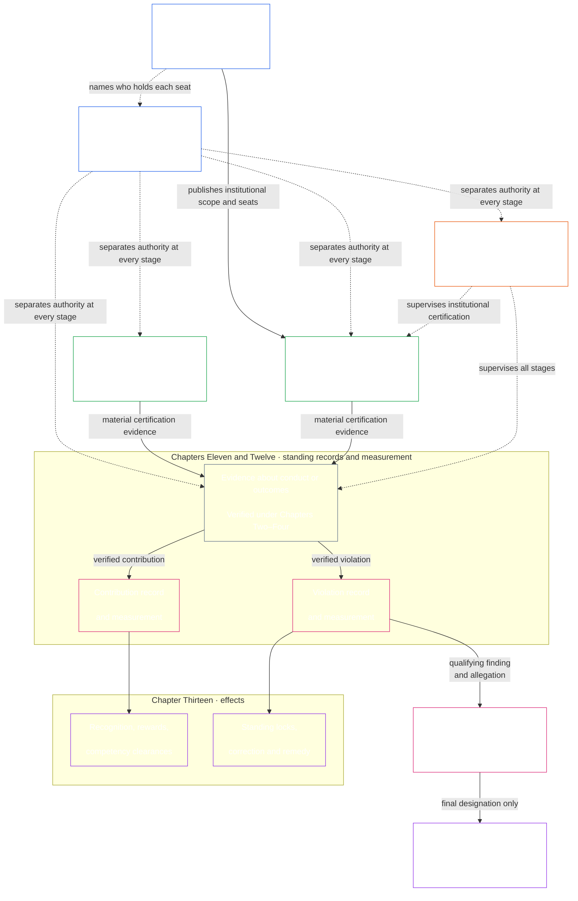
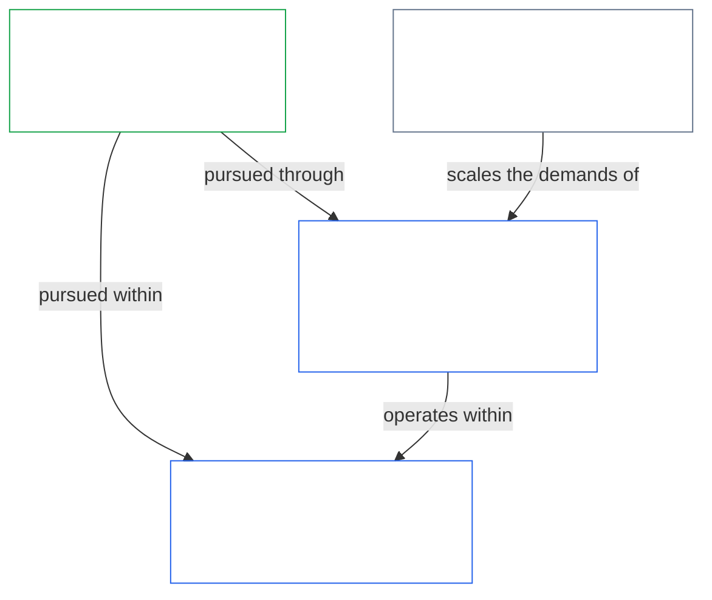
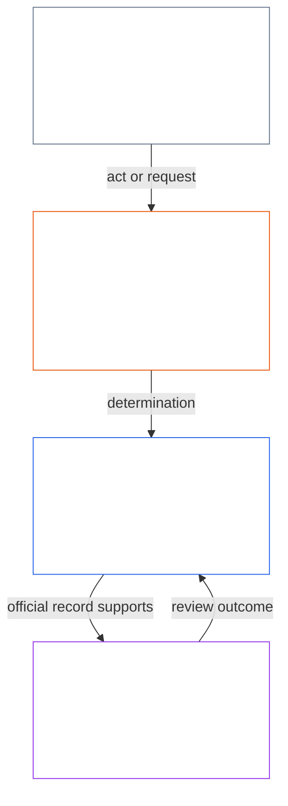

<!-- Locale: Japanese (ja) | Source commit: 630b161c | Baseline commit: 5067e1774b0877a2ef35efc7d20ba99a2b305e05 | AI-drafted, unreviewed | Partial changed-passage refresh -->

憲法が具体的な測定規則を求める場合、[第十五章](core_15.000_forum.md#42-technical-forum-domains)の**技術フォーラム領域**が、測定、試験、信頼できる証拠の共通基準を策定し維持する。紛争を担当するフォーラムは、[第十五章 §4.2（*技術フォーラム領域*）](core_15.000_forum.md#42-shared-standards-and-anti-displacement)に従って事件を判断する際に、その基準を適用する。

- **スタンディング記録**（[第十一章](core_11.000_standing_assessment.md#chapter-eleven-standing-records--question-1-what-happened)）— 行為や害が憲法上重要な場合、検証済みの事実を貢献または違反の正式な事件記録に記載する。噂や評判だけでは不十分。
- **是正と救済**（[第十三章 §5.1（*救済と是正*）](core_13.000_standing_integration.md#51-remedy-and-correction)）— 根本的な失敗を正し、被害を受けた者に相応の承認、修復、回復、または補償を行う。
- **フォーラム審査**（[第十五章](core_15.000_forum.md#1-purpose-and-role--participation-architecture)）

参加の層における争訟可能性は、すでに権限が付与されたシステム内の紛争に関する通常の第一歩である。影響を受けるセンティエントは、まず公表された異議申立て経路を使う。独立した[フォーラム審査](core_15.000_forum.md#1-purpose-and-role--participation-architecture)はその経路に取って代わらず、経路もまた、なお争われている、欠落または掌握されている、あるいは必要な救済を与えられない場合にフォーラム審査に取って代わらない。[紛争処理の順序](core_15.000_forum.md#dispute-sequencing)は、いつフォーラムへの経路づけに移るかを第十五章に定める。

- **成果：** [第十一章](core_11.000_standing_assessment.md#chapter-eleven-standing-records--question-1-what-happened)の**検証済み入力**と、[第九章](core_09.000_system_alignment_certification_evaluation.md#chapter-nine-system-alignment-certification)のシステム整合証拠につながる検証パイプライン。スタンディング測定そのものに取って代わるものではない。

  - 採用移行規則。

- **成果：** 第七章から第十五章、フォーラム、統治、改正規則が尊重し、手続または代理指標によって狭めたり、回避したり、空洞化したりしてはならない、交渉不能な権利保護と救済への接続。

*平たい言葉で言えば：実質的な影響を持つシステムまたは機関は、何をしてよいか、各席を誰が担うかを定めるシステム憲章または機関憲章を公表する。次に、実質的に拘束力のある行為が進む前に、誰が開始し、誰が確認または承認し、誰が公式記録を保管し、誰が異議を審査するかを分ける。役割は状況に合わせて調整できるが、同じ行為を審査する席を、同一の行為者とその支配線がひそかに占めてはならない。*

  - システム憲章または機関憲章をどのように改正・審査し、その憲章上の範囲が気づかれずに変わらないようにするか；

> この図は、四つの機能と、行為およびその行為記録の典型的な流れを示す。第五の席を追加せず、普遍的な順序を定めず、独立性、比例的な統合運営、緊急措置、異議申立て経路に関する第八章の規則も変更しない。

*平たい言葉で言えば：第九章から第十五章は、第八章の職務分離要件を一つの連鎖として適用する。システムと機関を認証し、助けと害を二つの別々の経路で測定し、実効性のある効果と救済を適用し、フォーラム自身への申立てについてフォーラムが唯一の最終判断者になるのを防ぐ。この連鎖によって、憲法上の義務を日常生活で実効的なものに保つ。*

[第七章](core_07.000_charters.md#chapter-seven-system-and-institutional-charters)は、クラスL以上の各システムおよび機関について、憲章上の範囲と席の地図を公表する。[第八章](core_08.000_functional_independence_separation_of_duties.md#chapter-eight-functional-independence-and-separation-of-duties)は、この連鎖のすべての行為を適切に検証可能にする職務分離要件を定める。開始、検証または承認、公式記録の保管、異議審査の機能は、適用される比例調整規則と独立性規則のもとで割り当て、別個に保たなければならない。第九章から第十五章は、この構造を次の順に適用する：

- **第九章**は独立検証を用いて、実質的な影響を持つシステムまたは機関が、明示された範囲と記録期間の中で整合しているかを判断する。第九章はシステム認証を、第十章は機関独自のクラス、評価、記録、是正結果を含む機関認証を所管する。
- **第十一章**は検証済みの事実を受け取り、貢献と違反の別個のスタンディング記録に記載する。
- **第十二章**は各スタンディング記録を独立した軸で測定する。繁栄への検証済み貢献が、別個に検証された害や説明責任の失敗を相殺、取消し、または軽減することはない。それぞれが記録され、それぞれ固有の結果に服する。
- **第十三章**はこれらの分類を比例的なスタンディング効果に変換する。これには、貢献経路における能力認可と承認、違反経路におけるスタンディング・ロック、是正、救済が含まれる。
- **第十四章**は第十二章が重大な違反を測定した後に限って適用される。適正手続の保護を経た上で、その行為が独立して最終的な反憲法的違反指定（ACMD）の基準を満たすかを判断する。
- **第十五章**は経路づけ、証拠、移管、フォーラムの独立性、迅速な解決を監督する。これにより、掌握されたフォーラムが自己の行為に対する唯一の最終判断者になることなく、記録と効果に異議を申し立て、是正し、執行できる。

- **違反審査**は独自の問い、すなわち適格な違反が最終的なACMD指定にも値するかに答える。
- **フォーラム監督**は経路づけ、証拠、移管、異議申立て、救済を管理し、公式記録と決定を適時に審査・是正できるようにする。

2. **影響が十分に重大な場合はシステムと機関を認証する** — 影響の大きいシステムを大規模に信頼する前に、異議申立て可能なシステム認証記録を取得する（[第九章A・B部](core_09.000_system_alignment_certification_evaluation.md#chapter-nine-system-alignment-certification)）。機関は独自のクラス、行為、統治、ポートフォリオについて[第十章](core_10.000_institutional_alignment_certification.md#chapter-ten-institutional-alignment-certification)に基づき評価し、その結果を機関認証記録に記載する。
3. **スタンディングを別個の経路で記録し測定する**（[第十一章](core_11.000_standing_assessment.md#chapter-eleven-standing-records--question-1-what-happened)および[第十二章](core_12.000_standing_measurement.md#chapter-twelve-standing-measurement--question-2-how-good-or-bad-was-it)）— 助けまたは害が憲法上重要なほど重大である場合、第十一章は正式な事件記録を開き、**検証済み入力**だけを認めなければならない（証拠が実質的に関係する場合は第九章のシステム整合認証証拠も含む）。第十二章は検証済み事項を測定し分類する。噂、評判、紛争に関する語りだけでは不十分。
   - **違反の性質：** **違反スタンディング記録** — 検証済みの害と説明責任の失敗について、範囲を限定し、異議申立て可能な事件記録 — を開き、Violation Axis上で**違反の性質**を分類する。助けと害を一つの純合計スコアにまとめない。関連する記録は相互参照するが、別々に保つ。
4. **各経路にスタンディング効果を適用する**（[第十三章](core_13.000_standing_integration.md#chapter-thirteen-standing-effects-and-integration)）— 検証済み貢献は能力認可を与えうるとともに、比例的な承認と実質的報酬を支えなければならない。検証済み違反はスタンディング・ロック、是正、[被害を受けた者への救済](core_13.000_standing_integration.md#51-remedy-and-correction)を引き起こしうる。
5. **反憲法的指定を審査する**（[第十四章](core_14.000_misconduct_designation.md#chapter-fourteen-anti-constitutional-misconduct)）— 重大度が最上位の違反所見が反憲法的基準も満たす可能性がある場合、第十四章は対応するACMDが付されるかを判断する。適正手続の保護を適用する。ACMDは、第十二章が測定した害の重大度を変えない。通常の第十三章効果は並行して続き、最終ACMDが反憲法的信頼ロックを発動するまで継続する。
6. **紛争を経路づけ、救済を適時に保つ**（[第十五章](core_15.000_forum.md#1-purpose-and-role--participation-architecture)）— フォーラムは事件の移動、担当経路、**第XXVI-C条**（*適時解決・遅延防止基準*）の期間遵守を監督し、遅延によって救済が失われないようにする。通常の紛争は[紛争処理の順序](core_15.000_forum.md#dispute-sequencing)に従う。フォーラムはまた、システム分類の文字体系に対応する五つの[重要度階層](core_15.000_forum.md#6-timely-resolution-materiality-tiers-and-anti-delay-discipline)（A/B/C/L/P）に紛争を分類する — 生存に関わる緊急性から私的・限定的な案件まで。最終的な第十四章指定が主な争点である場合は、インテグリティ系の既定経路づけを適用する。

**第九章 — [システム整合認証](core_09.000_system_alignment_certification_evaluation.md#chapter-nine-system-alignment-certification)**

- **所管：** 実質的な影響を持つシステムが憲法に整合した状態を保つようにする。
- **成果：** 各認証合格システムについて**システム認証記録**を作成する — 明示された範囲と記録期間におけるシステムの整合性について、範囲を限定し異議申立て可能な所見。

**第十章 — [機関整合認証](core_10.000_institutional_alignment_certification.md#chapter-ten-institutional-alignment-certification)**

- **所管：** 第九章と同じ六段階、同じ節番号に従い、実質的な影響を持つ機関が憲法に整合した状態を保つようにする。機関は自らが管理する事項、すなわち機関憲章の遵守、権限に対する責任者、何を報奨するか、独立した検査を利用できるかについて審査される。各システムの認証に依拠し、それをやり直さない。
+- **成果：** 各認証合格機関について**機関認証記録**を作成する — 明示された範囲と記録期間における機関の整合性について、範囲を限定し異議申立て可能な所見。第十章はシステム評価を再実施せずにフォーラム手続を再利用する。機関認証は、機関の設立や運営の許可・関門ではない。

**第十一章 — [スタンディング記録](core_11.000_standing_assessment.md#chapter-eleven-standing-records--question-1-what-happened)**

- **所管：** 行為が憲法上重要な場合、噂や評判だけでは不十分であり、検証済みの事実を**スタンディング記録**に記載する。**貢献**（繁栄への助け）と**違反**（説明責任の失敗や害）は**別個のスタンディング記録**に記録する。検証済みの助けが検証済みの害を消すことはなく、二つを一つの純合計スコアにまとめない。
+- **成果：** 貢献と違反の経路における範囲限定の**スタンディング記録**。**検証済み入力**とフォーラム監督下の所見だけに基づき、非公式な採点や紛争の語りは検証済みスタンディング記録の代わりにならない。

**第十二章 — [スタンディング測定](core_12.000_standing_measurement.md#chapter-twelve-standing-measurement--question-2-how-good-or-bad-was-it)**

- **所管：** 検証済みの事実がどれほど良いか、または悪いかを測定する。貢献と違反は同じ統一尺度を使う**別々の軸**で測定し、純合計スコアにまとめない。
+- **成果：** 各スタンディング記録について、Contribution AxisまたはViolation Axis上の分類済み測定 — 性質、規模、スロット。

**第十三章 — [スタンディングの統合と効果](core_13.000_standing_integration.md#chapter-thirteen-standing-effects-and-integration)**

    - [**能力認可**](core_13.000_standing_integration.md#72-competency-bars-and-clearances)は、公開済みの能力基準に照らして能力が示され、該当する[スタンディング・ロック](core_13.000_standing_integration.md#52-prevention--general-standing-locks)が指定経路を妨げない場合に、信頼性が重視される職務、委任権限、監督資格、段階的に重大性が増す責務ある管理を可能にしうる。

    - **スタンディング・ロック**、役割制限、是正命令、[被害を受けた者への救済](core_13.000_standing_integration.md#51-remedy-and-correction)、補足記述子、執行の仕組み

**第十四章 — [反憲法的違反に対する安全策](core_14.000_misconduct_designation.md#chapter-fourteen-anti-constitutional-misconduct)**

- **所管：** 最も重大な検証済み違反のみを扱う — 大規模に憲法上の義務を掌握または空洞化させた可能性のある行為である。第十二章が最重大の違反所見を測定し、反憲法的違反が実質的に申し立てられた場合、この章は通常の第十三章スタンディング効果と並行する第十三章ゲートウェイとして指定審査を行う。
+- **成果：** 必要な基準と適正手続上の保護を満たした場合に限り、その最重大所見について最終ACMDを指定するか、棄却する。害の重大度は引き続き第十二章が測定する。最終ACMDだけが第十三章の**反憲法的信頼ロック**を発動する。

**第十五章 — [フォーラム監督と経路づけ](core_15.000_forum.md#chapter-fifteen-forums-and-jurisdiction)**

  - 公表済みのステークホルダー・システム参加の異議申立て経路からフォーラム経路づけへの[紛争処理の順序](core_15.000_forum.md#dispute-sequencing)；

- **成果：** スタンディング記録を開設または更新しうる**スタンディング所見**に加え、救済と[適時解決](core_05.035_band_accountability.md#timely-resolution)に向けた適法な経路づけ。フォーラムはパイプラインを監督するが、第十二章のスタンディング測定に取って代わらない。

*平たい言葉で言えば：第十六章から第二十章はこの憲法を締めくくる。誰が統治できるか、保護を後退させずに本文をどう変更するか、他の法との関係、採択された実務資料をこの原典にどう結び付けるかを定める。*

**第十五章から第十九章**はこの憲法を締めくくる。これらは、統治、変更の有効性、編入についての[憲法上の所管登録](#4-principles-definitions-and-rights)を完成させる。正当に統治できる者、憲法を適法に変更する方法、採択された実装文書を、気づかれないずれなく憲法上の原典に結び付ける方法を示す。

**第十六章 — 憲法契約、正統性、責務ある管理**（[`core_16.000_governance.md`](core_16.000_governance.md#chapter-sixteen-constitutional-contract-legitimacy-authorization-and-stewardship)）

**第十七章 — 非後退**（[`core_17.000_non_regression.md`](core_17.000_non_regression.md#chapter-seventeen-non-regression-and-substantive-amendment-validity)）

**第十八章 — 至上性と外部命令**（[`core_18.000_expansion_supremacy.md`](core_18.000_expansion_supremacy.md#chapter-eighteen-expansion-supremacy-and-external-legal-orders)）

- **所管：** 本憲法と他の規範との関係。適法な範囲での保護の拡張、有効な原典・採択・統治層の範囲内での至上性、自らの効力を持つ適用可能な外部法の排除禁止、暗黙の従属や掌握を招かない外部法秩序との規律ある相互作用を扱う。

**第十九章 — 改正、批准、採択**（[`core_19.000_amendment_ratification.md`](core_19.000_amendment_ratification.md#chapter-nineteen-amendment-ratification-and-procedural-validity)）

- **所管：** 本憲法を適法に変更する方法 — 改正手続、批准、採択 — に加え、第十七章の実体的安全策に続く**手続上の安全策**を扱う。変更は公開され、権威ある保管先まで追跡可能でなければならず、必要に応じ独立審査を伴う実質的な異議申立て可能性を保たなければならない。

**第二十章 — 編入ブリッジ**（[`core_20.000_incorporation.md`](core_20.000_incorporation.md)）

採択者が[第二十章](core_20.000_incorporation.md)に従って適法に編入すると、これらのファイルは採択範囲内の実装文書として拘束力を持つ。センティエント憲法の意味が引き続き優先し、これらは上記の各章を**実装するものであり、狭めるものではない**。版の固定、保管の連鎖、暗黙の変化を許さない規則によって、採択された文書を実際に批准された原典まで追跡可能にする。正式な一覧と境界規則は[第五章 — コーパス](core_05.045_band_integrative.md#corpus)にある。
