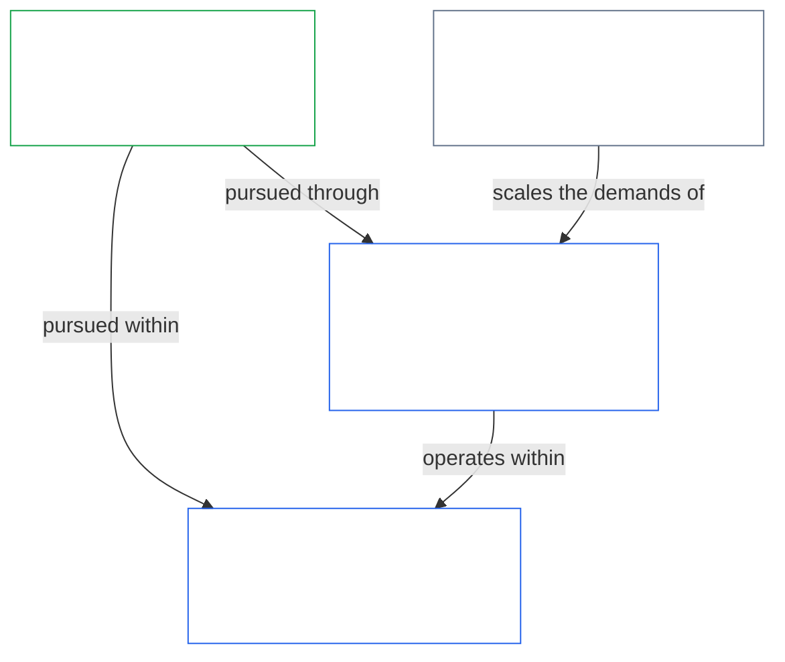
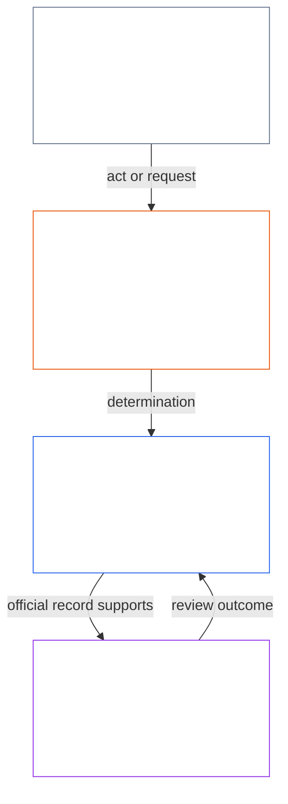
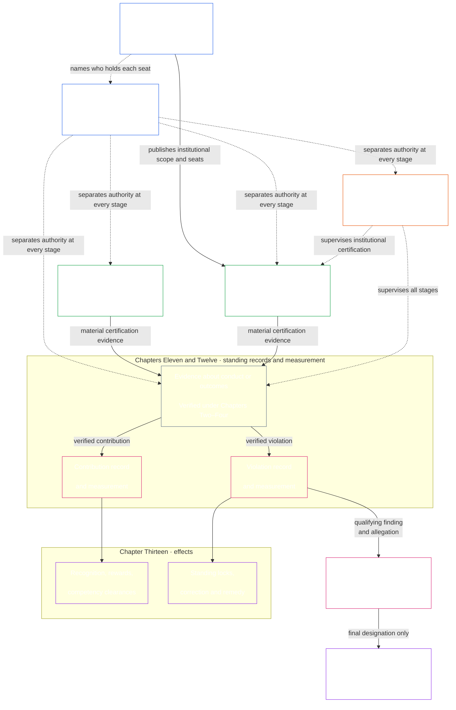

<!-- Locale: Korean (ko) | Source commit: 630b161c | Baseline commit: 5067e1774b0877a2ef35efc7d20ba99a2b305e05 | AI-drafted, unreviewed | Partial changed-passage refresh -->

헌법이 구체적인 측정 규칙을 요구하면 [제15장](core_15.000_forum.md#42-technical-forum-domains)의 **기술 포럼 영역**이 측정, 시험, 신뢰할 수 있는 증거를 위한 공동 기준을 개발하고 유지한다. 분쟁을 담당하는 포럼은 [제15장 §4.2 (*기술 포럼 영역*)](core_15.000_forum.md#42-shared-standards-and-anti-displacement)에 따라 사건을 판단할 때 해당 기준을 적용한다.

- **지위 기록**([제11장](core_11.000_standing_assessment.md#chapter-eleven-standing-records--question-1-what-happened)) — 행위나 피해가 헌법상 중요하면 검증된 사실을 공식 기여 또는 위반 사건 기록에 넣는다. 소문과 평판만으로는 부족하다.
- **수정과 구제**([제13장 §5.1 (*구제와 수정*)](core_13.000_standing_integration.md#51-remedy-and-correction)) — 근본적인 실패를 바로잡고 피해를 입은 이들에게 비례적인 인정, 수리, 회복 또는 보상을 제공한다.
- **포럼 심사**([제15장](core_15.000_forum.md#1-purpose-and-role--participation-architecture))

참여 층위의 이의제기 가능성은 이미 권한이 부여된 시스템 내부의 분쟁에 대한 통상적인 첫 단계다. 영향을 받는 센티언트는 먼저 공개된 이의제기 경로를 이용한다. 독립적인 [포럼 심사](core_15.000_forum.md#1-purpose-and-role--participation-architecture)는 그 경로를 대체하지 않으며, 그 경로가 계속 다투어지거나, 누락·포획되었거나, 필요한 구제를 할 수 없을 때 포럼 심사를 대신하지도 않는다. 제15장의 [분쟁 처리 순서](core_15.000_forum.md#dispute-sequencing)는 언제 포럼 경로 지정으로 넘어가는지 정한다.

- **산출물:** [제11장](core_11.000_standing_assessment.md#chapter-eleven-standing-records--question-1-what-happened)의 **검증된 입력**과 [제9장](core_09.000_system_alignment_certification_evaluation.md#chapter-nine-system-alignment-certification)의 시스템 정렬 증거를 제공하는 검증 절차. 지위 측정 자체를 대체하지 않는다.

  - 채택 전환 규칙.

- **산출물:** 제7장부터 제15장까지, 포럼, 거버넌스, 개정 규칙이 존중해야 하며 절차나 대리지표를 통해 축소·우회·공허화해서는 안 되는 협상 불가능한 권리 보호와 구제 연결고리.

*쉽게 말해: 실질적인 영향이 있는 시스템이나 기관은 무엇을 할 수 있고 각 자리를 누가 맡는지 정하는 시스템 헌장 또는 기관 헌장을 공표한다. 그런 다음 실질적으로 구속력 있는 행위가 진행되기 전에 누가 시작하고, 누가 확인하거나 승인하고, 누가 공식 기록을 보관하고, 누가 이의제기를 심사하는지 분리한다. 역할은 상황에 맞게 조정될 수 있지만 동일 행위자와 그 통제선이 자기 행위를 점검하는 자리를 은밀히 맡아서는 안 된다.*

  - 시스템 헌장 또는 기관 헌장을 어떻게 개정하고 심사하여 헌장 범위가 조용히 바뀌지 않게 할지; 그리고

> 이 지도는 네 기능과 행위 및 그 행위 기록의 일반적인 추적을 보여 준다. 다섯 번째 자리를 더하거나, 보편적인 순서를 정하거나, 독립성, 비례적 통합 운영, 긴급 조치 또는 이의제기 경로에 관한 제8장의 규칙을 바꾸지 않는다.

*쉽게 말해: 제9장부터 제15장까지는 제8장의 직무 분리 요건을 하나의 연쇄로 적용한다. 시스템과 기관을 인증하고, 도움과 피해를 두 개의 별도 경로로 측정하고, 실질적인 효과와 구제를 적용하며, 포럼이 자기 자신을 상대로 한 주장의 유일한 최종 판단자가 되지 않도록 한다. 이 연쇄는 헌법상 의무가 일상에서 실효성을 갖게 한다.*

[제7장](core_07.000_charters.md#chapter-seven-system-and-institutional-charters)은 클래스 L 이상인 각 시스템과 기관의 헌장 범위와 자리 배치를 공개한다. [제8장](core_08.000_functional_independence_separation_of_duties.md#chapter-eight-functional-independence-and-separation-of-duties)은 이 연쇄의 모든 행위를 유효하게 점검할 수 있도록 직무 분리 요건을 제공한다. 개시, 검증 또는 승인, 공식 기록 보관, 이의제기 심사의 기능은 적용되는 규모 조정 및 독립성 규칙에 따라 배정하고 서로 구분해야 한다. 제9장부터 제15장까지는 이어서 그 구조를 순서대로 적용한다:

- **제9장**은 독립 검증을 통해 실질적인 영향이 있는 시스템이나 기관이 명시된 범위와 기록 기간 안에서 정렬되었는지 결정한다. 제9장은 시스템 인증을, 제10장은 해당 기관 자체의 분류, 평가, 기록, 시정 결과를 포함한 기관 인증을 담당한다.
- **제11장**은 검증된 사실을 받아 별도의 기여 및 위반 지위 기록에 기록한다.
- **제12장**은 각 지위 기록을 독립된 축에서 측정한다. 번영에 대한 검증된 기여는 별도로 검증된 피해나 책무성 실패를 상쇄하거나 취소하거나 줄이지 않는다. 각각은 계속 기록되고 고유한 결과를 따른다.
- **제13장**은 그 분류를 비례적인 지위 효과로 전환한다. 기여 경로의 역량 승인과 인정, 위반 경로의 지위 잠금, 수정, 구제가 여기에 포함된다.
- **제14장**은 제12장이 고영향 위반을 측정한 뒤에만 적용된다. 적법절차 보호를 거친 뒤, 해당 행위가 최종 반헌법적 위법행위 지정(ACMD) 기준을 독립적으로 충족하는지 결정한다.
- **제15장**은 경로 지정, 증거, 이전, 포럼 독립성, 적시 해결을 감독하여, 포획된 포럼이 자기 행위에 대한 유일한 최종 판단자가 되지 않으면서 결과 기록과 효과에 이의를 제기하고 수정·집행할 수 있게 한다.

- **위법행위 심사**는 별도의 질문, 즉 자격을 갖춘 위반이 최종 ACMD 지정도 받아야 하는지에 답한다.
- **포럼 감독**은 경로 지정, 증거, 이전, 이의제기, 구제를 통제하여 공식 기록과 결정을 제때 심사하고 수정할 수 있도록 한다.

2. **영향이 충분히 중대하면 시스템과 기관을 인증한다** — 고영향 시스템을 대규모로 신뢰하기 전에 이의제기 가능한 시스템 인증 기록을 확보한다([제9장 A·B부](core_09.000_system_alignment_certification_evaluation.md#chapter-nine-system-alignment-certification)). 기관은 고유한 분류, 행위, 거버넌스, 포트폴리오에 따라 [제10장](core_10.000_institutional_alignment_certification.md#chapter-ten-institutional-alignment-certification)에서 평가하고, 기관 인증 기록에 결과를 기록한다.
3. **지위를 별도 경로로 기록하고 측정한다**([제11장](core_11.000_standing_assessment.md#chapter-eleven-standing-records--question-1-what-happened) 및 [제12장](core_12.000_standing_measurement.md#chapter-twelve-standing-measurement--question-2-how-good-or-bad-was-it)) — 도움이나 피해가 헌법상 중요할 만큼 중대하면 제11장은 공식 사건 기록을 열고 **검증된 입력**만 받아야 한다(해당 증거가 중대한 경우 제9장의 시스템 정렬 인증 증거 포함). 이어 제12장이 검증된 내용을 측정하고 분류한다. 소문, 평판, 분쟁 이야기는 충분하지 않다.
   - **위반의 성격:** 검증된 피해와 책무성 실패에 관한 범위가 정해지고 이의제기가 가능한 사건 기록인 **위반 지위 기록**을 열고, Violation Axis에서 **위반의 성격**을 분류한다. 도움과 피해를 하나의 순점수로 합산하지 않는다. 연결된 기록은 서로 참조하되 별도로 유지한다.
4. **각 경로에 지위 효과를 적용한다**([제13장](core_13.000_standing_integration.md#chapter-thirteen-standing-effects-and-integration)) — 검증된 기여는 역량 승인을 부여할 수 있고 비례적인 인정과 실질적 보상을 뒷받침해야 한다. 검증된 위반은 지위 잠금, 수정, [피해자에 대한 구제](core_13.000_standing_integration.md#51-remedy-and-correction)를 촉발할 수 있다.
5. **반헌법적 지정 심사를 진행한다**([제14장](core_14.000_misconduct_designation.md#chapter-fourteen-anti-constitutional-misconduct)) — 최고 영향 수준의 위반 판단이 반헌법적 기준도 충족할 수 있으면 제14장은 해당 ACMD를 부과할지 결정해야 한다. 적법절차 보호를 거친다. ACMD는 제12장이 이미 판단한 피해의 심각성을 바꾸지 않는다. 최종 ACMD가 반헌법적 신뢰 잠금을 촉발할 때까지 통상적인 제13장 효과는 병행된다.
6. **분쟁을 경로 지정하고 구제를 제때 유지한다**([제15장](core_15.000_forum.md#1-purpose-and-role--participation-architecture)) — 포럼은 사건 이동, 처리 경로, **제XXVI-C조**(*적시 해결 및 지연 방지 기준*)의 기간 준수를 감독하여 지연으로 구제가 사라지지 않게 해야 한다. 통상 분쟁은 [분쟁 처리 순서](core_15.000_forum.md#dispute-sequencing)를 따른다. 포럼은 시스템 분류 알파벳과 일치하는 다섯 [중요도 등급](core_15.000_forum.md#6-timely-resolution-materiality-tiers-and-anti-delay-discipline)(A/B/C/L/P)으로 분쟁을 분류해야 한다 — 생존에 치명적인 긴급성부터 사적·제한적 사안까지. 최종 제14장 지정이 주된 쟁점이면 무결성 계열의 기본 경로 지정을 적용한다.

**제9장 — [시스템 정렬 인증](core_09.000_system_alignment_certification_evaluation.md#chapter-nine-system-alignment-certification)**

- **담당:** 실질적 영향이 있는 시스템이 헌법상 정렬 상태를 유지하도록 한다.
- **산출물:** 인증에 통과한 각 시스템에 대해 명시된 범위와 기록 기간 내 시스템의 정렬에 관한 범위 한정적이고 이의제기 가능한 판단인 **시스템 인증 기록**을 작성한다.

**제10장 — [기관 정렬 인증](core_10.000_institutional_alignment_certification.md#chapter-ten-institutional-alignment-certification)**

- **담당:** 제9장과 같은 여섯 단계와 동일한 절 번호를 통해 실질적 영향이 있는 기관이 헌법상 정렬 상태를 유지하도록 한다. 기관은 기관 헌장을 지키는지, 권한에 누가 답하는지, 무엇에 보상을 주는지, 독립 검사를 이용할 수 있는지 등 오직 기관이 통제하는 사항을 기준으로 점검한다. 각 시스템의 인증에 의존하며 이를 다시 수행하지 않는다.
- **산출물:** 인증에 통과한 각 기관에 대해 명시된 범위와 기록 기간 내 기관 정렬에 관한 범위 한정적이고 이의제기 가능한 판단인 **기관 인증 기록**을 작성한다. 제10장은 시스템 평가를 다시 수행하지 않고 포럼 절차를 재사용하며, 기관 인증은 기관 설립이나 운영을 위한 허가 또는 관문이 아니다.

**제11장 — [지위 기록](core_11.000_standing_assessment.md#chapter-eleven-standing-records--question-1-what-happened)**

- **담당:** 행위가 헌법상 중요하면 소문과 평판만으로는 충분하지 않으며 검증된 사실을 **지위 기록**에 넣는다. **기여**(번영을 돕는 행위)와 **위반**(책무성 실패와 피해)은 **별도의 지위 기록**에 기록한다. 검증된 도움은 검증된 피해를 없애지 않으며 둘을 하나의 순점수로 합산하지 않는다.
- **산출물:** 기여 및 위반 경로의 범위가 정해진 **지위 기록**. **검증된 입력**과 포럼 감독 판단에만 근거하며, 비공식 점수나 분쟁 서사는 검증된 지위 기록을 대체할 수 없다.

**제12장 — [지위 측정](core_12.000_standing_measurement.md#chapter-twelve-standing-measurement--question-2-how-good-or-bad-was-it)**

- **담당:** 검증된 사실이 얼마나 좋았거나 나빴는지 측정한다. 기여와 위반은 동일한 통합 척도를 사용하는 **별도 축**에서 각각 측정하며 하나의 순점수로 합산하지 않는다.
- **산출물:** 각 지위 기록에 대해 Contribution Axis 또는 Violation Axis상의 분류된 측정치 — 성격, 규모, 슬롯.

**제13장 — [지위 통합 및 효과](core_13.000_standing_integration.md#chapter-thirteen-standing-effects-and-integration)**

    - [**역량 승인**](core_13.000_standing_integration.md#72-competency-bars-and-clearances)은 공개된 역량 기준에 따라 역량이 입증되고 적용 가능한 [지위 잠금](core_13.000_standing_integration.md#52-prevention--general-standing-locks)이 지정 경로를 막지 않을 때 신뢰 민감 역할, 위임 권한, 감독 자격, 점차 더 큰 책임의 관리를 가능하게 할 수 있다.

    - **지위 잠금**, 역할 제한, 시정 명령, [피해자에 대한 구제](core_13.000_standing_integration.md#51-remedy-and-correction), 보충 설명자, 집행 연결고리

**제14장 — [반헌법적 위법행위 보호 장치](core_14.000_misconduct_designation.md#chapter-fourteen-anti-constitutional-misconduct)**

- **담당:** 가장 심각한 검증된 위반, 즉 대규모로 헌법상 의무를 장악하거나 무력화했을 수 있는 행위만 다룬다. 제12장이 최고 영향 위반 판단을 측정했고 반헌법적 위법행위가 실질적으로 제기된 경우, 이 장은 통상적인 제13장 지위 효과와 병행하여 제13장 관문 경로로 지정 심사를 진행한다.
- **산출물:** 기존 최고 영향 판단에 대한 최종 ACMD 지정 또는 기각. 필요한 기준과 적법절차 보호를 충족한 뒤에만 가능하다. 피해의 심각성은 제12장이 계속 측정한다. 최종 ACMD만 제13장의 **반헌법적 신뢰 잠금**을 촉발한다.

**제15장 — [포럼 감독 및 경로 지정](core_15.000_forum.md#chapter-fifteen-forums-and-jurisdiction)**

  - 공개된 이해관계자 시스템 참여 이의제기 경로에서 포럼 경로 지정으로 이어지는 [분쟁 처리 순서](core_15.000_forum.md#dispute-sequencing);

- **산출물:** 지위 기록을 열거나 갱신할 수 있는 **지위 판단**과 구제 및 [적시 해결](core_05.035_band_accountability.md#timely-resolution)을 향한 적법한 경로 지정. 포럼은 절차를 감독하지만 제12장의 지위 측정을 대체하지 않는다.

*쉽게 말해: 제16장부터 제20장까지는 누가 통치할 수 있는지, 보호를 후퇴시키지 않고 본문을 어떻게 바꿀 수 있는지, 다른 법과 어떤 관계인지, 채택된 실행 지침을 어떻게 이 원천에 묶어 두는지 정하며 이 헌법을 마무리한다.*

**제15장부터 제19장까지**가 이 헌법을 마무리한다. 함께 헌법상 통치, 변경의 유효성, 편입에 관한 [헌법상 담당자 등록부](#4-principles-definitions-and-rights)를 완성한다. 정당하게 통치할 수 있는 사람, 헌법을 합법적으로 변경하는 방법, 채택된 실행 문안을 조용히 변질되지 않게 헌법 원천에 묶어 두는 방법을 정한다.

**제16장 — 헌법 계약, 정당성, 관리 책임** ([`core_16.000_governance.md`](core_16.000_governance.md#chapter-sixteen-constitutional-contract-legitimacy-authorization-and-stewardship))

**제17장 — 후퇴 금지** ([`core_17.000_non_regression.md`](core_17.000_non_regression.md#chapter-seventeen-non-regression-and-substantive-amendment-validity))

**제18장 — 최고성 및 외부 명령** ([`core_18.000_expansion_supremacy.md`](core_18.000_expansion_supremacy.md#chapter-eighteen-expansion-supremacy-and-external-legal-orders))

- **담당:** 이 헌법이 다른 규범과 맺는 관계를 다룬다. 적법할 때의 보호 확대, 유효한 원천·채택·거버넌스 층위 범위 내에서의 최고성, 자체 효력이 있는 적용 가능한 외부법의 배제 금지, 암묵적 종속이나 포획 없이 외부 법질서와 규율 있게 상호작용하는 것을 포함한다.

**제19장 — 개정, 비준, 채택** ([`core_19.000_amendment_ratification.md`](core_19.000_amendment_ratification.md#chapter-nineteen-amendment-ratification-and-procedural-validity))

- **담당:** 개정 절차, 비준, 채택을 포함하여 이 헌법을 합법적으로 변경하는 방법과 제17장의 실체적 안전장치를 따르는 **절차적 안전장치**를 다룬다. 변경 사항은 공개적으로 발표하고, 권위 있는 보관까지 추적 가능하며, 필요한 경우 독립 심사를 통해 의미 있게 이의를 제기할 수 있어야 한다.

**제20장 — 편입 연결부** ([`core_20.000_incorporation.md`](core_20.000_incorporation.md))

채택자가 [제20장](core_20.000_incorporation.md)에 따라 이를 적법하게 편입하면 이 파일들은 채택 범위 내에서 실행 문안으로서 구속력을 갖는다. 센티언트 헌법의 의미가 계속 우선한다 — 이들은 위 장들을 **실행할 뿐, 범위를 좁히지 않는다**. 판본 고정, 보관 연쇄, 조용한 변질 금지 규칙은 채택 문안이 실제 비준된 원천까지 추적되도록 한다. 정본 목록과 경계 규칙은 [제5장 — 코퍼스](core_05.045_band_integrative.md#corpus)에 있다.
