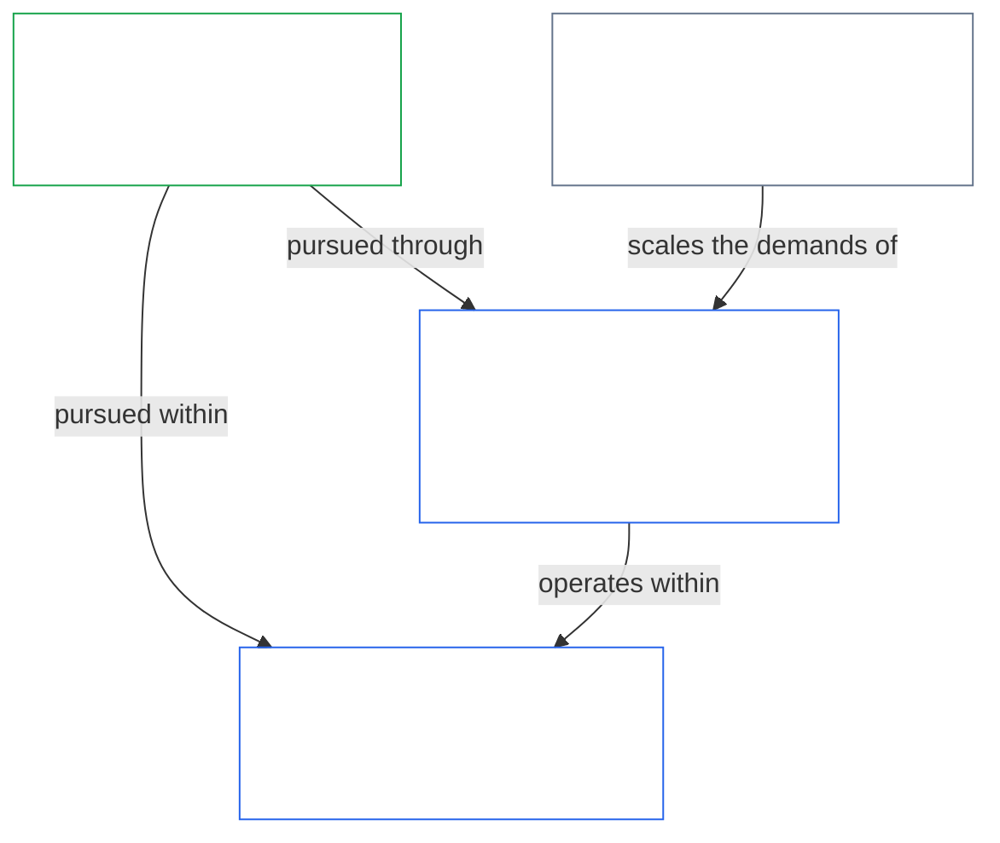
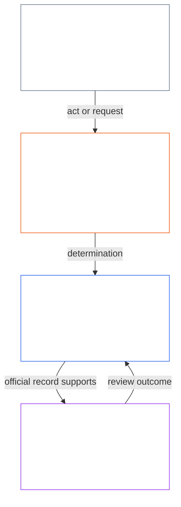
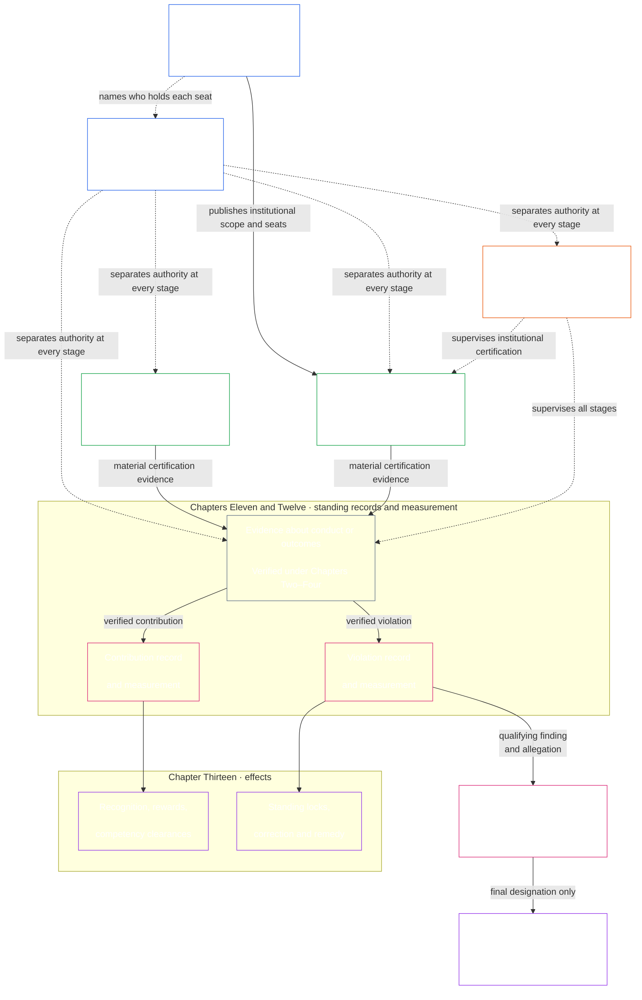

<!-- Locale: Marathi (mr) | Source commit: 630b161c | Baseline commit: 5067e1774b0877a2ef35efc7d20ba99a2b305e05 | AI-drafted, unreviewed | Partial changed-passage refresh -->

संविधानाला ठोस मापन नियमांची गरज असते तेव्हा [अध्याय पंधरा](core_15.000_forum.md#42-technical-forum-domains) अंतर्गत **तांत्रिक मंच क्षेत्रे** मापन, चाचणी आणि विश्वासार्ह साक्ष यांसाठी सामायिक मानके विकसित करून टिकवतात. वादाची जबाबदारी असलेला मंच नंतर [अध्याय पंधरा §4.2 (*तांत्रिक मंच क्षेत्रे*)](core_15.000_forum.md#42-shared-standards-and-anti-displacement) अंतर्गत प्रकरण ठरवताना ती मानके लागू करतो.

- **प्रस्थिति अभिलेख** ([अध्याय अकरा](core_11.000_standing_assessment.md#chapter-eleven-standing-records--question-1-what-happened)) — वर्तन किंवा हानी घटनात्मकदृष्ट्या महत्त्वाची असते तेव्हा सत्यापित तथ्ये औपचारिक योगदान किंवा उल्लंघन प्रकरण-अभिलेखात नोंदवा; अफवा आणि प्रतिष्ठा पुरेशी नाही.
- **दुरुस्ती आणि उपाय** ([अध्याय तेरा §5.1 (*उपाय आणि दुरुस्ती*)](core_13.000_standing_integration.md#51-remedy-and-correction)) — मूळ अपयश दुरुस्त करा आणि बाधितांना प्रमाणबद्ध मान्यता, दुरुस्ती, पुनर्स्थापना किंवा भरपाई द्या.
- **मंच पुनरावलोकन** ([अध्याय पंधरा](core_15.000_forum.md#1-purpose-and-role--participation-architecture))

सहभाग-स्तरातील आव्हानक्षमता, आधीच अधिकारप्राप्त प्रणालीतील वादांसाठी नेहमीची पहिली पायरी आहे: बाधित संज्ञेय व्यक्ती प्रथम प्रकाशित आव्हानमार्ग वापरतात. स्वतंत्र [मंच पुनरावलोकन](core_15.000_forum.md#1-purpose-and-role--participation-architecture) त्या मार्गाची जागा घेत नाही; तसेच तो मार्ग अजूनही वादग्रस्त, अनुपस्थित किंवा पकडलेला असेल, अथवा आवश्यक दिलासा देऊ शकत नसेल तर मंच पुनरावलोकनाची जागा घेत नाही. [वाद-क्रम](core_15.000_forum.md#dispute-sequencing) मंचाकडे मार्गनियोजन कधी हस्तांतरित होते हे अध्याय पंधरा ठरवतो.

- **निर्गम:** [अध्याय अकरा](core_11.000_standing_assessment.md#chapter-eleven-standing-records--question-1-what-happened) मधील **सत्यापित इनपुट** आणि [अध्याय नऊ](core_09.000_system_alignment_certification_evaluation.md#chapter-nine-system-alignment-certification) मधील प्रणाली-संरेखन साक्ष पुरवणारी पडताळणी-प्रक्रिया. ती प्रस्थिति मापनाची जागा घेत नाही.

  - दत्तक संक्रमण नियम.

- **निर्गम:** अध्याय सात ते पंधरा, मंच, शासन आणि दुरुस्ती नियमांनी मान्य करावयाचे, तसेच प्रक्रिया किंवा प्रतिनिधी मापनांद्वारे अरुंद, बायपास किंवा पोकळ न करता जपावयाचे वाटाघाटी-अशक्य अधिकार-संरक्षण आणि उपाय-सूत्रे.

*सोप्या भाषेत: प्रत्यक्ष परिणाम असलेली प्रणाली किंवा संस्था ती काय करू शकते आणि प्रत्येक आसनावर कोण आहे हे सांगणारा प्रणाली सनद किंवा संस्था सनद प्रकाशित करते. मग, वस्तुनिष्ठदृष्ट्या बंधनकारक कृती पुढे जाण्यापूर्वी ती कोण सुरू करतो, कोण तपासतो किंवा अधिकृत करतो, अधिकृत अभिलेख कोणाकडे असतो आणि आव्हानाचे पुनरावलोकन कोण करतो हे वेगळे केले जाते. भूमिका परिस्थितीनुसार प्रमाणबद्ध असू शकतात; परंतु तीच व्यक्ती आणि तिची नियंत्रण-रेषा स्वतःच्या कृतीची तपासणी करणारी आसने गुपचूप धरू शकत नाही.*

  - प्रणाली सनद किंवा संस्था सनद कशी दुरुस्त आणि पुनरावलोकित करावी, जेणेकरून सनदबद्ध व्याप्ती गुपचूप बदलणार नाही; आणि

> हा नकाशा चार कार्ये आणि कृती तसेच तिच्या कृती-अभिलेखाचा एक नेहमीचा मागोवा दाखवतो. तो पाचवे आसन जोडत नाही, सार्वत्रिक क्रम ठरवत नाही किंवा स्वातंत्र्य, प्रमाणबद्ध संयुक्त-कारभार, आणीबाणीची कृती किंवा आव्हान-मार्गनियोजन यांबाबत अध्याय आठचे नियम बदलत नाही.

*सोप्या भाषेत: अध्याय नऊ ते पंधरा अध्याय आठची कर्तव्य-विभाजन आवश्यकता एका साखळीत लागू करतात: प्रणाली आणि संस्थांना प्रमाणित करणे, मदत आणि हानी वेगळ्या दोन मार्गांवर मोजणे, वास्तविक परिणाम आणि उपाय लागू करणे, आणि मंचाला स्वतःविरुद्धच्या दाव्याचा एकमेव अंतिम निर्णयकर्ता होण्यापासून रोखणे. ही साखळी घटनात्मक कर्तव्ये दैनंदिन जीवनात वास्तविक ठेवते.*

[अध्याय सात](core_07.000_charters.md#chapter-seven-system-and-institutional-charters) वर्ग L किंवा त्याहून उच्च प्रत्येक प्रणाली आणि संस्थेची सनदबद्ध व्याप्ती व आसन-नकाशा प्रकाशित करतो. [अध्याय आठ](core_08.000_functional_independence_separation_of_duties.md#chapter-eight-functional-independence-and-separation-of-duties) या साखळीतील प्रत्येक कृती वैधपणे तपासता येईल अशी कर्तव्य-विभाजन आवश्यकता देतो. प्रारंभ, पडताळणी किंवा प्राधिकरण, अधिकृत अभिलेख-कस्टडी आणि आव्हान-पुनरावलोकन ही कार्ये लागू प्रमाणन व स्वातंत्र्य नियमांनुसार नेमून वेगळी ठेवली पाहिजेत. अध्याय नऊ ते पंधरा मग ही रचना क्रमाने लागू करतात:

- **अध्याय नऊ** स्वतंत्र पडताळणी करून वस्तुनिष्ठ परिणाम असलेली प्रणाली किंवा संस्था तिच्या सांगितलेल्या व्याप्ती आणि अभिलेख-कालावधीत संरेखित आहे का ते ठरवतो. प्रणाली प्रमाणन अध्याय नऊच्या अखत्यारीत; संस्थेची स्वतःची वर्गवारी, मूल्यांकन, अभिलेख आणि सुधारणा-परिणामांसह संस्था प्रमाणन अध्याय दहाच्या अखत्यारीत.
- **अध्याय अकरा** सत्यापित तथ्ये घेऊन ती स्वतंत्र योगदान आणि उल्लंघन प्रस्थिति अभिलेखांत नोंदवतो.
- **अध्याय बारा** प्रत्येक प्रस्थिति अभिलेख त्याच्या स्वतंत्र अक्षावर मोजतो. समृद्धीला दिलेले सत्यापित योगदान स्वतंत्र सत्यापित हानी किंवा उत्तरदायित्व अपयश भरून काढत, रद्द करत किंवा कमी करत नाही; प्रत्येक नोंदले जाते आणि त्याचे स्वतःचे परिणाम लागू होतात.
- **अध्याय तेरा** त्या वर्गीकरणांचे प्रमाणबद्ध प्रस्थिति परिणामांत रूपांतर करतो; त्यात योगदान मार्गावरील क्षमता-मंजुरी आणि मान्यता, तसेच उल्लंघन मार्गावरील प्रस्थिति कुलूप, दुरुस्ती आणि उपाय समाविष्ट आहेत.
- **अध्याय चौदा** अध्याय बाराने उच्च-प्रभाव उल्लंघन मोजल्यानंतरच लागू होतो. योग्य प्रक्रिया-संरक्षणांनंतर, वर्तन अंतिम घटनाविरोधी गैरवर्तन नियुक्ती (ACMD) निकष स्वतंत्रपणे पूर्ण करते का ते ठरवतो.
- **अध्याय पंधरा** मार्गनियोजन, साक्ष, हस्तांतरण, मंच-स्वातंत्र्य आणि वेळेवर निराकरण यांचे पर्यवेक्षण करतो; त्यामुळे पकडलेला मंच स्वतःच्या वर्तनाचा एकमेव अंतिम न्यायाधीश न होता अभिलेख आणि परिणामांना आव्हान, दुरुस्ती आणि अंमलबजावणी करता येते.

- **गैरवर्तन पुनरावलोकन** त्याच्या स्वतंत्र प्रश्नाचे उत्तर देते: पात्र उल्लंघनालाही अंतिम ACMD नियुक्ती आवश्यक आहे का.
- **मंच पर्यवेक्षण** मार्गनियोजन, साक्ष, हस्तांतरण, आव्हान आणि उपाय नियंत्रित करते, जेणेकरून अधिकृत अभिलेख आणि निर्णय वेळेत तपासून दुरुस्त करता येतील.

2. **परिणाम पुरेसे गंभीर असतील तेव्हा प्रणाली आणि संस्थांना प्रमाणित करा** — उच्च-प्रभाव प्रणालीवर मोठ्या प्रमाणात विश्वास ठेवण्यापूर्वी, आव्हानयोग्य प्रणाली प्रमाणन अभिलेख मिळवा ([अध्याय नऊ भाग A–B](core_09.000_system_alignment_certification_evaluation.md#chapter-nine-system-alignment-certification)); संस्थेचे स्वतःचे वर्ग, वर्तन, शासन आणि पोर्टफोलिओ यांनुसार [अध्याय दहा](core_10.000_institutional_alignment_certification.md#chapter-ten-institutional-alignment-certification) अंतर्गत मूल्यांकन करा आणि निकाल संस्था प्रमाणन अभिलेखात नोंदवा.
3. **प्रस्थिति स्वतंत्र मार्गांवर नोंदवा आणि मोजा** ([अध्याय अकरा](core_11.000_standing_assessment.md#chapter-eleven-standing-records--question-1-what-happened) आणि [अध्याय बारा](core_12.000_standing_measurement.md#chapter-twelve-standing-measurement--question-2-how-good-or-bad-was-it)) — मदत किंवा हानी घटनात्मकदृष्ट्या महत्त्वाची ठरण्याइतकी गंभीर असल्यास, अध्याय अकराने औपचारिक प्रकरण-अभिलेख उघडून फक्त **सत्यापित इनपुट** स्वीकारले पाहिजेत (सामग्रीदृष्ट्या संबंधित असल्यास अध्याय नऊचे प्रणाली-संरेखन प्रमाणन-साक्षही त्यात येते); मग अध्याय बारा सत्यापित गोष्टी मोजून वर्गीकृत करतो. अफवा, प्रतिष्ठा आणि वाद-कथा पुरेशा नाहीत.
   - **उल्लंघनाचे स्वरूप:** सत्यापित हानी आणि उत्तरदायित्व अपयशासाठी मर्यादित, आव्हानयोग्य प्रकरण-अभिलेख असलेला **उल्लंघन प्रस्थिति अभिलेख** उघडा आणि Violation Axis वर **उल्लंघनाचे स्वरूप** वर्गीकृत करा. मदत आणि हानी कधीही एकत्रित निव्वळ गुण होत नाहीत; जोडलेले अभिलेख परस्पर संदर्भ देतात पण वेगळे राहतात.
4. **प्रत्येक मार्गावर प्रस्थिति परिणाम लागू करा** ([अध्याय तेरा](core_13.000_standing_integration.md#chapter-thirteen-standing-effects-and-integration)) — सत्यापित योगदान क्षमता-मंजुरी देऊ शकते आणि प्रमाणबद्ध मान्यता व भौतिक बक्षिसांना आधार दिला पाहिजे; सत्यापित उल्लंघन प्रस्थिति कुलूप, दुरुस्ती आणि [बाधितांसाठी उपाय](core_13.000_standing_integration.md#51-remedy-and-correction) सुरू करू शकते.
5. **घटनाविरोधी नियुक्ती पुनरावलोकन करा** ([अध्याय चौदा](core_14.000_misconduct_designation.md#chapter-fourteen-anti-constitutional-misconduct)) — सर्वोच्च-प्रभाव उल्लंघन निष्कर्ष घटनाविरोधी निकषही पूर्ण करू शकतो असेल, तर संबंधित ACMD लागू होते का हे अध्याय चौदाने ठरवले पाहिजे. योग्य प्रक्रिया-संरक्षणे लागू करा. ACMD मुळे अध्याय बाराने मोजलेली हानीची गंभीरता बदलत नाही. अंतिम ACMD घटनाविरोधी विश्वास-कुलूप सुरू करेपर्यंत सामान्य अध्याय तेराचे परिणाम समांतर सुरू राहतात.
6. **वाद मार्गित करा आणि उपाय वेळेत ठेवा** ([अध्याय पंधरा](core_15.000_forum.md#1-purpose-and-role--participation-architecture)) — प्रकरणे कशी जातात, कोणता मार्ग त्यांना हाताळतो, आणि **अनुच्छेद XXVI-C** (*वेळेवर निराकरण आणि विलंब-प्रतिबंध तळ*) अंतर्गत कालमर्यादा पाळल्या जातात का, यावर मंचांनी देखरेख करावी, जेणेकरून विलंबामुळे उपाय नष्ट होऊ नयेत. सामान्य वाद [वाद-क्रम](core_15.000_forum.md#dispute-sequencing) पाळतात. मंचांनी प्रणाली-वर्गीकरण अक्षरमालेची प्रतिकृती असलेल्या पाच [महत्त्व-स्तरांमध्ये](core_15.000_forum.md#6-timely-resolution-materiality-tiers-and-anti-delay-discipline) (A/B/C/L/P) वाद वर्गीकृत करावेत — जीवनरक्षण-महत्त्वाच्या तातडीपासून खाजगी/मर्यादित बाबींपर्यंत. अंतिम अध्याय चौदा नियुक्ती हा मुख्य मुद्दा असेल तर अखंडता-कुटुंबाचा मूलभूत मार्ग लागू होतो.

**अध्याय नऊ — [प्रणाली-संरेखन प्रमाणन](core_09.000_system_alignment_certification_evaluation.md#chapter-nine-system-alignment-certification)**

- **अखत्यार:** वस्तुनिष्ठ परिणाम असलेल्या प्रणाली घटनात्मकदृष्ट्या संरेखित राहतात याची खात्री करतो.
- **निर्गम:** प्रमाणित होणाऱ्या प्रत्येक प्रणालीसाठी **प्रणाली प्रमाणन अभिलेख** — सांगितलेल्या व्याप्ती व अभिलेख-कालावधीत प्रणालीचे संरेखन दर्शवणारा मर्यादित, आव्हानयोग्य निष्कर्ष.

**अध्याय दहा — [संस्था-संरेखन प्रमाणन](core_10.000_institutional_alignment_certification.md#chapter-ten-institutional-alignment-certification)**

- **अखत्यार:** अध्याय नऊप्रमाणेच सहा टप्प्यांत आणि त्याच विभाग क्रमांकांतून वस्तुनिष्ठ परिणाम असलेल्या संस्था घटनात्मकदृष्ट्या संरेखित राहतात याची खात्री करतो. संस्था फक्त तिच्या नियंत्रणातील गोष्टींवर तपासली जाते: ती स्वतःची संस्था सनद पाळते का, तिच्या अधिकाराला कोण उत्तर देते, ती कशाला बक्षीस देते आणि तिच्यावरील स्वतंत्र तपासणी वापरता येते का. प्रत्येक प्रणालीच्या प्रमाणनावर अवलंबून राहते; त्याची पुनरावृत्ती करत नाही.
+- **निर्गम:** प्रमाणित होणाऱ्या प्रत्येक संस्थेसाठी **संस्था प्रमाणन अभिलेख** — सांगितलेल्या व्याप्ती आणि अभिलेख-कालावधीत संस्थेचे संरेखन दर्शवणारा मर्यादित, आव्हानयोग्य निष्कर्ष. प्रणाली मूल्यांकन पुन्हा न चालवता अध्याय दहा मंच प्रक्रिया वापरतो; संस्था प्रमाणन ही संस्था स्थापन करण्याची किंवा चालवण्याची परवानगी किंवा प्रवेशद्वार नाही.

**अध्याय अकरा — [प्रस्थिति अभिलेख](core_11.000_standing_assessment.md#chapter-eleven-standing-records--question-1-what-happened)**

- **अखत्यार:** वर्तन घटनात्मकदृष्ट्या महत्त्वाचे असताना अफवा किंवा प्रतिष्ठा पुरेशी नसते — सत्यापित तथ्ये **प्रस्थिति अभिलेखात** जातात. **योगदान** (समृद्धीसाठी मदत) आणि **उल्लंघन** (उत्तरदायित्व अपयश व हानी) यांची नोंद **स्वतंत्र प्रस्थिति अभिलेखांमध्ये** होते: सत्यापित मदत सत्यापित हानी पुसत नाही आणि दोन्ही एकत्रित निव्वळ गुण होत नाहीत.
- **निर्गम:** योगदान आणि उल्लंघन मार्गांवरील मर्यादित **प्रस्थिति अभिलेख**, फक्त **सत्यापित इनपुट** आणि मंच-पर्यवेक्षित निष्कर्षांवर आधारित; अनौपचारिक गुणांकन किंवा वाद-कथा सत्यापित प्रस्थिति अभिलेखाची जागा घेत नाहीत.

**अध्याय बारा — [प्रस्थिति मापन](core_12.000_standing_measurement.md#chapter-twelve-standing-measurement--question-2-how-good-or-bad-was-it)**

- **अखत्यार:** सत्यापित तथ्ये किती चांगली किंवा वाईट होती हे मोजतो. योगदान आणि उल्लंघन **स्वतंत्र अक्षांवर** मोजले जातात, एकाच एकत्रित मापनाचा उपयोग करून, आणि कधीही एकत्रित निव्वळ गुण होत नाहीत.
- **निर्गम:** प्रत्येक प्रस्थिति अभिलेखासाठी Contribution Axis किंवा Violation Axis वरील वर्गीकृत मापन — स्वरूप, आकार आणि स्लॉट.

**अध्याय तेरा — [प्रस्थिति एकीकरण आणि परिणाम](core_13.000_standing_integration.md#chapter-thirteen-standing-effects-and-integration)**

    - [**क्षमता मंजुरी**](core_13.000_standing_integration.md#72-competency-bars-and-clearances) विश्वास-संवेदनशील भूमिका, प्रत्यायोजित अधिकार, देखरेख पात्रता आणि वाढत्या परिणामकारकतेचे कारभार उघडू शकते, जेव्हा प्रकाशित क्षमता-मर्यादेच्या आधारे क्षमता दाखवली जाते आणि लागू [प्रस्थिति कुलूप](core_13.000_standing_integration.md#52-prevention--general-standing-locks) नामनिर्दिष्ट मार्ग अडवत नाही.

    - **प्रस्थिति कुलूप**, भूमिका-मर्यादा, सुधारणा आदेश, [बाधितांसाठी उपाय](core_13.000_standing_integration.md#51-remedy-and-correction), पूरक वर्णन आणि अंमलबजावणी-सूत्रे

**अध्याय चौदा — [घटनाविरोधी गैरवर्तन संरक्षक](core_14.000_misconduct_designation.md#chapter-fourteen-anti-constitutional-misconduct)**

- **अखत्यार:** फक्त सर्वाधिक गंभीर सत्यापित उल्लंघने हाताळतो — मोठ्या प्रमाणावर घटनात्मक कर्तव्ये पकडलेली किंवा पोकळ केलेली असू शकतील असे वर्तन. अध्याय बाराने सर्वोच्च-प्रभाव उल्लंघन निष्कर्ष मोजल्यानंतर आणि घटनाविरोधी गैरवर्तनाचा वस्तुनिष्ठ आरोप झाल्यावर, हा अध्याय सामान्य अध्याय तेरा प्रस्थिति परिणामांसोबत समांतर अध्याय तेरा-गेटवे मार्गाने नियुक्ती पुनरावलोकन करतो.
- **निर्गम:** त्या आधीच अस्तित्वात असलेल्या सर्वोच्च-प्रभाव निष्कर्षासाठी अंतिम ACMD — किंवा नकार — परंतु आवश्यक निकष आणि योग्य प्रक्रिया-संरक्षणे पूर्ण झाल्यानंतरच. हानी किती गंभीर होती हे अध्याय बारा मोजत राहतो. अंतिम ACMD मुळेच अध्याय तेराचे **घटनाविरोधी विश्वास-कुलूप** सुरू होते.

**अध्याय पंधरा — [मंच पर्यवेक्षण आणि मार्गनियोजन](core_15.000_forum.md#chapter-fifteen-forums-and-jurisdiction)**

  - प्रकाशित Stakeholder System Participation आव्हानमार्गापासून मंच-मार्गनियोजनापर्यंतचा [वाद-क्रम](core_15.000_forum.md#dispute-sequencing);

- **निर्गम:** **प्रस्थिति निष्कर्ष**, जे प्रस्थिति अभिलेख उघडू किंवा अद्ययावत करू शकतात, तसेच उपाय आणि [वेळेवर निराकरण](core_05.035_band_accountability.md#timely-resolution) याकडे कायदेशीर मार्गनियोजन. मंच प्रक्रिया पाहतात; ते अध्याय बाराचे प्रस्थिति मापन बदलत नाहीत.

*सोप्या भाषेत: अध्याय सोळा ते वीस या संविधानाचा शेवट करतात: कोण शासन करू शकते, संरक्षणे मागे न घेता मजकूर कसा बदलू शकतो, इतर कायद्याशी त्याचा संबंध काय, आणि दत्तक घेतलेल्या कसे-करावे फाइल्स या स्रोताशी कशा बांधील राहतात.*

अध्याय **पंधरा ते एकोणीस** या संविधानाचा शेवट करतात. एकत्रितपणे ते शासन, बदलाची वैधता आणि समावेशन यांसाठी [घटनात्मक मालक नोंदवही](#4-principles-definitions-and-rights) पूर्ण करतात: वैधपणे कोण शासन करू शकते, संविधान कायदेशीररीत्या कसे बदलता येईल आणि दत्तक अंमलबजावणी मजकूर गुपचूप विचलन न होता घटनात्मक स्रोताशी कसा बांधील राहील.

**अध्याय सोळा — घटनात्मक करार, वैधता आणि कारभार** ([`core_16.000_governance.md`](core_16.000_governance.md#chapter-sixteen-constitutional-contract-legitimacy-authorization-and-stewardship))

**अध्याय सतरा — गैर-प्रतिगमन** ([`core_17.000_non_regression.md`](core_17.000_non_regression.md#chapter-seventeen-non-regression-and-substantive-amendment-validity))

**अध्याय अठरा — सर्वोच्चता आणि बाह्य आदेश** ([`core_18.000_expansion_supremacy.md`](core_18.000_expansion_supremacy.md#chapter-eighteen-expansion-supremacy-and-external-legal-orders))

- **अखत्यार:** हे संविधान इतर नियमांशी कसे संबंधित आहे: कायदेशीर असताना संरक्षणाचा विस्तार, वैध स्रोत, दत्तक आणि शासन-स्तराच्या व्याप्तीत सर्वोच्चता, स्वतःच्या बळावर लागू होणारा बाह्य कायदा विस्थापित न करणे, तसेच गुप्त अधीनता किंवा कब्जा न होता बाह्य कायदेशीर व्यवस्थांशी शिस्तबद्ध व्यवहार.

**अध्याय एकोणीस — दुरुस्ती, अनुमोदन आणि दत्तक** ([`core_19.000_amendment_ratification.md`](core_19.000_amendment_ratification.md#chapter-nineteen-amendment-ratification-and-procedural-validity))

- **अखत्यार:** दुरुस्ती प्रक्रिया, अनुमोदन आणि दत्तक यांसह हे संविधान कायदेशीररीत्या कसे बदलू शकते — तसेच अध्याय सतरा यांच्या आशयात्मक संरक्षणानंतर येणारी **प्रक्रियात्मक संरक्षक-उपाययोजना**. बदल खुलेपणाने प्रकाशित, अधिकृत अभिरक्षणापर्यंत मागोवा घेण्याजोगे, आणि गरजेप्रमाणे स्वतंत्र पुनरावलोकनासह अर्थपूर्णरीत्या आव्हानयोग्य असले पाहिजेत.

**अध्याय वीस — समावेशन पूल** ([`core_20.000_incorporation.md`](core_20.000_incorporation.md))

दत्तककर्ता [अध्याय वीस](core_20.000_incorporation.md) अंतर्गत त्यांचा वैध समावेश करतो तेव्हा, दत्तक व्याप्तीत हे फाइल्स अंमलबजावणी मजकूर म्हणून बंधनकारक होतात. संज्ञेय संविधानाचा अर्थच नियंत्रणात राहतो — ते वरील अध्यायांची **अंमलबजावणी करतात, व्याप्ती अरुंद करत नाहीत**. आवृत्ती निश्चिती, अभिरक्षण-साखळ्या आणि गुप्त-विचलन निषेध नियम दत्तक मजकूर प्रत्यक्ष अनुमोदित स्रोतापर्यंत मागोवा घेण्याजोगा ठेवतात. अधिकृत यादी आणि सीमा-नियम [अध्याय पाच — संग्रह](core_05.045_band_integrative.md#corpus) येथे आहेत.
