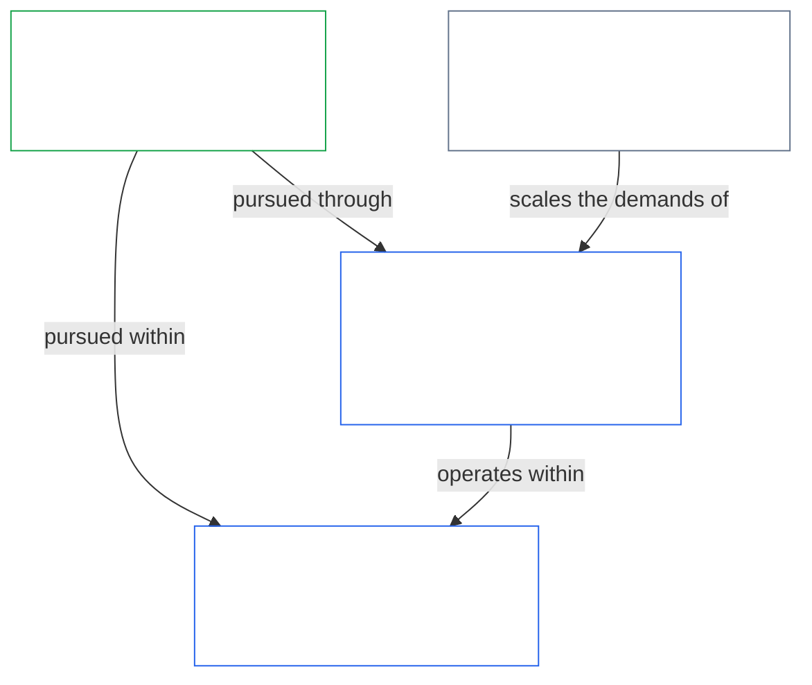
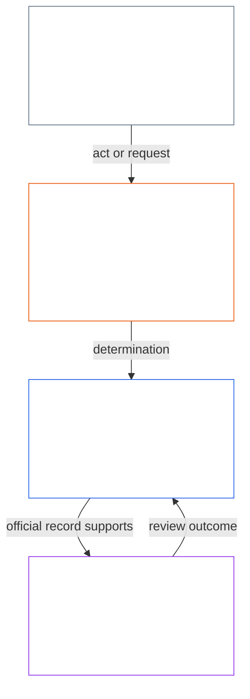
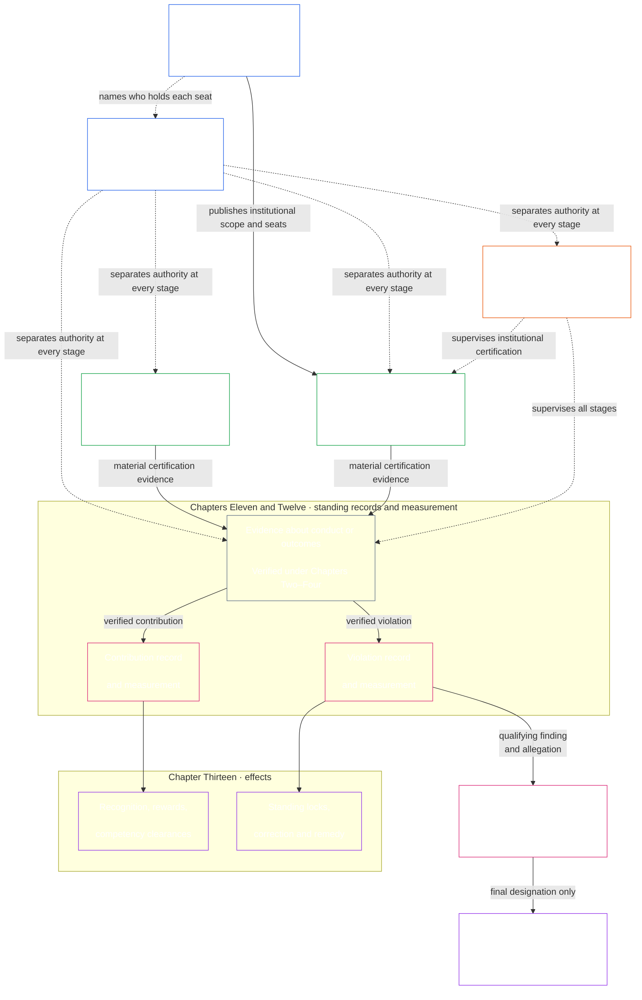

<!-- Locale: Brazilian Portuguese (pt-BR) (pt) | Source commit: 630b161c | Baseline commit: 5067e1774b0877a2ef35efc7d20ba99a2b305e05 | AI-drafted, unreviewed | Partial changed-passage refresh -->

Quando a Constituição exigir regras concretas de medição, os **Domínios de Fóruns Técnicos** do [Capítulo Quinze](core_15.000_forum.md#42-technical-forum-domains) desenvolvem e mantêm padrões compartilhados para medição, testes e evidências confiáveis. O fórum responsável por uma disputa aplica esses padrões ao decidir o caso segundo o [Capítulo Quinze §4.2 (*Domínios de Fóruns Técnicos*)](core_15.000_forum.md#42-shared-standards-and-anti-displacement).

- **Registros de standing** ([Capítulo Onze](core_11.000_standing_assessment.md#chapter-eleven-standing-records--question-1-what-happened)) — quando a conduta ou o dano importa constitucionalmente, registre fatos verificados em autos formais de contribuição ou violação; rumores e reputação não bastam.
- **Correção e reparação** ([Capítulo Treze §5.1 (*Reparação e correção*)](core_13.000_standing_integration.md#51-remedy-and-correction)) — corrija a falha subjacente e ofereça reconhecimento, reparo, restauração ou compensação proporcional às pessoas prejudicadas.
- **Revisão por fórum** ([Capítulo Quinze](core_15.000_forum.md#1-purpose-and-role--participation-architecture))

A contestabilidade na camada de participação é a primeira etapa normal para disputas dentro de sistemas já autorizados: os seres sencientes afetados usam primeiro a via de contestação publicada. A [revisão independente por fórum](core_15.000_forum.md#1-purpose-and-role--participation-architecture) não substitui essa via, nem a via substitui a revisão por fórum quando continua contestada, está ausente ou capturada, ou não pode conceder a reparação necessária. A [sequência de disputas](core_15.000_forum.md#dispute-sequencing) do Capítulo Quinze determina quando o encaminhamento ao fórum assume o caso.

- **O que produz:** O fluxo de verificação que alimenta as **entradas verificadas** do [Capítulo Onze](core_11.000_standing_assessment.md#chapter-eleven-standing-records--question-1-what-happened) e as evidências de alinhamento do sistema do [Capítulo Nove](core_09.000_system_alignment_certification_evaluation.md#chapter-nine-system-alignment-certification). Ele não substitui a própria medição de standing.

  - Regras de Transição da Adoção.

- **O que produz:** Proteções de direitos inegociáveis e mecanismos de reparação que os Capítulos Sete a Quinze, os fóruns, a governança e as regras de emenda devem respeitar e não podem restringir, contornar ou esvaziar por meio de procedimentos ou métricas substitutas.

*Em termos simples: um sistema ou instituição de impacto real publica uma Carta do Sistema ou Carta Institucional que declara o que pode fazer e quem ocupa cada assento. Antes que um ato materialmente vinculante avance, devem ser separados quem o inicia, quem verifica ou autoriza, quem guarda o registro oficial e quem analisa uma contestação. As funções podem ser ajustadas ao contexto, mas o mesmo agente e sua linha de controle não podem ocupar silenciosamente os assentos que verificam seu próprio ato.*

  - como uma Carta do Sistema ou Carta Institucional é emendada e revisada para que seu escopo chartered não mude silenciosamente; e

> Este mapa mostra as quatro funções e um percurso típico de um ato e de seu Registro do Ato. Ele não acrescenta um quinto assento, não prescreve uma sequência universal e não altera as regras do Capítulo Oito sobre independência, combinação proporcional de funções, ação emergencial ou encaminhamento de contestações.

*Em termos simples: os Capítulos Nove a Quinze aplicam o requisito de separação de funções do Capítulo Oito em uma cadeia: certificam sistemas e instituições, medem ajuda e dano em dois percursos separados, aplicam efeitos e reparação reais e impedem que um fórum seja o único julgador final de uma alegação contra si próprio. A cadeia mantém os deveres constitucionais reais no cotidiano.*

O [Capítulo Sete](core_07.000_charters.md#chapter-seven-system-and-institutional-charters) publica o escopo chartered e o mapa de assentos de cada sistema e instituição de Classe L ou superior. O [Capítulo Oito](core_08.000_functional_independence_separation_of_duties.md#chapter-eight-functional-independence-and-separation-of-duties) fornece o requisito de separação de funções que torna cada ato dessa cadeia validamente verificável. As funções de iniciação, verificação ou autorização, custódia do registro oficial e análise de contestações devem ser atribuídas e mantidas distintas conforme as regras aplicáveis de escala e independência. Os Capítulos Nove a Quinze aplicam essa arquitetura na seguinte sequência:

- **Capítulo Nove** usa verificação independente para decidir se um sistema ou instituição de impacto material está alinhado dentro do escopo e período de registro declarados. O Capítulo Nove rege a certificação de sistemas; o Capítulo Dez rege a certificação institucional, incluindo a classe, avaliação, registro e resultado de remediação da própria instituição.
- **Capítulo Onze** recebe os fatos verificados e os registra em registros de standing separados de Contribuição e Violação.
- **Capítulo Doze** mede cada registro de standing em seu próprio eixo. A contribuição verificada para o florescimento não compensa, cancela nem reduz um dano ou falha de responsabilização verificado separadamente; cada um permanece registrado e sujeito a suas próprias consequências.
- **Capítulo Treze** converte essas classificações em efeitos de standing proporcionais, incluindo habilitações de competência e reconhecimento no percurso de contribuição, e bloqueios de standing, correção e reparação no percurso de violação.
- **Capítulo Quatorze** só se aplica depois que o Capítulo Doze mede uma violação de alto impacto. Após as garantias do devido processo, decide se a conduta satisfaz por si só os critérios para uma designação final de conduta anticonstitucional (ACMD).
- **Capítulo Quinze** supervisiona encaminhamento, evidências, transferência, independência do fórum e resolução tempestiva para que os registros e efeitos resultantes possam ser contestados, corrigidos e aplicados sem permitir que um fórum capturado seja o único julgador final de sua própria conduta.

- **Revisão de conduta imprópria** responde à sua pergunta distinta: se uma violação qualificada também justifica uma designação final ACMD.
- **Supervisão do fórum** controla encaminhamento, evidências, transferência, contestação e reparação para que os registros oficiais e as decisões possam ser revisados e corrigidos a tempo.

2. **Certificar sistemas e instituições quando o impacto for suficientemente sério** — antes que um Sistema de alto impacto seja confiado em grande escala, obtenha um Registro de Certificação do Sistema contestável ([Partes A–B do Capítulo Nove](core_09.000_system_alignment_certification_evaluation.md#chapter-nine-system-alignment-certification)); avalie uma Instituição segundo sua própria classe, conduta, governança e portfólio conforme o [Capítulo Dez](core_10.000_institutional_alignment_certification.md#chapter-ten-institutional-alignment-certification) e registre o resultado em um Registro de Certificação Institucional.
3. **Registrar e medir standing em percursos separados** ([Capítulo Onze](core_11.000_standing_assessment.md#chapter-eleven-standing-records--question-1-what-happened) e [Capítulo Doze](core_12.000_standing_measurement.md#chapter-twelve-standing-measurement--question-2-how-good-or-bad-was-it)) — quando a ajuda ou o dano for suficientemente sério para importar constitucionalmente, o Capítulo Onze deve abrir autos formais e admitir apenas **entradas verificadas** (incluindo evidência de certificação de alinhamento do sistema do Capítulo Nove quando essa evidência for material); o Capítulo Doze mede e classifica o que foi verificado. Rumores, reputações e narrativas de disputas não bastam.
   - **Natureza da violação:** Abra um **registro de standing de violação** — autos delimitados e contestáveis para danos verificados e falhas de responsabilização — e classifique a **natureza da violação** no Eixo de Violação. Ajuda e dano nunca se fundem em uma pontuação líquida; registros vinculados fazem referência cruzada, mas permanecem separados.
4. **Aplicar efeitos de standing em cada percurso** ([Capítulo Treze](core_13.000_standing_integration.md#chapter-thirteen-standing-effects-and-integration)) — a contribuição verificada pode conceder habilitação de competência e deve sustentar reconhecimento proporcional e recompensas materiais; a violação verificada pode acionar bloqueios de standing, correção e [reparação para as pessoas prejudicadas](core_13.000_standing_integration.md#51-remedy-and-correction).
5. **Realizar revisão de designação anticonstitucional** ([Capítulo Quatorze](core_14.000_misconduct_designation.md#chapter-fourteen-anti-constitutional-misconduct)) — se uma constatação de violação de maior impacto também puder satisfazer os critérios anticonstitucionais, o Capítulo Quatorze deve decidir se a ACMD correspondente se aplica. As garantias do devido processo devem ser cumpridas. A ACMD não altera a gravidade do dano já medida pelo Capítulo Doze. Os efeitos ordinários do Capítulo Treze continuam em paralelo até que uma ACMD final acione o Bloqueio de Confiança Anticonstitucional.
6. **Encaminhar disputas e manter a reparação tempestiva** ([Capítulo Quinze](core_15.000_forum.md#1-purpose-and-role--participation-architecture)) — os fóruns devem supervisionar o andamento dos casos, o percurso que os trata e o cumprimento dos prazos do **Artigo XXVI-C** (*Piso de Resolução Tempestiva e Antiatraso*), para que a reparação não pereça por demora. As disputas ordinárias seguem a [sequência de disputas](core_15.000_forum.md#dispute-sequencing). Os fóruns também devem classificar as disputas em cinco [faixas de materialidade](core_15.000_forum.md#6-timely-resolution-materiality-tiers-and-anti-delay-discipline) (A/B/C/L/P) que espelham o alfabeto de classificação de sistemas — da urgência crítica à sobrevivência até assuntos privados/contidos. Aplica-se o encaminhamento padrão da família de integridade quando a designação final do Capítulo Quatorze for o interesse principal.

**Capítulo Nove — [Certificação de alinhamento do sistema](core_09.000_system_alignment_certification_evaluation.md#chapter-nine-system-alignment-certification)**

- **O que rege:** Garante que sistemas de impacto material permaneçam constitucionalmente alinhados.
- **O que produz:** Um **Registro de Certificação do Sistema** para cada sistema aprovado — uma constatação delimitada e contestável do alinhamento do sistema dentro do escopo e período de registro declarados.

**Capítulo Dez — [Certificação de alinhamento institucional](core_10.000_institutional_alignment_certification.md#chapter-ten-institutional-alignment-certification)**

- **O que rege:** Garante que instituições de impacto material permaneçam constitucionalmente alinhadas, pelas mesmas seis fases e sob a mesma numeração de seções do Capítulo Nove. A instituição é examinada quanto ao que somente ela controla: se segue sua Carta Institucional, quem responde por sua autoridade, o que recompensa e se os controles independentes podem ser utilizados. A certificação de cada sistema é considerada, sem repeti-la.
- **O que produz:** Um **Registro de Certificação Institucional** para cada instituição aprovada — uma constatação delimitada e contestável do alinhamento institucional dentro do escopo e período de registro declarados. O Capítulo Dez reutiliza o processo do fórum sem refazer a avaliação do sistema; a certificação institucional não é licença nem condição para formar ou operar uma instituição.

**Capítulo Onze — [Registros de standing](core_11.000_standing_assessment.md#chapter-eleven-standing-records--question-1-what-happened)**

- **O que rege:** Quando a conduta importa constitucionalmente, rumores e reputações não bastam — fatos verificados entram em **registros de standing**. **Contribuição** (ajuda ao florescimento) e **violação** (falhas de responsabilização e dano) são registradas em **registros de standing separados**: ajuda verificada não apaga dano verificado, e ambos nunca se fundem em uma pontuação líquida.
- **O que produz:** **Registros de standing** delimitados nos percursos de Contribuição e Violação, baseados apenas em **entradas verificadas** e constatações supervisionadas por fórum; pontuação informal e narrativas de disputa não substituem um registro de standing verificado.

**Capítulo Doze — [Medição de standing](core_12.000_standing_measurement.md#chapter-twelve-standing-measurement--question-2-how-good-or-bad-was-it)**

- **O que rege:** Mede quão boas ou ruins foram as evidências verificadas. Contribuição e violação são medidas em **eixos separados**, cada um na mesma escala unificada, e nunca se fundem em uma pontuação líquida.
- **O que produz:** Uma medição classificada — natureza, tamanho e slot — no Eixo de Contribuição ou no Eixo de Violação para cada registro de standing.

**Capítulo Treze — [Integração e efeitos de standing](core_13.000_standing_integration.md#chapter-thirteen-standing-effects-and-integration)**

    - [**Habilitações de competência**](core_13.000_standing_integration.md#72-competency-bars-and-clearances) podem abrir funções sensíveis à confiança, autoridade delegada, elegibilidade para supervisão e gestão responsável de consequências progressivamente maiores quando a competência é demonstrada segundo a barra de competência publicada e nenhum [bloqueio de standing](core_13.000_standing_integration.md#52-prevention--general-standing-locks) aplicável bloqueia a via nomeada

    - **Bloqueios de standing**, limites de função, ordens de remediação, [reparação para as pessoas prejudicadas](core_13.000_standing_integration.md#51-remedy-and-correction), descritores suplementares e mecanismos de execução

**Capítulo Quatorze — [Salvaguarda contra conduta anticonstitucional](core_14.000_misconduct_designation.md#chapter-fourteen-anti-constitutional-misconduct)**

- **O que rege:** Trata apenas das violações verificadas mais graves — condutas que possam ter capturado ou esvaziado deveres constitucionais em grande escala. Depois que o Capítulo Doze mede uma constatação de violação de maior impacto e há alegação material de conduta anticonstitucional, este capítulo conduz a revisão de designação como via de entrada do Capítulo Treze, em paralelo aos efeitos ordinários de standing desse capítulo.
- **O que produz:** Uma ACMD final — ou sua rejeição — para aquela constatação existente de maior impacto, somente após o cumprimento dos critérios exigidos e das garantias do devido processo. O Capítulo Doze continua medindo a gravidade do dano. Apenas uma ACMD final aciona o **Bloqueio de Confiança Anticonstitucional** do Capítulo Treze.

**Capítulo Quinze — [Supervisão e encaminhamento por fóruns](core_15.000_forum.md#chapter-fifteen-forums-and-jurisdiction)**

  - A [sequência de disputas](core_15.000_forum.md#dispute-sequencing) da via de contestação publicada de Participação do Sistema de Partes Interessadas até o encaminhamento ao fórum;

- **O que produz:** **Constatações de standing** que podem abrir ou atualizar registros de standing, além de encaminhamento legal para reparação e [resolução tempestiva](core_05.035_band_accountability.md#timely-resolution). Os fóruns supervisionam o fluxo; não substituem a medição de standing do Capítulo Doze.

*Em termos simples: os Capítulos Dezesseis a Vinte concluem esta Constituição: quem pode governar, como o texto pode mudar sem reverter proteções, como ele se relaciona com outras leis e como arquivos de orientação adotados permanecem vinculados a esta fonte.*

Os Capítulos **Quinze a Dezenove** concluem esta Constituição. Juntos, completam o [registro de titularidade constitucional](#4-principles-definitions-and-rights) para governança, validade de mudanças e incorporação: quem pode governar legitimamente, como a Constituição pode ser alterada legalmente e como o texto de implementação adotado permanece vinculado à fonte constitucional sem desvio silencioso.

**Capítulo Dezesseis — Contrato constitucional, legitimidade e gestão responsável** ([`core_16.000_governance.md`](core_16.000_governance.md#chapter-sixteen-constitutional-contract-legitimacy-authorization-and-stewardship))

**Capítulo Dezessete — Não regressão** ([`core_17.000_non_regression.md`](core_17.000_non_regression.md#chapter-seventeen-non-regression-and-substantive-amendment-validity))

**Capítulo Dezoito — Supremacia e ordens externas** ([`core_18.000_expansion_supremacy.md`](core_18.000_expansion_supremacy.md#chapter-eighteen-expansion-supremacy-and-external-legal-orders))

- **O que rege:** Como esta Constituição se relaciona com outras normas: ampliação da proteção quando legal, supremacia dentro do escopo válido da fonte, da adoção e da camada de governança, não deslocamento da lei externa aplicável por sua própria força e interação disciplinada com ordens jurídicas externas sem subordinação silenciosa ou captura.

**Capítulo Dezenove — Emenda, ratificação e adoção** ([`core_19.000_amendment_ratification.md`](core_19.000_amendment_ratification.md#chapter-nineteen-amendment-ratification-and-procedural-validity))

- **O que rege:** Como esta Constituição pode ser alterada legalmente — procedimento de emenda, ratificação e adoção — e as **salvaguardas processuais** que seguem as salvaguardas substantivas do Capítulo Dezessete: as mudanças devem ser publicadas abertamente, rastreáveis até a custódia autorizada e permanecer significativamente contestáveis, com revisão independente quando exigida.

**Capítulo Vinte — Ponte de incorporação** ([`core_20.000_incorporation.md`](core_20.000_incorporation.md))

Quando um adotante os incorpora validamente segundo o [Capítulo Vinte](core_20.000_incorporation.md), esses arquivos vinculam como texto de implementação dentro do escopo da adoção. O sentido da Constituição dos Seres Sencientes continua prevalecendo — eles **implementam, não restringem**, os capítulos acima. Fixação da edição, cadeias de custódia e a regra contra desvio silencioso mantêm o texto adotado rastreável até o que foi efetivamente ratificado. A lista canônica e as regras de limites estão no [Capítulo Cinco — Corpus](core_05.045_band_integrative.md#corpus).
