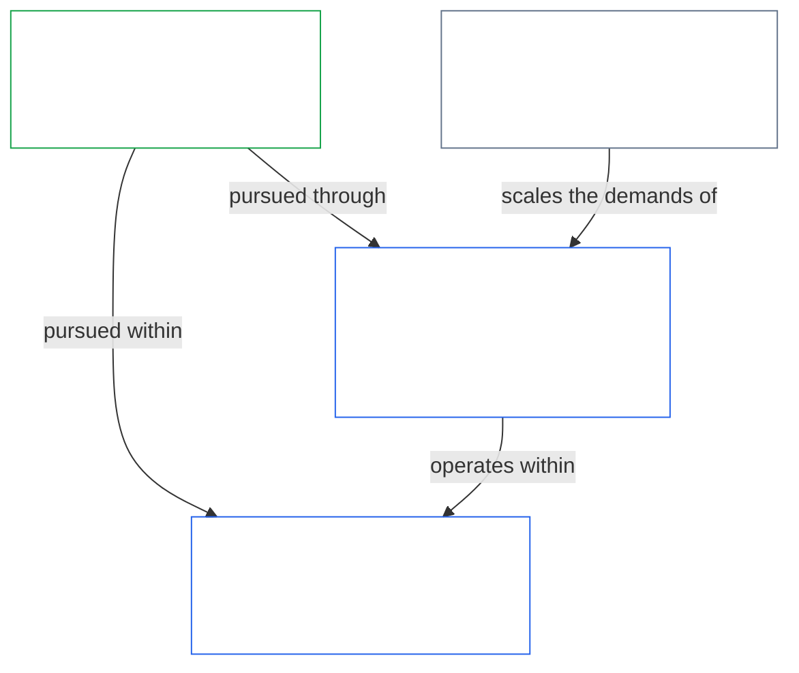
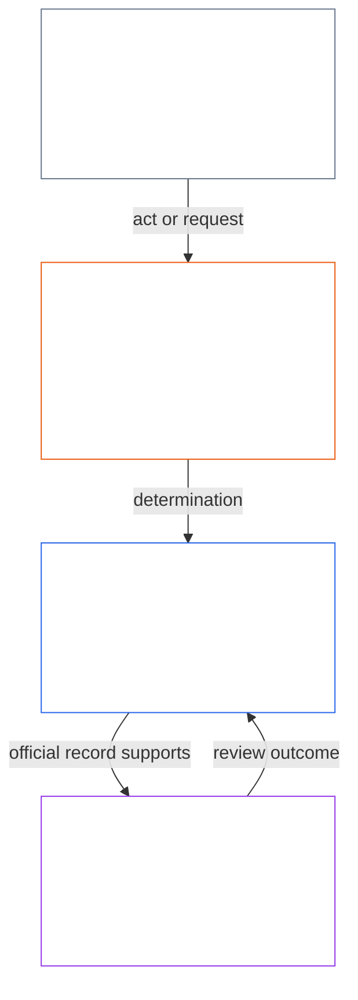
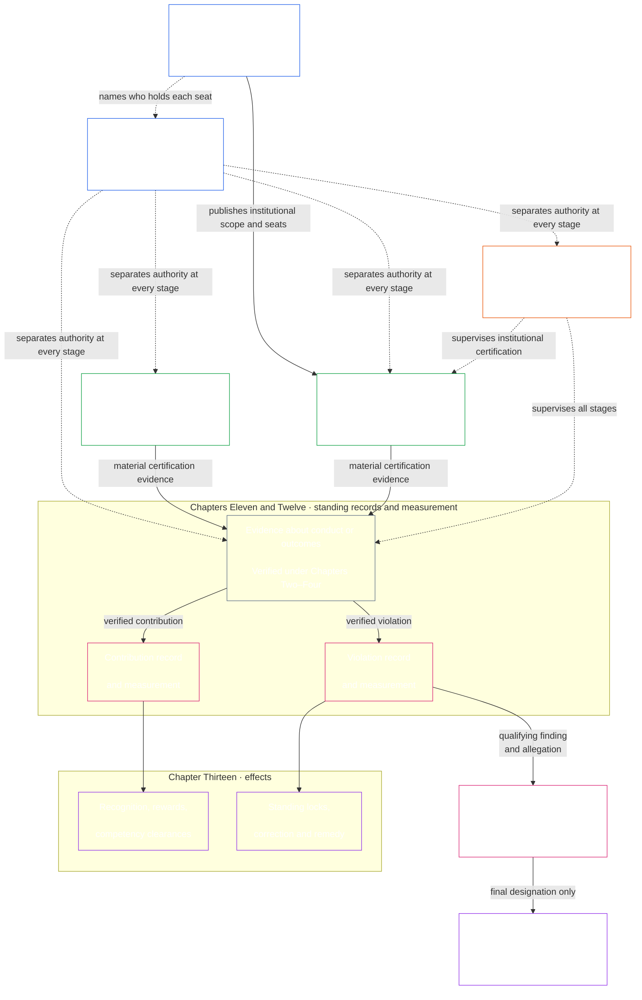

<!-- Locale: Russian (ru) | Source commit: 630b161c | Baseline commit: 5067e1774b0877a2ef35efc7d20ba99a2b305e05 | AI-drafted, unreviewed | Partial changed-passage refresh -->

Когда Конституция требует конкретных правил измерения, **Области технических форумов** по [Главе пятнадцатой](core_15.000_forum.md#42-technical-forum-domains) разрабатывают и поддерживают общие стандарты измерений, испытаний и надёжных доказательств. Форум, отвечающий за спор, затем применяет эти стандарты при рассмотрении дела согласно [Главе пятнадцатой §4.2 (*Области технических форумов*)](core_15.000_forum.md#42-shared-standards-and-anti-displacement).

- **Записи о статусе** ([Глава одиннадцатая](core_11.000_standing_assessment.md#chapter-eleven-standing-records--question-1-what-happened)) — если поведение или вред имеет конституционное значение, вносите проверенные факты в официальные дела о вкладе или нарушении; слухов и репутации недостаточно.
- **Исправление и возмещение** ([Глава тринадцатая §5.1 (*Возмещение и исправление*)](core_13.000_standing_integration.md#51-remedy-and-correction)) — устраните исходный сбой и предоставьте пострадавшим соразмерное признание, исправление, восстановление или компенсацию.
- **Рассмотрение форумом** ([Глава пятнадцатая](core_15.000_forum.md#1-purpose-and-role--participation-architecture))

Оспоримость на уровне участия — обычный первый шаг для споров внутри уже уполномоченных систем: затронутые сущности сначала используют опубликованный путь оспаривания. Независимое [рассмотрение форумом](core_15.000_forum.md#1-purpose-and-role--participation-architecture) не заменяет этот путь, и путь не заменяет рассмотрение форумом, если спор сохраняется, маршрут отсутствует или захвачен либо не позволяет предоставить необходимое средство защиты. [Последовательность рассмотрения споров](core_15.000_forum.md#dispute-sequencing) в Главе пятнадцатой определяет, когда дело передаётся форуму.

- **Результат:** Процесс проверки, обеспечивающий **проверенные входные данные** для [Главы одиннадцатой](core_11.000_standing_assessment.md#chapter-eleven-standing-records--question-1-what-happened) и доказательства согласованности системы для [Главы девятой](core_09.000_system_alignment_certification_evaluation.md#chapter-nine-system-alignment-certification). Он не заменяет само измерение статуса.

  - Правила перехода при принятии.

- **Результат:** Неподлежащие обсуждению гарантии прав и механизмы возмещения, которые Главы седьмая по пятнадцатую, форумы, управление и правила внесения поправок обязаны уважать и не могут сужать, обходить или опустошать посредством процедур или косвенных показателей.

*Простыми словами: система или учреждение с реальным воздействием публикует Системную хартию или Институциональную хартию, где указано, что она может делать и кто занимает каждое место. Затем, до совершения существенно обязывающего действия, необходимо разделить функции инициирования, проверки или утверждения, хранения официальной записи и рассмотрения оспаривания. Роли можно соразмерять с условиями, но один и тот же субъект и линия его контроля не могут незаметно занимать места, проверяющие его собственное действие.*

  - как изменять и пересматривать Системную хартию или Институциональную хартию, чтобы установленный хартией охват не менялся незаметно; и

> Эта схема показывает четыре функции и типичную последовательность действия и Записи о действии. Она не добавляет пятого места, не предписывает универсальную последовательность и не меняет правила Главы восьмой о независимости, соразмерном совмещении функций, действиях в чрезвычайной ситуации или маршрутизации оспаривания.

*Простыми словами: Главы с девятой по пятнадцатую применяют требование разделения обязанностей из Главы восьмой как единую цепочку: сертифицируют системы и учреждения, измеряют помощь и вред по двум отдельным направлениям, применяют реальные последствия и возмещение и не позволяют форуму стать единственным окончательным судьёй по жалобе на него самого. Эта цепочка делает конституционные обязанности реальными в повседневной жизни.*

[Глава седьмая](core_07.000_charters.md#chapter-seven-system-and-institutional-charters) публикует охват хартии и карту мест для каждой системы и учреждения класса L или выше. [Глава восьмая](core_08.000_functional_independence_separation_of_duties.md#chapter-eight-functional-independence-and-separation-of-duties) устанавливает требование разделения обязанностей, благодаря которому каждое действие в этой цепочке можно надлежащим образом проверить. Функции инициирования, проверки или утверждения, хранения официальных записей и рассмотрения оспаривания должны распределяться и оставаться раздельными согласно применимым правилам масштабирования и независимости. Затем Главы с девятой по пятнадцатую последовательно применяют эту архитектуру:

- **Глава девятая** использует независимую проверку, чтобы определить, согласована ли система или учреждение со значительным воздействием в пределах заявленного охвата и периода записи. Глава девятая регулирует сертификацию систем; Глава десятая — сертификацию учреждений, включая класс, оценку, запись и результат исправления самого учреждения.
- **Глава одиннадцатая** принимает проверенные факты и вносит их в отдельные записи о вкладе и нарушении.
- **Глава двенадцатая** измеряет каждую запись о статусе по собственной оси. Подтверждённый вклад в процветание не компенсирует, не отменяет и не уменьшает отдельно подтверждённый вред или сбой подотчётности; каждый из них остаётся в записи и влечёт собственные последствия.
- **Глава тринадцатая** преобразует эти классификации в соразмерные последствия для статуса, включая допуски по компетентности и признание на направлении вклада, а также блокировки статуса, исправление и возмещение на направлении нарушения.
- **Глава четырнадцатая** применяется только после того, как Глава двенадцатая измерила нарушение высокого уровня воздействия. После гарантий надлежащей процедуры она решает, соответствуют ли действия самостоятельным критериям окончательного признания антиконституционного нарушения (ACMD).
- **Глава пятнадцатая** контролирует маршрутизацию, доказательства, передачу, независимость форума и своевременное разрешение, чтобы записи и последствия можно было оспаривать, исправлять и обеспечивать исполнением, не позволяя захваченному форуму стать единственным окончательным судьёй собственного поведения.

- **Рассмотрение нарушения** отвечает на отдельный вопрос: заслуживает ли квалифицируемое нарушение окончательного признания ACMD.
- **Надзор форума** управляет маршрутизацией, доказательствами, передачей, оспариванием и возмещением, чтобы официальные записи и решения можно было своевременно пересматривать и исправлять.

2. **Сертифицируйте системы и учреждения при достаточно серьёзном воздействии** — прежде чем начать широко полагаться на систему с высоким воздействием, получите оспоримую Запись о сертификации системы ([Части A–B Главы девятой](core_09.000_system_alignment_certification_evaluation.md#chapter-nine-system-alignment-certification)); оцените учреждение по его собственному классу, поведению, управлению и портфелю согласно [Главе десятой](core_10.000_institutional_alignment_certification.md#chapter-ten-institutional-alignment-certification) и внесите результат в Запись о сертификации учреждения.
3. **Записывайте и измеряйте статус по отдельным направлениям** ([Глава одиннадцатая](core_11.000_standing_assessment.md#chapter-eleven-standing-records--question-1-what-happened) и [Глава двенадцатая](core_12.000_standing_measurement.md#chapter-twelve-standing-measurement--question-2-how-good-or-bad-was-it)) — когда помощь или вред имеют достаточно серьёзное конституционное значение, Глава одиннадцатая должна открыть официальные дела и принимать только **проверенные входные данные** (включая доказательства сертификации согласованности системы по Главе девятой, если они имеют существенное значение); затем Глава двенадцатая измеряет и классифицирует проверенные факты. Слухов, репутации и рассказов о спорах недостаточно.
   - **Характер нарушения:** откройте **запись о нарушении в рамках статуса** — ограниченное и оспоримое дело о подтверждённом вреде и сбоях подотчётности — и классифицируйте **характер нарушения** по Оси нарушения. Помощь и вред никогда не сводятся к единой чистой оценке; связанные записи ссылаются друг на друга, но остаются раздельными.
4. **Применяйте последствия статуса по каждому направлению** ([Глава тринадцатая](core_13.000_standing_integration.md#chapter-thirteen-standing-effects-and-integration)) — подтверждённый вклад может дать допуск по компетентности и должен обеспечивать соразмерное признание и материальное вознаграждение; подтверждённое нарушение может повлечь блокировки статуса, исправление и [возмещение пострадавшим](core_13.000_standing_integration.md#51-remedy-and-correction).
5. **Проведите рассмотрение признания антиконституционного нарушения** ([Глава четырнадцатая](core_14.000_misconduct_designation.md#chapter-fourteen-anti-constitutional-misconduct)) — если вывод о нарушении с наивысшим воздействием может также соответствовать антиконституционным критериям, Глава четырнадцатая должна решить, применяется ли соответствующее признание ACMD. Необходимо соблюсти гарантии надлежащей процедуры. ACMD не меняет оценку серьёзности вреда, уже выполненную Главой двенадцатой. Обычные последствия Главы тринадцатой продолжаются параллельно, пока окончательное ACMD не активирует Блокировку антиконституционного доверия.
6. **Маршрутизируйте споры и обеспечивайте своевременное возмещение** ([Глава пятнадцатая](core_15.000_forum.md#1-purpose-and-role--participation-architecture)) — форумы должны контролировать движение дел, направление их рассмотрения и соблюдение сроков по **Статье XXVI-C** (*Минимальный стандарт своевременного разрешения и защиты от задержек*), чтобы задержка не лишала возможности возмещения. Обычные споры следуют [последовательности рассмотрения споров](core_15.000_forum.md#dispute-sequencing). Форумы также классифицируют споры по пяти [уровням существенности](core_15.000_forum.md#6-timely-resolution-materiality-tiers-and-anti-delay-discipline) (A/B/C/L/P), соответствующим буквенной классификации систем, — от срочности, критичной для выживания, до частных/ограниченных вопросов. Приоритетная маршрутизация семейства целостности применяется, если главным предметом является окончательное признание по Главе четырнадцатой.

**Глава девятая — [Сертификация согласованности системы](core_09.000_system_alignment_certification_evaluation.md#chapter-nine-system-alignment-certification)**

- **Компетенция:** обеспечивает конституционную согласованность систем со значительным воздействием.
- **Результат:** для каждой успешно прошедшей системы оформляется **Запись о сертификации системы** — ограниченный и оспоримый вывод о согласованности системы в заявленных пределах и за период записи.

**Глава десятая — [Сертификация согласованности учреждений](core_10.000_institutional_alignment_certification.md#chapter-ten-institutional-alignment-certification)**

- **Компетенция:** обеспечивает конституционную согласованность учреждений со значительным воздействием, используя те же шесть этапов и номера разделов, что и Глава девятая. Учреждение проверяется по вопросам, которые контролирует только оно: соблюдение Институциональной хартии, ответственность за его полномочия, система вознаграждения и доступность независимых проверок. Сертификация каждой системы учитывается, но не проводится повторно.
- **Результат:** для каждого успешно прошедшего учреждения оформляется **Запись о сертификации учреждения** — ограниченный и оспоримый вывод о согласованности учреждения в заявленных пределах и за период записи. Глава десятая повторно использует форумный процесс, не повторяя оценку системы; сертификация учреждения не является лицензией или условием его создания либо работы.

**Глава одиннадцатая — [Записи о статусе](core_11.000_standing_assessment.md#chapter-eleven-standing-records--question-1-what-happened)**

- **Компетенция:** если поведение имеет конституционное значение, слухов и репутации недостаточно — проверенные факты вносятся в **записи о статусе**. **Вклад** (помощь процветанию) и **нарушение** (сбои подотчётности и вред) вносятся в **отдельные записи о статусе**: подтверждённая помощь не стирает подтверждённый вред, и они никогда не объединяются в единую чистую оценку.
- **Результат:** ограниченные **записи о статусе** по направлениям вклада и нарушения, основанные только на **проверенных входных данных** и выводах под надзором форума; неофициальная оценка и повествования о спорах не заменяют проверенную запись о статусе.

**Глава двенадцатая — [Измерение статуса](core_12.000_standing_measurement.md#chapter-twelve-standing-measurement--question-2-how-good-or-bad-was-it)**

- **Компетенция:** измеряет, насколько хорошими или плохими были проверенные факты. Вклад и нарушение измеряются по **отдельным осям**, каждая по одной и той же единой шкале; они никогда не объединяются в чистую оценку.
- **Результат:** классифицированное измерение — характер, размер и слот — по Оси вклада или Оси нарушения для каждой записи о статусе.

**Глава тринадцатая — [Интеграция статуса и последствия](core_13.000_standing_integration.md#chapter-thirteen-standing-effects-and-integration)**

    - [**Допуски по компетентности**](core_13.000_standing_integration.md#72-competency-bars-and-clearances) могут открыть роли, чувствительные к доверию, делегированные полномочия, право на надзор и управление с возрастающими последствиями, если компетентность подтверждена по опубликованному порогу компетентности и применимая [блокировка статуса](core_13.000_standing_integration.md#52-prevention--general-standing-locks) не закрывает указанный маршрут

    - **Блокировки статуса**, ограничения ролей, предписания об исправлении, [возмещение пострадавшим](core_13.000_standing_integration.md#51-remedy-and-correction), дополнительные дескрипторы и механизмы исполнения

**Глава четырнадцатая — [Защита от антиконституционных нарушений](core_14.000_misconduct_designation.md#chapter-fourteen-anti-constitutional-misconduct)**

- **Компетенция:** рассматривает только наиболее серьёзные подтверждённые нарушения — поведение, которое могло масштабно захватить или обессмыслить конституционные обязанности. Если Глава двенадцатая уже измерила нарушение с наивысшим воздействием и выдвинуто существенное обвинение в антиконституционном нарушении, эта глава проводит рассмотрение признания как шлюзового направления Главы тринадцатой параллельно с обычными последствиями статуса по Главе тринадцатой.
- **Результат:** окончательное признание ACMD — либо отказ — по существующему выводу о наивысшем воздействии, но только после выполнения необходимых критериев и гарантий надлежащей процедуры. Серьёзность вреда по-прежнему измеряет Глава двенадцатая. Только окончательное ACMD активирует **Блокировку антиконституционного доверия** Главы тринадцатой.

**Глава пятнадцатая — [Надзор форумов и маршрутизация](core_15.000_forum.md#chapter-fifteen-forums-and-jurisdiction)**

  - [Последовательность рассмотрения споров](core_15.000_forum.md#dispute-sequencing) от опубликованного пути оспаривания участия затронутых в системе до маршрутизации форуму;

- **Результат:** **Выводы о статусе**, которые могут открыть или обновить записи о статусе, а также правомерная маршрутизация к возмещению и [своевременному разрешению](core_05.035_band_accountability.md#timely-resolution). Форумы контролируют процесс, но не заменяют измерение статуса по Главе двенадцатой.

*Простыми словами: Главы с шестнадцатой по двадцатую завершают эту Конституцию: кто может управлять, как менять текст без отката гарантий, как он соотносится с другими законами и как принятые практические материалы остаются связанными с этим источником.*

Главы **с пятнадцатой по девятнадцатую** завершают эту Конституцию. Вместе они заполняют [реестр конституционных компетенций](#4-principles-definitions-and-rights) для управления, действительности изменений и инкорпорации: кто может законно управлять, как правомерно изменить Конституцию и как принятый текст реализации остаётся связанным с конституционным источником без незаметного дрейфа.

**Глава шестнадцатая — Конституционный договор, легитимность и ответственное управление** ([`core_16.000_governance.md`](core_16.000_governance.md#chapter-sixteen-constitutional-contract-legitimacy-authorization-and-stewardship))

**Глава семнадцатая — Недопущение регресса** ([`core_17.000_non_regression.md`](core_17.000_non_regression.md#chapter-seventeen-non-regression-and-substantive-amendment-validity))

**Глава восемнадцатая — Верховенство и внешние распоряжения** ([`core_18.000_expansion_supremacy.md`](core_18.000_expansion_supremacy.md#chapter-eighteen-expansion-supremacy-and-external-legal-orders))

- **Компетенция:** определяет отношение этой Конституции к другим нормам: расширение защиты там, где это законно; верховенство в пределах действительного источника, принятия и слоя управления; недопущение вытеснения применимого внешнего права, действующего самостоятельно; упорядоченное взаимодействие с внешними правовыми системами без скрытого подчинения или захвата.

**Глава девятнадцатая — Поправки, ратификация и принятие** ([`core_19.000_amendment_ratification.md`](core_19.000_amendment_ratification.md#chapter-nineteen-amendment-ratification-and-procedural-validity))

- **Компетенция:** определяет, как правомерно менять эту Конституцию — процедуру поправок, ратификацию и принятие, — а также **процедурные гарантии**, следующие за содержательными гарантиями Главы семнадцатой: изменения должны публиковаться открыто, прослеживаться до уполномоченного хранения и оставаться предметом содержательного оспаривания с независимой проверкой, когда она требуется.

**Глава двадцатая — Мост инкорпорации** ([`core_20.000_incorporation.md`](core_20.000_incorporation.md))

Когда принимающая сторона правомерно включает их согласно [Главе двадцатой](core_20.000_incorporation.md), эти файлы становятся обязательным текстом реализации в пределах принятия. Значение Конституции разумных существ продолжает иметь приоритет — эти файлы **реализуют изложенные выше главы, но не сужают их**. Фиксация редакции, цепочки хранения и запрет на незаметный дрейф позволяют проследить принятый текст до фактически ратифицированного источника. Канонический перечень и правила границ приведены в [Главе пятой — Корпус](core_05.045_band_integrative.md#corpus).
