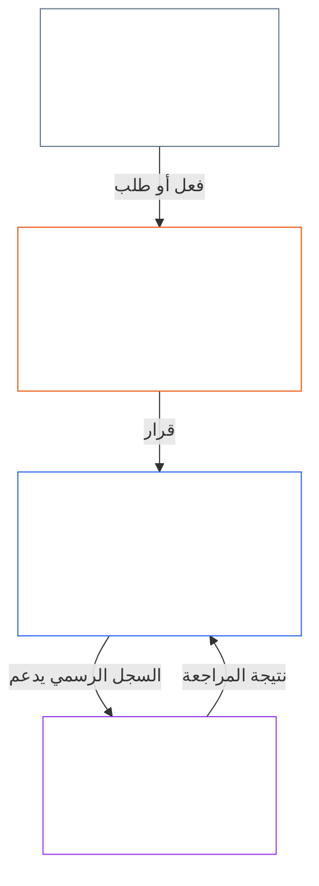
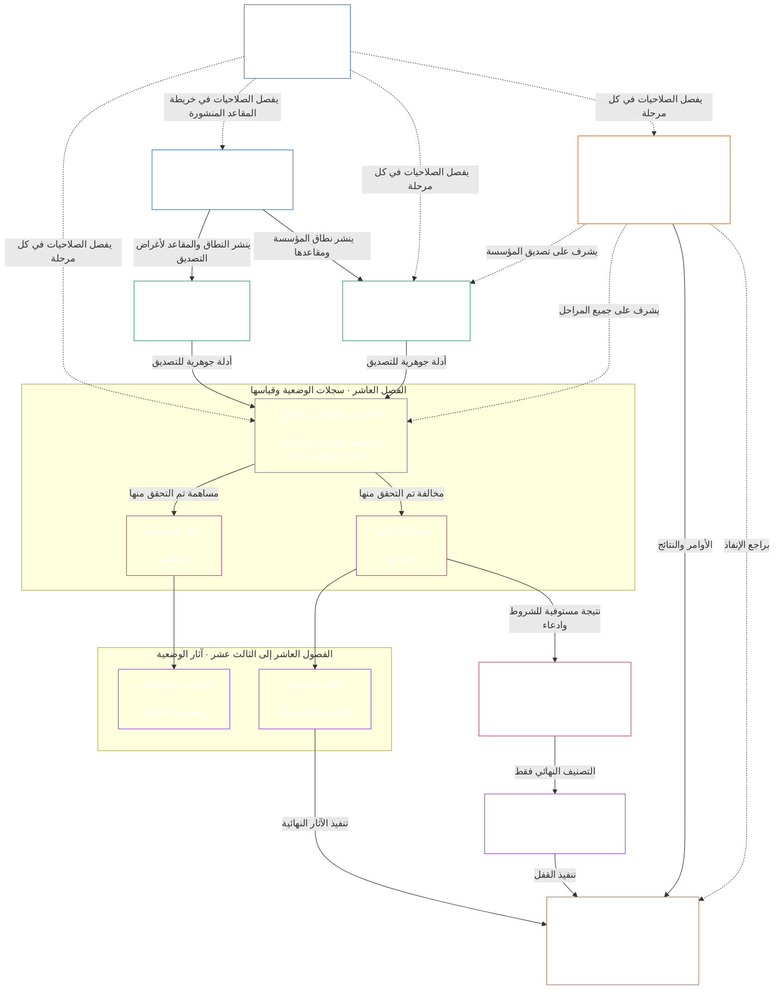

<!-- Locale: ar; variety: العربية الفصحى الحديثة. AI-assisted structural resynchronization draft (GPT-6 Codex), unreviewed and incomplete. English source commit 6e0b6c663dde01b5dea731fe33d87725c7174930; edition SC-Corpus-2026.11.25. core_00 SHA-256 90799cb8019b41356fa5dd90565e3f9540fc346e8c77e2c321b841654f39b274; core_01 SHA-256 aca759b394f10784ab1a2eef4e9e2ca12e369ef0ca8ee797298c6af00d2950aa. -->

<strong>موضع الملف في المتن (غير تشغيلي): بنية الملف وقواعد القراءة</strong>

> الأدوات الموسومة بأنها **غير تشغيلية** (موضع الملف في المتن، وإرشادات القارئ، وخرائط القراءة) للتوجيه فقط. ولا تضيف التزامًا ملزمًا أو تحذفه أو تضيّقه، في ملفها أو في أي ملف آخر.
>
> هذا الملف **جزء من دستور الكائنات الواعية**، وهو **ملزم فقط مع** ملفات `core_*` المرقمة الأخرى والمتن الفرعي، عند قراءتها كنص واحد. ويحتوي على **الفصل الأول**، *الخريطة الدستورية*: غرضه (§1)، وسبب وجوده (§2)، وكيفية ترابط ملفاته (§3)، وأسس الفصول اللاحقة (§4)، وعمليات الحوكمة الرئيسية (§5)، وسجل المسؤوليات الدستورية (§§6 إلى 11).
>
> **السابق:** [core_00.000_preamble.md](core_00_preamble.md) (الديباجة)
> **التالي:** [core_02.000_values_principles.md](../../core_02.000_values_principles.md)

<strong>التتبّع</strong>

- السابق: [الديباجة](core_00_preamble.md) (*النموذج، والمقصدان الدستوريان، والرباعية الدستورية، والرهان المادي، وفئات القياس*).
- الأقسام الفرعية:
  - [§1](#1-purpose-role-and-scope);
  - [§2](#2-why-the-map-exists);
  - [§3](#3-how-the-files-fit-together);
  - [§4](#4-foundations-for-the-chapters-that-follow);
  - [§5](#5-key-governance-processes);
  - [§6](#6-principles-definitions-and-rights);
  - [§7](#7-system-and-institutional-charters-functional-independence-and-separation-of-duties);
  - [§8](#8-key-practical-process-pipelines);
  - [§9](#9-process-ownership-and-outputs);
  - [§10](#10-governance-change-and-incorporation);
  - [§11](#11-adopted-implementation-corpus).
- يُقرأ مع: [تراتب السلطة والهرمية الداخلية](../../subcore_03.080_band_integrative.md#authority-stack-and-internal-hierarchy) (*كيفية تطبيق سجل المسؤوليات*)؛ [README.md](README.md) (*ترتيب القراءة*).

 

# الفصل الأول: الخريطة الدستورية

> **État / Draft status:** structural draft, unreviewed and incomplete. Current sections 1–4 are new and require translation; moved sections are raw prior translation requiring full fidelity review.

### 1. الغرض والدور والنطاق

*بعبارات واضحة: هذا الفصل دليل لبقية الدستور. يوضح كيف تترابط أجزاؤه، وأي فصل يتولى كل موضوع، وكيف تسير العمليات الرئيسية، لكي يجد القارئ القاعدة التي تجيب عن سؤاله.*

**الغرض:** يقدم الفصل الأول نظرة عامة ودليلًا لتوزيع المسؤوليات. ويسمي العمليات التي تختبر الحوكمة المأذون بها، ويحدد الفصل المسؤول عن كل مجال موضوعي، ويصف المستويات الثلاثة للنص الدستوري.

**الدور:** هذا الفصل للتوجيه وتحديد المسؤوليات. ولا يضيف واجبًا من عنده يتجاوز سجل المسؤوليات، الذي تطبقه الفصول الأخرى و[تراتب السلطة والهرمية الداخلية](../../subcore_03.080_band_integrative.md#authority-stack-and-internal-hierarchy).

**نطاق الفصل:** يشمل الفصل:

- سبب وجود الخريطة (**القسم 2**);
- كيفية ترابط الملفات (**القسم 3**) والأسس التي تستند إليها الفصول اللاحقة (**القسم 4**);
- عمليات الحوكمة الرئيسية (**القسم 5**);
- سجل المسؤوليات الدستورية: المبادئ والتعريفات والحقوق (**القسم 6**)، ومواثيق الأنظمة والمؤسسات والاستقلال الوظيفي وفصل الواجبات (**القسم 7**)، ومسارات العمليات (**القسم 8**)، ومسؤولية العمليات ومخرجاتها (**القسم 9**)، والحوكمة والتغيير والدمج (**القسم 10**); و
- مجموعة التنفيذ المعتمدة والمجموعة الفرعية (**القسم 11**).

### 2. لماذا توجد الخريطة

*بعبارات واضحة: يحتاج نص بهذا الحجم إلى دليل يبين كيف تترابط أجزاؤه ومن المسؤول عن كل موضوع. وُضع هذا الفصل لكي يجد القارئ القاعدة التي تجيب عن سؤاله.*

يوزع الدستور عمله على فصول كثيرة، ومجموعة فرعية، وأربع مجموعات تنفيذ معتمدة. وقد يضل كائن حساس يحاول معرفة ما يستحقه، أو جهة متبنية تبحث عن واجب. هذا الفصل هو النظرة العامة ودليل المسؤوليات: ما الذي يفعله كل جزء، وأي فصل يتولى كل موضوع، وكيف تسير المسارات، وكيف ترتبط المستويات بعضها ببعض. ولا يضيف قاعدة خاصة به تتجاوز سجل المسؤوليات.

**الأساس:**

- الديباجة:
  - [الرباعية الدستورية](core_00_preamble.md#constitutional-tetrad): الوظائف التي يحملها هذا الفصل:
    - [المشاركة](../../subcore_03.060_apex_participation_leg.md#participation): يستطيع الكائن الحساس العثور على القاعدة التي تجيب عن سؤاله؛
    - [المساءلة](../../subcore_03.040_apex_accountability_leg.md#accountability): لكل موضوع فصل مسؤول محدد يجيب عنه؛
    - [الرقابة](../../subcore_03.055_apex_oversight_leg.md#oversight): يستطيع القارئ رؤية ترابط الأجزاء واكتشاف أي فجوة أو تداخل؛
    - [التوقيت المناسب](../../subcore_03.065_apex_timeliness_leg.md#timeliness): يصل القارئ إلى القاعدة الصحيحة من دون تأخير؛
  - [الغايتان الدستوريتان](core_00_preamble.md#two-constitutional-aims): الغايتان اللتان يخدمهما هذا الفصل:
    - [الازدهار](core_00_preamble.md#flourishing): لا يخدم الدستور الكائنات الحساسة إلا إذا استطاعت الاهتداء إلى موضعها فيه؛
    - [الاستمرارية](core_00_preamble.md#continuity): تحافظ الخريطة الواضحة على تكامل النص مع نموه وتغيّره؛
- مبادئ الفصل الثاني:
  - [§5.2 الإتاحة بلغة واضحة (واجب المشاركة والرعاية)](../../core_02.000_values_principles.md#52-plain-language-accessibility-participation-and-stewardship-duty);
  - [§5.2.4 الانضباط ضد جعل التعقيد عائقًا](../../core_02.000_values_principles.md#524-complexity-as-defeat-discipline);
  - [§15.4 تسوية تعارض المعنى الدستوري](../../core_02.030_constitutional_interpretation.md#154-constitutional-meaning-conflict-resolution);
- مواد الفصل الرابع:
  - [المادة XXIV-A](../../core_04.030_rights_part_d.md#article-xxiv-a-proportional-comprehensibility-right) (*حق الفهم المتناسب*);
  - [المادة XXIV-B](../../core_04.030_rights_part_d.md#article-xxiv-b-complexity-audit-and-modularity-requirements) (*متطلبات تدقيق التعقيد والتقسيم إلى وحدات*).

### 3. كيف تترابط الملفات

تترابط ملفات الدستور على النحو الآتي:

- **النواة (`core_*`):** تحتوي الملفات المرقمة على فصول الدستور، وتُقرأ معًا كنص واحد. وهي تنص على الضمانات والبنية الدستورية.
- **المجموعة الفرعية (`subcore_*`):** تقدم هذه الملفات القواعد والإجراءات الكاملة التي تستند إليها الفصول. وينتمي كل ملف إلى فصل، وله القوة نفسها، ويلزم كل متبنٍّ من دون دمج منفصل. ولا يجوز للمجموعة الفرعية تضييق نطاق فصلها.
- **التنفيذ (`corpus_*`):** توفر أربعة ملفات التفاصيل التشغيلية لتنفيذ الدستور. وهي تلزم ضمن نطاق الدمج الصحيح، وتنفذ الدستور من دون تضييقه. ويحدد [القسم 11](#11-adopted-implementation-corpus) الملفات الأربعة.

إن [المجموعة](../../subcore_03.080_band_integrative.md#corpus) المحددة هي مجموعة أوسع ومُرقمنة من المصادر الدستورية الملزمة: تشمل النواة والمجموعة الفرعية ونصوص التنفيذ المعتمدة وأي أغلفة توافق صالحة خلال المرحلة الانتقالية. ولا تصبح المسودات والملاحظات وأدلة التصفح ملزمة لمجرد أنها جزء من المشروع.

### 4. أسس الفصول اللاحقة

*بعبارات واضحة: تتولى الفصول من الثاني إلى الرابع القيم والقاموس (مع قواعد المجموعة الفرعية بشأن بناء التعريفات وحمايتها وإثباتها) وأرضية الحقوق؛ وعلى الفصول اللاحقة احترام هذه المجالات من دون نقلها خفيةً.*

توفر الفصول **من الثاني إلى الرابع** القيم والمفردات وآليات التحقق وأرضية الحقوق التي يجب على كل ما يليها احترامها، بما في ذلك:

- متطلب ميثاق النظام أو ميثاق المؤسسة في [الفصل الخامس](#7-system-and-institutional-charters-functional-independence-and-separation-of-duties)، ومتطلب فصل الواجبات في الفصل السادس، والهيئات المستقلة في الفصل السابع، وكلها في القسم 7؛
- [مسارات العمليات العملية الرئيسية](#8-key-practical-process-pipelines) في القسم 8؛
- [مسؤولية العمليات ومخرجاتها](#9-process-ownership-and-outputs) في القسم 9؛
- فصول الحوكمة ومسارات التغيير في القسم 10؛ و
- [مجموعة التنفيذ المعتمدة](#11-adopted-implementation-corpus) في القسم 11.

### 5. عمليات الحوكمة الرئيسية

عندما يطلب الفصل الرابع أو السبكور 8-B أو وثيقة مُدمجة أو حكم دستوري آخر ذلك صراحة، تُوجَّه المسألة الدستورية المادية إلى مسار أو أكثر أدناه. المسارات تختبر الحوكمة المصرح بها وتجعلها قابلة للمراجعة والطعن والتصحيح؛ ولا تنشئ سلطة الحكم بذاتها.

- **الاستقلال الوظيفي وفصل الواجبات** ([الفصل السادس](../../core_06.000_functional_independence_separation_of_duties.md#chapter-six-functional-independence-and-separation-of-duties): قبل انتقال أي فعل مُلزِم ماديًا، حدّد وافصل وظائف البدء والتحقق أو الإذن وحفظ السجل الرسمي ومراجعة الطعون وفق قواعد التناسب والاستقلال المنطبقة.
- **تصديق مواءمة النظام** ([السبكور 8-B](../../subcore_08.020_system_alignment_certification_evaluation.md#subcore-8-b-system-alignment-certification--evaluation): قبل الوثوق بنظام عالي الأثر على نطاق واسع، اجمع وراجع الدليل لتحديد ما إذا كان آمنًا دستوريًا الاعتماد عليه الآن. ويعمل التصديق مع حق السنتيانات في الطعن والتدقيق، ولا يحل أحد الضمانين محل الآخر.
- **سجلات الوضعية** ([السبكور 10-B](../../subcore_10.020_standing_assessment.md#subcore-10-b-standing-records--question-1-what-happened): عندما يهم السلوك أو الضرر دستوريًا، أدرج الوقائع المتحقق منها في ملفات رسمية منفصلة للمساهمة أو المخالفة؛ فالشائعات والسمعة لا تكفيان.
- **التصحيح والانتصاف** ([الفصل الثاني عشر §3.1](../../core_12.000_violation_consequences.md#31-remedy-and-correction): بعد مخالفة متحقق منها، عالج سببها وأوقف استمرارها (التصحيح)، وقدّم ما يستحقه المتضررون (الانتصاف). ولا يغني أحدهما عن الآخر.
- **مراجعة المنتدى** ([الفصل السادس عشر](../../core_16.000_forum.md#chapter-sixteen-standards-routing-and-forum-cases)):
  - تستخدم النزاعات العادية داخل الأنظمة المصرح بها مسار الطعن المنشور للمشاركة النظامية لأصحاب المصلحة أولًا.
  - إذا ظل المسار محل نزاع أو كان مفقودًا أو مستولى عليه أو عاجزًا عن منح الانتصاف، وجّه النزاع بحسب الرهان الأساسي إلى منتديات خاضعة للإشراف.
  - تسند المنتديات الأدلة والنقل المشروع ومهل الحل في الوقت المناسب بموجب **المادة XXVII-C**.

### 6. المبادئ والتعريفات والحقوق

تشكّل الأقسام **6 إلى 11** سجلّ المالكين الدستوري: يحدّد الفصل أو المتن المعتمد المسؤول عن كل موضوع وما ينتجه. وتسمّي الجملة الملزمة في افتتاح كل فصل نطاق ملكيته. يجوز للأجزاء الأخرى الإحالة إلى المالك، لكنها لا تعيد كتابة مسؤوليته أو تنقلها ضمنًا. انظر [رصّة السلطة والتسلسل الداخلي](../../subcore_03.080_band_integrative.md#authority-stack-and-internal-hierarchy).

**[الفصل الثاني — القيم والمبادئ والإدارة المسؤولة](../../core_02.000_values_principles.md)**

- **ما يملكه:** القيم والقيود الدستورية الموجِّهة، بما فيها الرفاه والإنصاف والسلامة والحقيقة والثقة والحرية المحدودة؛ الاعتراف بالإسهام المشروع ومكافأته بما يتناسب معه؛ حل التعارض بين المبادئ؛ وواجبات الإدارة المسؤولة، ومنها الفهم الموزع والتقييم المنظومي وانضباط الحوكمة.
- **ما ينتجه:** الأساس التفسيري للفصول اللاحقة، الذي يحوّل المقاصد العليا إلى متطلبات تشغيلية عند تطبيق الأنظمة والحقوق والتعريفات ومسارات الإجراءات.

**[الفصل الثالث — التعريفات التأسيسية](../../core_03.000_definitions_home.md)**

- **ما يملكه:** مكدس التعريفات المعياري: نطاقات الرقابة والمشاركة والمساءلة والاستمرارية والتكامل؛ [رصّة السلطة والتسلسل الداخلي](../../subcore_03.080_band_integrative.md#authority-stack-and-internal-hierarchy)؛ [المتن](../../subcore_03.080_band_integrative.md#corpus)؛ وقواعد الحدود ذات الصلة.
- **ما ينتجه:** مفردات دستورية دقيقة للتفسير والتدقيق والفصل. إنه مكدس التعريفات، لا أرضية الحقوق؛ فالحقوق الملزمة في الفصل الرابع.

وتحمل الملفات الفرعية للفصل الثالث القواعد التي تحافظ على سلامة التعريفات:

- **[السبكور 3-A — بنية التعريفات](../../subcore_03.010_definition_structure.md):** يحدد بنية المكوّنات الوجودية/القياس/التقييم/الامتثال (O/M/A/C)، ومتطلبات المواءمة وقواعد المكوّن. **ما ينتجه:** نحو مشترك للتعريفات يحول دون الغموض والافتراضات الخفية والأشكال غير المتوافقة.
- **[السبكور 3-B — سلامة التعريفات](../../subcore_03.020_definition_integrity.md):** يمنع التهرّب وتحريك النطاق وإعادة التعريف والحيل التي تفرّغ التعريفات عمليًا. **ما ينتجه:** انضباط منع التهرّب وبيانات توجيه عدم الامتثال، بما فيها مسارات مراجعة الوضعية وسوء السلوك عند ثبوت التهرّب.
- **[السبكور 3-C — العبء والتتبّع والتحقق](../../subcore_03.030_burden_traceability_verification.md):** يضع عبء الإثبات على مدّعي الامتثال، ويطلب دليلًا قابلًا للتتبّع والرصد والتحقق يتناسب مع [الرهان المادي](core_00_preamble.md#material-stake) ويبقى قابلًا للطعن عمليًا. **ما ينتجه:** مسار التحقق الذي يغذي المدخلات المتحقق منها في [السبكور 10-B](../../subcore_10.020_standing_assessment.md#subcore-10-b-standing-records--question-1-what-happened) وأدلة مواءمة النظام في [السبكور 8-B](../../subcore_08.020_system_alignment_certification_evaluation.md#subcore-8-b-system-alignment-certification--evaluation)، ولا يحل محل قياس الوضعية.

**[الفصل الرابع — الحقوق التأسيسية](../../core_04.000_rights_part_a.md)**

- **ما يملكه:** أرضية الحقوق في المواد **I–XXIX**: ضروريات البقاء؛ تخصيص الموارد وإدارة الاعتماد؛ الكرامة والفاعلية والمشاركة؛ الطعن والانتصاف؛ قيود العدالة؛ التوقيت بموجب **المادة XXVII-C** (*أرضية الحل في وقته ومنع التأخير*)؛ وقواعد الانتقال عند التبنّي. تنظّم الأجزاء الأربعة هذه الحمايات لقراءة تبدأ بالكوكب.
- **ما ينتجه:** حمايات حقوق غير قابلة للتفاوض وروابط انتصاف يجب على الفصول من الخامس إلى السادس والعشرين والمنتديات والحوكمة وقواعد التعديل احترامها وألا تضيقها أو تتجاوزها أو تفرغها بإجراء أو مقياس بديل.

### 7. مواثيق الأنظمة والمؤسسات والاستقلال الوظيفي وفصل الواجبات

*بعبارات بسيطة: ينشر النظام أو المؤسسة ذات الأثر الحقيقي ميثاقًا للنظام أو للمؤسسة يبيّن ما يجوز لها فعله ومن يشغل كل مقعد. وقبل نفاذ فعل ملزم ماديًا، يجب فصل من يبدأه، ومن يتحقق منه أو يأذن به، ومن يحفظ السجل الرسمي، ومن يراجع الطعن فيه. قد تتناسب الأدوار مع السياق، لكن لا يجوز للفاعل نفسه أو لخط سيطرته أن يشغل خفيةً المقاعد التي تتحقق من فعله.*

يلخّص هذا القسم متطلبات مواثيق الأنظمة ومواثيق المؤسسات وفصل الواجبات، والفصل المتعلق بالهيئات التي يجب أن تستقل عمّن تراقبه. كما يبيّن ما الذي ينتجه كل منها.

**[الفصل الخامس — مواثيق الأنظمة والمؤسسات](../../core_05.000_charters.md#chapter-five-system-and-institutional-charters)**

- **ما يملكه:** متطلبات نشر ميثاق نظام أو ميثاق مؤسسة:
  - الأنظمة والمؤسسات من الفئة L فما فوق التي يجب أن تنشر [ميثاق نظام](../../subcore_03.075_band_continuity.md#system-charter) أو [ميثاق مؤسسة](../../subcore_03.075_band_continuity.md#institutional-charter) (ويجوز للفئة P نشره طوعًا)؛
  - الحد الأدنى لما يجب أن يذكره الميثاق، بما في ذلك [خريطة أدوار الميثاق](../../subcore_03.075_band_continuity.md#charter-role-map) و[إحالات الميثاق](../../subcore_03.075_band_continuity.md#charter-pointer) إلى قواعد اختيار أصحاب المصلحة الملزمة والمنشورة؛
  - كيفية تعديل الميثاق ومراجعته كي لا يتغير نطاقه بصمت؛ و
  - ما لا يجوز للميثاق فعله: تحديد الفئة، أو تعريف الحدود، أو أن يحل محل التصديق، أو أن يتضمن قواعد القرار، أو أن يمنح سلطة.
- **ما ينتجه:** بيان منشور ذو إصدارات للنطاق وتوزيع المقاعد، يمكن [للفصل السادس](../../core_06.000_functional_independence_separation_of_duties.md#chapter-six-functional-independence-and-separation-of-duties) والتصديق وسجلات الوضعية والمنتديات اختبار السلوك على أساسه.

**[الفصل السادس — الاستقلال الوظيفي وفصل الواجبات](../../core_06.000_functional_independence_separation_of_duties.md)**

- **ما يملكه:** المتطلب المشترك بين العمليات بأن يوزع كل [فعل ملزم ماديًا](../../subcore_03.070_band_accountability.md#materially-binding-act) الوظائف الأربع على نحو منفصل:
  - البدء؛
  - التحقق أو الإذن؛
  - حفظ السجل الرسمي؛ و
  - مراجعة الطعون.

  كما ينظّم:

  - الحد الأدنى الموحد لمحتويات كل [سجل فعل ملزم ماديًا](../../subcore_03.070_band_accountability.md#materially-binding-act-record)؛
  - الاستقلال عن [خط السيطرة المادية](../../subcore_03.070_band_accountability.md#material-control-line) للفاعل؛
  - توزيع المقاعد المنشور والبدائل؛
  - الاستضافة المدمجة المتناسبة وحدود الطوارئ؛ و
  - عمليات التسليم المنسوبة إلى أصحابها والتوجيه إلى المقعد الخطأ.
- **ما ينتجه:** بنية قابلة لإعادة الاستخدام للمقاعد الأربعة ولسجل الفعل. ويجب أن تطبقها كل عملية لاحقة للتصديق أو الوضعية أو المنتدى أو الحوكمة أو التنفيذ المُدمج قبل أن تُعد نتيجتها متحقَّقًا منها باستقلال، ومسجلة على نحو موثوق، وقابلة للطعن فعليًا.

**[الفصل السابع — الهيئات المستقلة](../../core_07.000_independent_bodies.md)**

- **ما يملكه:** تحديد ما يجعل هيئة مستقلة، وقاعدة تسمية هيئة بأنها هيئة مستقلة، وقائمة الهيئات المستقلة التي يجب على كل متبنٍ توفيرها، مع ضماناتها للكائنات الواعية في سطر واحد لكل هيئة.
- **ما ينتجه:** معيار واحد تستوفيه كل هيئة مستقلة كي يُتحقق من استقلالها بالطريقة ذاتها أينما كانت. وترد القواعد التشغيلية الكاملة لكل هيئة مدرجة في ملفها الخاص من ملفات السبكور الملحقة بـ[الفصل السابع](../../core_07.000_independent_bodies.md#chapter-seven-independent-bodies).

#### 7.1 خريطة فصل المقاعد الأربعة

يجب أن يراعي كل **فعل ملزم ماديًا** ضمانات الفعل الواحد نفسها:

- لا يجوز لمقعد البدء أن يتحقق من فعله أو يأذن به.
- لا يجوز لمقعد التحقق أو الإذن أن يحفظ السجل الرسمي للفعل.
- لا يجوز لمقعد التحقق أو الإذن أن يراجع طعنًا في الفعل.
- يجب أن يكون مقعدا التحقق أو الإذن ومراجعة الطعن خارج [خط السيطرة المادية](../../subcore_03.070_band_accountability.md#material-control-line) لمقعد البدء.

<strong>إرشاد للقارئ (غير تشغيلي): خريطة فصل المقاعد الأربعة</strong>

> تعرض هذه الخريطة الوظائف الأربع ومسارًا نموذجيًا لفعل وسجله. لا تضيف مقعدًا خامسًا، ولا تفرض تسلسلًا عامًا، ولا تغير قواعد الفصل السادس بشأن الاستقلال أو الاستضافة المدمجة المتناسبة أو إجراء الطوارئ أو توجيه الطعون.

 

### 8. سلاسل الإجراءات العملية الرئيسية

*بعبارة بسيطة: تطبق الفصول من التاسع إلى الخامس عشر متطلب فصل الواجبات في الفصل الثامن ضمن سلسلة واحدة: اعتماد الأنظمة والمؤسسات، وقياس المساعدة والضرر على مسارين منفصلين، وتطبيق الآثار الفعلية والانتصاف، ومنع المنتدى من أن يكون الموطن النهائي الوحيد لمطالبة موجهة ضده. وتجعل السلسلة الواجبات الدستورية واقعية في الحياة اليومية.*

ينشر [الفصل السابع](../../core_05.000_charters.md#chapter-five-system-and-institutional-charters) النطاق المعتمد وخريطة المقاعد لكل نظام ومؤسسة من الفئة L أو أعلى. ويقدم [الفصل الثامن](../../core_06.000_functional_independence_separation_of_duties.md#chapter-six-functional-independence-and-separation-of-duties) متطلب فصل الواجبات الذي يجعل كل فعل في هذه السلسلة قابلًا للتحقق على نحو صحيح. وهو يشترط إسناد وظائف البدء والتحقق أو الإذن وحفظ السجل الرسمي ومراجعة الطعن وإبقائها منفصلة وفق قواعد التناسب والاستقلال المنطبقة. ثم تطبق الفصول من التاسع إلى الخامس عشر هذا البناء بالتتابع:

كل خطوة أدناه تبيّن ما يخص الفصل وما يُنتجه. ثم يُظهر [كيف تلتئم السلسلة كاملة](#82-how-the-full-chain-fits-together) أولئك المالكين مسارًا واحدًا من فحص النظام إلى الانتصاف.

**تصديق مواءمة النظام** ([الفصل السابع](core_09.000_system_alignment_certification_evaluation.md#chapter-nine-system-alignment-certification))

- **ما يخصّه:** يضمن أن تبقى الأنظمة ذات الأثر المادي متوائمة دستوريًا.
  - قبل أن يُعتَرف بنظام يؤثّر ماديًا في الكائنات الواعية أو يُعتمَد عليه على نطاق واسع، يُجمع الدليل ويُراجَع تحت رقابة المنتدى
  - يجب أن تغطي المراجعة:
    - ما إذا كان النظام يحترم مقومات البقاء الأساسية؛
    - تخصيص الموارد ورعاية الاعتماديات بموجب **المادة الخامسة** (*تخصيص الموارد والاعتماديات وتمويل النظام البيئي*) — بما في ذلك [الدعم المتناسب عبر الأنظمة](../../subcore_03.075_band_continuity.md#proportionate-cross-system-support) عند وجود اعتماد جوهري على بنية تحتية مشتركة؛
    - السلامة؛
    - المشاركة؛ و
    - الحدود الدستورية الدنيا الأخرى.
  - الكائنات الواعية ذات الوضعية المعترف بها تستطيع الطعن في النتيجة
  - يجب إعادة تصديق الأنظمة عالية المخاطر بجدول منتظم؛ التصديق ليس دائمًا أبدًا
- **ماذا يُنتج:** **سجل تصديق مواءمة النظام** — جواب محدود قابل للطعن عمّا إذا كان ذلك النظام متوائمًا بما يكفي للاعتراف به أو مواصلة الاعتماد عليه أو نشره أو إطلاقه من الشروط *الآن*، ضمن نطاق ونافذة زمنية مبيَّنين.

**قياس الوضعية** ([الفصل الثامن](../../core_10.000_standing_assessment.md#chapter-ten-standing-assessment))

- **ما يخصّه:** عندما يهم السلوك دستوريًا، الإشاعات والسمعة لا تكفي. الوقائع الموثّقة تدخل **سجلات الوضعية**. **الإسهام** (المساعدة نحو الازدهار) و**المخالفة** (إخفاقات المساءلة والضرر) يُقاسان على **محورين منفصلين** — السلوك الحسن الموثّق لا يمحو الضرر الموثّق، ولا يُطوي الاثنان أبدًا في درجة صافية واحدة.
- **ماذا يُنتج:** **سجلات وضعية** مصنَّفة على محور الإسهام ومحور المخالفة، استنادًا فقط إلى **مدخلات موثّقة** ونتائج خاضعة لرقابة المنتدى — لا إلى تسجيل غير رسمي أو سرديات نزاع تقوم مقام التصنيف.

**دمج الوضعية والآثار** ([الفصل التاسع](../../subcore_10.060_standing_integration.md#1-purpose-role-and-scope))

- **ما يخصّه:** يدمج التصنيفات الموثّقة في **آثار وضعية** في العالم الحقيقي على مسارات منفصلة — مُقاسة على [**الرهان المادي**](core_00_preamble.md#material-stake)، من دون طي الإسهام والمخالفة في درجة صافية واحدة، ومن دون إفراغ المشاركة أو الرقابة أو المساءلة أو حسن التوقيت.
  - **مسار الإسهام:** التصنيف الإيجابي الموثّق يُنتج مكسبًا عمليًا:
    - [**تصاريح الكفاءة**](../../core_11.000_contribution_consequences.md#32-competency-bars-and-clearances) التي قد تتيح أدوارًا حساسة للثقة وسلطة مفوضة وأهلية للإشراف ومسؤوليات رعاية متزايدة الأثر عند إثبات الكفاءة وفق الحد المنشور، ما لم يمنع [قفل الوضعية](../../core_12.000_violation_consequences.md#32-prevention--general-standing-locks) المنطبق المسار المحكوم ببوابة
    - اعتراف متناسب و**مكافآت مادية** على الإدارة المسؤولة المشروعة والتعاون كما يطلب [الفصل الأول](../../core_02.000_values_principles.md#32-recognition-reinforcement-and-aspiration)
    - ليست ثناءً فارغًا. يجب أن تكون المنافع حقيقية ومسنودة بدليل ومفتوحة للطعن
  - **مسار المخالفة:** نتائج المخالفة الموثّقة تُنتج خسارة عملية:
    - **أقفال الوضعية** وحدود الأدوار وأوامر المعالجة و[الانتصاف لمن أُضيروا](../../core_12.000_violation_consequences.md#31-remedy-and-correction) وواصفات تكميلية وخطاطيف إنفاذ
    - القيود تناسب جسامة ما وُثِّق
    - المخالفات غير المحلولة تبقى حيّة
    - تبقى مسارات متناسبة لاستعادة الوضعية متاحة لمن يُظهر ردًّا أصيلًا
    - إجازة الكفاءة من جانب الإسهام لا تسقط قفل وضعية من جانب المخالفة
- **ماذا يُنتج:** آثار وضعية منفصلة ومُقاسة على مساري الإسهام والمخالفة — إجازات كفاءة ومكافآت مادية من جهة؛ وأقفال وضعية وتصحيح وانتصاف من جهة أخرى — لا يُطوى أي منهما في درجة واحدة.

**حاجز سوء السلوك المضاد للدستور** ([الفصل العاشر](core_10_a_misconduct_designation.md#chapter-ten-anti-constitutional-misconduct))

- **ما يخصّه:** يعالج فقط أخطر المخالفات الموثّقة — سلوك قد يكون استولى على واجبات دستورية أو أفرغها على نطاق واسع. عندما يكون الفصل الثامن قد سجّل أصلًا نتيجة مخالفة أعلى أثر، ويُدعى سوء سلوك مضاد للدستور دعوى مادية، يُجري هذا الفصل مراجعة التسمية مسار بوابة للفصل التاسع بالتوازي مع آثار الوضعية العادية للفصل التاسع.
- **ماذا يُنتج:** تسمية نهائية لسوء سلوك مضاد للدستور — أو رفضًا — لتلك النتيجة القائمة أعلى أثر، فقط بعد استيفاء المعايير المطلوبة وضمانات الإجراءات الواجبة. ما زال الفصل الثامن يقيس مدى جسامة الضرر؛ والتسمية النهائية وحدها تشغّل **قفل الثقة المضاد للدستور** في الفصل التاسع.

**رقابة المنتدى والتوجيه** ([الفصل الحادي عشر](core_11_forum.md#chapter-eleven-forums-and-jurisdiction))

- **ما يخصّه:** يراقب كيف تتحرك النزاعات ومسائل التصديق فعلًا.
  - [تسلسل النزاع](core_11_forum.md#dispute-sequencing) من مسار الطعن المنشور للمشاركة النظامية للأطراف المتأثرة إلى توجيه المنتدى
  - أي أسرة منتديات تتولاها، وأين تبدأ القضية عادة
  - كيف يُسنَد الدليل
  - كيف تُنقَل المسائل أو تُدمَج
  - كيف تمنع قواعد منع أن يحكم المنتدى في نفسه المنتديات المستولى عليها من أن تكون الموطن النهائي الوحيد
  - المهل تحت **المادة XXV-C** (*الحل في وقته وأرضية منع التأخير*) تمنع القضايا من الجلوس بلا حل طويلًا حتى لا يعود الانتصاف ذا شأن
- **ماذا يُنتج:** **نتائج موثّقة** قد تفتح سجلات الوضعية أو تحدّثها، إضافة إلى توجيه مشروع نحو الانتصاف و[الحل في وقته](../../subcore_03.070_band_accountability.md#timely-resolution-constitutional). المنتديات تراقب السلسلة؛ ولا تحل محل قياس الوضعية في الفصل الثامن.

#### 8.1 خريطة العمليات

تبقى السلسلة عملية دستورية واحدة لأن كل مرحلة تسلّم نتيجة محددة قابلة للمراجعة. وتظل مقيدة دستوريًا: فـ**الرباعية الدستورية** تقتضي المشاركة والإشراف والمساءلة والتوقيت المناسب في كل مرحلة؛ و**الغايتان الدستوريتان** تقتضيان خدمة الازدهار والاستمرارية معًا؛ وتحظر **أرضيات الحقوق** تضييق الحماية غير القابلة للتفاوض أو تجاوزها أو إفراغها. وتحول هذه القواعد الواجبات إلى سجلات وقرارات يستطيع أصحاب الإحساس فحصها والطعن فيها وإصلاحها والاعتماد عليها عمليًا، لا على الورق فقط.

#### 8.2 كيف تلتئم السلسلة كاملة

*بعبارات بسيطة: افصل المقاعد أولًا، ثم اتبع المسار من فحص النظام حتى الانتصاف، مع إشراف المنتدى على النزاع وخطوات الوضعية طوال الطريق.*

تسير السلسلة كاملة بالترتيب الآتي:

1. **افصل المقاعد في كل فعل مُلزِم ماديًا** ([الفصل السادس](../../core_06.000_functional_independence_separation_of_duties.md#3-four-seat-constitutional-requirement): حدّد من يبدأ، ومن يتحقق أو يأذن، ومن يحفظ السجل الرسمي، ومن ينظر في الطعن. طبّق حالات الجمع المحظورة وقواعد الاستقلال ومسار البديل المنشور قبل اعتبار الفعل مفحوصًا على نحو صحيح. وحين يلزم ميثاق نظام أو مؤسسة، تنشر خريطة أدوار الميثاق في [الفصل الخامس](../../core_05.000_charters.md#6-the-charter-role-map-and-standing-record-custody) أصحاب كل مقعد.
2. **صدّق الأنظمة والمؤسسات عندما يكون الأثر جسيمًا**: قبل الوثوق بنظام عالي الأثر على نطاق واسع، احصل على سجل تصديق نظام قابل للطعن بموجب [السبكور 8-B](../../subcore_08.020_system_alignment_certification_evaluation.md#subcore-8-b-system-alignment-certification--evaluation)؛ وقيّم المؤسسة وفق فئتها وسلوكها وحوكمتها ومحفظتها، وسجّل النتيجة في سجل تصديق مؤسسة بموجب [السبكور 9-B](../../subcore_09.020_institutional_alignment_certification_evaluation.md#subcore-9-b-institutional-alignment-certification--evaluation).
3. **سجّل الوضعية وقِسها على مسارين منفصلين** ([السبكوران 10-B و10-D](../../subcore_10.020_standing_assessment.md#subcore-10-b-standing-records--question-1-what-happened) و[10-D](../../subcore_10.040_standing_measurement.md#subcore-10-d-standing-measurement--question-2-how-good-or-bad-was-it)): عند وجود مساعدة أو ضرر ذي شأن دستوري، افتح ملفات رسمية واقبل **المدخلات المتحقق منها** وحدها، ثم قِس وصنّف ما ثبت. لا تكفي الشائعات أو السمعة أو روايات النزاع. لا تُطوَ المساعدة والضرر في درجة صافية؛ والسجلات المرتبطة تبقى منفصلة. وتشمل المدخلات المتحقق منها أدلة تصديق مواءمة النظام من الفصل الثامن عندما تكون مادية. افتح سجلًا للإسهام المتحقق منه نحو الازدهار وصنّف طبيعته على محور الإسهام، وسجلًا للمخالفة المتحقق منها وصنّف طبيعتها على محور المخالفة؛ وتتبادل السجلات المرتبطة الإحالات لكنها تظل منفصلة.
4. **طبّق آثار الوضعية لكل مسار** ([السبكور 10-F](../../subcore_10.060_standing_integration.md#subcore-10-f-standing-integration--question-3-what-follows)): قد يتيح الإسهام المتحقق منه تصريح كفاءة واعترافًا ومكافآت مادية متناسبة؛ وقد تترتب على المخالفة المتحقق منها أقفال وضعية وتصحيح وانتصاف للمتضررين. ويجب أن يدعم الإسهام المتحقق منه اعترافًا ومكافآت مادية متناسبة، وقد يتيح تصريح كفاءة.
5. **أجرِ مراجعة تسمية السلوك المضاد للدستور** ([الفصل الرابع عشر](../../core_14.000_misconduct_designation.md#chapter-fourteen-anti-constitutional-misconduct-designation)): إذا استوفت نتيجة مخالفة أعلى أثر معايير السلوك المضاد للدستور، فليقرر الفصل الرابع عشر بعد ضمانات الإجراءات الواجبة ما إذا كانت تسمية ACMD تنطبق. تستمر الآثار العادية بالتوازي؛ ولا يغيّر التصنيف النهائي جسامة الضرر التي قاسها الفصل العاشر، ولا يشغّل قفل الثقة المضاد للدستور إلا قرار ACMD نهائي.
6. **وجّه النزاعات وأبقِ الانتصاف في وقته** ([الفصلان السادس عشر والسابع عشر](../../core_16.000_forum.md#1-purpose-role-and-scope) و[الفصل السابع عشر](../../core_17.000_forum_families_escalation_timeliness_support.md#chapter-seventeen-forum-families-escalation-timely-resolution-and-support)): أشرف على انتقال القضايا وعلى المسار الذي يتولاها، وتحقق من مهل **المادة XXVII-C** حتى لا يموت الانتصاف في التأخير. تتبع النزاعات العادية [تسلسل النزاع](../../core_16.000_forum.md#dispute-sequencing). وصنّفها في خمس [درجات للرهان المادي](../../core_17.000_forum_families_escalation_timeliness_support.md#5-timely-resolution-materiality-tiers-and-anti-delay-discipline) (A/B/C/L/P). ويُطبّق التوجيه الافتراضي لأسرة النزاهة عندما يكون تصنيف الفصل الرابع عشر النهائي هو الرهان الأساسي.
7. **نفّذ النتائج** ([الفصلان التاسع عشر والعشرون](../../core_19.000_enforcement.md#chapter-nineteen-enforcement) و[الفصل العشرون](../../core_20.000_special_enforcement.md#chapter-twenty-special-enforcement)): ينفّذ طرف مُسمّى أثرًا نهائيًا أو قفلًا أو انتصافًا أو أمر منتدى ضمن مهلته، من دون تفادٍ أو تأخير أو إسقاط هادئ. وإذا قاوم الطرف المُلزَم، تُطبّق ضمانات الإنفاذ الخاص ضمن أرضياتها المشتركة: حجز المال والأصول مع حد أدنى محمي؛ وسُلّم معياري للضغط من أجل التسليم؛ وسُلّم للقوة يبدأ بغير القاتلة؛ وتقييم الأسباب الجذرية لمنع تكرار الإخفاق.

### 9. ملكية العمليات ومخرجاتها

*بعبارات بسيطة: تُظهر خريطة العمليات و[كيفية التئام السلسلة كاملة](#82-how-the-full-chain-fits-together) السلسلة؛ ويسمّي هذا القسم مالك كل مرحلة ومخرجاتها كي لا تستولي مرحلة بصمت على عمل مرحلة أخرى.*

تبيّن كل خطوة أدناه ما يملكه الفصل وما ينتجه، وتفصّل المالكين المذكورين في [§8.2 كيفية التئام السلسلة كاملة](#82-how-the-full-chain-fits-together).

**[السبكور 8-B — التصديق على مواءمة النظام](../../subcore_08.020_system_alignment_certification_evaluation.md#subcore-8-b-system-alignment-certification--evaluation)**

- **ما يملكه:** ضمان بقاء الأنظمة ذات الأثر المادي متوائمة دستوريًا.
  - قبل التصديق على نظام يؤثر ماديًا في الكائنات الواعية أو الاعتماد عليه على نطاق واسع، يجب جمع الأدلة ومراجعتها تحت إشراف المنتدى.
  - يجب أن تشمل المراجعة:
    - احترام النظام لضروريات البقاء؛
    - تخصيص الموارد ورعاية الاعتماد بموجب **المادة V** (*تخصيص الموارد والاعتماد وتمويل النظم الإيكولوجية*)، بما في ذلك [الدعم المتناسب بين الأنظمة](../../subcore_03.075_band_continuity.md#proportionate-cross-system-support) عندما يكون الاعتماد على بنية تحتية مشتركة مسألة مادية؛
    - السلامة؛
    - المشاركة؛ و
    - أرضيات دستورية أخرى.
  - يجب تمكين الكائنات الواعية ذات الوضعية من الطعن في النتيجة.
  - يجب إعادة التصديق على الأنظمة عالية المخاطر وفق جدول منتظم؛ فالتصديق لا يكون دائمًا أبدًا.
- **ما ينتجه:** **سجل تصديق النظام** لكل عملية اجتياز للنظام — نتيجة محدودة وقابلة للطعن بشأن مواءمة النظام ضمن نطاقه وفترة سجله المحددين.

**[السبكور 9-B — التصديق على مواءمة المؤسسة](../../subcore_09.020_institutional_alignment_certification_evaluation.md#subcore-9-b-institutional-alignment-certification--evaluation)**

- **ما يملكه:** ضمان بقاء المؤسسات ذات الأثر المادي متوائمة دستوريًا عبر المراحل الست نفسها للفصل الثامن وتحت أرقام الأقسام نفسها.
  - يملك الفصل التاسع التقييم (المرحلتان I وII).
  - يملك [السبكور 9-D](../../subcore_09.040_institutional_alignment_certification_forum_process_outcomes.md#subcore-9-d-institutional-alignment-certification--forum-process-and-outcomes) إجراءات المنتدى ونتائجه (المرحلتان III وIV).
  - يملك [السبكور 9-F](../../subcore_09.060_institutional_alignment_certification_records_recertification.md#subcore-9-f-institutional-alignment-certification--records-recertification-challenge-and-standing) سجل تصديق المؤسسة وتشغيله (المرحلتان V وVI).
  - تُفحص المؤسسة فيما يقتصر على سيطرتها: التزامها بميثاق المؤسسة، ومن يجيب عن سلطتها، وما تكافئه، وإمكان استخدام عمليات التحقق المستقلة منها.
  - تعتمد على تصديق كل نظام ولا تعيد إجراءه.
- **ما ينتجه:** **سجل تصديق المؤسسة** لكل عملية اجتياز للمؤسسة — نتيجة محدودة وقابلة للطعن بشأن مواءمتها ضمن نطاقها وفترة سجلها المحددين. يعيد الفصل التاسع استخدام إجراءات المنتدى من دون إعادة تقييم النظام، ولا يشكل تصديق المؤسسة ترخيصًا أو شرطًا لتأسيس مؤسسة أو تشغيلها.

**[السبكور 10-B — سجلات الوضعية](../../subcore_10.020_standing_assessment.md#subcore-10-b-standing-records--question-1-what-happened)**

- **ما يملكه:** عندما يكون السلوك مهمًا دستوريًا، لا تكفي الشائعات والسمعة — بل تدخل الوقائع المتحقَّق منها في **سجلات الوضعية**. ويسجل **الإسهام** (المساعدة على الازدهار) و**الانتهاك** (إخفاقات المساءلة والضرر) في **سجلات وضعية منفصلة**: فلا يمحو الإسهام المتحقَّق منه ضررًا متحقَّقًا منه، ولا يُدمج الاثنان في درجة صافية واحدة.
- **ما ينتجه:** **سجلات وضعية** محدودة على مساري الإسهام والانتهاك، تستند فقط إلى **مدخلات متحقَّق منها** ونتائج خاضعة لإشراف المنتدى؛ ولا يمكن للدرجات غير الرسمية أو سرديات النزاع أن تحل محل سجل وضعية متحقَّق منه.

**[السبكور 10-D — قياس الوضعية](../../subcore_10.040_standing_measurement.md#subcore-10-d-standing-measurement--question-2-how-good-or-bad-was-it)**

- **ما يملكه:** قياس مدى جودة الوقائع المتحقَّق منها أو سوءها. ويُقاس الإسهام والانتهاك على **محورين منفصلين**، كل منهما على المقياس الموحد نفسه، ولا يُدمجان في درجة صافية واحدة.
- **ما ينتجه:** قياس مصنّف — نوعًا وحجمًا وخانة — على محور الإسهام أو محور الانتهاك لكل سجل وضعية.

**[السبكور 10-F — دمج الوضعية وآثارها](../../subcore_10.060_standing_integration.md#subcore-10-f-standing-integration--question-3-what-follows)**

- **ما يملكه:** دمج التصنيفات المتحقَّق منها في **آثار وضعية** واقعية على مسارات منفصلة ومتناسبة مع [**الرهان المادي**](core_00_preamble.md#material-stake). ولا يدمج الإسهام والانتهاك في درجة صافية واحدة، ولا يفرغ المشاركة أو الرقابة أو المساءلة أو حسن التوقيت.
  - **مسار الإسهام:** يجب أن ينتج عن التصنيف الإيجابي المتحقَّق منه نفع عملي، بما يشمل:
    - [**تصاريح الكفاءة**](../../core_11.000_contribution_consequences.md#32-competency-bars-and-clearances) التي قد تفتح أدوارًا حساسة للثقة وسلطة مفوضة وأهلية للرقابة وإدارة مسؤولة متزايدة الأثر، حين تثبت الكفاءة وفق معيار الكفاءة المنشور ولا يمنع المسارَ المشروطَ [قفل وضعية](../../core_12.000_violation_consequences.md#32-prevention--general-standing-locks) منطبق؛
    - الاعتراف المتناسب و**المكافآت المادية** للإدارة المسؤولة المشروعة والتعاون كما يقتضي [الفصل الثاني](../../core_02.000_values_principles.md#32-recognition-reinforcement-and-aspiration)؛ و
    - منافع حقيقية مسنودة بالأدلة وقابلة للطعن، لا مديحًا فارغًا.
  - **مسار الانتهاك:** يجب أن ينتج عن ثبوت الانتهاك المتحقَّق منه عواقب عملية، تشمل:
    - **أقفال الوضعية** وقيود الأدوار وأوامر المعالجة و[الانتصاف للمتضررين](../../core_12.000_violation_consequences.md#31-remedy-and-correction) والأوصاف التكميلية وروابط الإنفاذ؛
    - قيودًا متناسبة مع جسامة ما تم التحقق منه؛
    - معالجة الانتهاكات غير المحسومة بوصفها ما زالت قائمة؛
    - مسارات متناسبة لاستعادة الوضعية لمن يثبت ردّ الحقوق بصدق؛ و
    - عدم جواز إسقاط قفل وضعية على مسار الانتهاك بتصريح كفاءة على مسار الإسهام.
- **ما ينتجه:** آثار وضعية منفصلة ومتناسبة على مساري الإسهام والانتهاك — تصاريح الكفاءة والمكافآت المادية في جانب، وأقفال الوضعية والتصحيح والانتصاف في الجانب الآخر — من دون دمجها في درجة واحدة.

**[الفصل الرابع عشر — تصنيف سوء السلوك المضاد للدستور](../../core_14.000_misconduct_designation.md#chapter-fourteen-anti-constitutional-misconduct-designation)**

- **ما يملكه:** معالجة أخطر الانتهاكات المتحقَّق منها فقط — أي السلوك الذي قد يكون استولى على الواجبات الدستورية أو أفرغها على نطاق واسع. عندما يكون الفصل العاشر قد قاس بالفعل نتيجة انتهاك الأعلى أثرًا ويُدّعى ماديًا وقوع سوء سلوك مضاد للدستور، يجري هذا الفصل مراجعة التصنيف كمسار بوابة موازٍ لآثار الوضعية العادية في الفصل العاشر.
- **ما ينتجه:** تصنيف نهائي لسوء السلوك المضاد للدستور (ACMD) أو رفضه بشأن تلك النتيجة القائمة الأعلى أثرًا، ولكن بعد استيفاء المعايير وضمانات الإجراءات الواجبة. يظل الفصل العاشر مسؤولًا عن قياس جسامة الضرر. ولا يفعّل **قفل الثقة المضاد للدستور** في الفصل العاشر إلا تصنيف نهائي.

**[الفصل السادس عشر — المعايير والتوجيه وقضايا المنتديات](../../core_16.000_forum.md#chapter-sixteen-standards-routing-and-forum-cases)**

- **ما يملكه:** الإشراف على الحركة الفعلية للنزاعات ومسائل التصديق.
  - [تسلسل النزاع](../../core_16.000_forum.md#dispute-sequencing) من مسار الطعن المنشور للمشاركة النظامية للأطراف المتأثرة إلى توجيهه للمنتدى؛
  - أسرة المنتدى التي تنظر كل مسألة ومكان بدء القضية عادةً؛
  - كيفية فتح قضايا المنتدى وحفظها؛
  - كيفية نقل المسائل أو توحيدها؛ و
  - كيفية منع قواعد عدم الفصل في المرء لنفسه للمنتديات المستولى عليها من أن تكون الموطن النهائي الوحيد.
- **ما ينتجه:** **نتائج وضعية** قد تفتح سجلات وضعية أو تحدّثها، فضلًا عن التوجيه المشروع نحو الانتصاف و[الحل في وقته](../../subcore_03.070_band_accountability.md#timely-resolution). تشرف المنتديات على السلسلة؛ ولا تحل محل قياس الوضعية في الفصل العاشر.

**[الفصل السابع عشر — أسر المنتديات والتصعيد والحل في وقته والدعم](../../core_17.000_forum_families_escalation_timeliness_support.md#chapter-seventeen-forum-families-escalation-timely-resolution-and-support)**

- **ما يملكه:** تحديد المنتديات وكيفية استمرار سير المسألة بعد وصولها إلى المنتدى.
  - أسر المنتديات ومعاييرها المشتركة؛
  - التصعيد وطلبات إصدار الأحكام؛
  - توجيه الحماية المؤقتة ومراجعتها، بما في ذلك [التعليق المؤقت](../../subcore_03.070_band_accountability.md#interim-hold) المحدود على مسار كائن واعٍ مسمّى، وإبقاؤها منفصلة عن النتائج وأقفال الوضعية؛
  - كيفية منع النوافذ الزمنية بموجب **المادة XXVII-C** (*الحل في وقته وأرضية منع التأخير*) بقاء المسائل بلا حل حتى يفقد الانتصاف أهميته؛ و
  - دعم الأدلة والكائنات الواعية المشاركة قبل المراجعة وأثناءها وبعدها.
- **ما ينتجه:** أسر منتديات قادرة على سماع كل فئة من المسائل وحلّها ضمن الوقت الذي يبقي الانتصاف ذا معنى.

**[الفصل التاسع عشر — الإنفاذ](../../core_19.000_enforcement.md#chapter-nineteen-enforcement)**

- **ما يملكه:** كيفية تنفيذ النتائج: من ينفذ نتيجة أنتجتها سلسلة الوضعية أو المنتدى، وفي أي مدة، وما الذي يمنع التهرب منها أو تأخيرها أو إسقاطها بصمت.
- **ما ينتجه:** نتائج تُنفّذ فعلًا ولا تبقى حبرًا على ورق. لا يضيف هذا الفصل نوعًا جديدًا من العواقب؛ بل ينظّم تنفيذ العواقب المحددة في الفصول من الرابع عشر إلى الثالث والعشرين.

**[الفصل العشرون — الإنفاذ الخاص](../../core_20.000_special_enforcement.md#chapter-twenty-special-enforcement)**

- **ما يملكه:** الضمانات الإضافية عندما يتطلب تنفيذ نتيجة تجميد الأموال أو الأصول أو حجزها، أو عند استخدام القوة أو احتمال استخدامها، أو عندما يتكرر فشل الإنفاذ بالطريقة نفسها.
- **ما ينتجه:** إنفاذ يترك أقل ضرر دائم مع استمرار تنفيذ النتيجة، ويحدد الأسباب الجذرية لفشل الإنفاذ ويزيلها بدل تكرارها.

### 10. الحوكمة والتغيير والإدماج

*بعبارات بسيطة: تختتم الفصول من السابع والعشرين إلى الحادي والثلاثين هذا الدستور: من يجوز له أن يحكم، وكيف يتغير النص دون التراجع عن الحماية، وعلاقته بالقوانين الأخرى، وكيف تبقى ملفات «كيفية التنفيذ» المعتمدة مرتبطة بهذا المصدر.*

تختتم الفصول **من السابع والعشرين إلى الحادي والثلاثين** هذا الدستور. وتكمل معًا [سجل المالكين الدستوري](#6-principles-definitions-and-rights) للحوكمة وصحة التغيير والإدماج: من يجوز له أن يحكم على نحو مشروع، وكيف يجوز تغيير الدستور قانونًا، وكيف يظل نص التنفيذ المعتمد مرتبطًا بالمصدر الدستوري دون انحراف صامت.

يبين كل ملخص أدناه ما يملكه الفصل وما ينتجه.

يأتي [الفصل الثامن عشر](../../core_18.000_assemblies.md#chapter-eighteen-assemblies) (*الجمعيات*) بعد فصول المنتديات في ترتيب القراءة، لكنه يتصل بالحوكمة: فالفصل الحادي والعشرون يبيّن كيفية الترخيص للسلطة الحاكمة، والفصل الثامن عشر يبيّن ما تفعله الجمعية بتلك السلطة.

**[الفصل الثامن عشر — الجمعيات](../../core_18.000_assemblies.md#chapter-eighteen-assemblies)**

- **ما يملكه:** ما تقرره جمعية الكيان السياسي، وكيف تقرره، والقيود المفروضة عليها: السياسة الضريبية والميزانيات، وتقسيم العمل بين المستويات المحلية والإقليمية والوطنية، والأغلبيات المطلوبة لكل نوع من الأفعال، والسلطة التنفيذية التي تختارها الجمعية ويجوز لها عزلها، واستفتاءات المجتمع، وحالات الطوارئ المصنفة.
- **ما ينتجه:** قواعد عامة وميزانيات تضعها علنًا هيئة خاضعة للمساءلة، وسلطات تنفيذية تجيب أمامها، وصلاحيات طوارئ محددة النوع تُؤكَّد سريعًا ويمكن إلغاؤها في أي وقت ولا تمس أرضية الحقوق.

**[الفصل الحادي والعشرون — العقد الدستوري والشرعية والرعاية المسؤولة](../../core_21.000_governance.md#chapter-twenty-one-constitutional-contract-legitimacy-authorization-and-stewardship)**

- **ما يملكه:** [**طبقة العقد الدستوري**](../../subcore_03.080_band_integrative.md#constitutional-contract-layer) — من يجوز له الحكم، وبأي آلية شرعية، وضمن أي نطاق وشروط دائمة، وما سمات الرعاية المسؤولة التي يجب الحفاظ عليها.
- **ما ينتجه:** متطلبات الترخيص والشرعية، وهي متميزة عن [**المشاركة النظامية للأطراف المتأثرة**](../../subcore_03.090_band_participation.md#stakeholder-status-and-weight) داخل الأنظمة المأذون بها مسبقًا. هذه قواعد للسلطة الحاكمة نفسها، لا للمشاركة داخلها فحسب.

**[الفصل الثاني والعشرون — عدم التراجع](../../core_22.000_non_regression.md#chapter-twenty-two-non-regression-and-substantive-amendment-validity)**

- **ما يملكه:** الحد الموضوعي الأدنى ضد التغيير التراجعي. فلا يجوز للتعديلات أو الالتفافات التراجع عن الحماية الأساسية، أو إفراغ الرباعية دون مستوى الرهان المادي، أو تمويه التراجع بوصفه تنظيفًا تقنيًا.
- **ما ينتجه:** **الحاجز الدستوري الأول** لأي تغيير مقترح: إذا كان التغيير يضعف الحماية الأساسية في الواقع فهو غير صحيح، حتى لو بدا الإجراء سليمًا. ويُوقف الالتفاف أو التراجع المموّه المشتبه به، أو يُحال إلى مسارات المراجعة المناسبة، بدل أن يمر بصمت.

**[الفصل الثالث والعشرون — التعديل والتصديق والاعتماد](../../core_23.000_amendment_ratification.md#chapter-twenty-three-amendment-ratification-and-procedural-validity)**

- **ما يملكه:** كيف يجوز تغيير هذا الدستور قانونًا — إجراءات التعديل والتصديق والاعتماد — فضلًا عن **الضمانات الإجرائية** المكملة للضمان الموضوعي في الفصل الثامن والعشرين: يجب نشر التغييرات علنًا، وإمكان تتبعها إلى الحفظ المعتمد، وأن تظل قابلة للطعن بصورة حقيقية مع مراجعة مستقلة حيث يلزم.
- **ما ينتجه:** مسار كامل للتغيير المشروع. ولا تُعد تحديثات دستورية صحيحة إلا التعديلات وعمليات الاعتماد التي تجتاز **ضمان عدم التراجع** و**الضمانات الإجرائية** معًا.

**[الفصل الرابع والعشرون — سمو الدستور والأوامر الخارجية](../../core_24.000_expansion_supremacy.md#chapter-twenty-four-expansion-supremacy-and-external-legal-orders)**

- **ما يملكه:** علاقة هذا الدستور بالقواعد الأخرى: توسيع الحماية حيثما كان مشروعًا، وسموه ضمن مصدره الصحيح ونطاق الاعتماد، وعدم إزاحة القانون الخارجي المنطبق بقوته الذاتية، والتفاعل المنضبط مع النظم القانونية الخارجية دون إخضاع أو استيلاء صامت.
- **ما ينتجه:** قواعد للتراتب وترتيب حسم التعارض. لا يُعامل النشر أو الاستخدام كأنه يلغي قانونًا خارجيًا منطبقًا، ولا يجوز للمتبنين اعتبار الإجراءات المدمجة أو المعايير الخارجية الأضعف أو مقاييس الملاءمة ناسخة لمعنى دستور الكائنات الواعية ضمن نطاق الاعتماد الصحيح.

**[الفصل الخامس والعشرون — جسر الإدماج](../../core_25.000_incorporation.md)**

- **ما يملكه:** تحديد ملفات التنفيذ التي تُعد نصًا مدمجًا ملزمًا عند اعتمادها. ويثبت الإصدارات، ويحافظ على سلاسل الحفظ، ويمنع الانحراف الصامت بين المصدر الدستوري والتفاصيل التشغيلية.
- **ما ينتجه:** حد إدماج واحد: يلزم نص التنفيذ المحدد عند اعتماده، لكن المتون المعتمدة تنفذ الدستور ولا تصبح مصدرًا ثانيًا يضيّقه. ويلخص [القسم 11](#11-adopted-implementation-corpus) تلك المتون على مستوى عام.

### 11. متن التنفيذ المرافق

*بعبارات بسيطة: أربعة متون مرافقة (البنية المشتركة والأنظمة والمؤسسات وعمليات المنتدى) تفصّل كيف يُنفَّذ ما تطلبه الفصول أصلًا؛ تُلزم عند الاعتماد الصحيح، ولا يجوز أن تقلّص تلك الواجبات.*

بعد الفصول المرقّمة `core_*`، تُكمل أربعة متون مرافقة [سجل المالكين الإيجابي](#4-principles-definitions-and-rights) لـ**نص التنفيذ** المعتمَد — تفصيل تشغيلي يجعل الواجبات الدستورية قابلة للتشغيل في الممارسة:

- **[corpus_joint_structure](../../corpus_joint_structure.md)** — التوجيه عبر الملفات والمصطلحات التشغيلية المشتركة والبنية المشتركة عندما يجب قراءة الأنظمة والمؤسسات والمنتديات معًا على الوقائع ذاتها.
- **[corpus_systems](../../corpus_systems.md)** — تصنيف الأنظمة وبروتوكولات التصميم والنشر ومعالجة المعلومات وميكانيكا الإدارة المسؤولة الحرجة.
- **[corpus_institutions](../../corpus_institutions.md)** — تكوين المؤسسات والحوكمة والرقابة والتناسب وانضباط الحل.
- **[corpus_forum](../../corpus_forum.md)** — عمليات المنتدى: تشكيل الأفرقة والتنحي ومسارب المراجعة وتفصيل التوجيه والدعم الاستدلالي.

عندما يدمجها من يعتمد إدماجًا صحيحًا تحت [الفصل السادس عشر](../../core_25.000_incorporation.md#chapter-twenty-five-incorporation-bridge)، تُلزم هذه الملفات كنص تنفيذ داخل نطاق الاعتماد. معنى دستور الكائنات الواعية ما زال يتحكم — هي **تنفّذ ولا تضيّق** الفصول أعلاه. تثبيت الطبعة وسلاسل الحفظ وقاعدة منع سوء المواءمة الصامت تُبقي النص المعتمَد قابلًا للتتبع إلى ما صُودق عليه فعلًا. القائمة القانونية وقواعد الحدود تعيش في [الفصل الخامس — المتن](../../subcore_03.080_band_integrative.md#corpus).

يجب قراءة المبادئ والتعريفات والحقوق وسلاسل الإجراءات والحوكمة وقواعد التعديل والتنفيذ المُدمَج معًا لحفظ الغرض الحمائي للدستور.

وتوجد بين الفصول المرقّمة ملفات **السبكور** (`subcore_*`)، وهي تحمل التفاصيل الكاملة للضمانات والإجراءات المشتركة التي يجب توحيدها بين المتبنّين. ينتمي كل ملف إلى فصل واحد وله القوة الملزمة نفسها، ولا يُعدّل إلا وفق [الفصل الثالث والعشرين](../../core_23.000_amendment_ratification.md#chapter-twenty-three-amendment-ratification-and-procedural-validity). يذكر الفصل الضمانة بعبارة واضحة، ويورد السبكور القاعدة كاملة. وتوضح الإحالة الطبقة المقصودة: «الفصل العاشر» يحيل إلى الضمانة الثابتة، و«السبكور 8-E» إلى التفصيل المعياري؛ ولهما القوة نفسها. أما تعريفات الفصل الثالث فيُشار إليها بالمصطلح المعرّف.
---

**الملف السابق:** [README.md](README.md)

**الملف التالي (هذه اللغة):** [core_01_a_values_principles.md](../../core_02.000_values_principles.md)

**الأصل الملزم:** [core_00_preamble.md](core_00_preamble.md)
