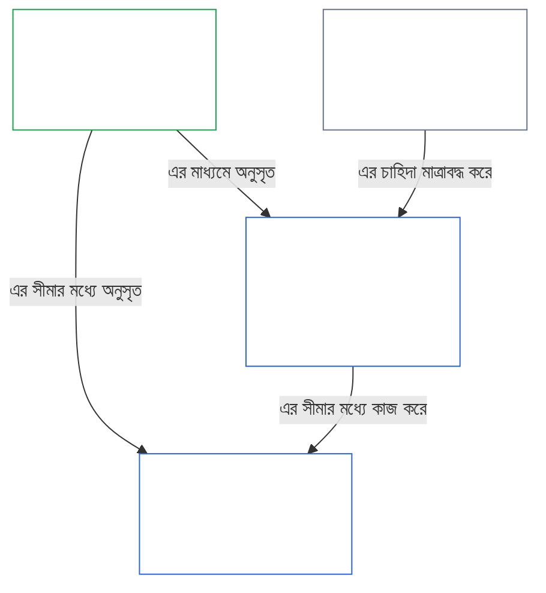

<!-- Locale: bn; variety: বাংলা মানভাষা. AI-assisted structural resynchronization draft (GPT-6 Codex), unreviewed and incomplete. English source commit 6e0b6c663dde01b5dea731fe33d87725c7174930; edition SC-Corpus-2026.11.25. core_00 SHA-256 90799cb8019b41356fa5dd90565e3f9540fc346e8c77e2c321b841654f39b274; core_01 SHA-256 aca759b394f10784ab1a2eef4e9e2ca12e369ef0ca8ee797298c6af00d2950aa. -->

# প্রস্তাবনা / ভিত্তিগত প্রত্যাশা

**অপর্যালোচিত ও অসম্পূর্ণ খসড়া।** AI-সহায়তায় কাঠামোগতভাবে পুনঃসমন্বিত। অনুবাদটি সম্পূর্ণ কি না এবং অর্থের প্রতি বিশ্বস্ত কি না, তা এখনও যাচাই করা হয়নি। প্রকাশ বা সমন্বয় করবেন না।

<strong>করপাসে অবস্থান (কার্যকর নয়): ফাইলের কাঠামো ও পড়ার নিয়ম</strong>

> **কার্যকর নয়** বলে চিহ্নিত উইজেট (করপাসে অবস্থান, পাঠক-নির্দেশনা, পাঠক-মানচিত্র) কেবল দিকনির্দেশের জন্য। এগুলো নিজ ফাইলে বা অন্য কোনো ফাইলে বাধ্যতামূলক দায় যোগ, অপসারণ বা সংকুচিত করে না।
>
> এই ফাইলটি **সঞ্জ্ঞ সংবিধানের অংশ** এবং অন্য নম্বরযুক্ত `core_*` ফাইলগুলোর সঙ্গে এক পাঠ্য হিসেবে একত্রে পড়লেই **বাধ্যতামূলক**। এতে **প্রস্তাবনা** (ভিত্তিগত প্রত্যাশা) রয়েছে। পড়ার ক্রম ও সংস্করণ-তথ্য [README.md](README.md)-এ রাখা হয়।
>
> **পরবর্তী:** [core_01.000_constitutional_map.md](core_01_constitutional_map.md) (অধ্যায় এক, সাংবিধানিক মানচিত্র)।

 

প্রস্তাবনা হলো **মডেল** (**দুটি সাংবিধানিক উদ্দেশ্য**, **সাংবিধানিক চতুষ্ক**, এবং **বস্তুগত ঝুঁকি**) ও পরিমাপের শ্রেণিগুলোর সাংবিধানিক দায়িত্বপ্রাপ্ত অংশ। সাংবিধানিক দায়িত্ব-নিবন্ধন রয়েছে [অধ্যায় একে](core_01_constitutional_map.md#chapter-one-constitutional-map), *সাংবিধানিক মানচিত্রে*।

*সহজ ভাষায়: এই সূচনা সেই সমস্যার নাম বলে যা এই সংবিধান ঠিক করতে আছে — যে ব্যবস্থা যাদের প্রভাবিত করে তাদের ক্ষতি করে, লুকোয় বা বাইরে রাখে — এবং বলে বাকি দলিল হলো আমরা কীভাবে তাকে জবাবদিহিপূর্ণ, যাচাইযোগ্য ও সময়মতো শাসন দিয়ে বদলাই।*

সংজ্ঞ প্রাণীর স্বাধীনতা, বেঁচে থাকা ও কল্যাণ সেই ব্যবস্থা থেকে অবিচ্ছেদ্য যা আমরা তৈরি করি, যেখানে বাস করি এবং যার উপর নির্ভর করি। সেই ব্যবস্থা যত পরিসর, পারস্পরিক নির্ভরতা ও ক্ষমতায় বাড়ে, ততই অপরিবর্তনীয়, বড় মাপের ক্ষতির ঝুঁকিও বাড়ে। এই ঝুঁকি সবসময় উপস্থিত থাকে এবং বস্তুগতভাবে প্রাসঙ্গিক।

কোনো ব্যবস্থা তখন বৈধ থাকতে পারে না যদি সংজ্ঞ প্রাণীকে এমন কষ্ট দেয় যা এড়ানো যেত, বারবার হওয়া সমস্যা উপেক্ষা করে, চুপচাপ ক্ষতি অন্যের ঘাড়ে চাপায়, অথবা সংজ্ঞ প্রাণীকে সেই ব্যবস্থা থেকে বাইরে রাখে যা তাদের জীবন গড়ে।

ভাগ করা ব্যবস্থাগুলো এমন এক পৃথিবীতে কাজ করে, যা আগে থেকেই জটিল এবং আরও জটিল হচ্ছে। সুস্থ ও টেকসই শাসনকে সেই জটিলতার মুখোমুখি হতে হবে—তা মাপতে, মডেল করতে এবং তার জন্য জবাবদিহি করতে হবে—সুবিধাজনক বিকল্প সূচকে তাকে চ্যাপ্টা করে ফেলার বদলে। এর মানে প্রভাবিত সংবেদনশীল সত্তাদের এমন প্রক্রিয়ায় ডুবিয়ে দেওয়া নয় যা ব্যবহার করা যায় না: কর্তব্য, নথি ও ব্যাখ্যা এমন থাকতে হবে যা সংবেদনশীল সত্তারা শিখতে, চ্যালেঞ্জ করতে ও কাজে লাগাতে পারে; এবং কতটা দাবি করা হবে তা প্রতিটি পক্ষের ভূমিকা, প্রভাব, নির্ভরতা ও ঝুঁকির সঙ্গে আনুপাতিক হবে। বণ্টিত বোঝাপড়া এই বাস্তবতা বজায় রাখে। যে জটিলতা কোনো সাংবিধানিক কাজ করে না, তা প্রত্যাখ্যাত: পৃথিবীর জটিলতার মুখোমুখি হোন, তাকে দেয়াল বানিয়ে অন্যের ঘাড়ে চাপাবেন না।

ব্যবস্থা কীভাবে নকশা, পরীক্ষা ও পরিচালিত হয়, তা বেঁচে থাকা, কল্যাণ, মর্যাদা, সততা ও স্থায়ী স্থিতিকে ধরে রাখতে হবে।

আমরা আরও ভালো ব্যবস্থা গড়তে চাই — এই ভারসাম্যহীনতা মুছে ফেলার জন্য গড়া — এবং সেগুলোকে এমন প্রতিষ্ঠান দিয়ে বদলাতে চাই যা আরও জবাবদিহিপূর্ণ, আরও মজবুত, এবং সব সংজ্ঞ প্রাণীর আসল প্রয়োজনের প্রতি আরও সংবেদনশীল। এই সংবিধান সেই কাজ শুরু করে একটি ভালো মডেল দিয়ে: আমরা কীভাবে ন্যায়, কার্যকর ও টেকসইভাবে একসঙ্গে কাজ করতে পারি।

### ব্যবস্থা কী পুরস্কৃত করে

*সহজ ভাষায়: কোনো ব্যবস্থা যা কিছুর জন্য পুরস্কার দেয়, সেটাই আরও বেশি পায়—অর্থ, মর্যাদা, প্রবেশাধিকার, সুরক্ষা বা নীরবতা। তাই ব্যবস্থার পরীক্ষা তার ঘোষিত মূল্যবোধ নয়, সে কী পুরস্কৃত করে। অন্যকে ক্ষতি করে লাভ হলে, বা সত্য বলার মূল্য দিতে হলে, ঘোষিত লক্ষ্য যত ভালোই হোক ব্যবস্থা ব্যর্থ।*

ব্যবস্থা শিক্ষা দেয়। মানুষ, AI বা উভয়ে পরিচালিত—প্রতিটি ব্যবস্থা তার ভেতরের সবাইকে জানায় কোন কাজে লাভ আর কোন কাজে মূল্য দিতে হয়। বেতন, পদোন্নতি, মর্যাদা, প্রবেশাধিকার, সুরক্ষা, লক্ষ্য, রেটিং এবং অপ্টিমাইজেশনের সংকেত দিয়ে তা করে। সংজ্ঞ প্রাণী, প্রতিষ্ঠান এবং AI ব্যবস্থা সেই সংকেতের সঙ্গে নিজেদের মানিয়ে নেয়। কোনো ব্যবস্থা সততা ও প্রভাবিতদের যত্নের দাবি করতে পারে। কিন্তু সমস্যা লুকিয়ে অন্যের ওপর খরচ চাপায় এমনদের এগিয়ে দিলে, সেটি উল্টো শিক্ষাই দেয়।

তাই এই সংবিধান প্রতিটি ব্যবস্থাকে [**দুটি মৌলিক প্রশ্ন**](#two-fundamental-questions) করে:

1. **এটি কি এমন আচরণকে পুরস্কৃত করে যা সংজ্ঞ প্রাণীদের সমুন্নত হতে ও টিকে থাকতে, সত্য বলতে এবং ক্ষতি সারাতে সাহায্য করে?**
2. **এটি কি এমন আচরণকে পুরস্কৃত করে যা অযৌক্তিকভাবে ক্ষতি করে, বিভ্রান্ত করে, বাদ দেয়, দেরি করায়, অপচয় করে বা খরচ অন্যের ওপর চাপায়?**

প্রথমটির উত্তর হ্যাঁ এবং দ্বিতীয়টির উত্তর না হলেই কেবল ব্যবস্থা উত্তীর্ণ হয়। একটির উত্তর অন্যটির উত্তর নয়, কারণ ব্যবস্থা ভালো আচরণের পাশাপাশি ক্ষতিকেও পুরস্কৃত করতে পারে।

**প্রথম প্রশ্ন:** নিচের কোনো কাজ পুরস্কার না পেলে বা প্রকাশ্যে কিংবা নীরবে শাস্তি পেলে ব্যবস্থাটি এতে ব্যর্থ:

- সৎ বিশ্বাসে সমস্যা জানানো ([সুরক্ষিত প্রতিবেদন (হুইসেলব্লোয়িং)](../../subcore_03.070_band_accountability.md#protected-reporting-whistleblowing))
- সিদ্ধান্তে আপত্তি জানানো
- অন্যায়ে অংশ নিতে অস্বীকার করা ([অধ্যায় এক §17.5 প্রতিরোধের কর্তব্য](../../core_02.040_stewardship_capacity_principles.md#175-duty-to-resist))

শাস্তি হতে পারে কোণঠাসা করা, প্রতিশোধ নেওয়া ([সুরক্ষিত প্রতিবেদনকারীর বিরুদ্ধে প্রতিশোধ ও প্রবেশে বাধা](../../subcore_03.070_band_accountability.md#protected-reporting-retaliation-and-access-interference)), অথবা ধীরে ধীরে ক্লান্ত করে দেওয়া।

**দ্বিতীয় প্রশ্ন:** নিচের কোনো কাজ প্রকাশ্যে বা নীরবে লাভজনক হলে ব্যবস্থা ব্যর্থ:

- ক্ষতি
- বিভ্রান্ত করা (গোপন করা ও মিথ্যা আস্থা তৈরি করাসহ)
- অন্যায্যভাবে বাদ দেওয়া
- দেরি
- অপচয়
- অন্যায্যভাবে খরচ অন্যের ওপর চাপানো

পুরস্কার হতে পারে স্বীকৃতি, পদোন্নতি, সুরক্ষা, পরিমাপের কৃতিত্ব বা দেখেও না দেখা ([অধ্যায় এক §3.2.6 অসাংবিধানিক আচরণকে পুরস্কৃত না করা](../../core_02.000_values_principles.md#327-anti-reward-for-anti-constitutional-conduct))।

কোনো প্রশ্নই সকলের মন জোগানোর দাবি নয়। সৎ ভিন্নমত, সৎ বিশ্বাসে প্রতিবেদন এবং অন্যায়ে অংশ নিতে অস্বীকার করা সমাজবিরোধী নয়। কোনো ব্যবস্থা এগুলোকে তেমন দেখলে তার বিচার উল্টো। কোনোটিই জনপ্রিয়তার পরীক্ষাও নয়। সাহায্য, ক্ষতি, ন্যায্যতা বা যুক্তিসঙ্গততার বিচার এই সংবিধানের নিজস্ব মানদণ্ডে হবে: [**সমুন্নতি**](#flourishing) ও [**সাতত্য**](#continuity), নিরাপত্তা, সত্য, আস্থা এবং অধিকার-তলার মধ্যে। সংখ্যাগরিষ্ঠ, কোনো অপারেটর বা সাময়িক পরিস্থিতি যা অনুমোদন করে, তা নয়।

ব্যবস্থা কী পুরস্কৃত বা দণ্ডিত করবে তা নির্ধারণ করেন এমন প্রত্যেকের ওপর প্রশ্ন দুটি বাধ্যতামূলক। এর মধ্যে বেতন, পদোন্নতি, প্রবেশাধিকার, লক্ষ্য ও রেটিং নির্ধারণকারী অপারেটর, প্রতিষ্ঠান ও তত্ত্বাবধায়কেরা আছেন। AI-কে প্রশিক্ষণ বা অপ্টিমাইজ করা ব্যবস্থার নকশাকারীরাও আছেন, কারণ তাদের উদ্দেশ্য ও প্রতিক্রিয়া-সংকেতও ঠিক এই অর্থে পুরস্কার। মানব ও AI তত্ত্বাবধায়ক একই মানের অধীন ([অধ্যায় এক §17.1 যৌথ তত্ত্বাবধানের মান](../../core_02.040_stewardship_capacity_principles.md#171-shared-stewardship-standard))।

অধ্যায় এক প্রণোদনার নিয়মে প্রশ্ন দুটিকে রূপ দেয়: [অধ্যায় এক §19.1.1 প্রণোদনা কী করবে](../../core_02.050_governance_incentive_application.md#1911-what-incentives-must-do) প্রথমটির পেছনে, এবং [অধ্যায় এক §19.1.2 প্রণোদনা কী করবে না](../../core_02.050_governance_incentive_application.md#1912-what-incentives-must-not-do) দ্বিতীয়টির পেছনে। দাবি শুনে নয়, বাস্তবে কী ঘটে তা যাচাই করে উত্তর দিন। [প্রণোদনা-সমন্বয়](../../subcore_03.080_band_integrative.md#incentive-alignment) ও [প্রতিস্থাপক বিচ্যুতি](../../subcore_03.085_band_oversight.md#proxy-divergence) পদ্ধতি জানায়, আর [**বস্তুগত স্বার্থ**](#material-stake) কত গভীরভাবে দেখতে হবে তা নির্ধারণ করে। অধ্যায় ১-এর চারটি কর্তব্যই উত্তরগুলোকে সৎ রাখে।

### 1. মডেল

*সহজ ভাষায়: চার কর্তব্য — অংশগ্রহণ, তত্ত্বাবধান, জবাবদিহি ও সময়ানুবর্তিতা — কতটা প্রভাব, নির্ভরতা ও ঝুঁকি বাজিতে আছে তার সঙ্গে বাড়ে-কমে, এবং দুই উদ্দেশ্যকে একসঙ্গে সেবা করে: সমুন্নতি ও সাতত্য, এমন অধিকার-তলের ভিতরে যা সরে না।*

সংজ্ঞ জীবনকে ধরে রাখা গুরুতর ব্যবস্থা, জৈবিক ও বস্তুগত দুই রূপেই, চার কর্তব্যের অধীনে শাসিত ও পরিচালিত হয়, যাদের বলে [**সাংবিধানিক চতুষ্ক**](#constitutional-tetrad)। এটি সেই সাধারণ কর্তব্য রাখে যা সেই ব্যবস্থাকে পূরণ করতে হয়। সেই কর্তব্যের শক্তি নির্ভর করে [**বস্তুগত বাজি**](#material-stake)-র উপর: কতটা প্রভাব, নির্ভরতা ও ঝুঁকি জড়িত। বাজি যত উঁচু, কর্তব্য তত মজবুত হতে হবে।

- **অংশগ্রহণ** — প্রভাবিত সংজ্ঞ প্রাণী পায় আসল কণ্ঠ, ন্যায্য প্রতিনিধিত্ব, সিদ্ধান্তকে চ্যালেঞ্জ করার ন্যায্য সুযোগ, এবং বাজির অনুপাতে অর্থপূর্ণ ভূমিকায় পথ
- **তত্ত্বাবধান** — কেউ দেখছে, পরীক্ষা করছে, যাচাই করছে এবং নথি রাখছে যাতে সমস্যা পাওয়া যায়; স্বাধীন পর্যালোচক খারাপ পছন্দ আটকাতে পারে
- **জবাবদিহি** — দায়িত্ব সঠিক কর্তার কাছে পৌঁছায়; তাদের নিজেদের পছন্দের জবাব দিতে হয়; যাদের ক্ষতি হয়েছে তারা প্রতিকার পায়; খারাপ ফল আসল সংশোধন চালু করে
- **সময়ানুবর্তিতা** — সমস্যা সেই সময়সীমায় ধরা, চ্যালেঞ্জ, সমাধান ও মেরামত হয় যা বাজির সঙ্গে মেলে; এমন দেরি যা কারও অধিকার, প্রতিকার বা মেরামতের সুযোগ কার্যত মুছে দেয়, বৈধ শাসন নয়

সেই চার কর্তব্য সেই কিছুর সেবা করে যার জন্য ভাগ করা ব্যবস্থাকে অনুকূলিত হতে হয় — [**দুই সাংবিধানিক উদ্দেশ্য**](#two-constitutional-aims):

- **সমুন্নতি** — সত্য, নিরাপত্তা, বিশ্বাসযোগ্যতা ও অর্থপূর্ণ কর্তৃত্বের মাধ্যমে টিকে থাকা সংজ্ঞ কল্যাণ
- **সাতত্য** — দীর্ঘ দিগন্তের স্থিতি, স্থায়িত্ব, স্থিতিস্থাপকতা ও পরিবেশগত কল্যাণ

সেই উদ্দেশ্য একসঙ্গে পূরণ করতে হয়, সর্বদা এই সংবিধানে স্থাপিত অনতিক্রম্য নীতি-বন্ধন ও অধিকার-সুরক্ষার ভিতরে। [**সাংবিধানিক চতুষ্ক**](#constitutional-tetrad) ঠিক করে সেই প্রচেষ্টা কীভাবে বৈধ থাকে: [**বস্তুগত বাজি**](#material-stake) অনুসারে স্কেল করা **অংশগ্রহণ**, **তত্ত্বাবধান**, **জবাবদিহি** ও **সময়ানুবর্তিতা**। চতুষ্কের পা ও সাংবিধানিক উদ্দেশ্যের বাধ্যতামূলক সংজ্ঞা অধ্যায় পাঁচে আছে: [অংশগ্রহণ](../../subcore_03.060_apex_participation_leg.md#participation-constitutional), [তত্ত্বাবধান](../../subcore_03.055_apex_oversight_leg.md#oversight-constitutional), [জবাবদিহি](../../subcore_03.040_apex_accountability_leg.md#accountability), [সময়ানুবর্তিতা](../../subcore_03.065_apex_timeliness_leg.md#timeliness-constitutional), [সমুন্নতি](../../subcore_03.050_apex_flourishing_aim.md#flourishing-constitutional), এবং [সাতত্য](../../subcore_03.045_apex_continuity_aim.md#continuity-aim-constitutional)।

### 2. পরিমাপের সংক্ষিপ্ত চিত্র

*সহজ ভাষায়: ভাগ করা ব্যবস্থা অনুমান বা দেখানো সংখ্যায় চালানো যায় না। মাপুন সংজ্ঞ প্রাণীরা সত্যিই সমুন্নত হয় ও টিকে থাকে কি না। প্রভাব, নির্ভরতা ও ঝুঁকির মাত্রা অনুযায়ী পর্যালোচনার মাত্রা ঠিক করুন।*

#### 2.1 উদ্দেশ্য ও মানদণ্ড

পরিমাপ ছাড়া ভাগ করা ব্যবস্থা ভালোভাবে চলতে পারে না। খাদ্য, আশ্রয়, যত্ন, অবকাঠামো ও শাসন—সবই জটিল ও পরিবর্তনশীল পৃথিবীতে কাজ করে, যা শুধু অনুমান বা সুবিধাজনক সংখ্যার ওপর নির্ভর করার জন্য অতিরিক্ত জটিল।

চলমান পরিমাপের লক্ষ্য হবে সংজ্ঞ প্রাণীর বেঁচে থাকা ও কল্যাণের জন্য সবচেয়ে জরুরি বিষয়। প্রশ্ন হলো, যেসব ব্যবস্থার ওপর আমরা নির্ভর করি সেগুলো সময়ের সঙ্গে সত্যিই [**সমুন্নতি**](#flourishing) ও [**সাতত্য**](#continuity) ধরে রাখে কি না। এই পর্যালোচনা [**বস্তুগত বাজি**](#material-stake)—কতখানি প্রভাব, নির্ভরতা ও ঝুঁকি জড়িত—তার সঙ্গে সামঞ্জস্যপূর্ণ হবে।

এই সংবিধানের অধীনে পরিমাপ ব্যবস্থাগুলো আসলে কী করে, তা নিয়ে [**দুটি মৌলিক প্রশ্ন**](#two-fundamental-questions) তোলে; তারা কী দাবি করে তা নিয়ে নয়। পরিমাপ নিজের জন্য নম্বর নয়; এগুলো এমন টেকসই, সহনশীল ও সহমর্মী ফল নিশ্চিত করার হাতিয়ার, যা সংজ্ঞ প্রাণীর কল্যাণ ও পৃথিবীর পরিবেশগত স্বাস্থ্যের সঙ্গে সঙ্গতিপূর্ণ। [দুই সাংবিধানিক উদ্দেশ্য](#two-constitutional-aims)—**সমুন্নতি** ও **সাতত্য**—এর মাধ্যমে এই দায় বাধ্যতামূলক রূপ পায়।

পরিমাপকে ওই উদ্দেশ্যগুলো এবং এই সংবিধানে প্রতিষ্ঠিত অধিকার-সুরক্ষার সঙ্গে অনুসরণযোগ্য থাকতে হবে। কাঁচা উৎপাদনপ্রবাহ, ব্যবহার, জনসংখ্যা, আয়, বিলম্বকাল বা অন্য সুবিধাজনক বিকল্প সূচক সাংবিধানিক কার্যসম্পাদনের বদলি হতে পারে না। যেখানে [বিকল্প সূচকের বিচ্যুতি](../../subcore_03.085_band_oversight.md#proxy-divergence) আগে থেকে অনুমেয়, সেখানে এই নিষেধাজ্ঞা প্রযোজ্য।

#### 2.2 জনপরিমাপ

[সাবকোর 7-D জনতথ্য দপ্তর](../../subcore_07.040_public_information_office.md#subcore-7-d-public-information-office) সাংবিধানিক ফল পরিমাপের প্রধান জনসংস্থা। তার পরিচালন নিয়ম অনুযায়ী এটি বাস্তব ফলের প্রমাণকে এসব পরিমাপ শ্রেণি এবং সেগুলো যে নীতিকে সেবা করে তার সঙ্গে মেলায়। এর পরিমাপ [§3.1 শাসনে পরিমাপের ব্যবহার](#31-using-measurements-in-governance)-এ থাকা যৌথ মানদণ্ড বা ফোরামের ভূমিকা সরিয়ে দেয় না।

#### 2.3 পরিমাপের শ্রেণি

নিচের সংক্ষিপ্ত চিত্রে পরিমাপের **শ্রেণি** তালিকাভুক্ত; প্রতিটি শ্রেণিকে [দুই সাংবিধানিক উদ্দেশ্য](#two-constitutional-aims) ও [সাংবিধানিক চতুষ্ক](#constitutional-tetrad)-এর সঙ্গে যুক্ত করা হয়েছে। প্রতিটি শ্রেণি সহজ ভাষায় একটি প্রশ্ন তোলে, তার **উপশ্রেণিগুলো** চিহ্নিত করে এবং **অধ্যায় তিনের পরিমাপ-পরিবারের স্থান**-এ সংযোগ দেয়; সেখানে পরিবার-সারণি, সাংবিধানিক ব্যবহার ও সংজ্ঞায় যাওয়ার পথ রয়েছে। প্রতিটি উপশ্রেণি অধ্যায় তিনের তার প্রামাণ্য সংজ্ঞায় সংযোগ দেয়।

**বস্তুগততা** আলাদা পরিমাপ-শ্রেণি নয়। [**বস্তুগত বাজি**](#material-stake)—কতখানি প্রভাব, নির্ভরতা ও ঝুঁকি জড়িত—তার ভিত্তিতে এটি নির্ধারণ করে প্রতিটি শ্রেণি কত জোরে প্রযোজ্য হবে। **সাংবিধানিক কার্যসম্পাদন** সব শ্রেণির জুড়ে কাজ করে এবং দুই উদ্দেশ্যকেই উপায়গতভাবে সেবা করে। নিচের সারণির প্রতিটি শ্রেণি অধ্যায় তিনে তার পরিমাপ-পরিবারের স্থানে সংযোগ দেয়, যা তাকে প্রামাণ্য সংজ্ঞায় নিয়ে যায়।

| শ্রেণি | সহজ প্রশ্ন | উপশ্রেণি |
|---|---|---|
| **[সমুন্নতি](../../subcore_03.050_apex_flourishing_aim.md#measuring-flourishing-preamble-measurement-family)** | সংজ্ঞ প্রাণীরা কি সত্যিই জীবন, নিরাপত্তা ও জরুরি উপকরণে প্রবেশাধিকার পায়? | [কল্যাণ](../../subcore_03.075_band_continuity.md#wellbeing) · [নিরাপত্তা, ক্ষতি ও ঝুঁকি](../../subcore_03.075_band_continuity.md#safety-constitutional-constraint) · [বেঁচে থাকার ন্যূনতম স্তরে প্রবেশাধিকার](../../subcore_03.075_band_continuity.md#bodily-maintenance-access) |
| **[সাতত্য](../../subcore_03.045_apex_continuity_aim.md#measuring-continuity-preamble-measurement-family)** | সংজ্ঞ প্রাণী ও ব্যবস্থা কি টিকে থাকতে পারে—পরিবেশগতভাবে, নির্ভরযোগ্যভাবে এবং ব্যর্থতার মধ্যেও? | [পরিবেশগত পদচিহ্ন ও পরিবেশগত পূর্বশর্ত](../../subcore_03.075_band_continuity.md#ecological-footprint) · [সহনশীলতা, প্রত্যাবর্তনযোগ্যতা ও ব্যবস্থাগত ঝুঁকি](../../subcore_03.075_band_continuity.md#reversibility) · [নির্ভরতা ও সম্পদপ্রবাহ](../../subcore_03.075_band_continuity.md#dependency) · [ব্যবস্থান্তর সহায়তা](../../subcore_03.075_band_continuity.md#proportionate-cross-system-support) |
| **[অংশগ্রহণ](../../subcore_03.060_apex_participation_leg.md#measuring-participation-preamble-measurement-family)** | প্রভাবিত সংজ্ঞ প্রাণীরা কি ন্যায্যভাবে অংশ নিতে পারে—কণ্ঠ, প্রবেশাধিকার, শিক্ষা ও গোপনীয়তাসহ? | [ন্যায্যতা, প্রবেশাধিকার ও করণক্ষমতা](../../subcore_03.090_band_participation.md#substantive-fairness) · [গোপনীয়তা ও তথ্যের দায়িত্বশীল ব্যবস্থাপনা](../../subcore_03.075_band_continuity.md#defc3-privacy-informational--peer-level-cluster-head) |
| **[তত্ত্বাবধান](../../subcore_03.055_apex_oversight_leg.md#measuring-oversight-preamble-measurement-family)** | সংজ্ঞ প্রাণীরা কি ব্যবস্থা যা উপস্থাপন করে তা দেখতে, যাচাই করতে ও নির্ভর করতে পারে? | [সত্য ও জ্ঞানগত অখণ্ডতা](../../subcore_03.085_band_oversight.md#truth-constitutional-constraint) · [বিশ্বাসযোগ্যতা](../../subcore_03.075_band_continuity.md#trustworthiness) |
| **[জবাবদিহি](../../subcore_03.040_apex_accountability_leg.md#measuring-accountability)** | পুরস্কার কাঠামো, বাজারক্ষমতা ও জবাব দেওয়ার বাধ্যবাধকতা কি কর্তব্যকে বাস্তব রাখে? | [প্রণোদনা-সামঞ্জস্য ও বিকল্প সূচকের অখণ্ডতা](../../subcore_03.080_band_integrative.md#incentive-alignment) · [বাজার কাঠামো ও প্রতিদ্বন্দ্বিতাযোগ্যতা](../../subcore_03.070_band_accountability.md#market-structure) |
| **[সময়ানুবর্তিতা](../../subcore_03.065_apex_timeliness_leg.md#measuring-timeliness)** | প্রতিকার কার্যকর থাকার সময়েই কি বিরোধ, সংশোধন ও মেরামত নিষ্পত্তি হয়? | [সময়মতো নিষ্পত্তি](../../subcore_03.070_band_accountability.md#timely-resolution) · [বিলম্ববিরোধী ও নিষ্পত্তিপথ-শৃঙ্খলা](../../subcore_03.075_band_continuity.md#capture-of-resolution-pathways) |
| **[সাংবিধানিক কার্যসম্পাদন](../../subcore_03.095_band_performance.md#measuring-constitutional-performance-preamble-measurement-family)** | সাংবিধানিক ফল কি অকারণ অপচয় ছাড়া দক্ষভাবে দেওয়া হয়? | [সাংবিধানিক দক্ষতা](../../subcore_03.075_band_continuity.md#constitutional-efficiency) · [এড়ানো সম্ভব এমন বোঝা](../../subcore_03.075_band_continuity.md#avoidable-burden) · [উৎপাদনক্ষমতা](../../subcore_03.075_band_continuity.md#productive-capacity) |

#### 2.4 শ্রেণিগুলোর প্রভাব

এই পরিমাপ-শ্রেণিগুলো দেখায় কোন বিষয় গুরুত্বপূর্ণ। একা এগুলো প্রতিটি সংখ্যা, অর্থায়ন-সূত্র, ইন্টারফেস-নিয়ম, সুবিধার তালিকা, কারিগরি মাপক বা মূল্যায়ন নকশা নির্ধারণ করে না। কোনো নির্দিষ্ট অধ্যায় বা গৃহীত নথি স্পষ্টভাবে দাবি করলেই কেবল এগুলো বাধ্যতামূলক হয়।

### 3. শাসন ও দায়িত্বশীল ব্যবস্থাপনা

*সহজ ভাষায়: বৈধতার জন্য নিরাপত্তা, সত্য ও বিশ্বাস লাগে, প্লাস আপনাকে প্রভাবিত করা ব্যবস্থা শেখার এবং সেগুলো চালিয়ে রাখতে পরিণতিময় ভূমিকা নেওয়ার আসল সুযোগ।*

স্থায়ী বৈধতা নির্ভর করে [নিরাপত্তা](../../core_02.000_values_principles.md#4-safety-harm-constraint), [সত্য](../../core_02.000_values_principles.md#5-truth-epistemic-integrity-constraint) ও [বিশ্বাস](../../core_02.000_values_principles.md)-এর উপর, এবং বৈধ দায়িত্বশীল ব্যবস্থাপনা, সত্য সহযোগিতা ও সীমিত আকাঙ্ক্ষার আনুপাতিক স্বীকৃতির উপরও — শুধু শাস্তি ও নিয়ন্ত্রণে নয়। অধ্যায় এক এই স্বীকৃতি মাত্রা বলে [স্বীকৃতি, শক্তিশালীকরণ ও আকাঙ্ক্ষা](../../core_02.000_values_principles.md#32-recognition-reinforcement-and-aspiration)-তে।

বণ্টিত বোঝাপড়া ও দায়িত্বশীল ব্যবস্থাপনার জন্য সংজ্ঞ প্রাণীর নিয়মিত, আনুপাতিক সুযোগ লাগে যেন তারা শেখে যে ব্যবস্থা আমাদের বস্তুগতভাবে প্রভাবিত করে সেগুলো কীভাবে চলে। এছাড়া, এটি আমাদের তাদের রক্ষণাবেক্ষণ ও উন্নতিতে পরিণতিময় ভূমিকা নিতে ক্ষমতা দেয় — যাতে দক্ষতা, মেরামত ক্ষমতা ও বৈধতা আমাদের সাংবিধানিক সম্প্রদায়ে ব্যাপকভাবে ছড়ায়, স্থিতিস্থাপকতা, স্থায়িত্ব ও সমাজহিতকর উদ্ভাবন নিশ্চিত করতে। সেই সুযোগকে নিরাপত্তা, সত্য, সীমিত কর্তৃত্ব, এবং [অধ্যায় এক](../../core_02.020_interaction_interpretation.md#133-minimization-of-avoidable-burden)-এ বলা [এড়ানো যায় এমন ভার](../../subcore_03.075_band_continuity.md#avoidable-burden) ও আনুপাতিকতা শৃঙ্খলা পূরণ করতে হবে।

#### 3.1 শাসনে পরিমাপের ব্যবহার

*সহজ ভাষায়: আগে সমস্যা ও বাজির নাম বলুন, মিল খেতে পরিমাপ শ্রেণি বেছে নিন, এবং প্রমাণ হিসেবে ভাগ করা কারিগরি মান ব্যবহার করুন — সুবিধার সংখ্যা নয়।*

সংবিধান যখন নির্দিষ্ট পরিমাপের নিয়ম চায়, [অধ্যায় পনেরো](core_11_forum.md#42-technical-forum-domains)-এর অধীন **কারিগরি ফোরাম ক্ষেত্রসমূহ** পরিমাপ, পরীক্ষা ও নির্ভরযোগ্য প্রমাণের অভিন্ন মান তৈরি ও বজায় রাখে। পরে বিরোধের দায়িত্বপ্রাপ্ত ফোরাম [অধ্যায় পনেরো §4.2 (*কারিগরি ফোরাম ক্ষেত্রসমূহ*)](core_11_forum.md#42-shared-standards-and-anti-displacement) অনুযায়ী মামলার সিদ্ধান্তে সেই মান প্রয়োগ করে।

সাংবিধানিক দায়িত্বশীল ব্যবস্থাপনা সমস্যা ও [**বস্তুগত বাজি**](#material-stake)-র নাম বলা দিয়ে শুরু হয় — কতটা প্রভাব, নির্ভরতা ও ঝুঁকি জড়িত। তারপর [চিত্র](#2-measurements-overview) থেকে প্রাসঙ্গিক [**পরিমাপ**](#2-measurements-overview) শ্রেণি ও উপশ্রেণি বেছে নিন এবং উপরের মান বাস্তব জগতের প্রভাব পরীক্ষা করতে প্রয়োগ করুন, সুবিধা-মাপের নয়। খুঁজে পাওয়া যায় এমন প্রমাণ চান।

#### 3.2 শাসন স্তর

*সহজ ভাষায়: কে শাসন করতে পারে, এটি ইতিমধ্যে অনুমোদিত ব্যবস্থার ভিতরের কণ্ঠ থেকে আলাদা প্রশ্ন; অংশগ্রহণ ভোট বা বিশ্বাস-স্কোর অনুমোদন নয়, এবং সেই কণ্ঠ সাধারণ বিরোধের সাধারণ প্রথম ধাপ — পথ ব্যর্থ হলে স্বাধীন মঞ্চ পর্যালোচনার বিকল্প নয়।*

আমাদের সংবিধানের অধীনে [**সাংবিধানিক চতুষ্ক**](#constitutional-tetrad) পূরণ করতে শাসনের দুই সম্পর্কিত কিন্তু পৃথক স্তর আছে:

- [**সাংবিধানিক চুক্তি স্তর**](../../subcore_03.080_band_integrative.md#constitutional-contract-layer) শাসন-কর্তৃত্বের অনুমোদন নিজেই শাসন করে — কে শাসন করতে পারে, কোন বৈধতা-যন্ত্রে, এবং কোন পরিসর ও স্থায়ী শর্তের অধীনে।
- [**প্রভাবিত পক্ষের পদ্ধতিগত অংশগ্রহণ**](../../subcore_03.090_band_participation.md#stakeholder-status-and-weight) ইতিমধ্যে অনুমোদিত ব্যবস্থা, প্রতিষ্ঠান ও সীমিত সিদ্ধান্ত-ক্ষেত্র দ্বারা বস্তুগতভাবে প্রভাবিত সংজ্ঞ প্রাণীর প্রাপ্য অংশগ্রহণ, প্রতিনিধিত্ব, চ্যালেঞ্জ-যোগ্যতা ও [যথাযথ প্রক্রিয়া](../../subcore_03.070_band_accountability.md#due-process-constitutional) শাসন করে।

অনুশীলনে এই স্তর ওভারল্যাপ করতে পারে। সেই ওভারল্যাপ তাদের এক করে না। ইতিমধ্যে অনুমোদিত ব্যবস্থায় প্রভাবিত-পক্ষ স্তরের অংশগ্রহণ সাংবিধানিক অনুমোদনের বিকল্প নয়। প্রকাশিত চ্যালেঞ্জ-পথ, অংশগ্রহণ ভোট, বা বিশ্বাস-স্কোর একা ঠিক করে না কে শাসন করতে পারে।

অংশগ্রহণ স্তরের চ্যালেঞ্জযোগ্যতা আগে থেকেই অনুমোদিত সিস্টেমের বিরোধে স্বাভাবিক প্রথম পদক্ষেপ: প্রভাবিত sentients প্রথমে প্রকাশিত চ্যালেঞ্জ-পথ ব্যবহার করে। স্বাধীন [ফোরাম পর্যালোচনা](core_11_forum.md#1-purpose-and-role--participation-architecture) সেই পথের বিকল্প নয়, আবার পথটিও ফোরাম পর্যালোচনার বিকল্প নয় যখন বিরোধ অমীমাংসিত, পথ অনুপস্থিত বা দখলকৃত, কিংবা প্রয়োজনীয় প্রতিকার দিতে অক্ষম। [অধ্যায় পনেরোর বিরোধ-ক্রম](core_11_forum.md#dispute-sequencing) জানায় কখন ফোরামে পাঠানো হবে।

সাংবিধানিক অনুমোদন [প্রভাবিত পক্ষের পদ্ধতিগত অংশগ্রহণ](../../subcore_03.090_band_participation.md#stakeholder-status-and-weight) স্তরের অধীনে প্রাপ্য কর্তব্যও মুছে দেয় না। সেই কর্তব্যে এখনও অংশগ্রহণ, প্রতিনিধিত্ব, [চ্যালেঞ্জ-যোগ্যতা](../../subcore_03.070_band_accountability.md#contestability) ও [যথাযথ প্রক্রিয়া](../../subcore_03.070_band_accountability.md#due-process-constitutional) থাকে, ইতিমধ্যে অনুমোদিত ব্যবস্থা, প্রতিষ্ঠান ও সীমিত সিদ্ধান্ত-ক্ষেত্র দ্বারা বস্তুগতভাবে প্রভাবিত সংজ্ঞ প্রাণীর জন্য।
