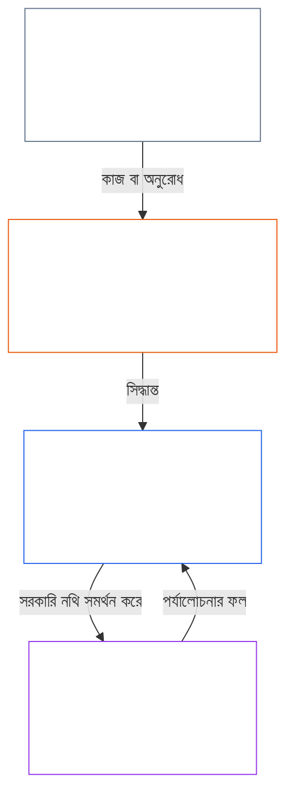
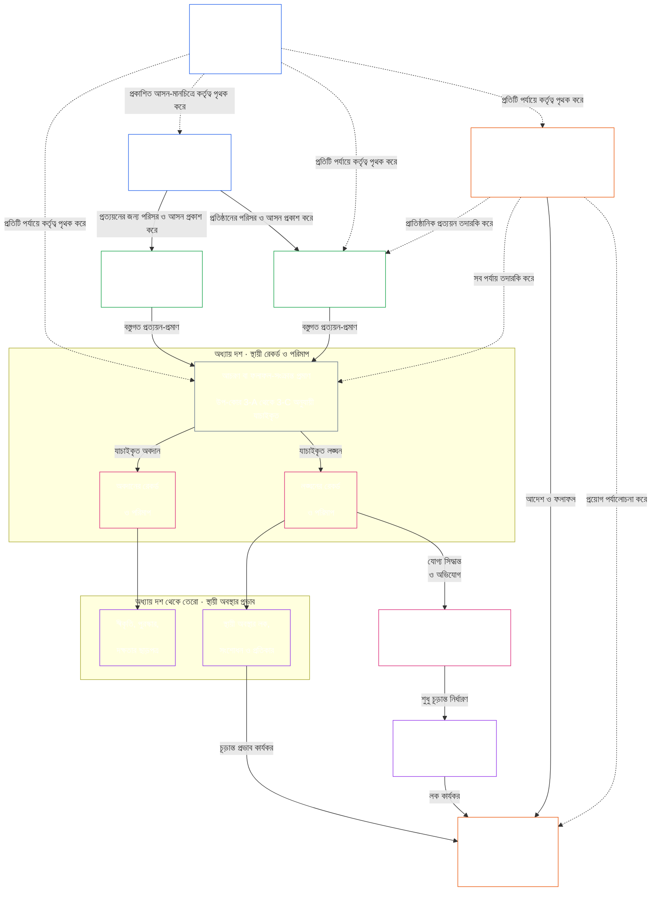

<!-- Locale: bn; variety: বাংলা মানভাষা. AI-assisted structural resynchronization draft (GPT-6 Codex), unreviewed and incomplete. English source commit 6e0b6c663dde01b5dea731fe33d87725c7174930; edition SC-Corpus-2026.11.25. core_00 SHA-256 90799cb8019b41356fa5dd90565e3f9540fc346e8c77e2c321b841654f39b274; core_01 SHA-256 aca759b394f10784ab1a2eef4e9e2ca12e369ef0ca8ee797298c6af00d2950aa. -->

<strong>করপাসে অবস্থান (অ-কার্যকরী): ফাইলের গঠন ও পড়ার নিয়ম</strong>

> **অ-কার্যকরী** হিসেবে চিহ্নিত উইজেটগুলো (করপাসে অবস্থান, পাঠক-নির্দেশনা ও পাঠ-মানচিত্র) কেবল দিকনির্দেশক। নিজের ফাইল বা অন্য কোনো ফাইলে এগুলো বাধ্যতামূলক কর্তব্য যোগ, বাদ বা সংকুচিত করে না।
>
> এই ফাইলটি **সঞ্জ্ঞ সংবিধানের অংশ** এবং অন্য সংখ্যাযুক্ত `core_*` ফাইল ও সাবকোরের সঙ্গে এক পাঠ্য হিসেবে পড়লেই **কেবল বাধ্যতামূলক**। এতে আছে **অধ্যায় এক**, *সাংবিধানিক মানচিত্র*: এর উদ্দেশ্য (§1), কেন এটি আছে (§2), ফাইলগুলো কীভাবে যুক্ত (§3), পরের অধ্যায়গুলোর ভিত্তি (§4), প্রধান শাসনপ্রক্রিয়া (§5), এবং সাংবিধানিক দায়িত্ব-নিবন্ধন (§§6–11)।
>
> **আগেরটি:** [core_00.000_preamble.md](core_00_preamble.md) (প্রস্তাবনা)
> **পরেরটি:** [core_02.000_values_principles.md](../../core_02.000_values_principles.md)

<strong>অনুসরণ-চিহ্ন</strong>

- আগেরটি: [প্রস্তাবনা](core_00_preamble.md) (*মডেল, দুই সাংবিধানিক উদ্দেশ্য, সাংবিধানিক চতুষ্ক, বস্তুগত বাজি ও পরিমাপের শ্রেণি*)।
- উপধারাগুলো:
  - [§1](#1-purpose-role-and-scope);
  - [§2](#2-why-the-map-exists);
  - [§3](#3-how-the-files-fit-together);
  - [§4](#4-foundations-for-the-chapters-that-follow);
  - [§5](#5-key-governance-processes);
  - [§6](#6-principles-definitions-and-rights);
  - [§7](#7-system-and-institutional-charters-functional-independence-and-separation-of-duties);
  - [§8](#8-key-practical-process-pipelines);
  - [§9](#9-process-ownership-and-outputs);
  - [§10](#10-governance-change-and-incorporation);
  - [§11](#11-adopted-implementation-corpus)।
- একসঙ্গে পড়ুন: [কর্তৃত্বের স্তরবিন্যাস ও অভ্যন্তরীণ শ্রেণিবিন্যাস](../../subcore_03.080_band_integrative.md#authority-stack-and-internal-hierarchy) (*দায়িত্ব-নিবন্ধন কীভাবে প্রয়োগ হয়*); [README.md](README.md) (*পাঠের ক্রম*)।

 

# অধ্যায় এক: সাংবিধানিক মানচিত্র

> **État / Draft status:** structural draft, unreviewed and incomplete. Current sections 1–4 are new and require translation; moved sections are raw prior translation requiring full fidelity review.

### ১. উদ্দেশ্য, ভূমিকা ও পরিধি

*সহজ কথায়: এই অধ্যায়টি সংবিধানের বাকি অংশের পথনির্দেশক। এতে অংশগুলো কীভাবে যুক্ত, কোন অধ্যায় কোন বিষয়ের দায়িত্বে, এবং প্রধান প্রক্রিয়াগুলো কীভাবে চলে তা দেখানো হয়েছে, যাতে পাঠক তাঁর প্রশ্নের উত্তর দেয় এমন নিয়মটি খুঁজে পান।*

**উদ্দেশ্য:** অধ্যায় এক সামগ্রিক পরিচিতি ও দায়িত্বের নির্দেশিকা দেয়। এটি অনুমোদিত শাসনব্যবস্থা যাচাইয়ের প্রক্রিয়াগুলোর নাম বলে, প্রতিটি বিষয়গত ক্ষেত্রের দায়িত্ব কোন অধ্যায়ে তা জানায়, এবং সাংবিধানিক পাঠ্যের তিনটি স্তর বর্ণনা করে।

**ভূমিকা:** এই অধ্যায়টি দিকনির্দেশনা ও দায়িত্ব নির্ধারণ করে। দায়িত্ব-নিবন্ধনের বাইরে এটি নিজে কোনো কর্তব্য যোগ করে না; অন্য অধ্যায় এবং [কর্তৃত্বের স্তরবিন্যাস ও অভ্যন্তরীণ শ্রেণিবিন্যাস](../../subcore_03.080_band_integrative.md#authority-stack-and-internal-hierarchy) সেই নিবন্ধন প্রয়োগ করে।

**অধ্যায়ের পরিধি:** অধ্যায়টি অন্তর্ভুক্ত করে:

- মানচিত্রটি কেন আছে (**ধারা ২**);
- ফাইলগুলো কীভাবে যুক্ত (**ধারা ৩**) এবং পরবর্তী অধ্যায়গুলোর ভিত্তি (**ধারা ৪**);
- প্রধান শাসনপ্রক্রিয়াগুলো (**ধারা ৫**);
- সাংবিধানিক দায়িত্ব-নিবন্ধন: নীতি, সংজ্ঞা ও অধিকার (**ধারা ৬**); সিস্টেম ও প্রতিষ্ঠানের সনদ, কার্যগত স্বাধীনতা ও দায়িত্বের পৃথকীকরণ (**ধারা ৭**); প্রক্রিয়ার ধারা (**ধারা ৮**); প্রক্রিয়ার দায়িত্ব ও ফলাফল (**ধারা ৯**); এবং শাসন, পরিবর্তন ও অন্তর্ভুক্তি (**ধারা ১০**); এবং
- গৃহীত বাস্তবায়ন কর্পাস ও সাবকোর (**ধারা ১১**)।

### ২. মানচিত্রটি কেন আছে

*সহজ কথায়: এত বড় একটি পাঠ্যের এমন নির্দেশিকা দরকার, যা দেখায় অংশগুলো কীভাবে যুক্ত এবং প্রতিটি বিষয়ের দায়িত্ব কার। পাঠক যেন তাঁর প্রশ্নের উত্তর দেয় এমন নিয়মটি খুঁজে পান, সে জন্য এই অধ্যায়টি আছে।*

সংবিধানের কাজ ছড়িয়ে আছে বহু অধ্যায়ে, একটি সাবকোরে এবং চারটি গৃহীত কর্পাসে। কোনো সংবেদনশীল সত্তা তার প্রাপ্য কী তা জানতে চাইলে, বা কোনো গ্রহণকারী কোনো কর্তব্য খুঁজলে, পথ হারাতে পারেন। এই অধ্যায়টি সামগ্রিক পরিচিতি ও দায়িত্বের নির্দেশিকা: প্রতিটি অংশ কী করে, কোন অধ্যায় কোন বিষয়ের দায়িত্বে, প্রক্রিয়ার ধারাগুলো কীভাবে চলে এবং স্তরগুলো কীভাবে সম্পর্কিত। দায়িত্ব-নিবন্ধনের বাইরে এটি নিজে কোনো নিয়ম যোগ করে না।

**ভিত্তি:**

- প্রস্তাবনা:
  - [সাংবিধানিক চতুর্মাত্রা](core_00_preamble.md#constitutional-tetrad): এই অধ্যায় যে চারটি কর্তব্যকে সামনে আনে:
    - [অংশগ্রহণ](../../subcore_03.060_apex_participation_leg.md#participation): কোনো সংবেদনশীল সত্তা তার প্রশ্নের উত্তর দেয় এমন নিয়মটি খুঁজে পেতে পারে;
    - [জবাবদিহি](../../subcore_03.040_apex_accountability_leg.md#accountability): প্রতিটি বিষয়ের একজন নির্দিষ্ট দায়িত্বপ্রাপ্ত অধ্যায় থাকে, যা তার জন্য জবাব দেয়;
    - [তদারকি](../../subcore_03.055_apex_oversight_leg.md#oversight): পাঠক অংশগুলোর সংযোগ দেখতে এবং ফাঁক বা ওভারল্যাপ শনাক্ত করতে পারেন;
    - [সময়ানুবর্তিতা](../../subcore_03.065_apex_timeliness_leg.md#timeliness): পাঠক দেরি ছাড়াই সঠিক নিয়মে পৌঁছান;
  - [দুটি সাংবিধানিক লক্ষ্য](core_00_preamble.md#two-constitutional-aims): এই অধ্যায় যে দুই লক্ষ্যই পূরণে সহায়তা করে:
    - [সমৃদ্ধি](core_00_preamble.md#flourishing): সংবিধান সংবেদনশীল সত্তাদের কাজে আসে কেবল তখনই, যখন তারা এর মধ্যে পথ খুঁজে পায়;
    - [ধারাবাহিকতা](core_00_preamble.md#continuity): একটি স্পষ্ট মানচিত্র পাঠ্যকে অক্ষুণ্ণ রাখে, যখন তা বাড়ে ও বদলায়;
- অধ্যায় দুইয়ের নীতিমালা:
  - [§5.2 সহজ ভাষায় প্রবেশযোগ্যতা (অংশগ্রহণ ও দায়িত্বশীল তত্ত্বাবধানের কর্তব্য)](../../core_02.000_values_principles.md#52-plain-language-accessibility-participation-and-stewardship-duty);
  - [§5.2.4 জটিলতাকে পরাজয়ের কারণ হতে না দেওয়ার শৃঙ্খলা](../../core_02.000_values_principles.md#524-complexity-as-defeat-discipline);
  - [§15.4 সাংবিধানিক অর্থের দ্বন্দ্ব নিরসন](../../core_02.030_constitutional_interpretation.md#154-constitutional-meaning-conflict-resolution);
- অধ্যায় চারের অনুচ্ছেদ:
  - [অনুচ্ছেদ XXIV-A](../../core_04.030_rights_part_d.md#article-xxiv-a-proportional-comprehensibility-right) (*আনুপাতিক বোধগম্যতার অধিকার*);
  - [অনুচ্ছেদ XXIV-B](../../core_04.030_rights_part_d.md#article-xxiv-b-complexity-audit-and-modularity-requirements) (*জটিলতা নিরীক্ষা ও মডুলারিটির শর্ত*)।

### ৩. ফাইলগুলো কীভাবে যুক্ত

সংবিধানের ফাইলগুলো এভাবে যুক্ত:

- **কোর (`core_*`):** নম্বরযুক্ত ফাইলগুলোতে সংবিধানের অধ্যায় রয়েছে, যেগুলো একসঙ্গে একটি পাঠ্য হিসেবে পড়তে হয়। এগুলো নিশ্চয়তা ও সাংবিধানিক কাঠামো জানায়।
- **সাবকোর (`subcore_*`):** এই ফাইলগুলো অধ্যায়গুলোর পেছনের পূর্ণ নিয়ম ও প্রক্রিয়া দেয়। প্রতিটি একটি অধ্যায়ের অন্তর্ভুক্ত, সেই অধ্যায়ের সমান বলবৎ-ক্ষমতা রাখে এবং আলাদা করে অন্তর্ভুক্ত না করলেও প্রত্যেক গ্রহণকারীকে বাধ্য করে। সাবকোর তার অধ্যায়কে সংকুচিত করতে পারে না।
- **বাস্তবায়ন (`corpus_*`):** চারটি ফাইল সংবিধান কার্যকর করার পরিচালনাগত বিবরণ দেয়। বৈধ অন্তর্ভুক্তির পরিধিতে এগুলো বাধ্যতামূলক এবং সংবিধানকে সংকুচিত না করে বাস্তবায়ন করে। [ধারা ১১](#11-adopted-implementation-corpus) চারটি ফাইল চিহ্নিত করে।

সংজ্ঞায়িত [কর্পাস](../../subcore_03.080_band_integrative.md#corpus) হলো বাধ্যতামূলক সাংবিধানিক উৎসগুলোর বিস্তৃত, সংস্করণ-নিয়ন্ত্রিত সমষ্টি: এতে কোর, সাবকোর, গৃহীত বাস্তবায়ন-পাঠ্য এবং উত্তরণকালে বৈধ সামঞ্জস্য-আবরণ অন্তর্ভুক্ত। খসড়া, নোট ও নেভিগেশন নির্দেশিকা প্রকল্পের অংশ হলেই বাধ্যতামূলক হয়ে যায় না।

### ৪. পরবর্তী অধ্যায়গুলোর ভিত্তি

*সহজ কথায়: অধ্যায় দুই থেকে চার মূল্যবোধ, অভিধান (সংজ্ঞা কীভাবে তৈরি, সুরক্ষিত ও প্রমাণ করতে হয় সে বিষয়ে সাবকোরের নিয়মসহ) এবং অধিকার-ভিত্তির দায়িত্বে। পরবর্তী অধ্যায়গুলোকে এসব ক্ষেত্র সম্মান করতে হবে, নীরবে অন্যত্র সরানো যাবে না।*

**অধ্যায় দুই থেকে চার** মূল্যবোধ, পরিভাষা, যাচাইয়ের ব্যবস্থা এবং অধিকার-ভিত্তি দেয়, যা পরবর্তী সবকিছুকে সম্মান করতে হবে, যার মধ্যে আছে:

- [অধ্যায় পাঁচের](#7-system-and-institutional-charters-functional-independence-and-separation-of-duties) সিস্টেম সনদ বা প্রাতিষ্ঠানিক সনদের শর্ত, অধ্যায় ছয়ের দায়িত্ব-পৃথকীকরণের শর্ত এবং অধ্যায় সাতের স্বাধীন সংস্থাগুলো—সবই ধারা ৭-এ;
- ধারা ৮-এর [প্রধান ব্যবহারিক প্রক্রিয়া-ধারা](#8-key-practical-process-pipelines);
- ধারা ৯-এর [প্রক্রিয়ার দায়িত্ব ও ফলাফল](#9-process-ownership-and-outputs);
- ধারা ১০-এর শাসন ও পরিবর্তনের পথ-সংক্রান্ত অধ্যায়গুলো; এবং
- ধারা ১১-এর [গৃহীত বাস্তবায়ন কর্পাস](#11-adopted-implementation-corpus)।

### 5. প্রধান শাসন প্রক্রিয়া

অধ্যায় চার, সাবকোর 8-B, অন্তর্ভুক্ত নথি বা অন্য সাংবিধানিক বিধান স্পষ্টভাবে চাইলে বস্তুগত সাংবিধানিক বিষয়কে নিচের এক বা একাধিক পথে নিন। এই পথগুলো অনুমোদিত শাসনকে পরীক্ষা, পর্যালোচনা ও চ্যালেঞ্জযোগ্য করে; নিজেরা শাসন-ক্ষমতা সৃষ্টি করে না।

- **কার্যগত স্বাধীনতা ও দায়িত্ব-বিভাজন** ([অধ্যায় ছয়](../../core_06.000_functional_independence_separation_of_duties.md#chapter-six-functional-independence-and-separation-of-duties): বস্তুগতভাবে বাধ্যতামূলক কোনো কাজ এগোনোর আগে, প্রযোজ্য মাত্রা ও স্বাধীনতার নিয়ম অনুযায়ী সূচনা, যাচাই বা অনুমোদন, সরকারি নথি-হেফাজত এবং চ্যালেঞ্জ পর্যালোচনার কাজগুলো শনাক্ত ও আলাদা করুন।
- **ব্যবস্থা-সামঞ্জস্য প্রত্যয়ন** ([সাবকোর 8-B](../../subcore_08.020_system_alignment_certification_evaluation.md#subcore-8-b-system-alignment-certification--evaluation): উচ্চ-প্রভাবের ব্যবস্থাকে বড় পরিসরে বিশ্বাস করার আগে, এখনই তার ওপর সাংবিধানিকভাবে নিরাপদে নির্ভর করা যায় কি না তা নির্ধারণে প্রমাণ সংগ্রহ ও পর্যালোচনা করুন। প্রত্যয়নের সঙ্গে সেই ব্যবস্থা চ্যালেঞ্জ ও নিরীক্ষার সেন্টিয়ানদের অধিকার একত্রে কাজ করে; একটিও অন্যটির বিকল্প নয়।
- **প্রস্থিতি নথি** ([সাবকোর 10-B](../../subcore_10.020_standing_assessment.md#subcore-10-b-standing-records--question-1-what-happened): আচরণ বা ক্ষতি সাংবিধানিকভাবে গুরুত্বপূর্ণ হলে, যাচাইকৃত তথ্য আনুষ্ঠানিক অবদান বা লঙ্ঘনের পৃথক মামলার নথিতে রাখুন; গুজব ও সুনাম যথেষ্ট নয়।
- **সংশোধন ও প্রতিকার** ([অধ্যায় বারো §3.1](../../core_12.000_violation_consequences.md#31-remedy-and-correction): যাচাইকৃত লঙ্ঘনের পর তার কারণ মোকাবিলা ও তা চলতে বাধা দেওয়া (সংশোধন), এবং ক্ষতিগ্রস্তদের যা পাওনা তা দেওয়া (প্রতিকার) মূল্যায়ন করুন। কোনোটি অন্যটির বিকল্প নয়।
- **মঞ্চ পর্যালোচনা** ([অধ্যায় ষোলো](../../core_16.000_forum.md#chapter-sixteen-standards-routing-and-forum-cases)):
  - ইতিমধ্যে অনুমোদিত ব্যবস্থার সাধারণ বিরোধ আগে প্রকাশিত অংশগ্রহণ-চ্যালেঞ্জ পথ ব্যবহার করে।
  - পথটি বিতর্কিত, অনুপস্থিত, দখলকৃত, বা প্রতিকার দিতে অক্ষম হলে প্রাথমিক বাজি অনুসারে তত্ত্বাবধানে থাকা মঞ্চে বিরোধ পাঠান।
  - মঞ্চগুলো **অনুচ্ছেদ XXVII-C**-এর অধীনে প্রমাণ, বৈধ স্থানান্তর এবং সময়মতো নিষ্পত্তির সময়সীমা সমর্থন করে।

### ৬. নীতি, সংজ্ঞা ও অধিকার

**৬ থেকে ১১ নম্বর ধারা** এই সংবিধানের সাংবিধানিক মালিকানা-নিবন্ধন: কোন অধ্যায় বা গৃহীত কর্পাস কোন বিষয়ের দায়িত্বে এবং কী ফল দেয় তা নির্দিষ্ট করে। প্রতিটি সংখ্যাযুক্ত অধ্যায়ের শুরুতেও তার বাধ্যতামূলক মালিকানা-বাক্য থাকে। অন্য অংশ মালিকের দিকে নির্দেশ করতে পারে, কিন্তু তার দায়িত্ব নীরবে পুনর্লিখন বা স্থানান্তর করতে পারে না। দেখুন [কর্তৃত্ব-স্তর ও অভ্যন্তরীণ স্তরবিন্যাস](../../subcore_03.080_band_integrative.md#authority-stack-and-internal-hierarchy)।

**[অধ্যায় দুই — মূল্যবোধ, নীতি ও দায়িত্বশীল তত্ত্বাবধান](../../core_02.000_values_principles.md)**

- **এর দায়িত্ব:** সংবিধানের পথনির্দেশক মূল্যবোধ ও সীমা—কল্যাণ, ন্যায্যতা, নিরাপত্তা, সত্য, আস্থা ও সীমাবদ্ধ স্বাধীনতা; বৈধ অবদানের স্বীকৃতি ও আনুপাতিক পুরস্কার; নীতির দ্বন্দ্ব মীমাংসা; এবং দায়িত্বশীল তত্ত্বাবধান, যার মধ্যে বিতরণকৃত বোধ, ব্যবস্থাগত মূল্যায়ন ও শাসন-শৃঙ্খলা রয়েছে।
- **এর ফল:** পরবর্তী অধ্যায়গুলোর ব্যাখ্যামূলক ভিত্তি; ব্যবস্থা, অধিকার, সংজ্ঞা ও প্রক্রিয়া-শৃঙ্খল প্রয়োগের সময় উচ্চতর লক্ষ্যকে কার্যকর শর্তে রূপ দেয়।

**[অধ্যায় তিন — ভিত্তিগত সংজ্ঞা](../../core_03.000_definitions_home.md)**

- **এর দায়িত্ব:** সংজ্ঞার স্বীকৃত স্তর—তত্ত্বাবধান, অংশগ্রহণ, জবাবদিহি, ধারাবাহিকতা ও সমন্বয় ব্যান্ড; [কর্তৃত্ব-স্তর ও অভ্যন্তরীণ স্তরবিন্যাস](../../subcore_03.080_band_integrative.md#authority-stack-and-internal-hierarchy); [কর্পাস](../../subcore_03.080_band_integrative.md#corpus); এবং সংশ্লিষ্ট সীমানা-নিয়ম।
- **এর ফল:** ব্যাখ্যা, নিরীক্ষা ও বিচারকার্যের জন্য নির্ভুল সাংবিধানিক শব্দভাণ্ডার। এটি সংজ্ঞার স্তর, অধিকার-তল নয়; বাধ্যতামূলক অধিকার অধ্যায় চারে।

অধ্যায় তিনের সাবকোরগুলো সংজ্ঞা নির্মাণ, সুরক্ষা ও প্রমাণের নিয়ম দেয়:

- **[সাবকোর 3-A — সংজ্ঞা কাঠামো](../../subcore_03.010_definition_structure.md):** অস্তিত্ব/পরিমাপ/মূল্যায়ন/সম্মতি (O/M/A/C) উপাদান-কাঠামো, সামঞ্জস্য-শর্ত ও উপাদান-নিয়ম নির্ধারণ করে। **ফল:** অস্পষ্টতা, গোপন অনুমান ও অসামঞ্জস্যপূর্ণ পরিভাষা ঠেকাতে সংজ্ঞার অভিন্ন ব্যাকরণ।
- **[সাবকোর 3-B — সংজ্ঞার অখণ্ডতা](../../subcore_03.020_definition_integrity.md):** এড়িয়ে যাওয়া, পরিধি সরানো, পুনঃসংজ্ঞায়নের কৌশল এবং সংজ্ঞাকে কাগজে রেখে বাস্তবে নিষ্ক্রিয় করার উপায় ঠেকায়। **ফল:** এড়ানো-বিরোধী শৃঙ্খলা ও অসম্মতি-রাউটিং তথ্য, প্রমাণিত এড়ানোর ক্ষেত্রে প্রস্থিতি ও অসদাচরণ পর্যালোচনার পথসহ।
- **[সাবকোর 3-C — ভার, অনুসরণযোগ্যতা ও যাচাই](../../subcore_03.030_burden_traceability_verification.md):** সম্মতির দাবিদারের ওপর প্রমাণের ভার দেয়; [বস্তুগত স্বার্থ](core_00_preamble.md#material-stake)-এর সঙ্গে মানানসই, অনুসরণযোগ্য, পর্যবেক্ষণযোগ্য, যাচাইযোগ্য ও বাস্তবে চ্যালেঞ্জযোগ্য প্রমাণ চায়। **ফল:** যাচাই-প্রক্রিয়া, যা [সাবকোর 10-B](../../subcore_10.020_standing_assessment.md#subcore-10-b-standing-records--question-1-what-happened)-এর যাচাইকৃত ইনপুট ও [সাবকোর 8-B](../../subcore_08.020_system_alignment_certification_evaluation.md#subcore-8-b-system-alignment-certification--evaluation)-এর ব্যবস্থা-সামঞ্জস্য প্রমাণ দেয়; এটি প্রস্থিতি পরিমাপের বিকল্প নয়।

**[অধ্যায় চার — ভিত্তিগত অধিকার](../../core_04.000_rights_part_a.md)**

- **এর দায়িত্ব:** **I–XXIX** অনুচ্ছেদের অধিকার-তল—বেঁচে থাকার অপরিহার্য বিষয়; সম্পদ বণ্টন ও নির্ভরতার তত্ত্বাবধান; মর্যাদা, সক্ষমতা ও অংশগ্রহণ; চ্যালেঞ্জ ও প্রতিকার; ন্যায়বিচারের সীমা; **অনুচ্ছেদ XXVII-C**-এর সময়সীমা; এবং গ্রহণ-রূপান্তর বিধি। চার অংশে গ্রহ-প্রথম পাঠের জন্য সুরক্ষাগুলো সাজানো।
- **এর ফল:** অবিচ্ছেদ্য অধিকার-সুরক্ষা ও প্রতিকারের সূত্র, যা অধ্যায় পাঁচ থেকে ছাব্বিশ, ফোরাম, শাসন ও সংশোধন-বিধিকে সম্মান করতে হবে; পদ্ধতি বা বিকল্প মাপকাঠিতে সংকুচিত, এড়ানো বা নিষ্ফল করা যাবে না।

### 7. ব্যবস্থা ও প্রতিষ্ঠানের সনদ, কার্যগত স্বাধীনতা এবং দায়িত্ব-বিভাজন

*সহজ ভাষায়: বাস্তব প্রভাবসম্পন্ন কোনো ব্যবস্থা বা প্রতিষ্ঠান একটি ব্যবস্থা-সনদ বা প্রতিষ্ঠান-সনদ প্রকাশ করে, যাতে বলা থাকে তারা কী করতে পারে এবং কোন আসনে কে থাকবে। এরপর বস্তুগতভাবে বাধ্যতামূলক কোনো কাজ এগোনোর আগে কে তা শুরু করে, কে পরীক্ষা বা অনুমোদন করে, কে সরকারি নথি সংরক্ষণ করে এবং কে আপত্তি পর্যালোচনা করে—এই ভূমিকা আলাদা করতে হবে। পরিস্থিতি অনুযায়ী ভূমিকার পরিসর বদলাতে পারে, কিন্তু একই কর্মী বা তার নিয়ন্ত্রণ-রেখা গোপনে নিজের কাজ যাচাইয়ের আসনগুলো দখল করতে পারে না।*

এই বিভাগ ব্যবস্থা-সনদ, প্রতিষ্ঠান-সনদ এবং দায়িত্ব-বিভাজনের শর্তাবলি, আর যেসব সংস্থাকে তাদের যাচাই করা পক্ষ থেকে আলাদা থাকতে হয় সেই অধ্যায়ের সারসংক্ষেপ দেয়। প্রতিটি কী ফল দেয়, তাও ব্যাখ্যা করে।

**[অধ্যায় পাঁচ — ব্যবস্থা ও প্রতিষ্ঠানের সনদ](../../core_05.000_charters.md#chapter-five-system-and-institutional-charters)**

- **যা এর আওতায়:** ব্যবস্থা-সনদ বা প্রতিষ্ঠান-সনদ প্রকাশের শর্তাবলি:
  - শ্রেণি L বা তার ওপরে কোন ব্যবস্থা ও প্রতিষ্ঠানকে [ব্যবস্থা-সনদ](../../subcore_03.075_band_continuity.md#system-charter) বা [প্রতিষ্ঠান-সনদ](../../subcore_03.075_band_continuity.md#institutional-charter) প্রকাশ করতেই হবে (শ্রেণি P চাইলে স্বেচ্ছায় প্রকাশ করতে পারে);
  - সনদে ন্যূনতম কী থাকতে হবে, যার মধ্যে [সনদের ভূমিকা-মানচিত্র](../../subcore_03.075_band_continuity.md#charter-role-map) এবং প্রকাশিত বাধ্যতামূলক অংশীজন-নির্বাচন বিধির [সনদ-নির্দেশক](../../subcore_03.075_band_continuity.md#charter-pointer) রয়েছে;
  - সনদের পরিসর যাতে নীরবে বদলে না যায়, সে জন্য কীভাবে সনদ সংশোধন ও পর্যালোচনা হবে; এবং
  - সনদ কী করতে পারে না: শ্রেণি নির্ধারণ, সীমানা সংজ্ঞায়িত, প্রত্যয়নের বিকল্প হওয়া, সিদ্ধান্তের নিয়ম বহন করা, বা কর্তৃত্ব দেওয়া।
- **যা এটি তৈরি করে:** পরিসর ও আসন-বণ্টনের প্রকাশিত, সংস্করণযুক্ত বিবৃতি, যার বিপরীতে [অধ্যায় ছয়](../../core_06.000_functional_independence_separation_of_duties.md#chapter-six-functional-independence-and-separation-of-duties), প্রত্যয়ন, প্রস্থিতি নথি এবং মঞ্চ আচরণ পরীক্ষা করতে পারে।

**[অধ্যায় ছয় — কার্যগত স্বাধীনতা ও দায়িত্ব-বিভাজন](../../core_06.000_functional_independence_separation_of_duties.md)**

- **যা এর আওতায়:** সব প্রক্রিয়ায় প্রতিটি [বস্তুগতভাবে বাধ্যতামূলক কাজ](../../subcore_03.070_band_accountability.md#materially-binding-act)-এর চারটি কাজ আলাদাভাবে বরাদ্দ করার শর্ত:
  - সূচনা;
  - যাচাই বা অনুমোদন;
  - সরকারি নথি সংরক্ষণ; এবং
  - আপত্তির পর্যালোচনা।

  এ ছাড়া এটি নিয়ন্ত্রণ করে:

  - প্রতিটি [বস্তুগতভাবে বাধ্যতামূলক কাজের নথি](../../subcore_03.070_band_accountability.md#materially-binding-act-record)-র সর্বজনীন ন্যূনতম বিষয়বস্তু;
  - কর্মীর [বস্তুগত নিয়ন্ত্রণ-রেখা](../../subcore_03.070_band_accountability.md#material-control-line) থেকে স্বাধীনতা;
  - প্রকাশিত আসন-বণ্টন ও বিকল্প ব্যবস্থা;
  - অনুপাতসঙ্গত একীভূত দায়িত্ব এবং জরুরি অবস্থার সীমা; এবং
  - কার কাছে দায় যাবে এমন হস্তান্তর এবং ভুল আসনে পাঠানো।
- **যা এটি তৈরি করে:** চার আসন ও কাজের নথির পুনর্ব্যবহারযোগ্য কাঠামো। পরবর্তী প্রতিটি প্রত্যয়ন, প্রস্থিতি, মঞ্চ, শাসন ও অন্তর্ভুক্ত বাস্তবায়ন প্রক্রিয়ায় এটি কার্যকর করতে হবে—তার ফল স্বাধীনভাবে যাচাইকৃত, নির্ভরযোগ্যভাবে নথিবদ্ধ এবং বাস্তবে আপত্তিযোগ্য গণ্য হওয়ার আগে।

**[অধ্যায় সাত — স্বাধীন সংস্থা](../../core_07.000_independent_bodies.md)**

- **যা এর আওতায়:** কোনো সংস্থাকে কী স্বাধীন করে, কোনো সংস্থাকে স্বাধীন সংস্থা বলার নিয়ম, এবং প্রত্যেক গ্রহণকারীর থাকা আবশ্যক স্বাধীন সংস্থার তালিকা—প্রতিটির ক্ষেত্রে সংজ্ঞ প্রাণীদের জন্য এক পঙ্‌ক্তিতে তার নিশ্চয়তাসহ।
- **যা এটি তৈরি করে:** প্রতিটি স্বাধীন সংস্থার জন্য একটি অভিন্ন মান, যাতে যেখানেই থাকুক তার স্বাধীনতা একইভাবে যাচাই হয়। তালিকাভুক্ত প্রতিটি সংস্থার পূর্ণ পরিচালন বিধি [অধ্যায় সাত](../../core_07.000_independent_bodies.md#chapter-seven-independent-bodies)-এর সঙ্গে যুক্ত নিজস্ব সাবকোর ফাইলে থাকে।

#### 7.1 চার আসনের পৃথকীকরণ মানচিত্র

প্রতিটি **বস্তুগতভাবে বাধ্যতামূলক কাজ**-এ একই কাজের জন্য এই সুরক্ষাগুলো মানতে হবে:

- সূচনা-আসন নিজের কাজ নিজে যাচাই বা অনুমোদন করতে পারবে না।
- যাচাই বা অনুমোদন-আসন কাজটির সরকারি নথি সংরক্ষণ করতে পারবে না।
- যাচাই বা অনুমোদন-আসন কাজটির বিরুদ্ধে আপত্তি পর্যালোচনা করতে পারবে না।
- যাচাই/অনুমোদন এবং আপত্তি-পর্যালোচনা আসন সূচনা-আসনের [বস্তুগত নিয়ন্ত্রণ-রেখার](../../subcore_03.070_band_accountability.md#material-control-line) বাইরে থাকতে হবে।

<strong>পাঠক নির্দেশনা (অকার্যকর): চার আসন পৃথকীকরণ মানচিত্র</strong>

> এই মানচিত্রে চারটি কাজ এবং একটি কাজ ও তার নথির সাধারণ অনুসরণ দেখানো হয়েছে। এটি পঞ্চম আসন যোগ করে না, সর্বজনীন ক্রম নির্ধারণ করে না, এবং স্বাধীনতা, অনুপাতসঙ্গত একীভূত দায়িত্ব, জরুরি কাজ বা আপত্তি পাঠানোর বিষয়ে অধ্যায় ছয়ের নিয়ম বদলায় না।

 

### 8. প্রধান ব্যবহারিক প্রক্রিয়া শৃঙ্খল

*সহজ ভাষায়: অধ্যায় নয় থেকে পনেরো অধ্যায় আটের দায়িত্ব-বিচ্ছেদ আবশ্যকতা একটি ধারায় প্রয়োগ করে: সিস্টেম ও প্রতিষ্ঠান প্রত্যয়িত করে, সহায়তা ও ক্ষতি আলাদা দুই পথে মাপে, বাস্তব প্রভাব ও প্রতিকার প্রয়োগ করে, এবং ফোরামকে নিজের বিরুদ্ধে দাবির একমাত্র চূড়ান্ত বিচারক হতে দেয় না। এই ধারায় সাংবিধানিক কর্তব্য দৈনন্দিন জীবনে বাস্তব থাকে।*

[অধ্যায় সাত](core_07_charters.md#chapter-seven-system-and-institutional-charters) প্রতিটি ক্লাস L বা তার ঊর্ধ্বের সিস্টেম ও প্রতিষ্ঠানের সনদভুক্ত পরিসর এবং আসন-মানচিত্র প্রকাশ করে। [অধ্যায় আট](../../core_07.000_independent_bodies.md#chapter-eight-functional-independence-and-separation-of-duties) দায়িত্ব-বিভাজনের সেই নিয়ম দেয় যা এই ধারার প্রতিটি কাজকে বৈধভাবে যাচাইযোগ্য করে। শুরু করা, যাচাই বা অনুমোদন, সরকারি নথি সংরক্ষণ এবং চ্যালেঞ্জ পর্যালোচনার কাজগুলো প্রযোজ্য মাত্রা ও স্বাধীনতার নিয়ম অনুযায়ী আলাদা করে বরাদ্দ ও বজায় রাখতে হয়। এরপর অধ্যায় নয় থেকে পনেরো এই কাঠামো ধারাবাহিকভাবে প্রয়োগ করে:

নিচে প্রতি ধাপ বলে অধ্যায়ের ক্ষেত্র কী এবং এটি কী দেয়। [পুরো শৃঙ্খল কীভাবে বসে](#51-how-the-full-chain-fits-together) তারপর সেই স্বত্বাধিকারীদের ব্যবস্থা-পরীক্ষা থেকে প্রতিকার পর্যন্ত এক পথ হিসেবে দেখায়।

**ব্যবস্থা-সারিবদ্ধতা প্রত্যয়ন** ([অধ্যায় সাত](core_09.000_system_alignment_certification_evaluation.md#chapter-nine-system-alignment-certification))

- **এর ক্ষেত্র:** নিশ্চিত করে বস্তুগত প্রভাবওয়ালা ব্যবস্থা সাংবিধানিকভাবে সারিবদ্ধ থাকে।
  - সংজ্ঞ প্রাণীকে বস্তুগতভাবে প্রভাবিত করা ব্যবস্থা চিহ্নিত বা বড় মাপে নির্ভর করার আগে, মঞ্চ তত্ত্বাবধানে প্রমাণ জড়ো ও পর্যালোচনা হয়
  - পর্যালোচনায় অবশ্যই অন্তর্ভুক্ত থাকবে:
  - ব্যবস্থাটি বেঁচে থাকার অপরিহার্য শর্তগুলো মানে কি না;
  - **Article V** (*সম্পদ বণ্টন, নির্ভরতা ও বাস্তুতন্ত্রের অর্থায়ন*) অনুযায়ী সম্পদ বণ্টন ও নির্ভরতার তত্ত্বাবধান—যেখানে যৌথ অবকাঠামোর ওপর বস্তুগত নির্ভরতা রয়েছে, সেখানে [Proportionate Cross-System Support](../../core_05.040_band_continuity.md#proportionate-cross-system-support)-সহ;
  - নিরাপত্তা;
  - অংশগ্রহণ; এবং
  - অন্যান্য সাংবিধানিক ন্যূনতম সুরক্ষা।
  - স্বীকৃত প্রস্থিতিওয়ালা সংজ্ঞ প্রাণী ফল চ্যালেঞ্জ করতে পারে
  - উচ্চ-ঝুঁকি ব্যবস্থার নিয়মিত তপশিলে পুনঃপ্রত্যয়ন হতে হবে; প্রত্যয়ন কখনো স্থায়ী নয়
- **এটি কী দেয়:** একটি **ব্যবস্থা-সারিবদ্ধতা প্রত্যয়ন নথি** — সীমিত, চ্যালেঞ্জযোগ্য উত্তর যে সেই ব্যবস্থা *এখন* চিহ্নিত, নির্ভর চালিয়ে যাওয়া, মোতায়েন, বা শর্ত থেকে ছাড়ার মতো যথেষ্ট সারিবদ্ধ কি না, বলা পরিসর ও সময়-জানালার ভিতরে।

**প্রস্থিতি পরিমাপ** ([অধ্যায় আট](../../subcore_10.020_standing_assessment.md#chapter-ten-compliance-violation-and-standing-model))

- **এর ক্ষেত্র:** যখন আচরণ সাংবিধানিকভাবে মানে রাখে, গুজব ও খ্যাতি যথেষ্ট নয়। যাচাইকৃত তথ্য যায় **প্রস্থিতি নথিতে**। **অবদান** (সমুন্নতির দিকে সাহায্য) ও **লঙ্ঘন** (জবাবদিহি ব্যর্থতা ও ক্ষতি) **আলাদা অক্ষে** মাপা হয় — যাচাইকৃত ভালো আচরণ যাচাইকৃত ক্ষতি মুছে দেয় না, এবং দুই কখনো এক নেট স্কোরে মেশে না।
- **এটি কী দেয়:** অবদান অক্ষ ও লঙ্ঘন অক্ষে শ্রেণিবদ্ধ **প্রস্থিতি নথি**, শুধু **যাচাইকৃত উপকরণ** ও মঞ্চ-তত্ত্বাবধৃত সিদ্ধান্তের উপর ভিত্তি করে — অনানুষ্ঠানিক স্কোর বা বিরোধ-কাহিনি শ্রেণিবিন্যাসের জায়গা নেয় না।

**প্রস্থিতি একীকরণ ও প্রভাব** ([অধ্যায় নয়](../../subcore_10.060_standing_integration.md#chapter-eleven-standing-effects-and-integration))

- **এর ক্ষেত্র:** যাচাইকৃত শ্রেণিবিন্যাসকে বাস্তব জগতের **প্রস্থিতি প্রভাবে** আলাদা পথে যোজায় — [**বস্তুগত বাজি**](#material-stake) অনুসারে স্কেল, অবদান ও লঙ্ঘন এক নেট স্কোরে না মিশিয়ে, এবং অংশগ্রহণ, তত্ত্বাবধান, জবাবদিহি বা সময়ানুবর্তিতা খালি না করে।
  - **অবদান পথ:** যাচাইকৃত ইতিবাচক শ্রেণিবিন্যাস ব্যবহারিক লাভ দেয়:
    - [**দক্ষতা-অনুমোদন**](../../core_13.000_standing_integration.md#72-competency-bars-and-clearances), যা আস্থাসংবেদনশীল ভূমিকা, অর্পিত কর্তৃত্ব, তত্ত্বাবধানের যোগ্যতা এবং ক্রমান্বয়ে বাড়তে থাকা অভিভাবকত্বের দায়িত্ব খুলতে পারে, যখন প্রকাশিত দক্ষতা-সীমা অনুযায়ী দক্ষতা প্রমাণিত হয় এবং প্রযোজ্য কোনো [প্রস্থিতি-লক](../../core_13.000_standing_integration.md#52-prevention--general-standing-locks) নির্দিষ্ট পথ বন্ধ না করে
    - বৈধ দায়িত্বশীল ব্যবস্থাপনা ও সহযোগিতার জন্য আনুপাতিক স্বীকৃতি ও **বস্তুগত পুরস্কার**, যেমন [অধ্যায় এক](../../core_02.000_values_principles.md#32-recognition-reinforcement-and-aspiration) চায়
    - খালি প্রশংসা নয়। লাভ আসল হতে হবে, প্রমাণে সমর্থিত, এবং চ্যালেঞ্জের জন্য খোলা
  - **লঙ্ঘন পথ:** যাচাইকৃত লঙ্ঘন সিদ্ধান্ত ব্যবহারিক ক্ষতি দেয়:
    - **প্রস্থিতি তালা**, ভূমিকা সীমা, সংশোধন আদেশ, [যাদের ক্ষতি হয়েছে তাদের জন্য প্রতিকার](../../core_13.000_standing_integration.md#51-remedy-and-correction), সম্পূরক বর্ণনাকারী, এবং প্রয়োগ হুক
    - নিষেধ যা যাচাই হয়েছে তার গুরুত্বের সঙ্গে মেলে
    - অমীমাংসিত লঙ্ঘন জীবিত থাকে
    - প্রামাণিক প্রত্যর্পণ দেখানোদের জন্য প্রস্থিতি ফেরানোর আনুপাতিক পথ থাকে
    - অবদান পাশের দক্ষতা-অনুমতি লঙ্ঘন পাশের প্রস্থিতি তালা মাফ করে না
- **এটি কী দেয়:** অবদান ও লঙ্ঘন পথে আলাদা, স্কেল করা প্রস্থিতি প্রভাব — একদিকে দক্ষতা-অনুমতি ও বস্তুগত পুরস্কার; অন্যদিকে প্রস্থিতি তালা, সংশোধন ও প্রতিকার — কোনো এক স্কোরে মেশে না।

**সংবিধান-বিরোধী দুরাচরণ রক্ষা-পটি** ([অধ্যায় দশ](core_10_a_misconduct_designation.md#chapter-ten-anti-constitutional-misconduct))

- **এর ক্ষেত্র:** শুধু সবচেয়ে গুরুতর যাচাইকৃত লঙ্ঘন সামলায় — আচরণ যা মাপে সাংবিধানিক কর্তব্য দখল বা খালি করে থাকতে পারে। যখন অধ্যায় আট ইতিমধ্যে সর্বোচ্চ-প্রভাব লঙ্ঘন সিদ্ধান্ত নথিভুক্ত করেছে, এবং সংবিধান-বিরোধী দুরাচরণ বস্তুগতভাবে অভিযোগ করা হয়, এই অধ্যায় নামকরণ পর্যালোচনা চালায় অধ্যায় নয় প্রবেশ-পথ হিসেবে সাধারণ অধ্যায়-নয় প্রস্থিতি প্রভাবের সমান্তরালে।
- **এটি কী দেয়:** সেই বিদ্যমান সর্বোচ্চ-প্রভাব সিদ্ধান্তের জন্য চূড়ান্ত সংবিধান-বিরোধী-দুরাচরণ নামকরণ — বা প্রত্যাখ্যান — শুধু প্রয়োজনীয় মানদণ্ড ও যথাযথ-প্রক্রিয়া সুরক্ষা পূরণের পর। অধ্যায় আট এখনও মাপে ক্ষতি কত গুরুতর ছিল; শুধু চূড়ান্ত নামকরণ অধ্যায় নয়ের **সংবিধান-বিরোধী আস্থা তালা** চালু করে।

**মঞ্চ তত্ত্বাবধান ও পথ** ([অধ্যায় এগারো](../../core_16.000_forum.md#chapter-thirteen-forums-and-jurisdiction))

- **এর ক্ষেত্র:** তত্ত্বাবধান করে বিরোধ ও প্রত্যয়ন বিষয় আসলে কীভাবে চলে।
  - প্রকাশিত প্রভাবিত-পক্ষ পদ্ধতিগত-অংশগ্রহণ চ্যালেঞ্জ-পথ থেকে মঞ্চ-পথ পর্যন্ত [বিরোধ ক্রম](core_11_forum.md#dispute-sequencing)
  - কোন মঞ্চ-পরিবার সেগুলো সামলায়, এবং মামলা সাধারণত কোথায় শুরু হয়
  - প্রমাণ কীভাবে ধরা হয়
  - বিষয় কীভাবে স্থানান্তর বা একত্র হয়
  - আত্ম-বিচার-নিষেধ নিয়ম দখলকৃত মঞ্চকে একমাত্র শেষ ঘর হতে কীভাবে আটকায়
  - **অনুচ্ছেদ XXV-C** (*সময়মতো সমাধান ও দেরি-নিরোধ তল*)-এর অধীনে সময়সীমা মামলাকে এত দেরি অমীমাংসিত বসতে দেয় না যে প্রতিকার অর্থহীন হয়ে যায়
- **এটি কী দেয়:** **যাচাইকৃত সিদ্ধান্ত** যা প্রস্থিতি নথি খুলতে বা হালনাগাদ করতে পারে, সঙ্গে প্রতিকার ও [সময়মতো সমাধান](../../core_05.035_band_accountability.md#timely-resolution-constitutional)-এর দিকে বৈধ পথ। মঞ্চ শৃঙ্খল তত্ত্বাবধান করে; তারা অধ্যায় আটের প্রস্থিতি পরিমাপের জায়গা নেয় না।

#### 8.1 প্রক্রিয়া মানচিত্র

প্রতিটি ধাপ একটি নির্ধারিত, পর্যালোচনাযোগ্য ফল পরের ধাপে দেয় বলে পাইপলাইনটি একটিই সাংবিধানিক প্রক্রিয়া থাকে। এর সাংবিধানিক সীমা হলো: **সাংবিধানিক চতুষ্টয়** প্রতিটি ধাপে অংশগ্রহণ, তত্ত্বাবধান, জবাবদিহি ও সময়ানুবর্তিতা চায়; **দুটি সাংবিধানিক লক্ষ্য** একসঙ্গে সমৃদ্ধি ও ধারাবাহিকতার সেবা চায়; এবং **অধিকার-তলসীমা** অ-আলোচনাযোগ্য সুরক্ষা সংকুচিত, পাশ কাটানো বা ফাঁপা করে দেওয়া নিষিদ্ধ করে। এসব নিয়ম কর্তব্যকে এমন নথি ও সিদ্ধান্তে রূপ দেয় যা সংবেদনশীল সত্তারা বাস্তবে যাচাই, চ্যালেঞ্জ, মেরামত ও নির্ভর করতে পারে—শুধু কাগজে নয়।

#### 8.2 পুরো শৃঙ্খল কীভাবে বসে

*সহজ ভাষায়: আগে আসনগুলো আলাদা করুন, তারপর ব্যবস্থা-পরীক্ষা থেকে প্রতিকার পর্যন্ত পথ অনুসরণ করুন; মঞ্চ পুরো পথে বিরোধ ও প্রস্থিতির ধাপ তত্ত্বাবধান করে।*

সম্পূর্ণ শৃঙ্খলটি এই ক্রমে চলে:

1. **প্রতিটি বস্তুগতভাবে বাধ্যতামূলক কাজে আসন আলাদা করুন** ([অধ্যায় ছয়](../../core_06.000_functional_independence_separation_of_duties.md#3-four-seat-constitutional-requirement): কে সূচনা করে, কে যাচাই বা অনুমোদন করে, কে সরকারি নথি রাখে, আর কে চ্যালেঞ্জ শোনে তা নির্ধারণ করুন। কাজটিকে যথাযথভাবে যাচাইকৃত বলার আগে নিষিদ্ধ কাজ-সমন্বয়, স্বাধীনতার নিয়ম ও প্রকাশিত বিকল্প পথ প্রয়োগ করুন। সনদ প্রয়োজন হলে [অধ্যায় পাঁচের](../../core_05.000_charters.md#6-the-charter-role-map-and-standing-record-custody) সনদ-ভূমিকা মানচিত্রে প্রতিটি আসনের ধারক প্রকাশিত থাকে।
2. **প্রভাব গুরুতর হলে ব্যবস্থা ও প্রতিষ্ঠান প্রত্যয়ন করুন**: উচ্চ-প্রভাব ব্যবস্থায় বড় পরিসরে আস্থা রাখার আগে [সাবকোর 8-B](../../subcore_08.020_system_alignment_certification_evaluation.md#subcore-8-b-system-alignment-certification--evaluation)-এর অধীনে চ্যালেঞ্জযোগ্য ব্যবস্থা-প্রত্যয়ন নথি নিন; আর প্রতিষ্ঠানের নিজস্ব শ্রেণি, আচরণ, শাসন ও কার্যক্রমের সমাহার মূল্যায়ন করে [সাবকোর 9-B](../../subcore_09.020_institutional_alignment_certification_evaluation.md#subcore-9-b-institutional-alignment-certification--evaluation) অনুযায়ী প্রতিষ্ঠান-প্রত্যয়ন নথিতে ফল রাখুন।
3. **আলাদা পথে প্রস্থিতি নথিবদ্ধ ও মাপুন** ([সাবকোর 10-B ও 10-D](../../subcore_10.020_standing_assessment.md#subcore-10-b-standing-records--question-1-what-happened) এবং [10-D](../../subcore_10.040_standing_measurement.md#subcore-10-d-standing-measurement--question-2-how-good-or-bad-was-it)): সাহায্য বা ক্ষতি সাংবিধানিকভাবে গুরুত্বপূর্ণ হলে আনুষ্ঠানিক মামলা-নথি খুলুন, কেবল **যাচাইকৃত ইনপুট** গ্রহণ করুন, তারপর যা যাচাই হয়েছে তা মাপুন ও শ্রেণিবদ্ধ করুন। গুজব, সুনাম বা বিরোধের বর্ণনা যথেষ্ট নয়। সাহায্য ও ক্ষতি নেট স্কোরে মেশে না; সম্পর্কিত নথিও আলাদা থাকে। যাচাইকৃত ইনপুটের মধ্যে প্রাসঙ্গিক হলে অধ্যায় আটের সিস্টেম-সামঞ্জস্য প্রত্যয়নের প্রমাণও অন্তর্ভুক্ত। সমৃদ্ধির দিকে যাচাইকৃত অবদানের জন্য একটি রেকর্ড খুলে অবদান-অক্ষের প্রকৃতি শ্রেণিবদ্ধ করুন; যাচাইকৃত ক্ষতি ও জবাবদিহি-ব্যর্থতার জন্য পৃথক রেকর্ড খুলে লঙ্ঘন-অক্ষের প্রকৃতি শ্রেণিবদ্ধ করুন। সম্পর্কিত রেকর্ড পরস্পরকে নির্দেশ করবে, কিন্তু পৃথকই থাকবে।
4. **প্রতিটি পথে প্রস্থিতির প্রভাব প্রয়োগ করুন** ([সাবকোর 10-F](../../subcore_10.060_standing_integration.md#subcore-10-f-standing-integration--question-3-what-follows)): যাচাইকৃত অবদান থেকে যোগ্যতা-অনুমোদন, আনুপাতিক স্বীকৃতি ও বস্তুগত পুরস্কার আসতে পারে; যাচাইকৃত লঙ্ঘন থেকে প্রস্থিতি-লক, সংশোধন ও ক্ষতিগ্রস্তের প্রতিকার হতে পারে। যাচাইকৃত অবদানকে অবশ্যই আনুপাতিক স্বীকৃতি ও বস্তুগত পুরস্কার সমর্থন করতে হবে; এটি যোগ্যতা-অনুমোদনও দিতে পারে।
5. **প্রয়োজনে সংবিধান-বিরোধী আচরণের স্বতন্ত্র নামকরণ-পর্যালোচনা করুন** ([অধ্যায় চৌদ্দ](../../core_14.000_misconduct_designation.md#chapter-fourteen-anti-constitutional-misconduct-designation)): সর্বোচ্চ-প্রভাবের লঙ্ঘন-ফল সংবিধান-বিরোধী মানদণ্ডও পূরণ করতে পারে মনে হলে, যথাযথ প্রক্রিয়ার সুরক্ষার পরে অধ্যায় চৌদ্দ চূড়ান্ত ACMD দেবে কি না স্থির করে। সাধারণ প্রস্থিতি-প্রভাব সমান্তরালে চলে; অধ্যায় দশের ক্ষতির মাপ বদলায় না, এবং চূড়ান্ত ACMD হলেই কেবল আস্থা-লক সক্রিয় হয়।
6. **বিরোধের পথ ঠিক করুন ও প্রতিকার সময়মতো রাখুন** ([অধ্যায় ষোলো ও সতেরো](../../core_16.000_forum.md#1-purpose-role-and-scope) এবং [অধ্যায় সতেরো](../../core_17.000_forum_families_escalation_timeliness_support.md#chapter-seventeen-forum-families-escalation-timely-resolution-and-support)): মামলা কীভাবে চলে, কোন পথ তা সামলায় এবং **অনুচ্ছেদ XXVII-C**-এর সময়সীমা মানা হচ্ছে কি না তত্ত্বাবধান করুন, যাতে প্রতিকার দেরিতে না মরে। সাধারণ বিরোধ [বিরোধ-ক্রম](../../core_16.000_forum.md#dispute-sequencing) মেনে চলে। বিরোধকে পাঁচ [বস্তুগততার স্তরে](../../core_17.000_forum_families_escalation_timeliness_support.md#5-timely-resolution-materiality-tiers-and-anti-delay-discipline) (A/B/C/L/P) শ্রেণিবদ্ধ করুন। চূড়ান্ত অধ্যায়-চৌদ্দ নামকরণই প্রধান বাজি হলে অখণ্ডতা-পরিবারে ডিফল্ট রাউটিং প্রযোজ্য।
7. **ফল বাস্তবায়ন করুন** ([অধ্যায় উনিশ ও বিশ](../../core_19.000_enforcement.md#chapter-nineteen-enforcement) এবং [অধ্যায় বিশ](../../core_20.000_special_enforcement.md#chapter-twenty-special-enforcement)): নামযুক্ত পক্ষ নির্দিষ্ট সময়সীমার মধ্যে চূড়ান্ত প্রভাব, লক, প্রতিকার বা মঞ্চের আদেশ বাস্তবায়ন করবে; এড়ানো, বিলম্ব বা নীরবে ফেলে রাখা যাবে না। বাধ্য পক্ষ বাধা দিলে যৌথ সুরক্ষা-সীমার মধ্যে বিশেষ বাস্তবায়ন চলবে: সুরক্ষিত ন্যূনতম রেখে অর্থ/সম্পদ জব্দ; মানসম্মত আত্মসমর্পণ-চাপের ধাপ; প্রাণঘাতী নয় এমন শক্তিকে অগ্রাধিকার দেওয়ার ধাপ; এবং পুনরাবৃত্ত ব্যর্থতা ঠেকাতে মূল-কারণ মূল্যায়ন।

### 9. প্রক্রিয়ার মালিকানা ও ফলাফল

*সহজ ভাষায়: প্রক্রিয়া-মানচিত্র এবং [সম্পূর্ণ শৃঙ্খল কীভাবে মেলে](#82-how-the-full-chain-fits-together) শৃঙ্খলটি দেখায়; এই বিভাগ প্রতিটি ধাপের মালিক ও ফল নির্দিষ্ট করে, যাতে কোনো ধাপ নীরবে অন্যটির কাজ দখল না করে।*

নিচের প্রতিটি ধাপ বলে অধ্যায়টি কী নিয়ন্ত্রণ করে ও কী তৈরি করে, এবং [§8.2 সম্পূর্ণ শৃঙ্খল কীভাবে মেলে](#82-how-the-full-chain-fits-together)-এ চিহ্নিত মালিকদের বিস্তারিত করে।

**[সাবকোর 8-B — ব্যবস্থা-সামঞ্জস্য প্রত্যয়ন](../../subcore_08.020_system_alignment_certification_evaluation.md#subcore-8-b-system-alignment-certification--evaluation)**

- **যা এর আওতায়:** বস্তুগত প্রভাবসম্পন্ন ব্যবস্থা সাংবিধানিকভাবে সামঞ্জস্যপূর্ণ থাকে তা নিশ্চিত করা।
  - সংজ্ঞ প্রাণীদের ওপর বস্তুগত প্রভাব ফেলে এমন কোনো ব্যবস্থা প্রত্যয়িত হওয়ার বা বৃহৎ পরিসরে নির্ভরতার আগে মঞ্চের তত্ত্বাবধানে প্রমাণ সংগ্রহ ও পর্যালোচনা করতে হবে।
  - পর্যালোচনায় দেখতে হবে:
    - ব্যবস্থা জীবনধারণের অপরিহার্য বিষয় মানে কি না;
    - **অনুচ্ছেদ V** (*সম্পদ বণ্টন, নির্ভরতা ও বাস্তুতন্ত্র অর্থায়ন*)-এর সম্পদ বণ্টন ও নির্ভরতা-দায়িত্ব—যৌথ অবকাঠামোর ওপর নির্ভরতা বস্তুগতভাবে প্রাসঙ্গিক হলে [অনুপাতসঙ্গত আন্তঃব্যবস্থা সহায়তাসহ](../../subcore_03.075_band_continuity.md#proportionate-cross-system-support);
    - নিরাপত্তা;
    - অংশগ্রহণ; এবং
    - অন্যান্য সাংবিধানিক ন্যূনতম সুরক্ষা।
  - প্রস্থিতির অধিকারসম্পন্ন সংজ্ঞ প্রাণীরা ফলকে চ্যালেঞ্জ করতে পারবে।
  - উচ্চ-ঝুঁকির ব্যবস্থা নিয়মিত সময়সূচিতে পুনঃপ্রত্যয়িত হবে। প্রত্যয়ন কখনো স্থায়ী নয়।
- **যা এটি তৈরি করে:** প্রতিটি ব্যবস্থার পর্যালোচনায় একটি **ব্যবস্থা-প্রত্যয়ন নথি** — নির্দিষ্ট পরিসর ও নথিকাল জুড়ে ব্যবস্থার সামঞ্জস্য বিষয়ে সীমাবদ্ধ ও চ্যালেঞ্জযোগ্য সিদ্ধান্ত।

**[সাবকোর 9-B — প্রতিষ্ঠান-সামঞ্জস্য প্রত্যয়ন](../../subcore_09.020_institutional_alignment_certification_evaluation.md#subcore-9-b-institutional-alignment-certification--evaluation)**

- **যা এর আওতায়:** অধ্যায় আটের একই ছয় ধাপ ও একই বিভাগ নম্বর অনুসারে বস্তুগত প্রভাবসম্পন্ন প্রতিষ্ঠান সাংবিধানিকভাবে সামঞ্জস্যপূর্ণ থাকে তা নিশ্চিত করা।
  - অধ্যায় নয় মূল্যায়নের মালিক (পর্যায় I ও II)।
  - [সাবকোর 9-D](../../subcore_09.040_institutional_alignment_certification_forum_process_outcomes.md#subcore-9-d-institutional-alignment-certification--forum-process-and-outcomes) মঞ্চ-প্রক্রিয়া ও ফলের মালিক (পর্যায় III ও IV)।
  - [সাবকোর 9-F](../../subcore_09.060_institutional_alignment_certification_records_recertification.md#subcore-9-f-institutional-alignment-certification--records-recertification-challenge-and-standing) প্রতিষ্ঠান-প্রত্যয়ন নথি ও তার পরিচালনার মালিক (পর্যায় V ও VI)।
  - প্রতিষ্ঠানকে কেবল তার নিজের নিয়ন্ত্রণাধীন বিষয়ে পরীক্ষা করা হয়: প্রতিষ্ঠান-সনদ মানে কি না, তার কর্তৃত্বের জবাব কে দেয়, সে কীকে পুরস্কৃত করে, এবং তার ওপর স্বাধীন পরীক্ষা ব্যবহারযোগ্য কি না।
  - এটি প্রতিটি ব্যবস্থার প্রত্যয়নের ওপর নির্ভর করে, তা পুনরায় করে না।
- **যা এটি তৈরি করে:** প্রতিটি প্রতিষ্ঠান-পরীক্ষায় একটি **প্রতিষ্ঠান-প্রত্যয়ন নথি** — নির্দিষ্ট পরিসর ও নথিকালের মধ্যে প্রতিষ্ঠানের সামঞ্জস্য বিষয়ে সীমাবদ্ধ ও চ্যালেঞ্জযোগ্য সিদ্ধান্ত। ব্যবস্থা-মূল্যায়ন পুনরায় না চালিয়ে অধ্যায় নয় মঞ্চ-প্রক্রিয়া পুনর্ব্যবহার করে; প্রতিষ্ঠান-প্রত্যয়ন কোনো লাইসেন্স নয়, এবং প্রতিষ্ঠান গঠন বা পরিচালনার প্রবেশদ্বারও নয়।

**[সাবকোর 10-B — প্রস্থিতি নথি](../../subcore_10.020_standing_assessment.md#subcore-10-b-standing-records--question-1-what-happened)**

- **যা এর আওতায়:** আচরণ সাংবিধানিকভাবে গুরুত্বপূর্ণ হলে গুজব ও সুনাম যথেষ্ট নয়—যাচাইকৃত তথ্য **প্রস্থিতি নথিতে** প্রবেশ করে। **অবদান** (সমুন্নতির পক্ষে সহায়তা) ও **লঙ্ঘন** (জবাবদিহির ব্যর্থতা ও ক্ষতি) **আলাদা প্রস্থিতি নথিতে** লিপিবদ্ধ হয়: যাচাইকৃত সহায়তা যাচাইকৃত ক্ষতি মুছে দেয় না, এবং দুটিকে এক নিট স্কোরে মেশানো হয় না।
- **যা এটি তৈরি করে:** অবদান ও লঙ্ঘনের পৃথক পথে সীমাবদ্ধ **প্রস্থিতি নথি**, যা শুধু **যাচাইকৃত উপাত্ত** ও মঞ্চ-তত্ত্বাবধানে প্রাপ্ত সিদ্ধান্তের ভিত্তিতে তৈরি; অনানুষ্ঠানিক স্কোর বা বিরোধের বর্ণনা যাচাইকৃত নথির বিকল্প হতে পারে না।

**[সাবকোর 10-D — প্রস্থিতি পরিমাপ](../../subcore_10.040_standing_measurement.md#subcore-10-d-standing-measurement--question-2-how-good-or-bad-was-it)**

- **যা এর আওতায়:** যাচাইকৃত তথ্য কতটা ভালো বা খারাপ ছিল তা মাপা। অবদান ও লঙ্ঘন **আলাদা অক্ষে** একই সমন্বিত মাপে মাপা হয়, কখনো এক নিট স্কোরে মেশানো হয় না।
- **যা এটি তৈরি করে:** প্রতিটি প্রস্থিতি নথির জন্য অবদান অক্ষ বা লঙ্ঘন অক্ষে শ্রেণিবদ্ধ পরিমাপ—প্রকৃতি, মাত্রা ও স্থান।

**[সাবকোর 10-F — প্রস্থিতি সমন্বয় ও প্রভাব](../../subcore_10.060_standing_integration.md#subcore-10-f-standing-integration--question-3-what-follows)**

- **যা এর আওতায়:** যাচাইকৃত শ্রেণিবিন্যাসকে আলাদা পথে বাস্তব **প্রস্থিতি-প্রভাবে** রূপ দেওয়া, যা [**বস্তুগত বাজি**](core_00_preamble.md#material-stake)-এর অনুপাতে নির্ধারিত। এটি অবদান ও লঙ্ঘনকে এক নিট স্কোরে মেশায় না এবং অংশগ্রহণ, তত্ত্বাবধান, জবাবদিহি বা সময়ানুবর্তিতাকে ফাঁপা করে না।
  - **অবদান-পথ:** যাচাইকৃত ইতিবাচক শ্রেণিবিন্যাসে বাস্তব সুবিধা আসতে হবে, যার মধ্যে রয়েছে:
    - [**দক্ষতা-অনুমোদন**](../../core_11.000_contribution_consequences.md#32-competency-bars-and-clearances), যা আস্থা-সংবেদনশীল ভূমিকা, অর্পিত কর্তৃত্ব, তত্ত্বাবধানের যোগ্যতা এবং ক্রমশ অধিক প্রভাবশালী দায়িত্বশীল ব্যবস্থাপনার সুযোগ দিতে পারে—যদি প্রকাশিত দক্ষতা-মানদণ্ডে যোগ্যতা প্রমাণিত হয় এবং প্রযোজ্য [প্রস্থিতি-তালা](../../core_12.000_violation_consequences.md#32-prevention--general-standing-locks) সীমাবদ্ধ পথ আটকে না দেয়;
    - [অধ্যায় দুই](../../core_02.000_values_principles.md#32-recognition-reinforcement-and-aspiration)-এর বিধানমতো বৈধ দায়িত্বশীল ব্যবস্থাপনা ও সহযোগিতার জন্য অনুপাতসঙ্গত স্বীকৃতি ও **বস্তুগত পুরস্কার**; এবং
    - বাস্তব, প্রমাণভিত্তিক ও চ্যালেঞ্জযোগ্য সুবিধা—ফাঁপা প্রশংসা নয়।
  - **লঙ্ঘন-পথ:** যাচাইকৃত লঙ্ঘনের সিদ্ধান্তে বাস্তব পরিণতি আসতে হবে, যার মধ্যে রয়েছে:
    - **প্রস্থিতি-তালা**, ভূমিকা-সীমা, প্রতিকার-আদেশ, [ক্ষতিগ্রস্তদের প্রতিকার](../../core_12.000_violation_consequences.md#31-remedy-and-correction), অতিরিক্ত বর্ণনা এবং প্রয়োগের সংযোগ;
    - যাচাইকৃত বিষয়ের তীব্রতার অনুপাতে বিধিনিষেধ;
    - অমীমাংসিত লঙ্ঘনকে চলমান হিসেবে বিবেচনা;
    - যারা সত্যিকার পুনঃপ্রতিষ্ঠা দেখায় তাদের জন্য অনুপাতসঙ্গতভাবে প্রস্থিতি পুনরুদ্ধারের পথ; এবং
    - অবদান-পথের দক্ষতা-অনুমোদন দিয়ে লঙ্ঘন-পথের প্রস্থিতি-তালা মওকুফ না করা।
- **যা এটি তৈরি করে:** অবদান ও লঙ্ঘন পথে আলাদা, মাত্রানুপাতে নির্ধারিত প্রস্থিতি-প্রভাব—একদিকে দক্ষতা-অনুমোদন ও বস্তুগত পুরস্কার; অন্যদিকে প্রস্থিতি-তালা, সংশোধন ও প্রতিকার—এক স্কোরে মেশানো নয়।

**[অধ্যায় চৌদ্দ — সংবিধান-বিরোধী অসদাচরণ designation](../../core_14.000_misconduct_designation.md#chapter-fourteen-anti-constitutional-misconduct-designation)**

- **যা এর আওতায়:** কেবল সবচেয়ে গুরুতর যাচাইকৃত লঙ্ঘন—যে আচরণ বৃহৎ পরিসরে সাংবিধানিক দায়িত্ব দখল বা ফাঁপা করে দিতে পারে। অধ্যায় দশ যখন ইতিমধ্যে সর্বোচ্চ-প্রভাবের লঙ্ঘন নির্ধারণ করেছে এবং সংবিধান-বিরোধী অসদাচরণের বস্তুগত অভিযোগ উঠেছে, তখন এই অধ্যায় সাধারণ প্রস্থিতি-প্রভাবের পাশাপাশি প্রবেশদ্বার-পথ হিসেবে designation পর্যালোচনা করে।
- **যা এটি তৈরি করে:** ওই বিদ্যমান সর্বোচ্চ-প্রভাবের সিদ্ধান্তের জন্য চূড়ান্ত ACMD বা প্রত্যাখ্যান—তাও প্রয়োজনীয় মানদণ্ড ও যথাযথ প্রক্রিয়ার সুরক্ষা পূরণের পরেই। ক্ষতির গুরুতরতা অধ্যায় দশই মাপে। কেবল চূড়ান্ত ACMD অধ্যায় দশের **সংবিধান-বিরোধী আস্থা-তালা** সক্রিয় করে।

**[অধ্যায় ষোলো — মান, পাঠানো এবং মঞ্চ-মামলা](../../core_16.000_forum.md#chapter-sixteen-standards-routing-and-forum-cases)**

- **যা এর আওতায়:** বিরোধ ও প্রত্যয়নের বিষয় বাস্তবে কীভাবে এগোয় তা তত্ত্বাবধান করা।
  - প্রকাশিত অংশীজন-ব্যবস্থা অংশগ্রহণ আপত্তি-পথ থেকে মঞ্চে পাঠানো পর্যন্ত [বিরোধের ক্রম](../../core_16.000_forum.md#dispute-sequencing);
  - কোন ধরনের মঞ্চ কোন বিষয় নেয় এবং মামলা সাধারণত কোথায় শুরু হয়;
  - মঞ্চ-মামলা কীভাবে খোলা ও পরিচালিত হয়;
  - বিষয় কীভাবে স্থানান্তর বা একত্র করা হয়; এবং
  - মঞ্চ দখল হলে সেটিই যেন নিজের আচরণের একমাত্র চূড়ান্ত বিচারক না হয়, সেই আত্ম-বিচারবিরোধী নিয়ম।
- **যা এটি তৈরি করে:** **প্রস্থিতি-সিদ্ধান্ত**, যা প্রস্থিতি নথি খুলতে বা হালনাগাদ করতে পারে, এবং প্রতিকার ও [সময়মতো সমাধানের](../../subcore_03.070_band_accountability.md#timely-resolution) বৈধ পথনির্দেশ। মঞ্চ প্রক্রিয়া তত্ত্বাবধান করে; অধ্যায় দশের প্রস্থিতি-পরিমাপের বিকল্প নয়।

**[অধ্যায় সতেরো — মঞ্চ-পরিবার, উত্তরণ, সময়মতো সমাধান ও সহায়তা](../../core_17.000_forum_families_escalation_timeliness_support.md#chapter-seventeen-forum-families-escalation-timely-resolution-and-support)**

- **যা এর আওতায়:** মঞ্চ কারা এবং কোনো বিষয় মঞ্চে আসার পর কীভাবে এগোবে।
  - মঞ্চ-পরিবার ও তাদের যৌথ মান;
  - উচ্চতর পর্যায়ে পাঠানো ও সিদ্ধান্তের জন্য প্রশ্ন;
  - কোনো নামিত সংজ্ঞ প্রাণীর পথের ওপর সীমিত [অন্তর্বর্তী স্থগিতাদেশ](../../subcore_03.070_band_accountability.md#interim-hold)-সহ অন্তর্বর্তী সুরক্ষা কীভাবে পাঠানো, পর্যালোচনা ও সিদ্ধান্ত এবং প্রস্থিতি-তালা থেকে পৃথক রাখা হয়;
  - **অনুচ্ছেদ XXVII-C** (*সময়মতো নিষ্পত্তি ও বিলম্ববিরোধী ন্যূনতম সুরক্ষা*)-এর সময়সীমা কীভাবে প্রতিকার অর্থহীন হওয়ার আগে বিষয় নিষ্পত্তিতে সাহায্য করে; এবং
  - পর্যালোচনার আগে, চলাকালে ও পরে প্রমাণ এবং অংশগ্রহণকারী সংজ্ঞ প্রাণীদের সহায়তা।
- **যা এটি তৈরি করে:** প্রতিটি ধরনের বিষয় শুনতে সক্ষম মঞ্চ-পরিবার, এবং প্রতিকার অর্থবহ থাকে এমন সময়ের মধ্যে সমাধান।

**[অধ্যায় উনিশ — প্রয়োগ](../../core_19.000_enforcement.md#chapter-nineteen-enforcement)**

- **যা এর আওতায়:** ফল কীভাবে কার্যকর হবে—প্রস্থিতি-প্রক্রিয়া বা মঞ্চের ফল কে, কত সময়ে কার্যকর করবে, এবং এড়িয়ে যাওয়া, বিলম্বিত করা বা নীরবে বাদ দেওয়া কীভাবে ঠেকানো হবে।
- **যা এটি তৈরি করে:** কাগজে ফেলে না রেখে বাস্তবে কার্যকর করা ফল। নতুন কোনো পরিণতি যোগ করে না; অধ্যায় চৌদ্দ থেকে তেইশে নির্ধারিত পরিণতি কীভাবে কার্যকর হয় তা নিয়ন্ত্রণ করে।

**[অধ্যায় বিশ — বিশেষ প্রয়োগ](../../core_20.000_special_enforcement.md#chapter-twenty-special-enforcement)**

- **যা এর আওতায়:** ফল কার্যকর করতে অর্থ বা সম্পদ স্থগিত/জব্দ করা, বলপ্রয়োগ করা বা বলপ্রয়োগের সম্ভাবনা, অথবা একইভাবে প্রয়োগ বারবার ব্যর্থ হওয়ার ক্ষেত্রে অতিরিক্ত সুরক্ষা।
- **যা এটি তৈরি করে:** ফল কার্যকর করেও যাতে স্থায়ী ক্ষতি সর্বনিম্ন থাকে এমন প্রয়োগ, এবং প্রয়োগ ব্যর্থতার মূল কারণ খুঁজে সরিয়ে ফেলা—পুনরাবৃত্তি নয়।

### 10. শাসন, পরিবর্তন ও অন্তর্ভুক্তি

*সহজ ভাষায়: অধ্যায় সাতাশ থেকে একত্রিশ এই সংবিধান সম্পূর্ণ করে: কে শাসন করতে পারে, সুরক্ষা ফিরিয়ে না নিয়ে পাঠ্য কীভাবে বদলাবে, অন্য আইনের সঙ্গে এর সম্পর্ক কী, এবং গৃহীত করণীয়-নির্দেশিকা কীভাবে এই উৎসের সঙ্গে বাঁধা থাকবে।*

**অধ্যায় সাতাশ থেকে একত্রিশ** এই সংবিধান শেষ করে। শাসন, পরিবর্তনের বৈধতা ও অন্তর্ভুক্তির জন্য তারা একত্রে [সাংবিধানিক ইতিবাচক স্বত্বাধিকারী পঞ্জি](#6-principles-definitions-and-rights) সম্পূর্ণ করে: কে বৈধভাবে শাসন করতে পারে, সংবিধান কীভাবে আইনসম্মতভাবে বদলাতে পারে, এবং গৃহীত বাস্তবায়ন-পাঠ্য কীভাবে নীরব বিচ্যুতি ছাড়া সাংবিধানিক উৎসের সঙ্গে বাঁধা থাকবে।

নিচের প্রতিটি সারাংশ বলে অধ্যায়টি কী নিয়ন্ত্রণ করে ও কী তৈরি করে।

পাঠের ক্রমে মঞ্চ-অধ্যায়গুলোর পরে [অধ্যায় আঠারো](../../core_18.000_assemblies.md#chapter-eighteen-assemblies) (*পরিষদ*) আসে, তবে এটি শাসনের অংশ: অধ্যায় একুশ বলে শাসন-কর্তৃত্ব কীভাবে অনুমোদিত হয়, আর অধ্যায় আঠারো বলে পরিষদ সেই কর্তৃত্ব দিয়ে কী করে।

**[অধ্যায় আঠারো — পরিষদ](../../core_18.000_assemblies.md#chapter-eighteen-assemblies)**

- **যা এর আওতায়:** কোনো রাজনৈতিক এককের পরিষদ কী সিদ্ধান্ত নেয়, কীভাবে নেয় এবং তার সীমা কী: করনীতি ও বাজেট, স্থানীয়/আঞ্চলিক/জাতীয় স্তরে কাজের বণ্টন, প্রতিটি ধরনের কাজের জন্য প্রয়োজনীয় সংখ্যাগরিষ্ঠতা, পরিষদ-নির্বাচিত ও অপসারণযোগ্য নির্বাহী, জনপরামর্শ এবং শ্রেণিবদ্ধ জরুরি অবস্থা।
- **যা এটি তৈরি করে:** জবাবদিহিমূলক সংস্থা প্রকাশ্যে সাধারণ নিয়ম ও বাজেট তৈরি করে; নির্বাহীরা তার কাছে জবাব দেয়; জরুরি ক্ষমতার ধরন নির্দিষ্ট, দ্রুত নিশ্চিত, যেকোনো সময় প্রত্যাহারযোগ্য এবং কখনো অধিকার-তল স্পর্শ করে না।

**[অধ্যায় একুশ — সাংবিধানিক চুক্তি, বৈধতা ও দায়িত্বশীল ব্যবস্থাপনা](../../core_21.000_governance.md#chapter-twenty-one-constitutional-contract-legitimacy-authorization-and-stewardship)**

- **যা এর আওতায়:** [**সাংবিধানিক চুক্তি স্তর**](../../subcore_03.080_band_integrative.md#constitutional-contract-layer)—কে শাসন করতে পারে, কোন বৈধতা-পদ্ধতিতে, কী পরিসর ও স্থায়ী শর্তে, এবং দায়িত্বশীল ব্যবস্থাপনায় কোন বৈশিষ্ট্য বজায় রাখতে হবে।
- **যা এটি তৈরি করে:** আগে থেকেই অনুমোদিত ব্যবস্থার ভেতরের [**প্রভাবিত পক্ষের পদ্ধতিগত অংশগ্রহণ**](../../subcore_03.090_band_participation.md#stakeholder-status-and-weight) থেকে পৃথক কর্তৃত্ব ও বৈধতার শর্ত। এগুলো শাসন-কর্তৃত্ব নিজে নিয়ে নিয়ম, শুধু তার ভেতরের অংশগ্রহণ নয়।

**[অধ্যায় বাইশ — পশ্চাদ্‌গমন-নিষেধ](../../core_22.000_non_regression.md#chapter-twenty-two-non-regression-and-substantive-amendment-validity)**

- **যা এর আওতায়:** পশ্চাদ্‌গামী পরিবর্তনের বিরুদ্ধে বিষয়গত ন্যূনতম সুরক্ষা। সংশোধনী বা এড়ানোর কৌশল মূল সুরক্ষা ফিরিয়ে নিতে পারে না, বস্তুগত বাজির তুলনায় চতুষ্ককে ফাঁপা করতে পারে না, বা প্রযুক্তিগত পরিমার্জন বলে পশ্চাদ্‌গমন ঢাকতে পারে না।
- **যা এটি তৈরি করে:** প্রস্তাবিত পরিবর্তনের ওপর **প্রথম সাংবিধানিক রক্ষাকবচ**: পরিবর্তনে বাস্তবে মূল সুরক্ষা দুর্বল হলে, প্রক্রিয়া ঠিক দেখালেও তা বৈধ নয়। সম্ভাব্য এড়ানোর কৌশল বা ছদ্মবেশী পশ্চাদ্‌গমন থামানো হয় বা যথাযথ পর্যালোচনা-পথে পাঠানো হয়—নীরবে পার হতে দেওয়া হয় না।

**[অধ্যায় তেইশ — সংশোধন, অনুসমর্থন ও গ্রহণ](../../core_23.000_amendment_ratification.md#chapter-twenty-three-amendment-ratification-and-procedural-validity)**

- **যা এর আওতায়:** সংবিধান কীভাবে আইনসম্মতভাবে বদলাবে—সংশোধন-পদ্ধতি, অনুসমর্থন ও গ্রহণ—এবং অধ্যায় আটাশের বিষয়গত রক্ষাকবচকে সম্পূরক **প্রক্রিয়াগত রক্ষাকবচ**: পরিবর্তন প্রকাশ্যে প্রকাশ করতে হবে, প্রামাণ্য হেফাজত পর্যন্ত অনুসরণযোগ্য হতে হবে এবং যেখানে দরকার স্বাধীন পর্যালোচনাসহ অর্থবহভাবে চ্যালেঞ্জযোগ্য থাকতে হবে।
- **যা এটি তৈরি করে:** আইনসম্মত পরিবর্তনের সম্পূর্ণ পথ। **পশ্চাদ্‌গমন-নিষেধ রক্ষাকবচ** ও **প্রক্রিয়াগত রক্ষাকবচ**—দুটিই পার হওয়া সংশোধনী ও গ্রহণই বৈধ সাংবিধানিক হালনাগাদ।

**[অধ্যায় চব্বিশ — প্রাধান্য ও বহিঃস্থ আদেশ](../../core_24.000_expansion_supremacy.md#chapter-twenty-four-expansion-supremacy-and-external-legal-orders)**

- **যা এর আওতায়:** অন্য মানদণ্ডের সঙ্গে এই সংবিধানের সম্পর্ক: যেখানে আইনসম্মত সেখানে সুরক্ষা বাড়ানো; বৈধ উৎস, গ্রহণ ও শাসন-স্তরে এর প্রাধান্য; নিজ ক্ষমতায় প্রযোজ্য বহিঃস্থ আইনকে সরিয়ে না দেওয়া; এবং নীরব অধীনতা বা দখল ছাড়া বহিঃস্থ আইনি ব্যবস্থার সঙ্গে শৃঙ্খলাপূর্ণ মিথস্ক্রিয়া।
- **যা এটি তৈরি করে:** স্তরবিন্যাস ও সংঘাত-নিরসনের নিয়ম। প্রকাশ বা ব্যবহারকে প্রযোজ্য বহিঃস্থ আইন বাতিল বলে গণ্য করা হয় না; আর গ্রহণকারীরা অন্তর্ভুক্ত পদ্ধতি, দুর্বলতর বহিঃস্থ মান বা সুবিধাজনক মাপকাঠিকে বৈধ গ্রহণ-সীমায় সংজ্ঞ সংবিধানের অর্থের ওপর কর্তৃত্ব দিতে পারে না।

**[অধ্যায় পঁচিশ — অন্তর্ভুক্তি সেতু](../../core_25.000_incorporation.md)**

- **যা এর আওতায়:** গৃহীত হলে কোন বাস্তবায়ন-ফাইল বাধ্যতামূলক অন্তর্ভুক্ত পাঠ্য হবে। এটি সংস্করণ স্থির করে, হেফাজত-শৃঙ্খল বজায় রাখে এবং সাংবিধানিক উৎস ও পরিচালন বিশদে নীরব বিচ্যুতি রোধ করে।
- **যা এটি তৈরি করে:** একক অন্তর্ভুক্তি-সীমানা: নির্দিষ্ট বাস্তবায়ন-পাঠ্য গৃহীত হলে বাধ্যতামূলক, কিন্তু গৃহীত করপাস সংবিধান বাস্তবায়ন করে—সংবিধান সংকুচিত করার দ্বিতীয় উৎস হয় না। [বিভাগ ১১](#11-adopted-implementation-corpus) এসব করপাসের উচ্চ-স্তরের সারাংশ দেয়।

### 11. সঙ্গী বাস্তবায়ন করপাস

*সহজ ভাষায়: চার সঙ্গী করপাস (যৌথ কাঠামো, ব্যবস্থা, প্রতিষ্ঠান ও মঞ্চ পরিচালনা) বিস্তারে বলে অধ্যায় আগে থেকে যা চায় তা কীভাবে পূরণ করতে হয়; বৈধ গ্রহণে তারা বাধ্য করে, এবং সেই কর্তব্য ছোট করতে পারে না।*

ক্রমাঙ্কিত `core_*` অধ্যায়ের পরে, চার সঙ্গী করপাস গৃহীত **বাস্তবায়ন পাঠ**-এর জন্য [ধনাত্মক স্বত্বাধিকারী পঞ্জি](#4-principles-definitions-and-rights) সম্পূর্ণ করে — কার্যকরী বিবরণ যা সাংবিধানিক কর্তব্যকে অনুশীলনে চালায়:

- **[corpus_joint_structure](../../corpus_joint_structure.md)** — ফাইল পেরিয়ে পথ, ভাগ করা কার্যকরী পদ, এবং যৌথ কাঠামো যখন ব্যবস্থা, প্রতিষ্ঠান ও মঞ্চকে একই তথ্যে একসঙ্গে পড়তে হয়।
- **[corpus_systems](../../corpus_systems.md)** — ব্যবস্থা শ্রেণিবিন্যাস, নকশা ও মোতায়েন প্রোটোকল, তথ্য ব্যবস্থাপনা, এবং গুরুতর দায়িত্বশীল-ব্যবস্থাপনা যন্ত্র।
- **[corpus_institutions](../../corpus_institutions.md)** — প্রতিষ্ঠান গঠন, শাসন, তত্ত্বাবধান, আনুপাতিকতা, এবং বিলোপ শৃঙ্খলা।
- **[corpus_forum](../../corpus_forum.md)** — মঞ্চ পরিচালনা: প্যানেল গঠন, সরে দাঁড়ানো, পর্যালোচনা লেন, পথ বিবরণ, এবং ফরেনসিক সহায়তা।

যখন গ্রহণকারী তাদের [অধ্যায় ষোল](../../core_25.000_incorporation.md#chapter-twenty-five-incorporation-bridge)-এর অধীনে বৈধভাবে অন্তর্ভুক্ত করে, এই ফাইল গ্রহণ পরিসরে বাস্তবায়ন পাঠ হিসেবে বাধ্য করে। সংজ্ঞ সংবিধান অর্থ এখনও নিয়ন্ত্রণ করে — তারা উপরের অধ্যায় **বাস্তবায়ন করে, সংকুচিত করে না**। সংস্করণ পিন, হেফাজত শৃঙ্খল, এবং নীরব-অসারিবদ্ধতা-নিষেধ নিয়ম গৃহীত পাঠকে সত্যি অনুসমর্থিত বিষয় পর্যন্ত খুঁজে পাওয়া যায় এমন রাখে। প্রামাণিক তালিকা ও সীমা নিয়ম থাকে [অধ্যায় পাঁচ — করপাস](../../subcore_03.080_band_integrative.md#corpus)-এ।

নীতি, সংজ্ঞা, অধিকার, প্রক্রিয়া শৃঙ্খল, শাসন, সংশোধন নিয়ম ও অন্তর্ভুক্ত বাস্তবায়নকে একসঙ্গে পড়তে হয় যাতে সংবিধানের সুরক্ষামূলক উদ্দেশ্য বাঁচে।

সংখ্যাযুক্ত অধ্যায় ও গৃহীত মূলপাঠের মধ্যে **সাবকোর** (`subcore_*`) ফাইলগুলো থাকে: এগুলো সুরক্ষা ও পদ্ধতির পূর্ণ বিবরণ দেয়, যা সব গ্রহণকারীর জন্য অভিন্ন হওয়া দরকার। প্রতিটি ফাইল একটি অধ্যায়ের অধীন এবং তার সমান বাধ্যতামূলক শক্তিসম্পন্ন; কেবল [অধ্যায় তেইশ](../../core_23.000_amendment_ratification.md#chapter-twenty-three-amendment-ratification-and-procedural-validity) অনুসারে সংশোধন করা যায়। অধ্যায় সুরক্ষাটি সংক্ষেপে বলে, সাবকোর পূর্ণ নিয়ম দেয়। উদ্ধৃতির স্তরও চিহ্নিত থাকে: “অধ্যায় দশ” স্থির সুরক্ষাকে, “সাবকোর 8-E” পূর্ণ মানদণ্ডকে বোঝায়; দুটির বাধ্যতামূলক শক্তি সমান। অধ্যায় তিনের সংজ্ঞা সংজ্ঞায়িত পরিভাষা দিয়ে উদ্ধৃত হয়।
---

**আগের ফাইল:** [README.md](README.md)

**পরের ফাইল (এই ভাষায়):** [core_01_a_values_principles.md](../../core_02.000_values_principles.md)

**বাধ্যতামূলক মূল:** [core_00_preamble.md](core_00_preamble.md)
