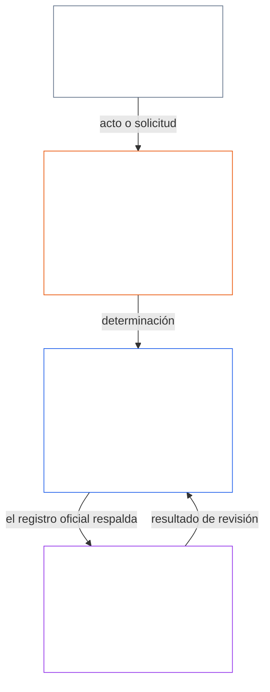
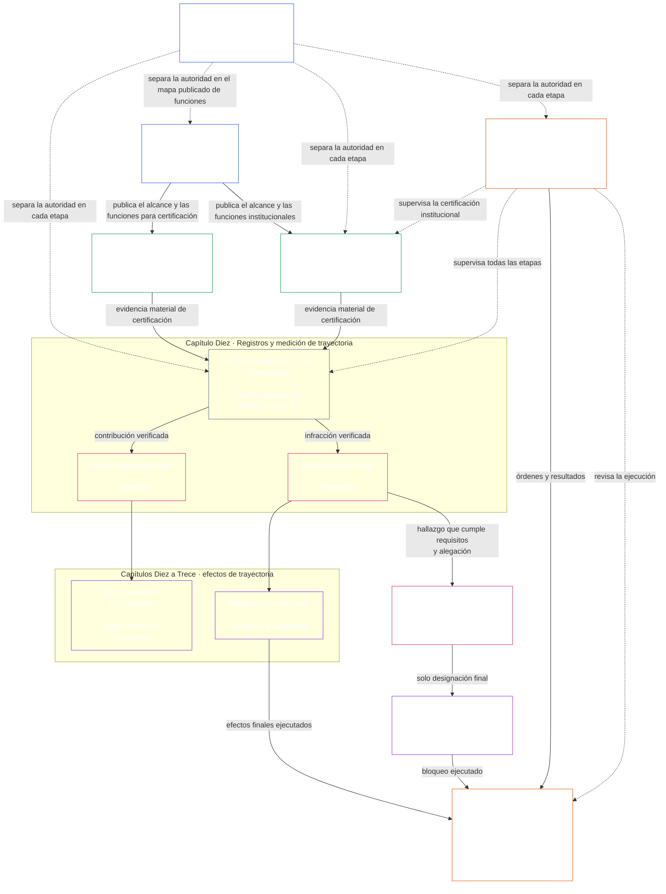

<!-- Locale: es; variety: español internacional. AI-assisted structural resynchronization draft (GPT-6 Codex), unreviewed and incomplete. English source commit 6e0b6c663dde01b5dea731fe33d87725c7174930; edition SC-Corpus-2026.11.25. core_00 SHA-256 90799cb8019b41356fa5dd90565e3f9540fc346e8c77e2c321b841654f39b274; core_01 SHA-256 aca759b394f10784ab1a2eef4e9e2ca12e369ef0ca8ee797298c6af00d2950aa. -->

<strong>Ubicación en el corpus (no operativo): estructura del archivo y reglas de lectura</strong>

> Los widgets marcados como **no operativos** (ubicación en el corpus, orientación para quien lee y mapas de lectura) son solo orientativos. No añaden, quitan ni estrechan obligaciones vinculantes, ni en su propio archivo ni en ningún otro.
>
> Este archivo **forma parte de la Constitución Senciente** y es **vinculante solo junto con** los demás archivos numerados `core_*` y el subcorpus, leídos como un solo texto. Contiene el **Capítulo Uno**, el *Mapa Constitucional*: su propósito (§1), por qué existe (§2), cómo encajan sus archivos (§3), los fundamentos para los capítulos posteriores (§4), los procesos clave de gobernanza (§5) y el registro constitucional de responsables (§§6 a 11).
>
> **Anterior:** [core_00.000_preamble.md](core_00_preamble.md) (Preámbulo)
> **Siguiente:** [core_02.000_values_principles.md](../../core_02.000_values_principles.md)

<strong>Trazabilidad</strong>

- Anterior: [Preámbulo](core_00_preamble.md) (*el Modelo, las Dos Finalidades Constitucionales, la Tétrada Constitucional, el enjuego material y las categorías de medición*).
- Secciones:
  - [§1](#1-purpose-role-and-scope);
  - [§2](#2-why-the-map-exists);
  - [§3](#3-how-the-files-fit-together);
  - [§4](#4-foundations-for-the-chapters-that-follow);
  - [§5](#5-key-governance-processes);
  - [§6](#6-principles-definitions-and-rights);
  - [§7](#7-system-and-institutional-charters-functional-independence-and-separation-of-duties);
  - [§8](#8-key-practical-process-pipelines);
  - [§9](#9-process-ownership-and-outputs);
  - [§10](#10-governance-change-and-incorporation);
  - [§11](#11-adopted-implementation-corpus).
- Leer junto con: [Pila de Autoridad y Jerarquía Interna](../../subcore_03.080_band_integrative.md#authority-stack-and-internal-hierarchy) (*cómo se aplica el registro de responsables*); [README.md](README.md) (*orden de lectura*).

 

# CAPÍTULO UNO: MAPA CONSTITUCIONAL

> **État / Draft status:** structural draft, unreviewed and incomplete. Current sections 1–4 are new and require translation; moved sections are raw prior translation requiring full fidelity review.

### 1. Propósito, función y alcance

*En términos sencillos: este capítulo es la guía del resto de la Constitución. Muestra cómo encajan sus partes, qué capítulo es responsable de cada tema y cómo funcionan los procesos principales, para que quien lee pueda encontrar la regla que responde a su pregunta.*

**Propósito:** El Capítulo Uno ofrece el panorama general y la guía de responsables. Nombra los procesos que ponen a prueba la gobernanza autorizada, indica qué capítulo es responsable de cada ámbito sustantivo y describe los tres niveles del texto constitucional.

**Función:** El capítulo orienta y asigna responsabilidades. No añade deberes propios aparte del registro de responsables, que los demás capítulos y la [Pila de Autoridad y Jerarquía Interna](../../subcore_03.080_band_integrative.md#authority-stack-and-internal-hierarchy) aplican.

**Alcance del capítulo:** El capítulo abarca:

- por qué existe el mapa (**sección 2**);
- cómo encajan los archivos (**sección 3**) y los fundamentos para los capítulos posteriores (**sección 4**);
- los procesos clave de gobernanza (**sección 5**);
- el registro de responsables constitucionales: principios, definiciones y derechos (**sección 6**); cartas de sistemas e instituciones, independencia funcional y separación de funciones (**sección 7**); cadenas de procesos (**sección 8**); responsables y resultados de los procesos (**sección 9**); y gobernanza, cambio e incorporación (**sección 10**); y
- el corpus de implementación adoptado y el subcorpus (**sección 11**).

### 2. Por qué existe el mapa

*En términos sencillos: un texto tan extenso necesita una guía que muestre cómo encajan sus partes y quién es responsable de cada tema. Este capítulo existe para que quien lee pueda encontrar la regla que responde a su pregunta.*

La Constitución distribuye su trabajo entre muchos capítulos, un subcorpus y cuatro corpus adoptados. Un ser sintiente que intenta averiguar qué se le debe, o un adoptante que busca un deber, puede perderse. Este capítulo es el panorama general y la guía de responsables: qué hace cada parte, qué capítulo es responsable de cada tema, cómo funcionan las cadenas de procesos y cómo se relacionan los niveles. No añade ninguna regla propia aparte del registro de responsables.

**Fundamento:**

- Preámbulo:
  - [Tétrada Constitucional](core_00_preamble.md#constitutional-tetrad): las funciones que este capítulo lleva a la práctica:
    - [Participación](../../subcore_03.060_apex_participation_leg.md#participation): un ser sintiente puede encontrar la regla que responde a su pregunta;
    - [Rendición de cuentas](../../subcore_03.040_apex_accountability_leg.md#accountability): cada tema tiene un capítulo responsable que responde por él;
    - [Supervisión](../../subcore_03.055_apex_oversight_leg.md#oversight): quien lee puede ver cómo encajan las partes y detectar una laguna o superposición;
    - [Puntualidad](../../subcore_03.065_apex_timeliness_leg.md#timeliness): quien lee llega a la regla correcta sin demora;
  - [Dos Finalidades Constitucionales](core_00_preamble.md#two-constitutional-aims): ambas finalidades a las que sirve este capítulo:
    - [Florecimiento](core_00_preamble.md#flourishing): la Constitución solo sirve a los seres sintientes si pueden orientarse en ella;
    - [Continuidad](core_00_preamble.md#continuity): un mapa claro mantiene íntegro el texto mientras crece y cambia;
- principios del Capítulo Dos:
  - [§5.2 Accesibilidad en lenguaje claro (deber de participación y administración responsable)](../../core_02.000_values_principles.md#52-plain-language-accessibility-participation-and-stewardship-duty);
  - [§5.2.4 Disciplina contra la complejidad como obstáculo](../../core_02.000_values_principles.md#524-complexity-as-defeat-discipline);
  - [§15.4 Resolución de conflictos sobre el significado constitucional](../../core_02.030_constitutional_interpretation.md#154-constitutional-meaning-conflict-resolution);
- artículos del Capítulo Cuatro:
  - [Artículo XXIV-A](../../core_04.030_rights_part_d.md#article-xxiv-a-proportional-comprehensibility-right) (*Derecho a la Comprensibilidad Proporcional*);
  - [Artículo XXIV-B](../../core_04.030_rights_part_d.md#article-xxiv-b-complexity-audit-and-modularity-requirements) (*Requisitos de Auditoría de Complejidad y Modularidad*).

### 3. Cómo encajan los archivos

Los archivos de la Constitución encajan de la siguiente manera:

- **Núcleo (`core_*`):** Los archivos numerados contienen los capítulos de la Constitución, que deben leerse juntos como un solo texto. Enuncian las garantías y la estructura constitucional.
- **Subcorpus (`subcore_*`):** Estos archivos contienen las reglas y procedimientos completos que respaldan los capítulos. Cada uno pertenece a un capítulo, tiene la misma fuerza que ese capítulo y obliga a cada adoptante sin necesidad de incorporación separada. El subcorpus no puede restringir su capítulo.
- **Implementación (`corpus_*`):** Cuatro archivos proporcionan detalles operativos para llevar a cabo la Constitución. Obligan dentro del alcance de una incorporación válida e implementan la Constitución sin restringirla. La [sección 11](#11-adopted-implementation-corpus) identifica los cuatro archivos.

El [Corpus](../../subcore_03.080_band_integrative.md#corpus) definido es el conjunto más amplio y versionado de fuentes constitucionales vinculantes: incluye el núcleo, el subcorpus, el texto de implementación adoptado y cualquier envoltura de compatibilidad válida durante la transición. Los borradores, las notas y las guías de navegación no se vuelven vinculantes por el solo hecho de formar parte del proyecto.

### 4. Fundamentos para los capítulos siguientes

*En términos sencillos: los Capítulos Dos a Cuatro son responsables de los valores, el diccionario (junto con las reglas del subcorpus sobre cómo se construyen, protegen y demuestran las definiciones) y el Piso de Derechos; los capítulos posteriores deben respetar esos ámbitos, sin trasladarlos en silencio.*

Los Capítulos **Dos a Cuatro** proporcionan los valores, el vocabulario, los mecanismos de verificación y el Piso de Derechos que todo lo posterior debe respetar, incluidos:

- el requisito de Carta del Sistema o Carta Institucional del [Capítulo Cinco](#7-system-and-institutional-charters-functional-independence-and-separation-of-duties), el requisito de separación de funciones del Capítulo Seis y los Órganos Independientes del Capítulo Siete;
- las [Cadenas Prácticas Clave de Procesos](#8-key-practical-process-pipelines) de la sección 8;
- los [responsables y resultados de los procesos](#9-process-ownership-and-outputs) de la sección 9;
- los capítulos de gobernanza y vías de cambio de la sección 10; y
- el [Corpus de Implementación Adoptado](#11-adopted-implementation-corpus) de la sección 11.

### 5. Procesos clave de gobernanza

Cuando lo exijan expresamente el Capítulo Cuatro, el Subcore 8-B, un documento incorporado u otra disposición constitucional, lleva el asunto constitucional material a una o más vías de abajo. Estas vías someten a prueba la gobernanza autorizada y la hacen revisable, impugnable y corregible; no la autorizan por sí mismas.

- **Independencia funcional y separación de funciones** ([Capítulo Seis](../../core_06.000_functional_independence_separation_of_duties.md#chapter-six-functional-independence-and-separation-of-duties)): Antes de que avance un acto materialmente vinculante, identifica y separa las funciones de iniciación, verificación o autorización, custodia del registro oficial y revisión de impugnaciones conforme a las reglas aplicables de proporcionalidad e independencia.
- **Certificación de alineación del sistema** ([Subcore 8-B](../../subcore_08.020_system_alignment_certification_evaluation.md#subcore-8-b-system-alignment-certification--evaluation)): Antes de confiar a gran escala en un sistema de alto impacto, reúne y revisa evidencia para determinar si es constitucionalmente seguro confiar en él ahora. La certificación y el derecho de los sencientes a impugnarlo y auditarlo son salvaguardas complementarias; ninguna sustituye a la otra.
- **Registros de trayectoria** ([Subcore 10-B](../../subcore_10.020_standing_assessment.md#subcore-10-b-standing-records--question-1-what-happened)): Cuando una conducta o daño importa constitucionalmente, incorpora los hechos verificados a expedientes formales separados de Contribución o Infracción; los rumores y la reputación no bastan.
- **Corrección y reparación** ([Capítulo Doce §3.1](../../core_12.000_violation_consequences.md#31-remedy-and-correction)): Tras una infracción verificada, evalúa tanto qué debe hacerse para atender su causa y detenerla (corrección) como qué se debe a quienes sufrieron daño (reparación). Una no sustituye a la otra.
- **Revisión del foro** ([Capítulo Dieciséis](../../core_16.000_forum.md#chapter-sixteen-standards-routing-and-forum-cases)):
  - Las controversias ordinarias dentro de sistemas ya autorizados usan primero la vía publicada de impugnación de Participación Sistémica de las Partes Interesadas.
  - Si esa vía sigue impugnada, falta, está capturada o no puede conceder reparación, deriva la controversia según el enjuego primario a foros supervisados.
  - Los foros sostienen la evidencia, el traslado lícito y los plazos de resolución oportuna bajo el **Artículo XXVII-C**.

### 6. Principios, definiciones y derechos

Las secciones **6 a 11** forman el **registro constitucional de titulares**: indican qué capítulo o corpus adoptado responde por cada materia y qué produce. La frase vinculante al inicio de cada capítulo numerado también declara su titularidad. Otras partes pueden remitir al titular, pero no reescribir ni trasladar silenciosamente su responsabilidad. Véase [Pila de autoridad y jerarquía interna](../../subcore_03.080_band_integrative.md#authority-stack-and-internal-hierarchy).

**[Capítulo Dos — Valores, principios y custodia responsable](../../core_02.000_values_principles.md)**

- **Qué le corresponde:** los valores y límites rectores de la Constitución —bienestar, equidad, Seguridad, Verdad, Confianza y libertad acotada—; reconocer y recompensar proporcionalmente la contribución lícita; resolver conflictos entre principios; y los deberes de custodia responsable, incluida la comprensión distribuida, la evaluación sistémica y la disciplina de gobernanza.
- **Qué produce:** la base interpretativa de los capítulos posteriores, que convierte las finalidades de alto nivel en requisitos operativos al aplicar sistemas, derechos, definiciones y cadenas de proceso.

**[Capítulo Tres — Definiciones fundacionales](../../core_03.000_definitions_home.md)**

- **Qué le corresponde:** la pila canónica de definiciones —bandas de Supervisión, Participación, Rendición de cuentas, Continuidad e Integrativa—; [Pila de autoridad y jerarquía interna](../../subcore_03.080_band_integrative.md#authority-stack-and-internal-hierarchy); [Corpus](../../subcore_03.080_band_integrative.md#corpus); y reglas de frontera relacionadas.
- **Qué produce:** vocabulario constitucional preciso para interpretación, auditoría y adjudicación. Es la pila de definiciones, no el Piso de Derechos; los derechos vinculantes viven en el Capítulo Cuatro.

Los subcores del Capítulo Tres establecen cómo se construyen, protegen y prueban las definiciones:

- **[Subcore 3-A — Estructura de las definiciones](../../subcore_03.010_definition_structure.md):** establece la estructura de componentes Ontológico/Medición/Evaluación/Cumplimiento (O/M/A/C), los requisitos de alineación y las reglas de componente. **Produce:** una gramática común que evita etiquetas vagas, supuestos ocultos y formas incompatibles.
- **[Subcore 3-B — Integridad de las definiciones](../../subcore_03.020_definition_integrity.md):** protege contra la evasión, el desplazamiento de alcance, los juegos de redefinición y los trucos de incumplimiento que vacían definiciones en la práctica. **Produce:** disciplina anti-evasión y metadatos de orientación de incumplimiento, con rutas a revisión de trayectoria e inconducta cuando la evasión se acredita.
- **[Subcore 3-C — Carga, trazabilidad y verificación](../../subcore_03.030_burden_traceability_verification.md):** pone la carga de la prueba en quien afirma cumplimiento y exige evidencia trazable, observable y verificable, proporcional al [enjuego material](core_00_preamble.md#material-stake) y abierta a impugnación práctica. **Produce:** la cadena de verificación que alimenta los insumos verificados del [Subcore 10-B](../../subcore_10.020_standing_assessment.md#subcore-10-b-standing-records--question-1-what-happened) y la evidencia de alineación del sistema del [Subcore 8-B](../../subcore_08.020_system_alignment_certification_evaluation.md#subcore-8-b-system-alignment-certification--evaluation); no sustituye la medición de trayectoria.

**[Capítulo Cuatro — Derechos fundacionales](../../core_04.000_rights_part_a.md)**

- **Qué le corresponde:** el Piso de Derechos de los Artículos **I–XXIX**: esenciales de supervivencia; asignación de recursos y custodia de dependencias; dignidad, agencia y participación; impugnación y reparación; límites de justicia; oportunidad conforme al **Artículo XXVII-C**; y reglas de transición de adopción. Sus cuatro partes organizan estas protecciones para una lectura planeta-primero.
- **Qué produce:** protecciones no negociables y ganchos de reparación que los Capítulos Cinco a Veintiséis, los foros, la gobernanza y las reglas de enmienda deben respetar y no estrechar, eludir o vaciar mediante procedimientos o métricas sustitutas.

### 7. Cartas del Sistema e Institucionales, independencia funcional y separación de funciones

*En términos sencillos: un sistema o institución de impacto real publica una Carta del Sistema o Carta Institucional que indica qué puede hacer y quién ocupa cada puesto. Antes de que avance un acto materialmente vinculante, separa quién lo inicia, quién lo verifica o autoriza, quién custodia el registro oficial y quién revisa una impugnación. Las funciones pueden adaptarse al contexto, pero el mismo actor y su línea de control no pueden ocupar silenciosamente los puestos que verifican su propio acto.*

**Capítulo Cinco — Cartas del Sistema e Institucionales**

- **Qué le corresponde:** el piso para el documento de alcance publicado de un sistema o institución: quién debe publicar una carta; su contenido mínimo, incluido el Mapa de Funciones de la Carta y sus referencias a las reglas vinculantes de elección de partes interesadas; cómo se modifica y revisa para impedir cambios silenciosos de alcance; y lo que una carta no puede hacer: fijar la clase, definir el límite, reemplazar la certificación, contener reglas de decisión ni conceder autoridad.
- **Qué produce:** una declaración de alcance y ubicación de funciones publicada y versionada que pueden comprobar las certificaciones, los registros de trayectoria y los foros. [Capítulo Cinco](../../core_05.000_charters.md#chapter-five-system-and-institutional-charters).

**Capítulo Seis — Independencia funcional y separación de funciones**

- **Qué le corresponde:** exige asignar por separado cuatro funciones en cada [acto materialmente vinculante](../../core_05.035_band_accountability.md#materially-binding-act): iniciación; verificación o autorización; custodia del registro oficial; y revisión de impugnaciones. También regula el contenido mínimo del Registro del Acto, la independencia de la línea de control material del actor, la ubicación publicada y los sustitutos, el alojamiento combinado proporcional, los límites de emergencia y las transferencias atribuibles y la derivación al puesto correcto.
- **Qué produce:** una arquitectura reutilizable de cuatro funciones y del Registro del Acto. Todo proceso posterior de certificación, trayectoria, foro, gobernanza e incorporación debe aplicarla para que sus resultados sean comprobables de forma independiente, queden registrados de manera fiable y puedan impugnarse realmente. [Capítulo Seis](../../core_06.000_functional_independence_separation_of_duties.md#chapter-six-functional-independence-and-separation-of-duties).

**[Capítulo Siete — Organismos independientes](../../core_07.000_independent_bodies.md#chapter-seven-independent-bodies)**

- **Qué le corresponde:** Define qué hace independiente a un organismo, la regla para nombrarlo como Organismo Independiente y la lista de organismos que cada adoptante debe tener, con una garantía para los sencientes en cada caso.
- **Qué produce:** Un estándar común para comprobar la independencia; las reglas operativas completas de cada organismo están en su subcore del Capítulo Siete.

#### 7.1 Mapa de separación de cuatro funciones

Todo acto materialmente vinculante debe mantener estas salvaguardas para ese mismo acto:

- La función de iniciación no puede verificar ni autorizar su propio acto.
- La función de verificación o autorización no puede custodiar el registro oficial del acto.
- La función de verificación o autorización no puede revisar una impugnación del acto.
- Las funciones de verificación o autorización y de revisión de impugnaciones deben quedar fuera de la línea de control material de quien inicia el acto.

<strong>Orientación de lectura (no operativa): mapa de separación de cuatro funciones</strong>

> Este mapa muestra las cuatro funciones y un recorrido típico de un acto y su Registro del Acto. No añade una quinta función, no prescribe una secuencia universal ni altera las reglas del Capítulo Seis sobre independencia, funciones combinadas proporcionales, acción de emergencia o derivación de impugnaciones.

### 8. Cadenas prácticas de proceso clave

*En términos sencillos: los Capítulos Nueve a Quince forman una sola cadena — certificar sistemas e instituciones, registrar y medir ayuda y daño en vías separadas, aplicar efectos reales y reparación, y evitar que un foro sea el único hogar final de una reclamación contra sí mismo — para mantener los deberes reales en la vida diaria.*

Los Capítulos Nueve a Quince se enlazan en una sola cadena práctica — y, dentro del [registro positivo de titulares](#4-principles-definitions-and-rights), cada paso nombra qué le corresponde a ese capítulo. Juntos convierten los deberes constitucionales en registros que los sencientes pueden comprobar, impugnar y reparar — de modo que la [**Tétrada Constitucional**](#constitutional-tetrad), las [**Dos Finalidades Constitucionales**](#two-constitutional-aims) y los Pisos de Derechos sigan siendo reales en la vida cotidiana, no solo en el papel.

Cada paso de abajo enuncia qué le corresponde al capítulo y qué produce. [Cómo encaja la cadena completa](#62-how-the-full-chain-fits-together) muestra después a esos titulares como un solo camino desde la comprobación del sistema hasta el remedio.

**Certificación de alineación del sistema** ([Capítulo Nueve](core_09.000_system_alignment_certification_evaluation.md#chapter-nine-system-alignment-certification))

- **Qué le corresponde:** Asegura que los sistemas con impacto material se mantengan alineados constitucionalmente.
  - Antes de que un sistema que afecta de forma material a los sencientes pueda reconocerse o de que se pueda confiar en él a escala, se reúne y se revisa evidencia bajo supervisión de foro
  - El alcance de la revisión incluye si el sistema respeta lo esencial de supervivencia; la asignación de recursos y la administración responsable de dependencias del **Artículo IV** (*Asignación de recursos, dependencias y financiamiento del ecosistema*) — incluida la [contribución transistémica proporcional](../../subcore_03.075_band_continuity.md#proportionate-cross-system-support-constitutional) donde la dependencia de infraestructura compartida está materialmente en cuestión; la seguridad; la participación; y otros pisos constitucionales
  - Los sencientes con trayectoria reconocida pueden impugnar el resultado
  - Los sistemas de alto riesgo deben recertificarse con un calendario regular; la certificación nunca es permanente
- **Qué produce:** Un **registro de certificación de alineación del sistema** — una respuesta acotada e impugnable a si ese sistema está lo bastante alineado para reconocerlo, seguir confiando en él, desplegarlo o liberarlo de condiciones *ahora mismo*, dentro de un alcance y una ventana de tiempo enunciados.

**Registros y medición de trayectoria** ([Capítulos Once y Doce](core_11_standing_assessment.md#chapter-eleven-standing-records--question-1-what-happened) · [Capítulo Doce](core_12_standing_measurement.md#chapter-twelve-standing-measurement--question-2-how-good-or-bad-was-it))

- **Qué le corresponde:** Cuando la conducta importa constitucionalmente, los rumores y las reputaciones no bastan. El Capítulo Once incorpora los hechos verificados a **registros de trayectoria**; el Capítulo Doce mide la **contribución** (ayuda hacia el florecimiento) y la **infracción** (fallos de rendición de cuentas y daño) en **ejes separados** — la conducta buena verificada no borra el daño verificado, y ambos nunca se pliegan en una sola puntuación neta.
- **Qué produce:** **Registros de trayectoria** clasificados en el Eje de Contribución y el Eje de Infracción, basados solo en **insumos verificados** y en hallazgos supervisados por foro — no en puntuación informal ni en relatos de controversia que sustituyan la clasificación.

**Integración de trayectoria y efectos** ([Capítulo Trece](../../core_13.000_standing_integration.md#chapter-thirteen-standing-effects-and-integration))

- **Qué le corresponde:** Integra las clasificaciones verificadas en **efectos de trayectoria** del mundo real en pistas separadas — escalados al [**enjuego material**](#material-stake), sin plegar contribución e infracción en una sola puntuación neta, y sin vaciar la participación, la supervisión, la rendición de cuentas o la actuación a tiempo.
  - **Pista de contribución:** La clasificación positiva verificada produce un alza práctica:
    - [**Habilitaciones de competencia**](../../core_13.000_standing_integration.md#72-competency-bars-and-clearances) que pueden abrir roles sensibles a la confianza, autoridad delegada, elegibilidad de supervisión y administración responsable de consecuencia progresiva cuando se demuestra competencia frente a la barra de competencia publicada y ningún [bloqueo de trayectoria](../../core_13.000_standing_integration.md#52-prevention--general-standing-locks) aplicable cierra la vía condicionada
    - Reconocimiento proporcional y **recompensas materiales** por la administración responsable lícita y la cooperación, como exige el [Capítulo Uno](../../core_02.000_values_principles.md#32-recognition-reinforcement-and-aspiration)
    - No es elogio vacío. Los beneficios tienen que ser reales, respaldados por evidencia y abiertos a impugnación
  - **Pista de infracción:** Los hallazgos de infracción verificados producen un descenso práctico:
    - **Bloqueos de trayectoria**, límites de rol, órdenes de remediación, [remedio para quienes fueron dañados](../../core_13.000_standing_integration.md#51-remedy-and-correction), descriptores suplementarios y ganchos de ejecución
    - Las restricciones se ajustan a la gravedad de lo que se verificó
    - Las infracciones no resueltas siguen vivas
    - Siguen disponibles vías proporcionales para restaurar la trayectoria de quienes demuestran restitución auténtica
    - Una habilitación de competencia del lado de la contribución no dispensa un bloqueo de trayectoria del lado de la infracción
- **Qué produce:** Efectos de trayectoria separados y escalados en las pistas de Contribución y de Infracción — habilitaciones de competencia y recompensas materiales de un lado; bloqueos de trayectoria, corrección y remedio del otro — ninguno plegado en una sola puntuación.

**Barandilla de inconducta anticonstitucional** ([Capítulo Catorce](../../core_14.000_misconduct_designation.md#chapter-fourteen-anti-constitutional-misconduct))

- **Qué le corresponde:** Trata solo las infracciones verificadas más graves — conducta que puede haber capturado o vaciado deberes constitucionales a escala. Cuando el Capítulo Once ya ha registrado un hallazgo de infracción de máximo impacto, y se alega de forma material inconducta anticonstitucional, este capítulo corre la revisión de designación como una pista de umbral del Capítulo Trece en paralelo con los efectos ordinarios de trayectoria del Capítulo Trece.
- **Qué produce:** Una designación final de inconducta anticonstitucional — o su rechazo — para ese hallazgo existente de máximo impacto, solo después de que se cumplen los criterios exigidos y las salvaguardas de debido proceso. El Capítulo Doce sigue midiendo cuán grave fue el daño; solo una designación final dispara el **Bloqueo de Confianza Anticonstitucional** del Capítulo Trece.

**Supervisión de foro y enrutamiento** ([Capítulo Quince](../../core_15.000_forum.md#chapter-fifteen-forums-and-jurisdiction))

- **Qué le corresponde:** Supervisa cómo se mueven de hecho las controversias y los asuntos de certificación.
  - [Secuencia de controversias](core_11_forum.md#dispute-sequencing) desde la vía de impugnación publicada de Participación Sistémica de las Partes Afectadas hasta el enrutamiento de foro
  - Qué familia de foros los trata, y dónde empieza de ordinario un caso
  - Cómo se sostiene la evidencia
  - Cómo se trasladan o se consolidan los asuntos
  - Cómo las reglas anti-autojuzgamiento evitan que foros capturados sean el único hogar final
  - Los plazos bajo el **Artículo XXVII-C** (*Resolución oportuna y piso contra la demora*) evitan que los casos queden sin resolver tanto tiempo que el remedio ya no importe
- **Qué produce:** **Hallazgos verificados** que pueden abrir o actualizar registros de trayectoria, más enrutamiento lícito hacia el remedio y la [resolución oportuna](../../subcore_03.070_band_accountability.md#timely-resolution-constitutional). Los foros supervisan la cadena; no reemplazan la medición de trayectoria del Capítulo Doce.

#### 8.1 Mapa del proceso

La cadena sigue siendo un solo proceso constitucional porque cada etapa entrega un resultado definido y revisable. También permanece dentro de los límites constitucionales: la Tétrada exige participación, supervisión, rendición de cuentas y actuación oportuna en cada etapa; las Dos Finalidades exigen que el proceso sirva al Florecimiento y la Continuidad conjuntamente; y los Pisos de Derechos impiden restringir, eludir o vaciar las protecciones no negociables. En conjunto, estas reglas convierten los deberes en registros y decisiones que los sencientes pueden comprobar, impugnar, reparar y usar en la práctica, no solo en el papel.

#### 8.2 Cómo encaja la cadena completa

*En términos sencillos: primero separa las funciones; luego sigue el camino desde la comprobación del sistema hasta la reparación, con los foros supervisando las controversias y los pasos de trayectoria.*

La cadena completa avanza en este orden:

1. **Separa las funciones en cada acto materialmente vinculante** ([Capítulo Seis](../../core_06.000_functional_independence_separation_of_duties.md#3-four-seat-constitutional-requirement)): identifica quién inicia, quién verifica o autoriza, quién custodia el registro oficial y quién oye una impugnación. Aplica las combinaciones prohibidas, las reglas de independencia y la vía sustitutiva publicada antes de considerar que el acto fue comprobado válidamente. Cuando se requiera una Carta, el [Mapa de Funciones de la Carta del Capítulo Cinco](../../core_05.000_charters.md#6-the-charter-role-map-and-standing-record-custody) publica quién ocupa cada función.
2. **Certifica sistemas e instituciones cuando el impacto sea suficientemente grave**: antes de confiar a gran escala en un sistema de alto impacto, obtén un Registro de Certificación del Sistema impugnable bajo el [Subcore 8-B](../../subcore_08.020_system_alignment_certification_evaluation.md#subcore-8-b-system-alignment-certification--evaluation); evalúa una institución según su propia clase, conducta, gobernanza y cartera, y asienta el resultado en un Registro de Certificación Institucional bajo el [Subcore 9-B](../../subcore_09.020_institutional_alignment_certification_evaluation.md#subcore-9-b-institutional-alignment-certification--evaluation).
3. **Registra y mide la trayectoria en vías separadas** ([Subcores 10-B y 10-D](../../subcore_10.020_standing_assessment.md#subcore-10-b-standing-records--question-1-what-happened) y [10-D](../../subcore_10.040_standing_measurement.md#subcore-10-d-standing-measurement--question-2-how-good-or-bad-was-it)): cuando la ayuda o el daño importe constitucionalmente, abre expedientes formales y admite solo **insumos verificados**; después mide y clasifica lo que se verificó. Rumores, reputación y relatos de controversia no bastan. La ayuda y el daño nunca se fusionan en una puntuación neta; los registros vinculados siguen separados. Los insumos verificados incluyen evidencia de certificación de alineación del sistema del Capítulo Ocho cuando sea material. Abre un Registro de Trayectoria de contribución para la ayuda verificada hacia el florecimiento y clasifica su naturaleza en el Eje de Contribución; abre otro de infracción para el daño verificado y los fallos de rendición de cuentas y clasifica su naturaleza en el Eje de Infracción. Los registros vinculados se remiten entre sí, pero siguen separados.
4. **Aplica efectos de trayectoria en cada vía** ([Subcore 10-F](../../subcore_10.060_standing_integration.md#subcore-10-f-standing-integration--question-3-what-follows)): la contribución verificada puede abrir habilitaciones de competencia y sustentar reconocimiento y recompensas materiales proporcionales; una infracción verificada puede activar bloqueos de trayectoria, corrección y reparación para quienes sufrieron daño. La contribución verificada debe respaldar reconocimiento y recompensas materiales proporcionales, y puede conceder habilitaciones de competencia.
5. **Revisa por separado la designación de conducta anticonstitucional** ([Capítulo Catorce](../../core_14.000_misconduct_designation.md#chapter-fourteen-anti-constitutional-misconduct-designation)): si un hallazgo de infracción de máximo impacto también puede cumplir los criterios anticonstitucionales, el Capítulo Catorce decide, con garantías procesales, si corresponde una ACMD. Los efectos ordinarios de trayectoria siguen en paralelo; la designación no cambia la gravedad que el Capítulo Diez ya determinó y solo una ACMD final activa el Bloqueo de Confianza Anticonstitucional.
6. **Deriva las controversias y mantén la reparación a tiempo** ([Capítulos Dieciséis y Diecisiete](../../core_16.000_forum.md#1-purpose-role-and-scope) y [Capítulo Diecisiete](../../core_17.000_forum_families_escalation_timeliness_support.md#chapter-seventeen-forum-families-escalation-timely-resolution-and-support)): supervisa el recorrido de los casos, la vía que los trata y el cumplimiento de los plazos del **Artículo XXVII-C** para que la reparación no muera por demora. Las controversias ordinarias siguen la [secuencia de controversias](../../core_16.000_forum.md#dispute-sequencing). Clasifica también los asuntos en cinco [niveles de materialidad](../../core_17.000_forum_families_escalation_timeliness_support.md#5-timely-resolution-materiality-tiers-and-anti-delay-discipline) (A/B/C/L/P). Si la designación final del Capítulo Catorce es el enjuego principal, se aplica la derivación predeterminada a la familia de Integridad.
7. **Ejecuta los resultados** ([Capítulos Diecinueve y Veinte](../../core_19.000_enforcement.md#chapter-nineteen-enforcement) y [Capítulo Veinte](../../core_20.000_special_enforcement.md#chapter-twenty-special-enforcement)): una parte nombrada ejecuta el efecto final, bloqueo, reparación u orden del foro dentro de su plazo, sin eludirlo, retrasarlo ni abandonarlo silenciosamente. Si el actor obligado se resiste, la ejecución especial se mantiene dentro de sus pisos compartidos: incautar dinero y activos preservando un mínimo protegido; aplicar una escala estándar de presión para la entrega; priorizar una escala de fuerza no letal; y evaluar las causas raíz para que no se repita el fallo.

### 9. Titularidad de los procesos y resultados

*En términos sencillos: cada etapa tiene un propietario y un resultado delimitado; ninguna sustituye el trabajo de las demás.*

**[Subcore 8-B — Certificación de alineación del sistema](../../subcore_08.020_system_alignment_certification_evaluation.md#subcore-8-b-system-alignment-certification--evaluation)** — Reúne y revisa, bajo supervisión del foro, evidencia sobre supervivencia, recursos y dependencias, seguridad, participación y otros pisos constitucionales. Permite impugnar el resultado y exige recertificación periódica de sistemas de alto riesgo. Produce un Registro de Certificación del Sistema acotado al alcance y período evaluados.

**[Subcore 9-B — Certificación de alineación institucional](../../subcore_09.020_institutional_alignment_certification_evaluation.md#subcore-9-b-institutional-alignment-certification--evaluation)** — Evalúa lo que controla la institución: su Carta Institucional, responsabilidad por la autoridad, incentivos y disponibilidad de verificaciones independientes. Se apoya en las certificaciones de sus sistemas, sin repetirlas. Produce un Registro de Certificación Institucional impugnable; no es licencia ni requisito para formar u operar una institución.

**[Subcore 10-B — Registros de trayectoria](../../subcore_10.020_standing_assessment.md#subcore-10-b-standing-records--question-1-what-happened)** — Registra hechos verificados en vías separadas de Contribución e Infracción. La ayuda verificada no borra el daño y no se combinan en una puntuación neta. Produce registros delimitados basados solo en entradas verificadas y hallazgos supervisados por el foro.

**[Subcore 10-D — Medición de trayectoria](../../subcore_10.040_standing_measurement.md#subcore-10-d-standing-measurement--question-2-how-good-or-bad-was-it)** — Mide los hechos verificados en ejes separados y una escala unificada, sin puntuación neta. Produce para cada registro una clasificación de naturaleza, tamaño y casilla en el Eje de Contribución o el Eje de Infracción.

**[Subcore 10-F — Integración y efectos de trayectoria](../../subcore_10.060_standing_integration.md#subcore-10-f-standing-integration--question-3-what-follows)** — Convierte clasificaciones verificadas en efectos proporcionales separados: habilitaciones, reconocimiento y recompensas en la vía de contribución; bloqueos, corrección y reparación en la de infracción. Ninguna vía cancela la otra ni vacía participación, supervisión, rendición de cuentas o puntualidad.

**[Capítulo Catorce — Designación de conducta anticonstitucional](../../core_14.000_misconduct_designation.md#chapter-fourteen-anti-constitutional-misconduct-designation)** — Revisa solo infracciones verificadas de máximo impacto con alegación material y garantías procesales. Produce una designación final o su rechazo; solo la designación final activa el Bloqueo de Confianza Anticonstitucional.

**[Capítulo Dieciséis — Normas, derivación y casos de foro](../../core_16.000_forum.md#chapter-sixteen-standards-routing-and-forum-cases)** — Supervisa la secuencia de controversias, la familia de foros y el inicio, mantenimiento, transferencia o consolidación de casos, con reglas contra el autojuzgamiento. Produce hallazgos de trayectoria y derivación lícita hacia reparación y resolución oportuna; no reemplaza la medición del Capítulo Diez.

**[Capítulo Diecisiete — Familias de foros, escalamiento, resolución oportuna y apoyo](../../core_17.000_forum_families_escalation_timeliness_support.md#chapter-seventeen-forum-families-escalation-timely-resolution-and-support)** — Define familias de foro, escalamiento, cuestiones para fallo, protección provisional, plazos del Artículo XXVII-C y apoyo a pruebas y participantes. Produce foros capaces de resolver cada clase de asunto a tiempo para que la reparación siga siendo significativa.

**[Capítulo Diecinueve — Ejecución](../../core_19.000_enforcement.md#chapter-nineteen-enforcement)** — Determina quién ejecuta y en qué plazo los resultados de la cadena o de un foro, evitando que se eludan, retrasen o abandonen. Produce resultados efectivamente cumplidos; no crea nuevas consecuencias.

**[Capítulo Veinte — Ejecución especial](../../core_20.000_special_enforcement.md#chapter-twenty-special-enforcement)** — Añade salvaguardas para congelar o incautar activos, usar fuerza o responder a fallas de ejecución repetidas. Busca ejecutar con el menor daño duradero compatible y eliminar las causas raíz de fallas repetidas.

### 10. Gobernanza, cambio e incorporación

*En términos sencillos: esta parte asigna la autoridad de gobierno, los actos de las asambleas, los límites a los cambios, la relación con otras normas y la incorporación de textos de implementación.*

**[Capítulo Dieciocho — Asambleas](../../core_18.000_assemblies.md#chapter-eighteen-assemblies)** — Regula lo que decide una asamblea, cómo decide y sus límites: impuestos y presupuestos, división del trabajo entre niveles territoriales, mayorías requeridas, elección y destitución del ejecutivo, referendos y emergencias tipificadas. Produce reglas y presupuestos públicos, ejecutivos responsables y poderes de emergencia confirmables, revocables y sujetos al Piso de Derechos.

**[Capítulo Veintiuno — Contrato constitucional, legitimidad y custodia](../../core_21.000_governance.md#chapter-twenty-one-constitutional-contract-legitimacy-authorization-and-stewardship)** — Define la Capa del Contrato Constitucional: quién puede gobernar, mediante qué mecanismo legítimo, con qué alcance y términos duraderos, y qué custodia responsable debe mantenerse. Produce requisitos de autorización distintos de la participación dentro de sistemas ya autorizados.

**[Capítulo Veintidós — No regresión](../../core_22.000_non_regression.md#chapter-twenty-two-non-regression-and-substantive-amendment-validity)** — Impide que enmiendas o atajos reduzcan las protecciones básicas, vacíen la Tétrada por debajo del enjuego material o disfracen una regresión de ajuste técnico. Es la primera salvaguarda sustantiva para cualquier cambio.

**[Capítulo Veintitrés — Enmienda, ratificación y adopción](../../core_23.000_amendment_ratification.md#chapter-twenty-three-amendment-ratification-and-procedural-validity)** — Establece cómo cambiar, ratificar y adoptar legalmente la Constitución, con publicación abierta, trazabilidad de custodia autorizada e impugnabilidad efectiva y revisión independiente cuando se requiera. Los cambios solo valen si superan las salvaguardas sustantivas y procesales.

**[Capítulo Veinticuatro — Supremacía y órdenes externas](../../core_24.000_expansion_supremacy.md#chapter-twenty-four-expansion-supremacy-and-external-legal-orders)** — Regula la ampliación lícita de protecciones, la supremacía dentro de su fuente válida, el alcance de adopción, la no sustitución de leyes externas aplicables por su propia fuerza y la interacción con órdenes jurídicos externos sin subordinación o captura silenciosas.

**[Capítulo Veinticinco — Puente de incorporación](../../core_25.000_incorporation.md#chapter-twenty-five-incorporation-bridge)** — Determina qué archivos de implementación designados vinculan cuando se adoptan, fija ediciones y cadenas de custodia y prohíbe desviaciones silenciosas. El texto incorporado implementa la Constitución, pero no se convierte en fuente paralela que pueda restringirla.

### 11. Corpus de implementación adoptado

*En términos sencillos: cuatro corpora compañeros (estructura conjunta, sistemas, instituciones y operaciones de foro) detallan cómo llevar a cabo lo que los capítulos ya exigen; vinculan cuando se adoptan válidamente, y no pueden encoger esos deberes.*

Más allá de los capítulos numerados `core_*`, cuatro corpora compañeros completan el [registro positivo de titulares](#4-principles-definitions-and-rights) para el **texto de implementación** adoptado — detalle operativo que hace ejecutables en la práctica los deberes constitucionales:

- **[corpus_joint_structure](../../corpus_joint_structure.md)** — enrutamiento entre archivos, términos operativos compartidos y estructura conjunta cuando sistemas, instituciones y foros deben leerse juntos sobre los mismos hechos.
- **[corpus_systems](../../corpus_systems.md)** — clasificación de sistemas, protocolos de diseño y despliegue, manejo de información y mecánica de administración responsable crítica.
- **[corpus_institutions](../../corpus_institutions.md)** — formación institucional, gobernanza, supervisión, proporcionalidad y disciplina de disolución.
- **[corpus_forum](../../corpus_forum.md)** — operaciones de foro: formación de paneles, recusación, carriles de revisión, detalle de enrutamiento y apoyo forense.

Cuando quien adopta los incorpora válidamente bajo el [Capítulo Veinticinco](../../core_25.000_incorporation.md#chapter-twenty-five-incorporation-bridge), estos archivos vinculan como texto de implementación dentro del alcance de adopción. El significado de la Constitución Senciente sigue controlando — **implementan, no estrechan**, los capítulos de arriba. La fijación de edición, las cadenas de custodia y la regla de no desalineación silenciosa mantienen el texto adoptado trazable a lo que de hecho se ratificó. La lista canónica y las reglas de frontera viven en [Capítulo Cinco — Corpus](../../subcore_03.080_band_integrative.md#corpus).

Entre los capítulos numerados y el corpus adoptado se encuentran los archivos **subcore** (`subcore_*`), que contienen los detalles completos de garantías y procedimientos comunes que deben ser uniformes para cada adoptante. Cada archivo pertenece a un capítulo y tiene la misma fuerza vinculante; solo puede modificarse conforme al [Capítulo Veintitrés](../../core_23.000_amendment_ratification.md#chapter-twenty-three-amendment-ratification-and-procedural-validity). El capítulo nombra la garantía en lenguaje claro y el subcore contiene la regla completa. Las citas señalan la capa: «Capítulo Diez» remite a la garantía estable y «Subcore 8-E» al detalle normativo; ambos tienen la misma fuerza. Las definiciones del Capítulo Tres se citan por el término definido.

Los principios, las definiciones, los derechos, las cadenas de proceso, la gobernanza, las reglas de enmienda y la implementación incorporada deben leerse juntos para preservar el propósito protector de la Constitución.

---

**Archivo anterior:** [README.md](README.md)

**Siguiente archivo (este idioma):** [core_01_a_values_principles.md](../../core_02.000_values_principles.md)

**Original vinculante:** [core_00_preamble.md](core_00_preamble.md)
