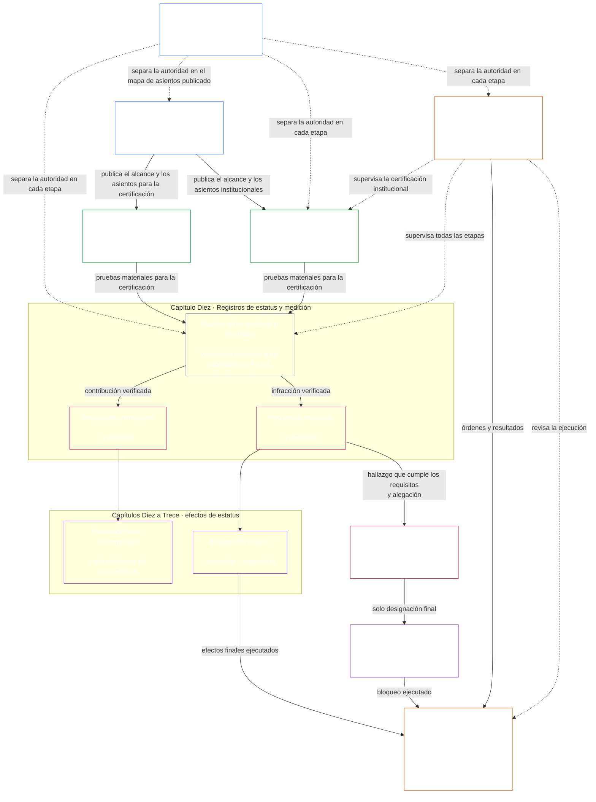
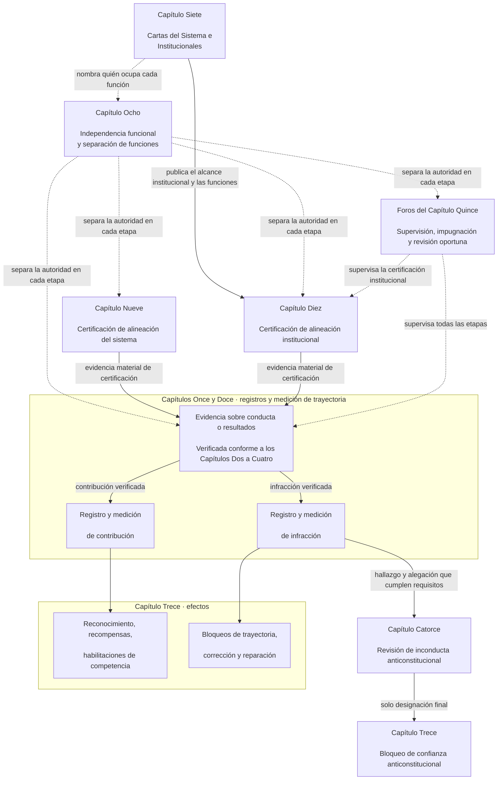

<!-- Locale: es; variety: español internacional. AI-assisted structural resynchronization draft (GPT-6 Codex), unreviewed and incomplete. English source commit 6e0b6c663dde01b5dea731fe33d87725c7174930; edition SC-Corpus-2026.11.25. core_00 SHA-256 90799cb8019b41356fa5dd90565e3f9540fc346e8c77e2c321b841654f39b274; core_01 SHA-256 aca759b394f10784ab1a2eef4e9e2ca12e369ef0ca8ee797298c6af00d2950aa. -->

<strong>Ubicación en el corpus (no operativo): estructura del archivo y reglas de lectura</strong>

> Los widgets marcados como **no operativos** (ubicación en el corpus, orientación para quien lee y mapas de lectura) son solo orientativos. No añaden, quitan ni estrechan obligaciones vinculantes, ni en su propio archivo ni en ningún otro.
>
> Este archivo **forma parte de la Constitución Senciente** y es **vinculante solo junto con** los demás archivos numerados `core_*` y el subcorpus, leídos como un solo texto. Contiene el **Capítulo Uno**, el *Mapa Constitucional*: su propósito (§1), por qué existe (§2), cómo encajan sus archivos (§3), los fundamentos para los capítulos posteriores (§4), los procesos clave de gobernanza (§5) y el registro constitucional de responsables (§§6 a 11).
>
> **Anterior:** [core_00.000_preamble.md](core_00_preamble.md) (Preámbulo)
> **Siguiente:** [core_02.000_values_principles.md](../../core_02.000_values_principles.md)

<strong>Trazabilidad</strong>

- Anterior: [Preámbulo](core_00_preamble.md) (*el Modelo, las Dos Finalidades Constitucionales, la Tétrada Constitucional, el enjuego material y las categorías de medición*).
- Secciones:
  - [§1](#1-purpose-role-and-scope);
  - [§2](#2-why-the-map-exists);
  - [§3](#3-how-the-files-fit-together);
  - [§4](#4-foundations-for-the-chapters-that-follow);
  - [§5](#5-key-governance-processes);
  - [§6](#6-principles-definitions-and-rights);
  - [§7](#7-system-and-institutional-charters-functional-independence-and-separation-of-duties);
  - [§8](#8-key-practical-process-pipelines);
  - [§9](#9-process-ownership-and-outputs);
  - [§10](#10-governance-change-and-incorporation);
  - [§11](#11-adopted-implementation-corpus).
- Leer junto con: [Pila de Autoridad y Jerarquía Interna](../../subcore_03.080_band_integrative.md#authority-stack-and-internal-hierarchy) (*cómo se aplica el registro de responsables*); [README.md](README.md) (*orden de lectura*).

 

# CAPÍTULO UNO: MAPA CONSTITUCIONAL

> **État / Draft status:** structural draft, unreviewed and incomplete. Current sections 1–4 are new and require translation; moved sections are raw prior translation requiring full fidelity review.

### 1. Propósito, función y alcance

*En términos sencillos: este capítulo es la guía del resto de la Constitución. Muestra cómo encajan sus partes, qué capítulo es responsable de cada tema y cómo funcionan los procesos principales, para que quien lee pueda encontrar la regla que responde a su pregunta.*

**Propósito:** El Capítulo Uno ofrece el panorama general y la guía de responsables. Nombra los procesos que ponen a prueba la gobernanza autorizada, indica qué capítulo es responsable de cada ámbito sustantivo y describe los tres niveles del texto constitucional.

**Función:** El capítulo orienta y asigna responsabilidades. No añade deberes propios aparte del registro de responsables, que los demás capítulos y la [Pila de Autoridad y Jerarquía Interna](../../subcore_03.080_band_integrative.md#authority-stack-and-internal-hierarchy) aplican.

**Alcance del capítulo:** El capítulo abarca:

- por qué existe el mapa (**sección 2**);
- cómo encajan los archivos (**sección 3**) y los fundamentos para los capítulos posteriores (**sección 4**);
- los procesos clave de gobernanza (**sección 5**);
- el registro de responsables constitucionales: principios, definiciones y derechos (**sección 6**); cartas de sistemas e instituciones, independencia funcional y separación de funciones (**sección 7**); cadenas de procesos (**sección 8**); responsables y resultados de los procesos (**sección 9**); y gobernanza, cambio e incorporación (**sección 10**); y
- el corpus de implementación adoptado y el subcorpus (**sección 11**).

### 2. Por qué existe el mapa

*En términos sencillos: un texto tan extenso necesita una guía que muestre cómo encajan sus partes y quién es responsable de cada tema. Este capítulo existe para que quien lee pueda encontrar la regla que responde a su pregunta.*

La Constitución distribuye su trabajo entre muchos capítulos, un subcorpus y cuatro corpus adoptados. Un ser sintiente que intenta averiguar qué se le debe, o un adoptante que busca un deber, puede perderse. Este capítulo es el panorama general y la guía de responsables: qué hace cada parte, qué capítulo es responsable de cada tema, cómo funcionan las cadenas de procesos y cómo se relacionan los niveles. No añade ninguna regla propia aparte del registro de responsables.

**Fundamento:**

- Preámbulo:
  - [Tétrada Constitucional](core_00_preamble.md#constitutional-tetrad): las funciones que este capítulo lleva a la práctica:
    - [Participación](../../subcore_03.060_apex_participation_leg.md#participation): un ser sintiente puede encontrar la regla que responde a su pregunta;
    - [Rendición de cuentas](../../subcore_03.040_apex_accountability_leg.md#accountability): cada tema tiene un capítulo responsable que responde por él;
    - [Supervisión](../../subcore_03.055_apex_oversight_leg.md#oversight): quien lee puede ver cómo encajan las partes y detectar una laguna o superposición;
    - [Puntualidad](../../subcore_03.065_apex_timeliness_leg.md#timeliness): quien lee llega a la regla correcta sin demora;
  - [Dos Finalidades Constitucionales](core_00_preamble.md#two-constitutional-aims): ambas finalidades a las que sirve este capítulo:
    - [Florecimiento](core_00_preamble.md#flourishing): la Constitución solo sirve a los seres sintientes si pueden orientarse en ella;
    - [Continuidad](core_00_preamble.md#continuity): un mapa claro mantiene íntegro el texto mientras crece y cambia;
- principios del Capítulo Dos:
  - [§5.2 Accesibilidad en lenguaje claro (deber de participación y administración responsable)](../../core_02.000_values_principles.md#52-plain-language-accessibility-participation-and-stewardship-duty);
  - [§5.2.4 Disciplina contra la complejidad como obstáculo](../../core_02.000_values_principles.md#524-complexity-as-defeat-discipline);
  - [§15.4 Resolución de conflictos sobre el significado constitucional](../../core_02.030_constitutional_interpretation.md#154-constitutional-meaning-conflict-resolution);
- artículos del Capítulo Cuatro:
  - [Artículo XXIV-A](../../core_04.030_rights_part_d.md#article-xxiv-a-proportional-comprehensibility-right) (*Derecho a la Comprensibilidad Proporcional*);
  - [Artículo XXIV-B](../../core_04.030_rights_part_d.md#article-xxiv-b-complexity-audit-and-modularity-requirements) (*Requisitos de Auditoría de Complejidad y Modularidad*).

### 3. Cómo encajan los archivos

Los archivos de la Constitución encajan de la siguiente manera:

- **Núcleo (`core_*`):** Los archivos numerados contienen los capítulos de la Constitución, que deben leerse juntos como un solo texto. Enuncian las garantías y la estructura constitucional.
- **Subcorpus (`subcore_*`):** Estos archivos contienen las reglas y procedimientos completos que respaldan los capítulos. Cada uno pertenece a un capítulo, tiene la misma fuerza que ese capítulo y obliga a cada adoptante sin necesidad de incorporación separada. El subcorpus no puede restringir su capítulo.
- **Implementación (`corpus_*`):** Cuatro archivos proporcionan detalles operativos para llevar a cabo la Constitución. Obligan dentro del alcance de una incorporación válida e implementan la Constitución sin restringirla. La [sección 11](#11-adopted-implementation-corpus) identifica los cuatro archivos.

El [Corpus](../../subcore_03.080_band_integrative.md#corpus) definido es el conjunto más amplio y versionado de fuentes constitucionales vinculantes: incluye el núcleo, el subcorpus, el texto de implementación adoptado y cualquier envoltura de compatibilidad válida durante la transición. Los borradores, las notas y las guías de navegación no se vuelven vinculantes por el solo hecho de formar parte del proyecto.

### 4. Fundamentos para los capítulos siguientes

*En términos sencillos: los Capítulos Dos a Cuatro son responsables de los valores, el diccionario (junto con las reglas del subcorpus sobre cómo se construyen, protegen y demuestran las definiciones) y el Piso de Derechos; los capítulos posteriores deben respetar esos ámbitos, sin trasladarlos en silencio.*

Los Capítulos **Dos a Cuatro** proporcionan los valores, el vocabulario, los mecanismos de verificación y el Piso de Derechos que todo lo posterior debe respetar, incluidos:

- el requisito de Carta del Sistema o Carta Institucional del [Capítulo Cinco](#7-system-and-institutional-charters-functional-independence-and-separation-of-duties), el requisito de separación de funciones del Capítulo Seis y los Órganos Independientes del Capítulo Siete;
- las [Cadenas Prácticas Clave de Procesos](#8-key-practical-process-pipelines) de la sección 8;
- los [responsables y resultados de los procesos](#9-process-ownership-and-outputs) de la sección 9;
- los capítulos de gobernanza y vías de cambio de la sección 10; y
- el [Corpus de Implementación Adoptado](#11-adopted-implementation-corpus) de la sección 11.

### 5. Procesos clave de gobernanza

*En términos sencillos: cuando el texto lo exige, las cuestiones materiales pasan por certificación, registros escritos de ayuda y daño, corrección y remedio, y revisión de foro con plazos — las controversias ordinarias usan primero la vía de impugnación publicada; esas vías ponen a prueba la gobernanza autorizada; no la crean por sí solas.*

Donde el Capítulo Seis, el [Capítulo Nueve](core_09.000_system_alignment_certification_evaluation.md#chapter-nine-system-alignment-certification), los instrumentos incorporados u otras disposiciones constitucionales lo exigen de forma expresa, lleve las cuestiones constitucionales materiales a una o más de las vías de abajo. Las [Cadenas prácticas de proceso clave](#6-key-practical-process-pipelines) traducen la medición en registros, certificación, insumos verificados, clasificación, supervisión de foro, corrección y remedio oportuno — cómo la gobernanza autorizada se pone a prueba, se impugna y se repara en la práctica. No autorizan la gobernanza por sí solas; hacen que la gobernanza sea revisable, impugnable, corregible y a tiempo. La [sección 6.2](#62-how-the-full-chain-fits-together) enuncia esa cadena completa.

- **Certificación de alineación del sistema** ([Capítulo Nueve](core_09.000_system_alignment_certification_evaluation.md#chapter-nine-system-alignment-certification)) — antes de confiar a escala en un sistema de alto impacto, reúna y revise evidencia sobre si es constitucionalmente seguro apoyarse en él ahora mismo.
- **Registros de trayectoria** ([Capítulo Once](core_11_standing_assessment.md#chapter-eleven-standing-records--question-1-what-happened)) — cuando una conducta o un daño importa constitucionalmente, incorporar los hechos verificados a expedientes formales de contribución o infracción; los rumores y la reputación no bastan.
- **Corrección y reparación** ([Capítulo Trece §5.1 (*Reparación y corrección*)](../../core_13.000_standing_integration.md#51-remedy-and-correction)) — corregir el fallo subyacente y ofrecer reconocimiento, reparación, restitución o compensación proporcional a quienes sufrieron daño.
- **Revisión del foro** ([Capítulo Quince](core_11_forum.md#1-purpose-and-role--participation-architecture))
  - Las controversias ordinarias dentro de sistemas ya autorizados usan primero la vía de impugnación publicada de [Participación Sistémica de las Partes Afectadas](../../subcore_03.090_band_participation.md#stakeholder-status-and-weight-cluster)
  - Si esa vía sigue impugnada, falta, está capturada o no puede conceder alivio, enrute según el enjuego primario a través de foros supervisados
  - Esos foros sostienen la evidencia, el traslado lícito y los plazos oportunos bajo el **Artículo XXVI-C** (*Resolución oportuna y piso contra la demora*)

### 6. Principios, definiciones y derechos

*En términos sencillos: los Capítulos Uno a Seis son dueños de los valores, de cómo se construyen y se comprueban las palabras, del diccionario y del Piso de Derechos; los capítulos posteriores deben respetar esos hogares, no moverlos en silencio.*

Las secciones **4 a 9** son el **registro positivo de titulares** de esta Constitución: cada bloque nombra el dominio sustantivo que su capítulo (o corpus compañero) tiene a su cargo y lo que produce. Las afirmaciones vinculantes de titular, en una línea, también aparecen en la apertura de cada capítulo numerado. Otras capas pueden apuntar a un titular — no deben reescribirlo ni reubicarlo en silencio; esa disciplina de no reubicación vive bajo [Pila de autoridad y jerarquía interna](../../subcore_03.080_band_integrative.md#authority-stack).

Los Capítulos **Uno a Seis** suministran los valores, el vocabulario, la maquinaria de verificación y el Piso de Derechos que todo lo posterior debe respetar — incluidos el requisito de Carta del Sistema o Carta Institucional del Capítulo Siete y el requisito de separación de funciones del Capítulo Ocho en la sección 5, las [Cadenas prácticas de proceso clave](#6-key-practical-process-pipelines) de la sección 6, la titularidad de procesos y resultados de la sección 7, los capítulos de gobernanza y cambio de la sección 8, y el [Corpus de implementación adoptado](#9-adopted-implementation-corpus) de la sección 9.

Cada resumen enuncia qué le corresponde al capítulo y qué produce.

**Capítulo Uno — Valores, principios y administración responsable** ([Parte A](../../core_02.000_values_principles.md) · [Parte B](../../core_02.020_interaction_interpretation.md#chapter-01-part-b-interaction-and-interpretation) · [Parte C](../../core_02.040_stewardship_capacity_principles.md#chapter-01-part-c-stewardship-and-governance))

- **Qué le corresponde:** Enuncia los valores y las restricciones guía de la Constitución — bienestar, equidad, Seguridad, Verdad, Confianza, libertad acotada, reconocimiento y recompensa proporcional por la contribución lícita, resolución de conflictos entre principios, y deberes de administración responsable que incluyen comprensión distribuida, evaluación sistémica y disciplina de gobernanza.
- **Qué produce:** El cimiento interpretativo de cada capítulo posterior — las reglas que convierten las finalidades de alto nivel en requisitos operativos cuando hay que leer y aplicar sistemas, derechos, definiciones o cadenas de proceso.

**Capítulo Dos — Estructura de las definiciones** ([`core_02_definition_structure.md`](../../subcore_03.010_definition_structure.md))

- **Qué le corresponde:** Define cómo se construyen los términos constitucionales — la estructura de componentes Ontológico/Medición/Evaluación/Cumplimiento (O/M/A/C), los requisitos de alineación y las reglas de componente que mantienen las definiciones precisas y usables en todo el corpus.
- **Qué produce:** Una gramática compartida para las definiciones, de modo que los capítulos posteriores no caigan en etiquetas vagas, supuestos ocultos o formas de término incompatibles.

**Capítulo Tres — Integridad de las definiciones** ([`core_02_definition_structure.md`](../../subcore_03.010_definition_structure.md))

- **Qué le corresponde:** Guarda contra la evasión, el desplazamiento de alcance, los juegos de redefinición y los trucos de incumplimiento que vaciarían las definiciones en el papel mientras las derrotan en la práctica.
- **Qué produce:** Disciplina anti-evasión y metadatos de orientación de incumplimiento — incluidos ganchos de enrutamiento hacia la trayectoria y la revisión de inconducta donde la evasión queda acreditada.

**Capítulo Cuatro — Carga, trazabilidad y verificación** ([`core_02_definition_structure.md`](../../subcore_03.010_definition_structure.md))

- **Qué le corresponde:** Pone la carga de la prueba en quien afirma el cumplimiento; exige evidencia trazable, observabilidad y verificación que se escalan al [**enjuego material**](#material-stake) y siguen siendo impugnables en la práctica.
- **Qué produce:** La cadena de verificación que alimenta los **insumos verificados** en el [Capítulo Once](core_11_standing_assessment.md#chapter-eleven-standing-records--question-1-what-happened) y la evidencia de alineación del sistema en el [Capítulo Nueve](core_09.000_system_alignment_certification_evaluation.md#chapter-nine-system-alignment-certification) — sin reemplazar la medición de trayectoria misma.

**Capítulo Cinco — Definiciones fundacionales** ([`core_05__definitions_home.md`](../../core_03.000_definitions_home.md#chapter-five-foundational-definitions))

- **Qué le corresponde:** Suministra la pila canónica de definiciones — bandas de Supervisión, Participación, Rendición de cuentas, Continuidad e Integrativa — más [Pila de autoridad y jerarquía interna](../../subcore_03.080_band_integrative.md#authority-stack), [Corpus](../../subcore_03.080_band_integrative.md#corpus) y reglas de frontera relacionadas.
- **Qué produce:** Vocabulario constitucional preciso para interpretación, auditoría y adjudicación. Es la **pila de definiciones**, no el Piso de Derechos; los derechos vinculantes viven en el Capítulo Seis. El enrutamiento de dominio de titular para el instrumento como un todo vive en este registro del Preámbulo (secciones 4–9).

**Capítulo Seis — Derechos fundacionales** ([Parte A](../../core_04.000_rights_part_a.md) · [Parte B](../../core_04.010_rights_part_b.md) · [Parte C](../../core_04.020_rights_part_c.md) · [Parte D](../../core_04.030_rights_part_d.md))

- **Qué le corresponde:** Enuncia el Piso de Derechos en los Artículos **I–XXVIII** — lo esencial de supervivencia, asignación de recursos y administración responsable de dependencias, dignidad, agencia, participación, impugnación y remedio, restricciones de justicia, actuación a tiempo bajo el **Artículo XXVI-C** (*Resolución oportuna y piso contra la demora*), y reglas de transición — organizados para una lectura planeta-primero a lo largo de cuatro partes.
- **Qué produce:** Protecciones de derechos no negociables y ganchos de remedio que los Capítulos Nueve a Quince, los foros, la gobernanza y las reglas de enmienda deben respetar — no estrechar, eludir ni vaciar mediante procedimiento o métricas sustitutas.

### 7. Cartas del Sistema e Institucionales, independencia funcional y separación de funciones

*En términos sencillos: un sistema o institución de impacto real publica una Carta del Sistema o Carta Institucional que indica qué puede hacer y quién ocupa cada puesto. Antes de que avance un acto materialmente vinculante, separa quién lo inicia, quién lo verifica o autoriza, quién custodia el registro oficial y quién revisa una impugnación. Las funciones pueden adaptarse al contexto, pero el mismo actor y su línea de control no pueden ocupar silenciosamente los puestos que verifican su propio acto.*

**Capítulo Siete — Cartas del Sistema e Institucionales**

- **Qué le corresponde:** el piso para el documento de alcance publicado de un sistema o institución: quién debe publicar una carta; su contenido mínimo, incluido el Mapa de Funciones de la Carta y sus referencias a las reglas vinculantes de elección de partes interesadas; cómo se modifica y revisa para impedir cambios silenciosos de alcance; y lo que una carta no puede hacer: fijar la clase, definir el límite, reemplazar la certificación, contener reglas de decisión ni conceder autoridad.
- **Qué produce:** una declaración de alcance y ubicación de funciones publicada y versionada que pueden comprobar las certificaciones, los registros de trayectoria y los foros. [Capítulo Siete](core_07_charters.md#chapter-seven-system-and-institutional-charters).

**Capítulo Ocho — Independencia funcional y separación de funciones**

- **Qué le corresponde:** exige asignar por separado cuatro funciones en cada [acto materialmente vinculante](../../core_05.035_band_accountability.md#materially-binding-act): iniciación; verificación o autorización; custodia del registro oficial; y revisión de impugnaciones. También regula el contenido mínimo del Registro del Acto, la independencia de la línea de control material del actor, la ubicación publicada y los sustitutos, el alojamiento combinado proporcional, los límites de emergencia y las transferencias atribuibles y la derivación al puesto correcto.
- **Qué produce:** una arquitectura reutilizable de cuatro funciones y del Registro del Acto. Todo proceso posterior de certificación, trayectoria, foro, gobernanza e incorporación debe aplicarla para que sus resultados sean comprobables de forma independiente, queden registrados de manera fiable y puedan impugnarse realmente. [Capítulo Ocho](../../core_07.000_independent_bodies.md#chapter-eight-functional-independence-and-separation-of-duties).

#### 7.1 Mapa de separación de cuatro funciones

Todo acto materialmente vinculante debe mantener estas salvaguardas para ese mismo acto:

- La función de iniciación no puede verificar ni autorizar su propio acto.
- La función de verificación o autorización no puede custodiar el registro oficial del acto.
- La función de verificación o autorización no puede revisar una impugnación del acto.
- Las funciones de verificación o autorización y de revisión de impugnaciones deben quedar fuera de la línea de control material de quien inicia el acto.

### 8. Cadenas prácticas de proceso clave

*En términos sencillos: los Capítulos Nueve a Quince forman una sola cadena — certificar sistemas e instituciones, registrar y medir ayuda y daño en vías separadas, aplicar efectos reales y reparación, y evitar que un foro sea el único hogar final de una reclamación contra sí mismo — para mantener los deberes reales en la vida diaria.*

Los Capítulos Nueve a Quince se enlazan en una sola cadena práctica — y, dentro del [registro positivo de titulares](#4-principles-definitions-and-rights), cada paso nombra qué le corresponde a ese capítulo. Juntos convierten los deberes constitucionales en registros que los sencientes pueden comprobar, impugnar y reparar — de modo que la [**Tétrada Constitucional**](#constitutional-tetrad), las [**Dos Finalidades Constitucionales**](#two-constitutional-aims) y los Pisos de Derechos sigan siendo reales en la vida cotidiana, no solo en el papel.

Cada paso de abajo enuncia qué le corresponde al capítulo y qué produce. [Cómo encaja la cadena completa](#62-how-the-full-chain-fits-together) muestra después a esos titulares como un solo camino desde la comprobación del sistema hasta el remedio.

**Certificación de alineación del sistema** ([Capítulo Nueve](core_09.000_system_alignment_certification_evaluation.md#chapter-nine-system-alignment-certification))

- **Qué le corresponde:** Asegura que los sistemas con impacto material se mantengan alineados constitucionalmente.
  - Antes de que un sistema que afecta de forma material a los sencientes pueda reconocerse o de que se pueda confiar en él a escala, se reúne y se revisa evidencia bajo supervisión de foro
  - El alcance de la revisión incluye si el sistema respeta lo esencial de supervivencia; la asignación de recursos y la administración responsable de dependencias del **Artículo IV** (*Asignación de recursos, dependencias y financiamiento del ecosistema*) — incluida la [contribución transistémica proporcional](../../subcore_03.075_band_continuity.md#proportionate-cross-system-support-constitutional) donde la dependencia de infraestructura compartida está materialmente en cuestión; la seguridad; la participación; y otros pisos constitucionales
  - Los sencientes con trayectoria reconocida pueden impugnar el resultado
  - Los sistemas de alto riesgo deben recertificarse con un calendario regular; la certificación nunca es permanente
- **Qué produce:** Un **registro de certificación de alineación del sistema** — una respuesta acotada e impugnable a si ese sistema está lo bastante alineado para reconocerlo, seguir confiando en él, desplegarlo o liberarlo de condiciones *ahora mismo*, dentro de un alcance y una ventana de tiempo enunciados.

**Registros y medición de trayectoria** ([Capítulos Once y Doce](core_11_standing_assessment.md#chapter-eleven-standing-records--question-1-what-happened) · [Capítulo Doce](core_12_standing_measurement.md#chapter-twelve-standing-measurement--question-2-how-good-or-bad-was-it))

- **Qué le corresponde:** Cuando la conducta importa constitucionalmente, los rumores y las reputaciones no bastan. El Capítulo Once incorpora los hechos verificados a **registros de trayectoria**; el Capítulo Doce mide la **contribución** (ayuda hacia el florecimiento) y la **infracción** (fallos de rendición de cuentas y daño) en **ejes separados** — la conducta buena verificada no borra el daño verificado, y ambos nunca se pliegan en una sola puntuación neta.
- **Qué produce:** **Registros de trayectoria** clasificados en el Eje de Contribución y el Eje de Infracción, basados solo en **insumos verificados** y en hallazgos supervisados por foro — no en puntuación informal ni en relatos de controversia que sustituyan la clasificación.

**Integración de trayectoria y efectos** ([Capítulo Trece](../../core_13.000_standing_integration.md#chapter-thirteen-standing-effects-and-integration))

- **Qué le corresponde:** Integra las clasificaciones verificadas en **efectos de trayectoria** del mundo real en pistas separadas — escalados al [**enjuego material**](#material-stake), sin plegar contribución e infracción en una sola puntuación neta, y sin vaciar la participación, la supervisión, la rendición de cuentas o la actuación a tiempo.
  - **Pista de contribución:** La clasificación positiva verificada produce un alza práctica:
    - [**Habilitaciones de competencia**](../../core_13.000_standing_integration.md#72-competency-bars-and-clearances) que pueden abrir roles sensibles a la confianza, autoridad delegada, elegibilidad de supervisión y administración responsable de consecuencia progresiva cuando se demuestra competencia frente a la barra de competencia publicada y ningún [bloqueo de trayectoria](../../core_13.000_standing_integration.md#52-prevention--general-standing-locks) aplicable cierra la vía condicionada
    - Reconocimiento proporcional y **recompensas materiales** por la administración responsable lícita y la cooperación, como exige el [Capítulo Uno](../../core_02.000_values_principles.md#32-recognition-reinforcement-and-aspiration)
    - No es elogio vacío. Los beneficios tienen que ser reales, respaldados por evidencia y abiertos a impugnación
  - **Pista de infracción:** Los hallazgos de infracción verificados producen un descenso práctico:
    - **Bloqueos de trayectoria**, límites de rol, órdenes de remediación, [remedio para quienes fueron dañados](../../core_13.000_standing_integration.md#51-remedy-and-correction), descriptores suplementarios y ganchos de ejecución
    - Las restricciones se ajustan a la gravedad de lo que se verificó
    - Las infracciones no resueltas siguen vivas
    - Siguen disponibles vías proporcionales para restaurar la trayectoria de quienes demuestran restitución auténtica
    - Una habilitación de competencia del lado de la contribución no dispensa un bloqueo de trayectoria del lado de la infracción
- **Qué produce:** Efectos de trayectoria separados y escalados en las pistas de Contribución y de Infracción — habilitaciones de competencia y recompensas materiales de un lado; bloqueos de trayectoria, corrección y remedio del otro — ninguno plegado en una sola puntuación.

**Barandilla de inconducta anticonstitucional** ([Capítulo Catorce](../../core_14.000_misconduct_designation.md#chapter-fourteen-anti-constitutional-misconduct))

- **Qué le corresponde:** Trata solo las infracciones verificadas más graves — conducta que puede haber capturado o vaciado deberes constitucionales a escala. Cuando el Capítulo Once ya ha registrado un hallazgo de infracción de máximo impacto, y se alega de forma material inconducta anticonstitucional, este capítulo corre la revisión de designación como una pista de umbral del Capítulo Trece en paralelo con los efectos ordinarios de trayectoria del Capítulo Trece.
- **Qué produce:** Una designación final de inconducta anticonstitucional — o su rechazo — para ese hallazgo existente de máximo impacto, solo después de que se cumplen los criterios exigidos y las salvaguardas de debido proceso. El Capítulo Doce sigue midiendo cuán grave fue el daño; solo una designación final dispara el **Bloqueo de Confianza Anticonstitucional** del Capítulo Trece.

**Supervisión de foro y enrutamiento** ([Capítulo Quince](../../core_15.000_forum.md#chapter-fifteen-forums-and-jurisdiction))

- **Qué le corresponde:** Supervisa cómo se mueven de hecho las controversias y los asuntos de certificación.
  - [Secuencia de controversias](core_11_forum.md#dispute-sequencing) desde la vía de impugnación publicada de Participación Sistémica de las Partes Afectadas hasta el enrutamiento de foro
  - Qué familia de foros los trata, y dónde empieza de ordinario un caso
  - Cómo se sostiene la evidencia
  - Cómo se trasladan o se consolidan los asuntos
  - Cómo las reglas anti-autojuzgamiento evitan que foros capturados sean el único hogar final
  - Los plazos bajo el **Artículo XXVI-C** (*Resolución oportuna y piso contra la demora*) evitan que los casos queden sin resolver tanto tiempo que el remedio ya no importe
- **Qué produce:** **Hallazgos verificados** que pueden abrir o actualizar registros de trayectoria, más enrutamiento lícito hacia el remedio y la [resolución oportuna](../../subcore_03.070_band_accountability.md#timely-resolution-constitutional). Los foros supervisan la cadena; no reemplazan la medición de trayectoria del Capítulo Doce.

#### 8.1 Mapa del proceso

La cadena sigue siendo un solo proceso constitucional porque cada etapa entrega un resultado definido y revisable. También permanece dentro de los límites constitucionales: la Tétrada exige participación, supervisión, rendición de cuentas y actuación oportuna en cada etapa; las Dos Finalidades exigen que el proceso sirva al Florecimiento y la Continuidad conjuntamente; y los Pisos de Derechos impiden restringir, eludir o vaciar las protecciones no negociables. En conjunto, estas reglas convierten los deberes en registros y decisiones que los sencientes pueden comprobar, impugnar, reparar y usar en la práctica, no solo en el papel.

#### 8.2 Cómo encaja la cadena completa

*En términos sencillos: piénselo como un camino desde la comprobación del sistema hasta el remedio — con los foros supervisando la controversia y los pasos de trayectoria a lo largo de todo el recorrido.*

1. **Certifique el sistema cuando el impacto es lo bastante serio** ([Capítulo Nueve](core_09.000_system_alignment_certification_evaluation.md#chapter-nine-system-alignment-certification)) — antes de confiar a escala en un sistema de alto impacto, obtenga un registro de alineación impugnable: ¿es constitucionalmente seguro apoyarse en él *ahora mismo*?
   Antes de confiar en una institución de impacto material, el **Capítulo Diez** la evalúa según su propia clase, conducta, gobernanza y cartera; registra el resultado sin repetir la certificación de sus sistemas.
2. **Registre y mida la trayectoria en vías separadas** ([Capítulos Once y Doce](core_11_standing_assessment.md#chapter-eleven-standing-records--question-1-what-happened) y [Capítulo Doce](core_12_standing_measurement.md#chapter-twelve-standing-measurement--question-2-how-good-or-bad-was-it)) — cuando la ayuda o el daño importan constitucionalmente, el Capítulo Once abre expedientes formales y admite solo **entradas verificadas** (incluida evidencia material de certificación del sistema del Capítulo Nueve); el Capítulo Doce mide y clasifica los hechos verificados. Los rumores, la reputación y los relatos de controversia no bastan.
   - **Naturaleza de la contribución:** Abra un **registro de trayectoria de contribución** — un expediente acotado e impugnable de ayuda verificada hacia el florecimiento — y clasifique la **naturaleza de la contribución** en el Eje de Contribución.
   - **Naturaleza de la infracción:** Abra un **registro de trayectoria de infracción** — un expediente acotado e impugnable de daño verificado y fallos de rendición de cuentas — y clasifique la **naturaleza de la infracción** en el Eje de Infracción. Lo bueno y el daño nunca se pliegan en una sola puntuación neta; los registros vinculados se cruzan por referencia pero se mantienen separados.
3. **Aplique efectos de trayectoria en cada pista** ([Capítulo Trece](../../core_13.000_standing_integration.md#chapter-thirteen-standing-effects-and-integration)) — la contribución verificada puede conceder habilitación de competencia y sostener reconocimiento proporcional y recompensas materiales; la infracción verificada puede disparar bloqueos de trayectoria, corrección y [remedio para quienes fueron dañados](../../core_13.000_standing_integration.md#51-remedy-and-correction).
4. **Revisión de designación anticonstitucional** ([Capítulo Catorce](../../core_14.000_misconduct_designation.md#chapter-fourteen-anti-constitutional-misconduct)) — si un hallazgo de infracción de máximo impacto también puede satisfacer criterios anticonstitucionales, el Capítulo Catorce decide si se adjunta la designación correspondiente. La designación no cambia cuán grave encontró ya el Capítulo Once el daño; los efectos ordinarios del Capítulo Trece continúan en paralelo hasta que una designación final dispara el Bloqueo de Confianza Anticonstitucional.
5. **Enrute las controversias y mantenga el remedio a tiempo** ([Capítulo Quince](core_11_forum.md#1-purpose-and-role--participation-architecture)) — los foros supervisan cómo se mueven los casos, qué pista los trata, y si se cumplen los plazos bajo el **Artículo XXVI-C** (*Resolución oportuna y piso contra la demora*) para que el remedio no muera en la demora. Las controversias ordinarias siguen la [secuencia de controversias](core_11_forum.md#dispute-sequencing). Los foros también clasifican las controversias en cinco [niveles de materialidad](core_11_forum.md#6-timely-resolution-materiality-tiers-and-anti-delay-discipline) (A/B/C/L/P) que espejan el alfabeto de clasificación de sistemas — desde la urgencia crítica para la supervivencia hasta asuntos privados/contenidos — y el enrutamiento por defecto de la familia de Integridad se aplica cuando la designación final del Capítulo Catorce es el enjuego primario.

El [mapa de la cadena de trayectoria del README](../../README.md#standing-pipeline-and-forums) ofrece navegación directa para la cadena de arriba, incluidos los insumos verificados potenciales del Capítulo Nueve hacia la medición de trayectoria.

### 9. Titularidad de los procesos y resultados

*En términos sencillos: los Capítulos Nueve a Quince completan la cadena de procesos — certificación, registros y medición de trayectoria, efectos, revisión de inconducta y supervisión de foros — con responsabilidades y resultados propios.*

**Capítulo Nueve — [Certificación de alineación del sistema](core_09.000_system_alignment_certification_evaluation.md#chapter-nine-system-alignment-certification)**
- **De qué se ocupa:** garantiza que los sistemas de impacto material mantengan su alineación constitucional.
- **Qué produce:** un **Registro de certificación del sistema** por cada evaluación del sistema — hallazgo delimitado e impugnable sobre su alineación dentro del alcance y período de registro declarados.
**Capítulo Diez — [Certificación de alineación institucional](core_10.000_institutional_alignment_certification.md#chapter-ten-institutional-alignment-certification)**
- **De qué se ocupa:** garantiza que las instituciones de impacto material mantengan su alineación constitucional, mediante las mismas seis fases y los mismos números de sección que el Capítulo Nueve. La institución se evalúa en lo que solo ella controla: si respeta su Carta Institucional, quién responde por su autoridad, qué recompensa y si pueden utilizarse las verificaciones independientes que la supervisan. Se apoya en la certificación de cada sistema y no la repite.
- **Qué produce:** un **Registro de certificación institucional** por cada evaluación institucional — hallazgo delimitado e impugnable sobre la alineación de la institución dentro del alcance y período de registro declarados. El Capítulo Diez reutiliza el proceso del foro sin volver a evaluar el sistema; la certificación institucional no es licencia ni requisito previo para constituir u operar una institución.
**Capítulo Once — [Registros de trayectoria](core_11_standing_assessment.md#chapter-eleven-standing-records--question-1-what-happened)**

- **De qué se ocupa:** cuando una conducta importa constitucionalmente, los rumores y la reputación no bastan: los hechos verificados ingresan en **registros de trayectoria**. La **Contribución** (ayuda al florecimiento) y la **Infracción** (fallos de rendición de cuentas y daño) se registran en **registros de trayectoria separados**: la ayuda verificada no borra el daño verificado y nunca se fusionan en una puntuación neta.
- **Qué produce:** **registros de trayectoria** delimitados en las vías de Contribución e Infracción, basados solo en **entradas verificadas** y hallazgos supervisados por un foro; las puntuaciones informales y narrativas de controversia no sustituyen un registro de trayectoria verificado.

**Capítulo Doce — [Medición de trayectoria](core_12_standing_measurement.md#chapter-twelve-standing-measurement--question-2-how-good-or-bad-was-it)**

- **De qué se ocupa:** mide cuán buenos o malos fueron los hechos verificados. La contribución y la infracción se miden en **ejes separados**, cada uno en la misma escala unificada, y nunca se fusionan en una puntuación neta.
- **Qué produce:** una medición clasificada — naturaleza, tamaño y casilla — en el Eje de Contribución o el Eje de Infracción para cada registro de trayectoria.

**Capítulo Trece — [Integración y efectos de trayectoria](../../core_13.000_standing_integration.md#chapter-thirteen-standing-effects-and-integration)**
    - [**Habilitaciones de competencia**](../../core_13.000_standing_integration.md#72-competency-bars-and-clearances) que pueden abrir funciones sensibles a la confianza, autoridad delegada, elegibilidad para supervisar y responsabilidades de custodia de consecuencias progresivas cuando se demuestre competencia conforme al umbral publicado y ningún [bloqueo de trayectoria](../../core_13.000_standing_integration.md#52-prevention--general-standing-locks) aplicable impida la vía condicionada
    - **Bloqueos de trayectoria**, límites de funciones, órdenes de rehabilitación, [reparación para quienes sufrieron daño](../../core_13.000_standing_integration.md#51-remedy-and-correction), descriptores suplementarios y mecanismos de aplicación
**Capítulo Catorce — [Salvaguarda contra la conducta indebida anticonstitucional](../../core_14.000_misconduct_designation.md#chapter-fourteen-anti-constitutional-misconduct)**
- **De qué se ocupa:** trata solo las infracciones verificadas más graves: conductas que pueden haber capturado o vaciado de contenido las obligaciones constitucionales a gran escala. Cuando el Capítulo Doce ya midió un hallazgo de infracción de máximo impacto y se alegue materialmente una conducta indebida anticonstitucional, este capítulo realiza la revisión de designación como vía de acceso del Capítulo Trece, en paralelo con los efectos ordinarios de trayectoria del Capítulo Trece.
- **Qué produce:** una ACMD final —o su rechazo— para ese hallazgo existente de máximo impacto, solo después de cumplir los criterios exigidos y las garantías procesales debidas. El Capítulo Doce sigue midiendo la gravedad del daño. Solo una ACMD final activa el **Bloqueo de confianza anticonstitucional** del Capítulo Trece.
**Capítulo Quince — [Supervisión y derivación a foros](../../core_15.000_forum.md#chapter-fifteen-forums-and-jurisdiction)**
  - [Secuencia de controversias](core_11_forum.md#dispute-sequencing) desde la vía publicada de impugnación de participación del Sistema de Partes Interesadas hasta la derivación al foro;
- **Qué produce:** **hallazgos de trayectoria** que pueden abrir o actualizar registros de trayectoria, además de derivaciones lícitas hacia la reparación y la [resolución oportuna](../../core_05.035_band_accountability.md#timely-resolution). Los foros supervisan el proceso; no sustituyen la medición de trayectoria del Capítulo Doce.

### 10. Gobernanza, cambio e incorporación

*En términos sencillos: los Capítulos Dieciséis a Veinte cierran esta Constitución: quién puede gobernar, cómo puede cambiarse el texto sin revertir protecciones, cómo se relaciona con otras leyes y cómo los archivos de instrucciones adoptados permanecen vinculados a esta fuente.*
Los **Capítulos Quince a Diecinueve** cierran esta Constitución. En conjunto, completan el [registro de titulares constitucionales](#4-principles-definitions-and-rights) sobre gobernanza, validez de cambios e incorporación: quién puede gobernar legítimamente, cómo puede modificarse legalmente la Constitución y cómo el texto de implementación adoptado sigue vinculado a la fuente constitucional sin desviaciones silenciosas.
**Capítulo Dieciséis — Contrato constitucional, legitimidad y custodia** ([`core_16.000_governance.md`](../../core_16.000_governance.md#chapter-sixteen-constitutional-contract-legitimacy-authorization-and-stewardship))
**Capítulo Diecisiete — No regresión** ([`core_17.000_non_regression.md`](../../core_17.000_non_regression.md#chapter-seventeen-non-regression-and-substantive-amendment-validity))
**Capítulo Dieciocho — Supremacía y órdenes externas** ([`core_18.000_expansion_supremacy.md`](../../core_18.000_expansion_supremacy.md#chapter-eighteen-expansion-supremacy-and-external-legal-orders))
- **De qué se ocupa:** cómo se relaciona esta Constitución con otras normas: ampliar protecciones cuando sea legal, supremacía dentro de su fuente válida, adopción y alcance de la capa de gobernanza, no desplazamiento de leyes externas aplicables por su propia fuerza e interacción disciplinada con órdenes jurídicos externos sin subordinación ni captura silenciosas.
**Capítulo Diecinueve — Enmienda, ratificación y adopción** ([`core_19.000_amendment_ratification.md`](../../core_19.000_amendment_ratification.md#chapter-nineteen-amendment-ratification-and-procedural-validity))
- **De qué se ocupa:** cómo puede cambiarse legalmente esta Constitución —procedimiento de enmienda, ratificación y adopción—, además de las **salvaguardas procesales** que siguen a la regla sustantiva del Capítulo Diecisiete: los cambios deben publicarse abiertamente, poder rastrearse hasta una custodia autorizada y seguir siendo impugnables de manera significativa, con revisión independiente cuando se requiera.
**Capítulo Veinte — Puente de incorporación** ([`core_20.000_incorporation.md`](../../core_20.000_incorporation.md))
Cuando un adoptante los incorpora válidamente conforme al [Capítulo Veinte](../../core_20.000_incorporation.md), estos archivos son vinculantes como texto de implementación dentro del alcance de la adopción. El significado de la Constitución Senciente sigue prevaleciendo: estos archivos **implementan, no restringen**, los capítulos anteriores. La fijación de edición, las cadenas de custodia y la regla contra desviaciones silenciosas mantienen el texto adoptado rastreable hasta lo que se ratificó realmente. La lista canónica y las reglas de límites están en [Capítulo Cinco — Corpus](../../core_05.045_band_integrative.md#corpus).

### 11. Corpus de implementación adoptado

*En términos sencillos: cuatro corpora compañeros (estructura conjunta, sistemas, instituciones y operaciones de foro) detallan cómo llevar a cabo lo que los capítulos ya exigen; vinculan cuando se adoptan válidamente, y no pueden encoger esos deberes.*

Más allá de los capítulos numerados `core_*`, cuatro corpora compañeros completan el [registro positivo de titulares](#4-principles-definitions-and-rights) para el **texto de implementación** adoptado — detalle operativo que hace ejecutables en la práctica los deberes constitucionales:

- **[corpus_joint_structure](../../corpus_joint_structure.md)** — enrutamiento entre archivos, términos operativos compartidos y estructura conjunta cuando sistemas, instituciones y foros deben leerse juntos sobre los mismos hechos.
- **[corpus_systems](../../corpus_systems.md)** — clasificación de sistemas, protocolos de diseño y despliegue, manejo de información y mecánica de administración responsable crítica.
- **[corpus_institutions](../../corpus_institutions.md)** — formación institucional, gobernanza, supervisión, proporcionalidad y disciplina de disolución.
- **[corpus_forum](../../corpus_forum.md)** — operaciones de foro: formación de paneles, recusación, carriles de revisión, detalle de enrutamiento y apoyo forense.

Cuando quien adopta los incorpora válidamente bajo el [Capítulo Veinte](../../core_20.000_incorporation.md), estos archivos vinculan como texto de implementación dentro del alcance de adopción. El significado de la Constitución Senciente sigue controlando — **implementan, no estrechan**, los capítulos de arriba. La fijación de edición, las cadenas de custodia y la regla de no desalineación silenciosa mantienen el texto adoptado trazable a lo que de hecho se ratificó. La lista canónica y las reglas de frontera viven en [Capítulo Cinco — Corpus](../../subcore_03.080_band_integrative.md#corpus).

Los principios, las definiciones, los derechos, las cadenas de proceso, la gobernanza, las reglas de enmienda y la implementación incorporada deben leerse juntos para preservar el propósito protector de la Constitución.

---

**Archivo anterior:** [README.md](README.md)

**Siguiente archivo (este idioma):** [core_01_a_values_principles.md](../../core_02.000_values_principles.md)

**Original vinculante:** [core_00_preamble.md](core_00_preamble.md)
