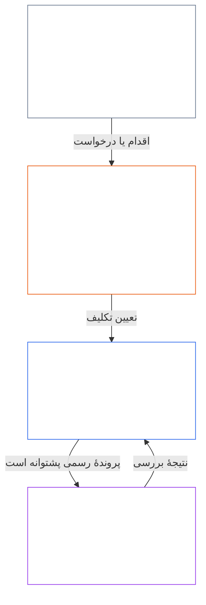
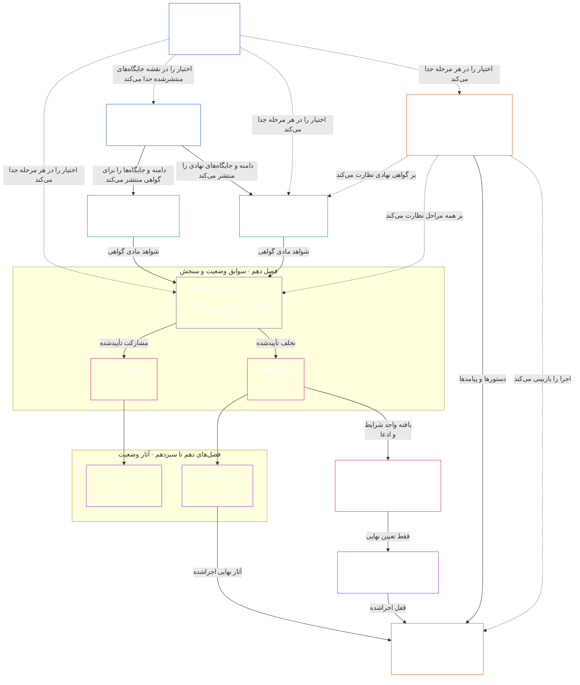

<!-- Locale: fa; variety: فارسی معیار. AI-assisted structural resynchronization draft (GPT-6 Codex), unreviewed and incomplete. English source commit 6e0b6c663dde01b5dea731fe33d87725c7174930; edition SC-Corpus-2026.11.25. core_00 SHA-256 90799cb8019b41356fa5dd90565e3f9540fc346e8c77e2c321b841654f39b274; core_01 SHA-256 aca759b394f10784ab1a2eef4e9e2ca12e369ef0ca8ee797298c6af00d2950aa. -->

<strong>جایگاه در پیکره (غیرعملیاتی): ساختار پرونده و قواعد خواندن</strong>

> ویجت‌های نشانه‌گذاری‌شده به‌عنوان **غیرعملیاتی** (جایگاه در پیکره، راهنمای خواننده و نقشه‌های خواندن) فقط جنبهٔ راهنما دارند. آن‌ها در پروندهٔ خود یا هر پروندهٔ دیگر تکلیف الزام‌آوری نمی‌افزایند، حذف نمی‌کنند یا محدودتر نمی‌سازند.
>
> این پرونده **بخشی از قانون اساسی حس‌مندان** است و **فقط همراه با** پرونده‌های شماره‌دار `core_*` و زیرپیکره، در مقام یک متن واحد، الزام‌آور است. این پرونده **فصل یک**، *نقشهٔ قانون اساسی*، را در بر دارد: هدف آن (§1)، چرایی وجودش (§2)، پیوند پرونده‌هایش (§3)، مبانی فصل‌های بعد (§4)، فرایندهای کلیدی حکمرانی (§5) و فهرست مسئولیت‌های قانون اساسی (§§6 تا 11).
>
> **پیشین:** [core_00.000_preamble.md](core_00_preamble.md) (دیباچه)
> **پسین:** [core_02.000_values_principles.md](../../core_02.000_values_principles.md)

<strong>ردیابی</strong>

- پیشین: [دیباچه](core_00_preamble.md) (*مدل، دو هدف قانون اساسی، چهارگانهٔ قانون اساسی، منافع مادی و دسته‌های اندازه‌گیری*).
- بخش‌ها:
  - [§1](#1-purpose-role-and-scope);
  - [§2](#2-why-the-map-exists);
  - [§3](#3-how-the-files-fit-together);
  - [§4](#4-foundations-for-the-chapters-that-follow);
  - [§5](#5-key-governance-processes);
  - [§6](#6-principles-definitions-and-rights);
  - [§7](#7-system-and-institutional-charters-functional-independence-and-separation-of-duties);
  - [§8](#8-key-practical-process-pipelines);
  - [§9](#9-process-ownership-and-outputs);
  - [§10](#10-governance-change-and-incorporation);
  - [§11](#11-adopted-implementation-corpus).
- خوانده شود با: [لایهٔ اختیار و سلسله‌مراتب درونی](../../subcore_03.080_band_integrative.md#authority-stack-and-internal-hierarchy) (*شیوهٔ اعمال فهرست مسئولیت‌ها*)؛ [README.md](README.md) (*ترتیب خواندن*).

 

# فصل یک: نقشه قانون اساسی

> **État / Draft status:** structural draft, unreviewed and incomplete. Current sections 1–4 are new and require translation; moved sections are raw prior translation requiring full fidelity review.

### ۱. هدف، نقش و دامنه

*به زبان ساده: این فصل راهنمای بقیهٔ قانون اساسی است. نشان می‌دهد بخش‌ها چگونه به هم مربوط‌اند، هر موضوع در مسئولیت کدام فصل است و فرایندهای اصلی چگونه پیش می‌روند تا خواننده قاعدهٔ پاسخ‌گوی پرسش خود را پیدا کند.*

**هدف:** فصل یک نمای کلی و راهنمای مسئولیت‌ها را ارائه می‌کند. فرایندهایی را نام می‌برد که حکمرانیِ مجاز را می‌آزمایند، مشخص می‌کند هر حوزهٔ ماهوی در مسئولیت کدام فصل است و سه لایهٔ متن قانون اساسی را توضیح می‌دهد.

**نقش:** این فصل راهنمایی و تعیین مسئولیت می‌کند. فراتر از فهرست مسئولیت‌ها، که فصل‌های دیگر و [لایهٔ اختیار و سلسله‌مراتب درونی](../../subcore_03.080_band_integrative.md#authority-stack-and-internal-hierarchy) آن را اعمال می‌کنند، تکلیف مستقلی نمی‌افزاید.

**دامنهٔ فصل:** این فصل شامل موارد زیر است:

- چرایی وجود نقشه (**بخش ۲**);
- پیوند پرونده‌ها (**بخش ۳**) و مبانی فصل‌های بعد (**بخش ۴**);
- فرایندهای کلیدی حکمرانی (**بخش ۵**);
- فهرست مسئولیت‌های قانون اساسی: اصول، تعاریف و حقوق (**بخش ۶**); منشورها، استقلال کارکردی و تفکیک وظایف (**بخش ۷**); زنجیره‌های فرایندی (**بخش ۸**); مسئولیت و خروجی فرایندها (**بخش ۹**); و حکمرانی، تغییر و الحاق (**بخش ۱۰**); و
- پیکرهٔ اجراییِ پذیرفته‌شده و زیرپیکره (**بخش ۱۱**).

### ۲. چرایی نقشه

*به زبان ساده: متنی به این بزرگی به راهنمایی نیاز دارد که نشان دهد بخش‌ها چگونه به هم مربوط‌اند و هر موضوع در مسئولیت کیست. این فصل برای آن است که خواننده قاعدهٔ پاسخ‌گوی پرسش خود را پیدا کند.*

قانون اساسی کار خود را میان فصل‌های متعدد، یک زیرپیکره و چهار پیکرهٔ پذیرفته‌شده تقسیم می‌کند. حس‌مندی که می‌خواهد بداند چه چیزی به او تعلق دارد، یا پذیرنده‌ای که در پی یافتن تکلیفی است، ممکن است راه را گم کند. این فصل نمای کلی و راهنمای مسئولیت‌هاست: هر بخش چه می‌کند، هر موضوع در مسئولیت کدام فصل است، زنجیره‌های فرایندی چگونه پیش می‌روند و لایه‌ها چه نسبتی دارند. فراتر از فهرست مسئولیت‌ها قاعدهٔ مستقلی نمی‌افزاید.

**مبتنی بر:**

- دیباچه:
  - [چهارگانهٔ قانون اساسی](core_00_preamble.md#constitutional-tetrad): ارکانی که این فصل به اجرا می‌گذارد:
    - [مشارکت](../../subcore_03.060_apex_participation_leg.md#participation): حس‌مندی می‌تواند قاعدهٔ پاسخ‌گوی پرسش خود را پیدا کند؛
    - [پاسخگویی](../../subcore_03.040_apex_accountability_leg.md#accountability): برای هر موضوع، فصل مسئولِ نام‌برده‌ای وجود دارد که پاسخگوست؛
    - [نظارت](../../subcore_03.055_apex_oversight_leg.md#oversight): خواننده می‌تواند پیوند بخش‌ها را ببیند و خلأ یا هم‌پوشانی را تشخیص دهد؛
    - [به‌هنگامی](../../subcore_03.065_apex_timeliness_leg.md#timeliness): خواننده بی‌درنگ به قاعدهٔ درست می‌رسد؛
  - [دو هدف قانون اساسی](core_00_preamble.md#two-constitutional-aims): هر دو هدفی که این فصل خدمتگزار آن‌هاست:
    - [شکوفایی](core_00_preamble.md#flourishing): قانون اساسی تنها وقتی به حس‌مندان خدمت می‌کند که بتوانند راه خود را در آن بیابند؛
    - [پیوستگی](core_00_preamble.md#continuity): نقشهٔ روشن متن را هنگام رشد و تغییر یکپارچه نگه می‌دارد؛
- اصول فصل دو:
  - [§5.2 دسترس‌پذیری به زبان ساده (تکلیف مشارکت و سرپرستی)](../../core_02.000_values_principles.md#52-plain-language-accessibility-participation-and-stewardship-duty);
  - [§5.2.4 انضباط مقابله با شکست از راه پیچیدگی](../../core_02.000_values_principles.md#524-complexity-as-defeat-discipline);
  - [§15.4 حل تعارض دربارهٔ معنای قانون اساسی](../../core_02.030_constitutional_interpretation.md#154-constitutional-meaning-conflict-resolution);
- مواد فصل چهار:
  - [مادهٔ XXIV-A](../../core_04.030_rights_part_d.md#article-xxiv-a-proportional-comprehensibility-right) (*حق فهم‌پذیری متناسب*);
  - [مادهٔ XXIV-B](../../core_04.030_rights_part_d.md#article-xxiv-b-complexity-audit-and-modularity-requirements) (*الزامات ممیزی پیچیدگی و ماژولار بودن*).

### ۳. پیوند میان پرونده‌ها

پرونده‌های قانون اساسی به این صورت کنار هم قرار می‌گیرند:

- **هسته (`core_*`):** پرونده‌های شماره‌دار فصل‌های قانون اساسی را در بر دارند و باید در کنار هم به‌عنوان یک متن خوانده شوند. تضمین‌ها و ساختار قانون اساسی را بیان می‌کنند.
- **زیرپیکره (`subcore_*`):** این پرونده‌ها قواعد و رویه‌های کاملِ پشتیبان فصل‌ها را ارائه می‌کنند. هر کدام به یک فصل تعلق دارند، هم‌قدرت با آن فصل‌اند و بی‌نیاز از الحاق جداگانه هر پذیرنده‌ای را ملزم می‌کنند. زیرپیکره نمی‌تواند دامنهٔ فصل خود را محدود کند.
- **اجرا (`corpus_*`):** چهار پرونده جزئیات عملیاتیِ اجرای قانون اساسی را فراهم می‌کنند. در محدودهٔ الحاق معتبر الزام‌آورند و قانون اساسی را بدون محدود کردن آن اجرا می‌کنند. [بخش ۱۱](#11-adopted-implementation-corpus) این چهار پرونده را مشخص می‌کند.

[پیکره](../../subcore_03.080_band_integrative.md#corpus) تعریف‌شده، مجموعهٔ گسترده‌تر و نسخه‌دارِ منابع الزام‌آور قانون اساسی است: هسته، زیرپیکره، متن اجراییِ پذیرفته‌شده و هر پوششِ سازگاریِ معتبر در دورهٔ گذار را در بر می‌گیرد. پیش‌نویس‌ها، یادداشت‌ها و راهنماهای ناوبری صرفاً به دلیل عضویت در پروژه الزام‌آور نمی‌شوند.

### ۴. مبانی فصل‌های پسین

*به زبان ساده: فصل‌های دو تا چهار مسئول ارزش‌ها، فرهنگ واژگان (همراه با قواعد زیرپیکره دربارهٔ ساخت، حفاظت و اثبات تعاریف) و کف حقوق‌اند. فصل‌های بعد باید به این حوزه‌ها احترام بگذارند و بی‌سروصدا آن‌ها را جابه‌جا نکنند.*

**فصل‌های دو تا چهار** ارزش‌ها، واژگان، سازوکارهای راستی‌آزمایی و کف حقوقی را فراهم می‌کنند که همهٔ مطالب بعدی باید رعایت کنند، از جمله:

- الزام منشور سامانه یا منشور نهادیِ فصل پنج، الزام تفکیک وظایفِ فصل شش، و نهادهای مستقلِ فصل هفت ([بخش ۷](#7-system-and-institutional-charters-functional-independence-and-separation-of-duties));
- [زنجیره‌های کلیدی فرایند عملی](#8-key-practical-process-pipelines) در بخش ۸؛
- [مسئولیت و خروجی‌های فرایند](#9-process-ownership-and-outputs) در بخش ۹؛
- فصل‌های حکمرانی و مسیر تغییر در بخش ۱۰؛ و
- [پیکرهٔ اجراییِ پذیرفته‌شده](#11-adopted-implementation-corpus) در بخش ۱۱.

### 5. فرایندهای کلیدی حکمرانی

هرگاه فصل چهارم، زیرپیکرهٔ 8-B، سندِ الحاق‌شده یا حکم قانون اساسی دیگری صریحاً بخواهد، مسئلهٔ مادیِ قانون اساسی را به یک یا چند مسیر زیر ببرید. این مسیرها حکمرانیِ مجاز را می‌آزمایند و بازبینی‌پذیر، قابل اعتراض و اصلاح‌پذیر می‌کنند؛ خودشان اختیار حکمرانی ایجاد نمی‌کنند.

- **استقلال کارکردی و تفکیک وظایف** ([فصل ششم](../../core_06.000_functional_independence_separation_of_duties.md#chapter-six-functional-independence-and-separation-of-duties): پیش از پیش‌رفتن هر اقدامِ به‌طور مادی الزام‌آور، جایگاه‌های آغاز، راستی‌آزمایی یا اجازه، نگهداری سابقهٔ رسمی و بازبینی اعتراض را طبق قواعد تناسب و استقلالِ مربوط شناسایی و جدا کنید.
- **گواهی هم‌ترازی نظام** ([زیرپیکرهٔ 8-B](../../subcore_08.020_system_alignment_certification_evaluation.md#subcore-8-b-system-alignment-certification--evaluation): پیش از اعتماد گسترده به نظامی با اثرگذاری زیاد، شواهد را گردآوری و بررسی کنید تا مشخص شود اعتماد به آن در حال حاضر از نظر قانون اساسی ایمن است یا نه. گواهی و حق سِنتینت‌ها برای اعتراض و ممیزی آن دو تضمینِ مکمل‌اند و هیچ‌یک جای دیگری را نمی‌گیرد.
- **سوابق وضعیت** ([زیرپیکرهٔ 10-B](../../subcore_10.020_standing_assessment.md#subcore-10-b-standing-records--question-1-what-happened): وقتی رفتار یا آسیب از نظر قانون اساسی اهمیت دارد، واقعیت‌های راستی‌آزمایی‌شده را در پرونده‌های رسمی جداگانهٔ مشارکت یا نقض ثبت کنید؛ شایعه و شهرت کافی نیست.
- **اصلاح و جبران** ([فصل دوازدهم §3.1](../../core_12.000_violation_consequences.md#31-remedy-and-correction): پس از نقضِ راستی‌آزمایی‌شده، هم کار لازم برای رسیدگی به علت و توقف ادامهٔ آن (اصلاح) را ارزیابی کنید و هم آنچه به آسیب‌دیدگان بدهکار است (جبران) را. هیچ‌یک جای دیگری را نمی‌گیرد.
- **بازبینی انجمن** ([فصل شانزدهم](../../core_16.000_forum.md#chapter-sixteen-standards-routing-and-forum-cases)):
  - اختلاف‌های عادی در نظام‌های ازپیش‌مجاز نخست از مسیر اعتراضِ منتشرشدهٔ مشارکت نظامِ ذی‌نفعان استفاده می‌کنند.
  - اگر آن مسیر همچنان مورد اعتراض، غایب، تسخیرشده یا ناتوان از اعطای جبران باشد، اختلاف را بر پایهٔ منفعت اصلی به انجمن‌های تحت نظارت ارجاع دهید.
  - انجمن‌ها از شواهد، انتقال مشروع و مهلت‌های حل به‌هنگام تحت **اصل XXVII-C** پشتیبانی می‌کنند.

### ۶. اصول، تعریف‌ها و حقوق

بخش‌های **۶ تا ۱۱** «دفتر ثبت مالکان قانون اساسی» را می‌سازند: مشخص می‌کنند هر موضوع بر عهدهٔ کدام فصل یا پیکرهٔ پذیرفته‌شده است و چه چیزی تولید می‌کند. جملهٔ الزام‌آور آغاز هر فصل شماره‌دار نیز مالکیت آن را بیان می‌کند. بخش‌های دیگر می‌توانند به مالک ارجاع دهند، اما نباید مسئولیت او را بی‌صدا بازنویسی یا جابه‌جا کنند. بنگرید به [لایهٔ اختیار و سلسله‌مراتب درونی](../../subcore_03.080_band_integrative.md#authority-stack-and-internal-hierarchy).

**[فصل دوم — ارزش‌ها، اصول و سرپرستی مسئولانه](../../core_02.000_values_principles.md)**

- **مسئولیت:** ارزش‌ها و محدودیت‌های راهنمای قانون اساسی، از جمله بهزیستی، انصاف، ایمنی، حقیقت، اعتماد و آزادیِ محدود؛ شناسایی و پاداش متناسب برای مشارکت قانونی؛ حل تعارض اصول؛ و وظایف سرپرستی مسئولانه، از جمله فهم توزیع‌شده، ارزیابی نظام‌مند و انضباط حکمرانی.
- **محصول:** بنیاد تفسیری فصل‌های بعدی که هدف‌های سطح بالا را هنگام اجرای نظام‌ها، حقوق، تعریف‌ها و زنجیره‌های فرایند به الزام‌های عملی تبدیل می‌کند.

**[فصل سوم — تعریف‌های بنیادین](../../core_03.000_definitions_home.md)**

- **مسئولیت:** زنجیرهٔ معیار تعریف‌ها—حوزه‌های نظارت، مشارکت، پاسخگویی، تداوم و یکپارچگی؛ [لایهٔ اختیار و سلسله‌مراتب درونی](../../subcore_03.080_band_integrative.md#authority-stack-and-internal-hierarchy)؛ [پیکره](../../subcore_03.080_band_integrative.md#corpus)؛ و قواعد مرزی مرتبط.
- **محصول:** واژگان دقیق قانون اساسی برای تفسیر، ممیزی و داوری. این زنجیرهٔ تعریف‌هاست، نه کف حقوق؛ حقوق الزام‌آور در فصل چهارم قرار دارد.

زیرپیکره‌های فصل سوم قواعد ساخت، پاسداری و اثبات تعریف‌ها را فراهم می‌کنند:

- **[زیرپیکرهٔ 3-A — ساختار تعریف](../../subcore_03.010_definition_structure.md):** ساختار مؤلفه‌های هستی‌شناسی/اندازه‌گیری/ارزیابی/انطباق (O/M/A/C)، الزامات هم‌ترازی و قواعد مؤلفه را تعیین می‌کند. **محصول:** دستور زبان مشترک تعریف‌ها برای پرهیز از برچسب مبهم، فرض پنهان و صورت‌بندی ناسازگار.
- **[زیرپیکرهٔ 3-B — یکپارچگی تعریف](../../subcore_03.020_definition_integrity.md):** در برابر طفره‌روی، جابه‌جایی دامنه، بازی بازتعریف و ترفندهای عدم انطباق که تعریف را در عمل تهی می‌کنند محافظت می‌کند. **محصول:** انضباط ضدطفره‌روی و فرادادهٔ مسیردهی عدم انطباق، از جمله ارجاع به بررسی وضعیت و سوءرفتار در صورت اثبات طفره‌روی.
- **[زیرپیکرهٔ 3-C — بار اثبات، ردگیری‌پذیری و راستی‌آزمایی](../../subcore_03.030_burden_traceability_verification.md):** بار اثبات را بر مدعی انطباق می‌گذارد و مدرک قابل‌ردگیری، مشاهده و راستی‌آزمایی می‌خواهد که با [منافع مادی](core_00_preamble.md#material-stake) متناسب و عملاً قابل اعتراض باشد. **محصول:** زنجیرهٔ راستی‌آزمایی که ورودی‌های تأییدشدهٔ [زیرپیکرهٔ 10-B](../../subcore_10.020_standing_assessment.md#subcore-10-b-standing-records--question-1-what-happened) و شواهد هم‌ترازی نظام در [زیرپیکرهٔ 8-B](../../subcore_08.020_system_alignment_certification_evaluation.md#subcore-8-b-system-alignment-certification--evaluation) را فراهم می‌کند؛ جای اندازه‌گیری وضعیت را نمی‌گیرد.

**[فصل چهارم — حقوق بنیادین](../../core_04.000_rights_part_a.md)**

- **مسئولیت:** کف حقوق در مواد **I–XXIX**: نیازهای بقا؛ تخصیص منابع و سرپرستی وابستگی‌ها؛ کرامت، عاملیت و مشارکت؛ اعتراض و جبران؛ محدودیت‌های عدالت؛ به‌هنگامی بر پایهٔ **مادهٔ XXVII-C**؛ و قواعد گذارِ پذیرش. چهار بخش، این حمایت‌ها را برای خوانش سیاره‌نخست سامان می‌دهند.
- **محصول:** حمایت‌های حقوقیِ غیرقابل‌مذاکره و پیوندهای جبران که فصل‌های پنج تا بیست‌وشش، انجمن‌ها، حکمرانی و قواعد اصلاح باید محترم بشمارند و با رویه یا شاخص جایگزین محدود، دور زده یا تهی نکنند.

### 7. منشورهای نظام و نهادی، استقلال کارکردی و تفکیک وظایف

*به زبان ساده: نظام یا نهادِ دارای اثر واقعی، منشور نظام یا منشور نهادی منتشر می‌کند که می‌گوید چه کاری می‌تواند انجام دهد و هر جایگاه را چه کسی در اختیار دارد. سپس، پیش از انجام اقدامی که از نظر مادی الزام‌آور است، باید آغازکننده، بررسی‌کننده یا مجوزدهنده، نگهدارندهٔ پروندهٔ رسمی و بازبین اعتراض از هم جدا شوند. نقش‌ها می‌توانند متناسب با محیط مقیاس‌پذیر باشند، اما یک کنشگر و خط کنترل او نمی‌توانند بی‌سروصدا جایگاه‌های بررسی‌کنندهٔ اقدام خود را در اختیار بگیرند.*

این بخش الزامات منشورهای نظام و نهادی، و تفکیک وظایف، و نیز فصل مربوط به نهادهایی را که باید از اشخاص مورد بررسی خود مستقل باشند خلاصه می‌کند. همچنین توضیح می‌دهد هرکدام چه چیزی تولید می‌کنند.

**[فصل پنج — منشورهای نظام و نهادی](../../core_05.000_charters.md#chapter-five-system-and-institutional-charters)**

- **موضوع مسئولیت:** الزامات انتشار منشور نظام یا منشور نهادی:
  - کدام نظام‌ها و نهادهای ردهٔ L یا بالاتر باید [منشور نظام](../../subcore_03.075_band_continuity.md#system-charter) یا [منشور نهادی](../../subcore_03.075_band_continuity.md#institutional-charter) منتشر کنند (ردهٔ P می‌تواند داوطلبانه چنین کند)؛
  - حداقل مواردی که منشور باید بیان کند، از جمله [نقشهٔ نقش منشور](../../subcore_03.075_band_continuity.md#charter-role-map) و [ارجاع‌های منشور](../../subcore_03.075_band_continuity.md#charter-pointer) به قواعد منتشرشده و الزام‌آورِ انتخاب ذی‌نفعان؛
  - اصلاح و بازبینی منشور، تا دامنهٔ آن بی‌سروصدا تغییر نکند؛ و
  - آنچه منشور نمی‌تواند انجام دهد: تعیین رده، تعریف مرز، جایگزینی تصدیق، دربرگرفتن قواعد تصمیم‌گیری یا اعطای اختیار.
- **خروجی:** بیانیه‌ای منتشرشده و نسخه‌دار از دامنه و جای‌گذاری جایگاه‌ها که [فصل شش](../../core_06.000_functional_independence_separation_of_duties.md#chapter-six-functional-independence-and-separation-of-duties)، فرایند تصدیق، سوابق وضعیت و مجامع می‌توانند رفتار را با آن بسنجند.

**[فصل شش — استقلال کارکردی و تفکیک وظایف](../../core_06.000_functional_independence_separation_of_duties.md)**

- **موضوع مسئولیت:** الزام مشترک میان فرایندها که هر [اقدامِ دارای الزام مادی](../../subcore_03.070_band_accountability.md#materially-binding-act) چهار کارکرد را جداگانه واگذار کند:
  - آغاز؛
  - راستی‌آزمایی یا مجوزدهی؛
  - نگهداری پروندهٔ رسمی؛ و
  - رسیدگی به اعتراض‌ها.

  همچنین بر این موارد حاکم است:

  - حداقل محتوای همگانی هر [پروندهٔ اقدامِ دارای الزام مادی](../../subcore_03.070_band_accountability.md#materially-binding-act-record)؛
  - استقلال از [خط کنترل مادی](../../subcore_03.070_band_accountability.md#material-control-line) کنشگر؛
  - جای‌گذاری منتشرشده و جایگزین‌ها؛
  - میزبانی ادغام‌شدهٔ متناسب و حدود وضعیت اضطراری؛ و
  - واگذاری‌های قابل انتساب و ارجاع به جایگاه نادرست.
- **خروجی:** ساختاری قابل استفادهٔ مجدد برای چهار جایگاه و پروندهٔ اقدام. هر فرایند بعدیِ تصدیق، وضعیت، مجمع، حکمرانی یا اجرایِ درون‌گنجانده باید آن را اجرا کند تا نتیجه‌اش مستقلانه بررسی‌شده، با قابلیت اعتماد ثبت‌شده و عملاً قابل اعتراض باشد.

**[فصل هفت — نهادهای مستقل](../../core_07.000_independent_bodies.md)**

- **موضوع مسئولیت:** ویژگی‌هایی که یک نهاد را مستقل می‌کند، قاعدهٔ نام‌گذاری آن به‌عنوان نهاد مستقل، و فهرست نهادهایی که هر پذیرنده باید داشته باشد؛ همراه با تضمین هرکدام برای حس‌مندان در یک سطر.
- **خروجی:** استانداردی واحد که همهٔ نهادهای مستقل باید برآورده کنند تا استقلال آن‌ها هرجا باشند به یک روش سنجیده شود. قواعد عملیاتی کامل هر نهاد فهرست‌شده در فایل زیرپیکرهٔ خودش و پیوست [فصل هفت](../../core_07.000_independent_bodies.md#chapter-seven-independent-bodies) آمده است.

#### 7.1 نقشهٔ تفکیک چهار جایگاه

هر **اقدامِ دارای الزام مادی** باید این تضمین‌های مربوط به همان اقدام را رعایت کند:

- جایگاه آغازکننده نباید اقدام خود را راستی‌آزمایی یا مجاز کند.
- جایگاه راستی‌آزمایی یا مجوزدهی نباید نگهداری پروندهٔ رسمی آن اقدام را بر عهده داشته باشد.
- جایگاه راستی‌آزمایی یا مجوزدهی نباید اعتراض به آن اقدام را بررسی کند.
- جایگاه‌های راستی‌آزمایی یا مجوزدهی و بررسی اعتراض باید بیرون از [خط کنترل مادی](../../subcore_03.070_band_accountability.md#material-control-line) جایگاه آغازکننده باشند.

<strong>راهنمای خواننده (غیرعملیاتی): نقشهٔ تفکیک چهار جایگاه</strong>

> این نقشه چهار کارکرد و یک مسیر معمول برای اقدام و پروندهٔ آن را نشان می‌دهد. جایگاه پنجمی اضافه نمی‌کند، ترتیب همگانی مقرر نمی‌کند، و قواعد فصل شش دربارهٔ استقلال، میزبانی ادغام‌شدهٔ متناسب، اقدام اضطراری یا ارجاع اعتراض را تغییر نمی‌دهد.

 

### 8. زنجیره‌های عملی فرایندهای کلیدی

*به زبان ساده: فصل‌های نه تا پانزده الزام تفکیک وظایف فصل هشتم را در یک زنجیره به‌کار می‌برند: سامانه‌ها و نهادها را گواهی می‌کنند، کمک و آسیب را در دو مسیر جدا می‌سنجند، آثار واقعی و جبران را اعمال می‌کنند، و نمی‌گذارند یک انجمن تنها مرجع نهایی رسیدگی به ادعایی علیه خودش باشد. این زنجیره تکالیف قانون اساسی را در زندگی روزمره واقعی نگه می‌دارد.*

[فصل هفتم](core_07_charters.md#chapter-seven-system-and-institutional-charters) دامنهٔ منشور و نقشهٔ کرسی هر سامانه و نهادِ ردهٔ L یا بالاتر را منتشر می‌کند. [فصل هشتم](../../core_07.000_independent_bodies.md#chapter-eight-functional-independence-and-separation-of-duties) الزام تفکیک وظایف را فراهم می‌کند تا هر کنش در این زنجیره به‌درستی قابل‌بررسی باشد. کارکردهای آغاز، راستی‌آزمایی یا مجوزدهی، نگهداری رسمی سوابق و بازبینی اعتراض باید مطابق قواعد مقیاس‌بندی و استقلال مربوط، جداگانه تخصیص یابند و جدا بمانند. فصل‌های نه تا پانزده سپس این معماری را به‌ترتیب اجرا می‌کنند:

هر گام زیر می‌گوید فصل چه چیزی را مالک است و چه می‌سازد. سپس [چگونه زنجیرهٔ کامل به هم می‌نشیند](#51-how-the-full-chain-fits-together) آن مالکان را به‌عنوان یک مسیر از بررسی نظام تا جبران نشان می‌دهد.

**گواهی هم‌راستایی نظام** ([فصل هفتم](core_09.000_system_alignment_certification_evaluation.md#chapter-nine-system-alignment-certification))

- **مالک چیست:** تضمین می‌کند نظام‌هایی با اثر مادی هم‌راستای قانون اساسی بمانند.
  - پیش از آنکه نظامی که بر حس‌مندان اثر مادی دارد در مقیاس به رسمیت شناخته یا به آن تکیه شود، شاهد زیر نظارت مجمع گردآوری و بازبینی می‌شود
  - بازبینی باید این موارد را پوشش دهد:
  - آیا سامانه به ملزومات بقا احترام می‌گذارد؛
  - تخصیص منابع و سرپرستی وابستگی‌ها طبق **مادهٔ پنجم** (*تخصیص منابع، وابستگی‌ها و تأمین مالی زیست‌بوم*) — از جمله [Proportionate Cross-System Support](../../core_05.040_band_continuity.md#proportionate-cross-system-support) هرگاه اتکا به زیرساخت مشترک از نظر مادی مطرح باشد؛
  - ایمنی؛
  - مشارکت؛ و
  - دیگر کف‌های قانون اساسی.
  - حس‌مندانی با ردپا می‌توانند نتیجه را اعتراض کنند
  - نظام‌های پرخطر باید طبق برنامهٔ منظم دوباره گواهی شوند؛ گواهی هرگز دائمی نیست
- **چه می‌سازد:** **سابقهٔ گواهی هم‌راستایی نظام** — پاسخی محدود و قابل‌اعتراض به اینکه آیا آن نظام هم‌اکنون به‌قدر کافی هم‌راستاست که به رسمیت شناخته شود، به آن ادامهٔ اتکا شود، مستقر شود، یا از شروط آزاد شود *همین حالا*، درون گستره و پنجرهٔ زمانی بیان‌شده.

**اندازه‌گیری ردپا** ([فصل هشتم](../../subcore_10.020_standing_assessment.md#chapter-ten-compliance-violation-and-standing-model))

- **مالک چیست:** وقتی رفتار از نظر قانون اساسی اهمیت دارد، شایعه و آوازه کافی نیست. واقعیت‌های راستی‌آزمایی‌شده وارد **سوابق ردپا** می‌شوند. **همیاری** (کمک به‌سوی شکوفایی) و **تخلف** (شکست‌های پاسخگویی و آسیب) روی **محورهای جدا** اندازه گرفته می‌شوند — رفتار خوب راستی‌آزمایی‌شده آسیب راستی‌آزمایی‌شده را پاک نمی‌کند، و هرگز در یک نمرهٔ خالص تا نمی‌شوند.
- **چه می‌سازد:** **سوابق ردپا**ی طبقه‌بندی‌شده روی محور همیاری و محور تخلف، فقط بر پایهٔ **ورودی‌های راستی‌آزمایی‌شده** و یافته‌های تحت نظارت مجمع — نه نمره‌دهی غیررسمی یا روایت اختلاف که جای طبقه‌بندی بنشیند.

**ادغام ردپا و آثار** ([فصل نهم](../../subcore_10.060_standing_integration.md#chapter-eleven-standing-effects-and-integration))

- **مالک چیست:** طبقه‌بندی‌های راستی‌آزمایی‌شده را به **آثار ردپا**ی جهان واقعی روی مسیرهای جدا ادغام می‌کند — مقیاس‌شده با [**منافع مادی**](#material-stake)، بدون تا کردن همیاری و تخلف در یک نمرهٔ خالص، و بدون خالی کردن مشارکت، نظارت، پاسخگویی یا به‌هنگامی.
  - **مسیر همیاری:** طبقه‌بندی مثبت راستی‌آزمایی‌شده سود عملی می‌سازد:
    - [**مجوزهای صلاحیت**](../../core_13.000_standing_integration.md#72-competency-bars-and-clearances) که می‌توانند نقش‌های حساس به اعتماد، اختیار تفویض‌شده، صلاحیت نظارت و مسئولیت‌های سرپرستیِ دارای پیامد فزاینده را بگشایند، هرگاه صلاحیت طبق آستانهٔ منتشرشده اثبات شود و هیچ [قفل ردپای](../../core_13.000_standing_integration.md#52-prevention--general-standing-locks) قابل‌اعمالی مسیر نام‌برده را مسدود نکند
    - بازشناسی متناسب و **پاداش‌های مادی** برای مدیریت مسئولانه و همکاری مشروع چنان‌که [فصل یکم](../../core_02.000_values_principles.md#32-recognition-reinforcement-and-aspiration) می‌خواهد
    - ستایش خالی نیست. فایده‌ها باید واقعی، متکی به شاهد، و باز به اعتراض باشند
  - **مسیر تخلف:** یافته‌های تخلف راستی‌آزمایی‌شده زیان عملی می‌سازند:
    - **قفل‌های ردپا**، حد نقش، دستورهای ترمیم، [جبران برای آسیب‌دیدگان](../../core_13.000_standing_integration.md#51-remedy-and-correction)، توصیفگرهای تکمیلی، و قلاب‌های اجرا
    - محدودیت‌ها با شدت آنچه راستی‌آزمایی شد جور است
    - تخلف‌های حل‌نشده زنده می‌مانند
    - مسیرهای متناسب برای بازگرداندن ردپا برای کسانی که جبران اصیل نشان دهند در دسترس می‌ماند
    - پاکی شایستگی در سمت همیاری قفل ردپا در سمت تخلف را ساقط نمی‌کند
- **چه می‌سازد:** آثار ردپای جدا و مقیاس‌شده روی مسیرهای همیاری و تخلف — پاکی‌های شایستگی و پاداش‌های مادی از یک سو؛ قفل‌های ردپا، اصلاح و جبران از سوی دیگر — هیچ‌کدام در یک نمره تا نمی‌شود.

**نردهٔ سوءرفتار ضدقانون‌اساسی** ([فصل دهم](core_10_a_misconduct_designation.md#chapter-ten-anti-constitutional-misconduct))

- **مالک چیست:** فقط جدی‌ترین تخلف‌های راستی‌آزمایی‌شده را اداره می‌کند — رفتاری که ممکن است تکالیف قانون اساسی را در مقیاس تسخیر یا خالی کرده باشد. وقتی فصل هشتم ازپیش یافتهٔ تخلف بالاترین‌اثر را ثبت کرده، و سوءرفتار ضدقانون‌اساسی از نظر مادی ادعا شده، این فصل بازبینی نام‌گذاری را به‌عنوان مسیر دروازهٔ فصل نهم موازی با آثار عادی ردپای فصل نهم اجرا می‌کند.
- **چه می‌سازد:** نام‌گذاری نهایی سوءرفتار ضدقانون‌اساسی — یا رد — برای آن یافتهٔ موجود بالاترین‌اثر، فقط پس از برآوردن معیارهای لازم و ضمانت‌های فرایند عادلانه. فصل هشتم هنوز اندازه می‌گیرد آسیب چقدر جدی بود؛ فقط نام‌گذاری نهایی **قفل اعتماد ضدقانون‌اساسی** فصل نهم را به کار می‌اندازد.

**نظارت مجمع و مسیرگذاری** ([فصل یازدهم](core_11_forum.md#chapter-eleven-forums-and-jurisdiction))

- **مالک چیست:** نظارت می‌کند اختلاف‌ها و مسائل گواهی واقعاً چگونه حرکت می‌کنند.
  - [توالی اختلاف](core_11_forum.md#dispute-sequencing) از مسیر اعتراض منتشرشدهٔ مشارکت سیستمی طرف‌های اثرپذیر تا مسیرگذاری مجمع
  - کدام خانوادهٔ مجمع آن‌ها را اداره می‌کند، و پرونده معمولاً کجا آغاز می‌شود
  - چگونه شاهد پشتیبانی می‌شود
  - چگونه امور انتقال یا ادغام می‌شوند
  - چگونه قواعد ضدخودداوری مانع می‌شوند مجمع‌های تسخیرشده تنها خانهٔ نهایی باشند
  - ساعت‌ها زیر **اصل XXV-C** (*حل به‌هنگام و کف ضدتأخیر*) مانع می‌شوند پرونده‌ها آن‌قدر حل‌نشده بمانند که جبران دیگر اهمیت نداشته باشد
- **چه می‌سازد:** **یافته‌های راستی‌آزمایی‌شده** که ممکن است سوابق ردپا را باز یا به‌روز کنند، به‌علاوهٔ مسیرگذاری مشروع به‌سوی جبران و [حل به‌هنگام](../../core_05.035_band_accountability.md#timely-resolution-constitutional). مجمع‌ها بر زنجیره نظارت می‌کنند؛ جای اندازه‌گیری ردپای فصل هشتم را نمی‌گیرند.

#### 8.1 نقشهٔ فرایند

زنجیره یک فرایند قانون اساسی واحد می‌ماند، زیرا هر مرحله نتیجه‌ای تعریف‌شده و بازبینی‌پذیر را به مرحلهٔ بعد می‌سپارد. حدود قانون اساسی آن چنین است: **چهارگانهٔ قانون اساسی** مشارکتی‌بودن، نظارت‌شدن، پاسخ‌گویی و به‌موقع‌بودن هر مرحله را می‌طلبد؛ **دو هدف قانون اساسی** خدمت هم‌زمان به شکوفایی و تداوم را می‌خواهند؛ و **کف‌های حقوق** هر مرحله را از تنگ‌کردن، دورزدن یا تهی‌کردن حمایت‌های غیرقابل‌مذاکره بازمی‌دارند. این قواعد تکالیف را به سوابق و تصمیم‌هایی بدل می‌کنند که حس‌مندان بتوانند در عمل، نه فقط روی کاغذ، بررسی، به چالش کشیدن، اصلاح و به آن‌ها اتکا کنند.

#### ۸.۲ زنجیرهٔ کامل چگونه به هم می‌پیوندد

*به زبان ساده: نخست جایگاه‌ها را جدا کنید، سپس مسیر را از بررسی نظام تا جبران دنبال کنید؛ انجمن‌ها در سراسر راه بر اختلاف و گام‌های وضعیت نظارت می‌کنند.*

زنجیرهٔ کامل به این ترتیب پیش می‌رود:

1. **جایگاه‌ها را در هر اقدامِ به‌طور مادی الزام‌آور جدا کنید** ([فصل ششم](../../core_06.000_functional_independence_separation_of_duties.md#3-four-seat-constitutional-requirement)): مشخص کنید چه کسی آغاز می‌کند، چه کسی راستی‌آزمایی یا اجازه می‌دهد، چه کسی سابقهٔ رسمی را نگه می‌دارد و چه کسی اعتراض را می‌شنود. پیش از معتبر دانستن بررسی اقدام، ترکیب‌های ممنوع، قواعد استقلال و مسیر جایگزینِ منتشرشده را اعمال کنید. هرگاه منشور لازم باشد، [نقشهٔ نقش‌های منشور در فصل پنجم](../../core_05.000_charters.md#6-the-charter-role-map-and-standing-record-custody) متصدی هر جایگاه را منتشر می‌کند.
2. **وقتی اثر جدی است، نظام‌ها و نهادها را گواهی کنید**: پیش از اعتماد گسترده به نظامی با اثر زیاد، طبق [زیرپیکرهٔ 8-B](../../subcore_08.020_system_alignment_certification_evaluation.md#subcore-8-b-system-alignment-certification--evaluation) سابقهٔ گواهی نظامِ قابل اعتراض به دست آورید؛ نهاد را بر پایهٔ طبقه، رفتار، حکمرانی و مجموعهٔ فعالیت‌های خودش ارزیابی کنید و نتیجه را طبق [زیرپیکرهٔ 9-B](../../subcore_09.020_institutional_alignment_certification_evaluation.md#subcore-9-b-institutional-alignment-certification--evaluation) در سابقهٔ گواهی نهادی ثبت کنید.
3. **وضعیت را در مسیرهای جدا ثبت و اندازه‌گیری کنید** ([زیرپیکره‌های 10-B و 10-D](../../subcore_10.020_standing_assessment.md#subcore-10-b-standing-records--question-1-what-happened) و [10-D](../../subcore_10.040_standing_measurement.md#subcore-10-d-standing-measurement--question-2-how-good-or-bad-was-it)): هرگاه کمک یا آسیب از نظر قانون اساسی اهمیت دارد، پرونده‌های رسمی باز کنید و فقط **ورودی‌های راستی‌آزمایی‌شده** را بپذیرید؛ سپس آنچه تأیید شده اندازه بگیرید و طبقه‌بندی کنید. شایعه، شهرت و روایت اختلاف کافی نیست. کمک و آسیب در امتیاز خالص یکی نمی‌شوند و سوابق مرتبط جدا می‌مانند. ورودی‌های تأییدشده، هرگاه مادی باشد، شامل شواهد گواهی هم‌راستایی نظام از فصل هشتم نیز می‌شود. برای کمکِ تأییدشده به سوی شکوفایی، سابقهٔ وضعیتِ مشارکت بگشایید و ماهیت آن را در محور مشارکت طبقه‌بندی کنید؛ برای آسیب و کاستی پاسخ‌گوییِ تأییدشده، سابقهٔ جداگانهٔ تخلف بگشایید و ماهیت آن را در محور تخلف طبقه‌بندی کنید. سوابق مرتبط به یکدیگر ارجاع می‌دهند اما جدا می‌مانند.
4. **آثار وضعیت را در هر مسیر جدا اعمال کنید** ([زیرپیکرهٔ 10-F](../../subcore_10.060_standing_integration.md#subcore-10-f-standing-integration--question-3-what-follows)): مشارکتِ تأییدشده می‌تواند مجوز شایستگی، شناسایی و پاداش مادیِ متناسب فراهم کند؛ نقضِ تأییدشده می‌تواند قفل وضعیت، اصلاح و جبران برای آسیب‌دیدگان در پی داشته باشد. مشارکتِ تأییدشده باید پشتیبانِ شناسایی و پاداش‌های مادیِ متناسب باشد و می‌تواند مجوز شایستگی فراهم کند.
5. **بازبینی نام‌گذاری رفتار ضدقانون‌اساسی را جداگانه انجام دهید** ([فصل چهاردهم](../../core_14.000_misconduct_designation.md#chapter-fourteen-anti-constitutional-misconduct-designation)): اگر یافتهٔ نقضِ دارای بیشترین اثر ممکن است معیارهای رفتار ضدقانون‌اساسی را نیز برآورده کند، فصل چهاردهم پس از تضمین دادرسی منصفانه تصمیم می‌گیرد که ACMD نهایی برقرار شود یا نه. آثار عادی وضعیت هم‌زمان ادامه می‌یابند؛ این نام‌گذاری شدتِ سنجیده‌شدهٔ آسیب را تغییر نمی‌دهد و فقط ACMD نهایی قفل اعتماد ضدقانون‌اساسی را فعال می‌کند.
6. **اختلاف‌ها را مسیردهی کنید و جبران را به‌هنگام نگه دارید** ([فصل‌های شانزدهم و هفدهم](../../core_16.000_forum.md#1-purpose-role-and-scope) و [فصل هفدهم](../../core_17.000_forum_families_escalation_timeliness_support.md#chapter-seventeen-forum-families-escalation-timely-resolution-and-support)): حرکت پرونده، مسیر رسیدگی و رعایت مهلت‌های **مادهٔ XXVII-C** را نظارت کنید تا جبران در تأخیر از میان نرود. اختلاف عادی از [توالی اختلاف](../../core_16.000_forum.md#dispute-sequencing) پیروی می‌کند. اختلاف‌ها را در پنج [سطح اهمیت مادی](../../core_17.000_forum_families_escalation_timeliness_support.md#5-timely-resolution-materiality-tiers-and-anti-delay-discipline) (A/B/C/L/P) طبقه‌بندی کنید. اگر نام‌گذاری نهایی فصل چهاردهم منفعت اصلی است، مسیردهی پیش‌فرضِ خانوادهٔ یکپارچگی اعمال می‌شود.
7. **نتایج را اجرا کنید** ([فصل‌های نوزدهم و بیستم](../../core_19.000_enforcement.md#chapter-nineteen-enforcement) و [فصل بیستم](../../core_20.000_special_enforcement.md#chapter-twenty-special-enforcement)): طرفِ نام‌برده اثر نهایی، قفل، جبران یا دستور انجمن را در مهلت آن اجرا می‌کند و از گریز، تأخیر یا رهاکردن خاموش جلوگیری می‌شود. در برابر مقاومتِ طرفِ ملزم، اجرای ویژه در چارچوب کف‌های مشترک به کار می‌رود: توقیف پول و دارایی با حفظ حداقلِ حمایت‌شده؛ نردبان استاندارد فشار برای تحویل؛ نردبان نیرویی با اولویت ابزار غیرکشنده؛ و ارزیابی ریشه‌ای علت برای جلوگیری از تکرار شکست.

### 9. مسئولیت فرایندها و خروجی‌ها

*به زبان ساده: نقشهٔ فرایند و [چگونگی پیوند زنجیرهٔ کامل](#82-how-the-full-chain-fits-together) زنجیره را نشان می‌دهند؛ این بخش مسئول و خروجی هر مرحله را نام می‌برد تا هیچ مرحله‌ای بی‌سروصدا کار دیگری را در اختیار نگیرد.*

هر گام زیر مشخص می‌کند فصل مربوط چه چیزی را بر عهده دارد و چه تولید می‌کند و بدین‌ترتیب مسئولان نام‌برده در [§8.2 چگونگی پیوند زنجیرهٔ کامل](#82-how-the-full-chain-fits-together) را تکمیل می‌کند.

**[زیرپیکرهٔ 8-B — تصدیق هم‌راستایی نظام](../../subcore_08.020_system_alignment_certification_evaluation.md#subcore-8-b-system-alignment-certification--evaluation)**

- **موضوع مسئولیت:** اطمینان از اینکه نظام‌های دارای اثر مادی هم‌راستایی قانون اساسی را حفظ می‌کنند.
  - پیش از تصدیق یا اتکا در مقیاس به نظامی که به‌طور مادی بر حس‌مندان اثر می‌گذارد، مدرک باید تحت نظارت مجمع گردآوری و بررسی شود.
  - بررسی باید پوشش دهد:
    - آیا نظام به نیازهای اساسی بقا احترام می‌گذارد؛
    - تخصیص منابع و سرپرستی وابستگی‌ها طبق **مادهٔ پنجم** (*تخصیص منابع، وابستگی‌ها و تأمین مالی زیست‌بوم*) — از جمله [پشتیبانی متناسب میان‌نظامی](../../subcore_03.075_band_continuity.md#proportionate-cross-system-support) هرگاه اتکای مادی به زیرساخت مشترک مطرح باشد؛
    - ایمنی؛
    - مشارکت؛ و
    - سایر کف‌های قانون اساسی.
  - حس‌مندان دارای جایگاه باید بتوانند نتیجه را به چالش بکشند.
  - نظام‌های پرخطر باید طبق برنامه‌ای منظم دوباره تصدیق شوند. تصدیق هرگز دائمی نیست.
- **خروجی:** برای هر نوبت بررسی نظام، یک **پروندهٔ تصدیق نظام** — یافته‌ای محدود و قابل اعتراض دربارهٔ هم‌راستایی نظام در دامنهٔ اعلام‌شده و بازهٔ ثبت آن.

**[زیرپیکرهٔ 9-B — تصدیق هم‌راستایی نهاد](../../subcore_09.020_institutional_alignment_certification_evaluation.md#subcore-9-b-institutional-alignment-certification--evaluation)**

- **موضوع مسئولیت:** اطمینان از حفظ هم‌راستایی قانون اساسی در نهادهای دارای اثر مادی، طی همان شش مرحله و با همان شماره‌بندی فصل هشت.
  - فصل نه ارزیابی (مرحله‌های I و II) را بر عهده دارد.
  - [زیرپیکرهٔ 9-D](../../subcore_09.040_institutional_alignment_certification_forum_process_outcomes.md#subcore-9-d-institutional-alignment-certification--forum-process-and-outcomes) فرایند و خروجی‌های مجمع (مرحله‌های III و IV) را بر عهده دارد.
  - [زیرپیکرهٔ 9-F](../../subcore_09.060_institutional_alignment_certification_records_recertification.md#subcore-9-f-institutional-alignment-certification--records-recertification-challenge-and-standing) پروندهٔ تصدیق نهاد و عملیات آن (مرحله‌های V و VI) را بر عهده دارد.
  - نهاد فقط در اموری بررسی می‌شود که خودش کنترل می‌کند: آیا از منشور نهادی پیروی می‌کند، چه کسی پاسخگوی اختیار آن است، چه چیزی را پاداش می‌دهد و آیا می‌توان از بررسی‌های مستقل آن استفاده کرد.
  - تصدیق هر نظام را مبنا می‌گیرد و آن را دوباره انجام نمی‌دهد.
- **خروجی:** برای هر نوبت بررسی نهاد یک **پروندهٔ تصدیق نهاد** — یافته‌ای محدود و قابل اعتراض دربارهٔ هم‌راستایی نهاد در دامنهٔ اعلام‌شده و بازهٔ ثبت آن. فصل نه فرایند مجمع را بدون تکرار ارزیابی نظام به‌کار می‌گیرد؛ تصدیق نهادی مجوز یا دروازه‌ای برای تشکیل یا ادارهٔ نهاد نیست.

**[زیرپیکرهٔ 10-B — سوابق وضعیت](../../subcore_10.020_standing_assessment.md#subcore-10-b-standing-records--question-1-what-happened)**

- **موضوع مسئولیت:** هرگاه رفتار از نظر قانون اساسی اهمیت داشته باشد، شایعه و شهرت کافی نیست؛ واقعیت‌های راستی‌آزمایی‌شده وارد **سوابق وضعیت** می‌شوند. **مشارکت** (یاری به سوی شکوفایی) و **نقض** (کاستی در پاسخگویی و آسیب) در **سوابق جداگانه** ثبت می‌شوند: یاریِ تأییدشده، آسیبِ تأییدشده را محو نمی‌کند و این دو هرگز به یک امتیاز خالص تبدیل نمی‌شوند.
- **خروجی:** **سوابق وضعیت** محدود در مسیر مشارکت و نقض، صرفاً بر اساس **ورودی‌های راستی‌آزمایی‌شده** و یافته‌های زیر نظارت مجمع؛ امتیازدهی غیررسمی و روایت اختلاف جایگزین سابقهٔ تأییدشده نیست.

**[زیرپیکرهٔ 10-D — سنجش وضعیت](../../subcore_10.040_standing_measurement.md#subcore-10-d-standing-measurement--question-2-how-good-or-bad-was-it)**

- **موضوع مسئولیت:** سنجش خوب یا بد بودن واقعیت‌های راستی‌آزمایی‌شده. مشارکت و نقض روی **محورهای جداگانه** و هرکدام با همان مقیاس یکپارچه سنجیده می‌شوند و هرگز در یک امتیاز خالص ادغام نمی‌شوند.
- **خروجی:** برای هر سابقهٔ وضعیت، سنجشی طبقه‌بندی‌شده — ماهیت، اندازه و جایگاه — روی محور مشارکت یا محور نقض.

**[زیرپیکرهٔ 10-F — ادغام وضعیت و آثار](../../subcore_10.060_standing_integration.md#subcore-10-f-standing-integration--question-3-what-follows)**

- **موضوع مسئولیت:** ادغام طبقه‌بندی‌های راستی‌آزمایی‌شده در **آثار واقعی وضعیت** بر مسیرهای جداگانه و متناسب با [**منافع مادی**](core_00_preamble.md#material-stake). مشارکت و نقض را به امتیاز خالص یکی نمی‌کند و مشارکت، نظارت، پاسخگویی یا به‌هنگامی را تهی نمی‌سازد.
  - **مسیر مشارکت:** طبقه‌بندی مثبتِ راستی‌آزمایی‌شده باید سود عملی داشته باشد، از جمله:
    - [**گواهی‌های صلاحیت**](../../core_11.000_contribution_consequences.md#32-competency-bars-and-clearances) که می‌تواند راه نقش‌های حساس به اعتماد، اختیار تفویض‌شده، واجدشرایط شدن برای نظارت و سرپرستی با مسئولیت فزاینده را باز کند، مشروط بر اثبات شایستگی طبق معیار منتشرشده و نبود [قفل وضعیت](../../core_12.000_violation_consequences.md#32-prevention--general-standing-locks) که مسیر دروازه‌ای را ببندد؛
    - شناسایی متناسب و **پاداش مادی** برای سرپرستی و همکاری قانونی، طبق الزام [فصل دو](../../core_02.000_values_principles.md#32-recognition-reinforcement-and-aspiration)؛ و
    - منافعی واقعی، مستند و قابل اعتراض، نه ستایش توخالی.
  - **مسیر نقض:** یافتهٔ نقضِ راستی‌آزمایی‌شده باید پیامدهای عملی داشته باشد، از جمله:
    - **قفل‌های وضعیت**، محدودیت نقش، دستورهای اصلاح، [جبران برای آسیب‌دیدگان](../../core_12.000_violation_consequences.md#31-remedy-and-correction)، توصیف‌گرهای تکمیلی و پیوندهای اجرا؛
    - محدودیت‌هایی متناسب با شدت آنچه تأیید شده؛
    - رسیدگی جاری به نقض‌های حل‌نشده؛
    - مسیرهای متناسب برای بازگرداندن وضعیت کسانی که جبران واقعی نشان می‌دهند؛ و
    - گواهی صلاحیت در مسیر مشارکت نمی‌تواند قفل وضعیت در مسیر نقض را لغو کند.
- **خروجی:** آثار وضعیتِ جدا و متناسب در دو مسیر مشارکت و نقض — گواهی صلاحیت و پاداش مادی از یک سو؛ قفل وضعیت، اصلاح و جبران از سوی دیگر؛ بدون ادغام در یک امتیاز.

**[فصل چهارده — تعیین سوءرفتار ضدقانون‌اساسی](../../core_14.000_misconduct_designation.md#chapter-fourteen-anti-constitutional-misconduct-designation)**

- **موضوع مسئولیت:** فقط رسیدگی به جدی‌ترین نقض‌های تأییدشده — رفتاری که ممکن است در مقیاس وسیع تکالیف قانون اساسی را تصرف یا تهی کرده باشد. اگر فصل ده قبلاً یافتهٔ نقضی با بیشترین اثر را سنجیده باشد و سوءرفتار ضدقانون‌اساسی به‌طور مادی ادعا شود، این فصل بررسی تعیین عنوان را به‌عنوان مسیر دروازه‌ای و موازی با آثار معمول وضعیت در فصل ده اجرا می‌کند.
- **خروجی:** تعیین نهایی ACMD — یا رد آن — برای همان یافتهٔ دارای بیشترین اثر، تنها پس از تحقق معیارها و تضمین‌های دادرسی منصفانه. فصل ده همچنان شدت آسیب را می‌سنجد. فقط ACMD نهایی **قفل اعتماد ضدقانون‌اساسی** فصل ده را فعال می‌کند.

**[فصل شانزده — معیارها، ارجاع و پرونده‌های مجمع](../../core_16.000_forum.md#chapter-sixteen-standards-routing-and-forum-cases)**

- **موضوع مسئولیت:** نظارت بر مسیر واقعی اختلاف‌ها و امور تصدیق:
  - ترتیب رسیدگی اختلاف از مسیر اعتراض منتشرشدهٔ مشارکت سیستمی ذی‌نفعان تا ارجاع به مجمع؛
  - اینکه کدام خانوادهٔ مجامع هر موضوع را رسیدگی می‌کند و پرونده معمولاً از کجا آغاز می‌شود؛
  - چگونگی گشایش و نگهداری پرونده‌های مجمع؛
  - انتقال یا ادغام موضوعات؛ و
  - قواعد منع داوریِ خود، برای اینکه مجمعِ تسخیرشده تنها مرجع نهاییِ رسیدگی به رفتار خود نباشد.
- **خروجی:** **یافته‌های وضعیت** که ممکن است سوابق وضعیت را باز یا به‌روز کنند، به‌علاوهٔ ارجاع قانونی برای جبران و [حل‌وفصل به‌هنگام](../../subcore_03.070_band_accountability.md#timely-resolution). مجامع بر زنجیره نظارت می‌کنند؛ جایگزین سنجش وضعیت در فصل ده نمی‌شوند.

**[فصل هفده — خانواده‌های مجامع، تشدید، حل‌وفصل به‌هنگام و پشتیبانی](../../core_17.000_forum_families_escalation_timeliness_support.md#chapter-seventeen-forum-families-escalation-timely-resolution-and-support)**

- **موضوع مسئولیت:** تعیین خانواده‌های مجامع و چگونگی ادامهٔ رسیدگی پس از ارجاع موضوع:
  - خانواده‌های مجامع و معیارهای مشترک آن‌ها؛
  - تشدید و پرسش‌های ارجاع‌شده برای صدور رأی؛
  - ارجاع، بازبینی و تمایز حمایت موقت — از جمله [توقف موقت](../../subcore_03.070_band_accountability.md#interim-hold) محدود در مسیر حس‌مند نام‌برده — از یافته‌ها و قفل‌های وضعیت؛
  - مهلت‌های **مادهٔ XXVII-C** (*کف حل‌وفصل به‌هنگام و منع تأخیر*) برای اینکه موضوع تا زمانی نامربوط شدن جبران معلق نماند؛ و
  - پشتیبانی از مدرک و حس‌مندان شرکت‌کننده پیش، حین و پس از بازبینی.
- **خروجی:** خانواده‌های مجامعی که بتوانند هر ردهٔ موضوع را رسیدگی کنند و حل‌وفصل را در مهلتی انجام دهند که جبران همچنان معنادار بماند.

**[فصل نوزده — اجرا](../../core_19.000_enforcement.md#chapter-nineteen-enforcement)**

- **موضوع مسئولیت:** چگونگی اجرای نتایج: چه کسی نتیجه‌ای را که زنجیرهٔ وضعیت یا مجمع ایجاد کرده اجرا می‌کند، در چه مهلتی، و چه چیزی مانع طفره‌رفتن، تأخیر یا کنارگذاشتن بی‌سروصدا می‌شود.
- **خروجی:** نتایجی که واقعاً اجرا می‌شوند و روی کاغذ نمی‌مانند. نوع تازه‌ای از پیامد نمی‌افزاید؛ شیوهٔ اجرای پیامدهای فصل‌های چهارده تا بیست‌وسه را تنظیم می‌کند.

**[فصل بیست — اجرای ویژه](../../core_20.000_special_enforcement.md#chapter-twenty-special-enforcement)**

- **موضوع مسئولیت:** تضمین‌های افزوده وقتی اجرای نتیجه به مسدودکردن یا توقیف پول یا دارایی، استفاده یا احتمال استفاده از زور، یا تکرار شکست در اجرا مربوط می‌شود.
- **خروجی:** اجرایی که با وجود انجام نتیجه کمترین آسیب ماندگار را برجا می‌گذارد و علت‌های ریشه‌ای شکست اجرا را می‌یابد و برطرف می‌کند، نه اینکه تکرارشان کند.

### 10. حکمرانی، تغییر و الحاق

*به زبان ساده: فصل‌های بیست‌وهفت تا سی‌ویک این قانون اساسی را کامل می‌کنند: چه کسی می‌تواند حکمرانی کند، چگونه می‌توان متن را بدون عقب‌گرد در حمایت‌ها تغییر داد، نسبت آن با قوانین دیگر چیست، و چگونه پرونده‌های راهنمای اجراییِ پذیرفته‌شده به این منبع مقید می‌مانند.*

فصل‌های **بیست‌وهفت تا سی‌ویک** این قانون اساسی را می‌بندند. این فصل‌ها در کنار هم فهرست [مسئولیت‌های قانون اساسی](#6-principles-definitions-and-rights) را دربارهٔ حکمرانی، اعتبار تغییر و الحاق کامل می‌کنند: چه کسی مشروعیت حکمرانی دارد، قانون اساسی چگونه می‌تواند به‌طور قانونی تغییر کند، و چگونه متن اجراییِ پذیرفته‌شده بدون انحراف خاموش به منبع قانون اساسی مقید می‌ماند.

هر خلاصهٔ زیر می‌گوید فصل چه چیزی را بر عهده دارد و چه چیزی تولید می‌کند.

[فصل هجده](../../core_18.000_assemblies.md#chapter-eighteen-assemblies) (*مجالس*) در ترتیب مطالعه پس از فصل‌های مجامع می‌آید، اما به حکمرانی تعلق دارد: فصل بیست‌ویکم می‌گوید اختیار حکمرانی چگونه مجاز می‌شود و فصل هجده می‌گوید مجلس با آن چه می‌کند.

**[فصل هجده — مجالس](../../core_18.000_assemblies.md#chapter-eighteen-assemblies)**

- **موضوع مسئولیت:** آنچه مجلس یک واحد سیاسی تصمیم می‌گیرد، شیوهٔ تصمیم‌گیری و محدودیت‌های آن: سیاست مالیاتی و بودجه‌ها، تقسیم کار میان سطوح محلی، منطقه‌ای و ملی، اکثریت لازم برای هر نوع اقدام، قوهٔ اجرایی که هر مجلس برمی‌گزیند و می‌تواند برکنار کند، همه‌پرسی‌های جامعه و وضعیت‌های اضطراریِ طبقه‌بندی‌شده.
- **خروجی:** قواعد عمومی و بودجه‌هایی که نهادی پاسخگو در ملأعام وضع می‌کند، قوه‌های اجرایی پاسخگو به آن، و اختیارات اضطراریِ طبقه‌بندی‌شده که سریع تأیید می‌شوند، هر زمان قابل لغوند و هرگز به کف حقوق دست نمی‌زنند.

**[فصل بیست‌ویک — قرارداد قانون اساسی، مشروعیت و سرپرستی](../../core_21.000_governance.md#chapter-twenty-one-constitutional-contract-legitimacy-authorization-and-stewardship)**

- **موضوع مسئولیت:** [**لایهٔ قرارداد قانون اساسی**](../../subcore_03.080_band_integrative.md#constitutional-contract-layer) — چه کسی با چه سازوکار مشروعیتی، در چه دامنه و شرایط پایداری می‌تواند حکمرانی کند و چه خصلت سرپرستی باید حفظ شود.
- **خروجی:** الزامات مجوز و مشروعیتی که از [**مشارکت سیستمی ذی‌نفعان**](../../subcore_03.090_band_participation.md#stakeholder-status-and-weight) در نظام‌های از پیش مجاز متمایزند. این‌ها قواعد خودِ اختیار حکمرانی‌اند، نه فقط مشارکت درون آن.

**[فصل بیست‌ودو — منع پس‌رفت](../../core_22.000_non_regression.md#chapter-twenty-two-non-regression-and-substantive-amendment-validity)**

- **موضوع مسئولیت:** کف ماهوی در برابر تغییر پس‌برنده. اصلاحیه‌ها و راه‌های گریز نمی‌توانند حمایت‌های هسته‌ای را عقب ببرند، چهارگانه را پایین‌تر از منافع مادی تهی کنند یا پس‌رفت را به شکل پاک‌سازی فنی جلوه دهند.
- **خروجی:** **نخستین حفاظ قانون اساسی** برای هر تغییر پیشنهادی: اگر تغییری در عمل حمایت‌های هسته‌ای را تضعیف کند، معتبر نیست — حتی اگر روند ظاهراً درست باشد. راه‌های گریز مشکوک یا عقب‌گردهای پنهان متوقف می‌شوند یا به مسیر بازبینی مناسب فرستاده می‌شوند تا بی‌سروصدا عبور نکنند.

**[فصل بیست‌وسه — اصلاح، تنفیذ و پذیرش](../../core_23.000_amendment_ratification.md#chapter-twenty-three-amendment-ratification-and-procedural-validity)**

- **موضوع مسئولیت:** شیوهٔ تغییر قانونی این قانون اساسی — روند اصلاح، تنفیذ و پذیرش — به‌علاوهٔ **حفاظ‌های رویه‌ای** که پس از حفاظ ماهوی فصل بیست‌وهشت می‌آیند: تغییرها باید علنی منتشر شوند، تا نگهداری مرجع معتبر قابل ردیابی باشند و در صورت لزوم با بازبینی مستقل واقعاً قابل اعتراض بمانند.
- **خروجی:** مسیر کامل و قانونی تغییر. فقط اصلاح‌ها و پذیرش‌هایی که هم از **حفاظ منع پس‌رفت** و هم از **حفاظ‌های رویه‌ای** بگذرند، به‌روزرسانی معتبر قانون اساسی‌اند.

**[فصل بیست‌وچهار — برتری و دستورهای بیرونی](../../core_24.000_expansion_supremacy.md#chapter-twenty-four-expansion-supremacy-and-external-legal-orders)**

- **موضوع مسئولیت:** نسبت این قانون اساسی با هنجارهای دیگر: گسترش حمایت هرجا قانونی است، برتری در محدودهٔ منبع معتبر، پذیرش و لایهٔ حکمرانی، عدم جابه‌جایی قانون بیرونیِ قابل‌اعمال که مستقلاً لازم‌الاجراست، و تعامل منضبط با نظام‌های حقوقی بیرونی بدون تابع‌سازی یا تسخیر خاموش.
- **خروجی:** قواعد سلسله‌مراتب و ترتیب حل تعارض. انتشار یا استفاده به‌منزلهٔ نسخ قانون بیرونیِ قابل‌اعمال نیست؛ پذیرندگان نیز نمی‌توانند رویهٔ الحاق‌شده، هنجار بیرونی ضعیف‌تر یا معیارهای راحتی را بر معنای قانون اساسیِ حس‌مندان در دامنهٔ پذیرش معتبر مقدم بدانند.

**[فصل بیست‌وپنج — پل الحاق](../../core_25.000_incorporation.md)**

- **موضوع مسئولیت:** تعیین اینکه کدام پرونده‌های اجرایی هنگام پذیرش، متن الزام‌آورِ درون‌گنجانده محسوب می‌شوند. نسخه‌ها را تثبیت می‌کند، زنجیره‌های نگهداری را حفظ می‌کند و انحراف خاموش میان منبع قانون اساسی و جزئیات عملیاتی را ممنوع می‌کند.
- **خروجی:** مرزی واحد برای الحاق: متن اجراییِ تعیین‌شده هنگام پذیرش الزام‌آور می‌شود، اما پیکره‌های پذیرفته‌شده قانون اساسی را اجرا می‌کنند و به منبع دومی برای محدود کردن آن تبدیل نمی‌شوند. [بخش ۱۱](#11-adopted-implementation-corpus) این پیکره‌ها را در سطح کلی خلاصه می‌کند.

### 11. پیکرهٔ اجرای همراه

*به زبان ساده: چهار پیکرهٔ همراه (ساختار مشترک، نظام‌ها، نهادها، و عملیات مجمع) شرح می‌دهند چگونه آنچه فصل‌ها ازپیش می‌خواهند اجرا شود؛ وقتی به‌طور معتبر پذیرفته شوند الزام می‌آورند، و نمی‌توانند آن تکالیف را کوچک کنند.*

فراتر از فصل‌های شماره‌دار `core_*`، چهار پیکرهٔ همراه [فهرست مثبت مالکان](#4-principles-definitions-and-rights) را برای **متن اجرا**ی پذیرفته‌شده کامل می‌کنند — جزئیات عملیاتی که تکالیف قانون اساسی را در عمل اجراپذیر می‌کنند:

- **[corpus_joint_structure](../../corpus_joint_structure.md)** — مسیرگذاری میان‌پرونده، اصطلاحات عملیاتی مشترک، و ساختار مشترک وقتی نظام‌ها، نهادها و مجمع‌ها باید روی همان واقعیت‌ها با هم خوانده شوند.
- **[corpus_systems](../../corpus_systems.md)** — طبقه‌بندی نظام، پروتکل‌های طراحی و استقرار، رسیدگی به اطلاعات، و مکانیک مدیریت مسئولانهٔ حیاتی.
- **[corpus_institutions](../../corpus_institutions.md)** — تشکیل نهادی، حکمرانی، نظارت، تناسب، و انضباط انحلال.
- **[corpus_forum](../../corpus_forum.md)** — عملیات مجمع: تشکیل هیئت، کناره‌گیری، خطوط بازبینی، جزئیات مسیرگذاری، و پشتیبانی استنادی.

وقتی پذیرنده‌ای آن‌ها را به‌طور معتبر زیر [فصل شانزدهم](../../core_25.000_incorporation.md#chapter-twenty-five-incorporation-bridge) ادغام کند، این پرونده‌ها به‌عنوان متن اجرا درون گسترهٔ پذیرش الزام می‌آورند. معنای قانون اساسی حس‌مندان هنوز کنترل می‌کند — آن‌ها فصل‌های بالا را **اجرا می‌کنند، تنگ نمی‌کنند**. قفل ویرایش، زنجیره‌های نگهداری، و قاعدهٔ منع ناهم‌راستایی خاموش متن پذیرفته‌شده را به آنچه واقعاً تصویب شد ردگیری‌پذیر نگه می‌دارند. فهرست قانونی و قواعد مرز در [فصل پنجم — پیکره](../../subcore_03.080_band_integrative.md#corpus) زندگی می‌کنند.

اصول، تعریف‌ها، حقوق، زنجیره‌های فرایند، حکمرانی، قواعد اصلاح، و اجرای ادغام‌شده باید با هم خوانده شوند تا مقصود حمایتی قانون اساسی حفظ شود.

میان فصل‌های شماره‌دار و پیکرهٔ پذیرفته‌شده، فایل‌های **زیرپیکره** (`subcore_*`) قرار دارند که جزئیات کامل ضمانت‌ها و رویه‌های مشترکی را دربردارند که باید برای همهٔ پذیرندگان یکسان باشد. هر فایل به یک فصل تعلق دارد و همان نیروی الزام‌آور را دارد؛ فقط طبق [فصل بیست‌وسوم](../../core_23.000_amendment_ratification.md#chapter-twenty-three-amendment-ratification-and-procedural-validity) اصلاح می‌شود. فصل ضمانت را روشن بیان می‌کند و زیرپیکره قاعدهٔ کامل را می‌آورد. ارجاع لایه را مشخص می‌کند: «فصل دهم» به ضمانت پایدار و «زیرپیکرهٔ 8-E» به جزئیات هنجاری اشاره دارد؛ هر دو نیروی یکسان دارند. تعریف‌های فصل سوم با اصطلاح تعریف‌شده ارجاع داده می‌شوند.
---

**پروندهٔ قبلی:** [README.md](README.md)

**پروندهٔ بعدی (این زبان):** [core_01_a_values_principles.md](../../core_02.000_values_principles.md)

**اصل الزام‌آور:** [core_00_preamble.md](core_00_preamble.md)
