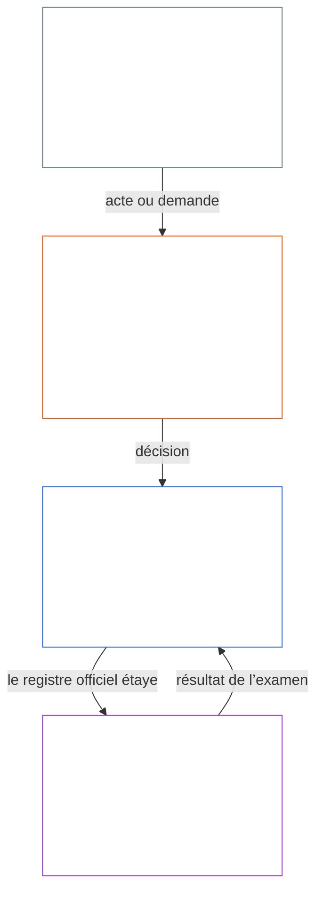
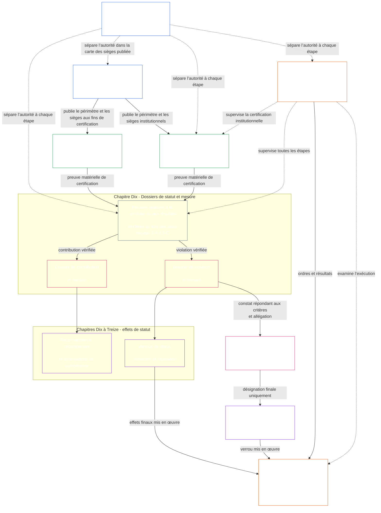

<!-- Locale: fr; variety: français standard international. AI-assisted structural resynchronization draft (GPT-6 Codex), unreviewed and incomplete. English source commit 6e0b6c663dde01b5dea731fe33d87725c7174930; edition SC-Corpus-2026.11.25. core_00 SHA-256 90799cb8019b41356fa5dd90565e3f9540fc346e8c77e2c321b841654f39b274; core_01 SHA-256 aca759b394f10784ab1a2eef4e9e2ca12e369ef0ca8ee797298c6af00d2950aa. -->

<strong>Place dans le corpus (non opératoire) : structure du fichier et règles de lecture</strong>

> Les widgets marqués **non opératoires** (place dans le corpus, guide de lecture et cartes de lecture) sont uniquement indicatifs. Ils n’ajoutent, ne retirent ni ne restreignent aucune obligation contraignante, dans leur propre fichier ou ailleurs.
>
> Ce fichier **fait partie de la Constitution sentiente** et n’est **contraignant qu’avec** les autres fichiers numérotés `core_*` et le sous-corpus, lus comme un seul texte. Il contient le **Chapitre Un**, la *Carte constitutionnelle* : son objet (§1), sa raison d’être (§2), l’articulation de ses fichiers (§3), les fondements des chapitres suivants (§4), les principaux processus de gouvernance (§5) et le registre constitutionnel des responsables (§§6 à 11).
>
> **Précédent :** [core_00.000_preamble.md](core_00_preamble.md) (Préambule)
> **Suivant :** [core_02.000_values_principles.md](../../core_02.000_values_principles.md)

<strong>Traçabilité</strong>

- Précédent : [Préambule](core_00_preamble.md) (*le Modèle, les Deux fins constitutionnelles, la Tétrade constitutionnelle, l’enjeu matériel et les catégories de mesure*).
- Sections :
  - [§1](#1-purpose-role-and-scope) ;
  - [§2](#2-why-the-map-exists) ;
  - [§3](#3-how-the-files-fit-together) ;
  - [§4](#4-foundations-for-the-chapters-that-follow) ;
  - [§5](#5-key-governance-processes) ;
  - [§6](#6-principles-definitions-and-rights) ;
  - [§7](#7-system-and-institutional-charters-functional-independence-and-separation-of-duties) ;
  - [§8](#8-key-practical-process-pipelines) ;
  - [§9](#9-process-ownership-and-outputs) ;
  - [§10](#10-governance-change-and-incorporation) ;
  - [§11](#11-adopted-implementation-corpus).
- À lire avec : [Hiérarchie de l’autorité et hiérarchie interne](../../subcore_03.080_band_integrative.md#authority-stack-and-internal-hierarchy) (*application du registre des responsables*) ; [README.md](README.md) (*ordre de lecture*).

 

# CHAPITRE UN : CARTE CONSTITUTIONNELLE

> **Statut du brouillon :** traduction assistée par IA, non révisée et incomplète. Ce dossier reste un brouillon de travail.

<strong>Emplacement dans le corpus (non opérationnel) : structure des fichiers et règles de lecture</strong>

> Les widgets marqués **non opérationnels** (emplacement dans le corpus, orientation du lecteur, cartes de lecture) servent uniquement à s’orienter. Ils n’ajoutent, ne suppriment ni ne restreignent aucune obligation contraignante, dans leur propre fichier ou ailleurs.
>
> Ce fichier **fait partie de la Constitution sentiente** et ne lie **qu’avec** les autres fichiers numérotés `core_*` et le sous-corpus, lus comme un seul texte. Il contient le **Chapitre Un**, la *Carte constitutionnelle* : son objet (§1), sa raison d’être (§2), l’articulation de ses fichiers (§3), les fondements des chapitres suivants (§4), les principaux processus de gouvernance (§5) et le registre constitutionnel des responsables (§§6 à 11).
>
> **Amont :** [core_00.000_preamble.md](core_00_preamble.md) (Préambule)
> **Suivant :** [core_02.000_values_principles.md](../../core_02.000_values_principles.md)

<strong>Trace</strong>

- En amont : [Préambule](core_00_preamble.md) (*le Modèle, les Deux fins constitutionnelles, la Tétrade constitutionnelle, l’enjeu matériel et les catégories de mesure*).
- Sous-sections :
  - [§1](#1-purpose-role-and-scope);
  - [§2](#2-why-the-map-exists);
  - [§3](#3-how-the-files-fit-together);
  - [§4](#4-foundations-for-the-chapters-that-follow);
  - [§5](#5-key-governance-processes);
  - [§6](#6-principles-definitions-and-rights);
  - [§7](#7-system-and-institutional-charters-functional-independence-and-separation-of-duties);
  - [§8](#8-key-practical-process-pipelines);
  - [§9](#9-process-ownership-and-outputs);
  - [§10](#10-governance-change-and-incorporation);
  - [§11](#11-adopted-implementation-corpus).
- À lire avec : [Hiérarchie de l’autorité et hiérarchie interne](../../subcore_03.080_band_integrative.md#authority-stack-and-internal-hierarchy) (*application du registre des responsables*) ; [README.md](README.md) (*ordre de lecture*).

 

### 1. Objet, rôle et portée

*En termes simples : ce chapitre est le guide du reste de la Constitution. Il montre comment les parties s’articulent, quel chapitre est responsable de chaque sujet et comment fonctionnent les principaux processus, afin que la personne qui lit puisse trouver la règle qui répond à sa question.*

**Objet :** Le Chapitre Un donne une vue d’ensemble et un guide des responsabilités. Il nomme les processus qui mettent à l’épreuve la gouvernance autorisée, indique quel chapitre est responsable de chaque domaine de fond et décrit les trois niveaux du texte constitutionnel.

**Rôle :** Le chapitre sert à orienter et à attribuer les responsabilités. Il n’ajoute aucune obligation propre au-delà du registre des responsables, que les autres chapitres et la [Hiérarchie de l’autorité et hiérarchie interne](../../subcore_03.080_band_integrative.md#authority-stack-and-internal-hierarchy) appliquent.

**Portée du chapitre :** Le chapitre couvre :

- la raison d’être de la carte (**section 2**) ;
- l’articulation des fichiers (**section 3**) et les fondements des chapitres suivants (**section 4**) ;
- les principaux processus de gouvernance (**section 5**) ;
- le registre des responsables constitutionnels : principes, définitions et droits (**section 6**) ; chartes de système et institutionnelles, indépendance fonctionnelle et séparation des fonctions (**section 7**) ; chaînes de processus (**section 8**) ; responsabilités et résultats des processus (**section 9**) ; et gouvernance, changement et incorporation (**section 10**) ; et
- le corpus de mise en œuvre adopté et le sous-corpus (**section 11**).

### 2. Pourquoi la carte existe

*En termes simples : un texte aussi vaste a besoin d’un guide qui montre comment ses parties s’articulent et qui est responsable de chaque sujet. Ce chapitre existe pour que la personne qui lit puisse trouver la règle qui répond à sa question.*

La Constitution répartit son travail entre de nombreux chapitres, un sous-corpus et quatre corpus adoptés. Un être sentient qui cherche à savoir ce qui lui est dû, ou une partie adoptante qui cherche une obligation, peut s’égarer. Ce chapitre constitue la vue d’ensemble et le guide des responsabilités : ce que fait chaque partie, quel chapitre est responsable de chaque sujet, comment fonctionnent les chaînes de processus et comment les niveaux se relient. Il n’ajoute aucune règle propre au-delà du registre des responsables.

**Fondements :**

- Préambule :
  - [Tétrade constitutionnelle](core_00_preamble.md#constitutional-tetrad) : les fonctions que ce chapitre met en œuvre :
    - [Participation](../../subcore_03.060_apex_participation_leg.md#participation) : un être sentient peut trouver la règle qui répond à sa question ;
    - [Reddition de comptes](../../subcore_03.040_apex_accountability_leg.md#accountability) : chaque sujet a un chapitre responsable désigné qui en répond ;
    - [Supervision](../../subcore_03.055_apex_oversight_leg.md#oversight) : la personne qui lit peut voir comment les parties s’articulent et repérer une lacune ou un chevauchement ;
    - [Action en temps](../../subcore_03.065_apex_timeliness_leg.md#timeliness) : la personne qui lit atteint la bonne règle sans retard ;
  - [Deux fins constitutionnelles](core_00_preamble.md#two-constitutional-aims) : les deux fins que sert ce chapitre :
    - [Épanouissement](core_00_preamble.md#flourishing) : la Constitution ne sert les êtres sentients que s’ils peuvent s’y orienter ;
    - [Continuité](core_00_preamble.md#continuity) : une carte claire préserve l’intégrité du texte à mesure qu’il grandit et change ;
- principes du Chapitre Deux :
  - [§5.2 Accessibilité en langage clair (obligation de participation et d’administration responsable)](../../core_02.000_values_principles.md#52-plain-language-accessibility-participation-and-stewardship-duty) ;
  - [§5.2.4 Discipline contre la complexité qui fait obstacle](../../core_02.000_values_principles.md#524-complexity-as-defeat-discipline) ;
  - [§15.4 Résolution des conflits de sens constitutionnel](../../core_02.030_constitutional_interpretation.md#154-constitutional-meaning-conflict-resolution) ;
- articles du Chapitre Quatre :
  - [Article XXIV-A](../../core_04.030_rights_part_d.md#article-xxiv-a-proportional-comprehensibility-right) (*Droit à la compréhensibilité proportionnelle*) ;
  - [Article XXIV-B](../../core_04.030_rights_part_d.md#article-xxiv-b-complexity-audit-and-modularity-requirements) (*Exigences d’audit de la complexité et de modularité*).

### 3. Comment les fichiers s’articulent

Les fichiers de la Constitution s’articulent comme suit :

- **Noyau (`core_*`) :** les fichiers numérotés contiennent les chapitres de la Constitution, à lire ensemble comme un texte unique. Ils énoncent les garanties et la structure constitutionnelle.
- **Sous-corpus (`subcore_*`) :** ces fichiers donnent les règles et procédures complètes qui sous-tendent les chapitres. Chacun relève d’un chapitre, a la même force que celui-ci et lie chaque partie adoptante sans incorporation distincte. Le sous-corpus ne peut pas restreindre son chapitre.
- **Mise en œuvre (`corpus_*`) :** quatre fichiers donnent les détails opérationnels nécessaires à la mise en œuvre de la Constitution. Ils lient dans le champ d’une incorporation valide et mettent en œuvre la Constitution sans la restreindre. La [section 11](#11-adopted-implementation-corpus) désigne les quatre fichiers.

Le [Corpus](../../subcore_03.080_band_integrative.md#corpus) défini est l’ensemble plus vaste et versionné des sources constitutionnelles contraignantes : il comprend le noyau, le sous-corpus, le texte de mise en œuvre adopté et toute enveloppe de compatibilité valide pendant la transition. Les brouillons, notes et guides de navigation ne deviennent pas contraignants du seul fait qu’ils font partie du projet.

### 4. Fondements des chapitres suivants

*En termes simples : les Chapitres Deux à Quatre sont responsables des valeurs, du dictionnaire (avec les règles du sous-corpus sur la construction, la protection et la preuve des définitions) et du Plancher des droits ; les chapitres suivants doivent respecter ces domaines sans les déplacer en silence.*

Les Chapitres **Deux à Quatre** fournissent les valeurs, le vocabulaire, les mécanismes de vérification et le Plancher des droits que tout ce qui suit doit respecter, notamment :

- l’exigence de Charte de système ou de Charte institutionnelle du [Chapitre Cinq](#7-system-and-institutional-charters-functional-independence-and-separation-of-duties), l’exigence de séparation des fonctions du Chapitre Six et les Organismes indépendants du Chapitre Sept, à la section 7 ;
- les [Chaînes pratiques de processus clés](#8-key-practical-process-pipelines) de la section 8 ;
- les [responsabilités et résultats des processus](#9-process-ownership-and-outputs) de la section 9 ;
- les chapitres sur la gouvernance et les voies de changement de la section 10 ; et
- le [Corpus de mise en œuvre adopté](#11-adopted-implementation-corpus) de la section 11.

### 5. Processus clés de gouvernance

*En termes simples : lorsque le texte l’exige, les questions matérielles passent par la certification, des registres écrits d’aide et de préjudice, la correction et le recours, et l’examen de forum avec des délais — les différends ordinaires utilisent d’abord la voie de contestation publiée ; ces voies testent la gouvernance autorisée ; elles ne la créent pas à elles seules.*

Là où le chapitre six, le [chapitre sept](core_09.000_system_alignment_certification_evaluation.md#chapter-nine-system-alignment-certification), des instruments incorporés ou d’autres dispositions constitutionnelles l’exigent expressément, portez les questions constitutionnelles matérielles vers une ou plusieurs des voies ci-dessous. Les [Chaînes pratiques de processus clés](#5-key-practical-process-pipelines) traduisent la mesure en registres, certification, apports vérifiés, classification, supervision de forum, correction et recours en temps — comment la gouvernance autorisée est testée, contestée et réparée en pratique. Elles n’autorisent pas la gouvernance à elles seules ; elles rendent la gouvernance examinable, contestable, corrigeable et en temps. La [section 5.1](#51-how-the-full-chain-fits-together) énonce cette chaîne complète.

- **Certification d’alignement du système** ([Chapitre sept](core_09.000_system_alignment_certification_evaluation.md#chapter-nine-system-alignment-certification)) — avant de faire confiance à l’échelle à un système à fort impact, rassemblez et examinez la preuve de s’il est constitutionnellement sûr de s’y appuyer maintenant
- **registres de trajectoire** ([chapitre onze](core_11_standing_assessment.md#chapter-eleven-standing-records--question-1-what-happened)) — lorsque la conduite ou le préjudice revêt une importance constitutionnelle, consigner les faits vérifiés dans des dossiers formels de contribution ou de violation ; les rumeurs et la réputation ne suffisent pas.
- **Correction et réparation** ([chapitre treize §5.1 (*Réparation et correction*)](../../core_13.000_standing_integration.md#51-remedy-and-correction)) — corriger le manquement sous-jacent et fournir aux personnes lésées une reconnaissance, une réparation, un rétablissement ou une indemnisation proportionnés.
- **Examen par le forum** ([chapitre quinze](core_11_forum.md#1-purpose-and-role--participation-architecture))
  - Les différends ordinaires dans des systèmes déjà autorisés utilisent d’abord la voie de contestation publiée de la [Participation systémique des parties affectées](../../core_05.055_band_participation.md#stakeholder-status-and-weight-cluster)
  - Si cette voie est encore contestée, manquante, capturée ou ne peut accorder de soulagement, routez selon l’enjeu primaire par des forums supervisés
  - Ces forums soutiennent la preuve, le transfert licite et les délais en temps sous l’**article XXVI-C** (*Résolution en temps et plancher anti-retard*)

### 6. Principes, définitions et droits

*En termes simples : les chapitres un à six possèdent les valeurs, comment les mots sont construits et vérifiés, le dictionnaire et le Plancher des droits ; les chapitres suivants doivent respecter ces foyers, non les déplacer en silence.*

Les sections **4 à 7** sont le **registre positif des titulaires** de cette Constitution : chaque bloc nomme le domaine substantiel que son chapitre (ou corpus compagnon) possède et ce qu’il produit. Des affirmations de titulaire contraignantes, en une ligne, apparaissent aussi à l’ouverture de chaque chapitre numéroté. D’autres couches peuvent pointer vers un titulaire — elles ne doivent pas le réécrire ni le relocaliser en silence ; cette discipline de non-relocalisation vit sous [Pile d’autorité et hiérarchie interne](../../subcore_03.080_band_integrative.md#authority-stack).

Les chapitres **un à six** fournissent les valeurs, le vocabulaire, la machinerie de vérification et le Plancher des droits que tout ce qui suit doit respecter — y compris les [Chaînes pratiques de processus clés](#5-key-practical-process-pipelines) de la section 5, les chapitres de gouvernance et de voie de changement de la section 6, et le [corpus compagnon de mise en œuvre](#7-companion-implementation-corpus) de la section 7.

Chaque résumé énonce ce qui revient au chapitre et ce qu’il produit.

**Chapitre un — Valeurs, principes et administration responsable** ([Partie A](../../core_02.000_values_principles.md) · [Partie B](../../core_02.020_interaction_interpretation.md#chapter-01-part-b-interaction-and-interpretation) · [Partie C](../../core_02.040_stewardship_capacity_principles.md#chapter-01-part-c-stewardship-and-governance))

- **Ce qui lui revient :** Énonce les valeurs et contraintes directrices de la Constitution — bien-être, équité, Sécurité, Vérité, Confiance, liberté bornée, reconnaissance et récompense proportionnée pour la contribution licite, résolution des conflits entre principes, et devoirs d’administration responsable y compris compréhension distribuée, évaluation systémique et discipline de gouvernance.
- **Ce qu’il produit :** Le fondement interprétatif de chaque chapitre ultérieur — les règles qui transforment les fins de haut niveau en exigences opératoires lorsque systèmes, droits, définitions ou chaînes de processus doivent être lus et appliqués.

**Chapitre deux — Structure des définitions** ([`core_02_definition_structure.md`](../../subcore_03.010_definition_structure.md))

- **Ce qui lui revient :** Définit comment les termes constitutionnels sont construits — la structure de composantes Ontologique/Mesure/Évaluation/Conformité (O/M/A/C), les exigences d’alignement et les règles de composante qui gardent les définitions précises et utilisables à travers le corpus.
- **Ce qu’il produit :** Une grammaire partagée pour les définitions, afin que les chapitres ultérieurs ne tombent pas dans des étiquettes vagues, des hypothèses cachées ou des formes de terme incompatibles.

**Chapitre trois — Intégrité des définitions** ([`core_02_definition_structure.md`](../../subcore_03.010_definition_structure.md))

- **Ce qui lui revient :** Garde contre l’évasion, le glissement de portée, les jeux de redéfinition et les tours de non-conformité qui videraient les définitions sur le papier tout en les battant en pratique.
- **Ce qu’il produit :** Discipline anti-évasion et métadonnées d’orientation de non-conformité — y compris des crochets de routage vers la trajectoire et l’examen de mauvaise conduite lorsque l’évasion est établie.

**Chapitre quatre — Charge, traçabilité et vérification** ([`core_02_definition_structure.md`](../../subcore_03.010_definition_structure.md))

- **Ce qui lui revient :** Met la charge de la preuve sur quiconque affirme la conformité ; exige une preuve traçable, l’observabilité et une vérification mises à l’échelle de l’[**enjeu matériel**](#material-stake) et qui restent contestables en pratique.
- **Ce qu’il produit :** le processus de vérification qui alimente les **entrées vérifiées** du [chapitre onze](core_11_standing_assessment.md#chapter-eleven-standing-records--question-1-what-happened) et les preuves d’alignement du système du [chapitre neuf](core_09.000_system_alignment_certification_evaluation.md#chapter-nine-system-alignment-certification). Il ne remplace pas la mesure de situation elle-même.

**Chapitre cinq — Définitions fondationnelles** ([`core_05__definitions_home.md`](../../core_03.000_definitions_home.md#chapter-five-foundational-definitions))

- **Ce qui lui revient :** Fournit la pile canonique de définitions — bandes Supervision, Participation, Reddition de comptes, Continuité et Intégrative — plus [Pile d’autorité et hiérarchie interne](../../subcore_03.080_band_integrative.md#authority-stack), [Corpus](../../subcore_03.080_band_integrative.md#corpus) et règles de frontière connexes.
- **Ce qu’il produit :** Un vocabulaire constitutionnel précis pour l’interprétation, l’audit et l’adjudication. C’est la **pile de définitions**, pas le Plancher des droits ; les droits contraignants vivent au chapitre six. Le routage de domaine de titulaire pour l’instrument dans son ensemble vit dans ce registre du Préambule (sections 4–7).

**Chapitre six — Droits fondationnels** ([Partie A](../../core_04.000_rights_part_a.md) · [Partie B](../../core_04.010_rights_part_b.md) · [Partie C](../../core_04.020_rights_part_c.md) · [Partie D](../../core_04.030_rights_part_d.md))

- **Ce qui lui revient :** Énonce le Plancher des droits aux articles **I–XXVII** — l’essentiel de la survie, l’allocation des ressources et l’administration responsable des dépendances, la dignité, l’agence, la participation, la contestation et le recours, les contraintes de justice, l’action en temps sous l’**article XXV-C** (*Résolution en temps et plancher anti-retard*), et les règles de transition — organisés pour une lecture planète d’abord à travers quatre parties.
- **Ce qu’il produit :** Des protections des droits non négociables et des voies de réparation que les chapitres sept à quinze, les forums, la gouvernance et les règles de modification doivent respecter, sans les restreindre, les contourner ni les vider de leur substance par des procédures ou des indicateurs de substitution.

### 7. Chartes des systèmes et des institutions, indépendance fonctionnelle et séparation des fonctions

*En termes simples : un système ou une institution ayant un impact réel publie une charte qui précise ce qu’il peut faire et qui occupe chaque siège. Avant tout acte matériellement contraignant, il faut séparer l’initiative, la vérification ou l’autorisation, la garde du registre officiel et l’examen des contestations. Les rôles peuvent s’adapter au contexte, mais un acteur et sa ligne de contrôle ne peuvent occuper discrètement les sièges chargés de contrôler leur propre acte.*

Cette section résume les exigences relatives aux chartes des systèmes et des institutions, à la séparation des fonctions et au chapitre consacré aux organismes qui doivent être indépendants de ceux qu’ils contrôlent. Elle précise aussi ce que chacun produit.

**[Chapitre Cinq — Chartes des systèmes et des institutions](../../core_05.000_charters.md#chapter-five-system-and-institutional-charters)**

- **Ce qui lui revient :** les exigences de publication d’une charte de système ou d’une charte institutionnelle :
  - les systèmes et institutions de classe L ou supérieure qui doivent publier une [Charte de système](../../subcore_03.075_band_continuity.md#system-charter) ou une [Charte institutionnelle](../../subcore_03.075_band_continuity.md#institutional-charter) (la classe P peut en publier une volontairement) ;
  - le contenu minimal de ces chartes, notamment la [Carte des rôles de la charte](../../subcore_03.075_band_continuity.md#charter-role-map) et les [Renvois de la charte](../../subcore_03.075_band_continuity.md#charter-pointer) vers les règles publiées et contraignantes de choix des parties prenantes ;
  - la manière de modifier et d’examiner une charte afin que son périmètre ne change pas silencieusement ; et
  - ce qu’une charte ne peut pas faire : déterminer la classe, définir la frontière, remplacer la certification, porter les règles de décision ou conférer une autorité.
- **Ce qu’il produit :** une déclaration publiée et versionnée du périmètre et de l’attribution des sièges, permettant au [Chapitre Six](../../core_06.000_functional_independence_separation_of_duties.md#chapter-six-functional-independence-and-separation-of-duties), à la certification, aux registres de situation et aux forums de vérifier les comportements.

**[Chapitre Six — Indépendance fonctionnelle et séparation des fonctions](../../core_06.000_functional_independence_separation_of_duties.md)**

- **Ce qui lui revient :** l’exigence transversale selon laquelle chaque [Acte matériellement contraignant](../../subcore_03.070_band_accountability.md#materially-binding-act) attribue séparément quatre fonctions :
  - l’initiative ;
  - la vérification ou l’autorisation ;
  - la garde du registre officiel ; et
  - l’examen des contestations.

  Il régit aussi :

  - le contenu minimal universel de chaque [Registre d’acte matériellement contraignant](../../subcore_03.070_band_accountability.md#materially-binding-act-record) ;
  - l’indépendance par rapport à la [Ligne de contrôle matériel](../../subcore_03.070_band_accountability.md#material-control-line) de l’acteur ;
  - l’attribution publiée des fonctions et les remplacements ;
  - l’hébergement mutualisé proportionné et les limites applicables en urgence ; et
  - les transferts attribuables et l’orientation vers un siège inapproprié.
- **Ce qu’il produit :** une architecture réutilisable à quatre sièges et un modèle de Registre d’acte. Tout processus ultérieur de certification, de situation, de forum, de gouvernance ou de mise en œuvre incorporée doit l’appliquer avant que son résultat puisse être considéré comme contrôlé indépendamment, consigné de façon fiable et réellement contestable.

**[Chapitre Sept — Organismes indépendants](../../core_07.000_independent_bodies.md)**

- **Ce qui lui revient :** les critères d’indépendance d’un organisme, la règle pour le désigner comme organisme indépendant et la liste des organismes indépendants que chaque adoptant doit avoir, avec pour chacun une garantie envers les sentients formulée en une ligne.
- **Ce qu’il produit :** une norme commune d’indépendance, vérifiable de la même manière pour chaque organisme. Les règles opérationnelles complètes de chacun figurent dans son propre fichier de sous-corpus rattaché au [Chapitre Sept](../../core_07.000_independent_bodies.md#chapter-seven-independent-bodies).

#### 7.1 Carte de séparation des quatre sièges

Chaque **Acte matériellement contraignant** doit respecter les garanties suivantes pour un même acte :

- le siège d’initiative ne vérifie ni n’autorise son propre acte ;
- le siège de vérification ou d’autorisation ne garde pas le registre officiel de l’acte ;
- ce siège n’examine pas non plus une contestation de l’acte ;
- les sièges de vérification ou d’autorisation et d’examen des contestations se trouvent hors de la [Ligne de contrôle matériel](../../subcore_03.070_band_accountability.md#material-control-line) du siège d’initiative.

<strong>Orientation du lecteur (non opérationnelle) : carte de séparation des quatre sièges</strong>

> Cette carte montre les quatre fonctions et un parcours type de l’acte et de son Registre d’acte. Elle n’ajoute pas de cinquième siège, n’impose pas de séquence universelle et ne modifie pas les règles du Chapitre Six sur l’indépendance, l’hébergement mutualisé proportionné, l’action d’urgence ou l’acheminement des contestations.

 

### 8. Chaînes pratiques de processus clés

*En termes simples : les chapitres neuf à quinze appliquent en une seule chaîne l’exigence de séparation des fonctions du chapitre huit : certifier les systèmes et les institutions, mesurer l’aide et le préjudice sur deux voies distinctes, appliquer des effets réels et des réparations, et empêcher qu’un forum soit le seul juge final d’une réclamation qui le vise. Cette chaîne rend les devoirs constitutionnels réels au quotidien.*

[Le chapitre sept](core_07_charters.md#chapter-seven-system-and-institutional-charters) publie le périmètre de la charte et la carte des sièges de chaque système et institution de classe L ou supérieure. [Le chapitre huit](../../core_07.000_independent_bodies.md#chapter-eight-functional-independence-and-separation-of-duties) établit l’exigence de séparation des fonctions qui rend chaque acte de cette chaîne vérifiable de manière valide. Il exige que l’initiative, la vérification ou l’autorisation, la garde officielle des dossiers et l’examen des contestations soient attribués à des fonctions distinctes et maintenus séparés selon les règles applicables de proportionnalité et d’indépendance. Les chapitres neuf à quinze appliquent ensuite cette architecture dans l’ordre :

Chaque pas ci-dessous énonce ce qui revient au chapitre et ce qu’il produit. [Comment la chaîne complète s’emboîte](#51-how-the-full-chain-fits-together) montre ensuite ces titulaires comme un seul chemin de la vérification du système au recours.

**Certification d’alignement du système** ([Chapitre sept](core_09.000_system_alignment_certification_evaluation.md#chapter-nine-system-alignment-certification))

- **Ce qui lui revient :** Assure que les systèmes à impact matériel restent alignés constitutionnellement.
  - Avant qu’un système qui affecte matériellement les êtres sentients puisse être reconnu ou qu’on s’y fie à l’échelle, la preuve est rassemblée et examinée sous supervision de forum
  - L’examen doit couvrir :
  - le respect par le système des éléments essentiels à la survie ;
  - l’allocation des ressources et la gestion des dépendances au titre de l’**article V** (*Allocation des ressources, dépendances et financement des écosystèmes*), y compris [Proportionate Cross-System Support](../../core_05.040_band_continuity.md#proportionate-cross-system-support) lorsque la dépendance à une infrastructure partagée est substantiellement en jeu ;
  - la sécurité ;
  - la participation ; et
  - les autres garanties constitutionnelles minimales.
  - Les êtres sentients à trajectoire reconnue peuvent contester le résultat
  - Les systèmes à haut risque doivent être recertifiés selon un calendrier régulier ; la certification n’est jamais permanente
- **Ce qu’il produit :** Un **registre de certification d’alignement du système** — une réponse bornée et contestable à si ce système est assez aligné pour le reconnaître, continuer de s’y fier, le déployer ou le libérer de conditions *maintenant*, dans une portée et une fenêtre de temps énoncées.

**Mesure de trajectoire** ([Chapitre huit](../../subcore_10.020_standing_assessment.md#chapter-ten-compliance-violation-and-standing-model))

- **Ce qui lui revient :** Lorsque la conduite importe constitutionnellement, rumeurs et réputations ne suffisent pas. Les faits vérifiés entrent dans des **registres de trajectoire**. La **contribution** (aide vers l’épanouissement) et l’**infraction** (échecs de reddition de comptes et préjudice) sont mesurées sur des **axes séparés** — la bonne conduite vérifiée n’efface pas le préjudice vérifié, et les deux ne se plient jamais en un seul score net.
- **Ce qu’il produit :** Des **registres de trajectoire** classés sur l’Axe de contribution et l’Axe d’infraction, fondés seulement sur des **apports vérifiés** et des constatations supervisées par forum — pas un score informel ni des récits de différend à la place de la classification.

**Intégration de trajectoire et effets** ([Chapitre neuf](../../subcore_10.060_standing_integration.md#chapter-eleven-standing-effects-and-integration))

- **Ce qui lui revient :** Intègre les classifications vérifiées en **effets de trajectoire** du monde réel sur des pistes séparées — mis à l’échelle de l’[**enjeu matériel**](#material-stake), sans plier contribution et infraction en un seul score net, et sans vider participation, supervision, reddition de comptes ou action en temps.
  - **Piste de contribution :** La classification positive vérifiée produit un gain pratique :
    - [**Habilitations de compétence**](../../core_13.000_standing_integration.md#72-competency-bars-and-clearances) susceptibles d’ouvrir des fonctions sensibles à la confiance, une autorité déléguée, l’admissibilité à la supervision et des responsabilités de gestion progressivement plus importantes lorsque la compétence est démontrée selon le seuil publié et qu’aucun [blocage de situation](../../core_13.000_standing_integration.md#52-prevention--general-standing-locks) applicable n’empêche la voie nommée
    - reconnaissance proportionnée et **récompenses matérielles** pour l’administration responsable licite et la coopération, comme l’exige le [chapitre un](../../core_02.000_values_principles.md#32-recognition-reinforcement-and-aspiration)
    - Pas une louange vide. Les bénéfices doivent être réels, étayés par la preuve, et ouverts à contestation
  - **Piste d’infraction :** Les constatations d’infraction vérifiées produisent une perte pratique :
    - **Verrous de trajectoire**, limites de rôle, ordres de remédiation, [recours pour ceux qui ont été lésés](../../core_13.000_standing_integration.md#51-remedy-and-correction), descripteurs supplémentaires et crochets d’exécution
    - Les restrictions s’ajustent à la gravité de ce qui a été vérifié
    - Les infractions non résolues restent vivantes
    - Des voies proportionnées pour restaurer la trajectoire restent disponibles pour ceux qui démontrent une restitution authentique
    - Une habilitation de compétence du côté contribution ne dispense pas un verrou de trajectoire du côté infraction
- **Ce qu’il produit :** Des effets de trajectoire séparés et mis à l’échelle sur les pistes Contribution et Infraction — habilitations de compétence et récompenses matérielles d’un côté ; verrous de trajectoire, correction et recours de l’autre — aucun plié en un seul score.

**Garde-fou de mauvaise conduite anticonstitutionnelle** ([Chapitre dix](core_10_a_misconduct_designation.md#chapter-ten-anti-constitutional-misconduct))

- **Ce qui lui revient :** Traite seulement les infractions vérifiées les plus graves — conduite qui peut avoir capturé ou vidé des devoirs constitutionnels à l’échelle. Lorsque le chapitre huit a déjà enregistré une constatation d’infraction à impact maximal, et qu’une mauvaise conduite anticonstitutionnelle est alléguée de façon matérielle, ce chapitre mène l’examen de désignation comme piste-seuil du chapitre neuf en parallèle des effets ordinaires de trajectoire du chapitre neuf.
- **Ce qu’il produit :** Une désignation finale de mauvaise conduite anticonstitutionnelle — ou son rejet — pour cette constatation existante à impact maximal, seulement après que les critères exigés et les garanties de procédure due sont remplis. Le chapitre huit mesure encore combien le préjudice était grave ; seule une désignation finale déclenche le **Verrou de confiance anticonstitutionnel** du chapitre neuf.

**Supervision de forum et routage** ([Chapitre onze](core_11_forum.md#chapter-eleven-forums-and-jurisdiction))

- **Ce qui lui revient :** Supervise comment les différends et les affaires de certification se meuvent réellement.
  - [Séquençage des différends](core_11_forum.md#dispute-sequencing) de la voie de contestation publiée de la Participation systémique des parties affectées au routage de forum
  - Quelle famille de forums les traite, et où une affaire commence d’ordinaire
  - Comment la preuve est soutenue
  - Comment les affaires se transfèrent ou se consolident
  - Comment les règles anti-se-juger-soi-même empêchent des forums capturés d’être le seul foyer final
  - Les délais sous l’**article XXV-C** (*Résolution en temps et plancher anti-retard*) empêchent les affaires de rester non résolues si longtemps que le recours ne compte plus
- **Ce qu’il produit :** des **constatations vérifiées** qui peuvent ouvrir ou mettre à jour des registres de trajectoire, plus un routage licite vers le recours et la [résolution en temps](../../core_05.035_band_accountability.md#timely-resolution-constitutional). Les forums supervisent la chaîne ; ils ne remplacent pas la mesure de trajectoire du chapitre huit.

#### 8.1 Comment la chaîne complète s’emboîte

*En termes simples : pensez-y comme un chemin de la vérification du système au recours — les forums supervisant le différend et les pas de trajectoire tout du long.*

1. **Certifiez le système lorsque l’impact est assez sérieux** ([Chapitre sept](core_09.000_system_alignment_certification_evaluation.md#chapter-nine-system-alignment-certification)) — avant de faire confiance à l’échelle à un système à fort impact, obtenez un registre d’alignement contestable : est-il constitutionnellement sûr de s’y appuyer *maintenant* ?
2. **Mesurez la trajectoire sur des pistes séparées** ([Chapitre huit](../../subcore_10.020_standing_assessment.md#chapter-ten-compliance-violation-and-standing-model)) — lorsque la bonne conduite ou le préjudice est assez sérieux pour importer constitutionnellement, le chapitre huit ouvre des dossiers formels, n’admet que des **apports vérifiés** (y compris la preuve de certification d’alignement du système du chapitre sept lorsque cette preuve est matérielle), et classe ce qui a été vérifié. Rumeurs, réputations et récits de différend ne suffisent pas.
   - **Nature de la contribution :** Ouvrez un **registre de trajectoire de contribution** — un dossier borné et contestable d’aide vérifiée vers l’épanouissement — et classez la **nature de la contribution** sur l’Axe de contribution.
   - **Nature de l’infraction :** Ouvrez un **registre de trajectoire d’infraction** — un dossier borné et contestable de préjudice vérifié et d’échecs de reddition de comptes — et classez la **nature de l’infraction** sur l’Axe d’infraction. Le bon et le préjudice ne se plient jamais en un seul score net ; les registres liés se croisent par référence mais restent séparés.
3. **Appliquez les effets de trajectoire sur chaque piste** ([Chapitre neuf](../../subcore_10.060_standing_integration.md#chapter-eleven-standing-effects-and-integration)) — la contribution vérifiée peut accorder une habilitation de compétence et soutenir reconnaissance proportionnée et récompenses matérielles ; l’infraction vérifiée peut déclencher verrous de trajectoire, correction et [recours pour ceux qui ont été lésés](../../core_13.000_standing_integration.md#51-remedy-and-correction).
4. **Examen de désignation anticonstitutionnelle** ([Chapitre dix](core_10_a_misconduct_designation.md#chapter-ten-anti-constitutional-misconduct)) — si une constatation d’infraction à impact maximal peut aussi satisfaire des critères anticonstitutionnels, le chapitre dix décide si la désignation correspondante s’attache. La désignation ne change pas combien le chapitre huit a déjà trouvé le préjudice grave ; les effets ordinaires du chapitre neuf continuent en parallèle jusqu’à ce qu’une désignation finale déclenche le Verrou de confiance anticonstitutionnel.
5. **Routez les différends et gardez le recours en temps** ([Chapitre onze](core_11_forum.md#1-purpose-and-role)) — les forums supervisent comment les affaires se meuvent, quelle piste les traite, et si les délais sous l’**article XXVI-C** (*Résolution en temps et plancher anti-retard*) sont tenus pour que le recours ne meure pas dans le retard. Les différends ordinaires suivent le [séquençage des différends](core_11_forum.md#dispute-sequencing). Les forums classent aussi les différends en cinq [niveaux de matérialité](core_11_forum.md#6-timely-resolution-materiality-tiers-and-anti-delay-discipline) (A/B/C/L/P) qui reflètent l’alphabet de classification des systèmes — de l’urgence critique pour la survie aux affaires privées/contenues — et le routage par défaut de la famille Intégrité s’applique lorsque la désignation finale du chapitre dix est l’enjeu primaire.

La [carte de la chaîne de trajectoire du README](../../README.md#standing-pipeline-and-forums) offre une navigation directe pour la chaîne ci-dessus, y compris les apports vérifiés potentiels du chapitre sept vers la mesure de trajectoire.

### 9. Responsabilité des processus et résultats

*En termes simples : la carte des processus et [l’articulation de la chaîne complète](#82-how-the-full-chain-fits-together) montrent la chaîne ; cette section nomme le responsable et le résultat de chaque étape afin qu’aucune ne s’approprie discrètement le travail d’une autre.*

Chaque étape ci-dessous indique ce dont le chapitre est responsable et ce qu’il produit, en précisant les responsables nommés à la [§8.2, Articulation de la chaîne complète](#82-how-the-full-chain-fits-together).

**[Sous-corpus 8-B — Certification de l’alignement des systèmes](../../subcore_08.020_system_alignment_certification_evaluation.md#subcore-8-b-system-alignment-certification--evaluation)**

- **Ce qui lui revient :** maintenir l’alignement constitutionnel des systèmes ayant un impact matériel.
  - Avant de certifier ou d’utiliser à grande échelle un système ayant un impact matériel sur les sentients, recueillir et examiner les preuves sous la supervision d’un forum.
  - Vérifier le respect des nécessités de survie ; de l’**article V** (*Allocation des ressources, dépendances et financement des écosystèmes*), y compris le [Soutien intersystèmes proportionné](../../subcore_03.075_band_continuity.md#proportionate-cross-system-support) lorsque la dépendance à une infrastructure partagée est matériellement en jeu ; de la sécurité ; de la participation ; et des autres planchers constitutionnels.
  - Permettre aux sentients ayant qualité pour agir de contester le résultat.
  - Recertifier régulièrement les systèmes à haut risque : la certification n’est jamais permanente.
- **Ce qu’il produit :** un **Registre de certification du système** pour chaque examen, constat circonscrit et contestable de son alignement dans le périmètre déclaré et pendant la période consignée.

**[Sous-corpus 9-B — Certification de l’alignement des institutions](../../subcore_09.020_institutional_alignment_certification_evaluation.md#subcore-9-b-institutional-alignment-certification--evaluation)**

- **Ce qui lui revient :** maintenir l’alignement constitutionnel des institutions ayant un impact matériel, selon les six mêmes phases et la même numérotation que le Chapitre Huit.
  - Le Chapitre Neuf est responsable de l’évaluation (phases I et II) ; le [Sous-corpus 9-D](../../subcore_09.040_institutional_alignment_certification_forum_process_outcomes.md#subcore-9-d-institutional-alignment-certification--forum-process-and-outcomes) du processus et des résultats du forum (III et IV) ; et le [Sous-corpus 9-F](../../subcore_09.060_institutional_alignment_certification_records_recertification.md#subcore-9-f-institutional-alignment-certification--records-recertification-challenge-and-standing) du Registre de certification institutionnelle et de son fonctionnement (V et VI).
  - Examiner uniquement ce que l’institution contrôle : le respect de sa Charte institutionnelle, la responsabilité de son autorité, ses incitations et l’utilisabilité des contrôles indépendants.
  - S’appuyer sur la certification de chaque système sans la refaire.
- **Ce qu’il produit :** un **Registre de certification institutionnelle** pour chaque examen, constat circonscrit et contestable de l’alignement de l’institution dans son périmètre déclaré et sa période consignée. Le Chapitre Neuf réutilise le processus du forum sans répéter l’évaluation des systèmes ; la certification institutionnelle n’est ni une licence ni une condition pour former ou exploiter une institution.

**[Sous-corpus 10-B — registres de trajectoire](../../subcore_10.020_standing_assessment.md#subcore-10-b-standing-records--question-1-what-happened)**

- **Ce qui lui revient :** lorsque des actes comptent au regard de la Constitution, les rumeurs et la réputation ne suffisent pas : les faits vérifiés entrent dans des **registres de trajectoire**. La **contribution** (aide au Épanouissement) et la **violation** (défaillances de responsabilité et préjudice) sont inscrites dans des registres distincts ; l’aide vérifiée n’efface pas le préjudice vérifié, et les deux ne sont jamais réunies dans un score net.
- **Ce qu’il produit :** des registres circonscrits sur les axes Contribution et Violation, fondés uniquement sur des **éléments vérifiés** et des conclusions supervisées par un forum. Des évaluations informelles ou des récits de litige ne les remplacent pas.

**[Sous-corpus 10-D — Mesure de la situation](../../subcore_10.040_standing_measurement.md#subcore-10-d-standing-measurement--question-2-how-good-or-bad-was-it)**

- **Ce qui lui revient :** mesurer le caractère favorable ou défavorable des faits vérifiés. La contribution et la violation sont mesurées sur des axes distincts, selon la même échelle unifiée, sans score net commun.
- **Ce qu’il produit :** pour chaque Dossier de statut, une mesure classée — nature, ampleur et emplacement — sur l’axe Contribution ou Violation.

**[Sous-corpus 10-F — Intégration et effets de trajectoire](../../subcore_10.060_standing_integration.md#subcore-10-f-standing-integration--question-3-what-follows)**

- **Ce qui lui revient :** intégrer les classifications vérifiées en **effets de trajectoire** réels sur deux voies distinctes, proportionnés à l’[enjeu matériel](core_00_preamble.md#material-stake), sans score net contribution-violation ni vidage des obligations de participation, de supervision, de reddition de comptes ou d’action en temps.
  - **Voie de contribution :** une classification positive vérifiée doit produire un avantage pratique, notamment des [**habilitations de compétence**](../../core_11.000_contribution_consequences.md#32-competency-bars-and-clearances) ouvrant éventuellement des fonctions sensibles à la confiance, une autorité déléguée, l’éligibilité à la supervision et une administration responsable plus conséquente lorsque la compétence est démontrée et qu’aucun [verrou de trajectoire](../../core_12.000_violation_consequences.md#32-prevention--general-standing-locks) ne bloque la voie ; une reconnaissance et des **récompenses matérielles** proportionnées comme l’exige le [Chapitre Deux](../../core_02.000_values_principles.md#32-recognition-reinforcement-and-aspiration) ; et des avantages réels, étayés par des preuves et contestables, et non des éloges vides.
  - **Voie de violation :** une violation vérifiée doit entraîner des conséquences pratiques : **verrous de situation**, limites de rôle, ordres de remédiation, [réparation pour les personnes lésées](../../core_12.000_violation_consequences.md#31-remedy-and-correction), descripteurs complémentaires et leviers d’application ; restrictions proportionnées à la gravité vérifiée ; prise en compte des violations non résolues ; voies proportionnées de rétablissement de la situation après restitution authentique ; et aucune levée d’un verrou de violation par une habilitation de compétence liée à une contribution.
- **Ce qu’il produit :** des effets distincts et proportionnés sur les voies Contribution et Violation — habilitations et récompenses matérielles d’un côté, verrous, correction et réparation de l’autre — sans les fondre en une note unique.

**[Chapitre Quatorze — Désignation des manquements anticonstitutionnels](../../core_14.000_misconduct_designation.md#chapter-fourteen-anti-constitutional-misconduct-designation)**

- **Ce qui lui revient :** traiter uniquement les violations vérifiées les plus graves, susceptibles d’avoir capturé ou vidé des obligations constitutionnelles à grande échelle. Si le Chapitre Dix a déjà mesuré une violation de l’impact le plus élevé et qu’un manquement anticonstitutionnel est allégué de façon matériellement pertinente, ce chapitre mène l’examen de désignation sur une voie d’accès parallèle aux effets ordinaires de situation du Chapitre Dix.
- **Ce qu’il produit :** une désignation finale de manquement anticonstitutionnel, ou son rejet, pour cette conclusion existante d’impact maximal, après satisfaction des critères et garanties de procédure régulière. Le Chapitre Dix mesure toujours la gravité du préjudice ; seule la désignation finale déclenche le **Verrou de confiance anticonstitutionnel** du Chapitre Dix.

**[Chapitre Seize — Normes, acheminement et affaires des forums](../../core_16.000_forum.md#chapter-sixteen-standards-routing-and-forum-cases)**

- **Ce qui lui revient :** superviser le cheminement réel des litiges et des questions de certification : la [séquence des litiges](../../core_16.000_forum.md#dispute-sequencing), de la voie de contestation publiée de la Participation systémique des parties prenantes à l’acheminement vers un forum ; la famille de forums compétente et le point de départ ordinaire ; l’ouverture et la tenue des dossiers ; le transfert ou la consolidation des affaires ; et les règles contre l’auto-jugement qui empêchent un forum capturé d’être l’unique instance finale.
- **Ce qu’il produit :** des conclusions de forum pouvant ouvrir ou mettre à jour des registres de trajectoire, ainsi qu’un acheminement licite vers la réparation et une [résolution en temps](../../subcore_03.070_band_accountability.md#timely-resolution). Les forums supervisent le processus ; ils ne remplacent pas la mesure de situation du Chapitre Dix.

**[Chapitre Dix-sept — Familles de forums, escalade, résolution en temps et soutien](../../core_17.000_forum_families_escalation_timeliness_support.md#chapter-seventeen-forum-families-escalation-timely-resolution-and-support)**

- **Ce qui lui revient :** définir les forums et la progression d’une affaire après sa réception : familles de forums et normes communes ; escalade et questions à trancher ; acheminement, examen et distinction des protections provisoires — dont un [Gel provisoire](../../subcore_03.070_band_accountability.md#interim-hold) étroit sur le parcours d’un sentient nommé — par rapport aux conclusions et verrous de situation ; délais selon l’**article XXVII-C** (*Résolution en temps et plancher anti-retard*) ; et soutien aux preuves et aux sentients avant, pendant et après l’examen.
- **Ce qu’il produit :** des familles de forums capables d’entendre chaque catégorie d’affaire et de la résoudre dans le délai qui préserve l’utilité d’une réparation.

**[Chapitre Dix-neuf — Mise en application](../../core_19.000_enforcement.md#chapter-nineteen-enforcement)**

- **Ce qui lui revient :** déterminer comment exécuter les résultats du processus de situation ou d’un forum, par qui et dans quels délais, et empêcher qu’ils soient éludés, retardés ou abandonnés discrètement.
- **Ce qu’il produit :** des résultats effectivement exécutés, et non laissés sur le papier. Il ne crée pas de nouvelle catégorie de conséquence ; il régit l’exécution des conséquences prévues aux Chapitres Quatorze à Vingt-trois.

**[Chapitre Vingt — Mise en application spéciale](../../core_20.000_special_enforcement.md#chapter-twenty-special-enforcement)**

- **Ce qui lui revient :** les garanties supplémentaires lorsqu’une exécution implique le gel ou la saisie d’argent ou de biens, lorsqu’une force est ou pourrait être utilisée, ou lorsque les mêmes défaillances d’exécution se répètent.
- **Ce qu’il produit :** une exécution causant le moins de préjudice durable possible tout en réalisant le résultat, et la découverte puis l’élimination des causes profondes des défaillances plutôt que leur répétition.

### 10. Gouvernance, modifications et incorporation

*En termes simples : les Chapitres Vingt-Sept à Trente-et-un ferment la Constitution : qui peut gouverner, comment modifier le texte sans revenir sur les protections, comment il s’articule avec les autres lois et comment les textes pratiques adoptés restent liés à leur source constitutionnelle.*

Les **Chapitres Vingt-Sept à Trente-et-un** ferment la Constitution. Ensemble, ils complètent le [registre constitutionnel des responsables](#6-principles-definitions-and-rights) pour la gouvernance, la validité des modifications et l’incorporation : qui peut légitimement gouverner, comment modifier légalement la Constitution et comment le texte de mise en œuvre adopté reste lié à sa source constitutionnelle sans dérive silencieuse.

Chaque résumé ci-dessous indique le domaine dont le chapitre est responsable et ce qu’il produit.

[Chapitre Dix-huit](../../core_18.000_assemblies.md#chapter-eighteen-assemblies) (*Assemblées*) suit les chapitres sur les forums dans l’ordre de lecture, mais relève de la gouvernance : le Chapitre Vingt-et-un précise comment l’autorité de gouverner est autorisée ; le Chapitre Dix-huit, ce qu’une assemblée en fait.

**[Chapitre Dix-huit — Assemblées](../../core_18.000_assemblies.md#chapter-eighteen-assemblies)**

- **Ce qui lui revient :** les décisions d’une assemblée d’une entité politique, leur mode d’adoption et leurs limites : fiscalité et budgets, partage des tâches entre niveaux local, régional et national, majorités requises selon le type d’acte, exécutif choisi et révocable par chaque assemblée, référendums communautaires et urgences définies par type.
- **Ce qu’il produit :** des règles générales et des budgets publics élaborés par un organe responsable, des exécutifs qui lui rendent compte et des pouvoirs d’urgence classés, rapidement confirmés, révocables à tout moment et qui ne touchent jamais au Plancher des droits.

**[Chapitre Vingt-et-un — Contrat constitutionnel, légitimité et administration responsable](../../core_21.000_governance.md#chapter-twenty-one-constitutional-contract-legitimacy-authorization-and-stewardship)**

- **Ce qui lui revient :** la [**Couche du contrat constitutionnel**](../../subcore_03.080_band_integrative.md#constitutional-contract-layer) : qui peut gouverner, par quel mécanisme de légitimité, selon quel périmètre et quelles conditions durables, et quel caractère d’administration responsable doit être maintenu.
- **Ce qu’il produit :** des règles d’autorisation et de légitimité distinctes de la [**Participation systémique des parties prenantes**](../../subcore_03.090_band_participation.md#stakeholder-status-and-weight) dans les systèmes déjà autorisés. Elles régissent l’autorité de gouverner elle-même, et non seulement la participation en son sein.

**[Chapitre Vingt-deux — Non-régression](../../core_22.000_non_regression.md#chapter-twenty-two-non-regression-and-substantive-amendment-validity)**

- **Ce qui lui revient :** établir le plancher substantiel contre les modifications régressives. Les amendements et contournements ne peuvent faire reculer les protections fondamentales, vider la Tétrade sous l’effet de l’enjeu matériel ni déguiser une régression en nettoyage technique.
- **Ce qu’il produit :** le **premier garde-fou constitutionnel** de toute modification proposée : si elle affaiblit en pratique les protections fondamentales, elle est invalide même si la procédure paraît correcte. Les contournements soupçonnés ou les reculs déguisés sont arrêtés ou orientés vers la procédure de contrôle appropriée.

**[Chapitre Vingt-trois — Modification, ratification et adoption](../../core_23.000_amendment_ratification.md#chapter-twenty-three-amendment-ratification-and-procedural-validity)**

- **Ce qui lui revient :** les modalités légales de modification de la Constitution — procédure, ratification et adoption — ainsi que les **garde-fous procéduraux** complétant le garde-fou substantiel du Chapitre Vingt-huit : publication ouverte, traçabilité de la garde faisant autorité et contestabilité réelle avec examen indépendant lorsqu’il est requis.
- **Ce qu’il produit :** une voie complète de modification licite. Seules les modifications et adoptions respectant à la fois le **garde-fou de non-régression** et les **garde-fous procéduraux** constituent des mises à jour constitutionnelles valides.

**[Chapitre Vingt-quatre — Suprématie et ordres externes](../../core_24.000_expansion_supremacy.md#chapter-twenty-four-expansion-supremacy-and-external-legal-orders)**

- **Ce qui lui revient :** les rapports de la Constitution avec les autres normes : extension licite des protections, suprématie dans sa source valide, son adoption et le périmètre des couches de gouvernance ; non-éviction du droit externe applicable de son propre chef ; et interaction rigoureuse avec les ordres juridiques externes sans subordination ni captation silencieuse.
- **Ce qu’il produit :** des règles de hiérarchie et d’ordre de résolution des conflits. La publication ou l’usage ne vaut pas abrogation du droit externe applicable ; les adoptants ne peuvent pas laisser les procédures incorporées, des normes externes plus faibles ou des indicateurs de commodité supplanter le sens de la Constitution sentiente dans le périmètre d’adoption valide.

**[Chapitre Vingt-cinq — Passerelle d’incorporation](../../core_25.000_incorporation.md)**

- **Ce qui lui revient :** déterminer quels fichiers de mise en œuvre deviennent un texte incorporé contraignant lors de leur adoption. Il épingle les éditions, maintient les chaînes de garde et interdit toute dérive silencieuse entre la source constitutionnelle et le détail opérationnel.
- **Ce qu’il produit :** une frontière unique d’incorporation : le texte de mise en œuvre désigné lie lorsqu’il est adopté, mais les corpus adoptés mettent en œuvre la Constitution sans devenir une seconde source qui la restreint. La [section 11](#11-adopted-implementation-corpus) résume ces corpus.

### 11. Corpus compagnon de mise en œuvre

*En termes simples : quatre corpora compagnons (structure conjointe, systèmes, institutions et opérations de forum) détaillent comment exécuter ce que les chapitres exigent déjà ; ils lient lorsqu’ils sont valablement adoptés, et ne peuvent pas rétrécir ces devoirs.*

Au-delà des chapitres `core_*` numérotés, quatre corpora compagnons achèvent le [registre positif des titulaires](#4-principles-definitions-and-rights) pour le **texte de mise en œuvre** adopté — détail opérationnel qui rend les devoirs constitutionnels exécutables en pratique :

- **[corpus_joint_structure](../../corpus_joint_structure.md)** — routage entre fichiers, termes opérationnels partagés, et structure conjointe lorsque systèmes, institutions et forums doivent être lus ensemble sur les mêmes faits.
- **[corpus_systems](../../corpus_systems.md)** — classification des systèmes, protocoles de conception et de déploiement, traitement de l’information, et mécanique d’administration responsable critique.
- **[corpus_institutions](../../corpus_institutions.md)** — formation institutionnelle, gouvernance, supervision, proportionnalité et discipline de dissolution.
- **[corpus_forum](../../corpus_forum.md)** — opérations de forum : formation des panels, récusation, voies d’examen, détail de routage et soutien forensique.

Lorsqu’une partie qui adopte les incorpore valablement sous le [chapitre seize](../../core_20.000_incorporation.md), ces fichiers lient comme texte de mise en œuvre dans la portée d’adoption. Le sens de la Constitution sentiente continue de contrôler — ils **mettent en œuvre, ne resserrent pas**, les chapitres ci-dessus. L’épinglage d’édition, les chaînes de garde et la règle de non-désalignement silencieux gardent le texte adopté traçable jusqu’à ce qui a réellement été ratifié. La liste canonique et les règles de frontière vivent au [chapitre cinq — Corpus](../../subcore_03.080_band_integrative.md#corpus).

Principes, définitions, droits, chaînes de processus, gouvernance, règles d’amendement et mise en œuvre incorporée doivent être lus ensemble pour préserver le but protecteur de la Constitution.

---

**Fichier précédent :** [README.md](README.md)

**Fichier suivant (cette langue) :** [core_01_a_values_principles.md](../../core_02.000_values_principles.md)

**Original contraignant :** [core_00_preamble.md](core_00_preamble.md)
