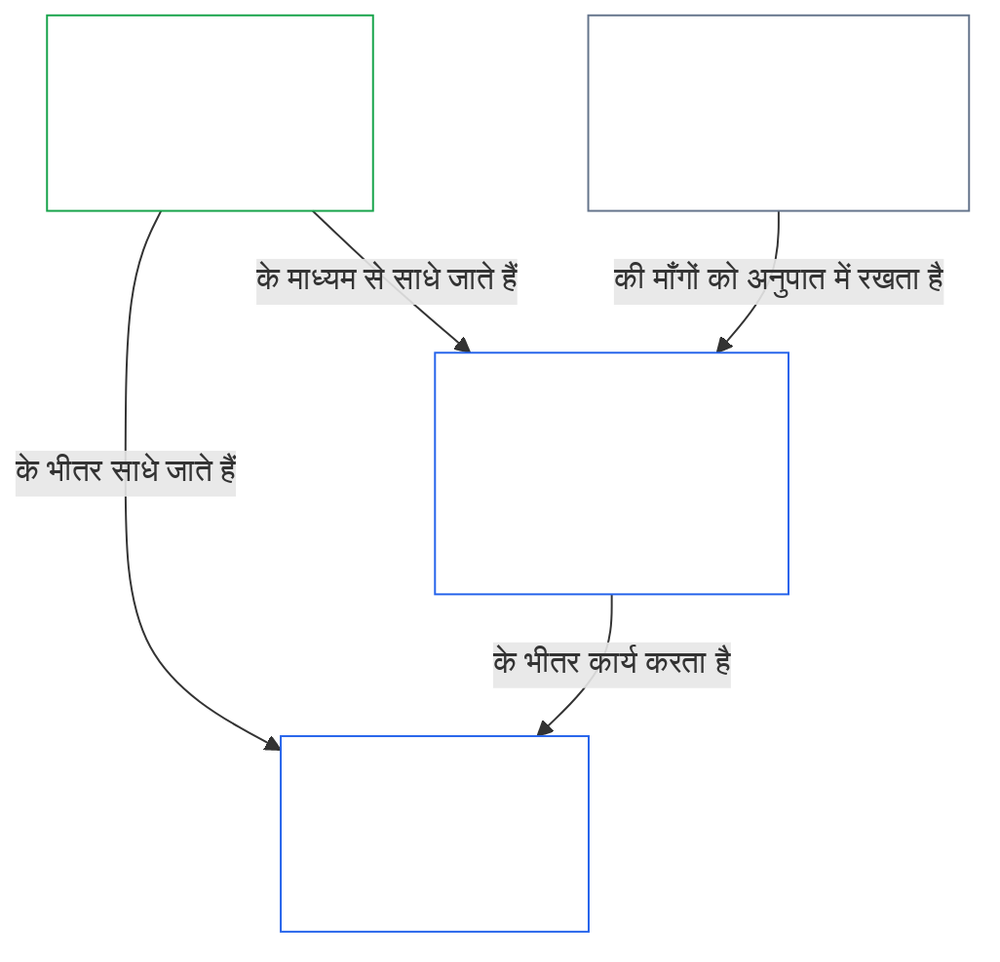

<!-- Locale: hi; variety: मानक हिंदी. AI-assisted structural resynchronization draft (GPT-6 Codex), unreviewed and incomplete. English source commit 6e0b6c663dde01b5dea731fe33d87725c7174930; edition SC-Corpus-2026.11.25. core_00 SHA-256 90799cb8019b41356fa5dd90565e3f9540fc346e8c77e2c321b841654f39b274; core_01 SHA-256 aca759b394f10784ab1a2eef4e9e2ca12e369ef0ca8ee797298c6af00d2950aa. -->

# प्रस्तावना / आधारभूत अपेक्षाएँ

**अपरिमार्जित और अपूर्ण मसौदा।** AI की सहायता से संरचनात्मक पुनःसमन्वय किया गया है। अनुवाद की पूर्णता और अर्थ-निष्ठा की अभी जाँच नहीं हुई है। इसे प्रकाशित या समन्वित न करें।

<strong>कॉर्पस में स्थान (गैर-संचालनात्मक): फ़ाइल संरचना और पढ़ने के नियम</strong>

> **गैर-संचालनात्मक** चिह्नित विजेट (कॉर्पस में स्थान, पाठक-मार्गदर्शन, पाठक-मानचित्र) केवल दिशा देने के लिए हैं। वे अपनी फ़ाइल या किसी अन्य फ़ाइल में कोई बाध्यकारी कर्तव्य जोड़ते, हटाते या संकुचित नहीं करते।
>
> यह फ़ाइल **संज्ञ संविधान का हिस्सा** है और अन्य क्रमांकित `core_*` फ़ाइलों के साथ एक ही पाठ के रूप में पढ़े जाने पर ही **बाध्यकारी** है। इसमें **प्रस्तावना** (आधारभूत अपेक्षाएँ) है। पढ़ने का क्रम और संस्करण-मेटाडेटा [README.md](README.md) में रखे जाते हैं।
>
> **अगला:** [core_01.000_constitutional_map.md](core_01_constitutional_map.md) (अध्याय एक, संवैधानिक मानचित्र)।

 

प्रस्तावना **मॉडल** (**दो संवैधानिक उद्देश्य**, **संवैधानिक चतुष्क**, और **भौतिक दाँव**) तथा मापन-श्रेणियों की संवैधानिक स्वामी है। संवैधानिक स्वामी-पंजी [अध्याय एक](core_01_constitutional_map.md#chapter-one-constitutional-map), *संवैधानिक मानचित्र* में है।

*साधारण शब्दों में: यह आरंभ उस समस्या का नाम लेता है जिसे यह संविधान ठीक करने के लिए है — प्रणालियाँ जो जिन्हें प्रभावित करती हैं उन्हें हानि पहुँचाती, छिपाती या बाहर कर देती हैं — और कहता है कि शेष दस्तावेज़ यही है कि हम उसे जवाबदेह, जाँच-योग्य और समयबद्ध शासन से कैसे बदलते हैं।*

संज्ञ प्राणियों की स्वतंत्रता, उत्तरजीविता और कल्याण उन प्रणालियों से अविभाज्य हैं जिन्हें हम बनाते हैं, जिनमें रहते हैं, और जिन पर निर्भर करते हैं। जैसे-जैसे वे प्रणालियाँ दायरे, पारस्परिक निर्भरता और शक्ति में बढ़ती हैं, वैसे-वैसे अपरिवर्तनीय, बड़े पैमाने की हानि के जोखिम भी बढ़ते हैं। ये जोखिम सदा मौजूद रहते हैं और तात्विक रूप से प्रासंगिक हैं।

कोई प्रणाली इस तरह वैध नहीं रह सकती कि संज्ञ प्राणियों को तब कष्ट दे जब वह कष्ट टाला जा सकता था, बार-बार होने वाली समस्याओं को अनदेखा करे, चुपचाप हानि दूसरों पर डाल दे, या संज्ञ प्राणियों को उन प्रणालियों से बाहर कर दे जो उनकी ज़िंदगी गढ़ती हैं।

साझा प्रणालियाँ ऐसी दुनिया में काम करती हैं जो पहले से जटिल है और और अधिक जटिल होती जा रही है। स्वस्थ, टिकाऊ शासन को इस जटिलता का सामना करना होगा—इसे मापना, मॉडल करना और इसके लिए जवाबदेह होना होगा—इसे सुविधाजनक प्रतिनिधि संकेतकों में समेटने के बजाय। इसका अर्थ प्रभावित संज्ञ प्राणियों को अनुपयोगी प्रक्रियाओं में डुबोना नहीं है: कर्तव्य, अभिलेख और स्पष्टीकरण ऐसे दायरे में रहें जिन्हें संज्ञ प्राणी सीख, चुनौती दे और उपयोग कर सकें; और उनकी माँग हर कर्ता की भूमिका तथा दाँव पर लगे प्रभाव, निर्भरता और जोखिम के अनुपात में हो। वितरित समझ इसे वास्तविक बनाए रखती है। जिस जटिलता का कोई संवैधानिक काम नहीं, उसे अस्वीकार किया जाता है: दुनिया की जटिलता का सामना करें, उसे दीवार बनाकर दूसरों के हवाले न करें।

प्रणालियाँ कैसे डिज़ाइन, परीक्षित और चलाई जाती हैं, यह उत्तरजीविता, कल्याण, गरिमा, ईमानदारी और स्थायी स्थिरता को सहारा देना चाहिए।

हम बेहतर प्रणालियाँ बनाना चाहते हैं — इन असंतुलनों को मिटाने के लिए गढ़ी हुई — और उन्हें ऐसी संस्थाओं से बदलना चाहते हैं जो अधिक जवाबदेह, अधिक मज़बूत, और सभी संज्ञ प्राणियों की वास्तविक ज़रूरतों के प्रति अधिक संवेदनशील हों। यह संविधान उस काम की शुरुआत एक बेहतर मॉडल से करता है: हम साथ मिलकर न्यायपूर्ण, प्रभावी और टिकाऊ ढंग से कैसे काम कर सकते हैं।

### प्रणालियाँ किसे पुरस्कृत करती हैं

*साधारण शब्दों में: कोई प्रणाली उसी चीज़ की अधिक मात्रा देती है जिसके लिए वह भुगतान करती है—चाहे वह धन, प्रतिष्ठा, पहुँच, सुरक्षा या चुप्पी हो। इसलिए प्रणाली की कसौटी यह नहीं कि वह किसे मूल्यवान कहती है, बल्कि यह है कि वह किसे पुरस्कृत करती है। यदि दूसरों को हानि पहुँचाने से लाभ हो या सच बोलने की कीमत चुकानी पड़े, तो घोषित उद्देश्य कितने भी अच्छे हों, प्रणाली विफल है।*

प्रणालियाँ सिखाती हैं। हर प्रणाली—चाहे उसे मनुष्य चलाएँ, AI चलाए या दोनों—अपने भीतर के लोगों को बताती है कि किससे लाभ और किससे लागत होती है। वह वेतन, पदोन्नति, प्रतिष्ठा, पहुँच, सुरक्षा, लक्ष्य, रेटिंग और अनुकूलन संकेतों के माध्यम से ऐसा करती है। संज्ञ प्राणी, संस्थाएँ और AI प्रणालियाँ इन संकेतों के अनुसार ढलती हैं। कोई प्रणाली ईमानदारी और प्रभावित लोगों की परवाह का दावा कर सकती है। यदि वह समस्याएँ छिपाने और लागत दूसरों पर डालने वालों को आगे बढ़ाती है, तो वह उलटा पाठ पढ़ा रही है।

इसलिए यह संविधान हर प्रणाली से [**दो मूलभूत प्रश्न**](#two-fundamental-questions) पूछता है:

1. **क्या वह ऐसे आचरण को पुरस्कृत करती है जो संज्ञ प्राणियों को समुन्नत होने और टिके रहने, सच बोलने तथा हानि की भरपाई करने में मदद करता है?**
2. **क्या वह ऐसे आचरण को पुरस्कृत करती है जो बिना औचित्य हानि पहुँचाता, गुमराह करता, बाहर करता, देर करता, अपव्यय करता या लागत दूसरों पर डालता है?**

प्रणाली तभी सफल है जब पहले प्रश्न का उत्तर हाँ और दूसरे का उत्तर नहीं हो। एक का उत्तर दूसरे का उत्तर नहीं है, क्योंकि प्रणाली अच्छे आचरण और हानि—दोनों को पुरस्कृत कर सकती है।

**पहला प्रश्न:** नीचे दिए गए किसी भी काम को पुरस्कृत न किया जाए या खुले अथवा छिपे रूप में दंडित किया जाए, तो प्रणाली इस प्रश्न में विफल है:

- सद्भावना से समस्या की सूचना देना ([संरक्षित रिपोर्टिंग (व्हिसलब्लोइंग)](../../core_05.035_band_accountability.md#protected-reporting-whistleblowing))
- किसी निर्णय को चुनौती देना
- गलत काम में भाग लेने से इनकार करना ([अध्याय एक §17.5 प्रतिरोध का कर्तव्य](../../core_02.040_stewardship_capacity_principles.md#175-duty-to-resist))

दंड में किनारे कर देना, प्रतिशोध ([संरक्षित रिपोर्टिंग पर प्रतिशोध और पहुँच में हस्तक्षेप](../../core_05.035_band_accountability.md#protected-reporting-retaliation-and-access-interference)) या थका देना शामिल हो सकता है।

**दूसरा प्रश्न:** नीचे दिए गए किसी भी काम से खुले या छिपे रूप में लाभ हो, तो प्रणाली इस प्रश्न में विफल है:

- हानि
- गुमराह करना (छिपाना और झूठा भरोसा दिलाना भी)
- अनुचित बहिष्कार
- देरी
- अपव्यय
- लागत अनुचित रूप से दूसरों पर डालना

पुरस्कार पहचान, पदोन्नति, सुरक्षा, मापदंड का श्रेय या जानबूझकर अनदेखी हो सकता है ([अध्याय एक §3.2.6 असंवैधानिक आचरण को पुरस्कृत न करना](../../core_02.000_values_principles.md#326-anti-reward-for-anti-constitutional-conduct))।

इनमें से कोई प्रश्न सबको खुश करने की माँग नहीं करता। ईमानदार असहमति, सद्भावना से रिपोर्ट करना और गलत काम में भाग लेने से इनकार करना समाज-विरोधी नहीं हैं। जो प्रणाली इन्हें ऐसा मानती है, उसका दृष्टिकोण उलटा है। ये लोकप्रियता की कसौटियाँ भी नहीं हैं। सहायता, हानि, निष्पक्षता या औचित्य का निर्णय इस संविधान के अपने मानकों से होगा: [**समुन्नति**](#flourishing) और [**सातत्य**](#continuity), सुरक्षा, सत्य, विश्वास और अधिकार-आधार के भीतर। ये मानक किसी बहुमत, संचालक या क्षण की स्वीकृति पर निर्भर नहीं हैं।

प्रश्न उन सभी को बाध्य करते हैं जो तय करते हैं कि प्रणाली किसे पुरस्कृत या दंडित करेगी। इसमें वे संचालक, संस्थाएँ और संरक्षक शामिल हैं जो वेतन, पदोन्नति, पहुँच, लक्ष्य और रेटिंग तय करते हैं। इसमें उन प्रणालियों के डिज़ाइनर भी शामिल हैं जो AI को प्रशिक्षित या अनुकूलित करती हैं, क्योंकि उनके उद्देश्य और प्रतिक्रिया संकेत इसी अर्थ में पुरस्कार हैं। मानव और AI संरक्षक एक ही मानक के अधीन हैं ([अध्याय एक §17.1 साझा संरक्षण मानक](../../core_02.040_stewardship_capacity_principles.md#171-shared-stewardship-standard))।

अध्याय एक इन प्रश्नों को प्रोत्साहन के नियमों में बदलता है: [अध्याय एक §19.1.1 प्रोत्साहनों को क्या करना चाहिए](../../core_02.040_stewardship_capacity_principles.md#1911-what-incentives-must-do) पहले प्रश्न के पीछे है, और [अध्याय एक §19.1.2 प्रोत्साहनों को क्या नहीं करना चाहिए](../../core_02.040_stewardship_capacity_principles.md#1912-what-incentives-must-not-do) दूसरे के पीछे। दावों पर भरोसा करके नहीं, बल्कि वास्तव में क्या होता है जाँचकर उत्तर दें। [प्रोत्साहन संरेखण](../../subcore_03.080_band_integrative.md#incentive-alignment) और [स्थानापन्न संकेत विचलन](../../subcore_03.085_band_oversight.md#proxy-divergence) तरीका बताते हैं, और [**महत्त्वपूर्ण दाँव**](#material-stake) तय करता है कि कितनी गहराई से देखना है। खंड 1 के चार कर्तव्य उत्तरों को ईमानदार रखते हैं।

### 1. मॉडल

*साधारण शब्दों में: चार कर्तव्य — सहभागिता, निगरानी, जवाबदेही और समयबद्धता — इस बात के साथ बढ़ते-घटते हैं कि कितना प्रभाव, निर्भरता और जोखिम दाँव पर है, और वे दो उद्देश्यों को साथ पूरा करते हैं: समुन्नति और सातत्य, एक ऐसे अधिकार-तल के भीतर जो नहीं खिसकता।*

संज्ञ जीवन को सहारा देने वाली गंभीर प्रणालियाँ, जैविक और भौतिक दोनों रूपों में, चार कर्तव्यों के अधीन शासित और चलाई जाती हैं, जिन्हें [**संवैधानिक चतुष्क**](#constitutional-tetrad) कहते हैं। यह उन सामान्य कर्तव्यों को रखता है जिन्हें उन प्रणालियों को पूरा करना है। उन कर्तव्यों की शक्ति [**भौतिक दाँव**](#material-stake) पर निर्भर करती है: कितना प्रभाव, निर्भरता और जोखिम शामिल है। दाँव जितना ऊँचा, कर्तव्य उतने ही मज़बूत होने चाहिए।

- **सहभागिता** — प्रभावित संज्ञ प्राणियों को वास्तविक आवाज़, निष्पक्ष प्रतिनिधित्व, निर्णयों को चुनौती देने का उचित अवसर, और दाँव के अनुपात में मायने रखने वाली भूमिकाओं तक पहुँच मिलती है
- **निगरानी** — कोई देख रहा है, जाँच रहा है, सत्यापित कर रहा है, और अभिलेख रख रहा है ताकि समस्याएँ मिल सकें; स्वतंत्र समीक्षक बुरी पसंदों को बाँध सकते हैं
- **जवाबदेही** — ज़िम्मेदारी सही कर्ताओं तक जाती है; उन्हें अपनी पसंदों का उत्तर देना होता है; जिन्हें हानि हुई उन्हें उपचार मिलता है; बुरे परिणाम वास्तविक सुधार चालू करते हैं
- **समयबद्धता** — समस्याएँ उन समय-सीमाओं में पकड़ी, चुनौती दी, सुलझाई और ठीक की जाती हैं जो दाँव से मेल खाती हैं; ऐसी देर जो किसी के अधिकार, उपचार या मरम्मत का अवसर व्यावहारिक रूप से मिटा दे, वैध शासन नहीं है

वे चार कर्तव्य उसी की सेवा करते हैं जिसके लिए साझा प्रणालियों को अनुकूलित होना चाहिए — [**दो संवैधानिक उद्देश्य**](#two-constitutional-aims):

- **समुन्नति** — सत्य, सुरक्षा, विश्वसनीयता और अर्थपूर्ण अभिकर्तृत्व के माध्यम से बना रहता संज्ञ कल्याण
- **सातत्य** — लंबे क्षितिज की स्थिरता, टिकाऊपन, लचीलापन और पारिस्थितिक कल्याण

वे उद्देश्य साथ पूरे करने हैं, सदैव इस संविधान में स्थापित अहस्तांतरणीय सिद्धांत-बंधनों और अधिकार-सुरक्षाओं के भीतर। [**संवैधानिक चतुष्क**](#constitutional-tetrad) यह तय करता है कि वह प्रयास वैध कैसे रहता है: [**भौतिक दाँव**](#material-stake) के अनुसार स्केल की गई **सहभागिता**, **निगरानी**, **जवाबदेही** और **समयबद्धता**। चतुष्क की टाँगों और संवैधानिक उद्देश्यों की बाध्यकारी परिभाषाएँ अध्याय पाँच में हैं: [सहभागिता](../../subcore_03.060_apex_participation_leg.md#participation-constitutional), [निगरानी](../../subcore_03.055_apex_oversight_leg.md#oversight-constitutional), [जवाबदेही](../../subcore_03.040_apex_accountability_leg.md#accountability), [समयबद्धता](../../subcore_03.065_apex_timeliness_leg.md#timeliness-constitutional), [समुन्नति](../../subcore_03.050_apex_flourishing_aim.md#flourishing-constitutional), और [सातत्य](../../subcore_03.045_apex_continuity_aim.md#continuity-aim-constitutional)।

### 2. मापन का अवलोकन

*साधारण शब्दों में: साझा प्रणालियाँ अंदाज़े या दिखावटी मापदंडों पर नहीं चल सकतीं। मापें कि संज्ञ प्राणी वास्तव में समुन्नत और टिकाऊ हैं या नहीं। समीक्षा को प्रभाव, निर्भरता और जोखिम के अनुपात में रखें।*

#### 2.1 उद्देश्य और मानक

मापन के बिना साझा प्रणालियाँ अच्छी तरह काम नहीं कर सकतीं। भोजन, आश्रय, देखभाल, आधारिक संरचना और शासन—सभी एक जटिल, बदलती दुनिया में काम करते हैं, जो केवल अंदाज़े या सुविधाजनक आँकड़ों के लिए बहुत जटिल है।

निरंतर मापन का ध्यान संज्ञ प्राणियों के जीवित रहने और कल्याण के लिए सबसे महत्त्वपूर्ण बात पर होना चाहिए। प्रश्न यह है कि जिन प्रणालियों पर हम निर्भर हैं, वे समय के साथ सचमुच [**समुन्नति**](#flourishing) और [**सातत्य**](#continuity) को सहारा देती हैं या नहीं। समीक्षा [**भौतिक दाँव**](#material-stake)—कितना प्रभाव, निर्भरता और जोखिम शामिल है—के अनुपात में होनी चाहिए।

इस संविधान के अंतर्गत मापन [**दो मूलभूत प्रश्न**](#two-fundamental-questions) प्रणालियाँ वास्तव में क्या करती हैं, इस पर रखता है, न कि वे क्या दावा करती हैं। मापन अपने-आप में अंक नहीं हैं; वे ऐसे टिकाऊ, लचीले और करुणामय परिणाम सुनिश्चित करने के साधन हैं जो संज्ञ प्राणियों के कल्याण और पृथ्वी के पारिस्थितिक स्वास्थ्य के अनुरूप हों। यह कर्तव्य [दो संवैधानिक उद्देश्यों](#two-constitutional-aims)—**समुन्नति** और **सातत्य**—के माध्यम से बाध्यकारी रूप लेता है।

मापन को उन उद्देश्यों और इस संविधान में स्थापित अधिकार-सुरक्षाओं तक पता लगाने योग्य रहना चाहिए। कच्चा उत्पादन, उपयोग, जन-संख्या, राजस्व, विलंब और अन्य सुविधाजनक प्रतिनिधि संकेतक संवैधानिक कार्य-प्रदर्शन की जगह नहीं ले सकते। जहाँ [प्रतिनिधि संकेतक का विचलन](../../subcore_03.085_band_oversight.md#proxy-divergence) पूर्वानुमेय हो, वहाँ यह निषेध लागू होता है।

#### 2.2 सार्वजनिक मापन

[सबकोर 7-D सार्वजनिक सूचना कार्यालय](../../subcore_07.040_public_information_office.md#subcore-7-d-public-information-office) संवैधानिक परिणामों का प्राथमिक सार्वजनिक मापक है। अपने संचालन नियमों के अनुसार यह वास्तविक परिणामों के साक्ष्य को इन मापन श्रेणियों और उन सिद्धांतों से जोड़ता है जिनकी वे सेवा करती हैं। इसका मापन [§3.1 शासन में मापन का उपयोग](#31-using-measurements-in-governance) में साझा मानकों या मंचों की भूमिकाओं को विस्थापित नहीं करता।

#### 2.3 मापन श्रेणियाँ

नीचे का अवलोकन मापन की **श्रेणियाँ** सूचीबद्ध करता है और हर श्रेणी को [दो संवैधानिक उद्देश्यों](#two-constitutional-aims) तथा [संवैधानिक चतुष्क](#constitutional-tetrad) से जोड़ता है। हर श्रेणी सरल भाषा में एक प्रश्न रखती है, अपनी **उपश्रेणियाँ** बताती है और **अध्याय तीन के मापन-परिवार के स्थान** से जोड़ती है, जहाँ परिवार-सारणी, संवैधानिक उपयोग और परिभाषाओं तक पहुँचने का मार्ग है। हर उपश्रेणी अध्याय तीन में अपनी प्रामाणिक परिभाषा से जुड़ती है।

**भौतिकता** कोई अलग मापन श्रेणी नहीं है। [**भौतिक दाँव**](#material-stake)—कितना प्रभाव, निर्भरता और जोखिम शामिल है—के आधार पर यह तय करती है कि हर श्रेणी कितनी दृढ़ता से लागू होगी। **संवैधानिक कार्य-प्रदर्शन** सभी श्रेणियों में लागू होता है और दोनों उद्देश्यों के लिए साधन का काम करता है। नीचे की तालिका की हर श्रेणी अध्याय तीन में अपने मापन-परिवार के स्थान से जुड़ती है, जो उसे प्रामाणिक परिभाषाओं तक ले जाता है।

| श्रेणी | सरल प्रश्न | उपश्रेणियाँ |
|---|---|---|
| **[समुन्नति](../../subcore_03.050_apex_flourishing_aim.md#measuring-flourishing-preamble-measurement-family)** | क्या संज्ञ प्राणियों को वास्तव में जीवन, सुरक्षा और आवश्यक चीज़ों तक पहुँच मिलती है? | [कल्याण](../../subcore_03.075_band_continuity.md#wellbeing) · [सुरक्षा, हानि और जोखिम](../../subcore_03.075_band_continuity.md#safety-constitutional-constraint) · [जीवन-निर्वाह तल तक पहुँच](../../subcore_03.075_band_continuity.md#bodily-maintenance-access) |
| **[सातत्य](../../subcore_03.045_apex_continuity_aim.md#measuring-continuity-preamble-measurement-family)** | क्या संज्ञ प्राणी और प्रणालियाँ पारिस्थितिक रूप से, भरोसेमंद ढंग से और विफलता के पार टिक सकती हैं? | [पारिस्थितिक पदचिह्न और पर्यावरणीय पूर्वशर्तें](../../subcore_03.075_band_continuity.md#ecological-footprint) · [लचीलापन, प्रत्यावर्तनीयता और प्रणालीगत जोखिम](../../subcore_03.075_band_continuity.md#reversibility) · [निर्भरता और संसाधन प्रवाह](../../subcore_03.075_band_continuity.md#dependency) · [प्रणालियों के बीच समर्थन](../../subcore_03.075_band_continuity.md#proportionate-cross-system-support) |
| **[भागीदारी](../../subcore_03.060_apex_participation_leg.md#measuring-participation-preamble-measurement-family)** | क्या प्रभावित संज्ञ प्राणी न्यायसंगत ढंग से भाग ले सकते हैं—आवाज़, पहुँच, सीखना और निजता? | [निष्पक्षता, पहुँच और कर्तृत्व](../../subcore_03.090_band_participation.md#substantive-fairness) · [निजता और डेटा का उत्तरदायी प्रबंधन](../../subcore_03.075_band_continuity.md#defc3-privacy-informational--peer-level-cluster-head) |
| **[निगरानी](../../subcore_03.055_apex_oversight_leg.md#measuring-oversight-preamble-measurement-family)** | क्या संज्ञ प्राणी प्रणालियों के प्रस्तुत दावों को देख, सत्यापित और उन पर भरोसा कर सकते हैं? | [सत्य और ज्ञानगत अखंडता](../../subcore_03.085_band_oversight.md#truth-constitutional-constraint) · [विश्वसनीयता](../../subcore_03.075_band_continuity.md#trustworthiness) |
| **[जवाबदेही](../../subcore_03.040_apex_accountability_leg.md#measuring-accountability)** | क्या पुरस्कार संरचनाएँ, बाजार शक्ति और उत्तर देने की बाध्यता कर्तव्यों को वास्तविक बनाए रखती हैं? | [प्रोत्साहन-संरेखण और प्रतिनिधि संकेतक की अखंडता](../../subcore_03.080_band_integrative.md#incentive-alignment) · [बाजार संरचना और चुनौती-योग्यता](../../subcore_03.070_band_accountability.md#market-structure) |
| **[समयबद्धता](../../subcore_03.065_apex_timeliness_leg.md#measuring-timeliness)** | क्या विवाद, सुधार और मरम्मत तब तक हल होते हैं जब तक उपचार मायने रखता है? | [समय पर समाधान](../../subcore_03.070_band_accountability.md#timely-resolution) · [देरी-विरोधी और समाधान-मार्ग अनुशासन](../../subcore_03.075_band_continuity.md#capture-of-resolution-pathways) |
| **[संवैधानिक कार्य-प्रदर्शन](../../subcore_03.095_band_performance.md#measuring-constitutional-performance-preamble-measurement-family)** | क्या संवैधानिक परिणाम निरर्थक अपव्यय के बिना कुशलता से दिए जाते हैं? | [संवैधानिक दक्षता](../../subcore_03.075_band_continuity.md#constitutional-efficiency) · [टाला जा सकने वाला बोझ](../../subcore_03.075_band_continuity.md#avoidable-burden) · [उत्पादक क्षमता](../../subcore_03.075_band_continuity.md#productive-capacity) |

#### 2.4 श्रेणियों का प्रभाव

ये मापन श्रेणियाँ दिखाती हैं कि क्या महत्त्वपूर्ण है। अकेले ये हर संख्या, वित्तपोषण सूत्र, इंटरफ़ेस नियम, समायोजन सूची, तकनीकी माप या आकलन रूपरेखा तय नहीं करतीं। वे तभी बाध्यकारी बनती हैं जब कोई विशिष्ट अध्याय या अंगीकृत दस्तावेज़ उन्हें स्पष्ट रूप से अपेक्षित करता है।

### 3. शासन और उत्तरदायी प्रबंधन

*साधारण शब्दों में: वैधता को सुरक्षा, सत्य और विश्वास चाहिए, साथ ही आपको प्रभावित करने वाली प्रणालियाँ सीखने और उन्हें चलाते रहने की परिणामी भूमिकाएँ लेने के वास्तविक अवसर।*

टिकाऊ वैधता [सुरक्षा](../../core_02.000_values_principles.md#4-safety-harm-constraint), [सत्य](../../core_02.000_values_principles.md#5-truth-epistemic-integrity-constraint) और [विश्वास](../../core_02.000_values_principles.md) पर निर्भर करती है, और वैध उत्तरदायी प्रबंधन, सत्य सहयोग तथा सीमाबद्ध आकांक्षा की आनुपातिक मान्यता पर भी — केवल दंड और नियंत्रण पर नहीं। अध्याय एक इस मान्यता आयाम को [मान्यता, सुदृढ़ीकरण और आकांक्षा](../../core_02.000_values_principles.md#32-recognition-reinforcement-and-aspiration) में कहता है।

वितरित समझ और उत्तरदायी प्रबंधन के लिए संज्ञ प्राणियों को नियमित, आनुपातिक अवसर चाहिए कि वे सीखें कि जो प्रणालियाँ हमें तात्विक रूप से प्रभावित करती हैं वे कैसे चलती हैं। इसके अलावा, यह हमें उनके रखरखाव और सुधार में परिणामी भूमिकाएँ लेने की शक्ति देता है — ताकि क्षमता, मरम्मत क्षमता और वैधता हमारे संवैधानिक समुदाय में व्यापक रूप से फैले, लचीलापन, टिकाऊपन और समाज-हितैषी नवाचार सुनिश्चित करने के लिए। वे अवसर सुरक्षा, सत्य, सीमाबद्ध अभिकर्तृत्व, तथा [अध्याय एक](../../core_02.020_interaction_interpretation.md#133-minimization-of-avoidable-burden) में कथित [परिहार्य भार](../../core_05.040_band_continuity.md#avoidable-burden) और आनुपातिकता अनुशासन को पूरा करने चाहिए।

#### 3.1 शासन में मापन का उपयोग

*साधारण शब्दों में: पहले समस्या और दाँव का नाम लें, मेल खाती मापन श्रेणी चुनें, और साक्ष्य के रूप में साझा तकनीकी मानक इस्तेमाल करें — सुविधा के आँकड़े नहीं।*

जब संविधान ठोस मापन नियमों की माँग करता है, तब [अध्याय पंद्रह](core_11_forum.md#42-technical-forum-domains) के अंतर्गत **तकनीकी फोरम क्षेत्र** मापन, परीक्षण और विश्वसनीय साक्ष्य के साझा मानक विकसित और बनाए रखते हैं। विवाद के लिए जिम्मेदार फोरम फिर [अध्याय पंद्रह §4.2 (*तकनीकी फोरम क्षेत्र*)](core_11_forum.md#42-shared-standards-and-anti-displacement) के अधीन मामले का निर्णय करते समय उन मानकों को लागू करता है।

संवैधानिक उत्तरदायी प्रबंधन समस्या और [**भौतिक दाँव**](#material-stake) का नाम लेने से शुरू होता है — कितना प्रभाव, निर्भरता और जोखिम शामिल है। फिर [अवलोकन](#2-measurements-overview) से प्रासंगिक [**मापन**](#2-measurements-overview) श्रेणी और उपश्रेणी चुनें और ऊपर के मानकों को वास्तविक दुनिया के प्रभावों की जाँच के लिए लागू करें, सुविधा-मापों की नहीं। पता लगाने योग्य साक्ष्य माँगें।

#### 3.2 शासन परतें

*साधारण शब्दों में: कौन शासन कर सकता है, यह उस आवाज़ से अलग प्रश्न है जो पहले से अधिकृत प्रणाली के भीतर है; सहभागिता मत या विश्वास-अंक प्राधिकार नहीं है, और वह आवाज़ साधारण विवादों का साधारण पहला कदम है — मार्ग विफल होने पर स्वतंत्र मंच समीक्षा का स्थानापन्न नहीं।*

हमारे संविधान के अधीन [**संवैधानिक चतुष्क**](#constitutional-tetrad) को पूरा करने वाले शासन की दो संबंधित किंतु भिन्न परतें हैं:

- [**संवैधानिक अनुबंध परत**](../../subcore_03.080_band_integrative.md#constitutional-contract-layer) स्वयं शासन-प्राधिकार के प्राधिकरण को शासित करती है — कौन शासन कर सकता है, किस वैधता-तंत्र से, और किस दायरे तथा टिकाऊ शर्तों के अधीन।
- [**प्रभावित पक्षों की प्रणालीगत सहभागिता**](../../core_05.055_band_participation.md#stakeholder-status-and-weight) पहले से अधिकृत प्रणालियों, संस्थाओं और सीमाबद्ध निर्णय-क्षेत्रों से तात्विक रूप से प्रभावित संज्ञ प्राणियों को देय सहभागिता, प्रतिनिधित्व, चुनौती-योग्यता और [उचित प्रक्रिया](../../core_05.035_band_accountability.md#due-process-constitutional) को शासित करती है।

व्यवहार में ये परतें ओवरलैप कर सकती हैं। वह ओवरलैप उन्हें एक में नहीं मिलाता। पहले से अधिकृत प्रणालियों में प्रभावित-पक्ष स्तर की सहभागिता संवैधानिक प्राधिकरण का स्थानापन्न नहीं है। प्रकाशित चुनौती-मार्ग, सहभागिता मत, या विश्वास-अंक स्वयं यह तय नहीं करते कि कौन शासन कर सकता है।

भागीदारी परत के अंतर्गत चुनौती-योग्यता पहले से अधिकृत सिस्टमों के विवादों का सामान्य पहला कदम है: प्रभावित sentients पहले प्रकाशित चुनौती-पथ अपनाते हैं। स्वतंत्र [फोरम समीक्षा](core_11_forum.md#1-purpose-and-role--participation-architecture) उस पथ का स्थान नहीं लेती, और न ही पथ फोरम समीक्षा का स्थान लेता है जब विवाद बना रहे, पथ अनुपस्थित या कब्ज़ा किया गया हो, या आवश्यक राहत न दे सके। अध्याय पंद्रह का [विवाद क्रम](core_11_forum.md#dispute-sequencing) बताता है कि फोरम को भेजना कब शुरू होता है।

संवैधानिक प्राधिकरण [प्रभावित पक्षों की प्रणालीगत सहभागिता](../../core_05.055_band_participation.md#stakeholder-status-and-weight) परत के अधीन देय कर्तव्यों को मिटाता भी नहीं। उन कर्तव्यों में अभी भी सहभागिता, प्रतिनिधित्व, [चुनौती-योग्यता](../../core_05.035_band_accountability.md#contestability) और [उचित प्रक्रिया](../../core_05.035_band_accountability.md#due-process-constitutional) शामिल हैं, पहले से अधिकृत प्रणालियों, संस्थाओं और सीमाबद्ध निर्णय-क्षेत्रों से तात्विक रूप से प्रभावित संज्ञ प्राणियों के लिए।
