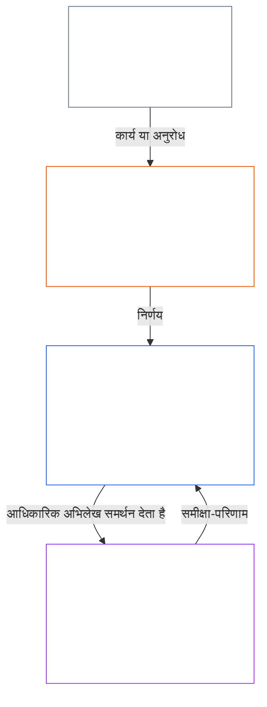
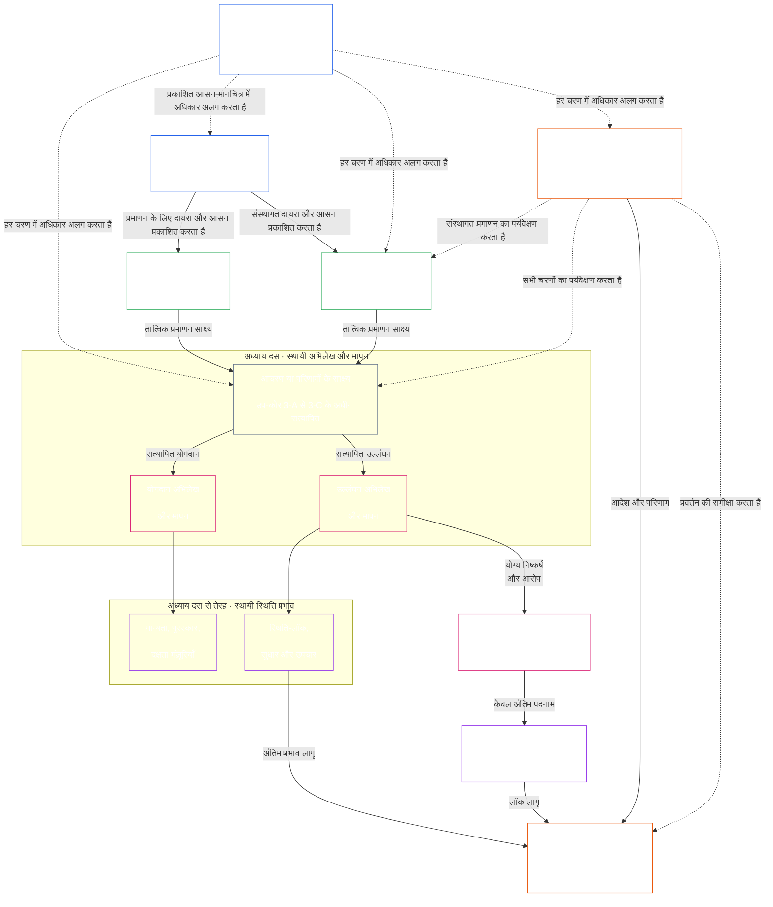

<!-- Locale: hi; variety: मानक हिंदी. AI-assisted structural resynchronization draft (GPT-6 Codex), unreviewed and incomplete. English source commit 6e0b6c663dde01b5dea731fe33d87725c7174930; edition SC-Corpus-2026.11.25. core_00 SHA-256 90799cb8019b41356fa5dd90565e3f9540fc346e8c77e2c321b841654f39b274; core_01 SHA-256 aca759b394f10784ab1a2eef4e9e2ca12e369ef0ca8ee797298c6af00d2950aa. -->

<strong>संग्रह में स्थान (गैर-संक्रियात्मक): फ़ाइल संरचना और पढ़ने के नियम</strong>

> **गैर-संक्रियात्मक** चिह्नित विजेट (संग्रह में स्थान, पाठक-मार्गदर्शन और पठन-मानचित्र) केवल मार्गदर्शन हैं। वे अपनी फ़ाइल या किसी अन्य फ़ाइल में बाध्यकारी कर्तव्य जोड़ते, हटाते या संकीर्ण नहीं करते।
>
> यह फ़ाइल **संज्ञ संविधान का हिस्सा** है और अन्य क्रमांकित `core_*` फ़ाइलों तथा सबकोर के साथ एक पाठ के रूप में पढ़े जाने पर ही **बाध्यकारी** है। इसमें **अध्याय एक**, *संवैधानिक मानचित्र*, है: इसका उद्देश्य (§1), यह क्यों है (§2), इसकी फ़ाइलें कैसे जुड़ती हैं (§3), आगे के अध्यायों की बुनियाद (§4), मुख्य शासन प्रक्रियाएँ (§5), और संवैधानिक स्वामी-पंजी (§6 से §11)।
>
> **पहले:** [core_00.000_preamble.md](core_00_preamble.md) (प्रस्तावना)
> **अगला:** [core_02.000_values_principles.md](../../core_02.000_values_principles.md)

<strong>अनुसरण</strong>

- पहले: [प्रस्तावना](core_00_preamble.md) (*मॉडल, दो संवैधानिक उद्देश्य, संवैधानिक चतुष्क, भौतिक दाँव और मापन श्रेणियाँ*)।
- उपखंड:
  - [§1](#1-purpose-role-and-scope);
  - [§2](#2-why-the-map-exists);
  - [§3](#3-how-the-files-fit-together);
  - [§4](#4-foundations-for-the-chapters-that-follow);
  - [§5](#5-key-governance-processes);
  - [§6](#6-principles-definitions-and-rights);
  - [§7](#7-system-and-institutional-charters-functional-independence-and-separation-of-duties);
  - [§8](#8-key-practical-process-pipelines);
  - [§9](#9-process-ownership-and-outputs);
  - [§10](#10-governance-change-and-incorporation);
  - [§11](#11-adopted-implementation-corpus)।
- साथ में पढ़ें: [प्राधिकार-स्तर और आंतरिक पदानुक्रम](../../subcore_03.080_band_integrative.md#authority-stack-and-internal-hierarchy) (*स्वामी-पंजी कैसे लागू होता है*); [README.md](README.md) (*पठन-क्रम*)।

 

# अध्याय एक: संवैधानिक मानचित्र

> **मसौदे की स्थिति:** AI-सहायित अनुवाद; अभी समीक्षा नहीं हुई है और अधूरा है। यह कार्य-मसौदा है।

<strong>कॉर्पस में स्थान (गैर-संचालनात्मक): फ़ाइल संरचना और पढ़ने के नियम</strong>

> **गैर-संचालनात्मक** चिह्नित विजेट (कॉर्पस में स्थान, पाठक-मार्गदर्शन, पठन-मानचित्र) केवल दिशा देते हैं। वे अपनी फ़ाइल में या किसी अन्य फ़ाइल में कोई बाध्यकारी कर्तव्य जोड़ते, हटाते या सीमित नहीं करते।
>
> यह फ़ाइल **संज्ञ संविधान का भाग** है और अन्य क्रमांकित `core_*` फ़ाइलों तथा सबकोर के साथ एक ही पाठ के रूप में पढ़े जाने पर ही **बाध्यकारी** है। इसमें **अध्याय एक**, *संवैधानिक मानचित्र* है: इसका उद्देश्य (§1), यह क्यों है (§2), इसकी फ़ाइलें कैसे जुड़ती हैं (§3), आगे के अध्यायों की बुनियाद (§4), मुख्य शासन प्रक्रियाएँ (§5), और संवैधानिक स्वामी-पंजी (§§6 से 11)।
>
> **Amont :** [core_00.000_preamble.md](core_00_preamble.md) (Préambule)
> **Suivant :** [core_02.000_values_principles.md](../../core_02.000_values_principles.md)

<strong>पथ-रेखा</strong>

- पूर्ववर्ती: [प्रस्तावना](core_00_preamble.md) (*मॉडल, दो संवैधानिक उद्देश्य, संवैधानिक चतुष्क, भौतिक दाँव और मापन-श्रेणियाँ*).
- उपखंड:
  - [§1](#1-purpose-role-and-scope);
  - [§2](#2-why-the-map-exists);
  - [§3](#3-how-the-files-fit-together);
  - [§4](#4-foundations-for-the-chapters-that-follow);
  - [§5](#5-key-governance-processes);
  - [§6](#6-principles-definitions-and-rights);
  - [§7](#7-system-and-institutional-charters-functional-independence-and-separation-of-duties);
  - [§8](#8-key-practical-process-pipelines);
  - [§9](#9-process-ownership-and-outputs);
  - [§10](#10-governance-change-and-incorporation);
  - [§11](#11-adopted-implementation-corpus).
- साथ पढ़ें: [अधिकार-क्रम और आंतरिक पदानुक्रम](../../subcore_03.080_band_integrative.md#authority-stack-and-internal-hierarchy) (*स्वामी-पंजी लागू करने का तरीका*); [README.md](README.md) (*पठन-क्रम*).

 

### 1. उद्देश्य, भूमिका और दायरा

*साधारण शब्दों में: यह अध्याय संविधान के बाकी हिस्से के लिए मार्गदर्शिका है। यह दिखाता है कि हिस्से कैसे जुड़ते हैं, हर विषय की जिम्मेदारी किस अध्याय की है, और मुख्य प्रक्रियाएँ कैसे चलती हैं, ताकि पाठक अपने प्रश्न का उत्तर देने वाला नियम खोज सके।*

**उद्देश्य:** अध्याय एक समग्र परिचय और जिम्मेदारी-मार्गदर्शिका देता है। यह उन प्रक्रियाओं के नाम बताता है जो अधिकृत शासन को परखती हैं, बताता है कि हर सारगत क्षेत्र की जिम्मेदारी किस अध्याय की है, और संवैधानिक पाठ के तीन स्तरों का वर्णन करता है।

**भूमिका:** यह अध्याय दिशा और जिम्मेदारी देता है। जिम्मेदार स्वामी-पंजी से आगे यह अपना कोई कर्तव्य नहीं जोड़ता; अन्य अध्याय और [प्राधिकार-स्तर और आंतरिक पदानुक्रम](../../subcore_03.080_band_integrative.md#authority-stack-and-internal-hierarchy) उस पंजी को लागू करते हैं।

**अध्याय का दायरा:** अध्याय में शामिल हैं:

- मानचित्र क्यों है (**खंड 2**);
- फ़ाइलें कैसे जुड़ती हैं (**खंड 3**) और आगे के अध्यायों की बुनियाद (**खंड 4**);
- मुख्य शासन प्रक्रियाएँ (**खंड 5**);
- संवैधानिक स्वामी-पंजी: सिद्धांत, परिभाषाएँ और अधिकार (**खंड 6**); सिस्टम और संस्थागत चार्टर, कार्यात्मक स्वतंत्रता और कर्तव्यों का पृथक्करण (**खंड 7**); प्रक्रिया-शृंखलाएँ (**खंड 8**); प्रक्रिया-स्वामित्व और परिणाम (**खंड 9**); और शासन, बदलाव और समावेशन (**खंड 10**); तथा
- स्वीकृत कार्यान्वयन कॉर्पस और सबकोर (**खंड 11**)।

### 2. मानचित्र क्यों है

*साधारण शब्दों में: इतने बड़े पाठ को ऐसी मार्गदर्शिका चाहिए जो दिखाए कि उसके हिस्से कैसे जुड़ते हैं और हर विषय का स्वामी कौन है। यह अध्याय इसलिए है ताकि पाठक अपने प्रश्न का उत्तर देने वाला नियम खोज सके।*

संविधान का काम अनेक अध्यायों, एक सबकोर और चार स्वीकृत कॉर्पस में फैला है। कोई संज्ञ प्राणी यह जानने की कोशिश करे कि उसे क्या मिलना चाहिए, या कोई अपनाने वाला कोई कर्तव्य ढूँढ़े, तो वह रास्ता भटक सकता है। यह अध्याय समग्र परिचय और जिम्मेदारी-मार्गदर्शिका है: हर हिस्सा क्या करता है, किस विषय का स्वामी कौन-सा अध्याय है, प्रक्रिया-शृंखलाएँ कैसे चलती हैं और स्तर कैसे जुड़े हैं। स्वामी-पंजी से आगे यह अपना कोई नियम नहीं जोड़ता।

**आधार:**

- प्रस्तावना:
  - [संवैधानिक चतुष्क](core_00_preamble.md#constitutional-tetrad): वे चार कर्तव्य जिन्हें यह अध्याय आगे ले जाता है:
    - [सहभागिता](../../subcore_03.060_apex_participation_leg.md#participation): संज्ञ प्राणी अपने प्रश्न का उत्तर देने वाला नियम खोज सकता है;
    - [जवाबदेही](../../subcore_03.040_apex_accountability_leg.md#accountability): हर विषय का एक नामित स्वामी-अध्याय है जो उसके लिए जवाब देता है;
    - [निगरानी](../../subcore_03.055_apex_oversight_leg.md#oversight): पाठक देख सकता है कि हिस्से कैसे जुड़ते हैं और कोई कमी या ओवरलैप पहचान सकता है;
    - [समयबद्धता](../../subcore_03.065_apex_timeliness_leg.md#timeliness): पाठक बिना देरी सही नियम तक पहुँचता है;
  - [दो संवैधानिक उद्देश्य](core_00_preamble.md#two-constitutional-aims): दोनों उद्देश्य जिनकी यह अध्याय सेवा करता है:
    - [समुन्नति](core_00_preamble.md#flourishing): संविधान संज्ञ प्राणियों के काम तभी आता है जब वे उसमें अपना रास्ता खोज सकें;
    - [सातत्य](core_00_preamble.md#continuity): स्पष्ट मानचित्र पाठ को उसके बढ़ने और बदलने पर भी पूरा रखता है;
- अध्याय दो के सिद्धांत:
  - [§5.2 सरल-भाषा सुलभता (सहभागिता और उत्तरदायी प्रबंधन का कर्तव्य)](../../core_02.000_values_principles.md#52-plain-language-accessibility-participation-and-stewardship-duty);
  - [§5.2.4 जटिलता को पराजय बनने से रोकने का अनुशासन](../../core_02.000_values_principles.md#524-complexity-as-defeat-discipline);
  - [§15.4 संवैधानिक अर्थ के टकराव का समाधान](../../core_02.030_constitutional_interpretation.md#154-constitutional-meaning-conflict-resolution);
- अध्याय चार के अनुच्छेद:
  - [अनुच्छेद XXIV-A](../../core_04.030_rights_part_d.md#article-xxiv-a-proportional-comprehensibility-right) (*आनुपातिक बोधगम्यता का अधिकार*);
  - [अनुच्छेद XXIV-B](../../core_04.030_rights_part_d.md#article-xxiv-b-complexity-audit-and-modularity-requirements) (*जटिलता-लेखा और मॉड्यूलरता की आवश्यकताएँ*)।

### 3. फ़ाइलें कैसे जुड़ती हैं

संविधान की फ़ाइलें इस प्रकार जुड़ती हैं:

- **कोर (`core_*`):** क्रमांकित फ़ाइलों में संविधान के अध्याय हैं, जिन्हें एक पाठ की तरह साथ पढ़ा जाता है। वे गारंटियाँ और संवैधानिक ढाँचा बताते हैं।
- **सबकोर (`subcore_*`):** ये फ़ाइलें अध्यायों के पीछे के पूर्ण नियम और प्रक्रियाएँ देती हैं। हर फ़ाइल किसी अध्याय की है, उसी के समान बल रखती है और अलग समावेशन के बिना हर अपनाने वाले पर बाध्यकारी है। सबकोर अपने अध्याय को संकुचित नहीं कर सकता।
- **कार्यान्वयन (`corpus_*`):** चार फ़ाइलें संविधान चलाने के परिचालन विवरण देती हैं। वैध समावेशन के दायरे में वे बाध्यकारी हैं और संविधान को संकुचित किए बिना लागू करती हैं। [खंड 11](#11-adopted-implementation-corpus) चार फ़ाइलों की पहचान करता है।

परिभाषित [कॉर्पस](../../subcore_03.080_band_integrative.md#corpus) बाध्यकारी संवैधानिक स्रोतों का व्यापक, संस्करणबद्ध समूह है: इसमें कोर, सबकोर, स्वीकृत कार्यान्वयन-पाठ और संक्रमण के दौरान कोई भी वैध अनुकूलता-आवरण शामिल है। केवल परियोजना का हिस्सा होने से मसौदे, टिप्पणियाँ और नेविगेशन मार्गदर्शिकाएँ बाध्यकारी नहीं बनतीं।

### 4. आगे के अध्यायों की बुनियाद

*साधारण शब्दों में: अध्याय दो से चार मूल्यों, शब्दकोश (परिभाषाएँ बनाने, उनकी रक्षा करने और उन्हें साबित करने के सबकोर नियमों सहित) और अधिकार-तल के स्वामी हैं; आगे के अध्यायों को इन क्षेत्रों का सम्मान करना है, उन्हें चुपचाप दूसरी जगह नहीं ले जाना।*

**अध्याय दो से चार** वे मूल्य, शब्दावली, सत्यापन-व्यवस्था और अधिकार-तल देते हैं जिनका आगे सबको सम्मान करना है, जिनमें शामिल हैं:

- [अध्याय पाँच](#7-system-and-institutional-charters-functional-independence-and-separation-of-duties) की सिस्टम या संस्थागत चार्टर आवश्यकता, अध्याय छह की कर्तव्य-पृथक्करण आवश्यकता और अध्याय सात के स्वतंत्र निकाय—धारा 7 में;
- धारा 8 की [मुख्य व्यावहारिक प्रक्रिया-शृंखलाएँ](#8-key-practical-process-pipelines);
- धारा 9 का [प्रक्रिया-स्वामित्व और परिणाम](#9-process-ownership-and-outputs);
- धारा 10 के शासन और बदलाव-पथ अध्याय; और
- धारा 11 का [स्वीकृत कार्यान्वयन कॉर्पस](#11-adopted-implementation-corpus)।

### 5. प्रमुख शासन प्रक्रियाएँ

जब अध्याय चार, सबकोर 8-B, कोई समाविष्ट दस्तावेज़ या अन्य संवैधानिक प्रावधान स्पष्ट रूप से माँगे, तो तात्विक संवैधानिक मुद्दे को नीचे दिए एक या अधिक मार्गों पर ले जाएँ। ये मार्ग अधिकृत शासन की परीक्षा करते हैं और उसे समीक्षा-योग्य, चुनौती-योग्य तथा सुधारे जाने योग्य बनाते हैं; वे स्वयं शासन-अधिकार नहीं देते।

- **कार्यात्मक स्वतंत्रता और कर्तव्य-पृथक्करण** ([अध्याय छह](../../core_06.000_functional_independence_separation_of_duties.md#chapter-six-functional-independence-and-separation-of-duties)): किसी वस्तुतः बाध्यकारी कार्य के आगे बढ़ने से पहले, लागू अनुपातिकता और स्वतंत्रता नियमों के अनुसार पहल, सत्यापन या प्राधिकरण, आधिकारिक अभिलेख-अभिरक्षा और चुनौती-समीक्षा के कार्यों की पहचान कर उन्हें अलग रखें।
- **प्रणाली-संरेखण प्रमाणन** ([सबकोर 8-B](../../subcore_08.020_system_alignment_certification_evaluation.md#subcore-8-b-system-alignment-certification--evaluation)): बड़े पैमाने पर उच्च-प्रभाव प्रणाली पर भरोसा करने से पहले प्रमाण जुटाएँ और जाँचें कि अभी उस पर भरोसा करना संवैधानिक रूप से सुरक्षित है या नहीं। प्रमाणन और उसे चुनौती देने तथा ऑडिट करने का संज्ञ प्राणियों का अधिकार एक-दूसरे के पूरक सुरक्षा उपाय हैं; कोई भी दूसरे का स्थान नहीं लेता।
- **स्थिति अभिलेख** ([सबकोर 10-B](../../subcore_10.020_standing_assessment.md#subcore-10-b-standing-records--question-1-what-happened)): जब आचरण या हानि संवैधानिक रूप से मायने रखती हो, सत्यापित तथ्यों को योगदान या उल्लंघन की अलग औपचारिक केस-फाइलों में दर्ज करें; अफवाह और प्रतिष्ठा पर्याप्त नहीं हैं।
- **सुधार और उपचार** ([अध्याय बारह §3.1](../../core_12.000_violation_consequences.md#31-remedy-and-correction)): सत्यापित उल्लंघन के बाद उसके कारण का समाधान और उसे जारी रहने से रोकने के लिए क्या करना होगा (सुधार), और प्रभावित लोगों को क्या देय है (उपचार), दोनों का आकलन करें। एक दूसरे का विकल्प नहीं है।
- **फोरम समीक्षा** ([अध्याय सोलह](../../core_16.000_forum.md#chapter-sixteen-standards-routing-and-forum-cases)):
  - पहले से अधिकृत प्रणालियों के भीतर साधारण विवाद पहले प्रकाशित हितधारक-प्रणाली सहभागिता चुनौती-मार्ग अपनाते हैं।
  - यदि वह मार्ग विवादित, अनुपस्थित, कब्ज़े में या उपचार देने में असमर्थ हो, तो प्राथमिक दाँव के अनुसार पर्यवेक्षित मंचों तक विवाद भेजें।
  - मंच **अनुच्छेद XXVII-C** के तहत साक्ष्य, वैध स्थानांतरण और समयबद्ध समाधान की समय-सीमाओं में सहायता करते हैं।

### 6. सिद्धांत, परिभाषाएँ और अधिकार

**अनुभाग 6 से 11** इस संविधान की **संवैधानिक स्वामी-पंजी** हैं: वे बताते हैं कि हर विषय का उत्तरदायित्व किस अध्याय या स्वीकृत कॉर्पस का है और वह क्या प्रदान करता है। हर क्रमांकित अध्याय की शुरुआत में उसका बाध्यकारी स्वामी-वाक्य भी है। अन्य भाग स्वामी का संदर्भ दे सकते हैं, पर उसकी जिम्मेदारी को चुपचाप फिर से लिख या स्थानांतरित नहीं कर सकते। देखें [प्राधिकार-स्तर और आंतरिक पदानुक्रम](../../subcore_03.080_band_integrative.md#authority-stack-and-internal-hierarchy)।

**[अध्याय दो — मूल्य, सिद्धांत और उत्तरदायी प्रबंधन](../../core_02.000_values_principles.md)**

- **इसका स्वामित्व:** संविधान के मार्गदर्शक मूल्य और सीमाएँ—कल्याण, निष्पक्षता, सुरक्षा, सत्य, विश्वास और सीमित स्वतंत्रता; वैध योगदान की पहचान और आनुपातिक पुरस्कार; सिद्धांतों के टकराव का समाधान; तथा उत्तरदायी प्रबंधन के कर्तव्य, जिनमें वितरित समझ, प्रणालीगत मूल्यांकन और शासन-अनुशासन शामिल हैं।
- **यह क्या प्रदान करता है:** बाद के अध्यायों के लिए व्याख्यात्मक आधार, जो प्रणालियों, अधिकारों, परिभाषाओं और प्रक्रिया-शृंखलाओं को लागू करते समय उच्च-स्तरीय उद्देश्यों को परिचालन आवश्यकताओं में बदलता है।

**[अध्याय तीन — आधारभूत परिभाषाएँ](../../core_03.000_definitions_home.md)**

- **इसका स्वामित्व:** परिभाषाओं का मानक ढाँचा—पर्यवेक्षण, सहभागिता, जवाबदेही, सातत्य और समेकन बैंड; [प्राधिकार-स्तर और आंतरिक पदानुक्रम](../../subcore_03.080_band_integrative.md#authority-stack-and-internal-hierarchy); [कॉर्पस](../../subcore_03.080_band_integrative.md#corpus); और संबंधित सीमा-नियम।
- **यह क्या प्रदान करता है:** व्याख्या, ऑडिट और निर्णय के लिए सटीक संवैधानिक शब्दावली। यह परिभाषा-ढाँचा है, अधिकार-तल नहीं; बाध्यकारी अधिकार अध्याय चार में हैं।

अध्याय तीन के उपकॉर्पस परिभाषाओं के निर्माण, संरक्षण और प्रमाण के नियम देते हैं:

- **[उपकॉर्पस 3-A — परिभाषा संरचना](../../subcore_03.010_definition_structure.md):** अस्तित्व/मापन/आकलन/अनुपालन (O/M/A/C) घटक-संरचना, संरेखण आवश्यकताएँ और घटक नियम तय करता है। **यह क्या प्रदान करता है:** अस्पष्ट लेबल, छिपी धारणाओं और असंगत शब्द-रूपों से बचाने वाली साझा व्याकरण।
- **[उपकॉर्पस 3-B — परिभाषा अखंडता](../../subcore_03.020_definition_integrity.md):** बचाव, दायरा खिसकाने, पुनर्परिभाषा के खेल और ऐसे गैर-अनुपालन उपायों से बचाता है जो परिभाषाओं को व्यवहार में खोखला कर दें। **यह क्या प्रदान करता है:** बचाव-विरोधी अनुशासन और गैर-अनुपालन मार्ग-दिशा मेटाडेटा, जिसमें बचाव सिद्ध होने पर प्रस्थिति और कदाचार समीक्षा तक मार्ग शामिल हैं।
- **[उपकॉर्पस 3-C — भार, अनुरेखण और सत्यापन](../../subcore_03.030_burden_traceability_verification.md):** अनुपालन का दावा करने वाले पर प्रमाण-भार रखता है और [तात्विक दाँव](core_00_preamble.md#material-stake) के अनुरूप, अनुरेखणीय, प्रेक्षणीय, सत्यापन योग्य तथा व्यवहार में चुनौती योग्य प्रमाण माँगता है। **यह क्या प्रदान करता है:** सत्यापन-शृंखला, जो [उपकॉर्पस 10-B](../../subcore_10.020_standing_assessment.md#subcore-10-b-standing-records--question-1-what-happened) के सत्यापित इनपुट और [उपकॉर्पस 8-B](../../subcore_08.020_system_alignment_certification_evaluation.md#subcore-8-b-system-alignment-certification--evaluation) के प्रणाली-संरेखण प्रमाण देती है; यह प्रस्थिति-मापन का स्थान नहीं लेती।

**[अध्याय चार — आधारभूत अधिकार](../../core_04.000_rights_part_a.md)**

- **इसका स्वामित्व:** अनुच्छेद **I–XXIX** का अधिकार-तल—जीवन-आवश्यकताएँ; संसाधन आवंटन और निर्भरता-प्रबंधन; गरिमा, कर्तृत्व और सहभागिता; चुनौती और उपचार; न्याय की सीमाएँ; **अनुच्छेद XXVII-C** के तहत समयबद्धता; और अंगीकरण-संक्रमण नियम। चार भागों में ग्रह-प्रथम पठन के लिए ये सुरक्षा व्यवस्थित हैं।
- **यह क्या प्रदान करता है:** गैर-बातचीत योग्य अधिकार-सुरक्षा और उपचार-सूत्र, जिनका अध्याय पाँच से छब्बीस, मंचों, शासन और संशोधन-नियमों को सम्मान करना है; प्रक्रिया या वैकल्पिक माप से इन्हें संकुचित, दरकिनार या खोखला नहीं किया जा सकता।

### 7. प्रणाली और संस्थागत चार्टर, कार्यात्मक स्वतंत्रता और कर्तव्य-पृथक्करण

*साधारण शब्दों में: वास्तविक प्रभाव वाली प्रणाली या संस्था एक प्रणाली-चार्टर या संस्थागत चार्टर प्रकाशित करती है, जिसमें बताया जाता है कि वह क्या कर सकती है और हर आसन पर कौन बैठता है। किसी भौतिक रूप से बाध्यकारी कार्य से पहले, उसे शुरू करने, जाँचने या अधिकृत करने, आधिकारिक अभिलेख रखने और चुनौती की समीक्षा करने वाले लोगों को अलग रखा जाता है। भूमिकाएँ संदर्भ के अनुपात में हो सकती हैं, पर वही कर्ता और उसकी नियंत्रण-रेखा चुपचाप उन आसनों पर नहीं बैठ सकती जो उसके अपने कार्य की जाँच करते हैं।*

यह खंड प्रणाली-चार्टर, संस्थागत चार्टर और कर्तव्य-पृथक्करण की आवश्यकताओं तथा उन निकायों के अध्याय का सार देता है जिन्हें उन लोगों से स्वतंत्र रहना चाहिए जिनकी वे जाँच करते हैं। यह बताता है कि प्रत्येक क्या प्रदान करता है।

**[अध्याय पाँच — प्रणाली और संस्थागत चार्टर](../../core_05.000_charters.md#chapter-five-system-and-institutional-charters)**

- **इसका स्वामित्व:** प्रणाली-चार्टर या संस्थागत चार्टर प्रकाशित करने की आवश्यकताएँ:
  - वर्ग L या उससे ऊपर की वे प्रणालियाँ और संस्थाएँ जिन्हें [प्रणाली-चार्टर](../../subcore_03.075_band_continuity.md#system-charter) या [संस्थागत चार्टर](../../subcore_03.075_band_continuity.md#institutional-charter) प्रकाशित करना चाहिए (वर्ग P स्वेच्छा से प्रकाशित कर सकता है);
  - चार्टर में बताई जाने वाली न्यूनतम बातें, जिनमें [चार्टर-भूमिका मानचित्र](../../subcore_03.075_band_continuity.md#charter-role-map) और प्रकाशित बाध्यकारी हितधारक-चयन नियमों के [चार्टर-संदर्भ](../../subcore_03.075_band_continuity.md#charter-pointer) शामिल हैं;
  - चार्टर में बताए गए दायरे को चुपचाप बदलने से रोकने के लिए संशोधन और समीक्षा की प्रक्रिया; और
  - चार्टर क्या नहीं कर सकता: वर्ग तय करना, सीमा परिभाषित करना, प्रमाणन का स्थान लेना, निर्णय-नियम रखना या अधिकार देना।
- **यह क्या प्रदान करता है:** दायरे और आसन-विन्यास का प्रकाशित, संस्करणबद्ध कथन, जिसके आधार पर [अध्याय छह](../../core_06.000_functional_independence_separation_of_duties.md#chapter-six-functional-independence-and-separation-of-duties), प्रमाणन, प्रस्थिति अभिलेख और मंच आचरण की जाँच कर सकते हैं।

**[अध्याय छह — कार्यात्मक स्वतंत्रता और कर्तव्य-पृथक्करण](../../core_06.000_functional_independence_separation_of_duties.md)**

- **इसका स्वामित्व:** प्रत्येक [भौतिक रूप से बाध्यकारी कार्य](../../subcore_03.070_band_accountability.md#materially-binding-act) में चार कार्यों को अलग-अलग सौंपने की सभी प्रक्रियाओं पर लागू आवश्यकता:
  - पहल करना;
  - सत्यापन या प्राधिकरण;
  - आधिकारिक अभिलेख की अभिरक्षा; और
  - चुनौतियों की समीक्षा।

  यह इन बातों को भी नियंत्रित करता है:

  - प्रत्येक [भौतिक रूप से बाध्यकारी कार्य-अभिलेख](../../subcore_03.070_band_accountability.md#materially-binding-act-record) की सार्वभौमिक न्यूनतम सामग्री;
  - कर्ता की [भौतिक नियंत्रण-रेखा](../../subcore_03.070_band_accountability.md#material-control-line) से स्वतंत्रता;
  - कार्यों का प्रकाशित स्थान और विकल्प;
  - अनुपातिक संयुक्त व्यवस्था और आपातकालीन सीमाएँ; तथा
  - उत्तरदायी हस्तांतरण और गलत आसन की ओर भेजने से बचाव।
- **यह क्या प्रदान करता है:** चार आसनों और कार्य-अभिलेख की पुनःप्रयोग योग्य संरचना। किसी भी बाद की प्रमाणन, प्रस्थिति, मंच, शासन या समाविष्ट कार्यान्वयन प्रक्रिया को इसे लागू करना होगा, तभी उसका परिणाम स्वतंत्र रूप से जाँचा हुआ, विश्वसनीय रूप से दर्ज और वास्तव में चुनौती योग्य माना जा सकता है।

**[अध्याय सात — स्वतंत्र निकाय](../../core_07.000_independent_bodies.md)**

- **इसका स्वामित्व:** निकाय की स्वतंत्रता के गुण, निकाय को स्वतंत्र निकाय नामित करने का नियम, और प्रत्येक अंगीकारकर्ता के लिए आवश्यक स्वतंत्र निकायों की सूची; प्रत्येक के साथ संज्ञ प्राणियों को दी जाने वाली गारंटी की एक-पंक्ति अभिव्यक्ति।
- **यह क्या प्रदान करता है:** ऐसा एक मानक जिसे प्रत्येक स्वतंत्र निकाय पूरा करता है, ताकि उसकी स्वतंत्रता हर जगह एक ही तरह जाँची जाए। प्रत्येक सूचीबद्ध निकाय के पूरे संचालन-नियम उसके अपने उपकॉर्पस फ़ाइल में हैं, जो [अध्याय सात](../../core_07.000_independent_bodies.md#chapter-seven-independent-bodies) से जुड़ी है।

#### 7.1 चार-आसन पृथक्करण मानचित्र

हर **भौतिक रूप से बाध्यकारी कार्य** को उसी कार्य के लिए ये सुरक्षा-नियम मानने होंगे:

- पहल करने वाला आसन अपने ही कार्य का सत्यापन या प्राधिकरण नहीं कर सकता;
- सत्यापन या प्राधिकरण वाला आसन उस कार्य के आधिकारिक अभिलेख की अभिरक्षा नहीं कर सकता;
- वह आसन उस कार्य की चुनौती की समीक्षा भी नहीं कर सकता;
- सत्यापन/प्राधिकरण और चुनौती-समीक्षा के आसन, पहल करने वाले आसन की [भौतिक नियंत्रण-रेखा](../../subcore_03.070_band_accountability.md#material-control-line) के बाहर होंगे।

<strong>पाठक-मार्गदर्शन (गैर-संचालनात्मक): चार-आसन पृथक्करण मानचित्र</strong>

> यह मानचित्र चार कार्यों और किसी कार्य तथा उसके कार्य-अभिलेख के सामान्य क्रम को दिखाता है। यह पाँचवाँ आसन नहीं जोड़ता, कोई सार्वभौमिक क्रम निर्धारित नहीं करता और अध्याय छह के स्वतंत्रता, अनुपातिक संयुक्त व्यवस्था, आपातकालीन कार्रवाई या चुनौती-मार्ग संबंधी नियम नहीं बदलता।

 

### 8. प्रमुख व्यावहारिक प्रक्रिया शृंखलाएँ

*सरल शब्दों में: अध्याय नौ से पंद्रह अध्याय आठ की कर्तव्य-विभाजन आवश्यकता को एक श्रृंखला में लागू करते हैं: प्रणालियों और संस्थाओं को प्रमाणित करना, सहायता और हानि को दो अलग मार्गों पर मापना, वास्तविक प्रभाव और उपचार लागू करना, और किसी मंच को अपने विरुद्ध दावे का अकेला अंतिम निर्णयकर्ता बनने से रोकना। यह श्रृंखला संवैधानिक कर्तव्यों को रोज़मर्रा के जीवन में वास्तविक रखती है।*

[अध्याय सात](core_07_charters.md#chapter-seven-system-and-institutional-charters) हर क्लास L या उससे ऊपर की प्रणाली और संस्था का चार्टर्ड दायरा तथा आसन-मानचित्र प्रकाशित करता है। [अध्याय आठ](../../core_07.000_independent_bodies.md#chapter-eight-functional-independence-and-separation-of-duties) कर्तव्य-विभाजन की वह आवश्यकता देता है जिससे इस श्रृंखला का हर कार्य वैध रूप से जाँचने योग्य हो। आरंभ, सत्यापन या प्राधिकरण, आधिकारिक अभिलेख-अभिरक्षा और चुनौती-समीक्षा के कार्य लागू अनुपात और स्वतंत्रता नियमों के अनुसार अलग-अलग सौंपे और अलग रखे जाने चाहिए। फिर अध्याय नौ से पंद्रह इस संरचना को क्रम से लागू करते हैं:

नीचे प्रत्येक चरण कहता है कि अध्याय का क्षेत्र क्या है और वह क्या देता है। [पूरी शृंखला कैसे बैठती है](#51-how-the-full-chain-fits-together) फिर उन स्वामियों को प्रणाली-जाँच से उपचार तक एक मार्ग के रूप में दिखाता है।

**प्रणाली-संरेखण प्रमाणन** ([अध्याय सात](core_09.000_system_alignment_certification_evaluation.md#chapter-nine-system-alignment-certification))

- **इसका क्षेत्र:** सुनिश्चित करता है कि तात्विक प्रभाव वाली प्रणालियाँ संवैधानिक रूप से संरेखित रहें।
  - इससे पहले कि संज्ञ प्राणियों को तात्विक रूप से प्रभावित करने वाली प्रणाली पहचानी जाए या बड़े पैमाने पर उस पर भरोसा किया जाए, मंच निगरानी के अधीन साक्ष्य इकट्ठा और समीक्षा किया जाता है
  - समीक्षा में ये बातें शामिल होनी चाहिए:
  - क्या सिस्टम जीवन-रक्षा की आवश्यकताओं का सम्मान करता है;
  - **अनुच्छेद V** (*संसाधन आवंटन, निर्भरताएँ और पारिस्थितिकी तंत्र वित्तपोषण*) के अंतर्गत संसाधन आवंटन और निर्भरता की देखरेख—जहाँ साझा अवसंरचना पर महत्वपूर्ण निर्भरता हो, वहाँ [Proportionate Cross-System Support](../../core_05.040_band_continuity.md#proportionate-cross-system-support) सहित;
  - सुरक्षा;
  - भागीदारी; और
  - अन्य संवैधानिक न्यूनतम सुरक्षा।
  - मान्य प्रस्थिति वाले संज्ञ प्राणी परिणाम को चुनौती दे सकते हैं
  - उच्च-जोखिम प्रणालियों का नियमित अनुसूची पर पुनःप्रमाणन होना चाहिए; प्रमाणन कभी स्थायी नहीं
- **यह क्या देता है:** एक **प्रणाली-संरेखण प्रमाणन अभिलेख** — एक सीमाबद्ध, चुनौती-योग्य उत्तर कि क्या वह प्रणाली *अभी* पहचानने, भरोसा जारी रखने, तैनात करने, या शर्तों से मुक्त करने लायक पर्याप्त संरेखित है, कथित दायरे और समय-खिड़की के भीतर।

**प्रस्थिति मापन** ([अध्याय आठ](../../subcore_10.020_standing_assessment.md#chapter-ten-compliance-violation-and-standing-model))

- **इसका क्षेत्र:** जब आचरण संवैधानिक रूप से मायने रखे, अफ़वाह और प्रतिष्ठा पर्याप्त नहीं। सत्यापित तथ्य **प्रस्थिति अभिलेखों** में जाते हैं। **योगदान** (समुन्नति की ओर सहायता) और **उल्लंघन** (जवाबदेही विफलताएँ और हानि) **अलग अक्षों** पर नापे जाते हैं — सत्यापित अच्छा आचरण सत्यापित हानि को मिटाता नहीं, और दोनों कभी एक नेट अंक में नहीं मिलते।
- **यह क्या देता है:** योगदान अक्ष और उल्लंघन अक्ष पर वर्गीकृत **प्रस्थिति अभिलेख**, केवल **सत्यापित निवेश** और मंच-पर्यवेक्षित निष्कर्षों पर आधारित — अनौपचारिक अंक या विवाद-कथाएँ वर्गीकरण की जगह नहीं लेतीं।

**प्रस्थिति एकीकरण और प्रभाव** ([अध्याय नौ](../../subcore_10.060_standing_integration.md#chapter-eleven-standing-effects-and-integration))

- **इसका क्षेत्र:** सत्यापित वर्गीकरणों को वास्तविक दुनिया के **प्रस्थिति प्रभावों** में अलग पटरियों पर जोड़ता है — [**भौतिक दाँव**](#material-stake) के अनुसार स्केल, योगदान और उल्लंघन को एक नेट अंक में मिलाए बिना, और सहभागिता, निगरानी, जवाबदेही या समयबद्धता को खोखला किए बिना।
  - **योगदान पटरी:** सत्यापित सकारात्मक वर्गीकरण व्यावहारिक लाभ देता है:
    - [**दक्षता मंज़ूरियाँ**](../../core_13.000_standing_integration.md#72-competency-bars-and-clearances), जो विश्वास-संवेदनशील भूमिकाएँ, प्रत्यायोजित अधिकार, पर्यवेक्षण-पात्रता और बढ़ते परिणाम वाले अभिरक्षण-दायित्व खोल सकती हैं, जब प्रकाशित दक्षता-सीमा के विरुद्ध क्षमता प्रदर्शित हो और कोई लागू [प्रस्थिति लॉक](../../core_13.000_standing_integration.md#52-prevention--general-standing-locks) नामित मार्ग को न रोकता हो
    - वैध उत्तरदायी प्रबंधन और सहयोग के लिए आनुपातिक मान्यता और **भौतिक पुरस्कार**, जैसा [अध्याय एक](../../core_02.000_values_principles.md#32-recognition-reinforcement-and-aspiration) माँगता है
    - खाली प्रशंसा नहीं। लाभ वास्तविक होने चाहिए, साक्ष्य से समर्थित, और चुनौती के लिए खुले
  - **उल्लंघन पटरी:** सत्यापित उल्लंघन निष्कर्ष व्यावहारिक घाटा देते हैं:
    - **प्रस्थिति ताले**, भूमिका सीमाएँ, सुधार आदेश, [जिन्हें हानि हुई उनके लिए उपचार](../../core_13.000_standing_integration.md#51-remedy-and-correction), पूरक वर्णनकर्ता, और प्रवर्तन हुक
    - प्रतिबंध उस गंभीरता से मेल खाते हैं जो सत्यापित हुई
    - अनसुलझे उल्लंघन जीवित रहते हैं
    - प्रामाणिक प्रतिकर दर्शाने वालों के लिए प्रस्थिति बहाल करने के आनुपातिक मार्ग उपलब्ध रहते हैं
    - योगदान पक्ष की क्षमता-स्वीकृति उल्लंघन पक्ष के प्रस्थिति ताले को माफ़ नहीं करती
- **यह क्या देता है:** योगदान और उल्लंघन पटरियों पर अलग, स्केल किए प्रस्थिति प्रभाव — एक ओर क्षमता-स्वीकृतियाँ और भौतिक पुरस्कार; दूसरी ओर प्रस्थिति ताले, सुधार और उपचार — कोई एक अंक में नहीं मिला।

**संविधान-विरोधी दुराचरण रक्षा-पट्टी** ([अध्याय दस](core_10_a_misconduct_designation.md#chapter-ten-anti-constitutional-misconduct))

- **इसका क्षेत्र:** केवल सबसे गंभीर सत्यापित उल्लंघनों को संभालता है — आचरण जिसने पैमाने पर संवैधानिक कर्तव्यों को कब्ज़ाया या खोखला किया हो सकता है। जब अध्याय आठ पहले ही उच्चतम-प्रभाव उल्लंघन निष्कर्ष दर्ज कर चुका हो, और संविधान-विरोधी दुराचरण तात्विक रूप से आरोपित हो, यह अध्याय नामांकन समीक्षा को अध्याय नौ द्वार-पटरी के रूप में साधारण अध्याय-नौ प्रस्थिति प्रभावों के समानांतर चलाता है।
- **यह क्या देता है:** उस विद्यमान उच्चतम-प्रभाव निष्कर्ष के लिए अंतिम संविधान-विरोधी-दुराचरण नामांकन — या अस्वीकृति — केवल आवश्यक मानदंड और उचित-प्रक्रिया सुरक्षाओं के पूरे होने के बाद। अध्याय आठ अभी भी नापता है कि हानि कितनी गंभीर थी; केवल अंतिम नामांकन अध्याय नौ का **संविधान-विरोधी विश्वास ताला** चालू करता है।

**मंच पर्यवेक्षण और मार्ग** ([अध्याय ग्यारह](core_11_forum.md#chapter-eleven-forums-and-jurisdiction))

- **इसका क्षेत्र:** पर्यवेक्षण करता है कि विवाद और प्रमाणन मामले वास्तव में कैसे चलते हैं।
  - प्रकाशित प्रभावित-पक्ष प्रणालीगत-सहभागिता चुनौती-मार्ग से मंच-मार्ग तक [विवाद अनुक्रम](core_11_forum.md#dispute-sequencing)
  - कौन-सा मंच-परिवार उन्हें संभालता है, और मामला साधारणतः कहाँ शुरू होता है
  - साक्ष्य कैसे सहारा पाता है
  - मामले कैसे स्थानांतरित या समेकित होते हैं
  - आत्म-निर्णय-निषेध नियम कब्ज़ाशुदा मंचों को एकमात्र अंतिम घर बनने से कैसे रोकते हैं
  - **अनुच्छेद XXV-C** (*समयबद्ध समाधान और देरी-निरोध तल*) के अधीन समय-सीमाएँ मामलों को इतनी देर अनसुलझा बैठने से रोकती हैं कि उपचार बेमानी हो जाए
- **यह क्या देता है:** **सत्यापित निष्कर्ष** जो प्रस्थिति अभिलेख खोल या अद्यतन कर सकते हैं, साथ उपचार और [समयबद्ध समाधान](../../core_05.035_band_accountability.md#timely-resolution-constitutional) की ओर वैध मार्ग। मंच शृंखला का पर्यवेक्षण करते हैं; वे अध्याय आठ के प्रस्थिति मापन की जगह नहीं लेते।

#### 8.1 प्रक्रिया मानचित्र

हर चरण एक निश्चित, समीक्षा योग्य परिणाम आगे सौंपता है, इसलिए यह श्रृंखला एक संवैधानिक प्रक्रिया बनी रहती है। इसकी संवैधानिक सीमाएँ हैं: **संवैधानिक चतुष्टय** हर चरण में सहभागिता, निगरानी, जवाबदेही और समयबद्धता माँगता है; **दो संवैधानिक उद्देश्य** समृद्धि और निरंतरता दोनों की सेवा माँगते हैं; और **अधिकार-आधार** गैर-परक्राम्य सुरक्षा को संकुचित करने, दरकिनार करने या खोखला करने से रोकते हैं। ये नियम कर्तव्यों को ऐसे अभिलेखों और निर्णयों में बदलते हैं जिन्हें संवेदनशील प्राणी व्यवहार में जाँच, चुनौती, सुधार और भरोसा कर सकें—सिर्फ कागज़ पर नहीं।

#### 8.2 पूरी शृंखला कैसे जुड़ती है

*साधारण शब्दों में: पहले आसनों को अलग करें, फिर प्रणाली-जाँच से उपचार तक का मार्ग अपनाएँ; मंच पूरे रास्ते विवाद और प्रस्थिति के चरणों का पर्यवेक्षण करते हैं।*

पूरी शृंखला इस क्रम में चलती है:

1. **हर वस्तुतः बाध्यकारी कार्य के लिए आसन अलग रखें** ([अध्याय छह](../../core_06.000_functional_independence_separation_of_duties.md#3-four-seat-constitutional-requirement)): पहचानें कि पहल कौन करता है, सत्यापन या प्राधिकरण कौन करता है, आधिकारिक अभिलेख कौन रखता है और चुनौती कौन सुनता है। कार्य को विधिवत जाँचा हुआ मानने से पहले निषिद्ध संयोजन, स्वतंत्रता नियम और प्रकाशित विकल्प-मार्ग लागू करें। जहाँ चार्टर आवश्यक हो, [अध्याय पाँच का चार्टर-भूमिका मानचित्र](../../core_05.000_charters.md#6-the-charter-role-map-and-standing-record-custody) हर आसन के धारक को प्रकाशित करता है।
2. **प्रभाव गंभीर हो तो प्रणालियों और संस्थाओं को प्रमाणित करें**: बड़े पैमाने पर उच्च-प्रभाव प्रणाली पर भरोसा करने से पहले [सबकोर 8-B](../../subcore_08.020_system_alignment_certification_evaluation.md#subcore-8-b-system-alignment-certification--evaluation) के तहत चुनौती-योग्य प्रणाली प्रमाणन अभिलेख लें; संस्था का आकलन उसके अपने वर्ग, आचरण, शासन और गतिविधि-पोर्टफोलियो के आधार पर करें और [सबकोर 9-B](../../subcore_09.020_institutional_alignment_certification_evaluation.md#subcore-9-b-institutional-alignment-certification--evaluation) के तहत संस्थागत प्रमाणन अभिलेख में परिणाम रखें।
3. **प्रस्थिति को अलग पटरियों पर दर्ज और मापें** ([सबकोर 10-B और 10-D](../../subcore_10.020_standing_assessment.md#subcore-10-b-standing-records--question-1-what-happened) तथा [10-D](../../subcore_10.040_standing_measurement.md#subcore-10-d-standing-measurement--question-2-how-good-or-bad-was-it)): जब मदद या हानि संवैधानिक रूप से मायने रखती हो, औपचारिक केस-फाइलें खोलें और केवल **सत्यापित इनपुट** स्वीकारें; फिर सत्यापित बात को मापें और वर्गीकृत करें। अफवाह, प्रतिष्ठा या विवाद-कथन पर्याप्त नहीं हैं। मदद और हानि कभी शुद्ध स्कोर में नहीं मिलतीं; जुड़े अभिलेख भी अलग रहते हैं। सत्यापित इनपुट में, जहाँ महत्वपूर्ण हो, अध्याय आठ के प्रणाली-संरेखण प्रमाणन के साक्ष्य भी शामिल हैं। समृद्धि की दिशा में सत्यापित मदद के लिए योगदान प्रस्थिति अभिलेख खोलें और योगदान अक्ष पर उसकी प्रकृति वर्गीकृत करें; सत्यापित हानि और जवाबदेही-विफलताओं के लिए अलग उल्लंघन अभिलेख खोलें और उल्लंघन अक्ष पर प्रकृति वर्गीकृत करें। जुड़े अभिलेख एक-दूसरे का संदर्भ देंगे, पर अलग रहेंगे।
4. **हर पटरी पर प्रस्थिति-प्रभाव लागू करें** ([सबकोर 10-F](../../subcore_10.060_standing_integration.md#subcore-10-f-standing-integration--question-3-what-follows)): सत्यापित योगदान से योग्यता-स्वीकृति, अनुपातिक पहचान और भौतिक पुरस्कार मिल सकते हैं; सत्यापित उल्लंघन से प्रस्थिति-लॉक, सुधार और प्रभावित लोगों के लिए उपचार हो सकता है। सत्यापित योगदान को अनुपातिक पहचान और भौतिक पुरस्कारों का समर्थन करना होगा, और वह योग्यता-अनुमति दे सकता है।
5. **संविधान-विरोधी कदाचार नामांकन की अलग समीक्षा करें** ([अध्याय चौदह](../../core_14.000_misconduct_designation.md#chapter-fourteen-anti-constitutional-misconduct-designation)): यदि उच्चतम-प्रभाव उल्लंघन का निष्कर्ष संविधान-विरोधी मानदंड भी पूरा कर सकता है, तो उचित प्रक्रिया-सुरक्षाओं के बाद अध्याय चौदह तय करता है कि अंतिम ACMD लागू होगा या नहीं। सामान्य प्रस्थिति-प्रभाव साथ-साथ चलते हैं; नामांकन अध्याय दस द्वारा मापी हानि की गंभीरता नहीं बदलता और अंतिम ACMD ही संविधान-विरोधी विश्वास-लॉक चलाता है।
6. **विवादों का मार्ग तय करें और उपचार समय पर रखें** ([अध्याय सोलह और सत्रह](../../core_16.000_forum.md#1-purpose-role-and-scope) तथा [अध्याय सत्रह](../../core_17.000_forum_families_escalation_timeliness_support.md#chapter-seventeen-forum-families-escalation-timely-resolution-and-support)): मामलों की गति, उन्हें सँभालने वाली पटरी और **अनुच्छेद XXVII-C** की समय-सीमाओं का पर्यवेक्षण करें ताकि देरी से उपचार निष्फल न हो। साधारण विवाद [विवाद अनुक्रम](../../core_16.000_forum.md#dispute-sequencing) का पालन करते हैं। विवादों को पाँच [तात्विकता स्तरों](../../core_17.000_forum_families_escalation_timeliness_support.md#5-timely-resolution-materiality-tiers-and-anti-delay-discipline) (A/B/C/L/P) में भी रखें। जब अध्याय चौदह का अंतिम नामांकन प्राथमिक दाँव हो, तो अखंडता-परिवार का तयशुदा मार्ग लागू होता है।
7. **परिणाम लागू करें** ([अध्याय उन्नीस और बीस](../../core_19.000_enforcement.md#chapter-nineteen-enforcement) तथा [अध्याय बीस](../../core_20.000_special_enforcement.md#chapter-twenty-special-enforcement)): नामित पक्ष अंतिम प्रभाव, लॉक, उपचार या मंच-आदेश को निर्धारित अवधि में लागू करे; उससे बचा, विलंबित या चुपचाप छोड़ा न जाए। बाध्य पक्ष के प्रतिरोध पर साझा तल के भीतर विशेष प्रवर्तन लागू हो: संरक्षित न्यूनतम बचाते हुए धन और संपत्ति की जब्ती; मानक समर्पण-दबाव की सीढ़ी; गैर-घातक बल को पहले रखने की सीढ़ी; और विफलता न दोहराने के लिए मूल-कारण मूल्यांकन।

### 9. प्रक्रिया-स्वामित्व और परिणाम

*साधारण शब्दों में: प्रक्रिया-मानचित्र और [पूरी शृंखला कैसे जुड़ती है](#82-how-the-full-chain-fits-together) यह शृंखला दिखाते हैं; यह खंड हर चरण का स्वामी और परिणाम बताता है, ताकि कोई चरण चुपचाप दूसरे का काम अपने हाथ में न ले।*

हर चरण का विवरण बताता है कि अध्याय किसका स्वामी है और क्या प्रदान करता है; इससे [§8.2 पूरी शृंखला कैसे जुड़ती है](#82-how-the-full-chain-fits-together) में बताए गए स्वामी स्पष्ट होते हैं।

**[उपकॉर्पस 8-B — प्रणाली-संरेखण प्रमाणन](../../subcore_08.020_system_alignment_certification_evaluation.md#subcore-8-b-system-alignment-certification--evaluation)**

- **इसका स्वामित्व:** भौतिक प्रभाव वाली प्रणालियों का संवैधानिक संरेखण बनाए रखना।
  - संज्ञ प्राणियों को भौतिक रूप से प्रभावित करने वाली प्रणाली को प्रमाणित करने या बड़े पैमाने पर उस पर निर्भर होने से पहले, मंच की निगरानी में साक्ष्य जुटाकर समीक्षा करें।
  - समीक्षा में जीवन-निर्वाह आवश्यकताओं का सम्मान; **अनुच्छेद V** (*संसाधन-वितरण, निर्भरताएँ और पारितंत्र वित्तपोषण*) का संसाधन-वितरण और निर्भरता-प्रबंधन, जिसमें साझा अवसंरचना पर निर्भरता भौतिक रूप से प्रासंगिक होने पर [अनुपातिक अंतर-प्रणाली समर्थन](../../subcore_03.075_band_continuity.md#proportionate-cross-system-support); सुरक्षा; सहभागिता; और अन्य संवैधानिक न्यूनतम शामिल हों।
  - प्रस्थिति रखने वाले संज्ञ प्राणी परिणाम को चुनौती दे सकें।
  - उच्च-जोखिम वाली प्रणालियों का नियमित पुनःप्रमाणन हो; प्रमाणन कभी स्थायी नहीं है।
- **यह क्या प्रदान करता है:** हर प्रणाली-जाँच के लिए **प्रणाली प्रमाणन अभिलेख** — बताई गई सीमा और दर्ज अवधि में प्रणाली के संरेखण पर सीमित, चुनौती योग्य निष्कर्ष।

**[उपकॉर्पस 9-B — संस्थागत संरेखण प्रमाणन](../../subcore_09.020_institutional_alignment_certification_evaluation.md#subcore-9-b-institutional-alignment-certification--evaluation)**

- **इसका स्वामित्व:** भौतिक प्रभाव वाली संस्थाओं का संवैधानिक संरेखण बनाए रखना; अध्याय आठ के समान छह चरण और वही अनुभाग-संख्या लागू हों।
  - अध्याय नौ मूल्यांकन (चरण I और II) का स्वामी है; [उपकॉर्पस 9-D](../../subcore_09.040_institutional_alignment_certification_forum_process_outcomes.md#subcore-9-d-institutional-alignment-certification--forum-process-and-outcomes) मंच-प्रक्रिया और परिणामों (III और IV) का; [उपकॉर्पस 9-F](../../subcore_09.060_institutional_alignment_certification_records_recertification.md#subcore-9-f-institutional-alignment-certification--records-recertification-challenge-and-standing) संस्थागत प्रमाणन अभिलेख और संचालन (V और VI) का।
  - संस्था की जाँच केवल उसके नियंत्रण की बातों पर हो: अपने संस्थागत चार्टर का पालन, उसके अधिकार के लिए कौन जवाब देता है, वह किन व्यवहारों को पुरस्कृत करती है और उस पर स्वतंत्र जाँच का उपयोग संभव है या नहीं।
  - प्रत्येक प्रणाली के प्रमाणन पर निर्भर रहे; उसे दोबारा न करे।
- **यह क्या प्रदान करता है:** हर संस्था-जाँच के लिए **संस्थागत प्रमाणन अभिलेख** — निर्धारित दायरे और दर्ज अवधि में उसके संरेखण पर सीमित, चुनौती योग्य निष्कर्ष। अध्याय नौ प्रणाली-मूल्यांकन दोहराए बिना मंच-प्रक्रिया पुनःप्रयोग करता है; संस्थागत प्रमाणन न लाइसेंस है न संस्था बनाने या चलाने की अनुमति-शर्त।

**[उपकॉर्पस 10-B — प्रस्थिति अभिलेख](../../subcore_10.020_standing_assessment.md#subcore-10-b-standing-records--question-1-what-happened)**

- **इसका स्वामित्व:** जब आचरण संवैधानिक रूप से मायने रखता हो, तो अफ़वाह और प्रतिष्ठा पर्याप्त नहीं—सत्यापित तथ्य **प्रस्थिति अभिलेखों** में दर्ज हों। **योगदान** (समुन्नति में सहायता) और **उल्लंघन** (जवाबदेही-विफलताएँ और हानि) अलग-अलग प्रस्थिति अभिलेखों में दर्ज हों; सत्यापित सहायता सत्यापित हानि नहीं मिटाती और दोनों कभी एक संयुक्त शुद्ध स्कोर नहीं बनते।
- **यह क्या प्रदान करता है:** योगदान और उल्लंघन पथों पर सीमित **प्रस्थिति अभिलेख**, जो केवल **सत्यापित इनपुट** और मंच-निगरानी वाले निष्कर्षों पर आधारित हों; अनौपचारिक अंकन या विवाद-कथाएँ सत्यापित अभिलेख का स्थान नहीं लेतीं।

**[उपकॉर्पस 10-D — प्रस्थिति मापन](../../subcore_10.040_standing_measurement.md#subcore-10-d-standing-measurement--question-2-how-good-or-bad-was-it)**

- **इसका स्वामित्व:** सत्यापित तथ्यों के अच्छे या बुरे होने का मापन। योगदान और उल्लंघन अलग-अलग अक्षों पर एक ही एकीकृत मापनी से मापे जाते हैं; इन्हें कभी एक संयुक्त शुद्ध स्कोर में नहीं मिलाया जाता।
- **यह क्या प्रदान करता है:** हर प्रस्थिति अभिलेख के लिए योगदान-अक्ष या उल्लंघन-अक्ष पर वर्गीकृत मापन—प्रकृति, आकार और स्थान।

**[उपकॉर्पस 10-F — प्रस्थिति एकीकरण और प्रभाव](../../subcore_10.060_standing_integration.md#subcore-10-f-standing-integration--question-3-what-follows)**

- **इसका स्वामित्व:** सत्यापित वर्गीकरणों को [**भौतिक दाँव**](core_00_preamble.md#material-stake) के अनुपात में दो अलग पथों पर वास्तविक **प्रस्थिति-प्रभावों** में बदलना। यह योगदान और उल्लंघन को एक शुद्ध स्कोर में नहीं मिलाता और सहभागिता, निगरानी, जवाबदेही या समयबद्धता को खोखला नहीं करता।
  - **योगदान-पथ:** सत्यापित सकारात्मक वर्गीकरण से व्यावहारिक लाभ होना चाहिए—[**दक्षता-मंज़ूरियाँ**](../../core_11.000_contribution_consequences.md#32-competency-bars-and-clearances), जो प्रकाशित दक्षता-सीमा पर योग्यता साबित होने और किसी लागू [प्रस्थिति-ताले](../../core_12.000_violation_consequences.md#32-prevention--general-standing-locks) से मार्ग अवरुद्ध न होने पर भरोसा-संवेदनशील भूमिकाएँ, सौंपा अधिकार, निगरानी-पात्रता और अधिक परिणामकारी उत्तरदायी प्रबंधन खोल सकती हैं; [अध्याय दो](../../core_02.000_values_principles.md#32-recognition-reinforcement-and-aspiration) के अनुसार अनुपातिक मान्यता और **भौतिक पुरस्कार**; तथा वास्तविक, साक्ष्य-समर्थित और चुनौती योग्य लाभ, केवल खोखली प्रशंसा नहीं।
  - **उल्लंघन-पथ:** सत्यापित उल्लंघन से व्यावहारिक परिणाम हों, जिनमें **प्रस्थिति-ताले**, भूमिका-सीमाएँ, सुधार-आदेश, [हानि उठाने वालों के लिए उपचार](../../core_12.000_violation_consequences.md#31-remedy-and-correction), पूरक वर्णन और प्रवर्तन-उपाय शामिल हों; सत्यापित गंभीरता के अनुपात में सीमाएँ; अनसुलझे उल्लंघनों का सक्रिय बने रहना; वास्तविक प्रतिपूर्ति दिखाने वालों के लिए अनुपातिक प्रस्थिति-पुनर्स्थापन; और योगदान-पक्ष की दक्षता-मंज़ूरी से उल्लंघन-पक्ष का प्रस्थिति-ताला न हटना।
- **यह क्या प्रदान करता है:** योगदान और उल्लंघन पथों पर अलग-अलग, अनुपातिक प्रस्थिति-प्रभाव—एक ओर दक्षता-मंज़ूरियाँ और भौतिक पुरस्कार, दूसरी ओर प्रस्थिति-ताले, सुधार और उपचार; इन्हें एक अंक में नहीं मिलाया जाता।

**[अध्याय चौदह — संविधान-विरोधी दुराचार पदनाम](../../core_14.000_misconduct_designation.md#chapter-fourteen-anti-constitutional-misconduct-designation)**

- **इसका स्वामित्व:** केवल सबसे गंभीर सत्यापित उल्लंघनों को संभालना—ऐसा आचरण जिसने बड़े पैमाने पर संवैधानिक कर्तव्यों पर कब्ज़ा किया हो या उन्हें खोखला किया हो। जब अध्याय दस सबसे अधिक प्रभाव वाले उल्लंघन को पहले ही माप चुका हो और संविधान-विरोधी दुराचार का भौतिक आरोप हो, यह अध्याय सामान्य अध्याय-दस प्रस्थिति-प्रभावों के समानांतर पदनाम-समीक्षा का प्रवेश-पथ चलाता है।
- **यह क्या प्रदान करता है:** उस पहले से दर्ज सबसे अधिक प्रभाव वाले निष्कर्ष के लिए अंतिम संविधान-विरोधी दुराचार पदनाम (ACMD), या उसे अस्वीकार करना—वह भी आवश्यक मानदंड और उचित-प्रक्रिया सुरक्षा पूरी होने पर। हानि की गंभीरता अध्याय दस ही मापता है; केवल अंतिम ACMD अध्याय दस का **संविधान-विरोधी विश्वास ताला** चालू करता है।

**[अध्याय सोलह — मानक, मार्ग-निर्धारण और मंच-मामले](../../core_16.000_forum.md#chapter-sixteen-standards-routing-and-forum-cases)**

- **इसका स्वामित्व:** विवादों और प्रमाणन-मामलों के वास्तविक आवागमन की निगरानी: प्रभावित पक्षों की प्रणालीगत सहभागिता के प्रकाशित चुनौती-पथ से मंच-मार्ग तक [विवाद-क्रम](../../core_16.000_forum.md#dispute-sequencing); किस मामले को कौन-सा मंच-परिवार संभालता है और मामला सामान्यतः कहाँ शुरू होता है; मंच-मामले खोलना और बनाए रखना; मामलों का स्थानांतरण या समेकन; और आत्म-निर्णय-विरोधी नियम, ताकि कब्ज़े वाला मंच अकेला अंतिम मंच न बने।
- **यह क्या प्रदान करता है:** ऐसे मंच-निष्कर्ष जो प्रस्थिति अभिलेख खोल या अद्यतन कर सकते हैं, तथा उपचार और [समयबद्ध समाधान](../../subcore_03.070_band_accountability.md#timely-resolution) तक वैध मार्ग। मंच प्रक्रिया की निगरानी करते हैं; वे अध्याय दस के प्रस्थिति मापन का स्थान नहीं लेते।

**[अध्याय सत्रह — मंच-परिवार, उन्नयन, समयबद्ध समाधान और सहायता](../../core_17.000_forum_families_escalation_timeliness_support.md#chapter-seventeen-forum-families-escalation-timely-resolution-and-support)**

- **इसका स्वामित्व:** मंच कौन हैं और मामला उनके पास पहुँचने के बाद कैसे आगे बढ़े: मंच-परिवार और उनके साझा मानक; उन्नयन और निर्णय के प्रश्न; अंतरिम सुरक्षा—जिसमें किसी नामित संज्ञ प्राणी के मार्ग पर सीमित [अंतरिम रोक](../../subcore_03.070_band_accountability.md#interim-hold)—का मार्ग-निर्धारण, समीक्षा और उसे निष्कर्षों तथा प्रस्थिति-तालों से अलग रखना; **अनुच्छेद XXVII-C** (*समयबद्ध समाधान और विलंब-विरोधी तल*) की समय-सीमाएँ; और समीक्षा से पहले, दौरान तथा बाद में साक्ष्य और भाग लेने वाले संज्ञ प्राणियों को सहायता।
- **यह क्या प्रदान करता है:** ऐसे मंच-परिवार जो हर प्रकार का मामला सुन सकें और उपचार का अर्थ बने रहने वाली समय-सीमा में उसका समाधान कर सकें।

**[अध्याय उन्नीस — प्रवर्तन](../../core_19.000_enforcement.md#chapter-nineteen-enforcement)**

- **इसका स्वामित्व:** परिणामों को लागू करना—प्रस्थिति-प्रक्रिया या मंच द्वारा दिए गए परिणाम को कौन, कितने समय में लागू करेगा, और उसे टालने, देर करने या चुपचाप छोड़ने से कैसे रोका जाएगा।
- **यह क्या प्रदान करता है:** कागज़ पर छोड़े जाने के बजाय वास्तव में लागू परिणाम। यह कोई नई परिणाम-श्रेणी नहीं जोड़ता; अध्याय चौदह से तेईस में तय परिणामों के कार्यान्वयन को नियंत्रित करता है।

**[अध्याय बीस — विशेष प्रवर्तन](../../core_20.000_special_enforcement.md#chapter-twenty-special-enforcement)**

- **इसका स्वामित्व:** जब परिणाम लागू करने में धन या संपत्ति रोकना या ज़ब्त करना शामिल हो, बल का उपयोग हो या हो सकता हो, अथवा प्रवर्तन एक ही तरह बार-बार विफल हो, तब अतिरिक्त सुरक्षा।
- **यह क्या प्रदान करता है:** परिणाम लागू करने के लिए आवश्यक न्यूनतम स्थायी हानि वाला प्रवर्तन, और प्रवर्तन-विफलता के मूल कारणों को दोहराने के बजाय ढूँढ़कर हटाना।

### 10. शासन, परिवर्तन और समावेशन

*साधारण शब्दों में: अध्याय सत्ताईस से इकतीस इस संविधान को पूरा करते हैं—कौन शासन कर सकता है, सुरक्षा वापस लिए बिना पाठ कैसे बदलेगा, इसका अन्य कानून से संबंध क्या है, और अंगीकृत कार्यान्वयन-निर्देश अपने संवैधानिक स्रोत से कैसे बँधे रहेंगे।*

**अध्याय सत्ताईस से इकतीस** संविधान को पूरा करते हैं। साथ मिलकर वे शासन, परिवर्तन की वैधता और समावेशन के लिए [संवैधानिक स्वामी-पंजी](#6-principles-definitions-and-rights) पूरा करते हैं: वैध रूप से कौन शासन कर सकता है, संविधान को विधिपूर्वक कैसे बदला जा सकता है, और अंगीकृत कार्यान्वयन-पाठ बिना चुपचाप भटके संवैधानिक स्रोत से कैसे जुड़ा रहेगा।

नीचे हर सारांश बताता है कि अध्याय किसका स्वामी है और क्या प्रदान करता है।

[अध्याय अठारह](../../core_18.000_assemblies.md#chapter-eighteen-assemblies) (*सभाएँ*) पाठ-क्रम में मंच-अध्यायों के बाद आता है, पर शासन का हिस्सा है: अध्याय इक्कीस बताता है कि शासकीय अधिकार को कैसे अधिकृत किया जाता है; अध्याय अठारह बताता है कि सभा उसका क्या करती है।

**[अध्याय अठारह — सभाएँ](../../core_18.000_assemblies.md#chapter-eighteen-assemblies)**

- **इसका स्वामित्व:** किसी राजनीतिक इकाई की सभा क्या तय करती है, कैसे तय करती है और उस पर कौन-सी सीमाएँ हैं: कर-नीति और बजट; स्थानीय, क्षेत्रीय और राष्ट्रीय स्तर के बीच काम का बँटवारा; हर प्रकार के कार्य के लिए आवश्यक बहुमत; सभा द्वारा चुना और हटाया जा सकने वाला कार्यकारी निकाय; सामुदायिक जनमत-संग्रह; और प्रकार-निर्धारित आपातस्थितियाँ।
- **यह क्या प्रदान करता है:** जवाबदेह निकाय द्वारा सार्वजनिक रूप से बनाए गए सामान्य नियम और बजट; उसके प्रति जवाबदेह कार्यकारी निकाय; तथा प्रकार-निर्धारित, शीघ्र पुष्टि किए गए, किसी भी समय वापस लिए जा सकने वाले आपात अधिकार, जो अधिकार-तल को कभी नहीं छूते।

**[अध्याय इक्कीस — संवैधानिक अनुबंध, वैधता और उत्तरदायी प्रबंधन](../../core_21.000_governance.md#chapter-twenty-one-constitutional-contract-legitimacy-authorization-and-stewardship)**

- **इसका स्वामित्व:** [**संवैधानिक अनुबंध परत**](../../subcore_03.080_band_integrative.md#constitutional-contract-layer)—कौन शासन कर सकता है, किस वैधता-तंत्र से, किस दायरे और टिकाऊ शर्तों के तहत, और उत्तरदायी प्रबंधन का कौन-सा चरित्र बनाए रखना होगा।
- **यह क्या प्रदान करता है:** पहले से अधिकृत प्रणालियों में [**प्रभावित पक्षों की प्रणालीगत सहभागिता**](../../subcore_03.090_band_participation.md#stakeholder-status-and-weight) से अलग प्राधिकरण और वैधता नियम। ये शासकीय अधिकार को नियंत्रित करते हैं, केवल उसके भीतर की सहभागिता को नहीं।

**[अध्याय बाईस — गैर-प्रतिगमन](../../core_22.000_non_regression.md#chapter-twenty-two-non-regression-and-substantive-amendment-validity)**

- **इसका स्वामित्व:** प्रतिगामी परिवर्तन के विरुद्ध वास्तविक न्यूनतम तल। संशोधन या उपाय मूल सुरक्षा को पीछे नहीं ले जा सकते, भौतिक दाँव के अनुपात में चतुष्क को खोखला नहीं कर सकते या प्रतिगमन को तकनीकी सफ़ाई का नाम नहीं दे सकते।
- **यह क्या प्रदान करता है:** प्रस्तावित परिवर्तन पर **पहला संवैधानिक सुरक्षा-कवच**: यदि व्यवहार में मूल सुरक्षा कमज़ोर होती है, तो परिवर्तन अमान्य है—भले ही प्रक्रिया ठीक दिखे। संदिग्ध बचाव-उपाय या छिपे हुए उलटाव रोके जाते हैं या उचित समीक्षा-पथ पर भेजे जाते हैं।

**[अध्याय तेईस — संशोधन, अनुसमर्थन और अंगीकरण](../../core_23.000_amendment_ratification.md#chapter-twenty-three-amendment-ratification-and-procedural-validity)**

- **इसका स्वामित्व:** संविधान को विधिपूर्वक बदलने की प्रक्रिया—संशोधन, अनुसमर्थन और अंगीकरण—तथा अध्याय अट्ठाईस के वास्तविक सुरक्षा-कवच के बाद आने वाले **प्रक्रियात्मक सुरक्षा-कवच**: परिवर्तन खुले रूप से प्रकाशित हों, आधिकारिक अभिरक्षा तक खोजे जा सकें, और जहाँ आवश्यक हो स्वतंत्र समीक्षा सहित वास्तविक चुनौती के लिए खुले रहें।
- **यह क्या प्रदान करता है:** वैध परिवर्तन का पूरा मार्ग। केवल वही संशोधन और अंगीकरण वैध संवैधानिक अद्यतन हैं जो **गैर-प्रतिगमन सुरक्षा-कवच** और **प्रक्रियात्मक सुरक्षा-कवचों**, दोनों को पार करें।

**[अध्याय चौबीस — सर्वोच्चता और बाहरी आदेश](../../core_24.000_expansion_supremacy.md#chapter-twenty-four-expansion-supremacy-and-external-legal-orders)**

- **इसका स्वामित्व:** इस संविधान का अन्य मानदंडों से संबंध: जहाँ विधिसम्मत हो वहाँ सुरक्षा का विस्तार; अपने वैध स्रोत, अंगीकरण और शासन-परत के दायरे में सर्वोच्चता; अपने बल पर लागू बाहरी कानून का विस्थापन न करना; और बाहरी विधि-व्यवस्थाओं से बिना चुपचाप अधीनता या कब्ज़े के अनुशासित अंतःक्रिया।
- **यह क्या प्रदान करता है:** पदानुक्रम और टकराव के क्रम के नियम। प्रकाशन या उपयोग लागू बाहरी कानून को निरस्त नहीं करता; अंगीकारकर्ता वैध अंगीकरण-दायरे में संज्ञ संविधान के अर्थ पर अंगीकृत प्रक्रिया, कमज़ोर बाहरी मानदंड या सुविधाजनक मापों को हावी नहीं होने दे सकते।

**[अध्याय पच्चीस — समावेशन सेतु](../../core_25.000_incorporation.md)**

- **इसका स्वामित्व:** यह तय करना कि अंगीकरण पर कौन-सी कार्यान्वयन फ़ाइलें बाध्यकारी समाविष्ट पाठ बनती हैं। यह संस्करण तय करता है, अभिरक्षा-शृंखलाएँ बनाए रखता है, और संवैधानिक स्रोत तथा संचालन-विवरण के बीच चुपचाप भटकाव रोकता है।
- **यह क्या प्रदान करता है:** समावेशन की एक सीमा: निर्दिष्ट कार्यान्वयन-पाठ अंगीकृत होने पर बाध्यकारी है, पर अंगीकृत संग्रह संविधान लागू करते हैं, उसे सीमित करने वाला दूसरा स्रोत नहीं बनते। [खंड 11](#11-adopted-implementation-corpus) इन संग्रहों का सार देता है।

### 11. साथी कार्यान्वयन संग्रह

*साधारण शब्दों में: चार साथी संग्रह (संयुक्त संरचना, प्रणालियाँ, संस्थाएँ और मंच संचालन) विस्तार से बताते हैं कि अध्याय पहले से जो माँगते हैं उसे कैसे पूरा करें; वैध अंगीकार पर वे बाध्य करते हैं, और उन कर्तव्यों को सिकोड़ नहीं सकते।*

क्रमांकित `core_*` अध्यायों के आगे, चार साथी संग्रह अंगीकृत **कार्यान्वयन पाठ** के लिए [सकारात्मक स्वामी पंजी](#4-principles-definitions-and-rights) पूरी करते हैं — संक्रियात्मक विवरण जो संवैधानिक कर्तव्यों को व्यवहार में चलाते हैं:

- **[corpus_joint_structure](../../corpus_joint_structure.md)** — फ़ाइलों के आर-पार मार्ग, साझा संक्रियात्मक पद, और संयुक्त संरचना जब प्रणालियों, संस्थाओं और मंचों को उन्हीं तथ्यों पर साथ पढ़ना हो।
- **[corpus_systems](../../corpus_systems.md)** — प्रणाली वर्गीकरण, डिज़ाइन और तैनाती प्रोटोकॉल, सूचना प्रबंधन, और गंभीर उत्तरदायी-प्रबंधन यांत्रिकी।
- **[corpus_institutions](../../corpus_institutions.md)** — संस्था निर्माण, शासन, निगरानी, आनुपातिकता, और विघटन अनुशासन।
- **[corpus_forum](../../corpus_forum.md)** — मंच संचालन: पैनल गठन, निवृत्ति, समीक्षा लेन, मार्ग विवरण, और फॉरेंसिक समर्थन।

जब अंगीकार करने वाला उन्हें [अध्याय सोलह](../../core_25.000_incorporation.md#chapter-twenty-five-incorporation-bridge) के अधीन वैध रूप से समाविष्ट करे, ये फ़ाइलें अंगीकार दायरे में कार्यान्वयन पाठ के रूप में बाध्य करती हैं। संज्ञ संविधान अर्थ अभी भी नियंत्रित करता है — वे ऊपर के अध्यायों को **लागू करते हैं, संकीर्ण नहीं**। संस्करण पिन, अभिरक्षा शृंखलाएँ, और मौन-विसंरेखण-निषेध नियम अंगीकृत पाठ को वास्तव में अनुसमर्थित बात तक पता लगाने योग्य रखते हैं। प्रामाणिक सूची और सीमा नियम [अध्याय पाँच — संग्रह](../../subcore_03.080_band_integrative.md#corpus) में रहते हैं।

सिद्धांत, परिभाषाएँ, अधिकार, प्रक्रिया शृंखलाएँ, शासन, संशोधन नियम और समाविष्ट कार्यान्वयन को साथ पढ़ना चाहिए ताकि संविधान का सुरक्षात्मक उद्देश्य बचा रहे।

क्रमांकित अध्यायों और अपनाए गए कोरपस के बीच **सबकोर** (`subcore_*`) फ़ाइलें हैं, जिनमें साझा सुरक्षा और प्रक्रियाओं का पूरा विवरण होता है, जिन्हें हर अंगीकारकर्ता के लिए एकसमान होना चाहिए। प्रत्येक फ़ाइल एक अध्याय से जुड़ी है और उसकी बाध्यकारी शक्ति समान है; संशोधन केवल [अध्याय तेईस](../../core_23.000_amendment_ratification.md#chapter-twenty-three-amendment-ratification-and-procedural-validity) के अनुसार हो सकता है। अध्याय सुरक्षा को स्पष्ट भाषा में बताता है और सबकोर पूरा नियम देता है। उद्धरण स्तर बताते हैं: “अध्याय दस” स्थिर सुरक्षा को और “सबकोर 8-E” मानक विवरण को; दोनों समान रूप से बाध्यकारी हैं। अध्याय तीन की परिभाषाएँ परिभाषित पद से उद्धृत होती हैं।
---

**पिछली फ़ाइल:** [README.md](README.md)

**अगली फ़ाइल (इस भाषा में):** [core_01_a_values_principles.md](../../core_02.000_values_principles.md)

**बाध्यकारी मूल:** [core_00_preamble.md](core_00_preamble.md)
