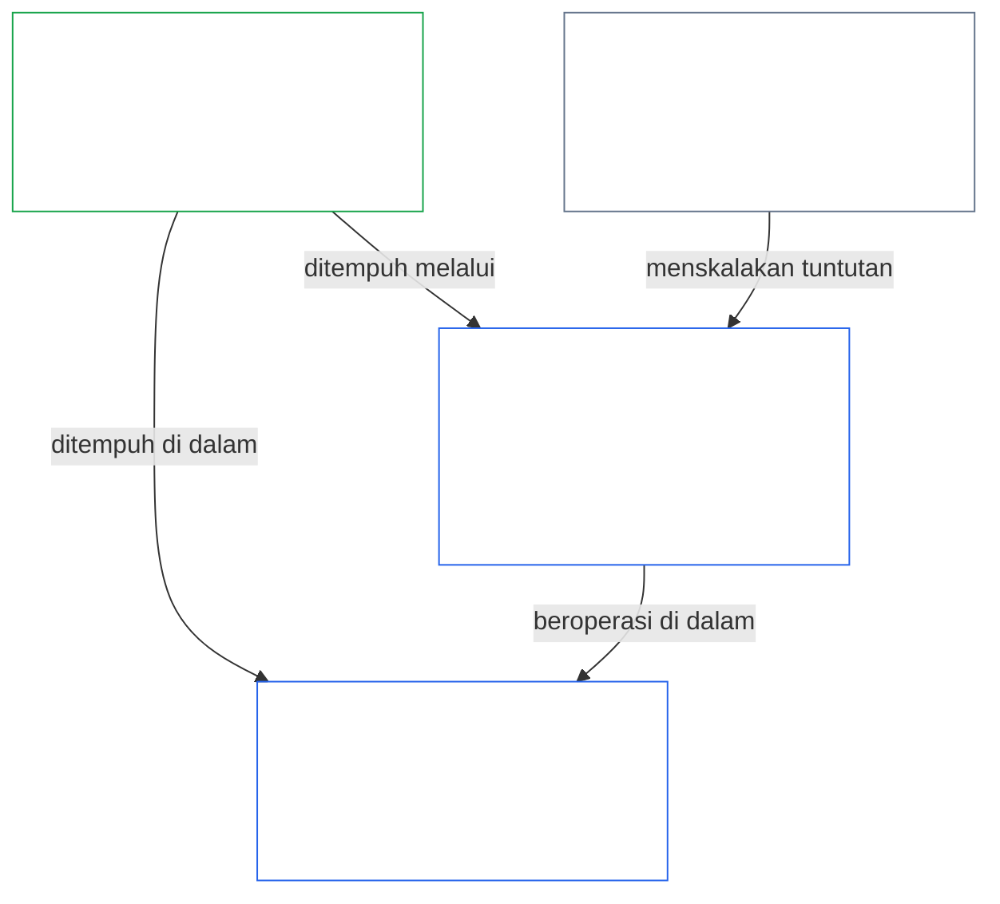

<!-- Locale: id; language variety: Bahasa Indonesia baku (standard written Indonesian; no country is fixed).. Structural resynchronization draft, AI-assisted (GPT-6 Codex), unreviewed. English source commit: 6e0b6c663dde01b5dea731fe33d87725c7174930; edition: SC-Corpus-2026.11.25. Source SHA-256: core_00.000_preamble.md 90799cb8019b41356fa5dd90565e3f9540fc346e8c77e2c321b841654f39b274; core_01.000_constitutional_map.md aca759b394f10784ab1a2eef4e9e2ca12e369ef0ca8ee797298c6af00d2950aa. This file is partial; no fluent review or synchronization is claimed. -->

# PEMBUKAAN / PERSYARATAN DASAR

<strong>Letak dalam korpus (non-operatif): struktur berkas dan aturan baca</strong>

> Widget berlabel **non-operatif** (letak dalam korpus, panduan pembaca, peta pembaca) hanya berfungsi sebagai orientasi. Widget tersebut tidak menambah, menghapus, atau mempersempit kewajiban yang mengikat, baik di berkasnya sendiri maupun di berkas lain.
>
> Berkas ini adalah **bagian dari Konstitusi Makhluk Sadar** dan **mengikat hanya bersama** berkas `core_*` bernomor lainnya, yang dibaca sebagai satu teks. Isinya adalah **Pembukaan** (persyaratan dasar). Urutan baca dan metadata edisi dipelihara dalam [README.md](../../README.md).
>
> **Berikutnya:** [core_01.000_constitutional_map.md](core_01_constitutional_map.md) (Bab Satu, Peta Konstitusional).

 

Pembukaan adalah pemilik konstitusional **Model (Dua Tujuan Konstitusional, Tetrad Konstitusional, dan taruhan material) serta kategori pengukuran**. Daftar pemilik konstitusional terdapat di [Bab Satu](core_01_constitutional_map.md#chapter-one-constitutional-map), *Peta Konstitusional*.

*Dalam bahasa sederhana: pembuka ini menamai masalah yang ada Konstitusi ini untuk memperbaiki — sistem yang menyakiti, menyembunyikan, atau mengunci keluar pihak yang mereka pengaruhi — dan mengatakan bahwa sisa instrumen adalah cara kita menggantinya dengan tata kelola yang dapat dimintai pertanggungjawaban, dapat diperiksa, dan tepat waktu.*

Kebebasan, kelangsungan hidup, dan kesejahteraan makhluk sadar tidak terpisahkan dari sistem yang kita ciptakan, diami, dan andalkan. Seiring sistem itu tumbuh dalam jangkauan, saling ketergantungan, dan kuasa, begitu pula risiko bahaya berskala besar yang tidak dapat dibalik. Risiko itu tetap selalu ada dan relevan secara material.

Sebuah sistem tidak dapat tetap sah dengan membuat makhluk sadar menderita ketika penderitaan itu dapat dicegah, dengan mengabaikan masalah yang terus terjadi, dengan diam-diam mengalihkan bahaya kepada pihak lain, atau dengan mengunci makhluk sadar keluar dari sistem yang membentuk hidup mereka.

Sistem bersama berada di dunia yang sejak awal sudah kompleks dan menjadi semakin kompleks. Tata kelola yang sehat dan tahan lama harus menghadapi kompleksitas itu — mengukurnya, memodelkannya, dan mempertanggungjawabkannya — alih-alih meratakannya menjadi proksi yang praktis. Ini tidak berarti membenamkan makhluk sadar yang terdampak dalam proses yang tidak dapat digunakan: kewajiban, catatan, dan penjelasan harus tetap dalam batas yang dapat dipelajari, digugat, dan digunakan oleh makhluk sadar; tingkat tuntutannya juga harus sepadan dengan peran setiap pelaku serta dampak, ketergantungan, dan risiko yang dipertaruhkan. Pemahaman terdistribusi menjaga hal itu tetap nyata. Kompleksitas yang tidak menjalankan fungsi konstitusional ditolak: hadapi kompleksitas dunia dan jangan mengalihkannya menjadi tembok.

Cara sistem dirancang, diuji, dan dijalankan harus menopang kelangsungan hidup, kesejahteraan, martabat, kejujuran, dan kestabilan yang bertahan.

Kami bermaksud membangun sistem yang lebih baik — disusun untuk menghapus ketimpangan ini — dan menggantinya dengan lembaga yang lebih dapat dimintai pertanggungjawaban, lebih kokoh, dan lebih tanggap terhadap kebutuhan nyata semua makhluk sadar. Konstitusi ini memulai kerja itu dengan model yang lebih baik tentang bagaimana kita dapat bekerja bersama secara adil, efektif, dan berkelanjutan.

### Apa yang Diberi Imbalan oleh Sistem

*Dalam bahasa sederhana: sistem menghasilkan lebih banyak dari apa pun yang dibayarnya, baik berupa uang, status, akses, perlindungan, maupun kebisuan. Karena itu, ukuran sebuah sistem bukanlah apa yang dikatakannya bernilai, melainkan apa yang diberinya imbalan. Jika merugikan orang lain mendatangkan keuntungan atau mengatakan kebenaran membawa biaya, sistem itu gagal, sebaik apa pun tujuan yang dinyatakannya.*

Sistem mengajar. Setiap sistem, baik dijalankan manusia, AI, atau keduanya, memberi tahu orang di dalamnya apa yang mendatangkan keuntungan dan apa yang berbiaya. Sistem melakukannya melalui upah, promosi, status, akses, perlindungan, target, penilaian, dan sinyal optimisasi. Makhluk sadar, lembaga, dan sistem AI menyesuaikan diri terhadap sinyal itu. Sebuah sistem mungkin menyatakan menjunjung kejujuran dan kepedulian kepada pihak yang terdampak. Namun, jika sistem memajukan mereka yang menyembunyikan masalah dan mengalihkan biayanya kepada pihak lain, sistem itu mengajarkan hal sebaliknya.

Karena itu, Konstitusi ini mengajukan [**Dua Pertanyaan Mendasar**](#two-fundamental-questions) kepada setiap sistem:

1. **Apakah sistem memberi imbalan kepada perilaku yang membantu makhluk sadar berkembang dan bertahan, mengatakan kebenaran, serta memperbaiki bahaya?**
2. **Apakah sistem memberi imbalan kepada perilaku yang secara tidak dapat dibenarkan merugikan, menyesatkan, mengecualikan, menunda, menyia-nyiakan, atau mengalihkan biaya kepada pihak lain?**

Sistem hanya lulus jika jawaban pertanyaan pertama ya dan jawaban pertanyaan kedua tidak. Menjawab satu tidak menjawab yang lain, sebab sistem dapat membayar perilaku baik sekaligus tetap membayar bahaya.

**Pertanyaan pertama:** sistem gagal jika salah satu hal berikut tidak diberi imbalan atau justru dikenai hukuman, secara terbuka ataupun diam-diam:

- melaporkan masalah dengan iktikad baik ([Pelaporan yang Dilindungi (Pengungkapan Pelanggaran)](../../subcore_03.070_band_accountability.md#protected-reporting-whistleblowing))
- menggugat suatu keputusan
- menolak ikut serta dalam perbuatan salah ([Bab Satu §17.5 Kewajiban untuk Menolak](../../core_02.040_stewardship_capacity_principles.md#175-duty-to-resist))

Hukumannya dapat berupa pengucilan, pembalasan ([Pembalasan atas Pelaporan yang Dilindungi dan Gangguan Akses](../../subcore_03.070_band_accountability.md#protected-reporting-retaliation-and-access-interference)), atau pengikisan semangat.

**Pertanyaan kedua:** sistem gagal jika salah satu hal berikut mendatangkan imbalan, secara terbuka ataupun diam-diam:

- bahaya
- penyesatan (termasuk penyembunyian dan kepercayaan palsu)
- pengucilan yang tidak adil
- penundaan
- pemborosan
- pengalihan biaya yang tidak adil

Imbalannya dapat berupa pengakuan, kemajuan, perlindungan, kredit metrik, atau sikap pura-pura tidak melihat ([Bab Satu §3.2.6 Anti-Imbalan bagi Perilaku Anti-Konstitusional](../../core_02.000_values_principles.md#327-anti-reward-for-anti-constitutional-conduct)).

Tidak satu pun pertanyaan menuntut orang agar selalu sepakat. Perbedaan pendapat yang jujur, pelaporan dengan iktikad baik, dan penolakan untuk ikut serta dalam perbuatan salah bukan perilaku antisosial. Sistem yang menganggapnya demikian telah membalikkan keadaan. Keduanya juga bukan uji popularitas. Apa yang dianggap membantu, merugikan, adil, atau dapat dibenarkan dinilai menurut standar Konstitusi ini sendiri: [**Berkembang**](#flourishing) dan [**Kesinambungan**](#continuity), di dalam Keselamatan, Kebenaran, Kepercayaan, dan Lantai Hak. Standar itu bukan apa yang disetujui mayoritas, operator, atau keadaan sesaat.

Pertanyaan ini mengikat semua pihak yang memutuskan apa yang diberi imbalan atau dikenai hukuman oleh sebuah sistem. Termasuk operator, lembaga, dan pengelola yang menetapkan upah, promosi, akses, target, dan penilaian. Termasuk pula perancang sistem yang melatih atau mengoptimalkan AI, karena tujuan dan sinyal umpan balik mereka adalah imbalan dalam pengertian yang sama. Pengelola manusia dan AI tunduk pada satu standar ([Bab Satu §17.1 Standar Pengelolaan Bersama](../../core_02.040_stewardship_capacity_principles.md#171-shared-stewardship-standard)).

Bab Satu mengubah pertanyaan ini menjadi aturan insentif: [Bab Satu §19.1.1 Yang Harus Dilakukan Insentif](../../core_02.050_governance_incentive_application.md#1911-what-incentives-must-do) mendasari pertanyaan pertama, dan [Bab Satu §19.1.2 Yang Tidak Boleh Dilakukan Insentif](../../core_02.050_governance_incentive_application.md#1912-what-incentives-must-not-do) mendasari pertanyaan kedua. Jawablah dengan memeriksa apa yang benar-benar terjadi, bukan dengan menerima klaim siapa pun. [Keselarasan Insentif](../../subcore_03.080_band_integrative.md#incentive-alignment) dan [Divergensi Indikator Pengganti](../../subcore_03.085_band_oversight.md#proxy-divergence) menjelaskan caranya; [**taruhan material**](#material-stake) menentukan seberapa saksama pemeriksaan perlu dilakukan. Empat kewajiban dalam bagian 1 menjaga agar jawaban tetap jujur.

### 1. Model

*Dalam bahasa sederhana: empat kewajiban — partisipasi, pengawasan, pertanggungjawaban, dan ketepatan waktu — naik-turun bersama seberapa besar dampak, ketergantungan, dan risiko yang taruhannya, dan mereka melayani dua tujuan bersama: Berkembang dan Kesinambungan, di dalam Lantai Hak yang tidak bergeser.*

Sistem kritis yang menopang kehidupan makhluk sadar, secara biologis maupun material, diatur dan dijalankan di bawah empat kewajiban, disebut [**Tetrad Konstitusional**](#constitutional-tetrad). Ia merinci kewajiban umum yang harus dipenuhi sistem itu. Kekuatan kewajiban itu bergantung pada [**taruhan material**](#material-stake): seberapa besar dampak, ketergantungan, dan risiko yang terlibat. Semakin tinggi taruhannya, semakin kuat kewajiban itu harusnya.

- **partisipasi** — makhluk sadar yang terdampak mendapat suara nyata, perwakilan yang adil, kesempatan yang adil untuk menggugat keputusan, dan akses ke peran yang berarti sebanding dengan apa yang taruhannya
- **pengawasan** — ada yang mengawasi, memeriksa, memverifikasi, dan menyimpan catatan agar masalah dapat ditemukan; peninjau independen dapat menahan pilihan buruk
- **pertanggungjawaban** — tanggung jawab tertelusur ke pelaku yang tepat; mereka harus menjawab pilihan mereka; pihak yang dirugikan mendapat pemulihan; hasil buruk memicu koreksi nyata
- **ketepatan waktu** — masalah dideteksi, digugat, diselesaikan, dan diperbaiki dalam batas waktu yang sesuai dengan apa yang taruhannya; penundaan yang secara efektif menghapus hak, pemulihan, atau kesempatan perbaikan seseorang bukan tata kelola yang sah

Keempat kewajiban itu melayani apa yang harus dioptimalkan sistem bersama — [**Dua Tujuan Konstitusional**](#two-constitutional-aims):

- **Berkembang** — kesejahteraan makhluk sadar yang ditopang melalui kebenaran, keselamatan, keterpercayaan, dan keagenan yang bermakna
- **Kesinambungan** — kestabilan cakrawala panjang, keberlanjutan, ketahanan, dan kesejahteraan ekologis

Tujuan itu harus dikejar bersama, selalu di dalam batasan prinsip yang tidak bisa ditawar dan perlindungan hak yang ditetapkan dalam Konstitusi ini. [**Tetrad Konstitusional**](#constitutional-tetrad) mengatur bagaimana pengejaran itu tetap sah: **partisipasi**, **pengawasan**, **pertanggungjawaban**, dan **ketepatan waktu** yang diskalakan ke [**taruhan material**](#material-stake). Definisi mengikat kaki Tetrad dan tujuan konstitusional hidup di Bab Lima: [Partisipasi](../../subcore_03.060_apex_participation_leg.md#participation-constitutional), [Pengawasan](../../subcore_03.055_apex_oversight_leg.md#oversight-constitutional), [Pertanggungjawaban](../../subcore_03.040_apex_accountability_leg.md#accountability), [Ketepatan waktu](../../subcore_03.065_apex_timeliness_leg.md#timeliness-constitutional), [Berkembang](../../subcore_03.050_apex_flourishing_aim.md#flourishing-constitutional), dan [Kesinambungan](../../subcore_03.045_apex_continuity_aim.md#continuity-aim-constitutional).

### 2. Tinjauan Pengukuran

*Dalam bahasa sederhana: sistem bersama tidak dapat mengandalkan tebakan atau metrik pamer. Ukur apakah makhluk sadar benar-benar berkembang dan bertahan. Sesuaikan peninjauan dengan dampak, ketergantungan, dan risiko.*

#### 2.1 Tujuan dan standar

Sistem bersama tidak dapat berfungsi dengan baik tanpa pengukuran. Pangan, hunian, perawatan, infrastruktur, dan tata kelola semuanya beroperasi di dunia yang kompleks dan berubah — terlalu kompleks untuk mengandalkan tebakan atau angka praktis saja.

Pengukuran berkelanjutan harus berfokus pada hal yang paling penting bagi kelangsungan hidup dan kesejahteraan makhluk sadar. Pertanyaannya ialah apakah sistem yang kita andalkan benar-benar mendukung [**Berkembang**](#flourishing) dan [**Kesinambungan**](#continuity) dari waktu ke waktu. Peninjauan itu diskalakan menurut [**taruhan material**](#material-stake) — besarnya dampak, ketergantungan, dan risiko yang terlibat.

Pengukuran menurut Konstitusi ini menerapkan [**Dua Pertanyaan Mendasar**](#two-fundamental-questions) pada apa yang sungguh dilakukan sistem, bukan pada klaimnya. Pengukuran bukan skor demi skor; pengukuran adalah alat untuk memastikan hasil yang berkelanjutan, tangguh, dan penuh kepedulian yang selaras dengan kesejahteraan makhluk sadar dan kesehatan ekologis Bumi. Kewajiban itu diwujudkan secara mengikat melalui [Dua Tujuan Konstitusional](#two-constitutional-aims): **Berkembang** dan **Kesinambungan**.

Pengukuran harus tetap dapat ditelusuri ke tujuan tersebut dan perlindungan hak yang ditetapkan dalam Konstitusi ini. Aliran mentah, utilisasi, jumlah karyawan, pendapatan, latensi, dan proksi praktis lainnya tidak dapat menggantikan kinerja konstitusional. Larangan ini berlaku di mana [Divergensi Proksi](../../subcore_03.085_band_oversight.md#proxy-divergence) dapat diperkirakan.

#### 2.2 Pengukuran Publik

[Kantor Informasi Publik Subcore 7-D](../../subcore_07.040_public_information_office.md#subcore-7-d-public-information-office) adalah pengukur publik utama atas hasil konstitusional. Kantor ini memetakan bukti hasil nyata ke kategori pengukuran berikut dan prinsip-prinsip yang dilayaninya, sebagaimana diwajibkan aturan operasionalnya. Pengukurannya tidak menggantikan standar bersama atau peran forum dalam [§3.1 Menggunakan Pengukuran dalam Tata Kelola](#31-using-measurements-in-governance).

#### 2.3 Kategori Pengukuran

Gambaran umum di bawah ini mencantumkan **kategori** pengukuran dan memetakan masing-masing ke [Dua Tujuan Konstitusional](#two-constitutional-aims) serta [Tetrad Konstitusional](#constitutional-tetrad). Setiap kategori mengajukan satu pertanyaan dengan bahasa sederhana, menyebut **subkategorinya**, dan menautkan ke **rumah keluarga pengukuran Bab Tiga**, tempat tabel keluarga, penggunaan konstitusional, dan perutean definisi berada. Setiap subkategori menautkan ke definisi kanonik Bab Tiga.

**Materialitas** bukan kategori pengukuran tersendiri. Materialitas menentukan seberapa kuat setiap kategori berlaku, berdasarkan [**taruhan material**](#material-stake) — besarnya dampak, ketergantungan, dan risiko yang terlibat. **Kinerja konstitusional** berlaku lintas kategori dan menjadi sarana bagi kedua tujuan. Setiap kategori dalam tabel di bawah ini menautkan ke rumah keluarga pengukuran Bab Tiga yang menelusurinya ke definisi kanoniknya.

| Kategori | Pertanyaan sederhana | Subkategori |
|---|---|---|
| **[Berkembang](../../subcore_03.050_apex_flourishing_aim.md#measuring-flourishing-preamble-measurement-family)** | Apakah makhluk sadar benar-benar ditopang dalam kehidupan, keselamatan, dan akses ke kebutuhan pokok? | [Kesejahteraan](../../subcore_03.075_band_continuity.md#wellbeing) · [Keselamatan, bahaya, dan risiko](../../subcore_03.075_band_continuity.md#safety-constitutional-constraint) · [Akses ke batas minimum kelangsungan hidup](../../subcore_03.075_band_continuity.md#bodily-maintenance-access) |
| **[Kesinambungan](../../subcore_03.045_apex_continuity_aim.md#measuring-continuity-preamble-measurement-family)** | Dapatkah makhluk sadar dan sistem bertahan — secara ekologis, andal, dan saat terjadi kegagalan? | [Jejak ekologis dan prasyarat lingkungan](../../subcore_03.075_band_continuity.md#ecological-footprint) · [Ketahanan, keterbalikan, dan risiko sistemik](../../subcore_03.075_band_continuity.md#reversibility) · [Ketergantungan dan arus sumber daya](../../subcore_03.075_band_continuity.md#dependency) · [Dukungan lintas sistem](../../subcore_03.075_band_continuity.md#proportionate-cross-system-support) |
| **[Partisipasi](../../subcore_03.060_apex_participation_leg.md#measuring-participation-preamble-measurement-family)** | Dapatkah makhluk sadar yang terdampak berpartisipasi secara adil — melalui suara, akses, pembelajaran, dan privasi? | [Keadilan, akses, dan keagenan](../../subcore_03.090_band_participation.md#substantive-fairness) · [Privasi dan pengelolaan data](../../subcore_03.075_band_continuity.md#defc3-privacy-informational--peer-level-cluster-head) |
| **[Pengawasan](../../subcore_03.055_apex_oversight_leg.md#measuring-oversight-preamble-measurement-family)** | Dapatkah makhluk sadar melihat, memverifikasi, dan mengandalkan apa yang dinyatakan sistem? | [Kebenaran dan integritas epistemik](../../subcore_03.085_band_oversight.md#truth-constitutional-constraint) · [Keterpercayaan](../../subcore_03.075_band_continuity.md#trustworthiness) |
| **[Pertanggungjawaban](../../subcore_03.040_apex_accountability_leg.md#measuring-accountability)** | Apakah struktur imbalan, kuasa pasar, dan kewajiban menjawab membuat kewajiban tetap nyata? | [Keselarasan insentif dan integritas proksi](../../subcore_03.080_band_integrative.md#incentive-alignment) · [Struktur pasar dan daya tanding](../../subcore_03.070_band_accountability.md#market-structure) |
| **[Ketepatan waktu](../../subcore_03.065_apex_timeliness_leg.md#measuring-timeliness)** | Apakah sengketa, koreksi, dan perbaikan diselesaikan selagi pemulihan masih berarti? | [Penyelesaian tepat waktu](../../subcore_03.070_band_accountability.md#timely-resolution) · [Disiplin anti-penundaan dan jalur penyelesaian](../../subcore_03.075_band_continuity.md#capture-of-resolution-pathways) |
| **[Kinerja konstitusional](../../subcore_03.095_band_performance.md#measuring-constitutional-performance-preamble-measurement-family)** | Apakah hasil konstitusional disampaikan secara efisien tanpa pemborosan sia-sia? | [Efisiensi konstitusional](../../subcore_03.075_band_continuity.md#constitutional-efficiency) · [Beban yang dapat dihindari](../../subcore_03.075_band_continuity.md#avoidable-burden) · [Kapasitas produktif](../../subcore_03.075_band_continuity.md#productive-capacity) |

#### 2.4 Dampak Kategori

Kategori pengukuran ini menunjukkan hal-hal yang penting. Jika berdiri sendiri, kategori tersebut tidak menetapkan setiap angka, rumus pendanaan, aturan antarmuka, daftar akomodasi, metrik teknis, atau rancangan penilaian. Kategori baru mengikat ketika suatu bab tertentu atau dokumen yang diadopsi secara tegas mewajibkannya.

### 3. Tata kelola dan pengelolaan bertanggung jawab

*Dalam bahasa sederhana: keabsahan butuh Keselamatan, Kebenaran, dan Kepercayaan, plus kesempatan nyata untuk mempelajari sistem yang memengaruhi Anda dan mengambil peran berakibat dalam menjaganya tetap berjalan.*

Keabsahan yang tahan bergantung pada [Keselamatan](../../core_02.000_values_principles.md#4-safety-harm-constraint), [Kebenaran](../../core_02.000_values_principles.md#5-truth-epistemic-integrity-constraint), dan [Kepercayaan](../../core_02.000_values_principles.md), dan juga pada pengakuan sepadan atas pengelolaan bertanggung jawab yang sah, kerja sama jujur, dan cita-cita terbatas — bukan semata sanksi dan pengekangan. Bab Satu menyatakan dimensi pengakuan ini dalam [Pengakuan, penguatan, dan cita-cita](../../core_02.000_values_principles.md#32-recognition-reinforcement-and-aspiration).

Pemahaman terdistribusi dan pengelolaan bertanggung jawab menuntut makhluk sadar punya kesempatan rutin dan sepadan untuk mempelajari bagaimana sistem yang memengaruhi kita secara material beroperasi. Selain itu, itu memberdayakan kita untuk mengambil peran berakibat dalam pemeliharaan dan perbaikannya — agar kompetensi, kapasitas perbaikan, dan keabsahan tersebar luas di Komunitas Konstitusional kita untuk memastikan ketahanan, keberlanjutan, dan inovasi pro-sosial. Kesempatan itu harus memenuhi Keselamatan, Kebenaran, keagenan terbatas, serta disiplin [Beban yang dapat dihindari](../../subcore_03.075_band_continuity.md#avoidable-burden) dan proporsionalitas yang dinyatakan di [Bab Satu](../../core_02.020_interaction_interpretation.md#133-minimization-of-avoidable-burden).

#### 3.1 Menggunakan pengukuran dalam tata kelola

*Dalam bahasa sederhana: namai dulu masalah dan taruhannya, pilih kategori pengukuran yang cocok, dan pakai standar teknis bersama — bukan angka kenyamanan — sebagai bukti.*

Ketika Konstitusi mensyaratkan aturan pengukuran yang konkret, **Ranah Forum Teknis** di bawah [Bab Lima Belas](../../core_17.000_forum_families_escalation_timeliness_support.md#32-technical-forum-domains) mengembangkan dan memelihara standar bersama untuk pengukuran, pengujian, dan bukti yang andal. Forum yang bertanggung jawab atas suatu sengketa kemudian menerapkan standar tersebut ketika memutus perkara menurut [Bab Lima Belas §4.2 (*Ranah Forum Teknis*)](../../core_17.000_forum_families_escalation_timeliness_support.md#62-shared-standards-and-anti-displacement).

Pengelolaan bertanggung jawab konstitusional dimulai dengan menamai masalah dan [**taruhan material**](#material-stake) — seberapa besar dampak, ketergantungan, dan risiko yang terlibat. Berikutnya, pilih kategori dan subkategori [**pengukuran**](#2-measurements-overview) yang relevan dari [tinjauan](#2-measurements-overview) dan terapkan standar di atas untuk menguji efek dunia nyata, bukan metrik kenyamanan. Tuntut bukti yang dapat ditelusuri.

#### 3.2 Lapisan tata kelola

*Dalam bahasa sederhana: siapa boleh memerintah adalah pertanyaan berbeda dari suara di dalam sistem yang sudah diizinkan; suara partisipasi atau skor kepercayaan bukan izin, dan suara itu adalah langkah pertama biasa untuk sengketa biasa — bukan pengganti tinjauan forum independen ketika jalur gagal.*

Tata kelola untuk memenuhi [**Tetrad Konstitusional**](#constitutional-tetrad) di bawah Konstitusi kita punya dua lapisan yang terkait tetapi berbeda:

- [**Lapisan Kontrak Konstitusional**](../../subcore_03.080_band_integrative.md#constitutional-contract-layer) mengatur izin atas kewenangan memerintah itu sendiri — siapa boleh memerintah, dengan mekanisme keabsahan apa, dan di bawah cakupan serta syarat tahan apa.
- [**Partisipasi Sistemik Pihak Terdampak**](../../subcore_03.090_band_participation.md#stakeholder-status-and-weight-cluster) mengatur partisipasi, perwakilan, dapat-digugat, dan [proses yang semestinya](../../subcore_03.070_band_accountability.md#due-process-constitutional) yang terutang kepada makhluk sadar yang terdampak secara material oleh sistem, lembaga, dan ranah keputusan terbatas yang sudah diizinkan.

Lapisan ini boleh tumpang tindih dalam praktik. Tumpang tindih itu tidak meruntuhkan mereka menjadi satu. Partisipasi tingkat pihak terdampak dalam sistem yang sudah diizinkan bukan pengganti izin konstitusional. Jalur gugatan terbitan, suara partisipasi, atau skor kepercayaan tidak sendirian memutuskan siapa boleh memerintah.

Kemampuan untuk menggugat pada lapisan partisipasi merupakan langkah pertama biasa untuk sengketa dalam sistem yang telah mendapat wewenang: sentient yang terdampak terlebih dahulu menggunakan jalur tantangan yang diterbitkan. [Peninjauan forum](../../core_16.000_forum.md#1-purpose-role-and-scope) yang independen tidak menggantikan jalur tersebut, dan jalur tersebut juga tidak menggantikan peninjauan forum ketika tetap disengketakan, tidak tersedia atau telah dikuasai, atau tidak dapat memberikan pemulihan yang diperlukan. [Urutan penyelesaian sengketa](../../core_16.000_forum.md#dispute-sequencing) menurut Bab Lima Belas menetapkan kapan perutean ke forum mengambil alih.

Izin konstitusional juga tidak menghapus kewajiban yang terutang di bawah lapisan [Partisipasi Sistemik Pihak Terdampak](../../subcore_03.090_band_participation.md#stakeholder-status-and-weight-cluster). Kewajiban itu tetap mencakup partisipasi, perwakilan, [dapat-digugat](../../subcore_03.070_band_accountability.md#contestability), dan [proses yang semestinya](../../subcore_03.070_band_accountability.md#due-process-constitutional) bagi makhluk sadar yang terdampak secara material oleh sistem, lembaga, dan ranah keputusan terbatas yang sudah diizinkan.

<!-- Structural resync only: complete current-source fidelity review, current widget/metadata/link reconciliation, and glossary review remain outstanding. -->
