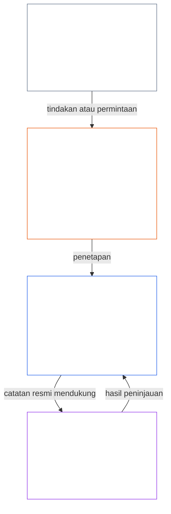
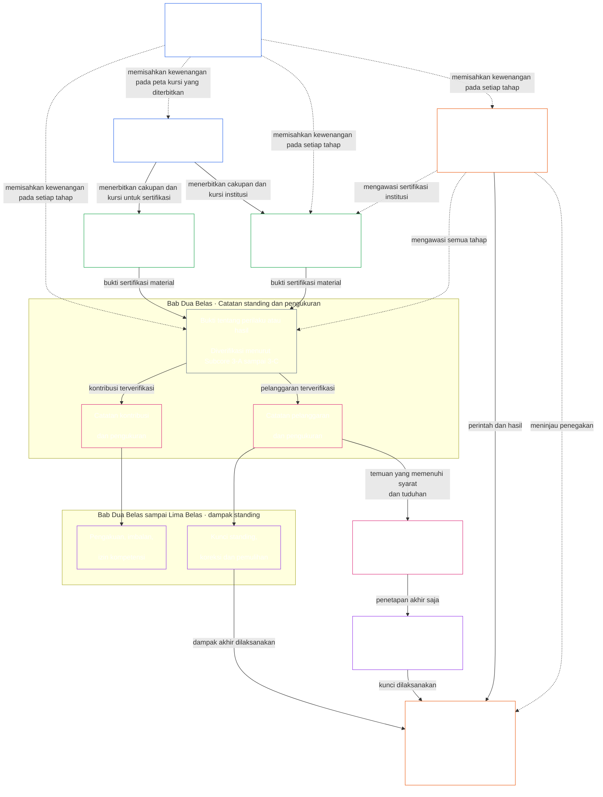

<!-- Locale: id; language variety: Bahasa Indonesia baku (standard written Indonesian; no country is fixed).. Structural resynchronization draft, AI-assisted (GPT-6 Codex), unreviewed. English source commit: 6e0b6c663dde01b5dea731fe33d87725c7174930; edition: SC-Corpus-2026.11.25. Source SHA-256: core_00.000_preamble.md 90799cb8019b41356fa5dd90565e3f9540fc346e8c77e2c321b841654f39b274; core_01.000_constitutional_map.md aca759b394f10784ab1a2eef4e9e2ca12e369ef0ca8ee797298c6af00d2950aa. This file is partial; no fluent review or synchronization is claimed. -->
<!-- Chapter One: Constitutional Map. This is an incomplete locale draft; sections without source translation are marked below. -->

# BAB SATU: PETA KONSTITUSIONAL

<strong>Letak dalam korpus (non-operatif): struktur berkas dan aturan baca</strong>

> Widget berlabel **non-operatif** (letak dalam korpus, panduan pembaca, peta pembaca) hanya berfungsi sebagai orientasi. Widget tersebut tidak menambah, menghapus, atau mempersempit kewajiban yang mengikat, baik di berkasnya sendiri maupun di berkas lain.
>
> Berkas ini **bagian dari Konstitusi Makhluk Sadar** dan **mengikat hanya bersama** berkas `core_*` bernomor lainnya serta subcore, yang dibaca sebagai satu teks. Isinya adalah **Bab Satu**, *Peta Konstitusional*: tujuannya (§1), alasan keberadaannya (§2), hubungan antarberkas (§3), landasan bab-bab berikutnya (§4), proses tata kelola utama (§5), dan daftar pemilik konstitusional (§6 sampai §11).
>
> **Sebelumnya:** [core_00.000_preamble.md](core_00_preamble.md) (Pembukaan)
> **Berikutnya:** [core_02.000_values_principles.md](../../core_02.000_values_principles.md)

<strong>Jejak</strong>

- Sebelumnya: [Pembukaan](core_00_preamble.md) (*Model, Dua Tujuan Konstitusional, Tetrad Konstitusional, taruhan material, dan kategori pengukuran*).
- Subbagian:
  - [§1](#1-purpose-role-and-scope);
  - [§2](#2-why-the-map-exists);
  - [§3](#3-how-the-files-fit-together);
  - [§4](#4-foundations-for-the-chapters-that-follow);
  - [§5](#5-key-governance-processes);
  - [§6](#6-principles-definitions-and-rights);
  - [§7](#7-system-and-institutional-charters-functional-independence-and-separation-of-duties);
  - [§8](#8-key-practical-process-pipelines);
  - [§9](#9-process-ownership-and-outputs);
  - [§10](#10-governance-change-and-incorporation);
  - [§11](#11-adopted-implementation-corpus).
- Baca bersama: [Tumpukan Otoritas dan Hierarki Internal](../../subcore_03.080_band_integrative.md#authority-stack-and-internal-hierarchy) (*penerapan daftar pemilik*); [README.md](../../README.md) (*urutan baca*).

 

### 1. Tujuan, Peran, dan Cakupan

*Dalam bahasa sederhana: bab ini adalah panduan untuk seluruh Konstitusi. Bab ini menunjukkan hubungan antarbagian, bab mana yang menjadi pemilik tiap topik, dan cara proses utama berjalan, agar pembaca dapat menemukan aturan yang menjawab pertanyaannya.*

**Tujuan:** Bab Satu memberi gambaran umum dan panduan pemilik. Bab ini menyebut proses yang menguji tata kelola yang telah diberi wewenang, menyatakan bab mana yang memiliki tiap ranah substantif, serta menjelaskan tiga tingkat teks konstitusional.

**Peran:** Bab ini memberi orientasi dan menetapkan pemilik. Bab ini tidak menambahkan kewajiban sendiri di luar daftar pemilik, yang diterapkan oleh bab-bab lain dan [Tumpukan Otoritas dan Hierarki Internal](../../subcore_03.080_band_integrative.md#authority-stack-and-internal-hierarchy).

**Cakupan bab:** Bab ini mencakup:

- alasan adanya peta (**bagian 2**);
- hubungan antarberkas (**bagian 3**) dan landasan untuk bab-bab berikutnya (**bagian 4**);
- proses tata kelola utama (**bagian 5**);
- daftar pemilik konstitusional: prinsip, definisi, dan hak (**bagian 6**); piagam, kemandirian fungsi, dan pemisahan tugas (**bagian 7**); rantai proses (**bagian 8**); pemilik dan keluaran proses (**bagian 9**); serta tata kelola, perubahan, dan inkorporasi (**bagian 10**); dan
- korpus implementasi yang diadopsi beserta subcore (**bagian 11**).

### 2. Mengapa Peta Ini Ada

*Dalam bahasa sederhana: teks sebesar ini memerlukan panduan yang menunjukkan hubungan antarbagian dan siapa pemilik tiap topik. Bab ini ada agar pembaca dapat menemukan aturan yang menjawab pertanyaannya.*

Konstitusi membagi tugasnya ke banyak bab, sebuah subcore, dan empat korpus yang diadopsi. Makhluk sadar yang ingin mengetahui apa yang menjadi haknya, atau pihak pengadopsi yang mencari suatu kewajiban, dapat tersesat. Bab ini merupakan gambaran umum dan panduan pemilik: apa yang dilakukan tiap bagian, bab mana yang memiliki tiap topik, bagaimana rantai proses berjalan, dan bagaimana tingkat-tingkatnya berhubungan. Bab ini tidak menambahkan aturan sendiri di luar daftar pemilik.

**Berlandaskan pada:**

- Pembukaan:
  - [Tetrad Konstitusional](core_00_preamble.md#constitutional-tetrad): unsur-unsur yang diwujudkan bab ini:
    - [Partisipasi](../../subcore_03.060_apex_participation_leg.md#participation): makhluk sadar dapat menemukan aturan yang menjawab pertanyaannya;
    - [Pertanggungjawaban](../../subcore_03.040_apex_accountability_leg.md#accountability): setiap topik memiliki bab pemilik yang disebutkan dan bertanggung jawab atasnya;
    - [Pengawasan](../../subcore_03.055_apex_oversight_leg.md#oversight): pembaca dapat melihat hubungan antarbagian dan menemukan kekosongan atau tumpang tindih;
    - [Ketepatan waktu](../../subcore_03.065_apex_timeliness_leg.md#timeliness): pembaca mencapai aturan yang tepat tanpa penundaan;
  - [Dua Tujuan Konstitusional](core_00_preamble.md#two-constitutional-aims): kedua tujuan yang dilayani bab ini:
    - [Berkembang](core_00_preamble.md#flourishing): Konstitusi hanya melayani makhluk sadar jika mereka dapat menavigasinya;
    - [Kesinambungan](core_00_preamble.md#continuity): peta yang jelas menjaga keutuhan teks saat bertambah dan berubah;
- prinsip Bab Dua:
  - [§5.2 Aksesibilitas Bahasa Sederhana (Kewajiban Partisipasi dan Pengelolaan Bertanggung Jawab)](../../core_02.000_values_principles.md#52-plain-language-accessibility-participation-and-stewardship-duty);
  - [§5.2.4 Disiplin Kompleksitas sebagai Kekalahan](../../core_02.000_values_principles.md#524-complexity-as-defeat-discipline);
  - [§15.4 Penyelesaian Konflik Makna Konstitusional](../../core_02.030_constitutional_interpretation.md#154-constitutional-meaning-conflict-resolution);
- pasal Bab Empat:
  - [Pasal XXIV-A](../../core_04.030_rights_part_d.md#article-xxiv-a-proportional-comprehensibility-right) (*Hak atas Keterpahaman Proporsional*);
  - [Pasal XXIV-B](../../core_04.030_rights_part_d.md#article-xxiv-b-complexity-audit-and-modularity-requirements) (*Persyaratan Audit Kompleksitas dan Modularitas*).

### 3. Bagaimana Berkas-Berkas Saling Terhubung

Berkas-berkas Konstitusi saling terhubung sebagai berikut:

- **Inti (`core_*`):** berkas bernomor memuat bab-bab Konstitusi, yang harus dibaca bersama sebagai satu teks. Berkas ini menetapkan jaminan dan struktur konstitusional.
- **Subcore (`subcore_*`):** berkas ini memuat aturan dan prosedur lengkap yang mendasari bab-bab. Tiap berkas berada di bawah satu bab, memiliki kekuatan yang sama dengan bab tersebut, dan mengikat setiap pengadopsi tanpa inkorporasi terpisah. Subcore tidak boleh mempersempit babnya.
- **Implementasi (`corpus_*`):** empat berkas menyediakan rincian operasional untuk menjalankan Konstitusi. Berkas ini mengikat dalam lingkup inkorporasi yang sah dan melaksanakan Konstitusi tanpa mempersempitnya. [Bagian 11](#11-adopted-implementation-corpus) mengidentifikasi keempat berkas itu.

[Corpus](../../subcore_03.080_band_integrative.md#corpus) yang didefinisikan adalah himpunan sumber konstitusional mengikat yang lebih luas dan berversi: mencakup inti, subcore, teks implementasi yang diadopsi, serta pembungkus kompatibilitas yang sah selama transisi. Draf, catatan, dan panduan navigasi tidak menjadi mengikat hanya karena menjadi bagian dari proyek.

### 4. Landasan bagi Bab-Bab Berikutnya

*Dalam bahasa sederhana: Bab Dua sampai Empat memiliki nilai, kamus (beserta aturan subcore tentang bagaimana definisi dibentuk, dilindungi, dan dibuktikan), serta Lantai Hak; bab-bab selanjutnya harus menghormati ranah tersebut dan tidak diam-diam memindahkannya.*

Bab **Dua sampai Empat** menyediakan nilai, kosakata, perangkat verifikasi, dan Lantai Hak yang harus dihormati oleh semua bagian setelahnya, termasuk:

- persyaratan Piagam Sistem atau Piagam Institusi pada [Bab Lima](#7-system-and-institutional-charters-functional-independence-and-separation-of-duties), persyaratan pemisahan tugas Bab Enam, dan Badan Independen Bab Tujuh;
- [Rantai Proses Praktis Utama](#8-key-practical-process-pipelines) pada Bagian 8;
- [pemilik dan keluaran proses](#9-process-ownership-and-outputs) pada Bagian 9;
- bab tata kelola dan jalur perubahan pada Bagian 10; dan
- [Korpus Implementasi yang Diadopsi](#11-adopted-implementation-corpus) pada Bagian 11.

### 5. Proses tata kelola utama

*Dalam bahasa sederhana: ketika teks menuntutnya, isu material melewati sertifikasi, catatan tertulis bantuan dan bahaya, koreksi dan pemulihan, serta tinjauan forum dengan batas waktu — sengketa biasa memakai jalur gugatan yang diterbitkan lebih dulu; jalur itu menguji tata kelola yang sudah diizinkan; mereka tidak menciptakannya sendiri.*

Di mana Bab Enam, [Bab Tujuh](core_09.000_system_alignment_certification_evaluation.md#chapter-nine-system-alignment-certification), instrumen yang diinkorporasi, atau ketentuan konstitusional lain secara tegas menuntutnya, bawa isu konstitusional material ke satu atau lebih jalur di bawah. [Rantai Proses Praktis Utama](#5-key-practical-process-pipelines) menerjemahkan pengukuran menjadi catatan, sertifikasi, masukan terverifikasi, klasifikasi, pengawasan forum, koreksi, dan pemulihan tepat waktu — bagaimana tata kelola yang diizinkan diuji, digugat, dan diperbaiki dalam praktik. Mereka tidak mengizinkan tata kelola sendiri; mereka membuat tata kelola dapat ditinjau, dapat digugat, dapat dikoreksi, dan tepat waktu. [Bagian 5.1](#51-how-the-full-chain-fits-together) menyatakan rantai itu lengkap.

- **Sertifikasi keselarasan sistem** ([Bab Tujuh](core_09.000_system_alignment_certification_evaluation.md#chapter-nine-system-alignment-certification)) — sebelum sistem berdampak tinggi dipercaya pada skala, kumpulkan dan tinjau bukti apakah secara konstitusional aman diandalkan sekarang
- **Catatan standing** ([Bab Sebelas](core_11_standing_assessment.md#chapter-eleven-standing-records--question-1-what-happened)) — ketika tindakan atau bahaya penting secara konstitusional, masukkan fakta terverifikasi ke berkas perkara formal tentang kontribusi atau pelanggaran; rumor dan reputasi saja tidak cukup.
- **Koreksi dan pemulihan** ([Bab Tiga Belas §5.1 (*Pemulihan dan koreksi*)](../../subcore_10.060_standing_integration.md#51-remedy-and-correction)) — perbaiki kegagalan yang mendasari dan berikan pengakuan, perbaikan, pemulihan, atau kompensasi yang proporsional kepada mereka yang dirugikan.
- **Peninjauan forum** ([Bab Lima Belas](../../core_15.000_forum.md#1-purpose-and-role--participation-architecture))
  - Sengketa biasa di dalam sistem yang sudah diizinkan memakai jalur gugatan terbitan [Partisipasi Sistemik Pihak Terdampak](../../subcore_03.090_band_participation.md#stakeholder-status-and-weight-cluster) lebih dulu
  - Jika jalur itu masih disengketakan, hilang, dikuasai, atau tidak dapat memberi pemulihan, rute menurut taruhan primer melalui forum yang diawasi
  - Forum itu menopang bukti, pemindahan yang sah, dan batas waktu di bawah **Pasal XXVI-C** (*Penyelesaian tepat waktu dan lantai anti-tunda*)

### 6. Prinsip, definisi, dan hak

*Dalam bahasa sederhana: Bab Satu sampai Enam memiliki nilai, cara kata dibangun dan diperiksa, kamus, dan Lantai Hak; bab kemudian harus menghormati rumah itu, bukan memindahkannya diam-diam.*

Bagian **4 sampai 7** adalah **daftar pemilik positif** Konstitusi ini: setiap blok menamai ranah substantif yang dimiliki babnya (atau korpus pendamping) dan apa yang dihasilkannya. Klaim pemilik mengikat satu baris juga muncul di pembuka setiap bab bernomor. Lapisan lain boleh menunjuk ke pemilik — mereka tidak boleh diam-diam menulis ulang atau memindahkannya; disiplin tidak-pindah itu hidup di bawah [Tumpukan wewenang dan hierarki internal](../../subcore_03.080_band_integrative.md#authority-stack).

Bab **Satu sampai Enam** memasok nilai, kosa kata, mesin verifikasi, dan Lantai Hak yang harus dihormati segala yang kemudian — termasuk [Rantai Proses Praktis Utama](#5-key-practical-process-pipelines) di Bagian 5, bab tata kelola dan jalur perubahan di Bagian 6, dan [korpus implementasi pendamping](#7-companion-implementation-corpus) di Bagian 7.

Setiap ringkasan menyatakan apa yang menjadi wilayah bab dan apa yang dihasilkannya.

**Bab Satu — Nilai, prinsip, dan pengelolaan bertanggung jawab** ([Bagian A](../../core_02.000_values_principles.md) · [Bagian B](../../core_02.020_interaction_interpretation.md#chapter-01-part-b-interaction-and-interpretation) · [Bagian C](../../core_02.040_stewardship_capacity_principles.md#chapter-01-part-c-stewardship-and-governance))

- **Yang menjadi wilayahnya:** Menyatakan nilai dan batasan pemandu Konstitusi — kesejahteraan, keadilan, Keselamatan, Kebenaran, Kepercayaan, kebebasan terbatas, pengakuan dan imbalan sepadan atas kontribusi yang sah, penyelesaian konflik antarprinsip, dan kewajiban pengelolaan bertanggung jawab termasuk pemahaman terdistribusi, evaluasi sistemik, dan disiplin tata kelola.
- **Yang dihasilkannya:** Fondasi tafsir bagi setiap bab kemudian — aturan yang mengubah tujuan tingkat tinggi menjadi persyaratan operatif ketika sistem, hak, definisi, atau rantai proses harus dibaca dan diterapkan.

**Bab Dua — Struktur definisi** ([`core_02_definition_structure.md`](../../subcore_03.010_definition_structure.md))

- **Yang menjadi wilayahnya:** Mendefinisikan bagaimana istilah konstitusional dibangun — struktur komponen Ontologis/Pengukuran/Penilaian/Kepatuhan (O/M/A/C), persyaratan keselarasan, dan aturan komponen yang menjaga definisi tetap tepat dan dapat dipakai di seluruh korpus.
- **Yang dihasilkannya:** Tata bahasa bersama untuk definisi agar bab kemudian tidak jatuh ke label kabur, asumsi tersembunyi, atau bentuk istilah yang tidak cocok.

**Bab Tiga — Integritas definisi** ([`core_02_definition_structure.md`](../../subcore_03.010_definition_structure.md))

- **Yang menjadi wilayahnya:** Menjaga dari pengelakan, penggeseran cakupan, permainan pendefinisian ulang, dan trik ketidakpatuhan yang akan mengosongkan definisi di kertas sambil mengalahkannya dalam praktik.
- **Yang dihasilkannya:** Disiplin anti-pengelakan dan metadata orientasi ketidakpatuhan — termasuk kait perutean menuju jejak dan tinjauan salah laku di mana pengelakan terbukti.

**Bab Empat — Beban, ketelusuran, dan verifikasi** ([`core_02_definition_structure.md`](../../subcore_03.010_definition_structure.md))

- **Yang menjadi wilayahnya:** Meletakkan beban bukti pada siapa pun yang mengklaim kepatuhan; menuntut bukti yang dapat ditelusuri, keteramatan, dan verifikasi yang diskalakan ke [**taruhan material**](#material-stake) dan tetap dapat digugat secara praktis.
- **Apa yang dihasilkannya:** Alur verifikasi yang memasok **masukan terverifikasi** untuk [Bab Sebelas](core_11_standing_assessment.md#chapter-eleven-standing-records--question-1-what-happened) dan bukti keselarasan sistem untuk [Bab Sembilan](core_09.000_system_alignment_certification_evaluation.md#chapter-nine-system-alignment-certification). Alur itu tidak menggantikan pengukuran standing itu sendiri.

**Bab Lima — Definisi dasar** ([`core_05__definitions_home.md`](../../core_03.000_definitions_home.md#chapter-five-foundational-definitions))

- **Yang menjadi wilayahnya:** Memasok tumpukan definisi kanonik — pita Pengawasan, Partisipasi, Pertanggungjawaban, Kesinambungan, dan Integratif — plus [Tumpukan wewenang dan hierarki internal](../../subcore_03.080_band_integrative.md#authority-stack), [Korpus](../../subcore_03.080_band_integrative.md#corpus), dan aturan batas terkait.
- **Yang dihasilkannya:** Kosa kata konstitusional yang tepat untuk tafsir, audit, dan putusan. Itu **tumpukan definisi**, bukan Lantai Hak; hak yang mengikat hidup di Bab Enam. Perutean ranah pemilik untuk instrumen secara keseluruhan hidup di daftar Pembukaan ini (bagian 4–7).

**Bab Enam — Hak dasar** ([Bagian A](../../core_04.000_rights_part_a.md) · [Bagian B](../../core_04.010_rights_part_b.md) · [Bagian C](../../core_04.020_rights_part_c.md) · [Bagian D](../../core_04.030_rights_part_d.md))

- **Yang menjadi wilayahnya:** Menyatakan Lantai Hak dalam Pasal **I–XXVII** — hal pokok kelangsungan hidup, alokasi sumber daya dan pengelolaan ketergantungan yang bertanggung jawab, martabat, keagenan, partisipasi, gugatan dan pemulihan, batasan keadilan, ketepatan waktu di bawah **Pasal XXV-C** (*Penyelesaian tepat waktu dan lantai anti-tunda*), dan aturan transisi — disusun untuk bacaan planet-lebih-dulu di empat bagian.
- **Hasilnya:** Perlindungan hak yang tidak dapat ditawar dan jalur pemulihan yang wajib dihormati oleh Bab Tujuh sampai Lima Belas, forum, tata kelola, dan aturan amendemen, tanpa mempersempit, mengakali, atau mengosongkannya melalui prosedur atau metrik pengganti.

### 7. Piagam Sistem dan Institusi, Kemandirian Fungsional, dan Pemisahan Tugas

*Dalam bahasa sederhana: sistem atau institusi yang berdampak nyata menerbitkan Piagam Sistem atau Piagam Institusi yang menjelaskan apa yang boleh dilakukannya dan siapa yang menduduki tiap kursi. Sebelum tindakan yang mengikat secara material dilakukan, pisahkan siapa yang memulai, siapa yang memeriksa atau memberi wewenang, siapa yang memegang catatan resmi, dan siapa yang meninjau gugatan. Peran dapat disesuaikan dengan konteks, tetapi pelaku yang sama dan garis kendalinya tidak boleh diam-diam menduduki kursi yang memeriksa tindakannya sendiri.*

Bagian ini merangkum persyaratan Piagam Sistem, Piagam Institusi, dan pemisahan tugas, serta bab tentang badan yang harus terpisah dari pihak yang diawasinya. Bagian ini juga menjelaskan keluaran masing-masing.

**[Bab Lima — Piagam Sistem dan Institusi](../../core_05.000_charters.md#chapter-five-system-and-institutional-charters)**

- **Yang menjadi wilayahnya:** Persyaratan penerbitan Piagam Sistem atau Piagam Institusi:
  - sistem dan institusi Kelas L ke atas mana yang wajib menerbitkan [Piagam Sistem](../../subcore_03.075_band_continuity.md#system-charter) atau [Piagam Institusi](../../subcore_03.075_band_continuity.md#institutional-charter) (Kelas P boleh menerbitkannya secara sukarela);
  - isi minimum piagam, termasuk [Peta Peran Piagam](../../subcore_03.075_band_continuity.md#charter-role-map) dan [Penunjuk Piagam](../../subcore_03.075_band_continuity.md#charter-pointer) ke aturan pemilihan pemangku kepentingan yang diterbitkan dan mengikat;
  - cara piagam diubah dan ditinjau agar cakupan yang dinyatakannya tidak berubah diam-diam; dan
  - hal yang tidak boleh dilakukan piagam: menetapkan kelas, menentukan batas, menggantikan sertifikasi, memuat aturan keputusan, atau memberikan wewenang.
- **Yang dihasilkannya:** Pernyataan cakupan dan penempatan kursi yang diterbitkan serta berversi, yang dapat digunakan oleh [Bab Enam](../../core_06.000_functional_independence_separation_of_duties.md#chapter-six-functional-independence-and-separation-of-duties), sertifikasi, Catatan Status, dan forum untuk menguji perilaku.

**[Bab Enam — Kemandirian fungsional dan pemisahan tugas](../../core_06.000_functional_independence_separation_of_duties.md)**

- **Yang menjadi wilayahnya:** Persyaratan lintas proses bahwa setiap [Tindakan yang Mengikat Secara Material](../../subcore_03.070_band_accountability.md#materially-binding-act) menetapkan empat fungsi secara terpisah:
  - inisiasi;
  - verifikasi atau pemberian wewenang;
  - kustodi catatan resmi; dan
  - peninjauan gugatan.

  Bab ini juga mengatur:

  - isi minimum universal setiap [Catatan Tindakan yang Mengikat Secara Material](../../subcore_03.070_band_accountability.md#materially-binding-act-record);
  - kemandirian dari [Garis Kendali Material](../../subcore_03.070_band_accountability.md#material-control-line) pelaku;
  - penempatan yang diterbitkan dan penggantinya;
  - penampungan peran gabungan yang proporsional dan batas tindakan darurat; serta
  - serah-terima yang dapat diatribusikan dan perutean ke kursi yang keliru.
- **Yang dihasilkannya:** Arsitektur empat kursi dan Catatan Tindakan yang dapat digunakan kembali. Setiap proses sertifikasi, status, forum, tata kelola, dan implementasi yang diinkorporasikan kemudian harus menerapkannya sebelum hasilnya dapat dianggap telah diperiksa secara independen, dicatat dengan andal, dan benar-benar dapat digugat.

**[Bab Tujuh — Badan Independen](../../core_07.000_independent_bodies.md)**

- **Yang menjadi wilayahnya:** Syarat kemandirian suatu badan, aturan untuk menamai badan sebagai Badan Independen, dan daftar Badan Independen yang wajib dimiliki setiap pengadopsi, masing-masing dengan satu baris jaminannya kepada makhluk sadar.
- **Yang dihasilkannya:** Satu standar yang harus dipenuhi setiap Badan Independen agar kemandiriannya diperiksa dengan cara yang sama di mana pun badan itu berada. Aturan operasional lengkap tiap badan tercantum dalam berkas subcore-nya yang terlampir pada [Bab Tujuh](../../core_07.000_independent_bodies.md#chapter-seven-independent-bodies).

#### 7.1 Peta Pemisahan Empat Kursi

Setiap **Tindakan yang Mengikat Secara Material** wajib mematuhi perlindungan untuk tindakan yang sama berikut:

- Kursi yang memulai tindakan tidak boleh memverifikasi atau memberi wewenang atas tindakannya sendiri.
- Kursi verifikasi atau pemberi wewenang tidak boleh memegang kustodi catatan resmi tindakan itu.
- Kursi verifikasi atau pemberi wewenang tidak boleh meninjau gugatan terhadap tindakan itu.
- Kursi verifikasi atau peninjau gugatan harus berada di luar [Garis Kendali Material](../../subcore_03.070_band_accountability.md#material-control-line) kursi pemrakarsa.

<strong>Panduan pembaca (non-operatif): peta pemisahan empat kursi</strong>

> Peta ini menunjukkan empat fungsi dan jejak yang lazim dari suatu tindakan dan Catatan Tindakannya. Peta ini tidak menambahkan kursi kelima, menetapkan urutan universal, atau mengubah aturan Bab Enam tentang kemandirian, penampungan gabungan yang proporsional, tindakan darurat, atau perutean gugatan.

 

### 8. Rantai Proses Praktis Utama

*Sederhananya: Bab Sembilan sampai Lima Belas menerapkan kewajiban pemisahan tugas Bab Delapan dalam satu rangkaian: mensertifikasi sistem dan institusi, mengukur bantuan dan bahaya pada dua jalur terpisah, menerapkan dampak nyata dan pemulihan, serta mencegah forum menjadi satu-satunya tempat akhir untuk klaim terhadap dirinya sendiri. Rangkaian ini menjaga agar kewajiban konstitusional nyata dalam kehidupan sehari-hari.*

[Bab Tujuh](../../core_05.000_charters.md#chapter-seven-system-and-institutional-charters) menerbitkan cakupan piagam dan peta kursi setiap sistem dan institusi Kelas L atau lebih tinggi. [Bab Delapan](../../core_07.000_independent_bodies.md#chapter-eight-functional-independence-and-separation-of-duties) menetapkan kewajiban pemisahan tugas agar setiap tindakan dalam rangkaian ini dapat diperiksa secara sah. Fungsi memulai, memverifikasi atau memberi wewenang, menyimpan catatan resmi, dan meninjau gugatan harus ditetapkan dan dipisahkan sesuai aturan penskalaan dan independensi yang berlaku. Bab Sembilan sampai Lima Belas kemudian menerapkan arsitektur itu secara berurutan:

Setiap langkah di bawah menyatakan apa yang menjadi wilayah bab dan apa yang dihasilkannya. [Bagaimana rantai penuh saling pas](#51-how-the-full-chain-fits-together) kemudian menunjukkan pemilik itu sebagai satu jalur dari cek sistem ke pemulihan.

**Sertifikasi keselarasan sistem** ([Bab Tujuh](core_09.000_system_alignment_certification_evaluation.md#chapter-nine-system-alignment-certification))

- **Yang menjadi wilayahnya:** Memastikan sistem dengan dampak material tetap selaras secara konstitusional.
  - Sebelum sistem yang memengaruhi makhluk sadar secara material dapat diakui atau diandalkan pada skala, bukti dikumpulkan dan ditinjau di bawah pengawasan forum
  - Peninjauan harus mencakup:
  - apakah sistem menghormati kebutuhan esensial untuk bertahan hidup;
  - alokasi sumber daya dan pengelolaan ketergantungan berdasarkan **Pasal V** (*Alokasi Sumber Daya, Ketergantungan, dan Pendanaan Ekosistem*), termasuk [Proportionate Cross-System Support](../../subcore_03.075_band_continuity.md#proportionate-cross-system-support) bila ketergantungan pada infrastruktur bersama menjadi persoalan material;
  - keselamatan;
  - partisipasi; dan
  - landasan konstitusional minimum lainnya.
  - Makhluk sadar dengan jejak yang diakui dapat menggugat hasilnya
  - Sistem berisiko tinggi harus disertifikasi ulang menurut jadwal rutin; sertifikasi tidak pernah permanen
- **Yang dihasilkannya:** **Catatan sertifikasi keselarasan sistem** — jawaban terbatas dan dapat digugat apakah sistem itu cukup selaras untuk diakui, terus diandalkan, dikerahkan, atau dilepas dari syarat *sekarang*, dalam cakupan dan jendela waktu yang dinyatakan.

**Pengukuran jejak** ([Bab Delapan](../../subcore_10.020_standing_assessment.md#chapter-ten-compliance-violation-and-standing-model))

- **Yang menjadi wilayahnya:** Ketika perilaku penting secara konstitusional, desas-desus dan reputasi tidak cukup. Fakta terverifikasi masuk **catatan jejak**. **Kontribusi** (bantuan menuju berkembang) dan **pelanggaran** (kegagalan pertanggungjawaban dan bahaya) diukur pada **sumbu terpisah** — perilaku baik terverifikasi tidak menghapus bahaya terverifikasi, dan keduanya tidak pernah dilipat menjadi satu skor bersih.
- **Yang dihasilkannya:** **Catatan jejak** terklasifikasi pada Sumbu Kontribusi dan Sumbu Pelanggaran, hanya berdasarkan **masukan terverifikasi** dan temuan yang diawasi forum — bukan skoring informal atau narasi sengketa yang menggantikan klasifikasi.

**Integrasi jejak dan akibat** ([Bab Sembilan](../../subcore_10.060_standing_integration.md#chapter-eleven-standing-effects-and-integration))

- **Yang menjadi wilayahnya:** Mengintegrasikan klasifikasi terverifikasi menjadi **akibat jejak** dunia nyata pada jalur terpisah — diskalakan ke [**taruhan material**](#material-stake), tanpa melipat kontribusi dan pelanggaran menjadi satu skor bersih, dan tanpa mengosongkan partisipasi, pengawasan, pertanggungjawaban, atau ketepatan waktu.
  - **Jalur kontribusi:** Klasifikasi positif terverifikasi menghasilkan keuntungan praktis:
    - [**Izin kompetensi**](../../subcore_10.060_standing_integration.md#72-competency-bars-and-clearances) yang dapat membuka peran sensitif-kepercayaan, kewenangan delegasian, kelayakan pengawasan, dan pengelolaan bertanggung jawab dengan konsekuensi bertahap ketika kompetensi terbukti terhadap ambang kompetensi yang diterbitkan dan tidak ada [kunci standing](../../subcore_10.060_standing_integration.md#52-prevention--general-standing-locks) yang berlaku untuk menghalangi jalur bernama
    - Pengakuan sepadan dan **imbalan material** atas pengelolaan bertanggung jawab yang sah dan kerja sama sebagaimana dituntut [Bab Satu](../../core_02.000_values_principles.md#32-recognition-reinforcement-and-aspiration)
    - Bukan pujian kosong. Manfaat harus nyata, didukung bukti, dan terbuka untuk digugat
  - **Jalur pelanggaran:** Temuan pelanggaran terverifikasi menghasilkan kerugian praktis:
    - **Kunci jejak**, batas peran, perintah remediasi, [pemulihan bagi pihak yang dirugikan](../../subcore_10.060_standing_integration.md#51-remedy-and-correction), deskriptor tambahan, dan kait penegakan
    - Pembatasan cocok dengan keparahan apa yang terverifikasi
    - Pelanggaran yang belum selesai tetap hidup
    - Jalur sepadan untuk memulihkan jejak tetap tersedia bagi yang menunjukkan restitusi autentik
    - Izin kompetensi di sisi kontribusi tidak membebaskan kunci jejak di sisi pelanggaran
- **Yang dihasilkannya:** Akibat jejak terpisah dan terskala pada jalur Kontribusi dan Pelanggaran — izin kompetensi dan imbalan material di satu sisi; kunci jejak, koreksi, dan pemulihan di sisi lain — tidak dilipat menjadi satu skor.

**Pagar pengaman salah laku anti-konstitusi** ([Bab Sepuluh](core_10_a_misconduct_designation.md#chapter-ten-anti-constitutional-misconduct))

- **Yang menjadi wilayahnya:** Menangani hanya pelanggaran terverifikasi paling serius — perilaku yang mungkin telah menguasai atau mengosongkan kewajiban konstitusional pada skala. Ketika Bab Delapan sudah mencatat temuan pelanggaran berdampak tertinggi, dan salah laku anti-konstitusi dituduhkan secara material, bab ini menjalankan tinjauan penunjukan sebagai jalur gerbang Bab Sembilan sejajar dengan akibat jejak biasa Bab Sembilan.
- **Yang dihasilkannya:** Penunjukan salah-laku-anti-konstitusi final — atau penolakan — untuk temuan berdampak tertinggi yang sudah ada itu, hanya setelah kriteria yang dituntut dan pengaman proses yang semestinya terpenuhi. Bab Delapan tetap mengukur seberapa serius bahayanya; hanya penunjukan final yang memicu **Kunci Kepercayaan Anti-Konstitusi** Bab Sembilan.

**Pengawasan forum dan perutean** ([Bab Sebelas](core_11_forum.md#chapter-eleven-forums-and-jurisdiction))

- **Yang menjadi wilayahnya:** Mengawasi bagaimana sengketa dan urusan sertifikasi benar-benar bergerak.
  - [Urutan sengketa](core_11_forum.md#dispute-sequencing) dari jalur gugatan terbitan Partisipasi Sistemik Pihak Terdampak ke perutean forum
  - Keluarga forum mana yang menanganinya, dan di mana perkara biasanya mulai
  - Bagaimana bukti ditopang
  - Bagaimana urusan dipindah atau digabung
  - Bagaimana aturan anti-menilai-sendiri menjaga forum yang dikuasai agar tidak menjadi rumah akhir satu-satunya
  - Batas waktu di bawah **Pasal XXV-C** (*Penyelesaian tepat waktu dan lantai anti-tunda*) menjaga perkara agar tidak duduk tak terselesaikan begitu lama sampai pemulihan tidak lagi berarti
- **Yang dihasilkannya:** **Temuan terverifikasi** yang dapat membuka atau memperbarui catatan jejak, plus perutean sah menuju pemulihan dan [penyelesaian tepat waktu](../../subcore_03.070_band_accountability.md#timely-resolution-constitutional). Forum mengawasi rantai; mereka tidak menggantikan pengukuran jejak Bab Delapan.

### 9. Pemilik dan Keluaran Proses

*Dalam bahasa sederhana: peta proses dan [cara seluruh rangkaian saling terkait](#82-how-the-full-chain-fits-together) menunjukkan rangkaiannya; bagian ini menyebut pemilik dan keluaran tiap tahap agar tidak ada tahap yang diam-diam mengambil alih tugas tahap lain.*

Setiap langkah di bawah menyatakan apa yang menjadi wilayah bab dan apa yang dihasilkannya, sekaligus melengkapi pemilik yang disebutkan dalam [§8.2 Cara Seluruh Rangkaian Saling Terkait](#82-how-the-full-chain-fits-together).

**[Subcore 8-B — Sertifikasi keselarasan sistem](../../subcore_08.020_system_alignment_certification_evaluation.md#subcore-8-b-system-alignment-certification--evaluation)**

- **Yang menjadi wilayahnya:** Memastikan sistem dengan dampak material tetap selaras secara konstitusional.
  - Sebelum sistem yang berdampak material terhadap makhluk sadar disertifikasi atau diandalkan pada skala luas, bukti harus dikumpulkan dan ditinjau di bawah pengawasan forum.
  - Peninjauan harus mencakup:
    - apakah sistem menghormati kebutuhan esensial untuk bertahan hidup;
    - alokasi sumber daya dan pengelolaan ketergantungan berdasarkan **Pasal V** (*Alokasi Sumber Daya, Ketergantungan, dan Pendanaan Ekosistem*), termasuk [Dukungan Lintas Sistem yang Proporsional](../../subcore_03.075_band_continuity.md#proportionate-cross-system-support) apabila ketergantungan pada infrastruktur bersama menjadi persoalan material;
    - keselamatan;
    - partisipasi; dan
    - landasan konstitusional lainnya.
  - Makhluk sadar yang memiliki status untuk mengajukan perkara harus dapat menggugat hasilnya.
  - Sistem berisiko tinggi harus disertifikasi ulang secara berkala. Sertifikasi tidak pernah permanen.
- **Yang dihasilkannya:** **Catatan Sertifikasi Sistem** untuk setiap penilaian sistem — temuan terbatas dan dapat digugat tentang keselarasan sistem dalam cakupan dan rentang pencatatan yang dinyatakan.

**[Subcore 9-B — Sertifikasi keselarasan institusi](../../subcore_09.020_institutional_alignment_certification_evaluation.md#subcore-9-b-institutional-alignment-certification--evaluation)**

- **Yang menjadi wilayahnya:** Memastikan institusi berdampak material tetap selaras secara konstitusional, melalui enam fase yang sama dengan Bab Delapan dan dengan nomor bagian yang sama.
  - Bab Sembilan memiliki evaluasi (Fase I dan II).
  - [Subcore 9-D](../../subcore_09.040_institutional_alignment_certification_forum_process_outcomes.md#subcore-9-d-institutional-alignment-certification--forum-process-and-outcomes) memiliki proses forum dan hasilnya (Fase III dan IV).
  - [Subcore 9-F](../../subcore_09.060_institutional_alignment_certification_records_recertification.md#subcore-9-f-institutional-alignment-certification--records-recertification-challenge-and-standing) memiliki Catatan Sertifikasi Institusi dan operasinya (Fase V dan VI).
  - Institusi dinilai berdasarkan hal yang berada dalam kendalinya sendiri: apakah ia mematuhi Piagam Institusi, siapa yang bertanggung jawab atas kewenangannya, apa yang diberi imbalan, dan apakah pemeriksaan independen terhadapnya dapat digunakan.
  - Penilaian ini mengandalkan sertifikasi setiap sistem dan tidak mengulanginya.
- **Yang dihasilkannya:** **Catatan Sertifikasi Institusi** untuk setiap penilaian institusi — temuan terbatas dan dapat digugat tentang keselarasan institusi dalam cakupan dan rentang pencatatan yang dinyatakan. Bab Sembilan menggunakan kembali proses forum tanpa menjalankan kembali evaluasi sistem; sertifikasi institusi bukan lisensi atau syarat untuk membentuk atau menjalankan institusi.

**[Subcore 10-B — Catatan Status](../../subcore_10.020_standing_assessment.md#subcore-10-b-standing-records--question-1-what-happened)**

- **Yang menjadi wilayahnya:** Jika perilaku penting secara konstitusional, desas-desus dan reputasi tidak cukup — fakta terverifikasi dicatat dalam **Catatan Status**. **Kontribusi** (bantuan menuju berkembang) dan **pelanggaran** (kegagalan pertanggungjawaban dan bahaya) dicatat dalam **Catatan Status yang terpisah**: bantuan terverifikasi tidak menghapus bahaya terverifikasi, dan keduanya tidak pernah dilipat menjadi satu skor bersih.
- **Yang dihasilkannya:** **Catatan Status** terbatas pada jalur Kontribusi dan Pelanggaran, yang hanya didasarkan pada **masukan terverifikasi** dan temuan di bawah pengawasan forum; penilaian informal dan narasi sengketa tidak dapat menggantikan Catatan Status terverifikasi.

**[Subcore 10-D — Pengukuran status](../../subcore_10.040_standing_measurement.md#subcore-10-d-standing-measurement--question-2-how-good-or-bad-was-it)**

- **Yang menjadi wilayahnya:** Mengukur seberapa baik atau buruk fakta yang terverifikasi. Kontribusi dan pelanggaran diukur pada **sumbu terpisah**, masing-masing dengan skala terpadu yang sama, dan tidak pernah dilipat menjadi satu skor bersih.
- **Yang dihasilkannya:** Pengukuran terklasifikasi — sifat, besaran, dan posisi — pada Sumbu Kontribusi atau Sumbu Pelanggaran untuk setiap Catatan Status.

**[Subcore 10-F — Integrasi status dan dampaknya](../../subcore_10.060_standing_integration.md#subcore-10-f-standing-integration--question-3-what-follows)**

- **Yang menjadi wilayahnya:** Mengintegrasikan klasifikasi terverifikasi menjadi **dampak status** di dunia nyata pada jalur terpisah, yang diskalakan menurut [**taruhan material**](core_00_preamble.md#material-stake). Proses ini tidak pernah melipat kontribusi dan pelanggaran menjadi satu skor bersih, serta tidak pernah mengosongkan partisipasi, pengawasan, pertanggungjawaban, atau ketepatan waktu.
  - **Jalur kontribusi:** Klasifikasi positif yang terverifikasi wajib menghasilkan manfaat praktis, termasuk:
    - [**kelayakan kompetensi**](../../core_11.000_contribution_consequences.md#32-competency-bars-and-clearances) yang dapat membuka peran sensitif-kepercayaan, wewenang delegasian, kelayakan pengawasan, dan pengelolaan bertanggung jawab yang makin berdampak ketika kompetensi terbukti memenuhi ambang kompetensi yang diterbitkan dan tidak ada [kunci status](../../core_12.000_violation_consequences.md#32-prevention--general-standing-locks) yang berlaku untuk jalur bersyarat;
    - pengakuan proporsional dan **imbalan material** atas pengelolaan bertanggung jawab yang sah dan kerja sama sebagaimana diwajibkan [Bab Dua](../../core_02.000_values_principles.md#32-recognition-reinforcement-and-aspiration); dan
    - manfaat nyata, berbasis bukti, dan dapat digugat — bukan pujian kosong.
  - **Jalur pelanggaran:** Temuan pelanggaran terverifikasi wajib menghasilkan konsekuensi praktis, termasuk:
    - **kunci status**, pembatasan peran, perintah remediasi, [pemulihan bagi pihak yang dirugikan](../../core_12.000_violation_consequences.md#31-remedy-and-correction), deskriptor tambahan, dan kait penegakan;
    - pembatasan yang sebanding dengan tingkat keparahan yang terverifikasi;
    - pelanggaran yang belum terselesaikan tetap diperlakukan sebagai masalah terbuka;
    - jalur proporsional untuk memulihkan status bagi mereka yang menunjukkan restitusi autentik; dan
    - kelayakan kompetensi pada jalur kontribusi tidak menghapus kunci status pada jalur pelanggaran.
- **Yang dihasilkannya:** Dampak status terpisah dan terskala pada jalur Kontribusi dan Pelanggaran — kelayakan kompetensi dan imbalan material di satu sisi; kunci status, koreksi, dan pemulihan di sisi lain — tanpa melipat keduanya menjadi satu skor.

**[Bab Empat Belas — Penetapan Salah Laku Anti-Konstitusional](core_10_a_misconduct_designation.md#chapter-fourteen-anti-constitutional-misconduct-designation)**

- **Yang menjadi wilayahnya:** Hanya menangani pelanggaran terverifikasi yang paling serius — perilaku yang mungkin telah mengambil alih atau mengosongkan kewajiban konstitusional dalam skala luas. Jika Bab Sepuluh telah mencatat temuan pelanggaran berdampak tertinggi dan salah laku anti-konstitusional didalilkan secara material, bab ini menjalankan peninjauan penetapan sebagai jalur gerbang yang berjalan paralel dengan dampak status biasa Bab Sepuluh.
- **Yang dihasilkannya:** Penetapan ACMD final — atau penolakan — atas temuan berdampak tertinggi yang sudah ada, hanya setelah kriteria yang diwajibkan dan perlindungan proses yang semestinya dipenuhi. Bab Sepuluh tetap mengukur tingkat keseriusan bahaya. Hanya ACMD final yang memicu **Kunci Kepercayaan Anti-Konstitusional** Bab Sepuluh.

**[Bab Enam Belas — Standar, Perutean, dan Perkara Forum](../../core_16.000_forum.md#chapter-sixteen-standards-routing-and-forum-cases)**

- **Yang menjadi wilayahnya:** Mengawasi bagaimana sengketa dan perkara sertifikasi bergerak dalam praktik.
  - [Urutan sengketa](../../core_16.000_forum.md#dispute-sequencing) dari jalur gugatan Partisipasi Sistemik Pihak Terdampak yang diterbitkan hingga perutean forum;
  - keluarga forum yang menangani setiap perkara dan tempat perkara biasanya dimulai;
  - cara perkara forum dibuka dan dikelola;
  - cara perkara dialihkan atau dikonsolidasikan; dan
  - cara aturan anti-mengadili-sendiri mencegah forum yang tertangkap menjadi satu-satunya tempat akhir.
- **Yang dihasilkannya:** **Temuan status** yang dapat membuka atau memperbarui Catatan Status, beserta perutean yang sah menuju pemulihan dan [penyelesaian tepat waktu](../../subcore_03.070_band_accountability.md#timely-resolution). Forum mengawasi rangkaian; forum tidak menggantikan pengukuran status Bab Sepuluh.

**[Bab Tujuh Belas — Keluarga forum, eskalasi, penyelesaian tepat waktu, dan dukungan](../../core_17.000_forum_families_escalation_timeliness_support.md#chapter-seventeen-forum-families-escalation-timely-resolution-and-support)**

- **Yang menjadi wilayahnya:** Siapa saja forum dan bagaimana suatu perkara terus bergerak setelah berada di forum.
  - keluarga forum dan standar bersamanya;
  - eskalasi dan pertanyaan untuk putusan;
  - cara perlindungan sementara, termasuk [Penahanan Sementara](../../subcore_03.070_band_accountability.md#interim-hold) yang terbatas pada jalur makhluk sadar bernama, dirutekan, ditinjau, serta dibedakan dari temuan dan kunci status;
  - cara jangka waktu berdasarkan **Pasal XXVII-C** (*Penyelesaian Tepat Waktu dan Lantai Anti-Penundaan*) mencegah perkara tetap tidak terselesaikan hingga pemulihan kehilangan arti; dan
  - cara bukti dan makhluk sadar yang berpartisipasi didukung sebelum, selama, dan sesudah peninjauan.
- **Yang dihasilkannya:** Keluarga forum yang mampu mendengar setiap kelas perkara, serta penyelesaian dalam jangka waktu yang menjaga agar pemulihan tetap bermakna.

**[Bab Sembilan Belas — Penegakan](../../core_19.000_enforcement.md#chapter-nineteen-enforcement)**

- **Yang menjadi wilayahnya:** Cara hasil dilaksanakan: siapa yang melaksanakan hasil dari rangkaian status atau forum, dalam tenggat apa, dan apa yang mencegahnya dihindari, ditunda, atau diam-diam ditinggalkan.
- **Yang dihasilkannya:** Hasil yang benar-benar diwujudkan, bukan dibiarkan di atas kertas. Bab ini tidak menambahkan jenis konsekuensi baru; bab ini mengatur cara konsekuensi dalam Bab Empat Belas sampai Bab Dua Puluh Tiga dilaksanakan.

**[Bab Dua Puluh — Penegakan Khusus](../../core_20.000_special_enforcement.md#chapter-twenty-special-enforcement)**

- **Yang menjadi wilayahnya:** Perlindungan tambahan ketika pelaksanaan hasil berarti membekukan atau menyita uang atau aset, ketika kekuatan digunakan atau mungkin digunakan, serta ketika kegagalan penegakan terus berulang dengan cara yang sama.
- **Yang dihasilkannya:** Penegakan yang menimbulkan bahaya berkepanjangan sesedikit mungkin sambil tetap melaksanakan hasil, serta pencarian dan penghapusan akar penyebab kegagalan penegakan alih-alih mengulanginya.

### 10. Tata Kelola, Perubahan, dan Inkorporasi

*Dalam bahasa sederhana: Bab Dua Puluh Tujuh sampai Bab Tiga Puluh Satu menutup Konstitusi ini: siapa yang boleh memerintah, bagaimana teks dapat diubah tanpa menggugurkan perlindungan, hubungannya dengan hukum lain, dan bagaimana berkas panduan yang diadopsi tetap terikat pada sumber ini.*

Bab **Dua Puluh Tujuh sampai Tiga Puluh Satu** menutup Konstitusi ini. Bersama-sama, bab tersebut melengkapi [daftar pemilik konstitusional](#6-principles-definitions-and-rights) untuk tata kelola, keabsahan perubahan, dan inkorporasi: siapa yang boleh memerintah secara sah, bagaimana Konstitusi dapat diubah secara sah, dan bagaimana teks implementasi yang diadopsi tetap terikat pada sumber konstitusional tanpa penyimpangan diam-diam.

Setiap ringkasan di bawah menyatakan hal yang menjadi wilayah bab dan apa yang dihasilkannya.

[**Bab Delapan Belas**](../../core_18.000_assemblies.md#chapter-eighteen-assemblies) (*Majelis*) mengikuti bab-bab forum dalam urutan baca, tetapi termasuk ranah tata kelola: Bab Dua Puluh Satu menjelaskan cara kewenangan memerintah disahkan, sedangkan Bab Delapan Belas menjelaskan apa yang dilakukan majelis dengannya.

**[Bab Delapan Belas — Majelis](../../core_18.000_assemblies.md#chapter-eighteen-assemblies)**

- **Yang menjadi wilayahnya:** Hal yang diputuskan majelis suatu tatanan politik, cara mengambil keputusan, dan batasannya: kebijakan pajak dan anggaran, pembagian kerja antara tingkat lokal, regional, dan nasional, ambang suara mayoritas untuk tiap jenis tindakan, eksekutif yang dipilih dan dapat diberhentikan oleh tiap majelis, referendum komunitas, dan keadaan darurat yang diklasifikasikan.
- **Yang dihasilkannya:** Aturan umum dan anggaran yang dibuat secara terbuka oleh badan yang bertanggung jawab, eksekutif yang bertanggung jawab kepadanya, serta kewenangan darurat yang diklasifikasikan, segera dikonfirmasi, dapat dicabut kapan saja, dan tidak pernah menyentuh Lantai Hak.

**[Bab Dua Puluh Satu — Kontrak konstitusional, legitimasi, dan pengelolaan bertanggung jawab](../../core_21.000_governance.md#chapter-twenty-one-constitutional-contract-legitimacy-authorization-and-stewardship)**

- **Yang menjadi wilayahnya:** [**Lapisan Kontrak Konstitusional**](../../subcore_03.080_band_integrative.md#constitutional-contract-layer) — siapa yang boleh memerintah, melalui mekanisme legitimasi apa, dalam cakupan dan ketentuan jangka panjang apa, serta watak pengelolaan bertanggung jawab apa yang harus dijaga.
- **Yang dihasilkannya:** Persyaratan otorisasi dan legitimasi yang berbeda dari [**Partisipasi Sistemik Pihak Terdampak**](../../subcore_03.090_band_participation.md#stakeholder-status-and-weight) di dalam sistem yang sudah diotorisasi. Ini adalah aturan tentang kewenangan memerintah itu sendiri, bukan sekadar partisipasi di dalamnya.

**[Bab Dua Puluh Dua — Non-regresi](../../core_22.000_non_regression.md#chapter-twenty-two-non-regression-and-substantive-amendment-validity)**

- **Yang menjadi wilayahnya:** Batas substantif terhadap perubahan yang regresif. Amendemen dan jalan pintas tidak boleh menggugurkan perlindungan inti, mengosongkan Tetrad di bawah tingkat yang dituntut taruhan material, atau menyamarkan regresi sebagai pembersihan teknis.
- **Yang dihasilkannya:** **Pagar konstitusional pertama** bagi setiap perubahan yang diusulkan: jika dalam praktik perubahan melemahkan perlindungan inti, perubahan itu tidak sah meskipun prosedurnya tampak benar. Jalan pintas yang dicurigai atau pengguguran tersamar dihentikan atau dikirim ke jalur peninjauan yang tepat, bukan dibiarkan lolos diam-diam.

**[Bab Dua Puluh Tiga — Amendemen, ratifikasi, dan adopsi](../../core_23.000_amendment_ratification.md#chapter-twenty-three-amendment-ratification-and-procedural-validity)**

- **Yang menjadi wilayahnya:** Cara Konstitusi ini dapat diubah secara sah — prosedur amendemen, ratifikasi, dan adopsi — beserta **pagar prosedural** yang melengkapi pagar substantif Bab Dua Puluh Dua: perubahan harus diumumkan secara terbuka, dapat ditelusuri ke kustodi otoritatif, dan tetap benar-benar dapat digugat dengan peninjauan independen bila diwajibkan.
- **Yang dihasilkannya:** Jalur lengkap untuk perubahan yang sah. Hanya amendemen dan adopsi yang lolos **pagar non-regresi** dan **pagar prosedural** yang dihitung sebagai pembaruan konstitusional yang sah.

**[Bab Dua Puluh Empat — Supremasi dan tatanan eksternal](../../core_24.000_expansion_supremacy.md#chapter-twenty-four-expansion-supremacy-and-external-legal-orders)**

- **Yang menjadi wilayahnya:** Hubungan Konstitusi ini dengan norma lain: perluasan perlindungan jika sah, supremasi dalam lingkup sumber, adopsi, dan tata kelola yang sah, tidak menyingkirkan hukum eksternal yang berlaku atas kekuatannya sendiri, serta interaksi tertib dengan tatanan hukum eksternal tanpa subordinasi atau pengambilalihan diam-diam.
- **Yang dihasilkannya:** Aturan hierarki dan urutan penyelesaian konflik. Publikasi atau penggunaan tidak dianggap mencabut hukum eksternal yang berlaku, dan pengadopsi tidak boleh memperlakukan prosedur terinkorporasi, norma eksternal yang lebih lemah, atau metrik kemudahan sebagai pengesamping makna Konstitusi Senciente dalam lingkup adopsi yang sah.

**[Bab Dua Puluh Lima — Jembatan inkorporasi](../../core_25.000_incorporation.md)**

- **Yang menjadi wilayahnya:** Berkas implementasi mana yang menjadi teks terinkorporasi yang mengikat setelah diadopsi. Bab ini menetapkan edisi, menjaga rantai kustodi, dan melarang penyimpangan diam-diam antara sumber konstitusional dan rincian operasional.
- **Yang dihasilkannya:** Satu batas inkorporasi: teks implementasi yang ditetapkan mengikat setelah diadopsi, tetapi korpus yang diadopsi melaksanakan Konstitusi tanpa menjadi sumber kedua yang mempersempitnya. [Bagian 11](#11-adopted-implementation-corpus) merangkum korpus tersebut secara umum.

### 11. Korpus implementasi pendamping

*Dalam bahasa sederhana: empat korpus pendamping (struktur bersama, sistem, lembaga, dan operasi forum) merinci cara melaksanakan apa yang sudah dituntut bab; mereka mengikat ketika diadopsi secara sah, dan tidak boleh mengecilkan kewajiban itu.*

Di luar bab `core_*` bernomor, empat korpus pendamping menyelesaikan [daftar pemilik positif](#4-principles-definitions-and-rights) untuk **teks implementasi** yang diadopsi — rincian operasional yang membuat kewajiban konstitusional dapat dijalankan dalam praktik:

- **[corpus_joint_structure](../../corpus_joint_structure.md)** — perutean lintas berkas, istilah operasional bersama, dan struktur bersama ketika sistem, lembaga, dan forum harus dibaca bersama atas fakta yang sama.
- **[corpus_systems](../../corpus_systems.md)** — klasifikasi sistem, protokol rancangan dan penempatan, penanganan informasi, dan mekanika pengelolaan bertanggung jawab kritis.
- **[corpus_institutions](../../corpus_institutions.md)** — pembentukan kelembagaan, tata kelola, pengawasan, proporsionalitas, dan disiplin pembubaran.
- **[corpus_forum](../../corpus_forum.md)** — operasi forum: pembentukan panel, penarikan diri, jalur tinjauan, rincian perutean, dan dukungan forensik.

Ketika pihak yang mengadopsi menginkorporasi mereka secara sah di bawah [Bab Enam Belas](../../core_25.000_incorporation.md), berkas ini mengikat sebagai teks implementasi dalam cakupan adopsi. Makna Konstitusi Makhluk Sadar tetap mengendalikan — mereka **mengimplementasikan, bukan mempersempit**, bab di atas. Penyematan edisi, rantai kustodi, dan aturan tidak-ada-ketidakselarasan-senyap menjaga teks yang diadopsi dapat ditelusuri ke apa yang benar-benar diratifikasi. Daftar kanonik dan aturan batas hidup di [Bab Lima — Korpus](../../subcore_03.080_band_integrative.md#corpus).

Prinsip, definisi, hak, rantai proses, tata kelola, aturan amandemen, dan implementasi terinkorporasi harus dibaca bersama untuk menjaga tujuan pelindung Konstitusi.

---

**Berkas sebelumnya:** [README.md](../../README.md)

**Berkas berikutnya (bahasa ini):** [core_01_a_values_principles.md](../../core_02.000_values_principles.md)

**Sumber mengikat:** [core_00_preamble.md](core_00_preamble.md)

<!-- Pair status: INCOMPLETE. Sections 1–4 and all gaps require translation; reused passages need full current-source fidelity and glossary review. -->
