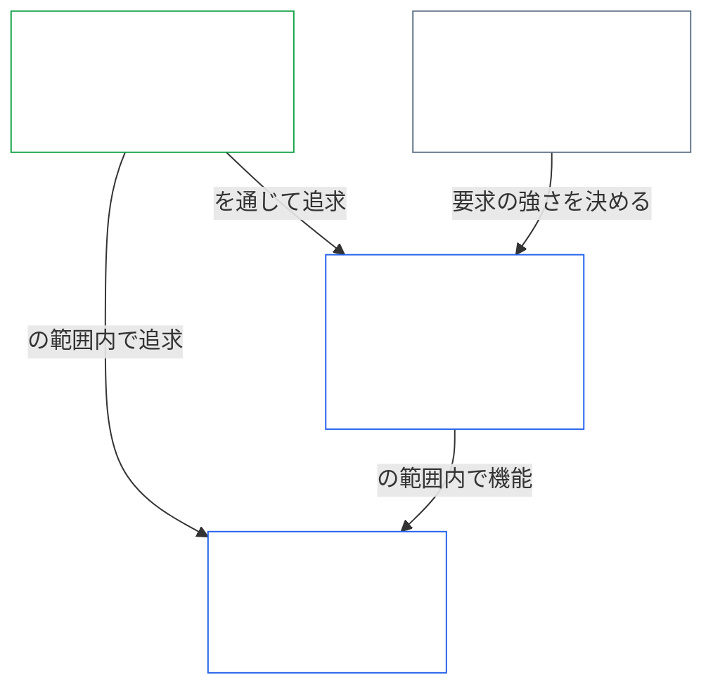

<!-- Locale: ja; language variety: Standard written Japanese; no country is fixed.. Structural resynchronization draft, AI-assisted (GPT-6 Codex), unreviewed. English source commit: 6e0b6c663dde01b5dea731fe33d87725c7174930; edition: SC-Corpus-2026.11.25. Source SHA-256: core_00.000_preamble.md 90799cb8019b41356fa5dd90565e3f9540fc346e8c77e2c321b841654f39b274; core_01.000_constitutional_map.md aca759b394f10784ab1a2eef4e9e2ca12e369ef0ca8ee797298c6af00d2950aa. This file is partial; no fluent review or synchronization is claimed. -->

# 前文／基礎要件

<strong>コーパス内の配置（非運用）：ファイル構造と読解規則</strong>

> **非運用**と記されたウィジェット（コーパス内の配置、読者案内、読者マップ）は案内のみを目的とする。自身のファイル内でも他のファイル内でも、拘束力ある義務を追加・削除・縮小しない。
>
> このファイルは**感知者憲法の一部**であり、番号付きの他の `core_*` ファイルと一つの文書として併せて読む場合に**のみ拘束力を持つ**。ここには**前文**（基礎要件）が収められている。読解順序と版のメタデータは[README.md](../../README.md)で管理する。
>
> **次へ：** [core_01.000_constitutional_map.md](core_01_constitutional_map.md)（第一章、憲法の地図）。

 

前文は、**モデル**（**二つの憲法上の目的**、**憲法四元**、**実質的利害**）および測定カテゴリーの憲法上の所管主体である。憲法上の所管登録は[第一章](core_01_constitutional_map.md#chapter-one-constitutional-map)、*憲法の地図*にある。

*平たい言葉で言えば：この冒頭は、この憲法が直すために存在する問題 — 影響を受ける者を傷つけ、隠し、または閉め出すシステム — を名指しし、文書の残りが、それを説明可能で、点検でき、適時な統治に置き換える方法だと述べる。*

感知者の自由、生存、福祉は、私たちがつくり、住み、依存するシステムと切り離せない。それらのシステムが範囲、相互依存、権力において大きくなるにつれ、不可逆で大規模な危害のリスクも大きくなる。これらのリスクは常に存在し、実質的に関連し続ける。

システムは、避けられたはずの苦しみを感知者に負わせること、繰り返し起こる問題を無視すること、危害を静かに他者へ移すこと、または感知者の暮らしを形づくるシステムから感知者を閉め出すことによって、正当性を保つことはできない。

共有システムは、すでに複雑であり、さらに複雑さを増している世界にある。健全で持続的な統治は、都合のよい代理指標に平板化するのではなく、その複雑さに向き合い、測定し、モデル化し、説明責任を負わなければならない。それは、影響を受ける感知者を使いものにならない手続に埋もれさせるという意味ではない。義務、記録、説明は、感知者が実際に学び、異議を申し立て、利用できる範囲に収めなければならない。また、その負担の大きさは、各行為者の役割と、問題となる影響、依存、リスクに応じて調整する。分散した理解がそれを現実のものにする。憲法上の働きをしない複雑さは認めない。世界の複雑さに正面から向き合い、それを壁の向こうへ押しやってはならない。

システムの設計、試験、運用の仕方は、生存、福祉、尊厳、誠実さ、そして持続する安定を支えなければならない。

私たちはより良いシステムを築くつもりである — これらの不均衡をなくすように組み立て — より説明責任があり、より堅牢で、すべての感知者の実際の必要により応える制度に置き換える。この憲法は、公正に、効果的に、持続可能に共に働くための、より良いモデルからその仕事を始める。

### システムが報いるもの

*平たい言葉で言えば：システムは、金銭、地位、アクセス、保護、沈黙のいずれであれ、対価を与えるものをより多く生み出す。したがって、システムの試金石は、何を大切にすると言うかではなく、何に報いるかである。他者を害すれば得をし、真実を語れば損をするなら、掲げる目的がどれほど立派でも、そのシステムは失敗している。*

システムは教える。人間が運営するものでも、AIが運営するものでも、両者によるものでも、あらゆるシステムは、その内部にいる者に何が得で何が損かを伝える。賃金、昇進、地位、アクセス、保護、目標、評価、最適化のシグナルを通じて伝えるのである。感知者、制度、AIシステムはそうしたシグナルに適応する。システムは、影響を受ける者への誠実さや配慮を掲げるかもしれない。しかし、問題を隠し、費用を他者に転嫁する者を引き立てるなら、反対のことを教えている。

そこで本憲法は、すべてのシステムに[**二つの根本的な問い**](#two-fundamental-questions)を投げかける：

1. **感知者の繁栄と存続を助け、真実を語り、害を修復する行為に報いるか？**
2. **不当に害し、誤解させ、排除し、遅らせ、浪費し、または費用を他者へ転嫁する行為に報いるか？**

システムが合格するのは、第一の答えが「はい」で、第二の答えが「いいえ」の場合だけである。一方への回答は他方への回答にはならない。良い行為に報いながら、害にも報いるシステムがあり得るからだ。

**第一の問い：** 次のいずれかが公然と、またはひそかに報われず、あるいは罰せられるなら、システムはこの問いに失敗する：

- 善意で問題を報告すること（[保護される報告（内部告発）](../../subcore_03.070_band_accountability.md#protected-reporting-whistleblowing)）
- 決定に異議を唱えること
- 不正への加担を拒むこと（[第一章 §17.5 抵抗する義務](../../core_02.040_stewardship_capacity_principles.md#175-duty-to-resist)）

罰には、脇へ追いやること、報復（[保護報告への報復とアクセス妨害](../../subcore_03.070_band_accountability.md#protected-reporting-retaliation-and-access-interference)）、または疲弊させることがある。

**第二の問い：** 次のいずれかが公然と、またはひそかに利益をもたらすなら、システムはこの問いに失敗する：

- 危害
- 誤導（隠蔽や偽りの信頼を含む）
- 不公正な排除
- 遅延
- 浪費
- 不公正な費用転嫁

報酬は、評価、昇進、保護、指標上の加点、または見て見ぬふりであり得る（[第一章 §3.2.6 反憲法的行為に報いることの禁止](../../core_02.000_values_principles.md#326-anti-reward-for-anti-constitutional-conduct)）。

どちらの問いも、同調を求めるものではない。誠実な異議、善意の報告、不正への加担拒否は反社会的ではない。それらをそう扱うシステムは、本末転倒である。また、どちらも人気投票ではない。何が助けとなり、害となり、公正で、正当化できるかは、本憲法独自の基準で判断する。それは[**繁栄**](#flourishing)と[**継続**](#continuity)であり、安全、真実、信頼、権利の床の内にある。多数派、運営者、あるいはその時々の承認が基準なのではない。

この問いは、システムが何に報い、何を罰するかを決めるすべての者を拘束する。賃金、昇進、アクセス、目標、評価を定める運営者、制度、管理者を含む。また、AIを訓練または最適化するシステムの設計者も含む。その目的関数とフィードバックシグナルは、まさにこの意味で報酬だからである。人間とAIの管理者は同じ基準に従う（[第一章 §17.1 共同管理基準](../../core_02.040_stewardship_capacity_principles.md#171-shared-stewardship-standard)）。

第一章は、この問いをインセンティブの規則にする：[第一章 §19.1.1 インセンティブがすべきこと](../../core_02.040_stewardship_capacity_principles.md#1911-what-incentives-must-do)が第一の問いを支え、[第一章 §19.1.2 インセンティブがしてはならないこと](../../core_02.040_stewardship_capacity_principles.md#1912-what-incentives-must-not-do)が第二の問いを支える。誰かの主張を信じるのでなく、実際に何が起きるかを確かめて答える。[インセンティブ整合](../../subcore_03.080_band_integrative.md#incentive-alignment)と[代替指標の乖離](../../subcore_03.085_band_oversight.md#proxy-divergence)が方法を示し、[**実質的利害**](#material-stake)が調査の深さを決める。第一節の四つの義務が、回答の誠実さを保つ。

### 1. モデル

*平たい言葉で言えば：四つの義務 — 参加、監督、説明責任、適時性 — は、どれだけの影響、依存、リスクがかかっているかに応じて尺度が変わり、二つの目的をともに仕える。繁栄と継続。動かない権利の床の内側で。*

感知者の生命を、生物としても物質としても支える重要システムは、四つの義務のもとで統治され、運用される。これを[**憲法四元**](#constitutional-tetrad)と呼ぶ。それは、それらのシステムが満たさなければならない一般義務を示す。義務の強さは、[**実質的利害**](#material-stake)に依存する。どれだけの影響、依存、リスクが関わるかである。利害が高いほど、義務はより強くなければならない。

- **参加** — 影響を受ける感知者は、実際の声、公正な代表、決定に異議を申し立てる公正な機会、および利害に見合った、本当に意味のある役割への通路を得る
- **監督** — 誰かが見て、点検し、検証し、記録を残し、問題を見つけられるようにする。独立した審査者は悪い選択を制約できる
- **説明責任** — 責任は正しい行為者までたどれる。彼らは自分の選択に答えなければならない。危害を受けた者は救済を得る。悪い結果は実際の是正を引き起こす
- **適時性** — 問題は、利害に見合った期限内に検出され、異議を申し立てられ、解決され、直される。誰かの権利、救済、または修復の機会を事実上消してしまう遅れは、正当な統治ではない

これら四つの義務は、共有システムが最適化すべき対象に仕える — [**二つの憲法上の目的**](#two-constitutional-aims)：

- **繁栄** — 真理、安全、信頼可能性、意味ある行為主体性を通じて持続する感知者の福祉
- **継続** — 長い時間地平の安定、持続可能性、回復力、生態的福祉

これらの目的は、つねにこの憲法が定める交渉不能の原則制約と権利保護の内側で、ともに追求されなければならない。[**憲法四元**](#constitutional-tetrad)は、その追求がどのように正当性を保つかを統治する。[**実質的利害**](#material-stake)に応じて尺度を合わせた**参加**、**監督**、**説明責任**、**適時性**である。四元の各脚と憲法上の目的の拘束力ある定義は第五章にある。[参加](../../subcore_03.060_apex_participation_leg.md#participation-constitutional)、[監督](../../subcore_03.055_apex_oversight_leg.md#oversight-constitutional)、[説明責任](../../subcore_03.040_apex_accountability_leg.md#accountability)、[適時性](../../subcore_03.065_apex_timeliness_leg.md#timeliness-constitutional)、[繁栄](../../subcore_03.050_apex_flourishing_aim.md#flourishing-constitutional)、[継続](../../subcore_03.045_apex_continuity_aim.md#continuity-aim-constitutional)。

### 2. 測定の概要

*平易に言えば：共有システムは当て推量や見栄えだけの指標では動かせない。感知者が実際に繁栄し、持続できているかを測る。審査の強さは影響、依存、リスクに応じて高める。*

#### 2.1 目的と基準

共有システムは、測定なしには適切に機能できない。食料、住居、ケア、インフラ、統治はいずれも複雑で変化する世界で機能する。その複雑さは、当て推量や都合のよい数字だけでは扱えない。

継続的な測定は、感知者の生存とウェルビーイングにとって最も重要なものに焦点を当てなければならない。問われるのは、私たちが依存するシステムが、時を通じて本当に[**繁栄**](#flourishing)と[**継続**](#continuity)を支えているかどうかである。その審査は、関わる影響、依存、リスクの大きさである[**実質的利害**](#material-stake)に応じて強化される。

本憲法に基づく測定は、システムの主張ではなく、実際に何をしているかについて[**二つの根本的な問い**](#two-fundamental-questions)を問う。測定は点数を付けること自体が目的ではない。感知者のウェルビーイングと地球の生態学的健全性に沿う、持続可能で強靱かつ思いやりのある結果を確保するための道具である。この義務は、[二つの憲法上の目的](#two-constitutional-aims)、すなわち**繁栄**と**継続**を通じて拘束力を持つ。

測定は、これらの目的および本憲法が定める権利保護に結び付いたままでなければならない。生の処理量、稼働率、人数、収益、遅延時間、その他の便宜的な代理指標は、憲法上の成果に取って代われない。この禁止は、[代理指標の乖離](../../subcore_03.085_band_oversight.md#proxy-divergence)が予見できる場合に適用される。

#### 2.2 公的測定

[サブコア7-D 公共情報局](../../subcore_07.040_public_information_office.md#subcore-7-d-public-information-office)は、憲法上の成果を公に測定する主要機関である。その運用規則に従い、実際の成果を示す証拠を、以下の測定カテゴリーおよびそれらが支える原則に対応付ける。その測定は、[§3.1 統治における測定の使用](#31-using-measurements-in-governance)における共有基準やフォーラムの役割に取って代わらない。

#### 2.3 測定カテゴリー

以下の概要は測定の**カテゴリー**を列挙し、それぞれを[二つの憲法上の目的](#two-constitutional-aims)および[憲法四元](#constitutional-tetrad)に対応付ける。各カテゴリーは平易な言葉で一つの問いを示し、**下位カテゴリー**を挙げ、測定ファミリー表、憲法上の用途、定義の振り分け先が記載された**第三章の測定ファミリーの所管**にリンクする。各下位カテゴリーは第三章の正式な定義にリンクする。

**物質性**は独立した測定カテゴリーではない。[**実質的利害**](#material-stake)、すなわち影響、依存、リスクの大きさに基づき、各カテゴリーをどの程度強く適用するかを定める。**憲法上の成果**は複数カテゴリーにまたがり、両方の目的を達成する手段となる。以下の表の各カテゴリーは、それを正式な定義まで追跡できる第三章の測定ファミリー所管にリンクする。

| カテゴリー | 平易な問い | 下位カテゴリー |
|---|---|---|
| **[繁栄](../../subcore_03.050_apex_flourishing_aim.md#measuring-flourishing-preamble-measurement-family)** | 感知者は生命、安全、必需品へのアクセスを実際に支えられているか。 | [ウェルビーイング](../../subcore_03.075_band_continuity.md#wellbeing) · [安全、害、リスク](../../subcore_03.075_band_continuity.md#safety-constitutional-constraint) · [生存基盤へのアクセス](../../subcore_03.075_band_continuity.md#bodily-maintenance-access) |
| **[継続](../../subcore_03.045_apex_continuity_aim.md#measuring-continuity-preamble-measurement-family)** | 感知者とシステムは、生態学的に、確実に、障害を越えて持続できるか。 | [生態学的フットプリントと環境上の前提条件](../../subcore_03.075_band_continuity.md#ecological-footprint) · [レジリエンス、可逆性、システムリスク](../../subcore_03.075_band_continuity.md#reversibility) · [依存関係と資源の流れ](../../subcore_03.075_band_continuity.md#dependency) · [システム間の支援](../../subcore_03.075_band_continuity.md#proportionate-cross-system-support) |
| **[参加](../../subcore_03.060_apex_participation_leg.md#measuring-participation-preamble-measurement-family)** | 影響を受ける感知者は、発言、アクセス、学習、プライバシーの面で公正に参加できるか。 | [公正、アクセス、主体性](../../subcore_03.090_band_participation.md#substantive-fairness) · [プライバシーとデータ管理](../../subcore_03.075_band_continuity.md#defc3-privacy-informational--peer-level-cluster-head) |
| **[監督](../../subcore_03.055_apex_oversight_leg.md#measuring-oversight-preamble-measurement-family)** | 感知者は、システムが示す内容を見て、検証し、信頼できるか。 | [真実と認識上の完全性](../../subcore_03.085_band_oversight.md#truth-constitutional-constraint) · [信頼性](../../subcore_03.075_band_continuity.md#trustworthiness) |
| **[説明責任](../../subcore_03.040_apex_accountability_leg.md#measuring-accountability)** | 報酬構造、市場支配力、説明責任は、義務を実効的に保っているか。 | [インセンティブの整合性と代理指標の完全性](../../subcore_03.080_band_integrative.md#incentive-alignment) · [市場構造と競争可能性](../../subcore_03.070_band_accountability.md#market-structure) |
| **[適時性](../../subcore_03.065_apex_timeliness_leg.md#measuring-timeliness)** | 紛争、是正、修復は救済が意味を持つうちに解決されるか。 | [適時の解決](../../subcore_03.070_band_accountability.md#timely-resolution) · [遅延防止と解決経路の規律](../../subcore_03.075_band_continuity.md#capture-of-resolution-pathways) |
| **[憲法上の成果](../../subcore_03.095_band_performance.md#measuring-constitutional-performance-preamble-measurement-family)** | 憲法上の成果は、無意味な浪費なく効率的に実現されているか。 | [憲法上の効率性](../../subcore_03.075_band_continuity.md#constitutional-efficiency) · [回避可能な負担](../../subcore_03.075_band_continuity.md#avoidable-burden) · [生産能力](../../subcore_03.075_band_continuity.md#productive-capacity) |

#### 2.4 カテゴリーの効果

これらの測定カテゴリーは、何が重要かを示す。それだけで、あらゆる数値、資金配分の算式、インターフェース規則、配慮事項の一覧、技術的指標、評価設計を定めるわけではない。特定の章または採択文書が明示的に要求した場合にのみ、拘束力を持つ。

### 3. 統治と責務ある管理

*平たい言葉で言えば：正当性には安全、真理、信頼が要る。それに加え、自分に影響するシステムを学び、それを動かし続けるうえで結果の伴う役割を取る、実際の機会が要る。*

持続する正当性は、[安全](../../core_02.000_values_principles.md#4-safety-harm-constraint)、[真理](../../core_02.000_values_principles.md#5-truth-epistemic-integrity-constraint)、[信頼](../../core_02.000_values_principles.md)に依存し、また、適法な責務ある管理、誠実な協力、有界な志向の比例的な承認にも依存する — 制裁と抑制だけではない。第一章はこの承認の次元を、[承認、強化、志向](../../core_02.000_values_principles.md#32-recognition-reinforcement-and-aspiration)で述べる。

分散した理解と責務ある管理は、私たちに実質的に影響するシステムがどう動くかを学ぶ、定期的で比例的な機会を感知者が持つことを求める。さらに、その維持と改善において結果の伴う役割を取る力を私たちに与える — そうして能力、修復能力、正当性が私たちの憲法共同体に広く行き渡り、回復力、持続可能性、向社会的な革新を確保する。それらの機会は、安全、真理、有界な行為主体性、および[第一章](../../core_02.020_interaction_interpretation.md#133-minimization-of-avoidable-burden)に述べられた[回避可能な負担](../../subcore_03.075_band_continuity.md#avoidable-burden)と比例性の規律を満たさなければならない。

#### 3.1 統治における測定の用い方

*平たい言葉で言えば：まず問題と利害を名指しし、合う測定カテゴリーを選び、都合のよい数字ではなく、共有の技術標準を証拠として用いる。*

憲法が具体的な測定規則を求める場合、[第十五章](../../core_15.000_forum.md#42-technical-forum-domains)の**技術フォーラム領域**が、測定、試験、信頼できる証拠の共通基準を策定し維持する。紛争を担当するフォーラムは、[第十五章 §4.2（*技術フォーラム領域*）](../../core_15.000_forum.md#42-shared-standards-and-anti-displacement)に従って事件を判断する際に、その基準を適用する。

憲法上の責務ある管理は、問題と[**実質的利害**](#material-stake) — どれだけの影響、依存、リスクが関わるか — を名指しすることから始まる。次に、[概観](#2-measurements-overview)から関連する[**測定**](#2-measurements-overview)カテゴリーと下位カテゴリーを選び、上記の標準を適用して、都合のよい指標ではなく現実世界の効果を試験する。たどれる証拠を求める。

#### 3.2 統治の層

*平たい言葉で言えば：誰が統治してよいかは、すでに授権されたシステムの内部の声とは別の問いである。参加投票や信頼得点は授権ではない。その声は通常の紛争の通常の第一歩である — 経路が失敗したときの独立したフォーラム審査の代わりではない。*

私たちの憲法のもとで[**憲法四元**](#constitutional-tetrad)を果たす統治には、関連するが異なる二つの層がある。

- [**憲法契約層**](../../subcore_03.080_band_integrative.md#constitutional-contract-layer)は、統治権限そのものの授権を統治する — 誰が統治してよいか、どの正当性の仕組みにより、どの範囲と持続する条件のもとでか。
- [**影響を受ける側のシステム参加**](../../subcore_03.090_band_participation.md#stakeholder-status-and-weight-cluster)は、すでに授権されたシステム、制度、有界な決定領域によって実質的に影響を受ける感知者に対して負う参加、代表、争訟可能性、[適正手続](../../subcore_03.070_band_accountability.md#due-process-constitutional)を統治する。

これらの層は実務では重なりうる。その重なりは、それらを一つに潰さない。すでに授権されたシステムにおける影響を受ける側の参加は、憲法上の授権の代わりではない。公表された異議経路、参加投票、信頼得点は、それ自体では誰が統治してよいかを決めない。

参加の層における争訟可能性は、すでに権限が付与されたシステム内の紛争に関する通常の第一歩である。影響を受けるセンティエントは、まず公表された異議申立て経路を使う。独立した[フォーラム審査](../../core_15.000_forum.md#1-purpose-and-role--participation-architecture)はその経路に取って代わらず、経路もまた、なお争われている、欠落または掌握されている、あるいは必要な救済を与えられない場合にフォーラム審査に取って代わらない。[紛争処理の順序](../../core_15.000_forum.md#dispute-sequencing)は、いつフォーラムへの経路づけに移るかを第十五章に定める。

憲法上の授権も、[影響を受ける側のシステム参加](../../subcore_03.090_band_participation.md#stakeholder-status-and-weight-cluster)層のもとで負う義務を消さない。それらの義務には、すでに授権されたシステム、制度、有界な決定領域によって実質的に影響を受ける感知者に対する参加、代表、[争訟可能性](../../subcore_03.070_band_accountability.md#contestability)、[適正手続](../../subcore_03.070_band_accountability.md#due-process-constitutional)がなお含まれる。

<!-- Structural resync only: complete current-source fidelity review, current widget/metadata/link reconciliation, and glossary review remain outstanding. -->
