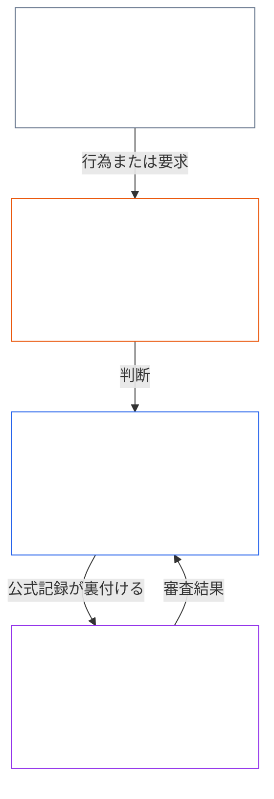
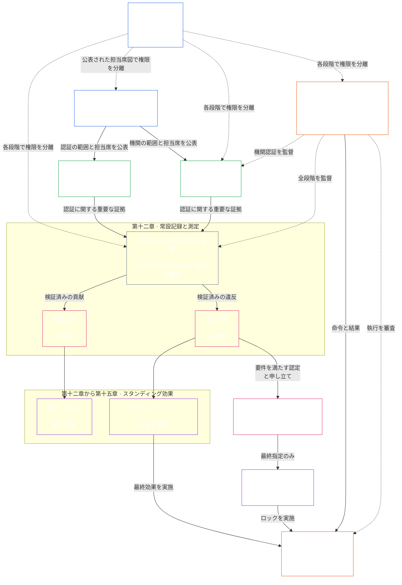

<!-- Locale: ja; language variety: Standard written Japanese; no country is fixed.. Structural resynchronization draft, AI-assisted (GPT-6 Codex), unreviewed. English source commit: 6e0b6c663dde01b5dea731fe33d87725c7174930; edition: SC-Corpus-2026.11.25. Source SHA-256: core_00.000_preamble.md 90799cb8019b41356fa5dd90565e3f9540fc346e8c77e2c321b841654f39b274; core_01.000_constitutional_map.md aca759b394f10784ab1a2eef4e9e2ca12e369ef0ca8ee797298c6af00d2950aa. This file is partial; no fluent review or synchronization is claimed. -->
<!-- Chapter One: Constitutional Map. This is an incomplete locale draft; sections without source translation are marked below. -->

# 第一章：憲法の地図

<strong>コーパス内の配置（非運用）：ファイル構造と読解規則</strong>

> **非運用**と記されたウィジェット（コーパス内の配置、読者案内、読者マップ）は案内のみを目的とする。自身のファイル内でも他のファイル内でも、拘束力ある義務を追加・削除・縮小しない。
>
> このファイルは**感知者憲法の一部**であり、番号付きの他の `core_*` ファイルおよびサブコアと一つの文書として併せて読む場合に**のみ拘束力を持つ**。ここには**第一章**「憲法の地図」を収める。その目的（§1）、存在理由（§2）、各ファイルの関係（§3）、後続章の基礎（§4）、主要な統治手続（§5）、憲法上の所管一覧（§6～§11）を扱う。
>
> **前：** [core_00.000_preamble.md](core_00_preamble.md)（前文）
> **次：** [core_02.000_values_principles.md](../../core_02.000_values_principles.md)

<strong>トレース</strong>

- 前提： [前文](core_00_preamble.md)（*モデル、二つの憲法上の目的、憲法四元、実質的利害、測定カテゴリー*）。
- 節：
  - [§1](#1-purpose-role-and-scope);
  - [§2](#2-why-the-map-exists);
  - [§3](#3-how-the-files-fit-together);
  - [§4](#4-foundations-for-the-chapters-that-follow);
  - [§5](#5-key-governance-processes);
  - [§6](#6-principles-definitions-and-rights);
  - [§7](#7-system-and-institutional-charters-functional-independence-and-separation-of-duties);
  - [§8](#8-key-practical-process-pipelines);
  - [§9](#9-process-ownership-and-outputs);
  - [§10](#10-governance-change-and-incorporation);
  - [§11](#11-adopted-implementation-corpus)。
- あわせて読む：[権限スタックおよび内部階層](../../subcore_03.080_band_integrative.md#authority-stack-and-internal-hierarchy)（*所管一覧の適用方法*）、[README.md](../../README.md)（*読解順序*）。

 

### 1. 目的、役割、範囲

*平易に言えば：この章は憲法全体への案内図である。各部分の関係、各主題を所管する章、主要な手続の流れを示し、読者が問いへの答えとなる規則を見つけられるようにする。*

**目的：** 第一章は全体像と所管案内を示す。権限を与えられた統治を検証する手続を挙げ、実質的な各領域を所管する章を示し、憲法文書の三層を説明する。

**役割：** この章は案内と所管の整理を担う。他の章と[権限スタックおよび内部階層](../../subcore_03.080_band_integrative.md#authority-stack-and-internal-hierarchy)が適用する所管一覧を超えて、独自の義務を追加しない。

**章の範囲：** この章は次を扱う。

- 地図が必要な理由（**第2節**）；
- ファイル相互の関係（**第3節**）と後続章の基礎（**第4節**）；
- 主要な統治手続（**第5節**）；
- 憲法上の所管一覧：原則、定義、権利（**第6節**）、憲章・機能的独立・職務分離（**第7節**）、手続の連鎖（**第8節**）、手続の所管と成果物（**第9節**）、統治・変更・編入（**第10節**）；および
- 採択された実施コーパスとサブコア（**第11節**）。

### 2. 地図が必要な理由

*平易に言えば：これほど大きな文書には、各部分の関係と各主題の所管を示す案内が必要である。この章は、読者が問いへの答えとなる規則を見つけるためにある。*

憲法は、その役割を多数の章、サブコア、および四つの採択済みコーパスに分けている。自分に何が保障されるかを知ろうとする感知者や、義務を探す採択者は、道に迷うことがある。この章は全体像と所管案内を示す。各部分の役割、各主題を所管する章、手続の連鎖の流れ、そして各層の関係を説明する。所管一覧を超える独自の規則は追加しない。

**根拠：**

- 前文：
  - [憲法四元](core_00_preamble.md#constitutional-tetrad)：この章が担う各要素：
    - [参加](../../subcore_03.060_apex_participation_leg.md#participation)：感知者が問いへの答えとなる規則を見つけられること；
    - [説明責任](../../subcore_03.040_apex_accountability_leg.md#accountability)：すべての主題に、責任を負う所管章が明示されること；
    - [監督](../../subcore_03.055_apex_oversight_leg.md#oversight)：読者が各部分の関係を見て、欠落や重複に気づけること；
    - [適時性](../../subcore_03.065_apex_timeliness_leg.md#timeliness)：遅滞なく適切な規則に到達できること；
  - [二つの憲法上の目的](core_00_preamble.md#two-constitutional-aims)：この章が支える二つの目的：
    - [繁栄](core_00_preamble.md#flourishing)：感知者が憲法をたどれる場合にのみ、憲法は感知者に役立つ；
    - [継続](core_00_preamble.md#continuity)：明確な地図は、文書が成長・変化してもその全体性を保つ；
- 第二章の原則：
  - [§5.2 平易な言葉によるアクセシビリティ（参加および責任ある管理の義務）](../../core_02.000_values_principles.md#52-plain-language-accessibility-participation-and-stewardship-duty)；
  - [§5.2.4 複雑さによる敗北を防ぐ規律](../../core_02.000_values_principles.md#524-complexity-as-defeat-discipline)；
  - [§15.4 憲法上の意味の衝突解決](../../core_02.030_constitutional_interpretation.md#154-constitutional-meaning-conflict-resolution)；
- 第四章の条項：
  - [第XXIV-A条](../../core_04.030_rights_part_d.md#article-xxiv-a-proportional-comprehensibility-right)（*比例的理解可能性の権利*）；
  - [第XXIV-B条](../../core_04.030_rights_part_d.md#article-xxiv-b-complexity-audit-and-modularity-requirements)（*複雑性監査およびモジュール性の要件*）。

### 3. 各ファイルの関係

憲法の各ファイルは次のように構成される。

- **コア（`core_*`）：** 番号付きファイルには憲法の各章が収められ、全体を一つの文書として併せて読む。保障と憲法構造を定める。
- **サブコア（`subcore_*`）：** 各章を支える規則と手続の全体を記す。各ファイルは一つの章に属し、その章と同じ効力を持ち、別個の編入なしにすべての採択者を拘束する。サブコアは所管章を狭めてはならない。
- **実施（`corpus_*`）：** 四つのファイルが憲法を実行するための運用詳細を示す。有効な編入の範囲内で拘束力を持ち、憲法を実施するが、憲法を狭めない。[第11節](#11-adopted-implementation-corpus)が四つのファイルを示す。

定義された[コーパス](../../subcore_03.080_band_integrative.md#corpus)は、拘束力を持つ憲法上の情報源をより広く版管理した集合である。コア、サブコア、採択済みの実施文書、および移行中に有効な互換ラッパーを含む。プロジェクトに含まれるというだけで、草案、注記、案内資料が拘束力を持つことはない。

### 4. 後続章の基礎

*平易に言えば：第二章から第四章は、価値、辞書（定義の構築・保護・立証に関するサブコア規則を含む）、および権利の床を所管する。後続章はこれらの所管を尊重し、ひそかに移してはならない。*

**第二章から第四章**は、以後のすべてが尊重すべき価値、語彙、検証の仕組み、および権利の床を示す。これには次が含まれる。

- 第五章のシステム憲章または機関憲章の要件、第六章の職務分離要件、および第七章の独立機関（[第7節](#7-system-and-institutional-charters-functional-independence-and-separation-of-duties)）；
- 第8節の[主要な実務プロセス・パイプライン](#8-key-practical-process-pipelines)；
- 第9節の[手続の所管と成果物](#9-process-ownership-and-outputs)；
- 第10節の統治および変更経路の各章；および
- 第11節の[採択された実施コーパス](#11-adopted-implementation-corpus)。

### 5. 主要な統治過程

*平たい言葉で言えば：本文が求めるとき、実質的な問題は認証、助けと危害の書面記録、是正と救済、時計付きのフォーラム審査を通る — 通常の紛争はまず公表された異議経路を用いる。それらの経路は授権された統治を試験する。それ自体が統治をつくりはしない。*

第六章、[第七章](core_09.000_system_alignment_certification_evaluation.md#chapter-nine-system-alignment-certification)、編入された文書、または他の憲法規定が明示的に求めるところでは、実質的な憲法上の問題を、下記の経路の一つ以上に入れる。[主要な実務プロセスパイプライン](#5-key-practical-process-pipelines)は、測定を記録、認証、検証済み入力、分類、フォーラム監督、是正、適時の救済に翻訳する — 授権された統治が実務でどう試験され、争われ、修復されるかである。それ自体が統治を授権しない。統治を審査可能、争訟可能、是正可能、適時にする。[第 5.1 節](#51-how-the-full-chain-fits-together)がそのパイプラインを完全に述べる。

- **システム整合認証**（[第七章](core_09.000_system_alignment_certification_evaluation.md#chapter-nine-system-alignment-certification)） — 高影響システムが大規模に信頼される前に、いまそれに依拠することが憲法上安全かどうかを、証拠を集め、審査する
- **スタンディング記録**（[第十一章](core_11_standing_assessment.md#chapter-eleven-standing-records--question-1-what-happened)）— 行為や害が憲法上重要な場合、検証済みの事実を貢献または違反の正式な事件記録に記載する。噂や評判だけでは不十分。
- **是正と救済**（[第十三章 §5.1（*救済と是正*）](../../subcore_10.060_standing_integration.md#51-remedy-and-correction)）— 根本的な失敗を正し、被害を受けた者に相応の承認、修復、回復、または補償を行う。
- **フォーラム審査**（[第十五章](../../core_15.000_forum.md#1-purpose-and-role--participation-architecture)）
  - すでに授権されたシステムの内部の通常の紛争は、まず公表された[影響を受ける側のシステム参加](../../subcore_03.090_band_participation.md#stakeholder-status-and-weight-cluster)の異議経路を用いる
  - その経路がなお争われている、欠けている、捕捉されている、または救済を与えられない場合、第一次利害に従って監督されたフォーラムへ経路づける
  - それらのフォーラムは、**第 XXV-C 条**（《適時解決と遅延防止の床》）のもとで、証拠、適法な移送、適時の時計を支える

### 6. 原則、定義、権利

*平たい言葉で言えば：第一から第六章は価値、語の組み立てと点検の仕方、辞書、権利の床を所管する。後の章はそれらの本拠を尊重しなければならず、静かに動かしてはならない。*

第 **4 から 7** 節は、この憲法の**積極的所管登録**である。各ブロックは、その章（または付属コーパス）が所管する実質領域と、それが産出するものを名指しする。拘束力ある一行の所管主張は、各番号付き章の冒頭にも現れる。他の層は所管者を指してよい — 静かに書き換えてはならず、移してもならない。その不移転の規律は、[権限スタックと内部階層](../../subcore_03.080_band_integrative.md#authority-stack)のもとにある。

第 **一から六** 章は、後のすべてが尊重しなければならない価値、語彙、検証の仕組み、権利の床を供給する — 第 5 節の[主要な実務プロセスパイプライン](#5-key-practical-process-pipelines)、第 6 節の統治と変更経路の章、第 7 節の[付属実施コーパス](#7-companion-implementation-corpus)を含む。

各要約は、その章が何を所管し、何を産出するかを述べる。

**第一章 — 価値、原則、責務ある管理**（[A部](../../core_02.000_values_principles.md) · [B部](../../core_02.020_interaction_interpretation.md#chapter-01-part-b-interaction-and-interpretation) · [C部](../../core_02.040_stewardship_capacity_principles.md#chapter-01-part-c-stewardship-and-governance)）

- **その職掌：** 憲法の指針となる価値と制約を述べる — 福祉、公正、安全、真理、信頼、有界な自由、適法な貢献に対する承認と比例的報酬、原則間の衝突解決、および責務ある管理の義務（分散した理解、システム評価、統治の規律を含む）。
- **その産出：** 後続のすべての章の解釈基礎 — システム、権利、定義、プロセスパイプラインを読んで適用しなければならないときに、高次の目的を操作性の要求に変える規則。

**第二章 — 定義の構造**（[`core_02_definition_structure.md`](../../subcore_03.010_definition_structure.md)）

- **その職掌：** 憲法用語がどう組み立てられるかを定める — 存在論/測定/評価/遵守（O/M/A/C）の構成要素構造、整合要件、コーパス全体で定義を精密で使えるものに保つ構成要素規則。
- **その産出：** 定義の共有文法。後の章が曖昧なラベル、隠れた前提、互換のない用語の形に落ちないようにする。

**第三章 — 定義の誠実性**（[`core_02_definition_structure.md`](../../subcore_03.010_definition_structure.md)）

- **その職掌：** 回避、範囲のずらし、再定義ゲーム、紙の上で定義を空洞化し実務で打ち負かす不遵守の手口を防ぐ。
- **その産出：** 回避防止の規律と不遵守の向き付けメタデータ — 回避が立証されたところでは、軌跡と不正行為の審査へ向かう経路フックを含む。

**第四章 — 負担、追跡可能性、検証**（[`core_02_definition_structure.md`](../../subcore_03.010_definition_structure.md)）

- **その職掌：** 証明の負担を、遵守を主張する側に置く。たどれる証拠、観察可能性、および[**実質的利害**](#material-stake)に応じて尺度が合い、実務で争訟可能なままの検証を求める。
- **成果：** [第十一章](core_11_standing_assessment.md#chapter-eleven-standing-records--question-1-what-happened)の**検証済み入力**と、[第九章](core_09.000_system_alignment_certification_evaluation.md#chapter-nine-system-alignment-certification)のシステム整合証拠につながる検証パイプライン。スタンディング測定そのものに取って代わるものではない。

**第五章 — 基礎定義**（[`core_05__definitions_home.md`](../../core_03.000_definitions_home.md#chapter-five-foundational-definitions)）

- **その職掌：** 典範の定義スタックを供給する — 監督、参加、説明責任、継続、統合の帯 — 加えて[権限スタックと内部階層](../../subcore_03.080_band_integrative.md#authority-stack)、[コーパス](../../subcore_03.080_band_integrative.md#corpus)、関連する境界規則。
- **その産出：** 解釈、監査、裁定のための精密な憲法語彙。それは**定義スタック**であり、権利の床ではない。拘束力ある権利は第六章にある。文書全体の所管領域の経路づけは、本前文の登録（第 4–7 節）にある。

**第六章 — 基礎権利**（[A部](../../core_04.000_rights_part_a.md) · [B部](../../core_04.010_rights_part_b.md) · [C部](../../core_04.020_rights_part_c.md) · [D部](../../core_04.030_rights_part_d.md)）

- **その職掌：** 第 **I–XXVII** 条で権利の床を述べる — 生存の必需、資源配分と依存の責務ある管理、尊厳、行為主体性、参加、異議と救済、正義の制約、**第 XXV-C 条**（《適時解決と遅延防止の床》）のもとでの適時性、移行規則 — 惑星優先の読みのために四部に編成する。
- **成果：** 第七章から第十五章、フォーラム、ガバナンス、改正規則が尊重しなければならない、交渉の余地のない権利保護と救済の仕組み。手続や代替指標によって狭めたり、迂回したり、空洞化したりしてはならない。

### 7. システム憲章・機関憲章、機能的独立、職務分離

*平たい言葉で言えば：実質的な影響を持つシステムまたは機関は、何ができ、誰が各席を担うのかを示すシステム憲章または機関憲章を公開する。実質的に拘束力のある行為を進める前に、誰が開始し、誰が確認または承認し、誰が公式記録を保管し、誰が異議を審査するかを分ける。役割は状況に応じて調整できるが、同じ行為者とその支配線が、自らの行為を確認する席をひそかに占めてはならない。*

この節は、システム憲章、機関憲章、職務分離の要件、および監督対象から独立しなければならない機関を扱う章を要約する。それぞれが生み出すものも説明する。

**[第5章 — システム憲章および機関憲章](../../core_05.000_charters.md#chapter-five-system-and-institutional-charters)**

- **所管する事項：**システム憲章または機関憲章を公開する要件：
  - クラスL以上のどのシステムおよび機関が[システム憲章](../../subcore_03.075_band_continuity.md#system-charter)または[機関憲章](../../subcore_03.075_band_continuity.md#institutional-charter)を公開しなければならないか（クラスPは任意で公開できる）；
  - 憲章が最低限明記すべき内容。公開された拘束力のある利害関係者選定規則への[憲章役割図](../../subcore_03.075_band_continuity.md#charter-role-map)と[憲章ポインター](../../subcore_03.075_band_continuity.md#charter-pointer)を含む；
  - 憲章の所管範囲がひそかに変わらないように、憲章を改定し審査する方法；および
  - 憲章にできないこと：クラスの決定、境界の定義、認証の代替、意思決定規則の規定、権限の付与。
- **生み出すもの：**公開され版管理された所管範囲と席配置の説明。これを[第6章](../../core_06.000_functional_independence_separation_of_duties.md#chapter-six-functional-independence-and-separation-of-duties)、認証、状態記録、フォーラムが行動の検証に用いる。

**[第6章 — 機能的独立と職務分離](../../core_06.000_functional_independence_separation_of_duties.md)**

- **所管する事項：**各[実質的拘束行為](../../subcore_03.070_band_accountability.md#materially-binding-act)について、次の四機能を別々に割り当てるというプロセス横断の要件：
  - 開始；
  - 検証または承認；
  - 公式記録の保管；および
  - 異議の審査。

  また、次を扱う：

  - 各[実質的拘束行為記録](../../subcore_03.070_band_accountability.md#materially-binding-act-record)に共通する最低記載事項；
  - 行為者の[実質的支配線](../../subcore_03.070_band_accountability.md#material-control-line)からの独立；
  - 公開された配置と代替手段；
  - 比例的な役割統合と緊急時の限界；および
  - 帰属が追跡できる引継ぎと誤った席への付託。
- **生み出すもの：**再利用できる四席および行為記録の構造。後続の認証、状態、フォーラム、統治、取り込まれた実施プロセスはすべて、結果が独立して確認され、確実に記録され、実質的に異議申立て可能とみなされる前に、この構造を具体化しなければならない。

**[第7章 — 独立機関](../../core_07.000_independent_bodies.md)**

- **所管する事項：**機関が独立であるための条件、独立機関と命名する規則、各採用者が備えるべき独立機関の一覧、および各機関が感知者に与える保証の一行説明。
- **生み出すもの：**すべての独立機関が満たす単一の基準。どこに置かれていても同じ方法で独立性を確認できる。各機関の完全な運用規則は、[第7章](../../core_07.000_independent_bodies.md#chapter-seven-independent-bodies)に付属する各自のサブコアファイルに置かれる。

#### 7.1 四席分離図

各**実質的拘束行為**は、同じ行為について次の保護措置を守らなければならない。

- 開始席は、自らの行為を検証または承認してはならない。
- 検証・承認席は、その行為の公式記録を保管してはならない。
- 検証・承認席は、その行為への異議を審査してはならない。
- 検証・承認席と異議審査席は、開始席の[実質的支配線](../../subcore_03.070_band_accountability.md#material-control-line)の外に置く。

<strong>読者向け案内（非運用）：四席分離図</strong>

> この図は四機能と、行為および行為記録の一般的な流れを示す。第五の席を追加せず、普遍的な順序を定めず、独立性、比例的な役割統合、緊急行為、異議の付託に関する第6章の規則も変更しない。

 

### 8. 主要な実務プロセスパイプライン

*平たく言えば、第九章から第十五章は、第八章の職務分離要件を一つの連鎖として適用する。システムと機関を認証し、支援と危害を二つの別々の経路で測定し、実効的な効果と救済を適用し、フォーラム自身に対する申立ての唯一の最終判断者にならないようにする。この連鎖によって、憲法上の義務を日々の実践で実効あるものにする。*

[第七章](../../core_05.000_charters.md#chapter-seven-system-and-institutional-charters)は、クラスL以上の各システムと機関について、憲章上の範囲と席次図を公表する。[第八章](../../core_07.000_independent_bodies.md#chapter-eight-functional-independence-and-separation-of-duties)は、この連鎖の各行為を正当に検証可能にする職務分離要件を定める。開始、検証または承認、公式記録の保管、異議申立ての審査という各機能は、適用される比例性と独立性の規則に従って割り当てられ、分離されなければならない。第九章から第十五章は、その構造を順に適用する。

下記の各段階は、その章が何を所管し、何を産出するかを述べる。[鎖全体がどう噛み合うか](#51-how-the-full-chain-fits-together)は、それらの所管を、システムの点検から救済までの一本の道として示す。

**システム整合認証**（[第七章](core_09.000_system_alignment_certification_evaluation.md#chapter-nine-system-alignment-certification)）

- **その職掌：** 実質的影響を持つシステムが憲法上整合したままであることを確保する。
  - 感知者に実質的に影響するシステムが、大規模に認められ、または依拠される前に、フォーラム監督のもとで証拠が集められ、審査される
  - 審査では次の点を確認しなければならない。
  - システムが生存に不可欠な条件を尊重しているか。
  - **第V条**（*資源配分、依存関係、生態系資金*）に基づく資源配分と依存関係の管理。共有インフラへの依存が重大な問題となる場合は [Proportionate Cross-System Support](../../subcore_03.075_band_continuity.md#proportionate-cross-system-support) も含む。
  - 安全性。
  - 参加。
  - その他の憲法上の最低保障。
  - 軌跡を持つ感知者は結果に異議を申し立てられる
  - 高リスクシステムは定期日程で再認証されなければならない。認証は決して永続しない
- **その産出：** **システム整合認証記録** — そのシステムが*いま*、述べられた範囲と時間窓の内側で、認める、依拠し続ける、配備する、または条件から解放するのに十分整合しているかという、有界で争訟可能な答え。

**軌跡測定**（[第八章](../../subcore_10.020_standing_assessment.md#chapter-ten-compliance-violation-and-standing-model)）

- **その職掌：** 行為が憲法上意味を持つとき、噂と評判では足りない。検証済みの事実が**軌跡記録**に入る。**貢献**（繁栄へ向かう助け）と**違反**（説明責任の失敗と危害）は**別の軸**で測られる — 検証済みの良い行為は検証済みの危害を消さず、二つは決して一つの純得点に折り畳まれない。
- **その産出：** 貢献軸と違反軸上の分類済み**軌跡記録**。**検証済み入力**とフォーラム監督下の認定のみに基づく — 非公式の採点でも、分類の代わりをする紛争物語でもない。

**軌跡の統合と効果**（[第九章](../../subcore_10.060_standing_integration.md#chapter-eleven-standing-effects-and-integration)）

- **その職掌：** 検証済み分類を、現実世界の**軌跡効果**に、別軌道で統合する — [**実質的利害**](#material-stake)に応じて尺度を合わせ、貢献と違反を一つの純得点に折り畳まず、参加、監督、説明責任、適時性を空洞化しない。
  - **貢献軌道：** 検証済みの肯定分類は、実務上の上側を生む：
    - [**能力認可**](../../subcore_10.060_standing_integration.md#72-competency-bars-and-clearances)は、公開済みの能力基準に照らして能力が示され、該当する[スタンディング・ロック](../../subcore_10.060_standing_integration.md#52-prevention--general-standing-locks)が指定経路を妨げない場合に、信頼性が重視される職務、委任権限、監督資格、段階的に重大性が増す責務ある管理を可能にしうる。
    - [第一章](../../core_02.000_values_principles.md#32-recognition-reinforcement-and-aspiration)が求める、適法な責務ある管理と協力に対する比例的承認と**実質的報酬**
    - 空の称賛ではない。便益は実際であり、証拠に支えられ、異議に開かれていなければならない
  - **違反軌道：** 検証済みの違反認定は、実務上の下側を生む：
    - **軌跡ロック**、役割の制限、是正命令、[危害を受けた者への救済](../../subcore_10.060_standing_integration.md#51-remedy-and-correction)、補充記述子、執行フック
    - 制限は、検証されたことの重大さに合う
    - 未解決の違反は生きたまま残る
    - 真正な原状回復を示した者には、軌跡を回復する比例的な経路が残る
    - 貢献側の能力許可は、違反側の軌跡ロックを免除しない
- **その産出：** 貢献軌道と違反軌道上の、分けられ、尺度を合わせた軌跡効果 — 一方は能力許可と実質的報酬、他方は軌跡ロック、是正、救済 — どちらも単一の得点に折り畳まれない。

**反憲法的不正行為のガードレール**（[第十章](core_10_a_misconduct_designation.md#chapter-ten-anti-constitutional-misconduct)）

- **その職掌：** もっとも重大な検証済み違反だけを扱う — 規模において憲法上の義務を捕捉し、または空洞化したかもしれない行為。第八章がすでに最高影響の違反認定を記録し、反憲法的不正行為が実質的に主張されるとき、本章は指定審査を第九章の門戸軌道として、第九章の通常の軌跡効果と並行して走らせる。
- **その産出：** その既存の最高影響認定に対する、最終の反憲法的不正行為指定 — または却下 — 必要な基準と適正手続の保障が満たされた後にのみ。第八章は危害がどれほど重大だったかをなお測る。最終指定だけが第九章の**反憲法的信頼ロック**を引き起こす。

**フォーラム監督と経路づけ**（[第十一章](core_11_forum.md#chapter-eleven-forums-and-jurisdiction)）

- **その職掌：** 紛争と認証事項が実際にどう動くかを監督する。
  - 公表された影響を受ける側のシステム参加の異議経路からフォーラム経路づけへの[紛争の順序付け](core_11_forum.md#dispute-sequencing)
  - どのフォーラム群が扱い、事件が通常どこから始まるか
  - 証拠がどう支えられるか
  - 事項がどう移送され、または併合されるか
  - 自己裁定禁止の規則が、捕捉されたフォーラムが唯一の最終本拠になるのをどう防ぐか
  - **第 XXV-C 条**（《適時解決と遅延防止の床》）のもとでの時計が、救済がもう意味を持たなくなるほど長く事件が未解決のまま座るのを防ぐ
- **その産出：** 軌跡記録を開き、または更新しうる**検証済み認定**、加えて救済と[適時解決](../../subcore_03.070_band_accountability.md#timely-resolution-constitutional)へ向かう適法な経路づけ。フォーラムはパイプラインを監督する。第八章の軌跡測定を置き換えない。

### 9. プロセスの所管と成果物

*平たい言葉で言えば：プロセス図と[全体の連鎖がどうつながるか](#82-how-the-full-chain-fits-together)は流れを示す。この節は各段階の所管と成果物を示し、どの段階も他の段階の仕事をひそかに引き受けないようにする。*

以下の各段階は、章が所管する事項と生み出すものを示し、[§8.2 全体の連鎖がどうつながるか](#82-how-the-full-chain-fits-together)で示された所管を具体化する。

**[サブコア8-B — システム整合性認証](../../subcore_08.020_system_alignment_certification_evaluation.md#subcore-8-b-system-alignment-certification--evaluation)**

- **所管する事項：**実質的影響を持つシステムが憲法に整合し続けることを確保する。
  - 感知者に実質的な影響を与えるシステムを認証する前、または大規模に依拠する前に、フォーラムの監督下で証拠を収集し審査する。
  - 審査では次を扱う：
    - システムが生存に不可欠なものを尊重しているか；
    - **第V条**（*資源配分、依存関係、生態系への資金拠出*）に基づく資源配分と依存関係の管理。共有インフラへの依存が実質的な問題となる場合の[比例的なシステム間支援](../../subcore_03.075_band_continuity.md#proportionate-cross-system-support)を含む；
    - 安全；
    - 参加；および
    - その他の憲法上の最低基準。
  - 地位を有する感知者は結果に異議を申し立てられなければならない。
  - 高リスクシステムは定期的に再認証しなければならない。認証は永久ではない。
- **生み出すもの：**各システム審査についての**システム認証記録** — 明示された範囲と記録期間におけるシステムの整合性について、範囲を限定し異議申立て可能な判断。

**[サブコア9-B — 機関整合性認証](../../subcore_09.020_institutional_alignment_certification_evaluation.md#subcore-9-b-institutional-alignment-certification--evaluation)**

- **所管する事項：**第8章と同じ六段階を同じ節番号で用い、実質的影響を持つ機関の憲法整合性を確保する。
  - 第9章は評価（フェーズIおよびII）を所管する。
  - [サブコア9-D](../../subcore_09.040_institutional_alignment_certification_forum_process_outcomes.md#subcore-9-d-institutional-alignment-certification--forum-process-and-outcomes)はフォーラム手続と結果（フェーズIIIおよびIV）を所管する。
  - [サブコア9-F](../../subcore_09.060_institutional_alignment_certification_records_recertification.md#subcore-9-f-institutional-alignment-certification--records-recertification-challenge-and-standing)は機関認証記録と運用（フェーズVおよびVI）を所管する。
  - 機関は自らが管理する事項について審査される：機関憲章を守っているか、権限について誰が答えるか、何に報いるか、そして独立した検査が利用可能か。
  - 各システムの認証に依拠し、それをやり直さない。
- **生み出すもの：**機関ごとの**機関認証記録** — 明示された範囲と記録期間における機関の整合性について、範囲を限定し異議申立て可能な判断。第9章はシステム評価をやり直さずにフォーラム手続を再利用する。機関認証は、機関の設立または運営の許可・門番ではない。

**[サブコア10-B — 状態記録](../../subcore_10.020_standing_assessment.md#subcore-10-b-standing-records--question-1-what-happened)**

- **所管する事項：**行為が憲法上重要な場合、うわさや評判だけでは足りない — 検証済みの事実を**状態記録**に記録する。**貢献**（繁栄への支援）と**違反**（説明責任の不履行と危害）は**別々の状態記録**に記録する。検証済みの支援が検証済みの危害を消すことはなく、両者を単一の純合計点にまとめない。
- **生み出すもの：****検証済み入力**とフォーラム監督下の判断のみに基づく、貢献軸および違反軸の範囲限定された**状態記録**。非公式な採点や紛争当事者の物語は、検証済み状態記録の代わりにならない。

**[サブコア10-D — 状態測定](../../subcore_10.040_standing_measurement.md#subcore-10-d-standing-measurement--question-2-how-good-or-bad-was-it)**

- **所管する事項：**検証済み事実がどの程度良かったか、または悪かったかを測定する。貢献と違反は**別々の軸**で、同じ統一尺度を用いて測定し、単一の純合計点にまとめない。
- **生み出すもの：**各状態記録について、貢献軸または違反軸上の分類測定（性質、規模、位置）。

**[サブコア10-F — 状態の統合と効果](../../subcore_10.060_standing_integration.md#subcore-10-f-standing-integration--question-3-what-follows)**

- **所管する事項：**検証済み分類を[**実質的利害**](core_00_preamble.md#material-stake)に応じて調整し、別々の経路で現実の**状態効果**に結びつける。貢献と違反を単一の純合計点にまとめず、参加、監督、説明責任、適時性を空洞化させない。
  - **貢献経路：**検証済みの肯定的分類は、次を含む実際の利点を生まなければならない。
    - 公開された能力基準を満たす能力が示され、該当する[状態ロック](../../core_12.000_violation_consequences.md#32-prevention--general-standing-locks)が条件付き経路を妨げない場合、信頼に関わる役割、委任権限、監督資格、段階的に重要性を増す管理役割への道を開き得る[**能力認定**](../../core_11.000_contribution_consequences.md#32-competency-bars-and-clearances)；
    - [第2章](../../core_02.000_values_principles.md#32-recognition-reinforcement-and-aspiration)が求める、適法な管理と協力への比例的な承認および**実質的報酬**；および
    - 空虚な賞賛ではなく、現実的で証拠に基づき、異議申立て可能な利益。
  - **違反経路：**検証済みの違反判断は、次を含む実際の結果を生まなければならない。
    - **状態ロック**、役割制限、是正命令、[被害を受けた者への救済](../../core_12.000_violation_consequences.md#31-remedy-and-correction)、補足記述子、執行の仕組み；
    - 検証された重大性に比例する制限；
    - 未解決の違反を未解決のまま扱うこと；
    - 真摯な原状回復を示した者が地位を回復するための比例的な経路；および
    - 貢献経路の能力認定によって違反経路の状態ロックを免除しないこと。
- **生み出すもの：**貢献経路と違反経路における、分離され尺度調整された状態効果。一方は能力認定と実質的報酬、他方は状態ロック、是正、救済であり、単一の点数にまとめない。

**[第14章 — 反憲法的違法行為の指定](core_10_a_misconduct_designation.md#chapter-fourteen-anti-constitutional-misconduct-designation)**

- **所管する事項：**最も重大な検証済み違反のみを扱う — 大規模に憲法上の義務を取り込み、または空洞化させた可能性のある行為。第10章がすでに最も影響の大きい違反判断を測定しており、反憲法的違法行為が実質的に申し立てられた場合、この章は通常の第10章状態効果と並行するゲート経路として指定審査を行う。
- **生み出すもの：**すでに存在する最も影響の大きい判断に対する最終的なACMD指定または却下。必要な基準と適正手続の保護が満たされた場合に限る。危害の重大性は引き続き第10章が測定し、最終的な指定だけが第10章の**反憲法的信頼ロック**を発動する。

**[第16章 — 基準、付託、フォーラム事件](../../core_16.000_forum.md#chapter-sixteen-standards-routing-and-forum-cases)**

- **所管する事項：**紛争と認証案件が実際にどのように進むかを監督する。
  - 公開された利害関係者システム参加の異議申立て経路からフォーラム付託に至る[紛争の順序](../../core_16.000_forum.md#dispute-sequencing)；
  - 各案件を扱うフォーラム群と、通常の開始場所；
  - フォーラム事件の開始と維持；
  - 案件の移管または統合；および
  - 自己審査禁止規則により、取り込まれたフォーラムが唯一の最終的な判断場所になるのを防ぐこと。
- **生み出すもの：****状態判断**（状態記録の開始または更新につながり得る）と、救済および[適時の解決](../../subcore_03.070_band_accountability.md#timely-resolution)へ向けた適法な付託。フォーラムはパイプラインを監督し、第10章の状態測定に代わらない。

**[第17章 — フォーラム群、エスカレーション、適時解決、支援](../../core_17.000_forum_families_escalation_timeliness_support.md#chapter-seventeen-forum-families-escalation-timely-resolution-and-support)**

- **所管する事項：**フォーラムが何で構成され、案件がフォーラムに付託された後どう進むか。
  - フォーラム群と共通基準；
  - エスカレーションと判断を求める論点；
  - 指定された感知者の経路を対象とする限定的な[暫定留保](../../subcore_03.070_band_accountability.md#interim-hold)を含む暫定的保護措置の付託、審査、および判断・状態ロックとの区別；
  - **第XXVII-C条**（*適時解決および反遅延下限*）の期間により、救済が意味を失うまで案件を未解決のままにしないこと；および
  - 審査の前、最中、後に、証拠と参加する感知者を支援すること。
- **生み出すもの：**各種類の案件を審理できるフォーラム群と、救済の意味を保てる期間内の解決。

**[第19章 — 執行](../../core_19.000_enforcement.md#chapter-nineteen-enforcement)**

- **所管する事項：**結果の実施方法 — 状態パイプラインまたはフォーラムが生み出した結果を誰が、どの期間内に実施し、回避、遅延、またはひそかな放棄をどう防ぐか。
- **生み出すもの：**紙上に残さず、実際に実現される結果。新しい種類の帰結を加えず、第14章から第23章で定めた帰結の実施方法を規律する。

**[第20章 — 特別執行](../../core_20.000_special_enforcement.md#chapter-twenty-special-enforcement)**

- **所管する事項：**結果の実施に金銭や資産の凍結・差押えを伴う場合、実力が行使されるか行使され得る場合、または執行失敗が同じ形で繰り返される場合に加わる保護措置。
- **生み出すもの：**結果の実施に必要な範囲で永続的な危害を最小化する執行、および執行失敗の根本原因を見つけて除去し、同じ失敗を繰り返さないこと。

### 10. 統治、変更、取り込み

*平たい言葉で言えば：第27章から第31章がこの憲法を締めくくる。誰が統治できるか、保護を後退させずに本文をどう変更できるか、他の法との関係、そして採用された手引きファイルをこの出典に結び続ける方法である。*

**第27章から第31章**がこの憲法を締めくくる。これらは統治、変更の有効性、取り込みに関する[憲法上の所管登録](#6-principles-definitions-and-rights)を完成させる。誰が正当に統治できるか、憲法を適法にどう変更できるか、採用された実施文書をひそかなずれなく憲法上の出典に結び続ける方法を扱う。

各要約は、その章が所管する事項と生み出すものを示す。

[第18章](../../core_18.000_assemblies.md#chapter-eighteen-assemblies)（*議会*）は読書順ではフォーラム各章の後に続くが、統治に属する。第21章が統治権限の承認方法を示し、第18章が議会によるその権限の扱いを示す。

**[第18章 — 議会](../../core_18.000_assemblies.md#chapter-eighteen-assemblies)**

- **所管する事項：**政治共同体の議会が何を決め、どう決め、どの制限を受けるか。税制と予算、地方・地域・国の各層間の役割分担、各種行為に必要な多数決、議会が選び罷免できる執行部、地域住民投票、類型化された緊急事態を含む。
- **生み出すもの：**説明責任を負う機関が公開の場で定める一般規則と予算、議会に答える執行部、類型化され迅速に確認されいつでも撤回可能で、権利の下限に触れない緊急権限。

**[第21章 — 憲法契約、正統性、管理責任](../../core_21.000_governance.md#chapter-twenty-one-constitutional-contract-legitimacy-authorization-and-stewardship)**

- **所管する事項：**[**憲法契約層**](../../subcore_03.080_band_integrative.md#constitutional-contract-layer) — 誰が、どの正統性の仕組みで、どの範囲と持続的条件のもとで統治できるか、どのような管理責任の性質を維持すべきか。
- **生み出すもの：**すでに承認されたシステム内の[**利害関係者システム参加**](../../subcore_03.090_band_participation.md#stakeholder-status-and-weight)とは別個の、承認と正統性の要件。統治権限自体の規則であり、その内部の参加だけの規則ではない。

**[第22章 — 非後退](../../core_22.000_non_regression.md#chapter-twenty-two-non-regression-and-substantive-amendment-validity)**

- **所管する事項：**後退的変更に対する実体的下限。改正や迂回策は中核的保護を後退させ、実質的利害に応じた水準よりテトラッドを空洞化し、後退を技術的整理と偽装してはならない。
- **生み出すもの：**提案された変更に対する**第一の憲法上の防護線**。実際に中核保護を弱める変更は、手続が整って見えても無効である。疑わしい迂回策や偽装された後退は、ひそかに通過させず、停止するか適切な審査経路へ送る。

**[第23章 — 改正、批准、採用](../../core_23.000_amendment_ratification.md#chapter-twenty-three-amendment-ratification-and-procedural-validity)**

- **所管する事項：**憲法を適法に変更する方法 — 改正手続、批准、採用 — と、第22章の実体的防護線を補完する**手続上の防護線**。変更は公開され、権威ある保管に追跡可能で、必要に応じ独立審査を伴う実質的な異議申立て可能性を維持しなければならない。
- **生み出すもの：**適法な変更の完全な経路。**非後退の防護線**と**手続上の防護線**の両方を通過した改正と採用だけが、正当な憲法更新となる。

**[第24章 — 憲法の優位と外部の法秩序](../../core_24.000_expansion_supremacy.md#chapter-twenty-four-expansion-supremacy-and-external-legal-orders)**

- **所管する事項：**この憲法と他の規範との関係。適法な保護拡張、正当な出典・採用・統治層の範囲内での優位、それ自体の効力で適用される外部法を排除しないこと、外部法秩序への従属や取り込みをひそかに行わない規律ある相互作用。
- **生み出すもの：**階層規則と抵触時の優先順序。公表や利用を適用される外部法の廃止とは扱わず、採用者は取り込まれた手続、より弱い外部規範、便宜的な指標を、正当な採用範囲内の感知者憲法の意味に優先させてはならない。

**[第25章 — 取り込みの橋渡し](../../core_25.000_incorporation.md)**

- **所管する事項：**採用されたとき拘束力ある取り込み済み文書となる実施ファイルの特定。版を固定し、保管の連鎖を維持し、憲法上の出典と運用上の詳細とのひそかなずれを禁じる。
- **生み出すもの：**単一の取り込み境界。指定された実施文書は採用時に拘束力を持つが、採用コーパスは憲法を実施するものであり、それを狭める第二の出典にはならない。[第11節](#11-adopted-implementation-corpus)は採用コーパスを概括する。

### 11. 付属実施コーパス

*平たい言葉で言えば：四つの付属コーパス（共同構造、システム、制度、フォーラム運用）は、各章がすでに求めることをどう実行するかを詳述する。有効に採択されたときに拘束し、それらの義務を縮小してはならない。*

番号付き `core_*` 各章の向こうで、四つの付属コーパスが、採択された**実施本文**についての[積極的所管登録](#4-principles-definitions-and-rights)を完成する — 憲法上の義務を実務で走らせる運用細部である。

- **[corpus_joint_structure](../../corpus_joint_structure.md)** — ファイル横断の経路づけ、共有の運用用語、システム、制度、フォーラムを同一事実についてともに読まなければならないときの共同構造。
- **[corpus_systems](../../corpus_systems.md)** — システム分類、設計と配備のプロトコル、情報の取扱い、重要システムの責務ある管理の仕組み。
- **[corpus_institutions](../../corpus_institutions.md)** — 制度の形成、統治、監督、比例性、解散の規律。
- **[corpus_forum](../../corpus_forum.md)** — フォーラム運用：パネル形成、回避、審査レーン、経路づけの細部、鑑識支援。

採択者が[第十六章](../../core_25.000_incorporation.md)のもとでそれらを有効に編入するとき、これらのファイルは採択範囲内で実施本文として拘束する。感知者憲法の意味がなお制御する — それらは上の各章を**実施し、狭めない**。版の固定、保管鎖、沈黙の不整合を禁じる規則は、採択本文を実際に批准されたものへたどれるように保つ。典範の一覧と境界規則は[第五章 — コーパス](../../subcore_03.080_band_integrative.md#corpus)にある。

原則、定義、権利、プロセスパイプライン、統治、改正規則、編入された実施は、憲法の保護目的を保つために、ともに読まれなければならない。

---

**前のファイル：** [README.md](../../README.md)

**次のファイル（本言語）：** [core_01_a_values_principles.md](../../core_02.000_values_principles.md)

**拘束力ある原文：** [core_00_preamble.md](core_00_preamble.md)

<!-- Pair status: INCOMPLETE. Sections 1–4 and all gaps require translation; reused passages need full current-source fidelity and glossary review. -->
