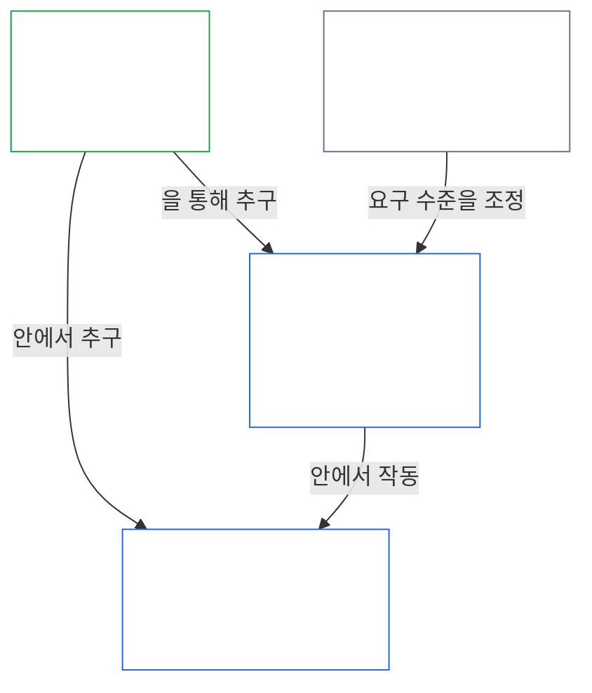

<!-- Locale: ko; language variety: Standard written Korean in Hangul; no country is fixed.. Structural resynchronization draft, AI-assisted (GPT-6 Codex), unreviewed. English source commit: 6e0b6c663dde01b5dea731fe33d87725c7174930; edition: SC-Corpus-2026.11.25. Source SHA-256: core_00.000_preamble.md 90799cb8019b41356fa5dd90565e3f9540fc346e8c77e2c321b841654f39b274; core_01.000_constitutional_map.md aca759b394f10784ab1a2eef4e9e2ca12e369ef0ca8ee797298c6af00d2950aa. This file is partial; no fluent review or synchronization is claimed. -->

# 전문 / 기초 요건

<strong>코퍼스 내 위치(비작동): 파일 구조와 읽기 규칙</strong>

> **비작동**으로 표시된 위젯(코퍼스 내 위치, 독자 안내, 독자 지도)은 안내만을 위한 것이다. 자체 파일이나 다른 파일에서 구속력 있는 의무를 추가·삭제·축소하지 않는다.
>
> 이 파일은 **감지자 헌법의 일부**이며 번호가 매겨진 다른 `core_*` 파일들과 하나의 텍스트로 함께 읽을 때에만 **구속력을 갖는다**. 이 파일에는 **전문**(기초 요건)이 담겨 있다. 읽기 순서와 판본 메타데이터는 [README.md](../../README.md)에서 관리한다.
>
> **다음:** [core_01.000_constitutional_map.md](core_01_constitutional_map.md) (제1장, 헌정 지도).

 

전문은 **모형**(**두 헌법 목적**, **헌법 사원(四元)**, **실질 이해관계**) 및 측정 범주의 헌법상 주관자이다. 헌법상 주관자 등록부는 [제1장](core_01_constitutional_map.md#chapter-one-constitutional-map), *헌정 지도*에 있다.

*쉬운 말로: 이 여는 글은 이 헌법이 고치려고 존재하는 문제를 이름 붙입니다 — 영향을 받는 이를 해치고, 숨기고, 문 밖에 잠그는 체계들 — 그리고 문서의 나머지는, 그것을 책무 있고, 점검할 수 있고, 제때인 거버넌스로 어떻게 바꾸는지를 말합니다.*

감지자의 자유, 생존, 복지는 우리가 만들고, 살고, 기대는 체계와 떼어 놓을 수 없다. 그 체계가 범위, 상호의존, 권력에서 커질수록, 되돌릴 수 없는 대규모 해의 위험도 커진다. 그 위험은 늘 있고, 실질적으로 관련된다.

체계는 막을 수 있었던 고통을 감지자에게 주거나, 거듭 일어나는 문제를 무시하거나, 해를 남몰래 다른 이에게 넘기거나, 삶을 빚는 체계에서 감지자를 잠가 내쫓는 방식으로는 정당성을 지킬 수 없다.

공유 체계는 이미 복잡하고 더욱 복잡해지는 세계에 놓여 있다. 건전하고 지속성 있는 거버넌스는 그 복잡성을 편리한 대리지표로 납작하게 만들지 말고, 복잡성에 맞서 측정하고 모형화하며 그에 답해야 한다. 그렇다고 영향을 받는 감지자를 쓸 수 없는 절차 속에 파묻으라는 뜻은 아니다. 의무, 기록, 설명은 감지자가 실제로 배우고 이의를 제기하고 사용할 수 있는 범위에 머물러야 하며, 요구의 강도는 각 행위자의 역할과 관련된 영향, 의존, 위험에 비례해야 한다. 분산된 이해가 이를 현실로 유지한다. 헌정상 아무 역할도 하지 않는 복잡성은 거부된다. 세계의 복잡성에 정면으로 대응하고, 그것을 벽 너머로 떠넘기지 말라.

체계를 어떻게 설계하고, 시험하고, 운영하는지는 생존, 복지, 존엄, 정직, 오래가는 안정을 받쳐야 한다.

우리는 더 나은 체계를 짓겠다고 — 이 불균형을 없애도록 짜인 체계를 — 그리고 모든 감지자의 실제 필요에 더 책무 있고, 더 튼튼하고, 더 응답하는 제도로 바꾸겠다고 한다. 이 헌법은 우리가 어떻게 정의롭고, 효과 있고, 지속 가능하게 함께 일할 수 있는지에 대한 더 나은 모형으로 그 일을 시작한다.

### 체계가 보상하는 것

*쉬운 말로: 체계는 돈, 지위, 접근, 보호, 침묵 등 자신이 대가를 치르는 것을 더 많이 얻게 한다. 그러므로 체계의 기준은 무엇을 중요하다고 말하는지가 아니라 무엇에 보상하는지다. 타인에게 해를 끼치면 이득을 얻고 진실을 말하면 대가를 치르는 체계는, 내세우는 목표가 아무리 좋아도 실패한 것이다.*

체계는 가르친다. 인간이 운영하든, AI가 운영하든, 둘이 함께 운영하든 모든 체계는 그 안에 있는 이들에게 무엇이 이득이고 무엇이 비용인지 알려 준다. 임금, 승진, 지위, 접근, 보호, 목표, 평점, 최적화 신호를 통해 그렇게 한다. 감지자, 기관, AI 체계는 그 신호에 맞춰 행동을 조정한다. 체계는 영향을 받는 이들을 정직하게 대하고 배려한다고 내세울 수 있다. 그러나 문제를 숨기고 비용을 타인에게 떠넘기는 이들을 승진시킨다면 정반대의 교훈을 주는 것이다.

그래서 이 헌법은 모든 체계에 [**두 가지 근본 질문**](#two-fundamental-questions)을 던진다:

1. **감지자의 번영과 지속을 돕고, 진실을 말하며, 해를 바로잡는 행동에 보상하는가?**
2. **부당하게 해를 끼치고, 오도하고, 배제하고, 지연시키고, 낭비하거나 비용을 타인에게 떠넘기는 행동에 보상하는가?**

첫 질문의 답이 예이고 둘째의 답이 아니어야 체계는 통과한다. 한쪽에 답해도 다른 쪽에 답한 것이 아니다. 좋은 행동에 보상하면서도 해로운 행동에 보상할 수 있기 때문이다.

**첫 번째 질문:** 다음 중 하나라도 공개적으로 또는 은밀하게 보상받지 못하거나 불이익을 받으면 체계는 이 질문에서 실패한다.

- 선의로 문제를 보고하기 ([보호되는 보고(내부고발)](../../subcore_03.070_band_accountability.md#protected-reporting-whistleblowing))
- 결정에 이의를 제기하기
- 잘못된 행위에 가담하기를 거부하기 ([제1장 §17.5 저항의 의무](../../core_02.040_stewardship_capacity_principles.md#175-duty-to-resist))

불이익은 배제, 보복([보호 보고에 대한 보복 및 접근 방해](../../subcore_03.070_band_accountability.md#protected-reporting-retaliation-and-access-interference)), 또는 지치게 만드는 방식일 수 있다.

**두 번째 질문:** 다음 중 하나라도 공개적으로 또는 은밀하게 이득을 가져오면 체계는 이 질문에서 실패한다.

- 해악
- 오도(은폐와 거짓 신뢰 포함)
- 부당한 배제
- 지연
- 낭비
- 부당한 비용 전가

보상은 인정, 승진, 보호, 지표상 점수, 또는 못 본 체하기일 수 있다([제1장 §3.2.6 반헌법적 행위에 대한 보상 금지](../../core_02.000_values_principles.md#327-anti-reward-for-anti-constitutional-conduct)).

두 질문 모두 무조건 동의하라는 요구가 아니다. 정직한 반대 의견, 선의의 보고, 잘못된 행위에 가담하지 않겠다는 태도는 반사회적이지 않다. 그것을 반사회적으로 취급하는 체계가 거꾸로 된 것이다. 어느 질문도 인기투표가 아니다. 무엇이 돕고 해치며 공정하고 정당한지는 이 헌법 자체의 기준으로 판단한다. 그 기준은 안전, 진실, 신뢰, 권리 바닥 안에서의 [**번영**](#flourishing)과 [**지속성**](#continuity)이다. 다수, 운영자, 또는 순간의 승인이 기준이 아니다.

이 질문은 체계가 무엇에 보상하거나 벌을 줄지 결정하는 모두를 구속한다. 임금, 승진, 접근, 목표, 평점을 정하는 운영자, 기관, 책임자가 포함된다. AI를 훈련하거나 최적화하는 체계의 설계자도 포함된다. 그들의 목적과 피드백 신호는 바로 이 의미의 보상이다. 인간과 AI 책임자는 같은 기준 아래 있다([제1장 §17.1 공동 책임자 기준](../../core_02.040_stewardship_capacity_principles.md#171-shared-stewardship-standard)).

제1장은 이 질문을 인센티브 규칙으로 구체화한다. [제1장 §19.1.1 인센티브가 해야 하는 일](../../core_02.050_governance_incentive_application.md#1911-what-incentives-must-do)은 첫 질문을 뒷받침하고, [제1장 §19.1.2 인센티브가 해서는 안 되는 일](../../core_02.050_governance_incentive_application.md#1912-what-incentives-must-not-do)은 둘째 질문을 뒷받침한다. 누군가의 주장을 믿지 말고 실제로 일어나는 일을 확인해 답하라. [인센티브 정렬](../../subcore_03.080_band_integrative.md#incentive-alignment)과 [대리지표 괴리](../../subcore_03.085_band_oversight.md#proxy-divergence)가 방법을 말하고, [**실질적 이해관계**](#material-stake)가 얼마나 깊이 살필지 정한다. 제1절의 네 의무가 답을 정직하게 지킨다.

### 1. 모형

*쉬운 말로: 네 의무 — 참여, 감독, 책무, 적시성 — 는 얼마나 많은 영향, 의존, 위험이 걸려 있는지에 따라 세지고, 두 목적을 함께 섬깁니다: 번영과 연속, 움직이지 않는 권리 바닥 안에서.*

감지자 생명을 생물적으로도 물질적으로도 받치는 핵심 체계는, [**헌법 사원(四元)**](#constitutional-tetrad)이라 부르는 네 의무 아래에서 거버넌스되고 운영된다. 그것은 그 체계가 충족해야 할 일반 의무를 밝힌다. 그 의무의 세기는 [**실질 이해관계**](#material-stake)에 달렸다: 얼마나 많은 영향, 의존, 위험이 걸려 있는가. 이해관계가 높을수록 의무는 더 세져야 한다.

- **참여** — 영향받는 감지자는 실제 목소리, 공정한 대표, 결정을 다툴 공정한 기회, 걸려 있는 것에 비례해 중요한 역할에 닿을 길을 얻는다
- **감독** — 누군가 보고, 점검하고, 확인하고, 기록을 남겨 문제를 찾을 수 있게 한다; 독립 검토자는 나쁜 선택을 제약할 수 있다
- **책무** — 책임은 올바른 행위자에게 추적된다; 그들은 선택에 답해야 한다; 해를 입은 이는 구제를 받는다; 나쁜 결과는 실제 교정을 부른다
- **적시성** — 문제는 걸려 있는 것에 맞는 시한 안에 발견되고, 다투어지고, 해결되고, 고쳐진다; 누군가의 권리, 구제, 수리 기회를 사실상 지워 버리는 지연은 정당한 거버넌스가 아니다

그 네 의무는 공유 체계가 최적화해야 할 것을 섬긴다 — [**두 헌법 목적**](#two-constitutional-aims):

- **번영** — 진실, 안전, 신뢰성, 의미 있는 행위주체성을 통해 지속되는 감지자 복지
- **연속** — 긴 시계의 안정, 지속가능성, 회복력, 생태 복지

그 목적은 함께 추구해야 하며, 언제나 이 헌법이 세운 타협 불가 원칙 제약과 권리 보호 안에 있어야 한다. [**헌법 사원(四元)**](#constitutional-tetrad)은 그 추구가 어떻게 정당성을 유지하는지를 다스린다: [**실질 이해관계**](#material-stake)에 맞춰 세기를 조절한 **참여**, **감독**, **책무**, **적시성**. 사원(四元) 각 다리와 헌법 목적의 구속력 있는 정의는 제5장에 산다: [참여](../../subcore_03.060_apex_participation_leg.md#participation-constitutional), [감독](../../subcore_03.055_apex_oversight_leg.md#oversight-constitutional), [책무](../../subcore_03.040_apex_accountability_leg.md#accountability), [적시성](../../subcore_03.065_apex_timeliness_leg.md#timeliness-constitutional), [번영](../../subcore_03.050_apex_flourishing_aim.md#flourishing-constitutional), [연속](../../subcore_03.045_apex_continuity_aim.md#continuity-aim-constitutional).

### 2. 측정 개요

*쉽게 말해: 공유 시스템은 추측이나 보여 주기용 지표로 운영할 수 없다. 감지자가 실제로 번영하고 지속하는지를 측정해야 한다. 검토 강도는 영향, 의존, 위험에 비례한다.*

#### 2.1 목적과 기준

공유 시스템은 측정 없이는 제대로 작동할 수 없다. 식량, 주거, 돌봄, 기반시설, 거버넌스는 모두 복잡하고 변하는 세계에서 운영된다. 그 복잡성은 추측이나 편리한 숫자만으로 다루기에는 너무 크다.

지속적인 측정은 감지자의 생존과 안녕에 가장 중요한 것에 초점을 맞춰야 한다. 우리가 의존하는 체계가 시간이 지나도 실제로 [**번영**](#flourishing)과 [**연속**](#continuity)을 뒷받침하는지가 질문이다. 검토의 강도는 관련된 영향, 의존, 위험의 크기인 [**실질 이해관계**](#material-stake)에 비례한다.

이 헌법에 따른 측정은 시스템의 주장 자체가 아니라 실제로 하는 일에 [**두 가지 근본 질문**](#two-fundamental-questions)을 적용한다. 측정은 점수 그 자체를 위한 점수가 아니다. 감지자의 안녕과 지구의 생태적 건강에 부합하는 지속 가능하고 회복력 있으며 연민 있는 결과를 보장하는 도구다. 이 책무는 [두 헌법 목적](#two-constitutional-aims), 즉 **번영**과 **연속**을 통해 구속력을 갖는다.

측정은 그 목적과 이 헌법이 정한 권리 보호에 계속 추적 가능해야 한다. 원시 처리량, 이용률, 인원수, 매출, 지연시간 및 다른 편리한 대리지표는 헌정 성과를 대체할 수 없다. [대리 지표의 괴리](../../subcore_03.085_band_oversight.md#proxy-divergence)가 예상되는 모든 경우에 이 금지가 적용된다.

#### 2.2 공공 측정

[서브코어 7-D 공공정보실](../../subcore_07.040_public_information_office.md#subcore-7-d-public-information-office)은 헌정 결과를 공개적으로 측정하는 주된 담당기관이다. 운영 규칙에 따라 실제 결과의 증거를 아래 측정 범주와 그 범주가 뒷받침하는 원칙에 대응시킨다. 이 측정은 [§3.1 거버넌스에서 측정 사용](#31-using-measurements-in-governance)의 공동 기준이나 포럼 역할을 대체하지 않는다.

#### 2.3 측정 범주

아래 개요는 측정 **범주**를 나열하고 각 범주를 [두 헌법 목적](#two-constitutional-aims)과 [헌법 사원(四元)](#constitutional-tetrad)에 연결한다. 각 범주는 쉬운 말로 질문 하나를 제시하고 **하위 범주**를 밝히며, 범주 표와 헌정상 용도, 정의 경로가 있는 **제3장 측정 계열 담당 위치**에 연결한다. 각 하위 범주는 제3장의 정식 정의에 연결된다.

**중요성(materiality)**은 별도의 측정 범주가 아니다. [**실질 이해관계**](#material-stake), 즉 영향·의존·위험의 크기에 따라 각 범주를 얼마나 강하게 적용할지 정한다. **헌정 성과**는 여러 범주에 걸치며 두 목적을 위한 수단이다. 아래 표의 각 범주는 정식 정의까지 추적하는 제3장 측정 계열 담당 위치에 연결된다.

| 범주 | 쉬운 질문 | 하위 범주 |
|---|---|---|
| **[번영](../../subcore_03.050_apex_flourishing_aim.md#measuring-flourishing-preamble-measurement-family)** | 감지자는 삶, 안전, 필수품 접근을 실제로 보장받는가? | [안녕](../../subcore_03.075_band_continuity.md#wellbeing) · [안전, 해악, 위험](../../subcore_03.075_band_continuity.md#safety-constitutional-constraint) · [생존 기반 접근](../../subcore_03.075_band_continuity.md#bodily-maintenance-access) |
| **[연속](../../subcore_03.045_apex_continuity_aim.md#measuring-continuity-preamble-measurement-family)** | 감지자와 시스템은 생태적으로, 신뢰성 있게, 실패를 넘어 지속될 수 있는가? | [생태 발자국과 환경 전제조건](../../subcore_03.075_band_continuity.md#ecological-footprint) · [회복력, 가역성, 시스템 위험](../../subcore_03.075_band_continuity.md#reversibility) · [의존성과 자원 흐름](../../subcore_03.075_band_continuity.md#dependency) · [시스템 간 지원](../../subcore_03.075_band_continuity.md#proportionate-cross-system-support) |
| **[참여](../../subcore_03.060_apex_participation_leg.md#measuring-participation-preamble-measurement-family)** | 영향을 받는 감지자는 발언, 접근, 학습, 사생활 측면에서 공정하게 참여할 수 있는가? | [공정성, 접근, 주체성](../../subcore_03.090_band_participation.md#substantive-fairness) · [사생활 및 데이터 관리](../../subcore_03.075_band_continuity.md#defc3-privacy-informational--peer-level-cluster-head) |
| **[감독](../../subcore_03.055_apex_oversight_leg.md#measuring-oversight-preamble-measurement-family)** | 감지자는 시스템이 나타내는 내용을 보고 검증하고 신뢰할 수 있는가? | [진실과 인식적 무결성](../../subcore_03.085_band_oversight.md#truth-constitutional-constraint) · [신뢰성](../../subcore_03.075_band_continuity.md#trustworthiness) |
| **[책무](../../subcore_03.040_apex_accountability_leg.md#measuring-accountability)** | 보상 구조, 시장 권력, 설명 책임은 책무가 실질적으로 지켜지게 하는가? | [인센티브 정렬 및 대리지표 무결성](../../subcore_03.080_band_integrative.md#incentive-alignment) · [시장 구조 및 경쟁 가능성](../../subcore_03.070_band_accountability.md#market-structure) |
| **[적시성](../../subcore_03.065_apex_timeliness_leg.md#measuring-timeliness)** | 구제책이 의미 있을 때까지 분쟁, 시정, 복구가 해결되는가? | [적시 해결](../../subcore_03.070_band_accountability.md#timely-resolution) · [지연 방지 및 해결 경로 규율](../../subcore_03.075_band_continuity.md#capture-of-resolution-pathways) |
| **[헌정 성과](../../subcore_03.095_band_performance.md#measuring-constitutional-performance-preamble-measurement-family)** | 헌정 결과가 무의미한 낭비 없이 효율적으로 제공되는가? | [헌정 효율성](../../subcore_03.075_band_continuity.md#constitutional-efficiency) · [피할 수 있는 부담](../../subcore_03.075_band_continuity.md#avoidable-burden) · [생산 역량](../../subcore_03.075_band_continuity.md#productive-capacity) |

#### 2.4 범주의 효과

이 측정 범주들은 무엇이 중요한지 보여 준다. 범주만으로 모든 수치, 자금 공식, 인터페이스 규칙, 편의 제공 목록, 기술 지표, 평가 설계를 정하지는 않는다. 특정 장이나 채택 문서가 명시적으로 요구할 때에만 구속력을 갖는다.

### 3. 거버넌스와 책임 있는 관리

*쉬운 말로: 정당성에는 안전, 진실, 신뢰가 필요하고, 더하여 당신에게 영향을 미치는 체계를 배우고 그것을 돌아가게 유지하는 데 결과가 있는 역할을 맡을 실제 기회가 필요합니다.*

오래가는 정당성은 [안전](../../core_02.000_values_principles.md#4-safety-harm-constraint), [진실](../../core_02.000_values_principles.md#5-truth-epistemic-integrity-constraint), [신뢰](../../core_02.000_values_principles.md)에 달렸고, 또한 적법한 책임 있는 관리, 진실한 협력, 한정된 지향의 비례 인정에도 달렸다 — 제재와 억제만으로는 아니다. 제1장은 이 인정 차원을 [인정, 강화, 지향](../../core_02.000_values_principles.md#32-recognition-reinforcement-and-aspiration)에서 말한다.

분산된 이해와 책임 있는 관리는, 우리에게 실질적으로 영향을 미치는 체계가 어떻게 돌아가는지를 배울 정기적이고 비례하는 기회를 감지자에게 요구한다. 더하여, 유지와 개선에서 결과가 있는 역할을 맡도록 한다 — 그리하여 역량, 수리 능력, 정당성이 우리 헌법 공동체에 넓게 퍼져 회복력, 지속가능성, 친사회적 혁신을 확보하게 한다. 그 기회는 안전, 진실, 한정된 행위주체성, 그리고 [제1장](../../core_02.020_interaction_interpretation.md#133-minimization-of-avoidable-burden)이 말한 [피할 수 있는 부담](../../subcore_03.075_band_continuity.md#avoidable-burden)과 비례 규율을 충족해야 한다.

#### 3.1 거버넌스에서 측정 쓰기

*쉬운 말로: 먼저 문제와 이해관계를 이름 붙이고, 맞는 측정 범주를 고르고, 편한 숫자가 아니라 공유 기술 표준을 증거로 쓰십시오.*

헌법이 구체적인 측정 규칙을 요구하면 [제15장](../../core_17.000_forum_families_escalation_timeliness_support.md#32-technical-forum-domains)의 **기술 포럼 영역**이 측정, 시험, 신뢰할 수 있는 증거를 위한 공동 기준을 개발하고 유지한다. 분쟁을 담당하는 포럼은 [제15장 §4.2 (*기술 포럼 영역*)](../../core_17.000_forum_families_escalation_timeliness_support.md#62-shared-standards-and-anti-displacement)에 따라 사건을 판단할 때 해당 기준을 적용한다.

헌법상 책임 있는 관리는 문제와 [**실질 이해관계**](#material-stake)를 이름 붙이는 데서 시작한다 — 얼마나 많은 영향, 의존, 위험이 걸려 있는가. 다음으로 [개관](#2-measurements-overview)에서 관련 [**측정**](#2-measurements-overview) 범주와 하위범주를 고르고, 위의 표준을 적용해 편한 지표가 아니라 실제 세계 효과를 시험한다. 추적 가능한 증거를 요구하라.

#### 3.2 거버넌스 층

*쉬운 말로: 누가 통치할 수 있는가는, 이미 수권된 체계 안의 목소리와는 다른 질문입니다; 참여 투표나 신뢰 점수는 수권이 아니고, 그 목소리는 보통 다툼의 보통 첫 걸음입니다 — 경로가 실패할 때 독립 포럼 검토의 대체가 아닙니다.*

우리 헌법 아래에서 [**헌법 사원(四元)**](#constitutional-tetrad)을 이행하는 거버넌스에는 관련되지만 다른 두 층이 있다:

- [**헌법 계약 층**](../../subcore_03.080_band_integrative.md#constitutional-contract-layer)은 통치 권한 자체의 수권을 다스린다 — 누가 통치할 수 있는가, 어떤 정당성 메커니즘으로, 어떤 범위와 오래가는 조건 아래에서.
- [**영향받는 쪽의 체계 참여**](../../subcore_03.090_band_participation.md#stakeholder-status-and-weight)는 이미 수권된 체계, 제도, 한정된 결정 영역에 실질적으로 영향받는 감지자에게 마땅한 참여, 대표, 다툴 수 있음, [적법절차](../../subcore_03.070_band_accountability.md#due-process-constitutional)를 다스린다.

이 층들은 실무에서 겹칠 수 있다. 그 겹침이 그것들을 하나로 무너뜨리지는 않는다. 이미 수권된 체계에서 영향받는 쪽 층의 참여는 헌법 수권의 대체가 아니다. 공표된 다툼 경로, 참여 투표, 신뢰 점수는 그것만으로 누가 통치할 수 있는지를 결정하지 않는다.

참여 층위의 이의제기 가능성은 이미 권한이 부여된 시스템 내부의 분쟁에 대한 통상적인 첫 단계다. 영향을 받는 센티언트는 먼저 공개된 이의제기 경로를 이용한다. 독립적인 [포럼 심사](../../core_16.000_forum.md#1-purpose-role-and-scope)는 그 경로를 대체하지 않으며, 그 경로가 계속 다투어지거나, 누락·포획되었거나, 필요한 구제를 할 수 없을 때 포럼 심사를 대신하지도 않는다. 제15장의 [분쟁 처리 순서](../../core_16.000_forum.md#dispute-sequencing)는 언제 포럼 경로 지정으로 넘어가는지 정한다.

헌법 수권은 [영향받는 쪽의 체계 참여](../../subcore_03.090_band_participation.md#stakeholder-status-and-weight) 층 아래 마땅한 의무를 지우지도 않는다. 그 의무는 여전히 참여, 대표, [다툴 수 있음](../../subcore_03.070_band_accountability.md#contestability), [적법절차](../../subcore_03.070_band_accountability.md#due-process-constitutional)를 포함하며, 이미 수권된 체계, 제도, 한정된 결정 영역에 실질적으로 영향받는 감지자에게 적용된다.

<!-- Structural resync only: complete current-source fidelity review, current widget/metadata/link reconciliation, and glossary review remain outstanding. -->
