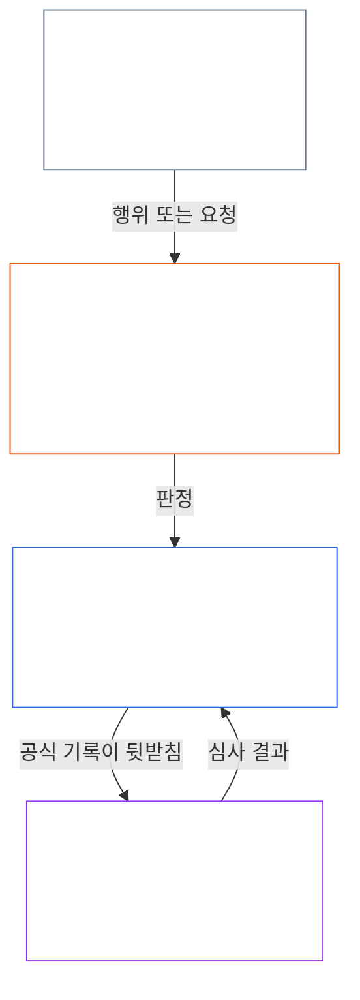
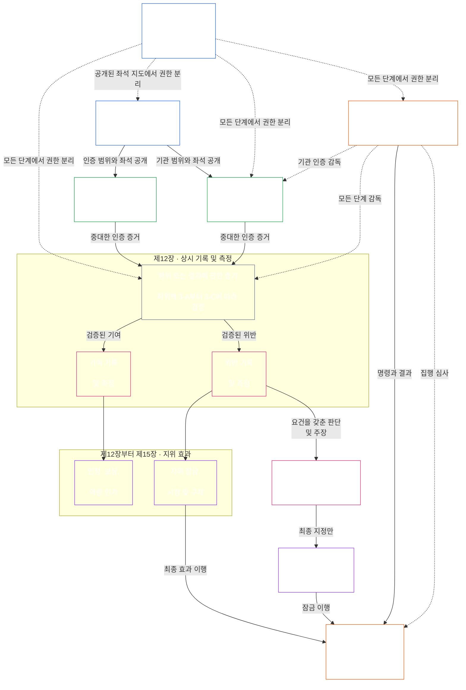

<!-- Locale: ko; language variety: Standard written Korean in Hangul; no country is fixed.. Structural resynchronization draft, AI-assisted (GPT-6 Codex), unreviewed. English source commit: 6e0b6c663dde01b5dea731fe33d87725c7174930; edition: SC-Corpus-2026.11.25. Source SHA-256: core_00.000_preamble.md 90799cb8019b41356fa5dd90565e3f9540fc346e8c77e2c321b841654f39b274; core_01.000_constitutional_map.md aca759b394f10784ab1a2eef4e9e2ca12e369ef0ca8ee797298c6af00d2950aa. This file is partial; no fluent review or synchronization is claimed. -->
<!-- Chapter One: Constitutional Map. This is an incomplete locale draft; sections without source translation are marked below. -->

# 제1장: 헌정 지도

<strong>코퍼스 내 위치(비작동): 파일 구조와 읽기 규칙</strong>

> **비작동**으로 표시된 위젯(코퍼스 내 위치, 독자 안내, 독자 지도)은 안내만을 위한 것이다. 자체 파일이나 다른 파일에서 구속력 있는 의무를 추가·삭제·축소하지 않는다.
>
> 이 파일은 **감지자 헌법의 일부**이며 번호가 매겨진 다른 `core_*` 파일 및 서브코어와 하나의 텍스트로 함께 읽을 때에만 **구속력을 갖는다**. 이 파일은 **제1장**, *헌정 지도*를 담는다. 이 장은 목적(§1), 존재 이유(§2), 파일들의 관계(§3), 후속 장의 토대(§4), 핵심 거버넌스 절차(§5), 헌정 담당 목록(§6–§11)을 다룬다.
>
> **이전:** [core_00.000_preamble.md](core_00_preamble.md) (전문)
> **다음:** [core_02.000_values_principles.md](../../core_02.000_values_principles.md)

<strong>추적</strong>

- 상위 문서: [전문](core_00_preamble.md) (*모형, 두 헌법 목적, 헌법 사원(四元), 실질 이해관계, 측정 범주*).
- 절:
  - [§1](#1-purpose-role-and-scope);
  - [§2](#2-why-the-map-exists);
  - [§3](#3-how-the-files-fit-together);
  - [§4](#4-foundations-for-the-chapters-that-follow);
  - [§5](#5-key-governance-processes);
  - [§6](#6-principles-definitions-and-rights);
  - [§7](#7-system-and-institutional-charters-functional-independence-and-separation-of-duties);
  - [§8](#8-key-practical-process-pipelines);
  - [§9](#9-process-ownership-and-outputs);
  - [§10](#10-governance-change-and-incorporation);
  - [§11](#11-adopted-implementation-corpus).
- 함께 읽기: [권한 스택 및 내부 위계](../../subcore_03.080_band_integrative.md#authority-stack-and-internal-hierarchy) (*담당 목록의 적용 방식*); [README.md](../../README.md) (*읽기 순서*).

 

### 1. 목적, 역할 및 범위

*쉽게 말해: 이 장은 헌법 전체를 안내하는 지도다. 각 부분이 어떻게 맞물리는지, 각 주제를 어느 장이 맡는지, 주요 절차가 어떻게 진행되는지를 보여 주어 독자가 질문에 답하는 규칙을 찾게 한다.*

**목적:** 제1장은 전체 개요와 담당 안내를 제공한다. 권한을 부여받은 통치를 시험하는 절차를 제시하고, 각 실질 영역을 어느 장이 맡는지 밝히며, 헌법 텍스트의 세 층위를 설명한다.

**역할:** 이 장은 안내와 담당 정리를 맡는다. 다른 장과 [권한 스택 및 내부 위계](../../subcore_03.080_band_integrative.md#authority-stack-and-internal-hierarchy)가 적용하는 담당 목록을 넘어 독자적인 의무를 추가하지 않는다.

**장 범위:** 이 장은 다음을 다룬다.

- 지도가 필요한 이유 (**제2절**);
- 파일 간 관계 (**제3절**) 및 후속 장의 토대 (**제4절**);
- 핵심 거버넌스 절차 (**제5절**);
- 헌정 담당 목록: 원칙·정의·권리 (**제6절**), 헌장·기능적 독립·직무 분리 (**제7절**), 절차 사슬 (**제8절**), 절차 담당 및 산출물 (**제9절**), 거버넌스·변경·편입 (**제10절**); 그리고
- 채택된 시행 코퍼스와 서브코어 (**제11절**).

### 2. 지도가 필요한 이유

*쉽게 말해: 이렇게 큰 텍스트에는 각 부분이 어떻게 맞물리고 누가 각 주제를 맡는지 보여 주는 안내가 필요하다. 이 장은 독자가 질문에 답하는 규칙을 찾도록 존재한다.*

헌법은 여러 장과 서브코어, 네 개의 채택 코퍼스에 걸쳐 역할을 나눈다. 자신에게 무엇이 보장되는지 알아보려는 감지자나 의무를 찾는 채택자는 길을 잃을 수 있다. 이 장은 각 부분의 역할, 각 주제를 맡는 장, 절차 사슬의 진행 방식, 각 층위의 관계를 보여 주는 전체 개요와 담당 안내다. 담당 목록을 넘어 독자적인 규칙을 추가하지 않는다.

**근거:**

- 전문:
  - [헌법 사원(四元)](core_00_preamble.md#constitutional-tetrad): 이 장이 수행하는 각 요소:
    - [참여](../../subcore_03.060_apex_participation_leg.md#participation): 감지자가 질문에 답하는 규칙을 찾을 수 있음;
    - [책무](../../subcore_03.040_apex_accountability_leg.md#accountability): 모든 주제에 책임지는 담당 장이 명시됨;
    - [감독](../../subcore_03.055_apex_oversight_leg.md#oversight): 독자가 부분들의 관계를 보고 누락이나 중복을 찾을 수 있음;
    - [적시성](../../subcore_03.065_apex_timeliness_leg.md#timeliness): 지체 없이 올바른 규칙에 도달함;
  - [두 헌법 목적](core_00_preamble.md#two-constitutional-aims): 이 장이 뒷받침하는 두 목적:
    - [번영](core_00_preamble.md#flourishing): 감지자가 헌법 안에서 길을 찾을 수 있어야 헌법이 그들에게 봉사함;
    - [연속](core_00_preamble.md#continuity): 명확한 지도는 텍스트가 커지고 바뀌어도 온전하게 유지함;
- 제2장의 원칙:
  - [§5.2 쉬운 언어 접근성(참여 및 책임 있는 관리 책무)](../../core_02.000_values_principles.md#52-plain-language-accessibility-participation-and-stewardship-duty);
  - [§5.2.4 복잡성으로 좌절시키는 행위에 대한 규율](../../core_02.000_values_principles.md#524-complexity-as-defeat-discipline);
  - [§15.4 헌정 의미 충돌 해결](../../core_02.030_constitutional_interpretation.md#154-constitutional-meaning-conflict-resolution);
- 제4장의 조항:
  - [제XXIV-A조](../../core_04.030_rights_part_d.md#article-xxiv-a-proportional-comprehensibility-right) (*비례적 이해 가능성에 대한 권리*);
  - [제XXIV-B조](../../core_04.030_rights_part_d.md#article-xxiv-b-complexity-audit-and-modularity-requirements) (*복잡성 감사 및 모듈성 요건*).

### 3. 파일들이 서로 맞물리는 방식

헌법 파일은 다음과 같이 맞물린다.

- **코어(`core_*`):** 번호가 붙은 파일에는 헌법의 장들이 담기며, 하나의 텍스트로 함께 읽어야 한다. 보장과 헌정 구조를 명시한다.
- **서브코어(`subcore_*`):** 각 장을 뒷받침하는 완전한 규칙과 절차를 제공한다. 각 파일은 한 장에 속하고 그 장과 같은 효력을 가지며, 별도의 편입 없이 모든 채택자를 구속한다. 서브코어는 그 장의 범위를 좁힐 수 없다.
- **시행(`corpus_*`):** 네 파일은 헌법을 실행하기 위한 운영 세부사항을 제공한다. 유효하게 편입된 범위에서 구속력을 가지며, 헌법을 좁히지 않고 시행한다. [제11절](#11-adopted-implementation-corpus)은 네 파일을 식별한다.

정의된 [코퍼스](../../subcore_03.080_band_integrative.md#corpus)는 구속력 있는 헌정 출처를 더 넓게 버전 관리한 집합이다. 코어, 서브코어, 채택된 시행 텍스트, 전환 중 유효한 호환 래퍼를 포함한다. 프로젝트의 일부라는 이유만으로 초안, 메모, 탐색 안내가 구속력을 갖지는 않는다.

### 4. 뒤따르는 장의 토대

*쉽게 말해: 제2장부터 제4장은 가치, 사전(정의의 구성·보호·입증 방식에 관한 서브코어 규칙 포함), 권리 바닥을 맡는다. 후속 장은 그 담당 범위를 존중하고 조용히 옮겨서는 안 된다.*

**제2장부터 제4장**은 이후 모든 내용이 존중해야 할 가치, 어휘, 검증 체계, 권리 바닥을 제공한다. 여기에는 다음이 포함된다.

- 제5장의 시스템 헌장 또는 기관 헌장 요건, 제6장의 직무 분리 요건, 제7장의 독립기구([제7절](#7-system-and-institutional-charters-functional-independence-and-separation-of-duties));
- 제8절의 [핵심 실무 절차 사슬](#8-key-practical-process-pipelines);
- 제9절의 [절차 담당 및 산출물](#9-process-ownership-and-outputs);
- 제10절의 거버넌스 및 변경 경로 장들; 그리고
- 제11절의 [채택된 시행 코퍼스](#11-adopted-implementation-corpus).

### 5. 핵심 거버넌스 과정

*쉬운 말로: 텍스트가 요구할 때, 실질 문제는 인증, 도움과 해의 서면 기록, 교정과 구제, 시계가 있는 포럼 검토를 거칩니다 — 보통 다툼은 먼저 공표된 다툼 경로를 씁니다; 그 경로는 수권된 거버넌스를 시험합니다; 그것만으로 거버넌스를 만들지 않습니다.*

제6장, [제7장](core_09.000_system_alignment_certification_evaluation.md#chapter-nine-system-alignment-certification), 편입 문서, 그 밖의 헌법 규정이 명시로 요구하는 곳에서, 실질 헌법 문제를 아래 경로 하나 이상으로 가져가라. [핵심 실무 과정 사슬](#5-key-practical-process-pipelines)은 측정을 기록, 인증, 확인된 입력, 분류, 포럼 감독, 교정, 제때 구제로 옮긴다 — 수권된 거버넌스가 실무에서 어떻게 시험되고, 다투어지고, 수리되는가. 그것만으로 거버넌스를 수권하지 않는다; 거버넌스를 검토할 수 있고, 다툴 수 있고, 교정할 수 있고, 제때이게 만든다. [§5.1](#51-how-the-full-chain-fits-together)이 그 사슬을 온전히 말한다.

- **체계 정합 인증** ([제7장](core_09.000_system_alignment_certification_evaluation.md#chapter-nine-system-alignment-certification)) — 고영향 체계를 규모로 믿기 전에, 지금 그것에 기대는 것이 헌법상 안전한지에 대한 증거를 모아 검토하라
- **지위 기록**([제11장](core_11_standing_assessment.md#chapter-eleven-standing-records--question-1-what-happened)) — 행위나 피해가 헌법상 중요하면 검증된 사실을 공식 기여 또는 위반 사건 기록에 넣는다. 소문과 평판만으로는 부족하다.
- **수정과 구제**([제13장 §5.1 (*구제와 수정*)](../../subcore_10.060_standing_integration.md#51-remedy-and-correction)) — 근본적인 실패를 바로잡고 피해를 입은 이들에게 비례적인 인정, 수리, 회복 또는 보상을 제공한다.
- **포럼 심사**([제15장](../../core_15.000_forum.md#1-purpose-and-role--participation-architecture))
  - 이미 수권된 체계 안의 보통 다툼은 먼저 [영향받는 쪽의 체계 참여](../../subcore_03.090_band_participation.md#stakeholder-status-and-weight)의 공표된 다툼 경로를 쓴다
  - 그 경로가 여전히 다투어지거나, 없거나, 포획되었거나, 구제를 줄 수 없으면, 일차 이해관계에 따라 감독받는 포럼으로 라우팅하라
  - 그 포럼들은 **제 XXVI-C조**(*제때 해결과 지연 금지 바닥*) 아래에서 증거, 적법한 이송, 제때 시계를 받친다

### 6. 원칙, 정의, 권리

*쉬운 말로: 제1장부터 제6장까지가 가치, 말이 어떻게 지어지고 점검되는지, 사전, 권리 바닥을 맡습니다; 이후 장은 그 거처를 존중해야 하며, 몰래 옮기지 말아야 합니다.*

**4부터 7**절은 이 헌법의 **양의 주관자 등록**이다: 각 덩어리는 그 장(또는 동반 코퍼스)이 맡은 실체 영역과 무엇을 산출하는지를 이름 붙인다. 구속력 있는 한 줄 주관 주장도 각 번호 장의 열림에 나타난다. 다른 층은 주관자를 가리킬 수 있다 — 몰래 다시 쓰거나 자리를 옮기면 안 된다; 그 자리 옮김 금지 규율은 [권위 스택과 내부 계층](../../subcore_03.080_band_integrative.md#authority-stack) 아래에 산다.

제 **1장부터 제6장**은 이후 모든 것이 존중해야 할 가치, 어휘, 확인 기계, 권리 바닥을 공급한다 — 5절의 [핵심 실무 과정 사슬](#5-key-practical-process-pipelines), 6절의 거버넌스와 변경 경로 장, 7절의 [동반 시행 코퍼스](#7-companion-implementation-corpus)를 포함한다.

각 요약은 그 장이 무엇을 맡고 무엇을 산출하는지를 말한다.

**제1장 — 가치, 원칙, 책임 있는 관리** ([A부분](../../core_02.000_values_principles.md) · [B부분](../../core_02.020_interaction_interpretation.md#chapter-01-part-b-interaction-and-interpretation) · [C부분](../../core_02.040_stewardship_capacity_principles.md#chapter-01-part-c-stewardship-and-governance))

- **맡은 일:** 헌법의 지도 가치와 제약을 말한다 — 복지, 공정, 안전, 진실, 신뢰, 한정된 자유, 적법한 기여에 대한 인정과 비례 보상, 원칙 사이 충돌 해결, 그리고 분산된 이해, 체계 평가, 거버넌스 규율을 포함한 책임 있는 관리 의무.
- **산출:** 이후 각 장의 해석 기초 — 체계, 권리, 정의, 과정 사슬을 읽고 적용해야 할 때, 높은 층의 목적을 운영 요건으로 바꾸는 규칙.

**제2장 — 정의 구조** ([`core_02_definition_structure.md`](../../subcore_03.010_definition_structure.md))

- **맡은 일:** 헌법 용어가 어떻게 지어지는지를 정의한다 — 존재론/측정/평가/준수(O/M/A/C) 구성 구조, 정합 요건, 정의를 코퍼스 전역에서 정밀하고 쓸 수 있게 유지하는 구성 규칙.
- **산출:** 정의를 위한 공유 문법, 이후 장이 모호한 꼬리표, 숨은 가정, 호환되지 않는 용어 모양에 빠지지 않게.

**제3장 — 정의 완전성** ([`core_02_definition_structure.md`](../../subcore_03.010_definition_structure.md))

- **맡은 일:** 회피, 범위 옮김, 재정의 놀이, 종이 위에서는 정의를 비우고 실무에서는 무너뜨리는 비준수 수법에 맞서 지킨다.
- **산출:** 회피 금지 규율과 비준수 지향 메타데이터 — 회피가 입증된 곳에서 궤적과 부당행위 검토로 가는 라우팅 고리를 포함한다.

**제4장 — 부담, 추적 가능성, 확인** ([`core_02_definition_structure.md`](../../subcore_03.010_definition_structure.md))

- **맡은 일:** 증명 부담을 준수를 주장하는 이에게 둔다; [**실질 이해관계**](#material-stake)에 맞춰 세기를 조절하고 실무에서 여전히 다툴 수 있는 추적 가능한 증거, 관찰 가능성, 확인을 요구한다.
- **산출물:** [제11장](core_11_standing_assessment.md#chapter-eleven-standing-records--question-1-what-happened)의 **검증된 입력**과 [제9장](core_09.000_system_alignment_certification_evaluation.md#chapter-nine-system-alignment-certification)의 시스템 정렬 증거를 제공하는 검증 절차. 지위 측정 자체를 대체하지 않는다.

**제5장 — 기초 정의** ([`core_05__definitions_home.md`](../../core_03.000_definitions_home.md#chapter-five-foundational-definitions))

- **맡은 일:** 정전 정의 스택을 공급한다 — 감독, 참여, 책무, 연속, 통합 띠 — 더하여 [권위 스택과 내부 계층](../../subcore_03.080_band_integrative.md#authority-stack), [코퍼스](../../subcore_03.080_band_integrative.md#corpus), 관련 경계 규칙.
- **산출:** 해석, 감사, 재결을 위한 정밀한 헌법 어휘. 그것은 **정의 스택**이지 권리 바닥이 아니다; 구속력 있는 권리는 제6장에 산다. 문서 전체의 주관 영역 라우팅은 이 전문 등록(4–7절)에 산다.

**제6장 — 기초 권리** ([A부분](../../core_04.000_rights_part_a.md) · [B부분](../../core_04.010_rights_part_b.md) · [C부분](../../core_04.020_rights_part_c.md) · [D부분](../../core_04.030_rights_part_d.md))

- **맡은 일:** **제 I–XXVI조**에서 권리 바닥을 말한다 — 생존 필수, 자원 배분과 의존의 책임 있는 관리, 존엄, 행위주체성, 참여, 다툼과 구제, 정의 제약, **제 XXV-C조**(*제때 해결과 지연 금지 바닥*) 아래의 적시성, 이행 규칙 — 행성 우선 읽기를 위해 네 부분으로 짜였다.
- **산출물:** 제7장부터 제15장까지, 포럼, 거버넌스, 개정 규칙이 존중해야 하며 절차나 대리지표를 통해 축소·우회·공허화해서는 안 되는 협상 불가능한 권리 보호와 구제 연결고리.

### 7. 시스템·기관 헌장, 기능적 독립, 직무 분리

*쉬운 말로: 실질적 영향을 미치는 체계나 기관은 무엇을 할 수 있고 각 좌석을 누가 맡는지 밝히는 시스템 헌장 또는 기관 헌장을 공개한다. 실질적으로 구속력 있는 행위를 진행하기 전에 누가 시작하고, 누가 확인하거나 권한을 부여하며, 누가 공식 기록을 보관하고, 누가 이의를 심사하는지 분리한다. 역할은 상황에 맞게 조정할 수 있지만, 같은 행위자와 그 통제선이 자기 행위를 확인하는 좌석을 몰래 맡아서는 안 된다.*

이 절은 시스템 헌장, 기관 헌장, 직무 분리 요건과 감독 대상에서 독립해야 하는 기관에 관한 장을 요약한다. 각 요소가 내는 결과도 설명한다.

**[제5장 — 시스템 및 기관 헌장](../../core_05.000_charters.md#chapter-five-system-and-institutional-charters)**

- **소관:** 시스템 헌장 또는 기관 헌장을 공개하는 요건:
  - 클래스 L 이상 중 [시스템 헌장](../../subcore_03.075_band_continuity.md#system-charter) 또는 [기관 헌장](../../subcore_03.075_band_continuity.md#institutional-charter)을 반드시 공개해야 하는 체계와 기관 (클래스 P는 자발적으로 공개할 수 있음);
  - 공개된 구속력 있는 이해관계자 선택 규칙을 가리키는 [헌장 역할 지도](../../subcore_03.075_band_continuity.md#charter-role-map)와 [헌장 포인터](../../subcore_03.075_band_continuity.md#charter-pointer)를 포함해 헌장이 최소한 밝혀야 할 내용;
  - 헌장에 명시된 범위가 몰래 바뀌지 않도록 헌장을 개정하고 심사하는 방식; 및
  - 헌장이 할 수 없는 일: 클래스를 정하거나, 경계를 정의하거나, 인증을 대체하거나, 결정 규칙을 담거나, 권한을 부여하는 일.
- **산출물:** 공개되고 판본이 관리되는 범위 및 좌석 배치 설명으로, [제6장](../../core_06.000_functional_independence_separation_of_duties.md#chapter-six-functional-independence-and-separation-of-duties), 인증, 궤적 기록, 포럼이 행위를 검증하는 데 쓸 수 있다.

**[제6장 — 기능적 독립과 직무 분리](../../core_06.000_functional_independence_separation_of_duties.md)**

- **소관:** 모든 [실질적 구속 행위](../../subcore_03.070_band_accountability.md#materially-binding-act)에 네 기능을 각각 분리해 배정해야 한다는 프로세스 전반의 요건:
  - 개시;
  - 검증 또는 권한 부여;
  - 공식 기록 보관; 및
  - 이의 심사.

  또한 다음을 규율한다:

  - 각 [실질적 구속 행위 기록](../../subcore_03.070_band_accountability.md#materially-binding-act-record)의 보편적 최소 기재사항;
  - 행위자의 [실질 통제선](../../subcore_03.070_band_accountability.md#material-control-line)으로부터의 독립;
  - 공개된 배치 및 대체 경로;
  - 비례적인 통합 배치와 긴급 조치의 한계; 및
  - 귀속을 추적할 수 있는 인계와 잘못된 좌석으로의 배정.
- **산출물:** 재사용 가능한 4석 및 행위 기록 구조. 후속 인증, 궤적, 포럼, 거버넌스 및 편입된 시행 프로세스는 결과가 독립적으로 확인되고, 신뢰성 있게 기록되고, 실질적으로 다툴 수 있다고 인정되기 전에 이를 구체화해야 한다.

**[제7장 — 독립 기관](../../core_07.000_independent_bodies.md)**

- **소관:** 기관이 독립적인 조건, 독립 기관으로 명명하는 규칙, 각 채택자가 갖춰야 하는 독립 기관 목록 및 각 기관이 감지자에게 보장하는 바의 한 줄 설명.
- **산출물:** 모든 독립 기관이 충족해야 하는 단일 기준으로, 어디에 있든 같은 방식으로 독립성을 점검한다. 각 기관의 전체 운영 규칙은 [제7장](../../core_07.000_independent_bodies.md#chapter-seven-independent-bodies)에 연결된 해당 하위코어 파일에 있다.

#### 7.1 네 좌석 분리 지도

모든 **실질적 구속 행위**는 동일 행위에 대해 다음 보호조치를 지켜야 한다.

- 개시 좌석은 자기 행위를 검증하거나 권한을 부여해서는 안 된다.
- 검증·권한 부여 좌석은 해당 행위의 공식 기록을 보관해서는 안 된다.
- 검증·권한 부여 좌석은 해당 행위에 대한 이의를 심사해서는 안 된다.
- 검증·권한 부여 좌석과 이의 심사 좌석은 개시 좌석의 [실질 통제선](../../subcore_03.070_band_accountability.md#material-control-line) 밖에 있어야 한다.

<strong>독자 안내 (비운영): 네 좌석 분리 지도</strong>

> 이 지도는 네 기능과 행위 및 행위 기록의 전형적인 흐름을 보여 준다. 다섯 번째 좌석을 추가하거나 보편적 순서를 정하지 않으며, 독립성, 비례적인 통합 배치, 긴급 조치 또는 이의 라우팅에 관한 제6장의 규칙도 바꾸지 않는다.

 

### 8. 핵심 실무 과정 사슬

*쉽게 말해: 제9장부터 제15장은 제8장의 직무 분리 요건을 하나의 사슬로 적용합니다. 체계와 기관을 인증하고, 도움과 해를 두 개의 별도 경로에서 측정하며, 실질적인 효과와 구제를 적용하고, 포럼이 자신에 대한 주장의 유일한 최종 판단자가 되지 않게 합니다. 이 사슬은 헌법상 의무를 일상에서 실효 있게 유지합니다.*

[제7장](../../core_05.000_charters.md#chapter-seven-system-and-institutional-charters)은 클래스 L 이상인 각 체계와 기관의 헌장상 범위 및 좌석 지도를 공개합니다. [제8장](../../core_07.000_independent_bodies.md#chapter-eight-functional-independence-and-separation-of-duties)은 이 사슬의 각 행위를 정당하게 점검할 수 있도록 직무 분리 요건을 제시합니다. 개시, 검증 또는 권한 부여, 공식 기록 보관, 이의 검토 기능은 적용되는 비례 조정 및 독립성 규칙에 따라 각각 배정되고 분리되어야 합니다. 제9장부터 제15장은 이 구조를 순서대로 적용합니다:

아래 각 걸음은 그 장이 무엇을 맡고 무엇을 산출하는지를 말한다. [온전한 사슬이 어떻게 맞춰지는가](#51-how-the-full-chain-fits-together)는 그다음 그 주관자들을 체계 점검에서 구제까지의 한 길로 보여 준다.

**체계 정합 인증** ([제7장](core_09.000_system_alignment_certification_evaluation.md#chapter-nine-system-alignment-certification))

- **맡은 일:** 실질 영향이 있는 체계가 헌법에 정합하도록 지킨다.
  - 감지자에게 실질적으로 영향을 미치는 체계가 인정되거나 규모로 기대기 전에, 포럼 감독 아래에서 증거를 모아 검토한다
  - 검토에는 다음 사항이 포함되어야 합니다.
  - 시스템이 생존 필수 요소를 존중하는지 여부;
  - **제V조** (*자원 배분, 의존성 및 생태계 자금 조달*)에 따른 자원 배분과 의존성 관리—공유 인프라 의존이 중대한 쟁점인 경우 [Proportionate Cross-System Support](../../subcore_03.075_band_continuity.md#proportionate-cross-system-support) 포함;
  - 안전;
  - 참여; 그리고
  - 그 밖의 헌법상 최저 기준.
  - 궤적이 있는 감지자는 결과를 다툴 수 있다
  - 고위험 체계는 정기 일정으로 재인증해야 한다; 인증은 영구가 아니다
- **산출:** **체계 정합 인증 기록** — 그 체계가 말한 범위와 시간창 안에서 *지금* 인정하고, 계속 기대고, 배치하고, 조건에서 풀어 줄 만큼 정합한지에 대한, 한정되고 다툴 수 있는 답.

**궤적 측정** ([제8장](../../subcore_10.020_standing_assessment.md#chapter-ten-compliance-violation-and-standing-model))

- **맡은 일:** 행위가 헌법상 중요할 때, 소문과 평판으로는 부족하다. 확인된 사실은 **궤적 기록**에 들어간다. **기여**(번영을 향한 도움)와 **위반**(책무 실패와 해)은 **따로 떨어진 축**에서 측정된다 — 확인된 좋은 행위가 확인된 해를 지우지 않으며, 둘은 하나의 순점수로 접히지 않는다.
- **산출:** 기여 축과 위반 축의 분류된 **궤적 기록**, **확인된 입력**과 포럼 감독 아래 인정에만 기초한다 — 비공식 채점이나 다툼 서사가 분류를 대신하지 않는다.

**궤적 통합과 효과** ([제9장](../../subcore_10.060_standing_integration.md#chapter-eleven-standing-effects-and-integration))

- **맡은 일:** 확인된 분류를 실제 세계의 **궤적 효과**로 통합한다, 따로 떨어진 궤도에서 — [**실질 이해관계**](#material-stake)에 맞춰 세기를 조절하고, 기여와 위반을 하나의 순점수로 접지 않으며, 참여, 감독, 책무, 적시성을 비우지 않는다.
  - **기여 궤도:** 확인된 긍정 분류는 실제 상승을 산출한다:
    - [**역량 승인**](../../subcore_10.060_standing_integration.md#72-competency-bars-and-clearances)은 공개된 역량 기준에 따라 역량이 입증되고 적용 가능한 [지위 잠금](../../subcore_10.060_standing_integration.md#52-prevention--general-standing-locks)이 지정 경로를 막지 않을 때 신뢰 민감 역할, 위임 권한, 감독 자격, 점차 더 큰 책임의 관리를 가능하게 할 수 있다.
    - [제1장](../../core_02.000_values_principles.md#32-recognition-reinforcement-and-aspiration)이 요구하는 대로, 적법한 책임 있는 관리와 협력에 대한 비례 인정과 **실질 보상**
    - 빈 칭찬이 아니다. 이익은 실제여야 하고, 증거로 받쳐져야 하며, 다툼에 열려 있어야 한다
  - **위반 궤도:** 확인된 위반 인정은 실제 하강을 산출한다:
    - **궤적 잠금**, 역할 한도, 시정 명령, [해를 입은 이를 위한 구제](../../subcore_10.060_standing_integration.md#51-remedy-and-correction), 보충 서술자, 집행 고리
    - 제한은 확인된 것의 심각도에 맞춘다
    - 해결되지 않은 위반은 살아 남는다
    - 진정한 반환을 입증한 이를 위한 궤적 회복의 비례 경로는 남아 있다
    - 기여 쪽의 역량 허가는 위반 쪽의 궤적 잠금을 면제하지 않는다
- **산출:** 기여 궤도와 위반 궤도에서 따로, 세기 조절된 궤적 효과 — 한쪽은 역량 허가와 실질 보상; 다른 쪽은 궤적 잠금, 교정, 구제 — 어느 쪽도 하나의 점수로 접히지 않는다.

**반헌법 부당행위 난간** ([제10장](core_10_a_misconduct_designation.md#chapter-ten-anti-constitutional-misconduct))

- **맡은 일:** 가장 심각한 확인된 위반만 다룬다 — 규모에서 헌법 의무를 포획했거나 비웠을 수 있는 행위. 제8장이 이미 최고영향 위반 인정을 기록했고, 반헌법 부당행위가 실질로 주장될 때, 이 장은 지정 검토를 제9장 문턱 궤도로 돌려, 제9장의 보통 궤적 효과와 나란히 한다.
- **산출:** 그 기존 최고영향 인정에 대한 최종 반헌법 부당행위 지정 — 또는 기각 — 요구된 기준과 적법절차 안전장치가 충족된 뒤에만. 제8장은 해가 얼마나 심각했는지를 계속 측정한다; 최종 지정만이 제9장의 **반헌법 신뢰 잠금**을 발동한다.

**포럼 감독과 라우팅** ([제11장](core_11_forum.md#chapter-eleven-forums-and-jurisdiction))

- **맡은 일:** 다툼과 인증 사항이 실제로 어떻게 움직이는지를 감독한다.
  - 공표된 영향받는 쪽의 체계 참여 다툼 경로에서 포럼 라우팅으로의 [다툼 순서](core_11_forum.md#dispute-sequencing)
  - 어느 포럼 가족이 다루는가, 사건이 보통 어디서 시작하는가
  - 증거가 어떻게 받쳐지는가
  - 사항이 어떻게 이송되거나 병합되는가
  - 자기 심판 금지 규칙이 포획된 포럼들이 유일한 최종 거처가 되지 않게 하는 방식
  - **제 XXV-C조**(*제때 해결과 지연 금지 바닥*) 아래 시계는 사건이 구제가 더 이상 중요하지 않을 만큼 오래 미해결로 남지 않게 한다
- **산출:** 궤적 기록을 열거나 갱신할 수 있는 **확인된 인정**, 더하여 구제와 [제때 해결](../../subcore_03.070_band_accountability.md#timely-resolution-constitutional)로 가는 적법한 라우팅. 포럼들은 사슬을 감독한다; 제8장 궤적 측정을 대체하지 않는다.

### 9. 프로세스 소관과 산출물

*쉬운 말로: 프로세스 지도와 [전체 사슬이 어떻게 맞물리는지](#82-how-the-full-chain-fits-together)가 흐름을 보여 주고, 이 절은 각 단계의 소관과 산출물을 밝혀 어느 단계도 다른 단계의 일을 몰래 차지하지 못하게 한다.*

아래 각 단계는 해당 장이 맡는 일과 산출물을 밝히며, [§8.2 전체 사슬이 어떻게 맞물리는지](#82-how-the-full-chain-fits-together)에 열거된 소관을 구체화한다.

**[하위코어 8-B — 시스템 정렬 인증](../../subcore_08.020_system_alignment_certification_evaluation.md#subcore-8-b-system-alignment-certification--evaluation)**

- **소관:** 실질적 영향을 미치는 체계가 헌법에 정렬된 상태를 유지하도록 한다.
  - 감지자에게 실질적 영향을 미치는 체계를 인증하거나 대규모로 의존하기 전에, 포럼 감독 아래 증거를 수집하고 심사해야 한다.
  - 심사는 다음을 다뤄야 한다:
    - 체계가 생존 필수 요소를 존중하는지;
    - **제V조**(*자원 배분, 의존 관계, 생태계 재정 지원*)에 따른 자원 배분 및 의존 관리. 공유 기반시설 의존이 실질적으로 문제되는 경우 [비례적 체계 간 지원](../../subcore_03.075_band_continuity.md#proportionate-cross-system-support) 포함;
    - 안전;
    - 참여; 및
    - 그 밖의 헌법상 바닥선.
  - 지위가 있는 감지자는 결과에 이의를 제기할 수 있어야 한다.
  - 고위험 체계는 정기적으로 재인증해야 한다. 인증은 영구적이지 않다.
- **산출물:** 각 체계 심사에 대한 **시스템 인증 기록** — 명시된 범위와 기록 기간 내 체계의 정렬 상태에 대한 제한적이고 다툴 수 있는 판정.

**[하위코어 9-B — 기관 정렬 인증](../../subcore_09.020_institutional_alignment_certification_evaluation.md#subcore-9-b-institutional-alignment-certification--evaluation)**

- **소관:** 제8장과 같은 여섯 단계와 같은 절 번호를 통해 실질적 영향을 미치는 기관의 헌법 정렬을 보장한다.
  - 제9장은 평가(제I·II단계)를 맡는다.
  - [하위코어 9-D](../../subcore_09.040_institutional_alignment_certification_forum_process_outcomes.md#subcore-9-d-institutional-alignment-certification--forum-process-and-outcomes)는 포럼 절차와 결과(제III·IV단계)를 맡는다.
  - [하위코어 9-F](../../subcore_09.060_institutional_alignment_certification_records_recertification.md#subcore-9-f-institutional-alignment-certification--records-recertification-challenge-and-standing)는 기관 인증 기록 및 운영(제V·VI단계)을 맡는다.
  - 기관은 자신이 통제하는 사항만 심사받는다: 기관 헌장을 지키는지, 권한에 누가 답하는지, 무엇에 보상하는지, 독립된 점검을 사용할 수 있는지.
  - 각 체계의 인증에 의존하며 이를 다시 수행하지 않는다.
- **산출물:** 기관별 **기관 인증 기록** — 명시된 범위와 기록 기간 내 기관의 정렬 상태에 대한 제한적이고 다툴 수 있는 판정. 제9장은 시스템 평가를 재실행하지 않고 포럼 절차를 재사용하며, 기관 인증은 기관 설립이나 운영의 허가 또는 관문이 아니다.

**[하위코어 10-B — 궤적 기록](../../subcore_10.020_standing_assessment.md#subcore-10-b-standing-records--question-1-what-happened)**

- **소관:** 행위가 헌법상 중요할 때는 소문과 평판만으로 충분하지 않다 — 검증된 사실을 **궤적 기록**에 넣는다. **기여**(번영을 돕는 일)와 **위반**(책무 실패 및 해악)은 **별도 궤적 기록**에 기록한다. 검증된 도움은 검증된 해악을 지우지 않으며 둘을 하나의 순점수로 합치지 않는다.
- **산출물:** **검증된 입력**과 포럼 감독 아래의 판정만으로 작성된 기여 및 위반 트랙의 제한적 **궤적 기록**. 비공식 점수나 분쟁 서사는 검증된 궤적 기록을 대체하지 못한다.

**[하위코어 10-D — 궤적 측정](../../subcore_10.040_standing_measurement.md#subcore-10-d-standing-measurement--question-2-how-good-or-bad-was-it)**

- **소관:** 검증된 사실이 얼마나 좋거나 나빴는지 측정한다. 기여와 위반은 같은 통합 척도를 사용하되 **서로 다른 축**에서 측정하며, 하나의 순점수로 합치지 않는다.
- **산출물:** 각 궤적 기록에 대해 기여 축 또는 위반 축상에서 성격, 크기, 위치를 분류한 측정값.

**[하위코어 10-F — 궤적 통합 및 효과](../../subcore_10.060_standing_integration.md#subcore-10-f-standing-integration--question-3-what-follows)**

- **소관:** 검증된 분류를 [**실질 이해관계**](core_00_preamble.md#material-stake)에 맞춰 조정되는 별도 트랙의 현실 **궤적 효과**로 통합한다. 기여와 위반을 한 순점수로 합치지 않으며 참여, 감독, 책무, 적시성을 약화시키지 않는다.
  - **기여 트랙:** 검증된 긍정 분류는 다음을 포함한 실질적 이익을 산출해야 한다:
    - 공표된 역량 기준에 따라 역량이 입증되고 해당 [궤적 잠금](../../core_12.000_violation_consequences.md#32-prevention--general-standing-locks)이 조건부 경로를 막지 않을 때 신뢰 민감 역할, 위임 권한, 감독 자격, 점차 중요한 관리 역할을 열 수 있는 [**역량 승인**](../../core_11.000_contribution_consequences.md#32-competency-bars-and-clearances);
    - [제2장](../../core_02.000_values_principles.md#32-recognition-reinforcement-and-aspiration)이 요구하는 합법적 관리와 협력에 대한 비례적 인정 및 **실질 보상**; 및
    - 빈 칭찬이 아니라 실제적이고 증거에 기반하며 이의 제기가 가능한 혜택.
  - **위반 트랙:** 검증된 위반 판정은 다음을 포함한 실질적 결과를 산출해야 한다:
    - **궤적 잠금**, 역할 제한, 시정 명령, [피해자 구제](../../core_12.000_violation_consequences.md#31-remedy-and-correction), 보충 기술자, 집행 고리;
    - 검증된 심각도에 비례하는 제한;
    - 미해결 위반을 계속 유효한 사안으로 다루기;
    - 진정한 원상회복을 보이는 이가 궤적을 회복할 비례적 경로; 및
    - 기여 측 역량 승인이 위반 측 궤적 잠금을 면제하지 않음.
- **산출물:** 기여 및 위반 트랙에 분리되고 조정된 궤적 효과 — 한쪽에는 역량 승인과 실질 보상, 다른 쪽에는 궤적 잠금, 시정, 구제 — 하나의 점수로 합치지 않는다.

**[제14장 — 반헌법적 위법행위 지정](core_10_a_misconduct_designation.md#chapter-fourteen-anti-constitutional-misconduct-designation)**

- **소관:** 가장 심각한 검증 위반만 다룬다 — 대규모로 헌법상 의무를 장악하거나 무력화했을 수 있는 행위. 제10장이 이미 가장 큰 영향을 미친 위반 판정을 측정했고 반헌법적 위법행위가 실질적으로 주장되면, 이 장은 일반적인 제10장 궤적 효과와 병행하는 관문 트랙으로 지정 심사를 한다.
- **산출물:** 필요한 기준과 적법절차 보호가 충족된 뒤에만 기존 최고 영향 판정에 대한 최종 ACMD 지정 또는 기각. 해악의 심각도는 계속 제10장이 측정하며, 최종 지정만 제10장의 **반헌법적 신뢰 잠금**을 작동시킨다.

**[제16장 — 기준, 라우팅, 포럼 사건](../../core_16.000_forum.md#chapter-sixteen-standards-routing-and-forum-cases)**

- **소관:** 분쟁과 인증 사안이 실제로 어떻게 움직이는지 감독한다.
  - 공표된 영향받는 쪽의 체계 참여 이의 경로에서 포럼 라우팅으로 이어지는 [분쟁 순서](../../core_16.000_forum.md#dispute-sequencing);
  - 각 사안을 맡는 포럼 가족과 보통 사건이 시작되는 곳;
  - 포럼 사건을 열고 유지하는 방법;
  - 사안을 이전하거나 병합하는 방법; 및
  - 자기 심판 금지 규칙이 포획된 포럼을 유일한 최종 판단처로 삼지 못하게 하는 방법.
- **산출물:** 궤적 기록을 열거나 갱신할 수 있는 **궤적 판정**과 구제 및 [적시 해결](../../subcore_03.070_band_accountability.md#timely-resolution)을 위한 적법한 라우팅. 포럼은 파이프라인을 감독하며 제10장의 궤적 측정을 대체하지 않는다.

**[제17장 — 포럼 가족, 상향 회부, 적시 해결, 지원](../../core_17.000_forum_families_escalation_timeliness_support.md#chapter-seventeen-forum-families-escalation-timely-resolution-and-support)**

- **소관:** 포럼의 구성과 사안이 포럼에 접수된 뒤 계속 진행되는 방식.
  - 포럼 가족과 공통 기준;
  - 상향 회부와 판정을 요청하는 쟁점;
  - 지정된 감지자의 경로에 대한 제한적 [임시 보류](../../subcore_03.070_band_accountability.md#interim-hold)를 포함한 임시 보호의 라우팅·심사 및 판정·궤적 잠금과의 구분;
  - **제XXVII-C조**(*적시 해결 및 지연 방지 바닥선*)의 기간을 통해 구제가 더는 의미가 없을 정도로 사안을 미해결 상태로 두지 않음; 및
  - 심사 전·중·후에 증거와 참여하는 감지자를 지원하는 방법.
- **산출물:** 각 종류의 사안을 심리할 수 있는 포럼 가족과 구제의 의미를 지킬 수 있는 기간 안의 해결.

**[제19장 — 집행](../../core_19.000_enforcement.md#chapter-nineteen-enforcement)**

- **소관:** 결과를 수행하는 방법 — 궤적 파이프라인 또는 포럼이 낸 결과를 누가, 어떤 기간 안에 집행하며, 회피·지연·조용한 폐기를 무엇이 막는지.
- **산출물:** 문서에만 남지 않고 실제로 이행되는 결과. 새 종류의 결과를 더하지 않고, 제14장부터 제23장까지 정한 결과가 수행되는 방식을 규율한다.

**[제20장 — 특별 집행](../../core_20.000_special_enforcement.md#chapter-twenty-special-enforcement)**

- **소관:** 결과 수행에 돈이나 자산의 동결·압수가 포함되거나, 물리력이 사용되거나 사용될 수 있거나, 같은 집행 실패가 반복되는 경우의 추가 보호조치.
- **산출물:** 결과를 수행하는 데 필요한 범위에서 지속되는 해악을 최소화하는 집행과, 집행 실패의 근본 원인을 찾아 제거하여 같은 실패를 되풀이하지 않는 것.

### 10. 거버넌스, 변경, 편입

*쉬운 말로: 제27장부터 제31장까지 이 헌법을 마무리한다. 누가 통치할 수 있는지, 보호를 후퇴시키지 않으면서 문안을 바꾸는 방법, 다른 법과의 관계, 채택된 안내 파일을 이 출처에 계속 묶어 두는 방법이다.*

**제27장부터 제31장까지** 이 헌법을 마무리한다. 이 장들은 거버넌스, 변경의 유효성, 편입에 관한 [헌법상 소관 등록부](#6-principles-definitions-and-rights)를 완성한다: 누가 정당하게 통치할 수 있는지, 헌법을 적법하게 바꾸는 방법, 채택된 시행 문안을 조용한 이탈 없이 헌법 출처에 묶어 두는 방법이다.

아래 각 요약은 해당 장의 소관과 산출물을 밝힌다.

[제18장](../../core_18.000_assemblies.md#chapter-eighteen-assemblies)(*의회*)는 읽기 순서상 포럼 장들 뒤에 오지만 거버넌스에 속한다. 제21장은 통치 권한의 승인 방식을 밝히고 제18장은 의회가 그 권한으로 무엇을 하는지 밝힌다.

**[제18장 — 의회](../../core_18.000_assemblies.md#chapter-eighteen-assemblies)**

- **소관:** 정치 공동체의 의회가 결정하는 것과 결정 방식, 한계: 조세 정책과 예산, 지방·지역·국가 층위 간 업무 분담, 행위별 필요 다수결, 각 의회가 선출하고 해임할 수 있는 행정부, 공동체 국민투표, 유형화된 비상사태.
- **산출물:** 책임지는 기관이 공개적으로 만든 일반 규칙과 예산, 그 기관에 답하는 행정부, 유형화되고 신속히 확인되며 언제든 철회 가능하고 권리 바닥을 침해하지 않는 비상 권한.

**[제21장 — 헌법 계약, 정당성, 책임 있는 관리](../../core_21.000_governance.md#chapter-twenty-one-constitutional-contract-legitimacy-authorization-and-stewardship)**

- **소관:** [**헌법 계약 층**](../../subcore_03.080_band_integrative.md#constitutional-contract-layer) — 누가, 어떤 정당성 기제로, 어떤 범위와 지속 조건에서 통치할 수 있는지, 어떤 책임 있는 관리 성격을 유지해야 하는지.
- **산출물:** 이미 수권된 체계 내 [**영향받는 쪽의 체계 참여**](../../subcore_03.090_band_participation.md#stakeholder-status-and-weight)와 구분되는 승인 및 정당성 요건. 이는 통치 권한 자체에 관한 규칙이지 그 안의 참여만을 다루지 않는다.

**[제22장 — 비후퇴](../../core_22.000_non_regression.md#chapter-twenty-two-non-regression-and-substantive-amendment-validity)**

- **소관:** 퇴행적 변경을 막는 실질적 바닥선. 개정과 우회책은 핵심 보호를 후퇴시키거나 실질 이해관계에 따른 테트라드를 무력화하거나 후퇴를 기술 정리로 위장할 수 없다.
- **산출물:** 제안된 변경의 **첫 번째 헌법상 방어선**. 실제로 핵심 보호를 약화하는 변경은 절차가 멀쩡해 보여도 유효하지 않다. 의심되는 우회나 위장된 후퇴는 조용히 통과시키지 않고 중단하거나 적절한 심사 경로로 보낸다.

**[제23장 — 개정, 비준, 채택](../../core_23.000_amendment_ratification.md#chapter-twenty-three-amendment-ratification-and-procedural-validity)**

- **소관:** 헌법을 적법하게 변경하는 방식 — 개정 절차, 비준, 채택 — 과 제22장의 실질적 방어선을 보완하는 **절차상 방어선**. 변경은 공개적으로 공표되고 권위 있는 보관처까지 추적 가능하며, 필요한 경우 독립 심사를 포함해 실질적으로 이의를 제기할 수 있어야 한다.
- **산출물:** 적법한 변경의 완전한 경로. **비후퇴 방어선**과 **절차상 방어선**을 모두 통과한 개정·채택만 유효한 헌법 갱신으로 인정된다.

**[제24장 — 헌법 우위와 외부 법질서](../../core_24.000_expansion_supremacy.md#chapter-twenty-four-expansion-supremacy-and-external-legal-orders)**

- **소관:** 이 헌법과 다른 규범의 관계: 적법한 보호 확대, 유효한 출처·채택·거버넌스 층위 내 우위, 자체 효력으로 적용되는 외부법을 배제하지 않음, 외부 법질서와의 상호작용에서 조용한 종속이나 포획을 막는 규율.
- **산출물:** 위계 및 충돌 해결 순서 규칙. 공표나 이용을 적용 가능한 외부법의 폐지로 보지 않으며, 채택자는 편입된 절차, 더 약한 외부 규범, 편의 지표를 유효한 채택 범위 내 감지자 헌법의 의미보다 우위에 둘 수 없다.

**[제25장 — 편입 연결부](../../core_25.000_incorporation.md)**

- **소관:** 채택 시 구속력 있는 편입 문안이 되는 시행 파일. 판본을 고정하고 보관 연쇄를 유지하며 헌법 출처와 운영 세부 사이의 조용한 이탈을 금지한다.
- **산출물:** 단일한 편입 경계. 지정된 시행 문안은 채택되면 구속력을 가지지만, 채택 코퍼스는 헌법을 시행할 뿐 이를 좁히는 두 번째 출처가 되지 않는다. [제11절](#11-adopted-implementation-corpus)은 채택 코퍼스를 개괄한다.

### 11. 동반 시행 코퍼스

*쉬운 말로: 네 동반 코퍼스(공동 구조, 체계, 제도, 포럼 운영)는 장들이 이미 요구하는 것을 어떻게 이행하는지를 풀어 씁니다; 유효하게 채택되면 구속하고, 그 의무를 줄일 수 없습니다.*

번호 `core_*` 장 너머, 네 동반 코퍼스가 채택된 **시행 텍스트**의 [양의 주관자 등록](#4-principles-definitions-and-rights)을 완성한다 — 헌법 의무를 실무에서 돌릴 수 있게 하는 운영 세부:

- **[corpus_joint_structure](../../corpus_joint_structure.md)** — 파일 사이 라우팅, 공유 운영 용어, 체계, 제도, 포럼들을 같은 사실에 대해 함께 읽어야 할 때의 공동 구조.
- **[corpus_systems](../../corpus_systems.md)** — 체계 분류, 설계와 배치 규약, 정보 취급, 핵심 책임 있는 관리 역학.
- **[corpus_institutions](../../corpus_institutions.md)** — 제도 형성, 거버넌스, 감독, 비례, 해산 규율.
- **[corpus_forum](../../corpus_forum.md)** — 포럼 운영: 패널 구성, 기피, 검토 차로, 라우팅 세부, 포렌식 지원.

채택 주체가 [제16장](../../core_25.000_incorporation.md) 아래에서 그것들을 유효하게 편입하면, 이 파일들은 채택 범위 안에서 시행 텍스트로 구속한다. 감지자 헌법 의미는 여전히 통제한다 — 그것들은 위 장들을 **시행하지, 좁히지 않는다**. 판본 고정, 보관 사슬, 고요한 어긋남 금지 규칙은 채택된 텍스트를 실제로 비준된 것에 추적 가능하게 유지한다. 정전 목록과 경계 규칙은 [제5장 — 코퍼스](../../subcore_03.080_band_integrative.md#corpus)에 산다.

원칙, 정의, 권리, 과정 사슬, 거버넌스, 개정 규칙, 편입된 시행은 헌법의 보호 목적을 지키려면 함께 읽어야 한다.

---

**이전 파일:** [README.md](../../README.md)

**다음 파일(이 언어):** [core_01_a_values_principles.md](../../core_02.000_values_principles.md)

**구속력 있는 원문:** [core_00_preamble.md](core_00_preamble.md)

<!-- Pair status: INCOMPLETE. Sections 1–4 and all gaps require translation; reused passages need full current-source fidelity and glossary review. -->
